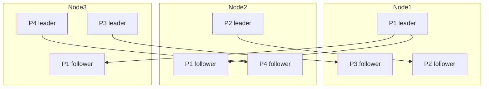

# Partitioning key-value data and hot spots

> **Before this lesson:** you should know what replication, leaders and followers are, from [Single-leader replication and replication lag](#/lesson/databases/leader-follower); what scaling out and a shared-nothing cluster are, from [Scalability](#/lesson/databases/scalability-percentiles); and what a hash function, a range query and an SSTable are, from [Log-structured storage](#/lesson/databases/log-structured).

## In plain words

Replication, the subject of the last three lessons, keeps the *same* data on several machines. It does nothing for a dataset that is too big to fit on one machine, or one that receives more requests than one machine can handle. For that the data has to be *divided*: some records on one machine, other records on another. Each piece is a **partition**, and dividing data this way is called **partitioning**, or **sharding**.

An everyday picture: a paper encyclopedia is too big for one book, so it comes in volumes. If the volumes are divided by letter (A-B, C-D and so on), you know which volume to pull out for any word, and neighbouring words sit together. But the volume holding S is twice as thick as the one holding X, Y and Z, and it wears out faster because more people consult it. You could deal the articles out to the volumes at random to make them equal, and then you would have no idea which volume holds "Sharding".

That is the trade-off of this lesson in one picture. Dividing by ranges of keys keeps neighbours together but can leave one partition overloaded. Dividing by a scrambled version of the key spreads the load evenly but scatters the neighbours.

Why this matters for a job: every large database is partitioned, and choosing the **partition key**, the piece of each record that decides where it goes, is a decision that is hard to reverse later. A bad choice produces an overloaded partition, known as a **hot spot**. "One shard is overloaded because of a viral post. What do you do?" is a standard interview question.

## 1. What a partition is

Each record belongs to exactly one partition. Each partition behaves like a small database of its own, though the database as a whole may support operations that involve several partitions at once.

Different products use different words for the same thing:

| System | Name for a partition |
|---|---|
| MongoDB, Elasticsearch, SolrCloud | shard |
| HBase | region |
| Bigtable | tablet |
| Cassandra, Riak | vnode |
| Couchbase | vBucket |

The purpose of partitioning is **scalability**. The partitions are placed on different nodes of a shared-nothing cluster, so a large dataset is spread over many disks and the work of answering queries is spread over many processors. A query that concerns one partition is handled entirely by the node holding it. Adding nodes therefore adds capacity. A large query that concerns many partitions can be worked on by many nodes at the same time, which is called running it **in parallel**.

## 2. Partitioning and replication

Partitioning and replication are used together. Each partition is copied to several nodes, so losing a node does not lose data. One node usually stores several partitions.

With leader-follower replication, each partition has its own leader and followers. A given node will typically be the leader for some partitions and a follower for others.



The diagram has three nodes and four partitions, P1 to P4. Look at Node 1: it holds the leader copy of P1 and follower copies of P2 and P3. The arrows run from each partition's leader to its followers on other nodes. If Node 1 died, P1 would need a new leader chosen from the copies on Nodes 2 and 3, while P2 and P3 would lose only a follower.

Everything in the replication lessons applies to each partition separately. How to partition and how to replicate are mostly independent decisions, so the rest of this lesson ignores replication.

## 3. Partitioning of key-value data

Suppose you have a large number of records, each found by its key. Which partition should each record go to?

The aim is to spread both the data and the query load **evenly**. If the spread is fair, ten nodes can hold ten times the data and serve ten times the requests of one node. If it is unfair, some partitions hold more data or receive more requests than others. An uneven spread is called **skew**. A partition carrying far more than its share of the load is a **hot spot**. In the worst case all the load lands on one partition, and the other nine nodes sit idle while one is overwhelmed.

One sure way to get an even spread is to send each record to a randomly chosen node. But then nobody knows where anything is, and reading one record means asking every node. A good scheme must spread the load evenly *and* let you work out where a key lives.

### 3.1 Partitioning by key range

The first scheme gives each partition a continuous **range of keys**, from a lowest key to a highest, as with the encyclopedia volumes. If you know where the boundaries are, you know immediately which partition holds any key.

- **The ranges need not be the same width.** Real data is not spread evenly across the alphabet. One partition might cover keys starting with A and B, and another everything from T to Z. The boundaries have to follow the data, and they are set either by an administrator or automatically by the database.
- **Keys are kept sorted inside each partition**, using the SSTables and similar structures of the storage lessons. That makes range queries cheap. It also lets you design keys so that related records sit next to each other. A network of sensors could use the time of each reading, written as year-month-day-hour-minute-second, as the key. All readings from one month are then a single continuous stretch that can be read in one pass.
- This scheme is used by Google's Bigtable, by HBase, and by early versions of MongoDB.

**The weakness: certain patterns of use create hot spots.** Stay with the sensor example. If the key is the timestamp, every reading taken *today* has a key in today's range, so every write goes to the one partition that covers today. That partition is overloaded while all the others, holding past days, receive nothing.

The remedy is to put something else at the front of the key. Use the sensor's name followed by the timestamp. Writes are now spread across the partitions according to sensor name, and many sensors are active at once. The cost is that "all sensors' readings for one hour" is no longer one continuous stretch. It needs a separate range query for each sensor.

### 3.2 Partitioning by hash of key

Because of the hot-spot risk, many databases use a **hash function** to decide where a key goes. Recall that a hash function turns any input into a number that looks random but is always the same for the same input. A good one sends even very similar keys to wildly different numbers. For example, a hash function that produces 32-bit numbers turns any text into a number between 0 and about 4.3 billion ($2^{32} - 1$), and keys that differ by one character land far apart.

Each partition is then given a range of *hash values* instead of a range of keys. A key belongs to the partition whose range contains the key's hash. Since hashes are spread evenly, so is the data.

> [!WARNING]
> The hash function does not need to be secure against attackers. It **does** need to give the same answer for the same key in every program on every machine, every time. Many programming languages' built-in hash functions do not. Python's `hash()` on text is deliberately randomised each time Python starts, and Java's `Object.hashCode()` can differ between processes. Use a fixed, well-defined function such as MD5 or MurmurHash.

The next program compares the two schemes on the sensor example: one hour of timestamps as keys, with writes arriving during the first fifteen minutes.

```python-run
import hashlib, bisect
from collections import Counter

def h32(key):
    return int.from_bytes(hashlib.md5(key.encode()).digest()[:4], "big")

keys = [f"2024-05-17T10:{m:02d}:{s:02d}" for m in range(60) for s in range(60)]  # one hour of timestamps

# key-range partitioning by first char of minute -> all of today's writes cluster
range_bounds = ["2024-05-17T10:15", "2024-05-17T10:30", "2024-05-17T10:45"]
range_part = Counter(bisect.bisect_right(range_bounds, k) for k in keys[:900])   # first 15 min
print("key-range, writes in the first 15 minutes:", dict(range_part), "<- one hot partition")

# hash partitioning: 4 equal hash ranges
hash_part = Counter(h32(k) * 4 >> 32 for k in keys[:900])
print("hash-range, same writes:              ", dict(sorted(hash_part.items())))
```

What each part does:

- `h32(key)` computes the MD5 hash of the key and keeps its first four bytes as a 32-bit number.
- `keys` is every second of one hour written as a timestamp: 3,600 keys in time order.
- `range_bounds` holds three boundaries that divide the hour into four key ranges of fifteen minutes each. `bisect.bisect_right(range_bounds, k)` finds which range a key falls into by binary search, giving a partition number from 0 to 3.
- `keys[:900]` is the first 900 keys, the first fifteen minutes. `Counter` counts how many of them fall into each partition.
- For the hash scheme, `h32(k) * 4 >> 32` converts the 32-bit hash into a partition number from 0 to 3. Multiplying by 4 and shifting right by 32 bits divides the full hash range into four equal parts.

```
key-range, writes in the first 15 minutes: {0: 900} <- one hot partition
hash-range, same writes:               {0: 212, 1: 241, 2: 224, 3: 223}
```

With key ranges, all 900 writes hit partition 0 and the other three receive nothing. With hashing, the same 900 writes are shared almost equally among four partitions.

> [!NOTE]
> You will meet the term **consistent hashing**. It refers to a way of choosing partition boundaries at random positions so that nodes can be added and removed without central coordination. It was invented for spreading web requests across cache servers. The word "consistent" there has no connection with consistency between replicas or with the transaction property of the same name, which confuses many people. DDIA prefers the plainer term *hash partitioning*. One of this module's practice problems has you build a consistent-hashing ring.

**What hashing costs: range queries.** Keys that were neighbours now sit in different partitions, and their order is gone. A request for "all keys from A to B" has to be sent to every partition. Some databases that partition by hash do not offer range queries on the key at all.

**A compromise: compound keys.** Cassandra combines the two schemes. A table's primary key can consist of several columns. Only the *first* part is hashed to choose the partition. The remaining columns are used to keep the rows *sorted* inside that partition. You cannot run a range query over the first column. But once you fix the first column to one value, you can run an efficient range query over the others.

For example, a social site stores each post under the key (user ID, time of post). All of one user's posts live in one partition, sorted by time. Fetching "this user's posts from the last week" touches one partition and reads one continuous stretch.

```sql
-- Cassandra CQL
CREATE TABLE updates (
  user_id   uuid,
  ts        timestamp,
  body      text,
  PRIMARY KEY ((user_id), ts)          -- partition key = user_id, clustering key = ts
) WITH CLUSTERING ORDER BY (ts DESC);

SELECT * FROM updates WHERE user_id = ? AND ts > '2024-01-01';   -- single partition range scan
```

The code is in CQL, Cassandra's SQL-like language. In the `PRIMARY KEY` line, the inner parentheses mark `user_id` as the **partition key**, the part that is hashed. `ts` is the **clustering key**, the part that sets the sort order inside a partition. The `SELECT` fixes the user ID and asks for a range of times, which is exactly the efficient case.

## 4. Skewed workloads and relieving hot spots

Hashing spreads *different* keys evenly. It can do nothing when a great many requests are for the *same* key, because the same key always has the same hash and always goes to the same partition.

This happens in practice. On a social network, a celebrity with millions of followers posts something, and within minutes there are hundreds of thousands of comments and reactions. Every one of those writes is filed under the same key, the ID of that post. One partition takes the whole storm.

Most databases cannot fix this automatically, so it falls to the application. A common technique is called **salting**: for a key known to be hot, add a random number to the beginning or end of it. With a two-digit number on the end, writes to the one hot key become writes to 100 different keys, and the hash sends those to different partitions.

Salting has a price. A read of the hot key must now fetch all 100 salted keys and combine the results. And the application has to keep track of which keys have been salted. So it is worth doing only for the few keys that are truly hot. Applied to every key, it would make every read more expensive for no gain.

```python-run
import random
from collections import Counter
random.seed(0)

PARTS = 8
def part(key): return int.from_bytes(__import__("hashlib").md5(key.encode()).digest()[:4], "big") % PARTS

hot = "post:celebrity:42"
writes = [hot] * 10_000 + [f"post:{random.randint(0, 10**6)}" for _ in range(2_000)]
print("no salting :", sorted(Counter(part(k) for k in writes).values(), reverse=True))

SALT = 16
def salted(k): return f"{k}#{random.randrange(SALT)}" if k == hot else k
print("salted x16 :", sorted(Counter(part(salted(k)) for k in writes).values(), reverse=True))

# reading the hot key now means a fan-out over all salts:
read_keys = [f"{hot}#{i}" for i in range(SALT)]
print("read fan-out touches partitions:", sorted({part(k) for k in read_keys}))
```

What each part does:

- `part(key)` hashes a key and uses `% PARTS` (the remainder after dividing by 8) to pick one of 8 partitions.
- `writes` is 10,000 writes to one hot key mixed with 2,000 writes to random other keys.
- The first `print` counts writes per partition and lists the counts from largest to smallest.
- `salted(k)` appends `#` and a random number from 0 to 15 to the hot key, and leaves every other key unchanged.
- The second `print` repeats the count with salting.
- `read_keys` lists the 16 salted versions of the hot key, and the last line shows which partitions a read would need to ask.

```
no salting : [10261, 272, 261, 250, 250, 243, 239, 224]
salted x16 : [2138, 2123, 2117, 1542, 1488, 877, 872, 843]
read fan-out touches partitions: [0, 1, 2, 3, 4, 5, 6, 7]
```

Without salting, one partition handles 10,261 writes while the others handle around 250 each: about forty times its share. With salting, the busiest partition handles 2,138. The spread is not perfectly even, because 16 salted keys shared among 8 partitions will not land exactly two per partition, but the hot spot is gone. The last line shows the price: reading the hot key now means asking all eight partitions.

> [!INTERVIEW]
> For questions about a hot partition ("a viral post overloads one shard"), offer a list. (1) Choose a partition key with many distinct values, so load has somewhere to spread. (2) **Salt the hot key** by adding a suffix from 0 to N, and on reads fetch all N+1 versions and combine them, or keep a running total elsewhere. (3) Put a **cache** in front of reads of the hot item. (4) For data keyed by time, never put the timestamp first; put the device or user first and the time second. You can add that some managed cloud databases now detect a hot partition and split it automatically.

## 5. Choosing between range and hash

| | Key range | Hash of key |
|---|---|---|
| Range scans on key | Efficient | Scatter to all partitions |
| Load distribution | Risk of hot spots for sequential keys | Even (except for single hot keys) |
| Rebalancing | Usually dynamic splitting | Usually fixed number of partitions |
| Examples | HBase, Bigtable, Spanner, CockroachDB | Cassandra, DynamoDB, Riak, Couchbase |
| Hybrid | Compound keys: hash the first part, sort by the rest (Cassandra) | |

In short: choose key ranges when the application depends on reading neighbouring keys together and the keys do not all arrive at one end. Choose hashing when even load matters most and lookups are by exact key. Choose a compound key when you need both: an exact match on one part and a range on another.

## 6. Pitfalls

- **Keys that always increase** (timestamps, automatically numbered IDs) under key-range partitioning. Every new write goes to the last partition.
- **A programming language's default `hash()`** used for partitioning. Different processes compute different partitions for the same key, and data appears to vanish.
- **A partition key with few distinct values**, such as country or order status. With five possible values there can be at most five groups, however many nodes you have, and the largest group becomes a hot spot.
- **Salting every key.** All reads become fan-out reads. Salt only the keys that have been shown to be hot.
- **Expecting hashing to fix a single hot key.** Identical keys always hash to the same place.

## 7. Summary

- **Partitioning** (sharding) divides data among nodes so that both storage and load can grow beyond one machine. Each record lives in one partition, and each partition is usually replicated.
- **Key-range** partitioning keeps keys sorted, which makes range queries cheap, and risks hot spots when keys arrive in order.
- **Hash** partitioning spreads load evenly and gives up efficient range queries. **Compound keys**, as in Cassandra, hash the first part and sort by the rest.
- No hash function can spread out a single very popular key. **Salt** such keys and combine the pieces when reading.

## Glossary

- **Partition (shard)** - one piece of a divided dataset; each record belongs to exactly one.
- **Partitioning (sharding)** - dividing a dataset into partitions placed on different nodes.
- **Partition key** - the part of a record that decides which partition it goes to.
- **In parallel** - worked on by several processors or machines at the same time.
- **Skew** - an uneven spread of data or load across partitions.
- **Hot spot** - a partition with far more than its share of the load.
- **Key-range partitioning** - giving each partition a continuous range of keys.
- **Hash partitioning** - giving each partition a range of hash values and placing each key by its hash.
- **Hash function** - a function turning any input into a random-looking number that is always the same for the same input.
- **Consistent hashing** - a way of placing partition boundaries at random points so nodes can join and leave with little data movement.
- **Compound primary key** - a key made of several columns.
- **Clustering key** - in Cassandra, the part of the key that sets the sort order within a partition.
- **Salting** - adding a random number to a hot key so its writes spread over several partitions.
- **Fan-out read (scatter/gather)** - a read that asks many partitions and combines their answers.

```quiz
[
  {"q": "What is a hot spot?",
   "options": ["A partition with no replicas", "A partition with disproportionately high load", "A failed node", "A partition boundary"],
   "answer": 1,
   "explain": "Skew concentrates load; a hot spot can bottleneck the whole system."},
  {"q": "A sensor database uses timestamps as keys with key-range partitioning. What goes wrong?",
   "options": ["Range queries become impossible", "All current writes go to the one partition holding 'now', creating a write hot spot", "Data cannot be sorted", "Hashing breaks"],
   "answer": 1,
   "explain": "Prefix the key with sensor name to spread writes."},
  {"q": "What is the main thing lost with hash partitioning of keys?",
   "options": ["Even distribution", "Efficient range queries on the key", "Replication", "Durability"],
   "answer": 1,
   "explain": "Adjacent keys are scattered across partitions."},
  {"q": "In Cassandra with PRIMARY KEY ((user_id), ts), which query is efficient?",
   "options": ["All updates in a time range across all users", "All updates for one user in a time range", "All users whose id starts with 'a'", "Sorting all users"],
   "answer": 1,
   "explain": "user_id is hashed for partitioning; ts sorts rows within the partition."},
  {"q": "Why is Python's built-in hash() a bad choice for partitioning strings?",
   "options": ["It is too slow", "It is randomized per process, so different processes compute different partitions", "It returns negative numbers", "It is cryptographic"],
   "answer": 1,
   "explain": "Partitioning needs a deterministic hash such as MD5 or Murmur3."},
  {"q": "How can an application relieve a single extremely hot key?",
   "options": ["Use range partitioning", "Append a random suffix to split writes across many keys, then read all of them and combine", "Increase replication factor only", "Use LWW"],
   "answer": 1,
   "explain": "Salting spreads writes; reads pay a scatter/gather cost, so only do this for hot keys."},
  {"q": "In DDIA, why is the term 'consistent hashing' considered confusing?",
   "options": ["It is not a hashing technique", "'Consistent' there has nothing to do with replica or ACID consistency", "It always causes hot spots", "It requires consensus"],
   "answer": 1,
   "explain": "It refers to a load-distribution technique with randomly chosen boundaries."}
]
```

> **Source:** DDIA ch. 6, "Partitioning" (Partitioning and Replication; Partitioning of Key-Value Data; Skewed Workloads and Relieving Hot Spots).
