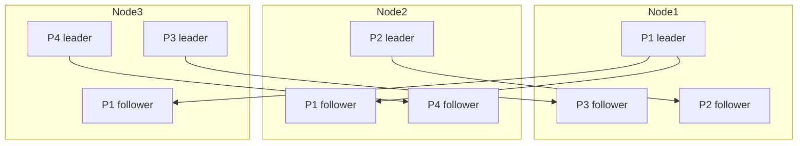

# Partitioning key-value data and hot spots

For very large datasets or very high query throughput, replication is not enough. We must break the data into **partitions**, also known as **sharding**. The terminology varies by system:

| System | Name for a partition |
|---|---|
| MongoDB, Elasticsearch, SolrCloud | shard |
| HBase | region |
| Bigtable | tablet |
| Cassandra, Riak | vnode |
| Couchbase | vBucket |

Normally each record belongs to **exactly one partition**, and each partition is a small database of its own. The main reason to partition is **scalability**. Different partitions can live on different nodes in a shared-nothing cluster, so a large dataset is spread across many disks and the query load across many processors. Queries that touch a single partition execute independently on their node, and adding nodes scales throughput. Large, complex queries can be **parallelised** across nodes.

## 1. Partitioning and replication

Partitioning is usually **combined with replication**: copies of each partition are stored on several nodes for fault tolerance. A node may store more than one partition. With leader–follower replication, each partition's leader lives on one node and its followers on others, and **each node may be the leader for some partitions and a follower for others**.



Everything from the replication chapter applies equally to replicating partitions. The choice of partitioning scheme is mostly independent of the choice of replication scheme.

## 2. Partitioning of key-value data

The goal is to **spread data and query load evenly**. With fair sharing, 10 nodes should handle 10× the data and 10× the throughput of one. If the partitioning is unfair, some partitions get more data or queries than others. That is called **skew**, and it makes partitioning less effective. A partition with disproportionately high load is a **hot spot**.

The simplest way to avoid hot spots is to assign records to nodes **randomly**. The data would be well distributed, but reading an item would require querying **all** nodes in parallel, because you would not know where it is. We can do better.

### 2.1 Partitioning by key range

Assign each partition a **continuous range of keys**, from some minimum to some maximum, like the volumes of a paper encyclopedia (A–B, C–D, … T–Z). If you know the boundaries you can go straight to the right partition, or the right node if you know which partition sits where.

- Ranges are **not necessarily evenly spaced**, because data may not be evenly distributed. Volume 1 might cover A–B while volume 12 covers T–Z. Boundaries must **adapt to the data**, chosen by an administrator or automatically.
- Used by **Bigtable**, its open-source equivalent **HBase**, RethinkDB, and MongoDB before 2.4.
- Within each partition, keys are kept **sorted** (in SSTables or LSM-trees), so **range scans are easy**. You can treat the key as a concatenated index and fetch several related records in one query. A sensor network might use the timestamp `year-month-day-hour-minute-second` as the key, making "all readings from a month" a simple scan.

**Downside: hot spots from access patterns.** With timestamp keys, all writes for *today* go to the *same* partition, which is overloaded while the others sit idle. The fix is to put something other than the timestamp first, such as the **sensor name**: `sensor_name + timestamp`. Writes then spread across sensors. To fetch all sensors over a time range, you run a separate range query per sensor.

### 2.2 Partitioning by hash of key

Because of skew and hot spots, many distributed datastores apply a **hash function** to the key to choose its partition. A good hash function takes skewed data and makes it **uniformly distributed**. A 32-bit hash maps any string to a seemingly random number between $0$ and $2^{32}-1$, and similar strings get evenly distributed hashes.

> [!WARNING]
> The hash does not need to be cryptographically strong. Cassandra uses MD5 and MongoDB uses MD5, while Voldemort uses Fowler–Noll–Vo. It **must** be deterministic across processes, though. Java's `Object.hashCode()` and Ruby's `Object#hash` can return different values for the same key in different processes. Python's `hash()` of strings is randomised per process (`PYTHONHASHSEED`). They are unsuitable for partitioning.

Each partition is assigned a **range of hashes** rather than a range of keys, and every key whose hash falls in a partition's range is stored there. Boundaries can be evenly spaced or chosen pseudorandomly (the latter is sometimes called **consistent hashing**).

```python-run
import hashlib, bisect
from collections import Counter

def h32(key):
    return int.from_bytes(hashlib.md5(key.encode()).digest()[:4], "big")

keys = [f"2024-05-17T10:{m:02d}:{s:02d}" for m in range(60) for s in range(60)]  # one hour of timestamps

# key-range partitioning by first char of minute -> all of today's writes cluster
range_bounds = ["2024-05-17T10:15", "2024-05-17T10:30", "2024-05-17T10:45"]
range_part = Counter(bisect.bisect_right(range_bounds, k) for k in keys[:900])   # first 15 min
print("key-range, writes in the first 15 minutes:", dict(range_part), "<- one hot partition")

# hash partitioning: 4 equal hash ranges
hash_part = Counter(h32(k) * 4 >> 32 for k in keys[:900])
print("hash-range, same writes:              ", dict(sorted(hash_part.items())))
```

> [!NOTE]
> **"Consistent hashing"** (Karger et al., 1997) originally meant a way of evenly distributing load across an internet-wide system of caches such as a CDN. It uses randomly chosen partition boundaries to avoid central control or distributed consensus. This *consistent* has nothing to do with replica consistency or ACID consistency. DDIA notes the term is confusing and prefers **hash partitioning**. We implement a consistent-hashing ring in this module's problems.

**What you lose: range queries.** Adjacent keys are now scattered across all partitions, so sort order is lost. In MongoDB with hash-based sharding, any range query has to be sent to all partitions. Riak, Couchbase and Voldemort do not support range queries on the primary key at all.

**Compound primary keys: the best of both.** **Cassandra** compromises. A table can have a compound primary key of several columns. Only the **first part** is hashed to determine the partition, while the other columns form a concatenated index for **sorting** the data within Cassandra's SSTables. A query cannot search for a range of values in the first column, but if it fixes the first column it can do an efficient range scan over the others.

Example: a social site stores updates with primary key `(user_id, update_timestamp)`. You can efficiently fetch all updates by one user within a time interval, sorted by timestamp. Different users are on different partitions, but within one user the updates are ordered.

```sql
-- Cassandra CQL
CREATE TABLE updates (
  user_id   uuid,
  ts        timestamp,
  body      text,
  PRIMARY KEY ((user_id), ts)          -- partition key = user_id, clustering key = ts
) WITH CLUSTERING ORDER BY (ts DESC);

SELECT * FROM updates WHERE user_id = ? AND ts > '2024-01-01';   -- single partition range scan
```

## 3. Skewed workloads and relieving hot spots

Hashing helps but **cannot eliminate hot spots entirely**. In the extreme case where all reads and writes are for the **same key**, every request goes to the same partition. On social media, a celebrity with millions of followers can cause a storm of activity when they post. Every comment on that post uses the same key (the post id), and hashing does not help because identical keys hash identically.

Today most data systems cannot compensate automatically for such heavy skew, so it is up to the application. A simple technique: if one key is very hot, **add a random number to the beginning or end of the key**. A two-digit decimal suffix splits writes to one key evenly across 100 different keys, which can go to different partitions.

The trade-off: **reads now have extra work**. They must read all 100 keys and combine them. You also need bookkeeping to know which keys are split. It only makes sense for the small number of hot keys, since applying it to all keys would be overhead. Future systems may detect and handle skew automatically.

```python-run
import random
from collections import Counter
random.seed(0)

PARTS = 8
def part(key): return int.from_bytes(__import__("hashlib").md5(key.encode()).digest()[:4], "big") % PARTS

hot = "post:celebrity:42"
writes = [hot] * 10_000 + [f"post:{random.randint(0, 10**6)}" for _ in range(2_000)]
print("no salting :", sorted(Counter(part(k) for k in writes).values(), reverse=True))

SALT = 16
def salted(k): return f"{k}#{random.randrange(SALT)}" if k == hot else k
print("salted x16 :", sorted(Counter(part(salted(k)) for k in writes).values(), reverse=True))

# reading the hot key now means a fan-out over all salts:
read_keys = [f"{hot}#{i}" for i in range(SALT)]
print("read fan-out touches partitions:", sorted({part(k) for k in read_keys}))
```

> [!INTERVIEW]
> For hot-partition questions ("a viral post overloads one shard", "a DynamoDB hot partition key"), say: (1) choose a high-cardinality partition key; (2) **salt or shard the hot key** (`key#0..N`) and scatter/gather on read, or pre-aggregate; (3) put a **cache** in front of hot reads; (4) for time-series, avoid a timestamp-leading key and use `(entity, time)` or time buckets plus hash. Mention adaptive capacity and split-for-heat in managed systems.

## 4. Choosing between range and hash

| | Key range | Hash of key |
|---|---|---|
| Range scans on key | Efficient | Scatter to all partitions |
| Load distribution | Risk of hot spots for sequential keys | Even (except for single hot keys) |
| Rebalancing | Usually dynamic splitting | Usually fixed number of partitions |
| Examples | HBase, Bigtable, Spanner, CockroachDB | Cassandra, DynamoDB, Riak, Couchbase |
| Hybrid | Compound keys: hash the first part, sort by the rest (Cassandra) | |

## 5. Pitfalls

- **Monotonically increasing keys** (timestamps, auto-increment) under range partitioning create a write hot spot at the tail.
- **Language-default `hash()`** across processes gives inconsistent placement.
- **Low-cardinality partition keys** (`country`, `status`) cause skew and limit parallelism.
- **Salting every key** doubles read costs everywhere. Salt only proven hot keys.

## 6. Summary

- Partitioning (sharding) spreads data and load over many nodes, and each record lives in one partition, usually replicated.
- **Key-range** partitioning keeps keys sorted, so range scans are cheap, but it risks hot spots.
- **Hash** partitioning distributes load evenly but loses range queries. **Compound keys** (Cassandra) combine both.
- Hashing cannot fix a single hot key. **Salt** hot keys and scatter/gather on read.

```quiz
[
  {"q": "What is a hot spot?",
   "options": ["A partition with no replicas", "A partition with disproportionately high load", "A failed node", "A partition boundary"],
   "answer": 1,
   "explain": "Skew concentrates load; a hot spot can bottleneck the whole system."},
  {"q": "A sensor database uses timestamps as keys with key-range partitioning. What goes wrong?",
   "options": ["Range queries become impossible", "All current writes go to the one partition holding 'now', creating a write hot spot", "Data cannot be sorted", "Hashing breaks"],
   "answer": 1,
   "explain": "Prefix the key with sensor name to spread writes."},
  {"q": "What is the main thing lost with hash partitioning of keys?",
   "options": ["Even distribution", "Efficient range queries on the key", "Replication", "Durability"],
   "answer": 1,
   "explain": "Adjacent keys are scattered across partitions."},
  {"q": "In Cassandra with PRIMARY KEY ((user_id), ts), which query is efficient?",
   "options": ["All updates in a time range across all users", "All updates for one user in a time range", "All users whose id starts with 'a'", "Sorting all users"],
   "answer": 1,
   "explain": "user_id is hashed for partitioning; ts sorts rows within the partition."},
  {"q": "Why is Python's built-in hash() a bad choice for partitioning strings?",
   "options": ["It is too slow", "It is randomized per process, so different processes compute different partitions", "It returns negative numbers", "It is cryptographic"],
   "answer": 1,
   "explain": "Partitioning needs a deterministic hash such as MD5 or Murmur3."},
  {"q": "How can an application relieve a single extremely hot key?",
   "options": ["Use range partitioning", "Append a random suffix to split writes across many keys, then read all of them and combine", "Increase replication factor only", "Use LWW"],
   "answer": 1,
   "explain": "Salting spreads writes; reads pay a scatter/gather cost, so only do this for hot keys."},
  {"q": "In DDIA, why is the term 'consistent hashing' considered confusing?",
   "options": ["It is not a hashing technique", "'Consistent' there has nothing to do with replica or ACID consistency", "It always causes hot spots", "It requires consensus"],
   "answer": 1,
   "explain": "It refers to a load-distribution technique with randomly chosen boundaries."}
]
```

> **Source:** DDIA ch. 6, "Partitioning" (Partitioning and Replication; Partitioning of Key-Value Data; Skewed Workloads and Relieving Hot Spots).
