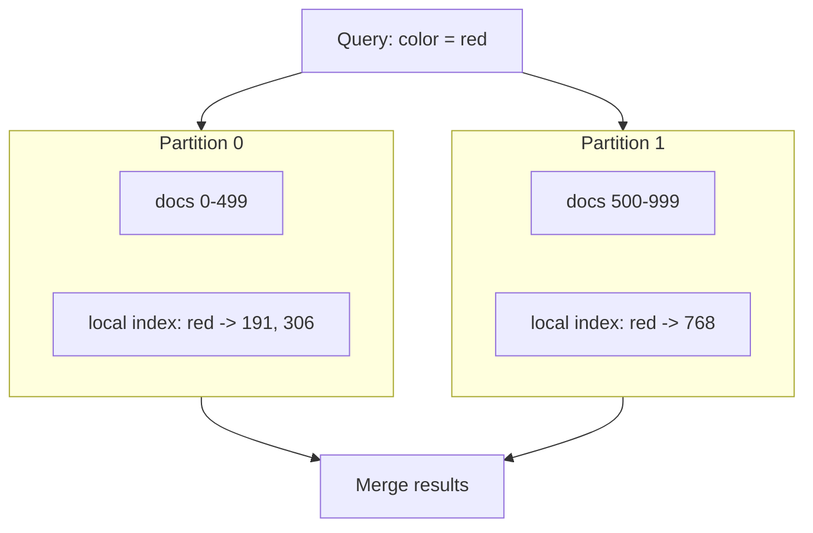
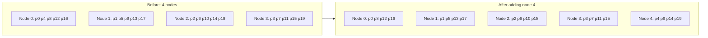
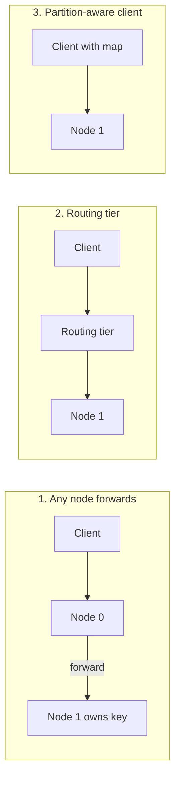
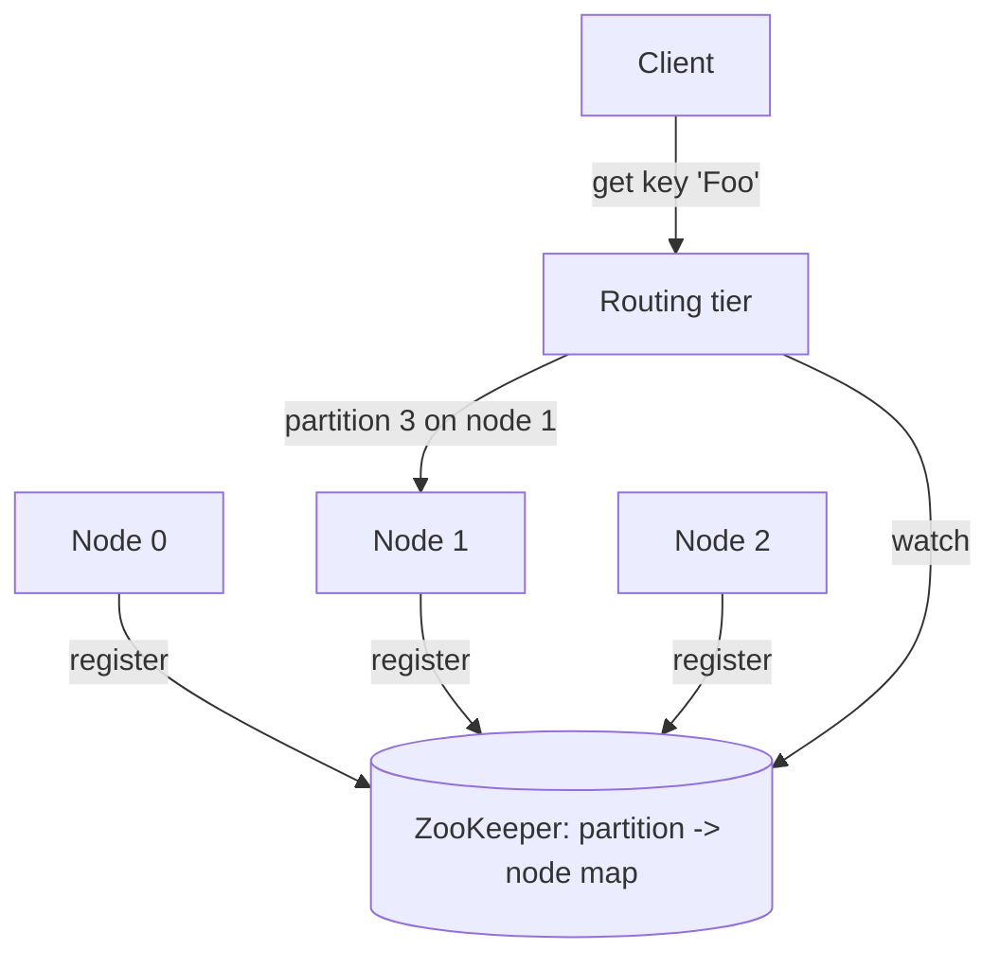

# Secondary indexes, rebalancing and request routing

The previous lesson partitioned records by **primary key**. Real applications also need **secondary indexes**, need to **move partitions** as the cluster grows, and need clients to **find** the right node. This lesson covers all three.

## 1. Partitioning and secondary indexes

A secondary index does not identify a record uniquely. It is a way of **searching for occurrences of a value**: all actions by user 123, all articles containing the word *hogwash*, all cars whose colour is *red*. Secondary indexes are the bread and butter of relational databases and common in document databases. Many key-value stores (HBase, Voldemort) avoided them because of the added complexity, while Riak has started adding them. They are the *raison d'être* of search servers such as Solr and Elasticsearch.

The problem is that secondary indexes **do not map neatly to partitions**. There are two main approaches.

### 1.1 Document-partitioned (local) indexes

Example: a used-car website. Each listing has a unique **document id** and is partitioned by that id (0–499 in partition 0, 500–999 in partition 1). You want to filter by `color` and `make`.

Each partition maintains its **own** secondary index covering **only the documents in that partition**. When a red car is added to partition 0, partition 0 adds its id to its own `color:red` list. A write touches only the partition that holds the document.



Reading is the hard part. There is no reason all red cars would be in one partition, so a query must go to **all partitions** and combine the results. This is **scatter/gather**, and it makes secondary-index reads expensive. Even in parallel, it is prone to **tail latency amplification** (Chapter 1). It is still widely used: MongoDB, Riak, Cassandra, Elasticsearch, SolrCloud and VoltDB all use document-partitioned secondary indexes. Vendors recommend structuring the partitioning scheme so that secondary-index queries can be served from a single partition, which is not always possible when several indexes are used in one query.

### 1.2 Term-partitioned (global) indexes

Alternatively, build a **global index** covering data in all partitions. It cannot live on one node, because that node would become a bottleneck, so the global index is **partitioned too, but differently from the primary key index**.

For example, red cars from all partitions appear under `color:red` in the index, and the index is partitioned so that colours starting with *a* to *r* live on partition 0 and *s* to *z* on partition 1. The **term** we are looking for determines the index partition, hence *term-partitioned*. You can partition by the term itself (good for range scans such as asking-price ranges) or by a hash of the term (more even load).

- **Reads are efficient.** Instead of scatter/gather over all partitions, a client queries only the partition holding the term.
- **Writes are slower and more complicated.** One document write may affect **several index partitions**, one for every term in the document.
- In an ideal world the index would always be up to date. In a term-partitioned index that would need a **distributed transaction** across all affected partitions, which most databases do not support (Chapter 9). In practice, global secondary index updates are often **asynchronous**: a read shortly after a write may not see the change in the index. Amazon **DynamoDB** global secondary indexes are normally updated within a fraction of a second but can lag more during infrastructure faults. Riak's search and Oracle's data warehouse also offer global indexes.

| | Local (document-partitioned) | Global (term-partitioned) |
|---|---|---|
| Write | One partition | Several index partitions (often async) |
| Read by secondary key | Scatter/gather to all partitions | Single partition |
| Freshness | Synchronous with the document | Often eventually consistent |
| Examples | MongoDB, Cassandra, Elasticsearch | DynamoDB GSIs, Riak Search |

> [!INTERVIEW]
> In DynamoDB, a **GSI** (global secondary index) is term-partitioned and eventually consistent, while an **LSI** (local secondary index) shares the base table's partition key and supports strongly consistent reads. That is a nice concrete example of this trade-off.

## 2. Rebalancing partitions

Things change over time:

- Query throughput grows, so you add CPUs.
- Dataset size grows, so you add disks and RAM.
- A machine fails, and others must take over its responsibilities.

Moving load from one node to another is **rebalancing**. Minimum requirements:

- Afterwards, load (storage, reads, writes) should be shared **fairly**.
- During rebalancing, the database keeps **accepting reads and writes**.
- **No more data than necessary** moves between nodes, to make rebalancing fast and limit network and disk I/O.

### 2.1 How not to do it: hash mod N

Why not assign key $k$ to node $hash(k) \bmod N$? Because when $N$ changes, **most keys move**. With `hash(key) = 123456`, 10 nodes put it on node 6, 11 nodes on node 3, and 12 nodes on node 0. Such frequent moves make rebalancing excessively expensive.

```python-run
import hashlib
def h(k): return int.from_bytes(hashlib.md5(k.encode()).digest()[:8], "big")
keys = [f"user:{i}" for i in range(20000)]
for n_from, n_to in [(10, 11), (10, 20), (100, 101)]:
    moved = sum(1 for k in keys if h(k) % n_from != h(k) % n_to)
    print(f"mod {n_from} -> mod {n_to}: {moved/len(keys):.1%} of keys move "
          f"(ideal: {abs(n_to-n_from)/max(n_to,n_from):.1%})")
```

### 2.2 Fixed number of partitions

Create **many more partitions than there are nodes**, and assign several partitions to each node. A database on a 10-node cluster might have **1,000 partitions** from the outset, about 100 per node.

When a node is **added**, it **steals a few partitions** from every existing node until partitions are fairly distributed again. When a node is removed, the reverse happens. Only **entire partitions** move between nodes. The number of partitions and the assignment of keys to partitions do not change. The only change is the assignment of partitions to nodes. That reassignment is not instant, since transferring data takes time, so the old assignment serves reads and writes in the meantime.



You can even account for **mismatched hardware** by giving more powerful nodes more partitions. Used by **Riak, Elasticsearch, Couchbase and Voldemort**. Kafka uses the same idea, since topics have a fixed partition count.

The catch is that the number of partitions is usually **fixed when the database is set up**. Choose it high enough to accommodate future growth. Each partition carries management overhead, so do not choose it too high. If partitions are very large, rebalancing and recovery become expensive. If they are too small, they incur too much overhead.

### 2.3 Dynamic partitioning

For **key-range** partitioning, fixed boundaries would be very inconvenient: wrong boundaries could put all data in one partition. Databases such as **HBase** and **RethinkDB** create partitions **dynamically**:

- When a partition grows beyond a configured size (HBase default: 10 GB), it is **split into two** halves, similar to a B-tree page split.
- If lots of data is deleted and a partition shrinks below a threshold, it is **merged** with an adjacent one.
- After a split, one half can be moved to another node to balance load.

The number of partitions **adapts to the total data volume**. One caveat: an empty database starts with **a single partition**, because there is no a priori information about where to draw boundaries. All writes hit one node while the others sit idle until the first split. HBase and MongoDB allow **pre-splitting**, which configures an initial set of partitions on an empty database, though you need to know the key distribution.

Dynamic partitioning also suits hash-partitioned data: MongoDB 2.4+ supports both key-range and hash partitioning with dynamic splitting either way.

### 2.4 Partitioning proportionally to nodes

With dynamic partitioning, the number of partitions is proportional to dataset size. With a fixed count, partition size is proportional to dataset size. A third option, used by **Cassandra** and **Ketama**, makes the number of partitions **proportional to the number of nodes**: a fixed number of partitions *per node*. Cassandra uses 256 by default (`num_tokens`).

When a new node joins, it **randomly chooses** a fixed number of existing partitions to split, and takes ownership of one half of each split. Randomisation can produce unfair splits, but averaged over many partitions (256 per node) the new node ends up with a fair share. This requires hash-based partitioning, so that boundaries can be picked from the range of hash outputs. It corresponds most closely to Karger's original definition of **consistent hashing**.

```python-run
import hashlib, bisect, random
from collections import Counter

def h(s): return int.from_bytes(hashlib.md5(s.encode()).digest()[:8], "big")

class Ring:
    def __init__(self, vnodes): self.vnodes, self.points, self.owner = vnodes, [], {}
    def add(self, node):
        for i in range(self.vnodes):
            p = h(f"{node}#{i}"); bisect.insort(self.points, p); self.owner[p] = node
    def lookup(self, key):
        i = bisect.bisect_right(self.points, h(key)) % len(self.points)
        return self.owner[self.points[i]]

keys = [f"k{i}" for i in range(20000)]
for v in (1, 16, 256):
    r = Ring(v)
    for n in "ABCD": r.add(n)
    before = {k: r.lookup(k) for k in keys}
    load = Counter(before.values())
    r.add("E")
    moved = sum(1 for k in keys if r.lookup(k) != before[k])
    spread = max(load.values()) / min(load.values())
    print(f"vnodes={v:<4} load max/min = {spread:4.2f}   adding E moved {moved/len(keys):.1%} of keys (ideal 20%)")
```

More virtual nodes give a smoother load distribution, and adding a node moves only about $1/N$ of the keys.

### 2.5 Automatic or manual rebalancing?

Fully automatic rebalancing is convenient but **unpredictable**. Rebalancing is expensive because it reroutes requests and moves large amounts of data. Combined with automatic failure detection it can be dangerous. If an overloaded node responds slowly, other nodes may conclude it is dead and rebalance load away from it, which puts *more* load on it, the other nodes and the network, and can cause a **cascading failure**. Many systems sit in between. Couchbase, Riak and Voldemort generate a *suggested* partition assignment automatically but need an administrator to commit it. A human in the loop is slower but prevents operational surprises.

## 3. Request routing

Partitions are now spread across nodes. When a client wants to connect, how does it know **which node** to talk to, especially as partitions are rebalanced? This is an instance of **service discovery**. Three approaches:

1. Clients contact **any node** (through a round-robin load balancer). If that node owns the partition it handles the request. Otherwise it **forwards** the request to the right node, receives the reply and passes it back. Cassandra and Riak use **gossip** so every node knows the partition map.
2. Send all requests to a **routing tier** first. It determines the node for each request and forwards it. The routing tier handles no requests itself and acts as a **partition-aware load balancer**.
3. Make **clients aware** of the partitioning and assignment, so they connect directly to the right node with no intermediary.



In every case, the key question is how the routing component **learns about changes** in the assignment of partitions to nodes. All participants must agree, or requests go to the wrong nodes. Agreement is a **consensus** problem (Chapter 9).

Many systems rely on a separate **coordination service such as ZooKeeper** to track this cluster metadata. Each node registers itself in ZooKeeper, which keeps the authoritative mapping of partitions to nodes. Routing tiers and partition-aware clients **subscribe** to this information, and ZooKeeper notifies them whenever a partition changes owner or a node is added or removed.



- **LinkedIn's Espresso** uses **Helix**, which relies on ZooKeeper, for cluster management.
- **HBase, SolrCloud and Kafka** use ZooKeeper for partition assignment. Kafka has since replaced it with its own Raft-based **KRaft** controller quorum.
- **MongoDB** has a similar architecture with its own **config server** and **mongos** routing daemons.
- **Cassandra and Riak** use a **gossip protocol** among nodes to spread cluster-state changes. Requests can go to any node, which forwards them. This adds complexity in the database nodes but avoids depending on an external coordination service.
- **Couchbase** does not rebalance automatically. It uses a routing tier called *moxi* that learns about routing changes from cluster nodes.

Clients still need the IP addresses of the routing tier or of some nodes. Those change rarely, so **DNS** is usually good enough.

### 3.1 Parallel query execution

So far we have looked at simple queries that read or write a single key, plus scatter/gather for document-partitioned indexes. That is about the level of access NoSQL stores support. **Massively parallel processing (MPP)** relational databases, often used for analytics, support far more complex queries with joins, filters, grouping and aggregation. The query optimiser breaks a complex query into execution stages and partitions that can run in parallel on different nodes. Queries that scan large parts of the dataset benefit especially. Fast parallel execution of warehouse queries is a specialised topic. Batch processing (Chapter 10) covers some related techniques.

## 4. Pitfalls

- **Using hash mod N** in your own sharding layer, so every resize reshuffles almost everything.
- **Too few fixed partitions** chosen at setup. You cannot scale beyond one node per partition.
- **Forgetting that global indexes are async.** A read-after-write through a GSI may miss the new item.
- **Fully automatic rebalancing plus aggressive failure detection** can cause a cascading failure.

## 5. Summary

- Secondary indexes are **local** (cheap writes, scatter/gather reads) or **global** (single-partition reads, multi-partition and often async writes).
- Rebalancing strategies: a **fixed number of partitions** (Riak, Elasticsearch, Kafka), **dynamic splitting and merging** (HBase, MongoDB), and **proportional to nodes** with random splits (Cassandra vnodes). Never use hash mod N.
- Request routing: any node forwards (gossip), a routing tier, or partition-aware clients. Cluster metadata is usually kept consistent by **ZooKeeper** or another consensus system.

```quiz
[
  {"q": "With document-partitioned (local) secondary indexes, a query by secondary key must...",
   "options": ["Hit exactly one partition", "Scatter to all partitions and gather the results", "Use a distributed transaction", "Be served by ZooKeeper"],
   "answer": 1,
   "explain": "Matching documents may live in any partition, so all local indexes must be consulted."},
  {"q": "What is the main drawback of term-partitioned (global) secondary indexes?",
   "options": ["Reads require scatter/gather", "A single document write may update several index partitions, and updates are often asynchronous", "They cannot be partitioned", "They do not support range queries"],
   "answer": 1,
   "explain": "Synchronous updates would need distributed transactions, so most systems update them asynchronously."},
  {"q": "Why is hash(key) mod N a poor rebalancing strategy?",
   "options": ["It is slow to compute", "When N changes, most keys move to a different node", "It creates hot spots", "It needs ZooKeeper"],
   "answer": 1,
   "explain": "Changing N from 10 to 11 moves about 90% of keys; ideally only about 1/11 should move."},
  {"q": "In the 'fixed number of partitions' strategy, what happens when a node is added?",
   "options": ["Keys are re-hashed", "The new node takes over whole partitions from existing nodes; key-to-partition mapping is unchanged", "All partitions split", "The cluster must restart"],
   "answer": 1,
   "explain": "Only partition-to-node assignment changes, which is cheap to reason about."},
  {"q": "Why does an empty HBase table initially create a write hot spot?",
   "options": ["HBase uses hashing", "With dynamic partitioning, an empty database starts with a single partition until it grows large enough to split", "ZooKeeper limits writes", "Tombstones"],
   "answer": 1,
   "explain": "Pre-splitting can help if you know the key distribution."},
  {"q": "Which system uses gossip rather than an external coordination service for routing metadata?",
   "options": ["HBase", "Cassandra", "SolrCloud", "Espresso"],
   "answer": 1,
   "explain": "Cassandra and Riak gossip cluster state; any node can forward requests."},
  {"q": "Why can fully automatic rebalancing be dangerous?",
   "options": ["It never finishes", "Combined with failure detection, it can shift load away from a slow node, increasing overall load and causing cascading failures", "It loses data", "It disables replication"],
   "answer": 1,
   "explain": "A human in the loop prevents operational surprises."}
]
```

> **Source:** DDIA ch. 6, "Partitioning and Secondary Indexes", "Rebalancing Partitions", "Request Routing".
