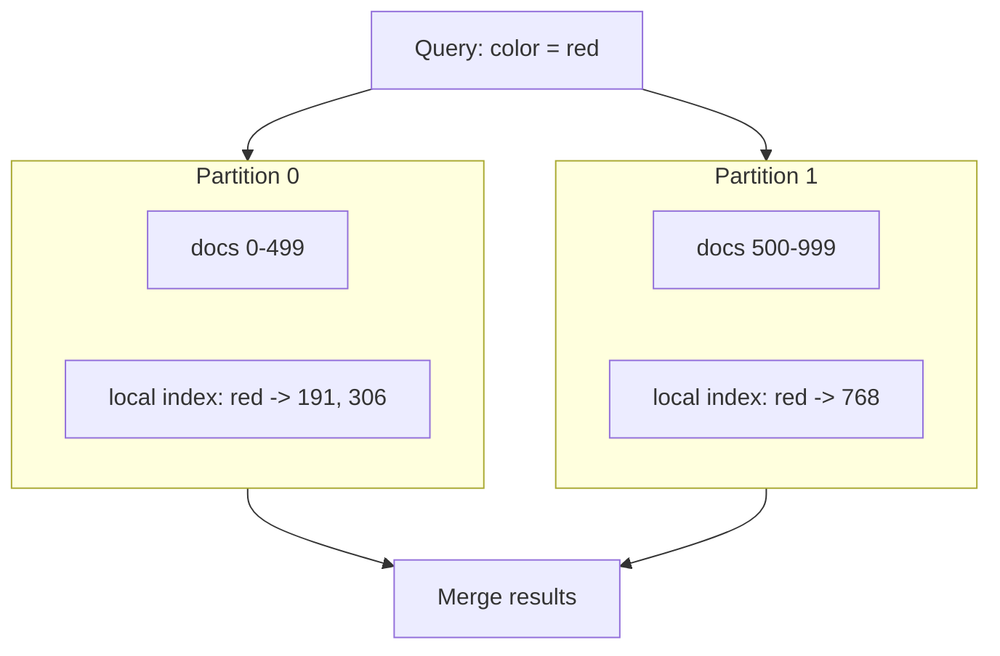
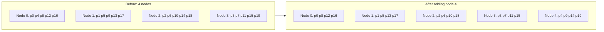
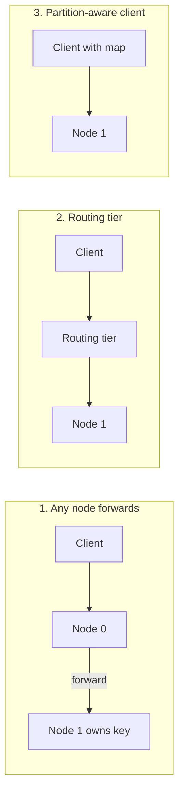
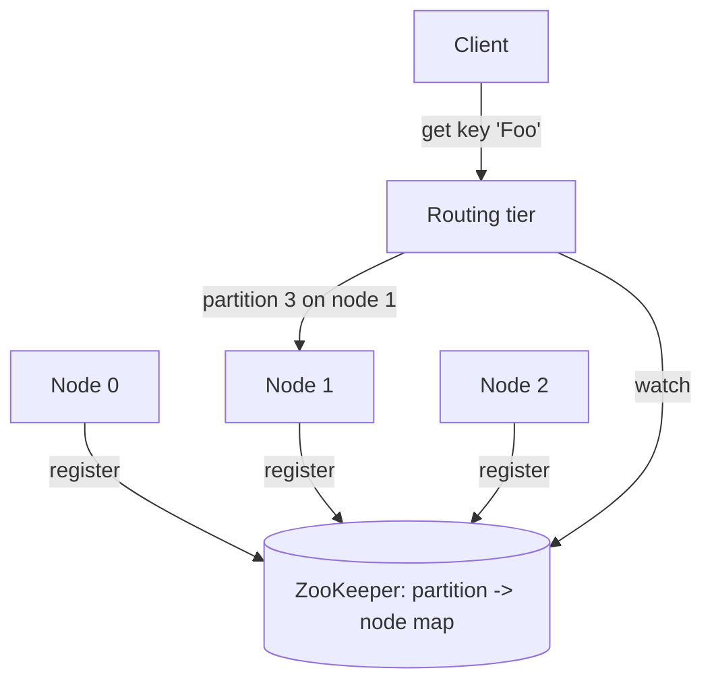

# Secondary indexes, rebalancing and request routing

> **Before this lesson:** read [Partitioning key-value data and hot spots](#/lesson/databases/partitioning-keys) for partitions, partition keys, key-range and hash partitioning. Secondary indexes were introduced in [B-trees](#/lesson/databases/btrees), tail latency amplification in [Scalability](#/lesson/databases/scalability-percentiles), and asynchronous updates in [Single-leader replication](#/lesson/databases/leader-follower).

## In plain words

The previous lesson decided which partition each record lives in, based on its key. Three practical questions follow, and this lesson answers them.

1. **How do you search by something other than the key?** The records were divided by ID, and now you want all the red cars.
2. **What happens when machines are added or removed?** Partitions have to be moved, ideally without moving more data than necessary. This is **rebalancing**.
3. **How does a client know which machine to ask?** This is **request routing**.

An everyday picture: a library that has outgrown its building and now occupies five. Books are assigned to buildings by catalogue number. (1) A reader wants every book about volcanoes, which could be in any building. Either each building keeps its own subject list and you must ask all five, or there is one combined subject catalogue that someone has to keep correct across five buildings. (2) A sixth building opens. You want to move about a sixth of the books into it, not reshelve the whole collection. (3) A visitor arrives with a catalogue number. Someone has to tell them which building to walk to, and that information must stay correct while books are being moved.

Why this matters for a job: "consistent hashing" is among the most frequently asked system-design topics, and it is the answer to question 2. The local-versus-global index trade-off appears by name in Amazon's DynamoDB and behaves in ways that surprise people who have not studied it. And knowing why `hash(key) % N` is a trap will save you from writing it yourself.

## 1. Partitioning and secondary indexes

A **secondary index** lets you find records by a value that is not their primary key: all orders placed by user 123, all articles containing a certain word, all cars whose colour is red. Unlike a primary key, the value does not identify one record. Many records can share it.

Relational databases depend on secondary indexes constantly. For search engines such as Elasticsearch they are the entire purpose. Some key-value stores left them out for a long time precisely because of the difficulty described here: a secondary index **does not line up with the partitions**. The records were divided by primary key, and the red cars are scattered across every partition. There are two ways to deal with that.

### 1.1 Document-partitioned (local) indexes

Take a website that sells used cars. Each listing is a document with a unique ID, and the listings are partitioned by that ID: IDs 0 to 499 in partition 0, IDs 500 to 999 in partition 1, and so on. Customers want to filter by colour and by make.

In the first approach, each partition keeps **its own** secondary index, covering **only the documents stored in that partition**. When a red car is added to partition 0, partition 0 adds that car's ID to its own list of red cars. No other partition is involved. Because each index is confined to one partition, it is called a **local index**, or a **document-partitioned index**.



Writing is cheap: one partition, one index update. Reading is the costly side. Red cars may be in any partition, so a search for red cars has to be sent to **every** partition, and the answers combined. This pattern is called **scatter/gather**. Even when the partitions are asked at the same time, the search is only finished when the slowest partition has replied, so it suffers from the tail latency amplification described in the scalability lesson: the more partitions, the more likely that one of them is having a slow moment.

Despite that cost, local indexes are the common choice. MongoDB, Cassandra, Elasticsearch and others use them. Their makers generally recommend choosing the partition key so that the most frequent searches can be answered by one partition, though that is not always achievable.

### 1.2 Term-partitioned (global) indexes

The second approach builds one index that covers the data in *all* partitions: a **global index**. It cannot be kept on a single node, since that node would become a bottleneck and a single point of failure. So the global index is itself partitioned. The important detail is that it is partitioned **differently from the data**.

In the car example, the index entry for "colour: red" lists every red car from every data partition. The index is divided by the value being searched for. For instance, colours beginning with a to r go in index partition 0 and colours beginning with s to z in index partition 1. The value being looked up is called a **term** (a word borrowed from text search), and since the term decides which index partition to consult, this is called a **term-partitioned index**. The index can be divided by the term itself, which helps range searches such as a price band, or by a hash of the term, which spreads load more evenly.

- **Reads are efficient.** A search for red cars goes to the one index partition that holds the term "red".
- **Writes are slower and more involved.** Adding one car updates an entry for its colour, another for its make, another for its price band. These entries may sit in different index partitions on different nodes.
- **The index may lag behind the data.** Ideally a newly written document would be findable through the index immediately. With a global index that would require all the affected partitions to change together or not at all, which is a **distributed transaction**, a costly mechanism that a later lesson covers and that many databases do not offer. In practice global indexes are usually updated **asynchronously**. A search made straight after a write may not find the new record yet.

| | Local (document-partitioned) | Global (term-partitioned) |
|---|---|---|
| Write | One partition | Several index partitions (often async) |
| Read by secondary key | Scatter/gather to all partitions | Single partition |
| Freshness | Synchronous with the document | Often eventually consistent |
| Examples | MongoDB, Cassandra, Elasticsearch | DynamoDB GSIs, Riak Search |

> [!INTERVIEW]
> Amazon DynamoDB offers both kinds under explicit names. A **global secondary index** (GSI) is term-partitioned and updated asynchronously, so reads through it are eventually consistent. A **local secondary index** (LSI) lives in the same partition as the records it covers and can be read with full consistency. Citing that pair is a concise way to show you understand the trade-off.

## 2. Rebalancing partitions

A cluster does not stay the same for long:

- More queries arrive, so more processors are needed.
- The data grows, so more disks and memory are needed.
- A machine fails, and others must take over what it was doing.

Each of these means moving data and requests from one node to another. That process is called **rebalancing**. Whatever method is used, it should satisfy three requirements:

- Afterwards, storage and request load are shared **fairly** among the nodes.
- While it is going on, the database **continues to accept reads and writes**.
- **No more data is moved than necessary**, since moving data is slow and consumes network and disk capacity.

### 2.1 How not to do it: hash mod N

The first idea most people have is this: with $N$ nodes, put key $k$ on node number $hash(k) \bmod N$. The **mod** operation (written `%` in Python) gives the remainder after division, so the result is always a number from 0 to $N-1$. It spreads keys evenly and is trivial to compute.

It has a fatal flaw. When $N$ changes, the remainder changes for almost every key. Take a key whose hash is 123456. With 10 nodes it belongs on node 6, because 123456 divided by 10 leaves 6. With 11 nodes it belongs on node 3. With 12 nodes, on node 0. Adding one node relocates nearly everything.

```python-run
import hashlib
def h(k): return int.from_bytes(hashlib.md5(k.encode()).digest()[:8], "big")
keys = [f"user:{i}" for i in range(20000)]
for n_from, n_to in [(10, 11), (10, 20), (100, 101)]:
    moved = sum(1 for k in keys if h(k) % n_from != h(k) % n_to)
    print(f"mod {n_from} -> mod {n_to}: {moved/len(keys):.1%} of keys move "
          f"(ideal: {abs(n_to-n_from)/max(n_to,n_from):.1%})")
```

What each part does:

- `h(k)` is a fixed hash: MD5 of the key, first eight bytes as a number.
- `keys` is 20,000 sample keys.
- For each change in the number of nodes, `moved` counts the keys whose node number differs before and after: `h(k) % n_from != h(k) % n_to`.
- The "ideal" figure is the smallest fraction that could possibly have to move. Going from 10 to 11 equal nodes, the new node should end up with one eleventh of the data, about 9.1%, and nothing else needs to move.

```
mod 10 -> mod 11: 90.7% of keys move (ideal: 9.1%)
mod 10 -> mod 20: 50.1% of keys move (ideal: 50.0%)
mod 100 -> mod 101: 99.0% of keys move (ideal: 1.0%)
```

Adding an eleventh node moves 90.7% of all keys, ten times more than needed. Adding one node to a hundred moves 99%. Only exact doubling behaves well. A method is needed that does not tie a key's location directly to the number of nodes.

### 2.2 Fixed number of partitions

The most common solution adds one level of indirection. Create **many more partitions than there are nodes**, right from the start, and give each node many partitions. A cluster of 10 nodes might be set up with 1,000 partitions, about 100 on each.

A key is assigned to a *partition*, for example by `hash(key) % 1000`, and that assignment **never changes**, because the number of partitions never changes. What changes is which node holds which partition.

When a node is added, it **takes a few whole partitions from each existing node** until the load is even again. When a node is removed, its partitions are handed out to the others. Only complete partitions travel between nodes. Copying a partition across the network takes time, so the old node keeps serving it until the copy is finished.



In the diagram there are 20 partitions on 4 nodes, 5 each. When node 4 joins, it takes one partition from each of the others (p4, p9, p14 and p19) and every node ends with 4. Sixteen of the twenty partitions did not move at all.

This approach also copes with unequal hardware: give a more powerful node more partitions. It is used by Riak, Elasticsearch, Couchbase and Voldemort, and Kafka topics work the same way.

The drawback is that the number of partitions is normally **fixed when the database is first set up**. It has to be large enough for future growth, since a cluster cannot usefully have more nodes than partitions. Yet each partition costs some management effort, so an enormous number is wasteful. And a partition's size grows with the total data. If partitions become very large, moving one and recovering one after a failure are slow. If they are tiny, the overhead dominates. Picking the number is a judgment that is hard to make in advance.

### 2.3 Dynamic partitioning

For databases that partition by key range, fixed boundaries would be a serious problem. A wrong guess could leave all the data in one partition and the rest empty. Such databases, including HBase and RethinkDB, create partitions as they go:

- When a partition grows beyond a set size (10 gigabytes by default in HBase), it is **split** into two halves. This resembles the splitting of a full page in a B-tree.
- When deletions shrink a partition below a lower limit, it is **merged** with a neighbour.
- After a split, one half can be handed to another node to even out the load.

The number of partitions therefore **follows the amount of data**. Little data means few partitions and little overhead. Lots of data means many partitions, each of bounded size.

There is one catch. A brand-new, empty database has **a single partition**, because with no data there is nothing to suggest where boundaries should go. Until the data grows enough to trigger the first split, every write goes to one node while the others stand idle. To avoid this, HBase and MongoDB let you set up some partitions in advance on an empty database, called **pre-splitting**. That requires knowing roughly how the keys will be distributed.

Dynamic partitioning works with hash partitioning too. MongoDB supports both kinds and splits dynamically in either case.

### 2.4 Partitioning proportionally to nodes

Compare the two methods so far. With a fixed number of partitions, each partition grows as the data grows. With dynamic partitioning, the number of partitions grows as the data grows. In both cases the number of partitions has nothing to do with the number of nodes.

A third method, used by Cassandra, ties the two together: there is a **fixed number of partitions per node**. Cassandra's default is 256. When the data grows and the nodes stay the same, each partition gets bigger. When nodes are added, there are more partitions and each gets smaller again.

When a new node joins, it picks a set of existing partitions **at random**, splits each one in two, and takes one half of each. Any single random split may be uneven. Averaged over 256 of them, the new node ends up with close to a fair share. Choosing boundaries at random requires hash partitioning, since the boundaries are picked from the range of possible hash values. This is the method that best fits the original meaning of **consistent hashing**.

A common way to picture it is a **ring**. Imagine all possible hash values arranged around a circle. Each node places many marks on the circle at pseudo-random positions; each mark is called a **virtual node**, or **vnode**. A key belongs to the node that owns the first mark at or after the key's hash, going clockwise.

```python-run
import hashlib, bisect, random
from collections import Counter

def h(s): return int.from_bytes(hashlib.md5(s.encode()).digest()[:8], "big")

class Ring:
    def __init__(self, vnodes): self.vnodes, self.points, self.owner = vnodes, [], {}
    def add(self, node):
        for i in range(self.vnodes):
            p = h(f"{node}#{i}"); bisect.insort(self.points, p); self.owner[p] = node
    def lookup(self, key):
        i = bisect.bisect_right(self.points, h(key)) % len(self.points)
        return self.owner[self.points[i]]

keys = [f"k{i}" for i in range(20000)]
for v in (1, 16, 256):
    r = Ring(v)
    for n in "ABCD": r.add(n)
    before = {k: r.lookup(k) for k in keys}
    load = Counter(before.values())
    r.add("E")
    moved = sum(1 for k in keys if r.lookup(k) != before[k])
    spread = max(load.values()) / min(load.values())
    print(f"vnodes={v:<4} load max/min = {spread:4.2f}   adding E moved {moved/len(keys):.1%} of keys (ideal 20%)")
```

What each part does:

- `Ring.add(node)` places `vnodes` marks for a node. Each position is the hash of the node's name plus a counter, such as `"A#0"`, `"A#1"`. `bisect.insort` keeps the list of positions sorted, and `self.owner` remembers which node placed each mark.
- `Ring.lookup(key)` hashes the key and uses `bisect.bisect_right` to find the first mark after that hash. The `% len(self.points)` wraps around to the first mark if the hash is past the last one, which is what makes the list behave like a circle.
- For 1, 16 and 256 marks per node, the loop builds a ring with nodes A to D and records where each of 20,000 keys lives. `load` counts keys per node. Then node E is added, and `moved` counts the keys whose owner changed.
- `spread` is the busiest node's key count divided by the least busy node's. A value of 1.0 would be a perfectly even spread.

```
vnodes=1    load max/min = 41.46   adding E moved 17.4% of keys (ideal 20%)
vnodes=16   load max/min = 1.68   adding E moved 24.9% of keys (ideal 20%)
vnodes=256  load max/min = 1.27   adding E moved 17.9% of keys (ideal 20%)
```

Two things stand out. First, look at the "moved" column: in every case about a fifth of the keys moved when a fifth node joined, which is close to the minimum possible. Compare that with the 90% from `hash mod N`. Second, look at the load column. With one mark per node the spread is terrible, with the busiest node holding 41 times as many keys as the quietest, because four random points do not divide a circle evenly. With 256 marks per node the busiest node holds only 27% more than the quietest. More virtual nodes give a smoother spread.

### 2.5 Automatic or manual rebalancing?

Should the database rebalance by itself, or wait for an administrator to approve?

Fully automatic rebalancing is convenient and can behave unpredictably. Rebalancing is a heavy operation: requests are rerouted and large amounts of data are copied. Combine that with automatic detection of dead nodes and a dangerous loop becomes possible. Suppose a node is overloaded and slow to respond. The others decide it must be dead and start moving its data elsewhere. That adds load to the struggling node, to the other nodes and to the network, which slows more nodes down, which may then be judged dead in turn. This is a cascading failure, as described in the first lesson.

Many systems therefore take a middle course. Couchbase, Riak and Voldemort work out a suggested new assignment of partitions automatically and wait for an administrator to confirm it. A person in the loop is slower, and prevents surprises.

## 3. Request routing

The data is now spread over many nodes, and partitions move between nodes from time to time. A client wants to read the key "Foo". Which machine should it connect to? This is one case of the general problem called **service discovery**: finding where on the network something currently lives. There are three broad designs.

1. **Ask any node.** The client contacts whichever node it likes, perhaps through a **load balancer** (a component that spreads incoming connections across machines). If that node holds the partition, it answers. If not, it **forwards** the request to the node that does, waits for the reply, and passes it back to the client.
2. **Ask a routing tier.** All requests go first to a dedicated layer whose only job is to know which node holds which partition and to forward each request accordingly. It stores no data itself.
3. **Make the client smart.** The client is given the map of partitions to nodes and connects directly to the right one.



In all three the core difficulty is identical: whoever makes the routing decision has to **learn when a partition has moved**. If different parts of the system hold different ideas of where a partition is, requests go to the wrong place. Getting every participant to agree on a piece of changing information is a consensus problem, the topic of a later lesson.

A widely used answer is to keep the map in a separate **coordination service**, the best known being **ZooKeeper**. A coordination service is a small, highly reliable store designed to hold exactly this kind of information about a cluster and to notify interested parties when it changes. Each node registers itself with ZooKeeper. ZooKeeper holds the authoritative map of partitions to nodes. The routing tier, or the smart clients, **subscribe** to that map and are told the moment a partition changes owner or a node joins or leaves.



Real systems differ in the details:

- **HBase** and **SolrCloud** use ZooKeeper to track partition assignment. **Kafka** did for many years and has since replaced it with a built-in equivalent called KRaft.
- **MongoDB** has its own equivalent: a set of *config servers* holding the map, and routing processes named *mongos*.
- **Cassandra** and **Riak** take a different path. Their nodes spread news of changes among themselves using a **gossip protocol**: each node periodically tells a few randomly chosen others what it knows, and information spreads through the cluster the way a rumour does. A client can contact any node, which forwards the request (design 1). This makes the database nodes themselves more complicated and removes the dependency on an outside service.

A client still needs a starting point: the network address of the routing tier, or of at least one node. Those addresses change rarely, so the ordinary internet name system, **DNS** (the service that turns a name such as example.com into a numeric address), is normally enough.

### 3.1 Parallel query execution

Almost everything in these two lessons concerned reading or writing a single key, with scatter/gather as the only operation spanning partitions. That is roughly what most NoSQL databases offer. Analytical databases go much further. A **massively parallel processing** (MPP) database accepts a complex query with joins, filters and grouping, and its query optimizer breaks the query into stages that run on many nodes at once. Queries that scan a large share of the data gain the most. The techniques involved are closely related to those in the batch-processing lessons.

## 4. Pitfalls

- **Using `hash(key) % N` in your own sharding code.** Every change in the number of nodes reshuffles almost everything.
- **Choosing too few fixed partitions.** The cluster cannot grow beyond one node per partition, and the number usually cannot be changed afterwards.
- **Forgetting that global indexes are updated asynchronously.** A search through a global index immediately after a write may not find the new record.
- **Fully automatic rebalancing combined with eager failure detection.** A slow node is treated as dead, its load is moved, and the extra work slows others down.
- **Too few virtual nodes on a hash ring.** The load is spread very unevenly.

## 5. Summary

- Secondary indexes in a partitioned database are either **local** (each partition indexes its own records: cheap writes, scatter/gather reads) or **global** (one index partitioned by term: reads touch one partition, writes touch several and are usually asynchronous).
- Rebalancing strategies: a **fixed number of partitions** moved whole between nodes, **dynamic splitting and merging** as data grows and shrinks, and a number of partitions **proportional to the number of nodes** with random boundaries (consistent hashing with virtual nodes). Never use `hash mod N`.
- Request routing: any node forwards, a routing tier decides, or the client knows the map. The map itself is kept in agreement by a coordination service such as **ZooKeeper** or spread by **gossip**.

## Glossary

- **Secondary index** - an index for finding records by a value other than the primary key.
- **Document-partitioned (local) index** - a secondary index kept separately inside each partition, covering only that partition's records.
- **Scatter/gather** - sending a query to every partition and combining the answers.
- **Term-partitioned (global) index** - one secondary index covering all data, itself partitioned by the value searched for.
- **Term** - a value being looked up in an index.
- **Distributed transaction** - a change to several nodes that must happen on all of them or on none.
- **Rebalancing** - moving data and load between nodes when the cluster changes.
- **Mod (`%`)** - the remainder after division.
- **Fixed number of partitions** - creating many more partitions than nodes up front and moving whole partitions between nodes.
- **Dynamic partitioning** - splitting partitions that grow too large and merging those that shrink.
- **Pre-splitting** - setting up initial partitions on an empty database.
- **Consistent hashing** - placing partition boundaries at random points of the hash range so that adding a node moves only a small share of keys.
- **Hash ring** - a picture of the hash range as a circle on which nodes place marks.
- **Virtual node (vnode)** - one of many marks a single node places on the ring.
- **Request routing** - getting a client's request to the node that holds the relevant partition.
- **Service discovery** - finding the current network location of a service or partition.
- **Load balancer** - a component that spreads incoming connections across machines.
- **Routing tier** - a layer that forwards each request to the right node and stores no data.
- **Coordination service (ZooKeeper)** - a small, reliable store for cluster information that notifies subscribers of changes.
- **Gossip protocol** - nodes spreading information by each periodically telling a few others.
- **DNS** - the internet service that turns names into network addresses.
- **MPP (massively parallel processing)** - running one complex query across many nodes at once.

```quiz
[
  {"q": "With document-partitioned (local) secondary indexes, a query by secondary key must...",
   "options": ["Hit exactly one partition", "Scatter to all partitions and gather the results", "Use a distributed transaction", "Be served by ZooKeeper"],
   "answer": 1,
   "explain": "Matching documents may live in any partition, so all local indexes must be consulted."},
  {"q": "What is the main drawback of term-partitioned (global) secondary indexes?",
   "options": ["Reads require scatter/gather", "A single document write may update several index partitions, and updates are often asynchronous", "They cannot be partitioned", "They do not support range queries"],
   "answer": 1,
   "explain": "Synchronous updates would need distributed transactions, so most systems update them asynchronously."},
  {"q": "Why is hash(key) mod N a poor rebalancing strategy?",
   "options": ["It is slow to compute", "When N changes, most keys move to a different node", "It creates hot spots", "It needs ZooKeeper"],
   "answer": 1,
   "explain": "Changing N from 10 to 11 moves about 90% of keys; ideally only about 1/11 should move."},
  {"q": "In the 'fixed number of partitions' strategy, what happens when a node is added?",
   "options": ["Keys are re-hashed", "The new node takes over whole partitions from existing nodes; key-to-partition mapping is unchanged", "All partitions split", "The cluster must restart"],
   "answer": 1,
   "explain": "Only partition-to-node assignment changes, which is cheap to reason about."},
  {"q": "Why does an empty HBase table initially create a write hot spot?",
   "options": ["HBase uses hashing", "With dynamic partitioning, an empty database starts with a single partition until it grows large enough to split", "ZooKeeper limits writes", "Tombstones"],
   "answer": 1,
   "explain": "Pre-splitting can help if you know the key distribution."},
  {"q": "Which system uses gossip rather than an external coordination service for routing metadata?",
   "options": ["HBase", "Cassandra", "SolrCloud", "Espresso"],
   "answer": 1,
   "explain": "Cassandra and Riak gossip cluster state; any node can forward requests."},
  {"q": "Why can fully automatic rebalancing be dangerous?",
   "options": ["It never finishes", "Combined with failure detection, it can shift load away from a slow node, increasing overall load and causing cascading failures", "It loses data", "It disables replication"],
   "answer": 1,
   "explain": "A human in the loop prevents operational surprises."}
]
```

> **Source:** DDIA ch. 6, "Partitioning and Secondary Indexes", "Rebalancing Partitions", "Request Routing".
