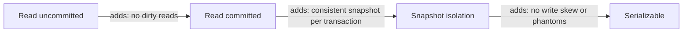

# ACID, read committed and snapshot isolation

> **Before this lesson:** you should know what a fault is ([Reliability and maintainability](#/lesson/databases/reliability-maintainability)), what a write-ahead log and a B-tree are ([B-trees](#/lesson/databases/btrees)), and what replication and failover are ([Single-leader replication](#/lesson/databases/leader-follower)). Idempotence and retries were covered in [Modes of data flow](#/lesson/databases/dataflow-modes). The code uses Python dictionaries, lists and functions.

## In plain words

A **transaction** is a way of telling a database: "these several steps are one piece of work. Do all of them or none of them, and do not let anyone else see the job half-finished."

An everyday picture: moving money between two accounts at a bank. The teller must take 100 out of one account and put 100 into the other. If the power fails after the first step, the money must not vanish. And if an auditor adds up all the accounts at the very moment between the two steps, the total must not come out 100 short. A transaction is the bank's promise that neither of those can happen: the transfer is one indivisible act as far as everyone else is concerned.

Two words are used constantly from here on. To **commit** a transaction is to make its changes permanent and visible. To **abort** it (also called a **rollback**) is to cancel it, discarding every change it made, as if it had never started.

The promise comes in different strengths, and that is what makes this topic tricky. Most databases, as they come out of the box, give a weaker promise than people assume. Under the weaker promises, certain timing-dependent bugs remain possible. Each kind of bug has a name, and each strength of promise, called an **isolation level**, is defined by which bugs it rules out.

Why this matters for a job: almost every backend engineer uses transactions daily, and bugs caused by misunderstanding isolation levels lose real money (double-spent balances, overbooked seats). They are also nearly impossible to reproduce in testing, because they depend on two requests arriving within milliseconds of each other. "What isolation level does your database use, and what can still go wrong?" is a question that separates candidates who have read the manual from those who have not.

## Why transactions exist

Think about what can interrupt a simple operation such as "move 15 pallets from warehouse A to warehouse B" in an inventory system. The database process may crash after the first of the two updates. The application server may die between them. The network may drop the connection so the client cannot tell whether anything happened. Another client may be reading both stock levels at that very moment, or modifying one of them. A disk may fail a week later.

Handling each of these cases by hand in every piece of application code would be hopeless. A **transaction** is the database's offer to take that burden away: the application declares that a group of reads and writes belongs together, and the database promises that the group either takes effect completely or not at all, and that other clients will not see it half-done. If anything goes wrong the transaction **aborts**, nothing remains of it, and the application may safely try again.

That promise makes the programmer's life easier; it is not something that nature provides for free. This lesson first pins down what the well-known acronym **ACID** really guarantees, which is less than its reputation suggests. It then studies the two isolation levels you are most likely to be running today, often without knowing it: **read committed** and **snapshot isolation**.

## 1. What ACID does and does not say

ACID stands for **Atomicity, Consistency, Isolation, Durability**. The acronym dates from 1983 and was meant to give exact names to the safety properties of transactions. In practice each database product implements it differently, and the phrase "ACID compliant" on a product page tells you little. (Systems that do not offer it are sometimes labelled BASE, for "basically available, soft state, eventual consistency", which is vaguer still.) It is worth knowing exactly what each letter covers.

### Atomicity - really "abortability"

In everyday English "atomic" means "cannot be split". In ACID the word is about one thing: **what happens when something fails part-way through several writes**. If a transaction cannot be completed, for whatever reason, the database throws away every write it has made so far. The application then knows for certain that the data is as it was before the transaction began. It can try again without the risk of applying half of the changes a second time.

So the valuable property is the ability to abort cleanly, and "abortability" would have been a clearer name. (Be aware that elsewhere in programming, "atomic" has a different meaning to do with several things running at once. In ACID that concern belongs to the letter I.)

### Consistency - the application's job

The word "consistency" is used for at least four unrelated things in the database world. You have met replica consistency and consistent hashing already. In ACID it means something else again: that your **invariants** hold. An invariant, as in the first lesson, is a statement that must always be true of the data, such as "in an accounting system, credits and debits add up to the same amount".

Here is the catch. The database generally does not know what your invariants are. It knows a few that you can declare to it, called **constraints**, such as "this column must be unique" or "this ID must exist in that other table". Beyond those, if the application writes data that breaks an invariant, the database will store it without complaint. Consistency is therefore something the *application* achieves, using atomicity and isolation as tools. Arguably the letter does not belong in the list.

### Isolation - the subject of three lessons

Several clients working on the same records at once can trip over each other. The textbook definition of isolation is **serialisability**: the outcome is the same as if the transactions had run one after another, even though they in fact overlapped. That is the strongest guarantee and the easiest to reason about, but it costs performance, so most databases default to something weaker - and some that use the name "serializable" actually deliver snapshot isolation.

A transaction is called **concurrent** with another when the two are in progress at the same time. Isolation is the property that deals with concurrency, and the rest of this lesson and the two after it are about how well different databases deliver it.

### Durability - a matter of degree

Once a transaction is reported as committed, its data should not disappear, even if the machine crashes the next second. On a single machine that means the data has been written to storage that keeps its contents without power (a hard disk or SSD), usually by way of a write-ahead log. In a replicated system it means the data has been copied to some number of other machines. Neither is absolute:

- A write to disk does not help if the machine is gone or unreachable; replication does.
- Replicas can all fail together: the whole site loses power, or one malformed request triggers the same crash on each of them.
- Asynchronous replication can lose the latest writes on failover.
- Disks and SSDs sometimes return corrupted data, and firmware has bugs; `fsync` has been found not to do what it promises on some systems.

Durability is achieved by combining techniques - local disk, replication, backups - and "guaranteed" should be read as "made very unlikely".

(`fsync`, from the storage lessons, is the request a program makes to have its data put on the disk immediately.)

## 2. One object or several

In this context an **object** is one stored item: a row, a document, or a key with its value.

Atomicity and isolation describe what happens when a transaction makes **several** writes. Consider an order system that stores each order line as a row and, for speed, keeps the order's total on the order row. Adding a line means inserting one row and updating one total.

- Without **isolation**, another session can read in between and see the new line in the list while the total still shows the old amount.
- Without **atomicity**, a failure after the insert leaves the total permanently wrong.

A transaction that touches more than one object needs a way to say which operations belong together. Relational databases tie this to the client's connection: the client sends the statement `BEGIN`, then its reads and writes, then `COMMIT`. Everything in between is one transaction. Many non-relational databases offer nothing comparable. Some have calls that write several keys at once, but such a call can succeed for some keys and fail for others, leaving the job half done.

Single objects need protection too. If the power fails when you are half-way through writing a 20-kilobyte document, you do not want to find a value that is half new and half old. And a reader should never be shown a half-updated one. Storage engines therefore provide atomicity for one object (using a log, as in the storage lessons) and isolation for one object (using a short-lived lock on it). Many add two further single-object operations:

- an **atomic increment**, which adds to a number in one step so that nobody can slip in between the read and the write;
- **compare-and-set**, which changes a value only if it still holds the value you last read, and otherwise reports failure.

These are useful, but they are not transactions in the usual sense. A transaction is above all a way to group operations on **several** objects.

Do applications really need that? Often yes: rows that reference each other through foreign keys, denormalised data that must be updated in several places, and secondary indexes that must change together with the row all involve more than one object.

### Aborting and retrying

The whole point of abort is that it is safe to try again. A few caveats spoil the neatness:

- If the transaction in fact committed and only the confirmation was lost on the network, a retry performs it twice, unless the application recognises duplicates (for example with an idempotency key).
- If the failure was caused by overload, retrying makes the overload worse. Limit the number of attempts, and wait longer before each successive attempt. Doubling the wait each time is called **exponential backoff**.
- Retrying helps with temporary problems, such as a failover in progress or two transactions blocking each other. It does not help with permanent ones, such as a write that violates a constraint.
- Effects outside the database are not undone by an abort. An email that was already sent stays sent.

## 3. Why weak isolation exists

Concurrency bugs are timing-dependent, appear rarely, are hard to reproduce, and are hard to find by reading code. Databases have long tried to hide them behind isolation. Full serialisability has a real cost in throughput and latency, so systems offer **weaker levels** that prevent *some* anomalies and leave the rest to you. These weaker levels are harder to reason about than they look, and they have caused real money to be lost and real data to be corrupted. The only defence is to know which anomalies each level allows.



The diagram shows the four levels as a ladder, weakest on the left. Each arrow is labelled with the protection gained by taking that step. "Read uncommitted", the lowest rung, prevents almost nothing and is rarely used. Terms on the arrows that are new (write skew, phantoms) are explained in the next lesson. This lesson covers the middle two rungs.

## 4. Read committed

The most basic level in common use makes two promises:

1. **No dirty reads.** You only ever see data that has been committed.
2. **No dirty writes.** You only ever overwrite data that has been committed.

**Dirty reads.** Suppose a transaction has written something but has not yet committed. If another transaction could already see it, two bad things could happen: it might see only part of a multi-object change (the new order line but not the new total), or it might see data that is subsequently rolled back and therefore never officially existed. Any decision based on it would be unfounded.

**Dirty writes.** Suppose two transactions update the same pair of rows. Booking the last seat on a course updates the seat row (who sits there) and the payment row (who is charged). If Ana's and Bo's bookings interleave their writes, the seat may end up assigned to Bo while Ana is charged for it. Forbidding a second write to a row while the first writer is still uncommitted rules that out.

### How it is implemented

A **lock** is a marker that gives one transaction exclusive use of something. Any other transaction that wants the same thing has to wait until the lock is released.

- *Dirty writes* are prevented with **row-level locks**: a writer takes the lock on a row and holds it until commit or abort. A second writer waits.
- *Dirty reads* could be prevented with the same lock, but then one long-running write would stall every reader of that row. So for each row being modified, the database keeps **both the old committed value and the new uncommitted one**. While the writing transaction is in progress, everyone else is served the old value. At commit, readers switch to the new one.

Read committed is the default in PostgreSQL, Oracle, SQL Server and many others.

### What read committed does not prevent

Because each statement sees whatever is committed *at the moment it runs*, two statements in the same transaction may see different states of the database.

```python-run
# A stock move of 15 pallets from warehouse A to warehouse B commits between two reads of an auditor.
committed = {"A": 40, "B": 40}

def read(warehouse):                     # read committed: always the latest committed value
    return committed[warehouse]

seen_a = read("A")                     # auditor reads A = 40
committed["A"] -= 15                   # stock-move transaction: both writes...
committed["B"] += 15                   # ...commit atomically here
seen_b = read("B")                     # auditor reads B = 55

print("auditor saw A =", seen_a, "B =", seen_b, "total =", seen_a + seen_b)
print("real total at every instant was", sum(committed.values()))
```

What each part does:

- `committed` is a dictionary standing for the committed state of the database: 40 pallets in each of two warehouses.
- `read(warehouse)` returns whatever is committed at the instant it is called. That is precisely the read committed rule.
- The auditor's first read gets A = 40.
- The next two lines are a different transaction, a stock move, which takes 15 from A and adds 15 to B. Both changes are committed together.
- The auditor's second read happens *after* that commit, so it gets B = 55.

```
auditor saw A = 40 B = 55 total = 95
real total at every instant was 80
```

The auditor counted 95 pallets, although there were 80 at every instant. One of the two numbers was read before the stock move and the other after it. The names for this are **non-repeatable read** and **read skew**. ("Skew" here means a timing mismatch. It is unrelated to the skew of the partitioning lessons.) If the auditor is a person looking at a web page who can press refresh, it is a brief curiosity. In other situations it cannot be tolerated:

- **Backups.** A backup copies the whole database over hours. If it captures some tables before a change and others after it, restoring it makes the inconsistency permanent.
- **Analytical queries and integrity checks.** A query that scans a large part of the database will return nonsense if it observes different parts at different times.

## 5. Snapshot isolation

The remedy is to let each transaction read from a **consistent snapshot**: it sees all data that was committed when the transaction *started*, and nothing committed later, no matter how long it runs. It is as if time were frozen for the reader.

Its defining trait: **a reader never has to wait for a writer, nor a writer for a reader**. A long analytical query can run alongside heavy write traffic, each unaffected by the other. Snapshot isolation is offered by PostgreSQL, MySQL/InnoDB, Oracle, SQL Server and others.

### Multi-version concurrency control

Writers are handled as under read committed: row locks prevent dirty writes. Readers need no locks at all. The database keeps **several committed versions of each row** side by side, because different transactions in progress may need to see the database as it stood at different moments. This technique is **multi-version concurrency control**, abbreviated **MVCC**. (Read committed can be built on the same machinery by taking a fresh snapshot for every statement. Snapshot isolation uses one snapshot for the whole transaction.)

In PostgreSQL's formulation:

- Every transaction receives a unique, ever-increasing id when it starts.
- Each row version carries `created_by`, the id of the transaction that inserted it, and `deleted_by`, initially empty.
- A delete does not remove anything; it writes the deleter's id into `deleted_by`. An **update is a delete plus an insert**: the old version is marked, and a new version is added.
- When no running transaction can still need an old version, a background garbage collector removes it.

### Visibility rules

A transaction looking at a row may find several versions of it. Which one should it see? The rules that decide are called **visibility rules**.

At the start of a transaction the database notes which other transactions are in progress. Then, for every row version the transaction encounters:

1. Writes by transactions that were **still in progress** at that moment are ignored, even if they commit later.
2. Writes by **aborted** transactions are ignored.
3. Writes by transactions with a **later id** (started afterwards) are ignored, committed or not.
4. Everything else is visible.

Put positively, a version is visible when both conditions hold:

- the transaction that created it had already committed when the reader started; and
- it has not been marked deleted, or the transaction that marked it had *not* yet committed when the reader started.

The program below is a small but complete MVCC store that follows those rules.

```python-run
# versions: (key, value, created_by, deleted_by)
versions = []
next_txid = 1
status = {}                                   # txid -> "active" | "committed" | "aborted"

def begin():
    global next_txid
    tx = {"id": next_txid, "in_progress": {t for t, s in status.items() if s == "active"}}
    status[tx["id"]] = "active"; next_txid += 1
    return tx

def sees(tx, writer):
    if writer == tx["id"]: return True                          # own writes
    return writer < tx["id"] and writer not in tx["in_progress"] and status[writer] == "committed"

def read(tx, key):
    for k, value, created, deleted in versions:
        if k == key and sees(tx, created) and (deleted is None or not sees(tx, deleted)):
            return value
    return None

def write(tx, key, value):
    for i, (k, v, c, d) in enumerate(versions):                 # mark the version we can see as deleted
        if k == key and sees(tx, c) and d is None:
            versions[i] = (k, v, c, tx["id"])
    versions.append((key, value, tx["id"], None))

def commit(tx): status[tx["id"]] = "committed"

setup = begin(); write(setup, "A", 40); write(setup, "B", 40); commit(setup)

observer = begin()                                              # snapshot taken here
a = read(observer, "A")
transfer = begin(); write(transfer, "A", 25); write(transfer, "B", 55); commit(transfer)
b = read(observer, "B")                                         # still the old version
print("observer:", a, b, "total", a + b)
late = begin()
print("new txn :", read(late, "A"), read(late, "B"))
print("stored versions:", versions)
```

What each part does:

- `versions` is the list of all row versions. Each is a tuple of four things: the key, the value, the ID of the transaction that created it, and the ID of the transaction that deleted it (or `None`).
- `status` records whether each transaction is active, committed or aborted.
- `begin()` starts a transaction. It gives it the next ID and stores in `in_progress` the set of transactions that are active at this moment. That set is the snapshot: it is fixed here and never updated. (The `global` line lets the function change the counter defined outside it.)
- `sees(tx, writer)` answers "can transaction `tx` see what transaction `writer` wrote?". It says yes for the transaction's own writes. Otherwise the writer must have a smaller ID, must not have been in progress when `tx` began, and must have committed. Those are rules 1 to 3.
- `read(tx, key)` looks through the versions of a key and returns the one whose creator is visible and whose deleter, if any, is not.
- `write(tx, key, value)` marks the currently visible version as deleted by this transaction and appends a new version. That is "an update is a delete plus an insert".
- The script creates A = 40 and B = 40 and commits. An `observer` transaction begins and reads A. Then a `transfer` transaction changes both values and commits. The observer reads B. Finally a new transaction, `late`, reads both.

```
observer: 40 40 total 80
new txn : 25 55
stored versions: [('A', 40, 1, 3), ('B', 40, 1, 3), ('A', 25, 3, None), ('B', 55, 3, None)]
```

Under read committed the auditor counted 95. Here the observer sees a coherent 80, because the stock move was made by transaction 3, which has a later ID than the observer (transaction 2), so its writes are invisible to the observer's snapshot. The `late` transaction started after the transfer committed and sees the new values. The last line shows what is physically stored: four versions for two keys. The old versions, created by transaction 1 and marked as deleted by transaction 3, are still there for the observer's benefit. The practice problem `db-mvcc-visibility` asks you to implement these rules yourself.

### Indexes under MVCC

How do indexes cope with several versions of a row? One approach has the index point to all versions and lets the query filter out the invisible ones; when old versions are garbage-collected their index entries go too. PostgreSQL avoids index updates altogether when a new version fits on the same page as the old one and no indexed column changed. A different design uses **copy-on-write B-trees**: an update never overwrites a page but writes a new copy of each page from the leaf to the root. Every root is then a self-contained snapshot of the whole database at one moment, and no visibility filtering by transaction id is needed.

### The naming mess

The SQL standard predates snapshot isolation and does not mention it. Its levels were defined in terms of locking, and the definitions are ambiguous. Vendors therefore attached the standard's names to whatever they built:

| Product | What it calls the level | What you get |
|---|---|---|
| PostgreSQL | `REPEATABLE READ` | Snapshot isolation |
| MySQL InnoDB | `REPEATABLE READ` | A snapshot for reads, with weaker lost-update protection than PostgreSQL |
| Oracle | `SERIALIZABLE` | Snapshot isolation |
| SQL Server | `SNAPSHOT` | Snapshot isolation |

Nobody can say precisely what "repeatable read" means without naming the product.

`REPEATABLE READ`, `SERIALIZABLE` and `SNAPSHOT` in that table are the names you type when asking the database for a level, for example `SET TRANSACTION ISOLATION LEVEL REPEATABLE READ`.

> [!INTERVIEW]
> When asked "which isolation level do you use?", do not answer with a standard name alone. Say what your database's default really is (read committed for PostgreSQL), which anomalies that still allows (non-repeatable reads, lost updates, write skew; the last two are explained in the next lesson), and how your code deals with the cases where that matters: single-statement atomic updates, explicitly locking the rows you read with `SELECT ... FOR UPDATE`, declared constraints, or a stronger level combined with retries.

## Pitfalls

- **Treating "ACID" as a precise guarantee.** Check the default isolation level and the durability settings of your particular database.
- **Assuming the database enforces your invariants.** Beyond declared constraints, consistency is your code's responsibility.
- **Retrying blindly.** Without idempotence a retry after a lost acknowledgement duplicates the operation; without backoff it amplifies an overload.
- **Running reports or backups under read committed.** Use a snapshot (a `REPEATABLE READ` transaction in PostgreSQL, or a dump tool that takes one).
- **Long-running snapshot transactions.** They force the database to retain old row versions, causing bloat.
- **Believing snapshot isolation is serialisable.** It still allows lost updates in some implementations and write skew in all of them - the topic of the next lesson.

## Summary

- A **transaction** groups reads and writes so that the application can ignore partial failure and, to a chosen degree, concurrency.
- **Atomicity** means a failed transaction leaves nothing behind. **Consistency** means the application's invariants hold - which is the application's responsibility. **Isolation** means concurrent transactions do not interfere, with serialisability as the ideal. **Durability** means committed data survives, to the extent that disks, replicas and backups allow.
- **Read committed** forbids dirty reads and dirty writes, using row locks for writers and "old value until commit" for readers. It still allows **read skew**.
- **Snapshot isolation** gives each transaction a frozen, consistent view. It is implemented with **MVCC**: row versions tagged with creating and deleting transaction ids, plus **visibility rules**. Readers and writers never block each other.
- Isolation level **names differ between products**; always check what your database actually provides.

## Glossary

- **Transaction** - a group of reads and writes that the database treats as one unit.
- **Commit** - making a transaction's changes permanent and visible.
- **Abort (rollback)** - cancelling a transaction and discarding all its changes.
- **ACID** - Atomicity, Consistency, Isolation, Durability: the safety properties of transactions.
- **Atomicity** - if a transaction fails part-way, none of its writes remain.
- **Invariant** - a statement about the data that must always be true.
- **Constraint** - an invariant declared to the database, which the database enforces.
- **Consistency (in ACID)** - the application's invariants hold.
- **Isolation** - transactions running at the same time do not interfere with each other.
- **Concurrent** - in progress at the same time.
- **Serialisability** - the result is the same as if transactions had run one after another.
- **Durability** - committed data is not lost.
- **Object** - one stored item: a row, a document or a key with its value.
- **Atomic increment** - adding to a stored number in one indivisible step.
- **Compare-and-set** - changing a value only if it still equals what you last read.
- **Exponential backoff** - waiting twice as long before each successive retry.
- **Isolation level** - a named strength of isolation, defined by which anomalies it prevents.
- **Dirty read** - seeing data another transaction has written but not committed.
- **Dirty write** - overwriting data another transaction has written but not committed.
- **Lock / row-level lock** - a marker giving one transaction exclusive use of something / of one row.
- **Read committed** - an isolation level with no dirty reads and no dirty writes.
- **Non-repeatable read (read skew)** - a transaction seeing different parts of the database as of different moments.
- **Snapshot isolation** - an isolation level where each transaction reads from a frozen view taken at its start.
- **MVCC (multi-version concurrency control)** - keeping several versions of each row so readers and writers do not block each other.
- **Visibility rules** - the rules deciding which version of a row a transaction sees.
- **Garbage collection** (here) - removing old row versions that no transaction can still need.

```quiz
[
  {"q": "What does atomicity mean in the ACID sense?",
   "options": ["Operations are invisible to other threads while in progress", "If a transaction cannot complete, all of its writes are discarded so it can be safely retried", "Data is stored in indivisible units", "Every transaction runs on a single CPU core"],
   "answer": 1,
   "explain": "ACID atomicity is about faults partway through a group of writes: all or nothing. Concurrency is the concern of isolation."},
  {"q": "Why is the C in ACID described as a property of the application rather than of the database?",
   "options": ["Databases cannot store consistent data", "The database does not know most invariants; the application must write transactions that preserve them", "Consistency only matters in distributed systems", "It refers to replica consistency"],
   "answer": 1,
   "explain": "Apart from declared constraints, the database stores whatever it is told. Atomicity and isolation are tools the application uses to keep its invariants."},
  {"q": "Which two anomalies does read committed prevent?",
   "options": ["Phantoms and write skew", "Dirty reads and dirty writes", "Lost updates and read skew", "Deadlocks and timeouts"],
   "answer": 1,
   "explain": "Readers see only committed data, and writers overwrite only committed data. Everything else is still possible."},
  {"q": "How do most databases prevent dirty reads without making readers wait for writers?",
   "options": ["They take a read lock on every row", "They keep the old committed value and serve it to readers until the writing transaction commits", "They abort the reader", "They delay the write until no reader is active"],
   "answer": 1,
   "explain": "Holding both the old and the new value lets readers proceed immediately with the committed one."},
  {"q": "A backup runs for two hours under read committed while stock moves between warehouses continue. What can go wrong?",
   "options": ["Nothing, backups are always consistent", "The backup may contain the removal of a move but not its arrival, or the reverse, because different tables were copied at different times", "The transfers are blocked for two hours", "The backup contains uncommitted data"],
   "answer": 1,
   "explain": "This is read skew. A snapshot gives the backup one consistent point in time."},
  {"q": "Under MVCC snapshot isolation, how is an UPDATE of a row represented internally?",
   "options": ["The row is overwritten in place", "The old version is marked as deleted by the transaction and a new version is created", "The row is locked for all readers until commit", "The update is stored only in the index"],
   "answer": 1,
   "explain": "Keeping the old version lets transactions with older snapshots continue to read it, which is why readers and writers do not block each other."},
  {"q": "A transaction with id 20 started while transaction 15 was still in progress. Transaction 15 then commits. Does transaction 20 see its writes?",
   "options": ["Yes, because 15 is smaller than 20", "Yes, because it committed", "No, writes by transactions that were in progress when the snapshot was taken stay invisible", "Only if it reads the row twice"],
   "answer": 2,
   "explain": "The snapshot is fixed at the start. Anything not yet committed at that moment is ignored for the whole transaction, even if it commits later."},
  {"q": "What does PostgreSQL provide when you request REPEATABLE READ?",
   "options": ["Two-phase locking", "Snapshot isolation", "Read uncommitted", "Serial execution"],
   "answer": 1,
   "explain": "The standard's names are applied inconsistently. PostgreSQL's repeatable read is snapshot isolation, and Oracle calls the same thing serializable."}
]
```

> **Source:** DDIA ch. 7 (Transactions) - the meaning of ACID, single-object and multi-object operations, read committed, snapshot isolation and repeatable read. Written in original wording with original examples.
