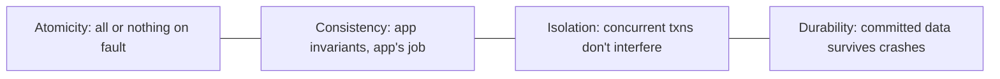
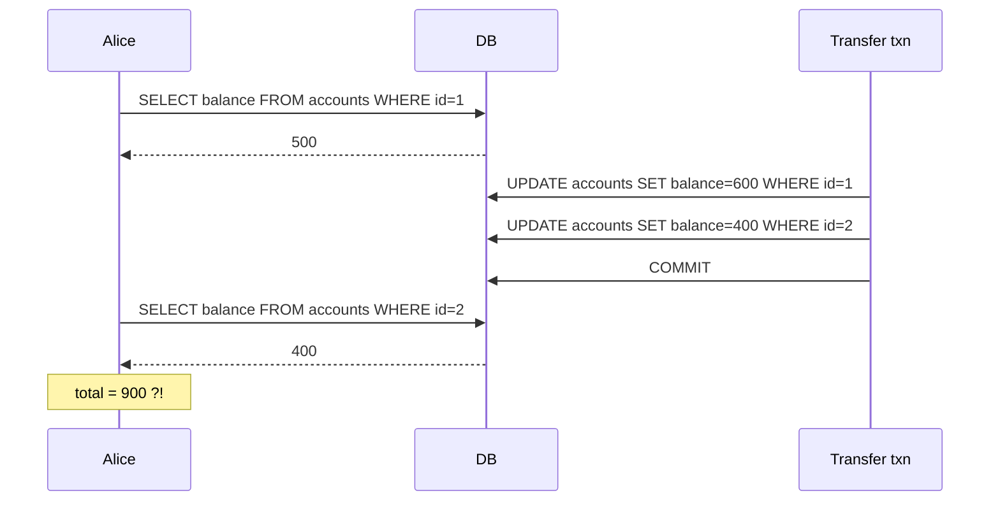

# ACID, read committed and snapshot isolation

Many things can go wrong in a data system. The database software or hardware may fail midway through a write. The application may crash partway through a series of operations. The network may cut the application off from the database. Several clients may write at the same time and overwrite each other's changes. A client may read data that is only partially updated. Race conditions can cause surprising bugs.

For decades, the mechanism of choice has been the **transaction**: a way for an application to group several reads and writes into one logical unit. Conceptually, all the reads and writes in a transaction are executed as one operation. Either the whole transaction succeeds (**commit**) or it fails (**abort**, **rollback**). If it fails, the application can safely retry. Error handling becomes much simpler because there are no partial failures to think about.

Transactions are not a law of nature. They were created to **simplify the programming model** for applications accessing a database. With them, the application can ignore certain error scenarios and concurrency issues because the database takes care of them. These are called **safety guarantees**.

## 1. The meaning of ACID

The safety guarantees are often described with the acronym **ACID**, coined by Härder and Reuter in 1983. In practice, one database's ACID is not another's. The term has become mostly a marketing label. Systems that do not meet the criteria are sometimes called **BASE**: Basically Available, Soft state, Eventual consistency. That is even vaguer.

### Atomicity

In general, *atomic* means something that cannot be broken into smaller parts. In multithreading it means another thread cannot see a half-finished result. **ACID atomicity is not about concurrency.** It describes what happens if a client makes several writes and a **fault** occurs partway through: a process crash, a network interruption, a full disk, or an integrity constraint violation. If the writes are grouped into an atomic transaction and it cannot be completed, the transaction is **aborted** and the database must **discard or undo** any writes made so far.

Atomicity makes retry safe: if a transaction aborted, the application can be sure it changed nothing. Kleppmann suggests **abortability** would have been a better name.

### Consistency

*Consistency* is badly overloaded. It can mean replica consistency or eventual consistency (Chapter 5), the "consistent" in consistent hashing (Chapter 6), linearizability in CAP (Chapter 9), or, in ACID, an application-specific notion that the database is in a "good state".

ACID consistency means certain **invariants** about the data must always hold. For example, in an accounting system, credits and debits across all accounts must always balance. If a transaction starts with a valid database and its writes preserve validity, the invariants are satisfied. That depends on the **application's** notion of invariants, and it is the application's responsibility to define transactions that preserve them. The database can check some specific invariants, such as foreign keys and uniqueness constraints, but generally the application defines what is valid. **Atomicity, isolation and durability are properties of the database, while consistency is a property of the application.** The C does not really belong in ACID. Joe Hellerstein has remarked that it was "tossed in to make the acronym work".

### Isolation

Most databases are accessed by several clients at the same time. If they access the **same records**, you can run into race conditions. Example: two clients simultaneously increment a counter stored in the database. Each reads 42, adds 1 and writes 43. The counter should have reached 44.

**Isolation** means concurrently executing transactions are isolated from each other and cannot step on each other's toes. The textbook formalisation is **serializability**: each transaction can pretend it is the only one running on the whole database. The database ensures that when the transactions have committed, the result is the same as if they had run **serially**, one after another, even though they may actually have run concurrently. In practice serializable isolation is rarely used because of its performance penalty. Oracle 11g's "serializable" is actually **snapshot isolation**, a weaker guarantee.

### Durability

**Durability** is the promise that once a transaction has committed successfully, any data it wrote will not be forgotten, even after a hardware fault or database crash. On a single node this usually means the data has been written to non-volatile storage (HDD, SSD), typically along with a **WAL** for recovery. In a replicated database it may mean the data has been copied to some number of nodes.

Perfect durability does not exist. DDIA lists ways it can fail: an fsync'd disk can still lose data in a power failure if the firmware is buggy; SSDs can lose data when unpowered for too long; disk sectors become corrupted silently; async replication loses recent writes when the leader fails; a correlated fault (a power outage, or a bug that crashes every node on a certain input) can take out all replicas at once. In practice, the best defence is a combination: writes to disk, replication to remote machines, and backups.



## 2. Single-object and multi-object operations

Atomicity and isolation describe what the database should do when a client makes several writes in one transaction. **Multi-object transactions** are often needed when several pieces of data must be kept in sync.

Example: an email app shows an unread-message counter, stored separately from the emails for performance. User 2 reads the mailbox after user 1 inserts a new email but **before** the counter is incremented. User 2 sees an unread message, but the counter says zero. Isolation would have prevented this, because user 2 would see both the email and the counter update or neither. And if the counter update fails, **atomicity** ensures the email insert is rolled back too.

Multi-object transactions need a way to determine which reads and writes belong to the same transaction. In relational databases this is based on the client's TCP connection: everything between `BEGIN TRANSACTION` and `COMMIT` belongs to one transaction. Many non-relational databases lack such grouping.

**Single-object writes** need atomicity and isolation too. Writing a 20 kB JSON document should not leave a half-written document if the network drops after 10 kB. Storage engines almost universally provide atomicity on a single object (via the log) and isolation (via a lock on each object). Some databases also provide atomic operations such as **increment**, removing the need for a read-modify-write cycle, and **compare-and-set** (write only if the value has not been concurrently changed). These are useful, but they are not transactions in the usual sense.

**Why multi-object transactions still matter:**

- Relational **foreign keys** across tables must stay valid when inserting several records that refer to each other.
- In a **document** model, denormalised data that must be updated in several documents at once.
- **Secondary indexes** must be updated whenever a value changes. Without isolation, a record may appear in one index but not another.

**Handling errors and aborts.** The whole point of aborts is to enable safe retries. Datastores with leaderless replication work on a "best effort" basis and will not undo something already done. ORMs such as Rails' ActiveRecord and Django often *don't retry* aborted transactions and bubble up an exception. Retrying is not perfect either:

- If the transaction actually succeeded but the network failed while acknowledging the commit, a retry performs it **twice**, unless there is app-level deduplication.
- If the error is due to **overload**, retrying makes things worse. Limit retries and use exponential backoff.
- Only retry **transient** errors (deadlock, isolation violation, temporary network trouble), not permanent ones such as a constraint violation.
- If the transaction has **side effects outside the database** (sending an email), they happen even if the transaction aborts. Use **two-phase commit** (Chapter 9) if several systems must commit or abort together.
- If the client process fails while retrying, any data it was trying to write is lost.

## 3. Weak isolation levels

If two transactions do not touch the same data, they can safely run in parallel. Concurrency issues (race conditions) come into play only when one transaction reads data that another modifies concurrently, or when two transactions modify the same data. Concurrency bugs are hard to find by testing because they are triggered only by unlucky timing.

**Serializable** isolation removes the problem but has a performance cost that many databases do not want to pay. So systems commonly use **weaker isolation levels**, which protect against *some* concurrency issues but not all. These can produce subtle bugs that have caused real financial losses, auditor investigations and corrupted customer data. Rather than blindly relying on tools, we need a good understanding of the kinds of concurrency problems that exist and how to prevent them.

### 3.1 Read committed

The most basic level of transaction isolation is **read committed**. It makes two guarantees:

1. **No dirty reads.** When reading from the database, you only see data that has been committed.
2. **No dirty writes.** When writing to the database, you only overwrite data that has been committed.

**Dirty reads.** Imagine a transaction has written some data but not yet committed or aborted. If another transaction can see that uncommitted data, that is a *dirty read*. Preventing dirty reads matters because:

- A transaction updating several objects should not have another transaction see some updates but not others (the email and counter example).
- If a transaction aborts, any writes it made are rolled back. With dirty reads, another transaction could see data that is **never actually committed**.

**Dirty writes.** If two transactions concurrently update the same object, and the earlier write is part of a transaction that has not yet committed, the later write overwrites an uncommitted value. Read committed prevents this, usually by delaying the second write until the first transaction has committed or aborted.

DDIA's example: Alice and Bob both try to buy the same car. Buying it requires two writes: the sale listing must be updated to reflect the buyer, and the sales invoice must be sent to the buyer. With dirty writes, the sale could be awarded to Bob while the invoice goes to Alice.

> [!WARNING]
> Read committed does **not** prevent the counter race (read 42, write 43, twice). The second write comes *after* the first transaction committed, so it is not a dirty write, but the result is still wrong. That is a **lost update** (next lesson).

**Implementing read committed.** It is the default in Oracle 11g, **PostgreSQL**, SQL Server 2012, MemSQL and many others.

- **Dirty writes** are prevented with **row-level locks**. To modify an object, a transaction must first acquire a lock on it and hold it until it commits or aborts. Only one transaction can hold the lock on a given object.
- **Dirty reads** could be prevented with the same lock, by requiring readers to briefly acquire it. That works poorly: one long-running write transaction would make many read-only transactions wait. Instead, most databases **remember both the old committed value and the new value** set by the transaction that holds the write lock. While the transaction is ongoing, other readers get the old value. Only when the new value is committed do readers switch to it.

### 3.2 Snapshot isolation and repeatable read

Read committed seems to do everything a transaction needs: it allows aborts, prevents reading incomplete results and prevents concurrent writes from mixing. Plenty of bugs can still occur.

**Read skew (non-repeatable read).** Alice has \$1,000 in two accounts, \$500 each. A transaction transfers \$100 from account 1 to account 2. If she looks at her balances at an unlucky moment, she may see account 1 *before* the incoming payment arrives (\$500) and account 2 *after* the outgoing transfer was made (\$400). That totals \$900, and \$100 seems to have vanished.



For Alice this is temporary: reload a few seconds later and she sees consistent balances. Some situations cannot tolerate such temporary inconsistency:

- **Backups.** A backup copies the whole database and may take hours while writes continue. Some parts would contain old data and others new. If you restore from it, the inconsistencies become **permanent**.
- **Analytic queries and integrity checks.** A query that scans large parts of the database, or a periodic integrity check, returns nonsensical results if it observes different parts at different points in time.

**Snapshot isolation** is the most common solution. Each transaction reads from a **consistent snapshot** of the database: it sees all data that was committed **at the start of the transaction**. Even if the data is later changed by another transaction, each transaction sees only the old data from that point in time. It is a boon for long-running, read-only queries such as backups and analytics. It is supported by PostgreSQL, MySQL InnoDB, Oracle, SQL Server and others.

### 3.3 Implementing snapshot isolation: MVCC

Like read committed, snapshot isolation implementations use **write locks** to prevent dirty writes. A key principle: **readers never block writers, and writers never block readers.** Because the database may need to keep several committed versions of an object (different in-progress transactions may need to see the state at different points in time), the technique is called **multi-version concurrency control (MVCC)**.

If a database only needed read committed, keeping two versions would suffice: committed and overwritten-but-not-yet-committed. Storage engines that support snapshot isolation typically use MVCC for read committed too: read committed uses a **separate snapshot for each query**, while snapshot isolation uses **the same snapshot for an entire transaction**.

PostgreSQL's implementation:

- When a transaction starts, it gets a unique, always-increasing **transaction ID (txid)**.
- Whenever a transaction writes, the data is tagged with the writer's txid.
- Each row has a **`created_by`** field (PostgreSQL's `xmin`) with the txid that inserted it, and a **`deleted_by`** field (`xmax`), initially empty.
- A **delete** does not remove the row. It sets `deleted_by` to the deleting txid. Later, when no transaction can access the deleted data any more, a **garbage collection** process (PostgreSQL's **VACUUM**) removes it and frees the space.
- An **update** is translated into a delete plus an insert. Updating account 2's balance from 500 to 400 marks the old row deleted by txid 13 and creates a new row created by txid 13.

### 3.4 Visibility rules for observing a consistent snapshot

When a transaction reads, transaction IDs determine which objects it can see:

1. At the start of each transaction, the database makes a list of all **other transactions that are in progress** (not yet committed or aborted). Writes by those transactions are **ignored**, even if they commit later.
2. Writes made by **aborted** transactions are ignored.
3. Writes made by transactions with a **later txid** (which started after the current transaction) are ignored, whether or not they have committed.
4. All other writes are visible.

Put another way, an object is visible if **both**:

- at the time the reader's transaction started, the transaction that **created** the object had already **committed**, and
- the object is **not marked for deletion**, or if it is, the transaction that requested deletion had **not yet committed** when the reader's transaction started.

```python-run
# MVCC snapshot visibility (PostgreSQL-style xmin/xmax)
committed = {1, 3, 5, 10, 13}      # transaction ids that have committed
aborted   = {7}

rows = [
    # (value, created_by, deleted_by)
    ("acct1=500", 3,  None),
    ("acct2=500", 5,  13),         # deleted (updated) by txn 13
    ("acct2=400", 13, None),       # new version created by txn 13
    ("acct3=999", 7,  None),       # created by an aborted txn
    ("acct4=50",  15, None),       # created by a txn that started later
]

def snapshot(my_txid, in_progress_at_start):
    def committed_before_me(t):
        return (t is not None and t in committed and t < my_txid
                and t not in in_progress_at_start)
    visible = []
    for value, xmin, xmax in rows:
        if not committed_before_me(xmin):
            continue                     # creator not visible to me
        if xmax is not None and committed_before_me(xmax):
            continue                     # deletion visible to me -> row is gone
        visible.append(value)
    return visible

print("txn 12 (started while 13 not yet begun):", snapshot(12, set()))
print("txn 14 (13 already committed)          :", snapshot(14, set()))
print("txn 14 but 13 was in progress at start :", snapshot(14, {13}))
```

Txn 12 still sees `acct2=500` because txn 13 started later. Long-running reads therefore keep seeing a consistent past, and old row versions cannot be vacuumed while such readers exist.

### 3.5 Indexes and snapshot isolation

How do indexes work in a multi-version database? One option: the index points to *all versions* of an object, and an index query filters out versions not visible to the current transaction. When garbage collection removes old versions, the corresponding index entries can be removed too. PostgreSQL has optimisations to avoid index updates when different versions of the same object fit on the same page (**HOT updates**).

CouchDB, Datomic and LMDB take another approach with **append-only / copy-on-write B-trees**. Pages are not overwritten. Each write creates a copy of each modified page, and parent pages up to the root are copied to point to the new versions. Every write transaction creates a new B-tree **root**, and a particular root is a consistent snapshot of the database at the moment it was created. This requires background compaction and garbage collection.

### 3.6 Repeatable read and naming confusion

Snapshot isolation is useful, especially for read-only transactions, but it is called different names in different databases. Oracle calls it **serializable**. PostgreSQL and MySQL call it **repeatable read**. The SQL standard does not have the concept of snapshot isolation because the standard is based on System R's 1975 definitions, before snapshot isolation was invented. It defines *repeatable read*, which looks superficially similar. The standard's definition is ambiguous and implementations vary widely in what they guarantee. Nobody really knows what "repeatable read" means.

| Anomaly | Read uncommitted | Read committed | Snapshot isolation | Serializable |
|---|---|---|---|---|
| Dirty write | prevented* | prevented | prevented | prevented |
| Dirty read | possible | prevented | prevented | prevented |
| Read skew | possible | possible | prevented | prevented |
| Lost update | possible | possible | depends (auto-detected in PG/Oracle) | prevented |
| Write skew | possible | possible | possible | prevented |
| Phantom (read-write) | possible | possible | possible | prevented |

\*Most databases prevent dirty writes even at the lowest level.

> [!INTERVIEW]
> When asked "What isolation level does PostgreSQL default to, and what can go wrong?", answer **Read committed**, with a fresh snapshot per *statement*. Non-repeatable reads, lost updates and write skew are possible. `REPEATABLE READ` in PostgreSQL is snapshot isolation and *does* detect lost updates (with a serialization error). `SERIALIZABLE` is SSI. In MySQL InnoDB, the default is REPEATABLE READ, which does *not* auto-detect lost updates.

## 4. Summary

- Transactions simplify error handling (atomicity = abortability) and concurrency (isolation). Consistency is the application's responsibility, and durability is never absolute.
- **Read committed**: no dirty reads, no dirty writes. Implemented with row locks for writes and by remembering the old committed value for reads.
- **Snapshot isolation** gives each transaction a consistent point-in-time view, which prevents **read skew**. It is implemented with **MVCC** (xmin/xmax, visibility rules, vacuum).
- Isolation-level names are inconsistent across databases. Learn the anomalies rather than the names.

```quiz
[
  {"q": "In ACID, what does atomicity actually guarantee?",
   "options": ["Concurrent transactions do not see each other", "If a fault occurs mid-transaction, all its writes are discarded (abortability)", "Data survives crashes", "Invariants hold"],
   "answer": 1,
   "explain": "ACID atomicity is about handling faults, not concurrency; isolation handles concurrency."},
  {"q": "Which ACID property is really a property of the application rather than the database?",
   "options": ["Atomicity", "Consistency", "Isolation", "Durability"],
   "answer": 1,
   "explain": "The application defines invariants and writes transactions that preserve them."},
  {"q": "Read committed prevents which anomalies?",
   "options": ["Dirty reads and dirty writes", "Lost updates and write skew", "Read skew", "Phantoms"],
   "answer": 0,
   "explain": "It does not prevent read skew, lost updates or write skew."},
  {"q": "How do most databases prevent dirty reads without making readers wait?",
   "options": ["Readers take the row lock", "They keep the old committed value and return it while the writer's transaction is in progress", "They abort writers", "They serialize all transactions"],
   "answer": 1,
   "explain": "Readers see the last committed value until the new one commits."},
  {"q": "Alice sees $500 + $400 = $900 during a transfer. Which anomaly is this, and what prevents it?",
   "options": ["Dirty write; read committed", "Read skew (non-repeatable read); snapshot isolation", "Lost update; atomic increment", "Phantom; predicate locks"],
   "answer": 1,
   "explain": "She saw different parts of the database at different points in time; a consistent snapshot fixes this."},
  {"q": "Under MVCC, which writes are invisible to a transaction T?",
   "options": ["Writes by transactions that committed before T started", "Writes by transactions in progress when T started, aborted transactions, and transactions with later txids", "All writes to rows T has read", "Only deletes"],
   "answer": 1,
   "explain": "These are exactly the visibility rules for a consistent snapshot."},
  {"q": "In PostgreSQL MVCC, what does an UPDATE do internally?",
   "options": ["Overwrites the row in place", "Marks the old row version deleted (xmax) and inserts a new version (xmin)", "Locks the whole table", "Writes only to the WAL"],
   "answer": 1,
   "explain": "VACUUM later removes versions no transaction can see."},
  {"q": "What is PostgreSQL's 'REPEATABLE READ' level in DDIA's terms?",
   "options": ["Read committed", "Snapshot isolation", "Serializable 2PL", "Read uncommitted"],
   "answer": 1,
   "explain": "Isolation-level names vary across databases; Oracle calls snapshot isolation 'serializable'."}
]
```

> **Source:** DDIA ch. 7, "Transactions" (The Slippery Concept of a Transaction; Weak Isolation Levels: read committed, snapshot isolation and repeatable read).
