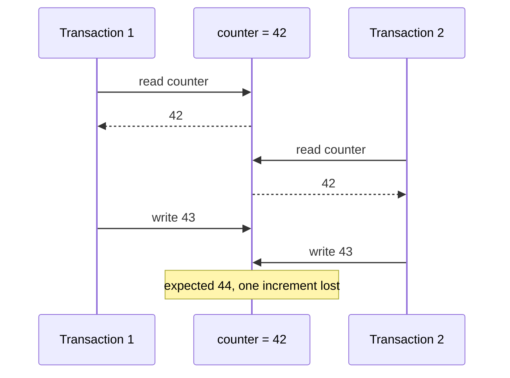
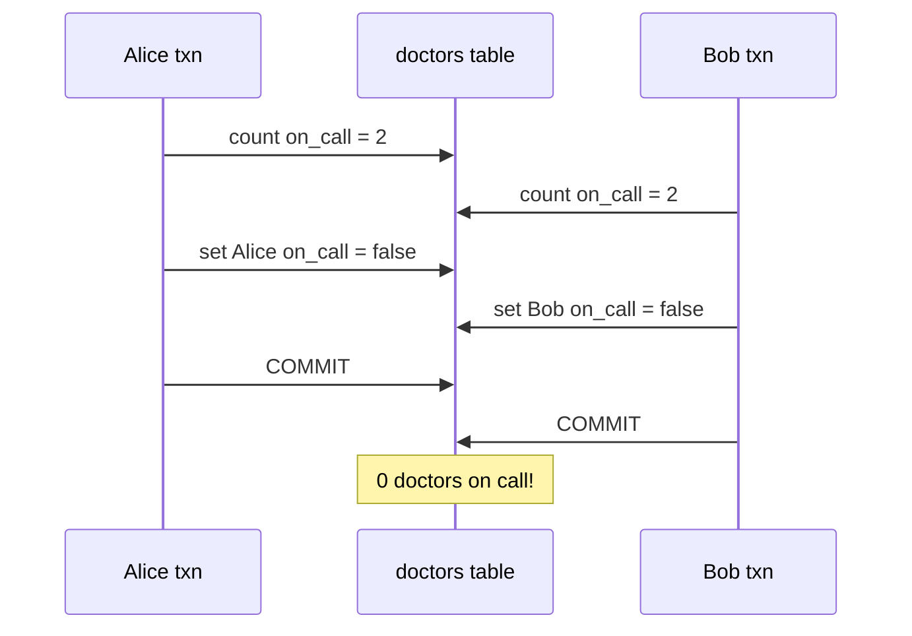

# Lost updates, write skew and phantoms

Read committed and snapshot isolation mostly answer one question: what can a **read-only** transaction see while writes happen concurrently? They mostly ignore the case of **two transactions writing concurrently**. Dirty writes are one kind of write–write conflict. This lesson covers several more that are subtler and far more common in real application code.

## 1. Preventing lost updates

The **lost update** problem shows up whenever an application performs a **read-modify-write cycle**. It reads a value, modifies it, and writes back the modified value. If two transactions do this concurrently, one of the modifications can be lost, because the second write does not include the first modification. We say the later write **clobbers** the earlier one. Typical cases:

- Incrementing a counter or updating an account balance (read the current value, compute the new value, write it back).
- Making a local change to a complex value, such as adding an element to a list inside a JSON document (parse, modify, write back the whole document).
- Two users editing a wiki page at the same time, each saving their changes by sending the whole page to the server and overwriting whatever is there.



Several solutions exist.

### 1.1 Atomic write operations

Many databases provide atomic update operations that remove the need for read-modify-write in application code. They are usually the best solution if your code can be expressed with them:

```sql
UPDATE counters SET value = value + 1 WHERE key = 'foo';
```

MongoDB has atomic operators for local modifications to parts of a JSON document, and **Redis** has atomic operations for modifying structures such as priority queues (`INCR`, `HINCRBY`, `ZINCRBY`). Not every write can be expressed this way. Updating a wiki page involves arbitrary text editing, for instance.

Atomic operations are usually implemented by taking an **exclusive lock** on the object when it is read, so no other transaction can read it until the update has been applied. This technique is sometimes called **cursor stability**. Another option is to force all atomic operations onto a **single thread**. ORMs make it easy to write code that does an unsafe read-modify-write instead of using the database's atomic operation, which is a frequent source of subtle bugs.

### 1.2 Explicit locking

If the database's built-in atomic operations do not provide the needed functionality, the application can **explicitly lock** the objects it is going to update. DDIA's example is a multiplayer game where several players can move the same figure concurrently. Atomic operations are not enough, because the application must check whether the move is valid under the game rules, which involves logic that cannot sensibly be done in a query. Use `FOR UPDATE`:

```sql
BEGIN TRANSACTION;
SELECT * FROM figures
  WHERE name = 'robot' AND game_id = 222
  FOR UPDATE;                     -- lock all rows returned by this query
-- check whether the move is valid, then update the position
UPDATE figures SET position = 'c4' WHERE id = 1234;
COMMIT;
```

This works, but getting it right means thinking carefully about the application logic. It is easy to forget a lock somewhere and introduce a race condition.

### 1.3 Automatically detecting lost updates

Atomic operations and locks prevent lost updates by forcing read-modify-write cycles to happen sequentially. An alternative is to let them run in **parallel** and, if the transaction manager **detects** a lost update, **abort** the transaction and force it to retry its cycle.

The advantage is that databases can perform this check efficiently together with **snapshot isolation**. PostgreSQL's repeatable read, Oracle's serializable and SQL Server's snapshot isolation levels automatically detect when a lost update has occurred and abort the offending transaction. MySQL/InnoDB's repeatable read does **not** detect lost updates. Some authors argue a database must prevent lost updates to qualify as providing snapshot isolation, so by that definition MySQL does not.

Detection is a great feature because application code does not need any special database features. You might forget to use a lock or an atomic operation, but lost-update detection happens automatically and is therefore less error-prone.

### 1.4 Compare-and-set

In databases without transactions, you sometimes find an atomic **compare-and-set** (CAS) operation. An update is allowed only if the value has not changed since you last read it. If the current value does not match what you previously read, the update has no effect and the read-modify-write cycle must be retried.

```sql
-- safe or unsafe depending on the implementation:
UPDATE wiki_pages SET content = 'new content'
  WHERE id = 1234 AND content = 'old content';
```

If the content changed and no longer matches `'old content'`, the update has no effect, so check whether it took effect and retry if necessary. If the database allows the `WHERE` clause to read from an **old snapshot**, this statement may not prevent lost updates. Check the database's guarantees before relying on it. A common variant is a **version column** (*optimistic locking*): `UPDATE ... SET v = v + 1 WHERE id = ? AND v = ?`.

```python-run
import threading

class Row:
    def __init__(self): self.value, self.version = 42, 0; self.lock = threading.Lock()
    def read(self): return self.value, self.version
    def cas(self, expected_version, new_value):
        with self.lock:                                   # the DB makes this step atomic
            if self.version != expected_version:
                return False
            self.value, self.version = new_value, self.version + 1
            return True

def unsafe_increment(row, snapshot):
    v, _ = snapshot
    row.value = v + 1                                     # blind write

def safe_increment(row):
    while True:
        v, ver = row.read()
        if row.cas(ver, v + 1):
            return

# deterministic interleaving: both read before either writes
r = Row(); s1 = r.read(); s2 = r.read()
unsafe_increment(r, s1); unsafe_increment(r, s2)
print("unsafe read-modify-write:", r.value, "(expected 44)")

r = Row()
s1, s2 = r.read(), r.read()
ok1 = r.cas(s1[1], s1[0] + 1)
ok2 = r.cas(s2[1], s2[0] + 1)        # fails: version moved on
print("CAS attempts:", ok1, ok2)
if not ok2: safe_increment(r)        # retry the cycle
print("CAS with retry:", r.value)
```

### 1.5 Conflict resolution and replication

In **replicated** databases, preventing lost updates takes on another dimension. Data may be modified concurrently on different nodes. Locks and CAS assume a **single up-to-date copy** of the data, which multi-leader and leaderless replication do not guarantee. Those systems instead let concurrent writes create **siblings** and resolve them with application code or special data structures (version vectors, previous lesson). **Atomic operations** work well in replicated contexts when they are **commutative**, meaning you can apply them in a different order on different replicas and still get the same result. Incrementing a counter and adding to a set are examples, and that is the CRDT idea. Riak 2.0 datatypes prevent lost updates across replicas. **Last write wins**, the default in many replicated databases, **is prone to lost updates**.

## 2. Write skew and phantoms

Dirty writes and lost updates are race conditions on the **same object**. Some race conditions are subtler.

DDIA's example is a hospital on-call system. Doctors can be on call for a shift, and **at least one doctor must be on call** at any time. Alice and Bob are both on call for a shift and both feel unwell, so both click "go off call" at about the same time:

```sql
BEGIN TRANSACTION;
SELECT COUNT(*) FROM doctors WHERE on_call = true AND shift_id = 1234;   -- both see 2
-- if count >= 2, it's safe for me to leave
UPDATE doctors SET on_call = false WHERE name = 'Alice' AND shift_id = 1234;  -- Bob updates his own row
COMMIT;
```

Under snapshot isolation, both checks return 2, so both transactions proceed to the update. Alice updates her own record and Bob updates his. Both commit, and now **no doctor is on call**. The requirement is violated.



### 2.1 Characterising write skew

This anomaly is called **write skew**. It is neither a dirty write nor a lost update, because the two transactions update **two different objects** (Alice's and Bob's on-call records). It is a race condition: had the transactions run one after another, the second doctor would have been prevented from going off call.

Write skew is a **generalisation of lost update**. It occurs when two transactions read the same objects and then update some of those objects, where different transactions may update different objects. In the special case where they update the same object you get a dirty write or a lost update.

The options for preventing write skew are more limited:

- **Atomic single-object operations** do not help, because several objects are involved.
- **Automatic lost-update detection** in snapshot isolation does not help either. Write skew is not automatically detected in PostgreSQL's repeatable read, MySQL/InnoDB's repeatable read, Oracle's serializable or SQL Server's snapshot isolation. Preventing it automatically requires true **serializable** isolation.
- Some databases allow you to configure **constraints**, but most do not support a constraint involving several objects ("at least one doctor on call"). You may be able to implement one with **triggers** or **materialized views**.
- If you cannot use serializable isolation, the second-best option is to **explicitly lock the rows the transaction depends on**:

```sql
BEGIN TRANSACTION;
SELECT * FROM doctors
  WHERE on_call = true AND shift_id = 1234
  FOR UPDATE;                 -- locks all rows returned
UPDATE doctors SET on_call = false WHERE name = 'Alice' AND shift_id = 1234;
COMMIT;
```

### 2.2 More examples of write skew

- **Meeting room booking.** Prevent two bookings for the same room at the same time. First check for conflicting bookings (overlapping time ranges for the same room); if there are none, insert. Snapshot isolation does not prevent another user from concurrently inserting a conflicting booking. You need serializable isolation. (PostgreSQL can enforce this one with an **exclusion constraint** on a range type.)
- **Multiplayer game.** A lock on the figure prevents two players moving the *same* figure, but not two players moving *different* figures to the same position on the board.
- **Claiming a username.** Two users try to register the same username at the same moment. Each checks whether the name is taken. A **unique constraint** is a simple solution here, because the second transaction to commit is rejected.
- **Preventing double-spending.** A service lets users spend money or points and checks that a user does not spend more than they have. Two spending items inserted concurrently could together push the balance negative, even though each check passed.

### 2.3 Phantoms causing write skew

All these examples follow a similar pattern:

1. A `SELECT` query checks whether some requirement is satisfied by searching for rows that match a **search condition**: at least two doctors on call, no existing booking for that room at that time, username not taken, and so on.
2. Depending on the result, the application decides how to continue.
3. If it goes ahead, it makes a write (`INSERT`, `UPDATE` or `DELETE`) and commits.

**The effect of this write changes the precondition of the decision in step 2.** If you repeated the `SELECT` after committing the write, you would get a different result.

In the doctor example, the row modified in step 3 was one of the rows returned in step 1, so `SELECT FOR UPDATE` can lock those rows. In the other examples the query checks for the **absence** of rows matching a condition, and the write **adds** a row matching that condition. If step 1 returns no rows, `SELECT FOR UPDATE` has **nothing to lock**.

This effect, where a write in one transaction changes the result of a search query in another transaction, is called a **phantom**. Snapshot isolation avoids phantoms in read-only queries. In read-write transactions like these examples, phantoms can lead to particularly tricky cases of write skew.

### 2.4 Materializing conflicts

If the problem of phantoms is that there is no object to which we can attach the locks, perhaps we can artificially introduce a lock object into the database. For meeting-room booking, create a table of **time slots and rooms**, where each row corresponds to a particular room for a particular period (say 15 minutes), created ahead of time for, say, the next six months. A transaction that wants to make a booking can lock (`SELECT FOR UPDATE`) the rows for the desired room and period. After acquiring the locks, it checks for overlapping bookings and inserts a new booking as before. The extra table is not used to store booking information. It is purely a collection of locks.

This approach is called **materializing conflicts**, because it takes a phantom and turns it into a lock conflict on a concrete set of rows. It can be hard and error-prone to figure out how to materialize conflicts, and it is ugly to let a concurrency-control mechanism leak into the application data model. It should be considered a **last resort** if no alternative is possible. A serializable isolation level is much preferable in most cases.

```python-run
# Detect write skew in a schedule under snapshot isolation.
# Each txn reads a *predicate* (set of row ids it depended on) and writes rows.
def write_skew_pairs(txns):
    """txns: name -> (read_set, write_set). Two concurrent committed txns form a
    write-skew pair if each wrote something the other read, and their write sets are disjoint."""
    names = sorted(txns)
    out = []
    for i, a in enumerate(names):
        for b in names[i + 1:]:
            ra, wa = txns[a]; rb, wb = txns[b]
            if wa & rb and wb & ra and not (wa & wb):
                out.append((a, b))
    return out

shift = {"alice", "bob"}   # rows matched by "on_call AND shift=1234"
schedule = {
    "T_alice": (shift, {"alice"}),
    "T_bob":   (shift, {"bob"}),
    "T_audit": (shift, set()),          # read-only: harmless
}
print("write-skew pairs:", write_skew_pairs(schedule))
```

The same "read-write dependency in both directions" check is what **serializable snapshot isolation** tracks, as the next lesson explains.

> [!INTERVIEW]
> "Two users book the last seat / the same meeting room." Name it: **write skew via phantom**. Fixes, from best to worst: (1) `SERIALIZABLE` isolation (SSI in PostgreSQL) with retry on serialization failure; (2) a database constraint (unique index, PostgreSQL `EXCLUDE USING gist` for overlapping ranges); (3) `SELECT ... FOR UPDATE` on rows that exist; (4) **materialize the conflict** (a slot table) as a last resort; (5) for counts like inventory, an atomic conditional update `UPDATE ... SET seats = seats - 1 WHERE seats > 0`.

## 3. Pitfalls

- **ORM read-modify-write** (`obj.count += 1; obj.save()`) is a classic lost update.
- **Trusting `FOR UPDATE` to stop phantoms.** It locks only rows that already exist.
- **Assuming REPEATABLE READ prevents lost updates in MySQL.** It does not.
- **CAS against an old snapshot** may not detect the concurrent change.
- **LWW in replicated stores** silently loses updates.

## 4. Summary

- **Lost update**: concurrent read-modify-write cycles clobber each other. Fix with atomic operations, `FOR UPDATE` locks, automatic detection (PostgreSQL and Oracle SI), or CAS/version checks.
- **Write skew**: transactions read overlapping data and write *different* objects, which breaks a cross-object invariant. Snapshot isolation does not prevent it.
- **Phantoms**: a write changes the result of another transaction's search query. You cannot lock rows that do not exist yet.
- Materializing conflicts is a last resort. Serializable isolation is the robust answer.

```quiz
[
  {"q": "What pattern causes a lost update?",
   "options": ["Two read-only transactions", "Two concurrent read-modify-write cycles on the same object, where the second write clobbers the first", "A dirty read", "A phantom insert"],
   "answer": 1,
   "explain": "Both read the old value; the later write overwrites the earlier modification."},
  {"q": "Which of these is the simplest robust fix for concurrent counter increments?",
   "options": ["Read then write in application code", "An atomic UPDATE ... SET value = value + 1", "Read committed isolation", "LWW"],
   "answer": 1,
   "explain": "The database applies the increment atomically, usually with an exclusive lock on the row."},
  {"q": "Which database's default snapshot level does NOT automatically detect lost updates?",
   "options": ["PostgreSQL repeatable read", "Oracle serializable", "MySQL InnoDB repeatable read", "SQL Server snapshot isolation"],
   "answer": 2,
   "explain": "PostgreSQL, Oracle and SQL Server abort one of the conflicting transactions; InnoDB does not."},
  {"q": "In the on-call doctors example, why does snapshot isolation fail?",
   "options": ["Both doctors update the same row", "Both transactions read the same snapshot (2 on call) and update different rows, so no write-write conflict is detected", "Dirty reads occur", "The database crashes"],
   "answer": 1,
   "explain": "This is write skew: the invariant spans multiple objects."},
  {"q": "Why can't SELECT ... FOR UPDATE prevent double-booking a meeting room?",
   "options": ["It is too slow", "The check is for the absence of conflicting rows; with no rows returned, there is nothing to lock (a phantom)", "It only works in MySQL", "It causes deadlocks"],
   "answer": 1,
   "explain": "The conflicting row is inserted by the other transaction after the check."},
  {"q": "What does 'materializing conflicts' mean?",
   "options": ["Writing conflicts to a log", "Creating concrete lock rows (e.g., room-time slots) so that a phantom becomes a lock conflict on existing rows", "Using CRDTs", "Retrying aborted transactions"],
   "answer": 1,
   "explain": "It works but leaks concurrency control into the data model, so it is a last resort."},
  {"q": "Why is claiming a unique username NOT a write-skew problem in practice?",
   "options": ["Usernames are short", "A unique constraint makes the second insert fail", "Snapshot isolation prevents it", "LWW resolves it"],
   "answer": 1,
   "explain": "Unique constraints are a database-enforced invariant over multiple rows."},
  {"q": "Compare-and-set prevents lost updates only if...",
   "options": ["It runs on a replica", "The comparison is evaluated against the current value, not an old snapshot", "It is used with LWW", "The value is numeric"],
   "answer": 1,
   "explain": "If the WHERE clause reads from an old snapshot, the concurrent change may be missed."}
]
```

> **Source:** DDIA ch. 7, "Preventing Lost Updates" and "Write Skew and Phantoms".
