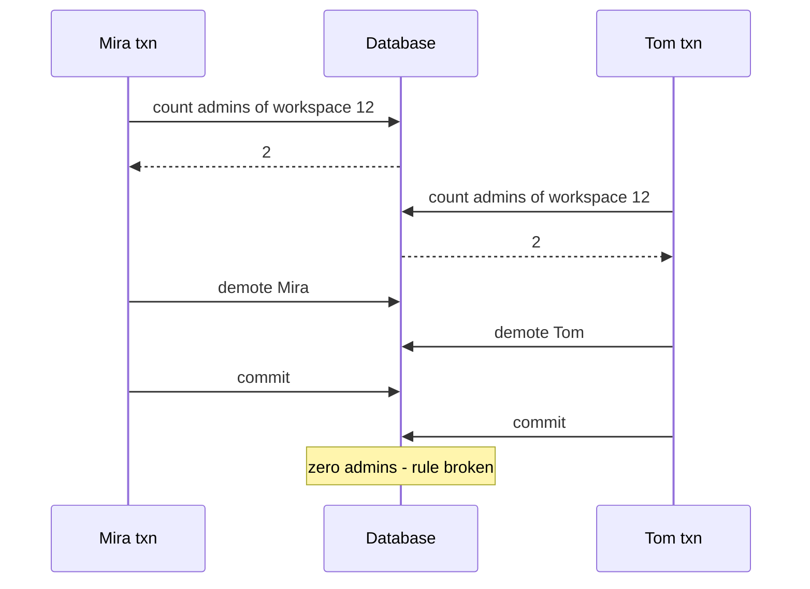

# Lost updates, write skew and phantoms

The previous lesson dealt with what a transaction may **read** while others are writing. Read committed and snapshot isolation give sensible answers to that question. They say much less about what happens when two transactions **write** at the same time - and that is where the costliest concurrency bugs live.

Dirty writes are prevented at every isolation level in practical use. Three subtler conflicts are not: the **lost update**, in which two writers of the *same* object overwrite each other; **write skew**, in which two writers of *different* objects jointly break a rule; and **phantoms**, where the conflict involves rows that do not exist yet. This lesson explains each of them, shows them happening in runnable code, and collects the tools for preventing them. If you remember one thing, let it be this: **snapshot isolation is not serialisability**, and the gap between the two has a precise shape.

## 1. The lost update

Almost every application contains code of this form:

```text
value = read(x)
value = some_function(value)
write(x, value)
```

A **read-modify-write cycle**. When two such cycles on the same object overlap, each computes its result from the old value, and whoever writes second erases the other's work. Examples:

- A "likes" counter: two requests read 41, both write 42. One like has vanished.
- A JSON document holding a list of tags: two editors each add a tag to their own copy and save the whole document; one tag is gone.
- A collaborative text field where every save sends the full text: the slower saver wipes out the faster one's edits.

```python-run
import random

def run(schedule):
    """schedule: sequence of client ids; each client does READ then WRITE(value + 1)."""
    counter, local, step = 41, {}, {}
    for c in schedule:
        if step.get(c, 0) == 0:
            local[c] = counter              # read
            step[c] = 1
        else:
            counter = local[c] + 1          # write based on what it read earlier
    return counter

print("serial      A A B B ->", run("AABB"))
print("interleaved A B A B ->", run("ABAB"))

random.seed(0)
lost = 0
for _ in range(10_000):
    ops = list("AABB"); random.shuffle(ops)
    lost += run(ops) != 43
print(f"random interleavings that lose an increment: {lost / 100:.0f}%")
```

Two thirds of the possible orderings lose an update. In production the window between read and write is short, so the bug shows up rarely - which makes it worse, not better, since it survives testing.

There are five standard remedies.

### 1.1 Atomic write operations

The best fix is to avoid the cycle altogether by letting the database do the read and the write as one step:

```sql
UPDATE posts SET likes = likes + 1 WHERE id = 99;
```

The database executes this safely, typically by holding an exclusive lock on the row from the read to the write (sometimes called cursor stability) or by running such operations on a single thread. Document and key-value stores offer analogous operations: increment a field, append to a list, add to a set. Where an atomic operation expresses what you need, use it.

The trap is the object-relational mapper. Code like `post.likes += 1; post.save()` looks harmless and is exactly the unsafe read-modify-write cycle, carried out in application memory.

### 1.2 Explicit locking

When the new value depends on logic the database cannot run - validating a move in a board game, say, where several rows must be inspected - the application can lock the rows it is about to change:

```sql
BEGIN;
SELECT * FROM pieces WHERE game_id = 7 AND player = 'white' FOR UPDATE;
-- check that the move is legal in application code
UPDATE pieces SET square = 'e4' WHERE id = 311;
COMMIT;
```

`FOR UPDATE` tells the database to lock every row the query returns until the transaction ends; a second transaction issuing the same read waits. This works, provided nobody forgets the clause anywhere in the code base.

### 1.3 Automatic detection

Instead of preventing overlap, let the cycles run concurrently and have the database notice afterwards that one of them would overwrite a change it never saw; that transaction is aborted and must retry. This fits naturally with snapshot isolation. You get it with repeatable read in PostgreSQL, with what Oracle calls serializable, and with SQL Server's snapshot level. **MySQL InnoDB's repeatable read does not** - one of the reasons it is sometimes said not to provide true snapshot isolation. Detection has a major advantage: it requires nothing from the application code, so it cannot be forgotten.

### 1.4 Compare-and-set

Without transactions, a conditional write does a similar job: perform the update only if the value is still what I read.

```sql
UPDATE documents SET body = :new_body, version = version + 1
WHERE id = 5 AND version = :version_i_read;
```

If the statement reports zero rows changed, somebody else got there first: reread and retry. This is **optimistic locking**, and the usual way to implement safe updates over an HTTP API (`If-Match` with an ETag). One caution: check that your database evaluates the condition against the current value and not against an old snapshot.

### 1.5 Replication changes the picture

Locks and compare-and-set presuppose that there is one authoritative copy of the data. In multi-leader and leaderless systems several nodes accept writes concurrently, so there is nothing to lock. Such systems let the conflicting versions (siblings) coexist and merge them afterwards. Operations that commute - incrementing a counter, adding to a set - merge cleanly, which is what CRDTs exploit. **Last write wins**, the default in many replicated stores, is by definition a lost update.

```python-run
# Compare-and-set with retries: no update is lost, whatever the interleaving.
import random
random.seed(1)

store = {"value": 0, "version": 0}

def cas(expected_version, new_value):
    if store["version"] != expected_version:
        return False
    store.update(value=new_value, version=store["version"] + 1)
    return True

pending = {c: None for c in "ABCDE"}          # each client wants to add 1 exactly once
retries = 0
while pending:
    c = random.choice(list(pending))
    if pending[c] is None:
        pending[c] = dict(store)              # read value and version
    else:
        snap = pending[c]
        if cas(snap["version"], snap["value"] + 1):
            del pending[c]
        else:
            pending[c] = None; retries += 1   # conflict: read again
print("final value:", store["value"], "| retries needed:", retries)
```

## 2. Write skew

Now a conflict that none of the remedies above touches, because the two transactions never write the same object.

A company's admin console has a rule: **every workspace must keep at least one administrator**. Mira and Tom are the only two admins of a workspace. Both decide, at the same moment, to give up their admin role. The application handles each request like this:

```sql
BEGIN;
SELECT count(*) FROM members WHERE workspace_id = 12 AND role = 'admin';   -- returns 2
-- application: 2 >= 2, so removing one is allowed
UPDATE members SET role = 'member' WHERE workspace_id = 12 AND user_id = :me;
COMMIT;
```

Under snapshot isolation both transactions see two admins. Both conclude it is safe. Mira's transaction updates Mira's row; Tom's updates Tom's row. There is no dirty write and no lost update, since the rows are different. Both commit, and the workspace has no administrator and no one who can fix that.



This is **write skew**. It generalises the lost update: two transactions read the same data and then write, but the writes go to different objects. Had they run one after the other, the second would have counted one admin and refused.

### 2.1 The pattern

Every instance of write skew has the same three steps:

1. A `SELECT` checks a condition by searching for rows (are there at least two admins? is the slot free? is the name unused? is there enough budget?).
2. Application code decides, from the result, whether to go ahead.
3. A write (`INSERT`, `UPDATE` or `DELETE`) is made, and **this write changes the answer to the query in step 1**.

When two transactions both pass step 1 before either commits step 3, each has acted on a premise that the other has just invalidated.

More examples of the same shape:

- **Double booking.** Check that no reservation overlaps the requested time for a machine in a lab; if none, insert one. Two people book the same hour.
- **Unique name.** Check that no account has the handle; if none, insert. Two accounts with the same handle. (Here a unique constraint is the simple cure.)
- **Budget cap.** Sum the spending of a team this month; if adding the new purchase stays below the cap, insert it. Two purchases together exceed the cap.
- **One-per-customer voucher.** Check the customer has not redeemed it; insert a redemption. Redeemed twice from two browser tabs.
- **Game move.** Check the target position is empty; move there. Two pieces on one square.

### 2.2 What does not help, and what does

- Atomic single-object operations: irrelevant, several objects are involved.
- Automatic lost-update detection: it does not trigger, because nobody overwrote anybody.
- Database constraints: a unique constraint or a foreign key helps for the special cases they express. Most databases have no constraint that spans several rows ("at least one admin"), though triggers or materialised views can sometimes be used.

What does work:

- **Serializable isolation** - the real thing, covered in the next lesson. This is the preferred answer.
- **Explicitly lock the rows the decision depends on**:

```sql
BEGIN;
SELECT * FROM members WHERE workspace_id = 12 AND role = 'admin' FOR UPDATE;
-- now only one of the two transactions gets past this line at a time
UPDATE members SET role = 'member' WHERE workspace_id = 12 AND user_id = :me;
COMMIT;
```

## 3. Phantoms

The locking trick worked for the admins because step 1 returned rows, and rows can be locked. Look at the booking example again: the query checks that **no** reservation exists for the slot. It returns nothing. `SELECT ... FOR UPDATE` has nothing to attach a lock to.

When one transaction's write alters what another transaction's search would return, the effect is called a **phantom**. Snapshot isolation protects *read-only* queries from phantoms - a snapshot does not change. In read-write transactions of the check-then-insert kind, phantoms are precisely what produces write skew.

### Materialising conflicts

If the difficulty is that there is no object to lock, one can create objects. For lab bookings, add a table with a row for every machine and every one-hour slot for the next six months. A booking transaction first locks (`FOR UPDATE`) the slot rows it wants, then checks for overlaps and inserts. The slot table stores no information of its own; its rows exist purely to be locked. The phantom has been turned into a lock conflict on concrete rows - hence **materialising conflicts**.

It works, and it is unpleasant. Working out how to materialise a given conflict can be hard, the lock table must be maintained, and a concurrency-control mechanism has leaked into the data model. Treat it as a last resort when serialisable isolation is not available.

```python-run
# Snapshot isolation simulated: each transaction reads its snapshot, buffers writes, then commits.
def simulate(protect):
    bookings = []                                    # committed (machine, hour, who)
    slot_locks = {}                                  # materialised lock rows: (machine, hour) -> holder
    log = []

    def txn(who, machine, hour):
        snapshot = list(bookings)                    # snapshot taken at start
        if protect:
            holder = slot_locks.setdefault((machine, hour), who)
            if holder != who:
                log.append(f"{who} waits for {holder}, then re-reads and sees the slot is taken")
                return None
        free = not any(m == machine and h == hour for m, h, _ in snapshot)
        return (machine, hour, who) if free else None

    # both transactions run their check before either commits
    a = txn("ana", "laser-cutter", 14)
    b = txn("raj", "laser-cutter", 14)
    for row in (a, b):
        if row: bookings.append(row)                 # commit
    return bookings, log

print("snapshot isolation only :", simulate(protect=False)[0])
rows, log = simulate(protect=True)
print("with materialised locks :", rows, "|", log[0])
```

Without protection both inserts commit: a double booking. With a lock row per slot, the second transaction is forced to wait and then sees the first one's booking.

## 4. A map of the anomalies

| Anomaly | What happens | Read committed | Snapshot isolation | Serializable |
|---|---|---|---|---|
| Dirty read | See uncommitted data | prevented | prevented | prevented |
| Dirty write | Overwrite uncommitted data | prevented | prevented | prevented |
| Read skew | See different points in time within one transaction | possible | prevented | prevented |
| Lost update | Concurrent read-modify-write on one object; one result is erased | possible | prevented by some implementations, not all | prevented |
| Write skew | Decisions on a stale premise; writes to different objects | possible | **possible** | prevented |
| Phantom | Another transaction's write changes the result of a search | possible | prevented for read-only queries; **causes write skew** in read-write ones | prevented |

> [!INTERVIEW]
> A typical question: "Two users book the last seat at the same time. How do you stop a double booking?" Offer the options in order of preference and name their trade-offs: a **unique constraint** on (event, seat) if seats are discrete - the simplest and safest; an **atomic conditional update** such as `UPDATE seats SET holder = :me WHERE id = :seat AND holder IS NULL` and check the affected row count; `SELECT ... FOR UPDATE` on the seat row; or **serializable** isolation with a retry loop. Then mention what does *not* work: a check followed by an insert under read committed or snapshot isolation.

## 5. Worked example: which fix for which rule?

A good exercise is to take the rules of one small application and decide, for each, the cheapest mechanism that enforces it. Take a ticketing service for workshops.

**"A workshop's `seats_sold` counter must be accurate."** Each sale increments one row. This is a pure read-modify-write on a single object, so an atomic `UPDATE workshops SET seats_sold = seats_sold + 1` is enough. No lock, no retry loop.

**"Never sell more seats than the capacity."** The check and the increment can be fused into one conditional statement: `UPDATE workshops SET seats_sold = seats_sold + 1 WHERE id = :w AND seats_sold < capacity`. If it reports zero affected rows, the workshop is full. The condition and the write are evaluated together on the current row, so two concurrent buyers cannot both take the last seat. A `CHECK (seats_sold <= capacity)` constraint is a good second line of defence.

**"A person can hold at most one ticket per workshop."** This is a check for absence followed by an insert - a phantom. But the rule is exactly a uniqueness rule, so a unique index on `(workshop_id, person_id)` enforces it at any isolation level; the application merely handles the constraint violation.

**"An instructor cannot teach two workshops at overlapping times."** Again a check for absence, but this time over a *range*, which a plain unique index cannot express. Options: an exclusion constraint over a time-range column where the database supports one (PostgreSQL does), materialised lock rows per instructor and hour, locking the instructor's row with `FOR UPDATE` before checking (a coarse lock on a row that does exist), or serialisable isolation.

**"A discount code may be redeemed at most 100 times in total, across all workshops."** A count over many rows followed by an insert. A constraint cannot count rows. Either keep a counter row for the code and use the conditional-update technique on it - turning a multi-row invariant into a single-row one - or run the transaction at the serialisable level.

The general method: first try to express the rule as a **constraint**; if that fails, try to **funnel the conflict onto one existing row** that can be updated atomically or locked; only when neither is possible reach for materialised locks or serialisable isolation. Whatever you choose, write down next to the rule *which* mechanism protects it, because the next developer to touch that code needs to know what must not be removed.

## Pitfalls

- **Read-modify-write hidden in an ORM.** Loading an object, changing a field and saving it is a lost update waiting to happen. Use atomic updates or version columns.
- **Assuming "repeatable read" detects lost updates.** PostgreSQL's does; MySQL InnoDB's does not.
- **Forgetting `FOR UPDATE` in one code path.** Explicit locking protects only if every writer uses it.
- **Trying to lock rows that do not exist.** A check for absence cannot be protected with row locks; use a constraint, a materialised lock row, or serialisable isolation.
- **Checking invariants only in application code.** Wherever a constraint can express the rule (unique, foreign key, check, exclusion), declare it; it holds at every isolation level.
- **Using last-write-wins in a replicated store for data where every write matters.**
- **No retry logic.** Detection-based approaches abort transactions; code that does not retry turns a prevented anomaly into a user-visible error.

## Summary

- A **lost update** is two overlapping read-modify-write cycles on one object. Prevent it with **atomic operations**, **explicit locks**, **automatic detection** (in databases that offer it), or **compare-and-set**; in multi-leader and leaderless systems, use mergeable data types instead of last-write-wins.
- **Write skew** is the generalisation to different objects: each transaction checks a condition, acts on it, and its write invalidates the condition the other relied on. Snapshot isolation allows it.
- A **phantom** is a write that changes the result of another transaction's search. When the check is for the *absence* of rows there is nothing to lock.
- Remedies for write skew: **constraints** where they fit, **locking the rows the premise depends on**, **materialising conflicts** as a last resort, and above all **serialisable isolation**.

```quiz
[
  {"q": "Two requests each read a counter with value 41 and each write back 42. What is this anomaly called?",
   "options": ["Dirty read", "Lost update", "Phantom", "Read skew"],
   "answer": 1,
   "explain": "Both performed a read-modify-write cycle on the same object from the same old value, and the later write erased the earlier one."},
  {"q": "Which statement avoids the lost update without any explicit lock or retry in the application?",
   "options": ["SELECT likes FROM posts WHERE id = 1; then UPDATE posts SET likes = :computed", "UPDATE posts SET likes = likes + 1 WHERE id = 1", "SELECT likes FROM posts WHERE id = 1 twice and compare", "INSERT INTO posts SELECT * FROM posts"],
   "answer": 1,
   "explain": "The increment is performed atomically inside the database, so there is no window between reading and writing."},
  {"q": "An UPDATE ... WHERE id = 5 AND version = 7 reports zero rows affected. What should the application do?",
   "options": ["Assume success", "Reread the row and retry, because another writer changed it in the meantime", "Drop the table", "Lower the isolation level"],
   "answer": 1,
   "explain": "This is compare-and-set, also called optimistic locking. A failed condition means the value was modified since it was read."},
  {"q": "Two admins of a workspace simultaneously remove their own admin role after each checking that two admins exist. Under snapshot isolation both commit. Why is this not detected as a lost update?",
   "options": ["Because the transactions were read-only", "Because each transaction wrote a different row, so no write was overwritten", "Because snapshot isolation never aborts transactions", "Because the count query was too slow"],
   "answer": 1,
   "explain": "Write skew involves writes to different objects that together violate an invariant. Lost-update detection only looks at conflicting writes to the same object."},
  {"q": "What is a phantom?",
   "options": ["A row that was deleted and vacuumed", "A write in one transaction that changes the result of a search query in another transaction", "A transaction that never commits", "An index entry without a row"],
   "answer": 1,
   "explain": "The classic case is check-then-insert: the check searched for rows matching a condition, and a concurrent insert adds one."},
  {"q": "Why does SELECT ... FOR UPDATE not prevent a double booking when the check is that no overlapping booking exists?",
   "options": ["FOR UPDATE is not supported for bookings", "The query returns no rows, so there is nothing for the lock to attach to", "FOR UPDATE only works in read committed", "Locks are released immediately"],
   "answer": 1,
   "explain": "Row locks need rows. A condition about the absence of rows requires a constraint, materialised lock rows, or serialisable isolation."},
  {"q": "What does materialising conflicts mean?",
   "options": ["Storing conflict logs for auditing", "Creating rows whose only purpose is to be locked, so that a phantom becomes a lock conflict on concrete rows", "Converting a table into a materialised view", "Replaying aborted transactions"],
   "answer": 1,
   "explain": "For example, a row per room and time slot that booking transactions lock before checking. It works but leaks concurrency control into the data model."},
  {"q": "Which isolation level prevents write skew?",
   "options": ["Read committed", "Snapshot isolation", "Serializable", "Read uncommitted"],
   "answer": 2,
   "explain": "Only serialisable isolation guarantees the result equals some serial order, in which the second transaction would have seen the first one's write."}
]
```

> **Source:** DDIA ch. 7 (Transactions) - preventing lost updates, write skew and phantoms. Written in original wording with original examples.
