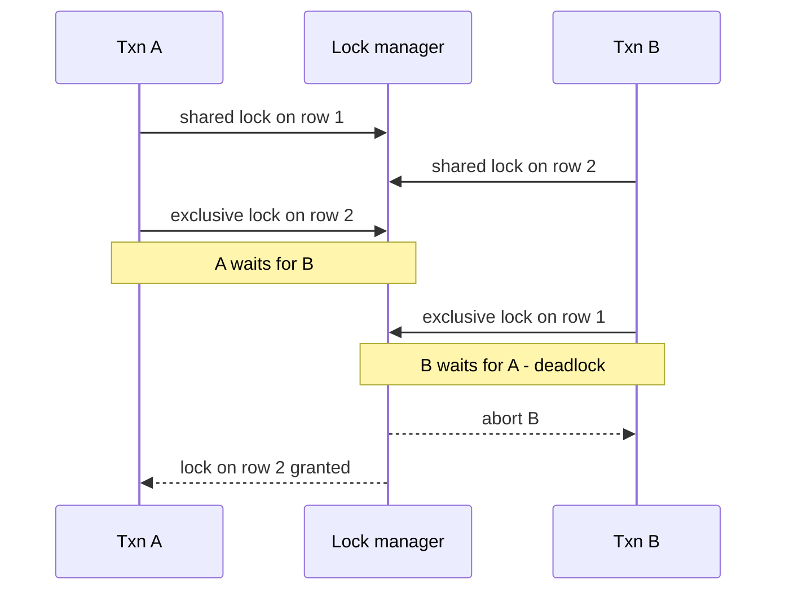

# Serializability: serial execution, 2PL and SSI

> **Before this lesson:** read [ACID, read committed and snapshot isolation](#/lesson/databases/acid-weak-isolation) and [Lost updates, write skew and phantoms](#/lesson/databases/lost-updates-write-skew). You need: transaction, commit, abort, lock, snapshot isolation, MVCC, write skew, phantom and premise. Partitions come from [Partitioning key-value data](#/lesson/databases/partitioning-keys), and tail latency from [Scalability](#/lesson/databases/scalability-percentiles).

## In plain words

The last two lessons listed the bugs that appear when transactions overlap, and a different patch for each. **Serializable isolation** is the level at which the list is empty. It promises that however the transactions overlapped in reality, the final result is one that could have come from running them strictly one after another. If each transaction is correct when run alone, any mixture of them is correct.

An everyday picture: a shop with one fitting room. There are three ways to make sure two customers never end up in it together.

1. **One customer in the shop at a time.** Nothing can clash, and the queue outside is long. This is **serial execution**.
2. **A lock on the fitting-room door.** Anyone may enter the shop, but whoever wants the room must wait until it is free, and keeps it until they leave. People sometimes block each other. This is **two-phase locking**.
3. **No lock, and a check at the till.** Everyone moves freely. At the till, the cashier checks whether anything a customer relied on was changed by someone who paid before them. If so, that customer has to start their shopping again. This is **serializable snapshot isolation**.

All three guarantee a correct outcome. They differ in who pays and how: by queueing, by waiting, or by starting over.

One term before going on. A **thread** is one sequence of instructions being carried out by a processor. A program with several threads does several things at once; a **single-threaded** program does one thing at a time.

Why this matters for a job: choosing an isolation level is a design decision with real consequences, and "why not make everything serializable?" is a classic interview question. To answer it you need to know what each of the three methods costs. You will also meet their side effects in production: deadlock errors, "could not serialize access" errors, and requests that mysteriously wait.

## Why a stronger guarantee is worth having

The last two lessons catalogued the ways concurrent transactions can go wrong under weak isolation: read skew, lost updates, write skew, phantoms. Each has its own workaround, each workaround has to be remembered in every code path, and there is no tool that will tell you whether your application as a whole is safe at a given level. That is an uncomfortable way to build software.

**Serializable isolation** removes the catalogue. It guarantees that, although transactions may actually run at the same time, the end result is identical to the result of *some* execution in which they ran one at a time, in a row. If each transaction is correct when run alone, any mix of them is correct together. All race conditions are excluded by construction.

If it is that good, why is it not always on? Because it has to be implemented somehow, and every implementation charges a price. There are three in real use, and they differ greatly:

1. **Actually running transactions serially**, one at a time on one thread.
2. **Two-phase locking (2PL)**, for decades the only practical method.
3. **Serializable snapshot isolation (SSI)**, an optimistic technique from 2008.

Knowing how each works tells you when serialisability is affordable.

## 1. Actual serial execution

The bluntest way to avoid concurrency problems is to have no concurrency: execute one transaction at a time, start to finish, on a single thread. The result is serial by definition.

For thirty years this was considered hopelessly slow. Two changes made it viable around 2007:

- **Memory became cheap enough** to hold the whole active dataset. A transaction that never waits for a disk read finishes in microseconds.
- Database designers recognised that **OLTP transactions are short** and touch few rows. Long analytical queries are read-only and can run separately on a snapshot.

VoltDB (and its research ancestor H-Store), Redis and Datomic work this way. A single-threaded engine can even be faster than a multi-threaded one because it spends nothing on locking and coordination - but its throughput is capped by one CPU core.

### 1.1 The whole transaction must arrive at once

Traditional transactions are conversations: the application sends a query, looks at the result, sends another. On a single-threaded server that style is fatal, since the one thread would sit idle during every network round trip while all other transactions queue behind it.

Serial engines therefore refuse interactive multi-statement transactions. The application must hand over the **complete transaction logic as a stored procedure**; the database executes it in one go, with all data in memory, without ever waiting for the client.

A **stored procedure** is a piece of program code that is kept inside the database and run there. The application does not send statements one by one. It sends a single request, "run procedure X with these inputs", and the database does all the reading, deciding and writing by itself.

Stored procedures earned a poor reputation in the past: each vendor had its own awkward language, the code lived inside the database where it was hard to version, test and monitor, and one badly written procedure could slow down every application sharing the server. Modern systems soften this by using ordinary languages - Java or Groovy in VoltDB, Clojure in Datomic, Lua in Redis.

If procedures are deterministic, they also provide a neat replication method: instead of shipping data changes, run the same procedure in the same order on every replica.

A procedure is **deterministic** if it always produces the same result from the same inputs and the same starting data: no random numbers, no reading of the clock.

The program below is a serial database in a few lines, used on the administrator example from the previous lesson.

```python-run
import random, time

class SerialDB:
    """One thread, whole transactions as functions - Redis and VoltDB in miniature."""
    def __init__(self, data): self.data, self.queue = dict(data), []
    def submit(self, proc, *args): self.queue.append((proc, args))
    def run(self):
        results = []
        for proc, args in self.queue:            # strictly one at a time
            results.append(proc(self.data, *args))
        self.queue.clear()
        return results

def give_up_admin(data, workspace, user):
    admins = [u for (w, u), role in data.items() if w == workspace and role == "admin"]
    if len(admins) < 2:
        return f"{user}: refused, last admin"
    data[(workspace, user)] = "member"
    return f"{user}: ok"

db = SerialDB({(12, "mira"): "admin", (12, "tom"): "admin"})
db.submit(give_up_admin, 12, "mira")
db.submit(give_up_admin, 12, "tom")              # the "concurrent" request runs second
print(db.run())
print(db.data)
```

What each part does:

- `SerialDB` holds the data in a dictionary and a queue of submitted procedures.
- `submit` adds a procedure and its arguments to the queue. Nothing runs yet.
- `run` takes the queued procedures one at a time and calls each with the data. Each one finishes completely before the next begins. That loop is the whole of the concurrency control.
- `give_up_admin` is the stored procedure. It lists the administrators of the workspace, refuses if fewer than two remain, and otherwise changes this user's role to member.
- Two requests are submitted, one from Mira and one from Tom, as if they had arrived at the same moment.

```
['mira: ok', 'tom: refused, last admin']
{(12, 'mira'): 'member', (12, 'tom'): 'admin'}
```

The write-skew example from the previous lesson cannot occur: the second procedure runs after the first has finished and sees one remaining admin.

### 1.2 Scaling with partitions

To use more than one core, split the data into partitions and give each its own single-threaded executor. Transactions that stay inside one partition scale linearly with the number of cores. A transaction that needs several partitions must be coordinated across all of them, and that is slower by orders of magnitude - on the order of a thousand such transactions per second in VoltDB's reports, and adding machines does not help.

Whether this works for you depends on the shape of your data. Key-value workloads partition easily. Data with several secondary indexes, or many cross-entity transactions, does not.

### 1.3 When serial execution fits

- Every transaction is **small and fast**; one slow one stalls everything.
- The active dataset **fits in memory**. (Rarely used data can live on disk, with a transaction aborted and restarted once the data has been fetched - anti-caching.)
- Write throughput is low enough for **one core**, or the data partitions cleanly.
- Cross-partition transactions are **rare**.

## 2. Two-phase locking

Two-phase locking predates everything else in this lesson. (It has nothing to do with two-phase *commit* despite the similar name.) Its rule is stricter than the "writers lock out writers" of weaker levels:

- Many transactions may read the same object at once, as long as nobody is writing it.
- A transaction that wants to **write** an object needs it exclusively: it waits for all readers and writers of that object to finish, and while it holds the object, everyone else waits - readers included.

So **writers block readers and readers block writers**. Compare snapshot isolation, whose slogan is the opposite. That mutual blocking is what closes the door on lost updates and write skew.

### 2.1 Mechanics

Each object has a lock that can be held in **shared** or **exclusive** mode.

- To read, acquire the lock in shared mode. Several transactions may share it; if another holds it exclusively, wait.
- To write, acquire it in exclusive mode. If anyone else holds it in any mode, wait.
- A reader that decides to write **upgrades** its shared lock to exclusive.
- Locks are kept **until the transaction commits or aborts**.

The name comes from the two phases: locks are acquired as the transaction proceeds (growing phase) and all released at the end (shrinking phase).

With so many locks held, two transactions can easily each hold what the other needs. The database detects such **deadlocks** and aborts one of the transactions, which the application must retry.

A **deadlock** is exactly that situation: transaction A is waiting for a lock that B holds, while B is waiting for a lock that A holds. Neither can ever proceed unless something outside intervenes. The part of the database that hands out locks is called the **lock manager**, and it is the one that notices the cycle and breaks it.



Read the diagram from the top. A takes a shared lock on row 1 and B takes one on row 2. Then A asks for row 2 exclusively and must wait for B. B asks for row 1 exclusively and must wait for A. The lock manager sees that each is waiting for the other, aborts B, and A can go on.

### 2.2 The price

2PL is used by the serializable level of MySQL InnoDB and SQL Server and by DB2's repeatable read. It is correct, and it is slow in a particular way:

- Acquiring and releasing locks costs CPU, but the real loss is **concurrency**: any two transactions that might conflict are forced to wait for one another.
- Nothing limits how long the waiting lasts. One transaction that reads a large part of a table, or that takes a long time for any other reason, holds up a queue of others behind it. **Tail latencies are unstable**: the 99th percentile of response time can be terrible even when the median is fine.
- Deadlocks are much more frequent than under weaker levels, and each one throws away work.

### 2.3 Locking things that are not there yet

Row locks do not stop phantoms: a transaction that checked "no booking for this machine at 14:00" holds no lock that would prevent somebody else from inserting one. Serializable 2PL needs a way to lock the *condition*.

A **predicate lock** belongs to a search condition, not to a row. A transaction that ran

```sql
SELECT * FROM bookings WHERE machine_id = 3 AND starts_at < '15:00' AND ends_at > '14:00';
```

holds a shared predicate lock on that condition. Anyone who wants to insert, update or delete a row *matching it* must wait - and conversely, a transaction wanting such a predicate lock must wait if another transaction has a matching uncommitted write. The lock covers rows that do not exist yet. Together with 2PL this prevents all write skew.

Checking every write against every active predicate is expensive, so real systems approximate with **index-range locks** (also called next-key locks). The idea is to lock *more* than strictly necessary, in a form that is cheap to check:

- Instead of the exact time interval on machine 3, lock *all* bookings of machine 3, by attaching a shared lock to the entry for `machine_id = 3` in that index.
- Or lock all bookings in the relevant time range across all machines, via an index on the time columns.

A writer that wants to insert a conflicting booking has to update that same part of the index, meets the lock and waits. A coarser lock blocks a few transactions that did not really conflict, but it has far lower overhead. If no suitable index exists, the database falls back to locking the whole table.

The program below is a tiny lock manager, used on the same two administrators.

```python-run
class LockManager:
    def __init__(self): self.locks = {}                       # obj -> (mode, holders)
    def acquire(self, txn, obj, mode):
        cur_mode, holders = self.locks.get(obj, (None, set()))
        if not holders or holders == {txn}:
            new_mode = "X" if mode == "X" or cur_mode == "X" else "S"
            self.locks[obj] = (new_mode, {txn}); return True
        if mode == "S" and cur_mode == "S":
            holders.add(txn); return True
        return False                                          # must wait
    def release_all(self, txn):
        for obj in list(self.locks):
            mode, holders = self.locks[obj]
            holders.discard(txn)
            if not holders: del self.locks[obj]

lm = LockManager()
# Both transactions read the admin list of workspace 12 through the same index range
print("mira S-lock on index range workspace=12:", lm.acquire("mira", "idx:workspace=12", "S"))
print("tom  S-lock on index range workspace=12:", lm.acquire("tom",  "idx:workspace=12", "S"))
# Each now wants to change a row inside that range -> needs the range exclusively
print("mira upgrade to X:", lm.acquire("mira", "idx:workspace=12", "X"), "(waits for tom)")
print("tom  upgrade to X:", lm.acquire("tom",  "idx:workspace=12", "X"), "(waits for mira) -> deadlock")
lm.release_all("tom")                                         # victim chosen, tom aborts and retries
print("after aborting tom, mira upgrade:", lm.acquire("mira", "idx:workspace=12", "X"))
```

What each part does:

- `self.locks` maps each locked object to a pair: the mode (`"S"` for shared, `"X"` for exclusive) and the set of transactions holding it.
- `acquire(txn, obj, mode)` returns `True` if the lock is granted and `False` if the transaction would have to wait. If nobody holds the lock, or only this same transaction does, it is granted (and becomes exclusive if exclusive was asked for). If the request is for shared and the lock is held shared, the transaction joins the holders. In every other case the answer is "wait".
- `release_all(txn)` removes a transaction from every lock it holds, which is what happens at commit or abort.
- The script has both transactions take a shared lock on the part of the index that covers workspace 12, standing for "I have read the list of administrators". Each then asks to upgrade to exclusive in order to change a row in that range.

```
mira S-lock on index range workspace=12: True
tom  S-lock on index range workspace=12: True
mira upgrade to X: False (waits for tom)
tom  upgrade to X: False (waits for mira) -> deadlock
after aborting tom, mira upgrade: True
```

Both shared locks are granted, since readers do not block readers. Neither upgrade is granted, because each is blocked by the other's shared lock. That is a deadlock. Once Tom's transaction is aborted and its locks released, Mira's upgrade succeeds. Tom's retry will then count one administrator and refuse.

The skew is prevented - at the cost of a deadlock and a retry. That is 2PL in miniature: always safe, sometimes painful.

## 3. Serializable snapshot isolation

Serial execution does not scale, 2PL does not perform, and weak levels are not safe. **Serializable snapshot isolation** tries to escape the dilemma: full serialisability with a performance penalty that is small compared with snapshot isolation. It was first described in 2008 and is what PostgreSQL has used for its `SERIALIZABLE` level since version 9.1; FoundationDB applies a similar idea across machines.

### 3.1 Pessimistic and optimistic

2PL is **pessimistic**: if something could go wrong, wait until it cannot. It is mutual exclusion applied to data. Serial execution is pessimism taken to the extreme - every transaction holds a lock on the entire database.

SSI is **optimistic**: let transactions proceed without blocking, and check at commit time whether anything bad actually happened. If so, abort and let the application retry.

Optimistic schemes do badly under heavy contention, since many transactions abort and their retries add load to a system that is already struggling. With spare capacity and moderate contention they do well, because most transactions never wait for anything. Contention can often be reduced with commutative atomic operations - concurrent increments of a counter do not conflict if nobody reads the value in the same transaction.

As the name says, SSI builds on snapshot isolation: every read comes from a consistent snapshot. On top of that it adds a mechanism to detect serialisation conflicts among writes.

Three words in that passage deserve a definition. **Mutual exclusion** means allowing only one party at a time to use something. **Contention** is the degree to which transactions compete for the same data: high contention means many of them want the same rows at the same moment. Operations are **commutative** if they give the same result in either order, as two additions to a counter do.

### 3.2 The outdated premise

Recall the pattern of write skew: a transaction reads something, takes a decision based on it, and writes. By the time it commits, the thing it read may no longer be true. The decision rested on a **premise** - "there are two admins" - that was valid at the start and stale at the end.

The database cannot know how the application used a query result. To be safe it must assume that **any change to the result of an earlier query might invalidate the transaction's writes**. So it needs to notice when a transaction has acted on a result that is no longer current. There are two cases.

### 3.3 Case one: the read was already stale

Under MVCC a reader ignores writes by transactions that were uncommitted when its snapshot was taken. Suppose Tom's transaction reads the admin list and, by the visibility rules, ignores Mira's not-yet-committed demotion. If Mira then commits, Tom has read a value that was out of date before he even wrote.

The database tracks, for each transaction, the uncommitted writes it ignored. When the transaction wants to commit, it checks whether any of those writes have since been committed. If yes, abort.

Why wait until commit instead of aborting at once? Because the reader might turn out to be read-only, in which case there is nothing to protect, or the other transaction might abort, in which case the read was not stale after all. Avoiding needless aborts preserves snapshot isolation's good behaviour for long-running readers.

### 3.4 Case two: a write arrives after the read

The other order: Tom reads the admin list, and *afterwards* Mira writes to it.

Here the database uses the same index-range information as 2PL, with a different purpose. When a transaction reads through an index entry, the database notes that fact. When another transaction later writes into that range, it looks up which transactions have recently read it. It does **not** block. The note acts as a **tripwire**: the reader is informed that what it read may have changed.

Both Mira and Tom are thus told that their reads have been affected by the other's write. The first to commit succeeds. When the second tries to commit, the conflicting write has been committed, so it is aborted.

The program below is a much simplified SSI engine, applied once more to Mira and Tom.

```python-run
class SSI:
    def __init__(self, data):
        self.committed = dict(data); self.txns = {}; self.clock = 0; self.history = []   # (commit_ts, keys)
    def begin(self, name):
        self.txns[name] = {"start": self.clock, "snap": dict(self.committed), "reads": set(), "writes": {}}
    def read(self, name, keys):
        t = self.txns[name]; t["reads"] |= set(keys)                 # remember what the decision depended on
        return {k: t["snap"][k] for k in keys}
    def write(self, name, key, value): self.txns[name]["writes"][key] = value
    def commit(self, name):
        t = self.txns.pop(name)
        if t["writes"]:                                             # read-only transactions never abort
            for ts, keys in self.history:
                if ts > t["start"] and keys & t["reads"]:
                    return f"{name}: ABORT - premise changed by a concurrent commit to {sorted(keys & t['reads'])}"
        self.clock += 1
        self.committed.update(t["writes"]); self.history.append((self.clock, set(t["writes"])))
        return f"{name}: commit"

db = SSI({"mira": "admin", "tom": "admin"})
for who in ("mira", "tom"):
    db.begin(who)
    admins = [u for u, r in db.read(who, ["mira", "tom"]).items() if r == "admin"]
    if len(admins) >= 2:
        db.write(who, who, "member")
print(db.commit("mira"))
print(db.commit("tom"))
db.begin("tom")                                                     # retry sees the new state
admins = [u for u, r in db.read("tom", ["mira", "tom"]).items() if r == "admin"]
print("tom retry sees admins =", admins, "-> request refused by application")
print(db.committed)
```

What each part does:

- `self.committed` is the committed data. `self.clock` counts commits. `self.history` records, for each commit, its commit number and the set of keys it wrote.
- `begin(name)` starts a transaction. It notes the current commit number as its start time, copies the committed data as its snapshot, and creates an empty set of keys read and an empty dictionary of pending writes.
- `read` returns values from the snapshot and adds the keys to the transaction's `reads` set. This is the "note" of section 3.4: the database remembers what the transaction's decision depended on.
- `write` stores the new value in the transaction's private `writes`. Nothing is visible to others yet.
- `commit` is where the check happens. A transaction with no writes commits at once. Otherwise the database looks through the history for any commit that happened *after this transaction started* and wrote a key that *this transaction read*. If it finds one, the premise is out of date and the transaction is aborted. If not, the writes are applied and added to the history.
- The script starts both transactions, has each read both administrators' roles and, seeing two, write its own demotion. Then Mira commits, Tom tries to commit, and Tom retries.

```
mira: commit
tom: ABORT - premise changed by a concurrent commit to ['mira']
tom retry sees admins = ['tom'] -> request refused by application
{'mira': 'member', 'tom': 'admin'}
```

Nobody waited for a lock. The conflict was detected at commit, one transaction was aborted, and on retry it saw the truth.

### 3.5 How SSI performs

- **No blocking.** As under snapshot isolation, readers and writers do not wait for one another, so latency is predictable. Read-only queries run on a snapshot and need no extra bookkeeping to stay consistent.
- **Not limited to one core.** Unlike serial execution, conflict detection can be distributed; FoundationDB does it across machines.
- **The abort rate is the governing quantity.** Tracking reads and writes in fine detail is precise but costs bookkeeping; tracking them coarsely is cheaper and aborts more transactions than strictly needed. A transaction that reads and writes over a long period is likely to hit a conflict, so SSI wants read-write transactions to be **short**. Long read-only ones are fine.

## 4. Choosing among the three

| | Serial execution | Two-phase locking | SSI |
|---|---|---|---|
| Approach | No concurrency | Pessimistic: wait | Optimistic: detect and abort |
| Blocking | Everything queues, briefly | Readers and writers block each other | None |
| Failure mode under contention | Queue grows | Lock queues, deadlocks, erratic tail latency | Aborts and retries |
| Scaling | One core per partition | Many cores | Many cores and machines |
| Needs | Short stored procedures, data in memory | Nothing special | Short read-write transactions, retry logic |
| Found in | VoltDB, Redis, Datomic | MySQL InnoDB and SQL Server serializable | PostgreSQL serializable, FoundationDB |

> [!INTERVIEW]
> "Why not run everything at serializable?" A balanced answer: it is the safest default and with SSI the overhead is often modest, so it deserves more use than it gets. The costs are that the application must handle serialisation failures by retrying whole transactions, that throughput drops under high contention, and - in lock-based implementations - that latency becomes unpredictable. Many teams therefore keep read committed and add targeted protection (constraints, atomic updates, `FOR UPDATE`) on the few critical paths; the risk of that choice is the path nobody thought about.

## Pitfalls

- **Assuming the level named `SERIALIZABLE` is serialisable.** In Oracle it is snapshot isolation. Check the documentation of your product and version.
- **No retry loop.** Both SSI and 2PL abort transactions (serialisation failure, deadlock). Code must catch these errors and rerun the *entire* transaction, including its reads.
- **Side effects inside a transaction that may be retried.** Send the email after commit, not during.
- **Long read-write transactions.** Under 2PL they hold locks and block others; under SSI they are likely to abort; under serial execution they stall the whole system.
- **Interactive transactions on a single-threaded engine.** Waiting for a user or a network call inside the critical section destroys throughput.
- **Missing indexes under 2PL.** Without a suitable index the range lock degenerates to a table lock.
- **Cross-partition transactions in a partitioned serial engine**, used casually, erase the benefit of partitioning.

## Summary

- **Serializability** means the outcome equals that of some one-at-a-time execution; it rules out every race condition, so application code need not reason about anomalies.
- **Serial execution** achieves it by really running one transaction at a time. It requires short transactions submitted as **stored procedures**, data in memory, and scales through partitioning as long as cross-partition transactions are rare.
- **Two-phase locking** uses shared and exclusive locks held until the end of the transaction, so readers and writers block each other; **predicate** or **index-range locks** prevent phantoms. It is correct but suffers from deadlocks and unstable latency.
- **SSI** is optimistic: transactions run on snapshots without blocking, the database tracks reads and detects when a transaction's **premise** has been invalidated by a concurrent write, and aborts it at commit. Performance depends on the abort rate.
- All three need the application to tolerate aborts; the choice depends on contention, transaction length and scale.

## Glossary

- **Serializable isolation (serializability)** - the result of overlapping transactions equals the result of running them one at a time in some order.
- **Thread / single-threaded** - one sequence of instructions being executed / doing only one thing at a time.
- **Serial execution** - really running one transaction at a time.
- **Interactive transaction** - a transaction in which the application sends statements one by one and waits for each result.
- **Stored procedure** - transaction logic stored in the database and run there in one go.
- **Deterministic** - always giving the same result from the same inputs and starting data.
- **Two-phase locking (2PL)** - readers take shared locks, writers take exclusive locks, and all locks are held until the transaction ends.
- **Shared / exclusive lock** - a lock many readers may hold together / a lock only one transaction may hold.
- **Lock upgrade** - changing a held shared lock to exclusive.
- **Lock manager** - the part of the database that grants and tracks locks.
- **Deadlock** - two or more transactions each waiting for a lock another holds.
- **Predicate lock** - a lock on a search condition, covering rows that match it now or in the future.
- **Index-range lock (next-key lock)** - a cheaper, broader substitute for a predicate lock, attached to a range of an index.
- **Pessimistic concurrency control** - preventing conflicts by making transactions wait.
- **Optimistic concurrency control** - letting transactions run freely and aborting one if a conflict is found at commit.
- **Mutual exclusion** - allowing only one party at a time to use something.
- **Contention** - how much transactions compete for the same data.
- **Commutative** - giving the same result in either order.
- **Serializable snapshot isolation (SSI)** - snapshot isolation plus detection of transactions whose premise has become outdated.
- **Premise** - what a transaction read and based its decision on.
- **Serialisation failure** - the error a database returns when it aborts a transaction to preserve serializability.
- **Abort rate** - the fraction of transactions that have to be aborted and retried.

```quiz
[
  {"q": "What does serializable isolation guarantee?",
   "options": ["Transactions are executed in the order they were submitted", "The result of concurrent execution is the same as that of some serial, one-at-a-time execution", "No transaction is ever aborted", "All replicas agree on the data"],
   "answer": 1,
   "explain": "Transactions may run in parallel, but the outcome must be equivalent to some serial order. Which order is not specified."},
  {"q": "Why do single-threaded serial databases require transactions to be submitted as stored procedures?",
   "options": ["SQL cannot express transactions", "Waiting for the client between statements would leave the only execution thread idle and block every other transaction", "Stored procedures use less memory", "To allow dirty reads"],
   "answer": 1,
   "explain": "With one thread, any network round trip inside a transaction stalls the whole system, so the complete logic must run inside the database without pauses."},
  {"q": "How does two-phase locking differ from the locking used under snapshot isolation?",
   "options": ["It uses no locks for writers", "Readers take shared locks, so readers and writers block each other", "It releases every lock immediately after use", "It only locks tables"],
   "answer": 1,
   "explain": "Under snapshot isolation readers never block writers. Under 2PL a reader blocks writers of the same object and vice versa, until the transaction ends."},
  {"q": "What problem do predicate locks or index-range locks solve?",
   "options": ["Slow disk writes", "Phantoms: they block inserts of rows that would match a condition another transaction has read, even though those rows do not exist yet", "Deadlock detection", "Replication lag"],
   "answer": 1,
   "explain": "Ordinary row locks cannot protect a check for absence. Locking the condition, or a superset of it through an index, does."},
  {"q": "Why can two-phase locking have very unstable tail latency?",
   "options": ["Locks are stored on slow disks", "A transaction may have to wait an unbounded time for others, and one slow or large transaction can hold up many behind it", "It takes a snapshot for every read", "It runs on a single thread"],
   "answer": 1,
   "explain": "Waiting is the mechanism, and nothing limits how long a lock holder runs. Deadlocks and retries add to the variance."},
  {"q": "SSI is called optimistic because:",
   "options": ["It assumes hardware never fails", "Transactions proceed without blocking and conflicts are checked at commit, aborting only when a violation is detected", "It never aborts transactions", "It locks the whole database for each transaction"],
   "answer": 1,
   "explain": "Instead of preventing conflicts by waiting, it lets them happen in isolation on snapshots and resolves them by aborting one side at commit time."},
  {"q": "In SSI, what does the database record when a transaction reads through an index range?",
   "options": ["An exclusive lock that blocks writers", "A non-blocking note, so that a later write to that range can flag the reader's premise as possibly outdated", "Nothing at all", "A copy of the entire table"],
   "answer": 1,
   "explain": "The note acts as a tripwire. Writers are not delayed, but the affected readers are checked at commit and aborted if the conflicting write has been committed."},
  {"q": "Which workload is a poor fit for SSI?",
   "options": ["Many short read-write transactions on mostly different rows", "Long-running read-only reports", "Long read-write transactions that all update the same few hot rows", "Point lookups"],
   "answer": 2,
   "explain": "High contention combined with long read-write transactions causes many aborts, and the retries add further load."}
]
```

> **Source:** DDIA ch. 7 (Transactions) - serializability: actual serial execution, two-phase locking, serializable snapshot isolation. Written in original wording with original examples.
