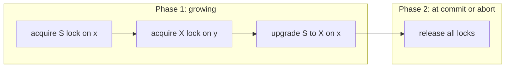
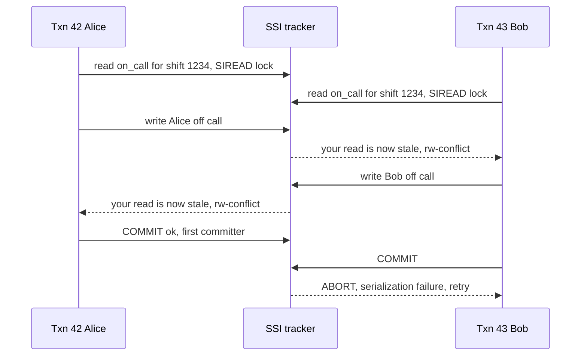

# Serializability: serial execution, 2PL and SSI

Weak isolation levels are confusing. Their names vary between databases, application code makes it hard to tell whether a given level is safe, and there are no good tools for detecting race conditions. Researchers have long had a simple answer: use **serializable** isolation.

**Serializable isolation** is the strongest isolation level. It guarantees that even though transactions may execute in parallel, the end result is the same as if they had executed **one at a time, serially**, without any concurrency. If transactions behave correctly when run individually, they continue to be correct when run concurrently. The database prevents **all** possible race conditions.

Why isn't everyone using it? Today's databases offer serializability with one of three techniques:

1. **Literally executing transactions in a serial order**
2. **Two-phase locking (2PL)**, which was the only viable option for several decades
3. **Optimistic concurrency control** such as **serializable snapshot isolation (SSI)**

## 1. Actual serial execution

The simplest way to avoid concurrency problems is to remove concurrency entirely and execute one transaction at a time, in serial order, on a **single thread**. This seems obvious, but databases designers only decided around 2007 that it was feasible, after 30 years of multi-threaded concurrency for performance. Two developments made it possible:

- **RAM became cheap enough** that for many use cases the entire active dataset fits in memory. A transaction that does not need to wait for disk runs far faster.
- Designers realised that **OLTP transactions are usually short** and make only a small number of reads and writes. Long-running analytic queries are typically read-only, so they can run on a consistent snapshot outside the serial execution loop.

Serial execution is used in **VoltDB/H-Store**, **Redis** and **Datomic**. A single-threaded system can sometimes perform better than one that supports concurrency, because it avoids the coordination overhead of locking. Its throughput is limited to that of a **single CPU core**.

### 1.1 Encapsulating transactions in stored procedures

In the early days, a database transaction was meant to encompass an entire flow of user activity, such as booking an airline ticket (search routes, fares, available seats, choose an itinerary, book seats, enter passenger details, pay). Humans are very slow to make up their minds, and a transaction waiting for user input would need a huge number of concurrent, mostly idle transactions. So most OLTP applications keep transactions short by committing within a single HTTP request.

Even so, in the interactive style many round trips occur between application and database: query, inspect result, possibly query again. A single-threaded database would spend most of its time waiting on the network. So systems with single-threaded serial processing **do not allow interactive multi-statement transactions**. The application must submit the **entire transaction code ahead of time** as a **stored procedure**. All data the transaction needs is in memory, so the procedure executes very fast without waiting for network or disk I/O.

Stored procedures have a bad reputation. Each vendor has its own language (Oracle PL/SQL, SQL Server T-SQL, PostgreSQL PL/pgSQL) that has not kept up with general-purpose programming languages. Code running in a database is hard to manage, debug, version-control, deploy, test and monitor. A badly written procedure in a database shared by many applications can do more harm than badly written application code.

Modern implementations use general-purpose languages instead: VoltDB uses Java or Groovy, Datomic uses Java or Clojure, and **Redis uses Lua**. With stored procedures and in-memory data, executing all transactions on a single thread becomes feasible. VoltDB also uses stored procedures for **replication**: instead of copying a transaction's writes, it executes the same stored procedure on each replica, which requires procedures to be **deterministic**.

```python-run
# Redis-style single-threaded executor running whole transactions as "stored procedures"
from collections import deque

store = {"alice": 100, "bob": 50, "seats_left": 1}
queue = deque()

def transfer(src, dst, amt):
    def proc(db):
        if db[src] < amt:
            return "insufficient funds"
        db[src] -= amt; db[dst] += amt
        return f"ok {src}->{dst} {amt}"
    return proc

def book_seat(user):
    def proc(db):
        if db["seats_left"] <= 0:
            return f"{user}: sold out"
        db["seats_left"] -= 1
        return f"{user}: booked"
    return proc

for p in [transfer("alice", "bob", 70), transfer("alice", "bob", 70),
          book_seat("ann"), book_seat("ben")]:
    queue.append(p)

while queue:                      # ONE thread: each procedure runs to completion
    print(queue.popleft()(store))
print(store)
```

### 1.2 Partitioning

Executing all transactions serially simplifies concurrency control but limits throughput to one CPU core. Read-only transactions can run elsewhere on snapshot isolation, but write-heavy applications need more. To scale to several cores and nodes, you can **partition** the data, and VoltDB supports this. If each transaction only reads and writes data within a **single partition**, each partition can have its own transaction-processing thread running independently, and throughput scales linearly with cores.

For any transaction that must access **multiple partitions**, the database must coordinate across all of them. The stored procedure must run in **lock-step** across all partitions to ensure serializability across the system. Cross-partition transactions have extra coordination overhead and are vastly slower. VoltDB reports a throughput of about **1,000 cross-partition writes per second**, orders of magnitude below its single-partition throughput, and it cannot be increased by adding machines. Whether transactions can be single-partition depends heavily on the structure of the data. Simple key-value data is easy to partition, but data with multiple secondary indexes is likely to need a lot of cross-partition coordination.

### 1.3 Summary of serial execution

Serial execution achieves serializability under specific constraints:

- Every transaction must be **small and fast**, because one slow transaction stalls all processing.
- It is limited to use cases where the **active dataset fits in memory**. Rarely accessed data could be on disk, but a transaction that touches it would be very slow. (Anti-caching can help: abort, fetch into memory asynchronously, then restart.)
- **Write throughput must be low enough** for a single CPU core, or transactions must be partitionable without cross-partition coordination.
- Cross-partition transactions are possible but have a hard limit on throughput.

## 2. Two-phase locking (2PL)

For around 30 years, there was only one widely used algorithm for serializability in databases: **two-phase locking (2PL)**.

> [!WARNING]
> **2PL is not 2PC.** Two-phase *locking* is about isolation within one database. Two-phase *commit* is about atomic commit across several nodes (Chapter 9). The names are similar but the ideas are completely different.

Locks are often used to prevent dirty writes: if two transactions write the same object concurrently, the lock makes the second writer wait. 2PL is similar but makes the lock requirements much **stronger**. Several transactions may concurrently read the same object as long as nobody is writing to it. As soon as anyone wants to **write** (modify or delete) an object, **exclusive access** is required:

- If transaction A has **read** an object and transaction B wants to **write** it, B must wait until A commits or aborts. This ensures B cannot change the object unexpectedly behind A's back.
- If transaction A has **written** an object and transaction B wants to **read** it, B must wait until A commits or aborts. Reading an old version, as in snapshot isolation, is not acceptable under 2PL.

In 2PL, **writers block other writers *and readers*, and readers block writers**. Contrast this with snapshot isolation's mantra that *readers never block writers, and writers never block readers*. Because 2PL provides serializability, it protects against all the race conditions discussed earlier, including lost updates and write skew.

### 2.1 Implementation

2PL is used by the serializable level in MySQL (InnoDB) and SQL Server, and the repeatable read level in DB2. Each object has a lock that can be held in **shared mode** or **exclusive mode**:

- To **read** an object, a transaction must acquire the lock in **shared** mode. Several transactions may hold it in shared mode simultaneously, but if another transaction already holds an exclusive lock, they must wait.
- To **write** an object, a transaction must acquire the lock in **exclusive** mode. No other transaction may hold the lock at the same time in either mode.
- If a transaction first reads and then writes an object, it may **upgrade** its shared lock to an exclusive lock.
- After a transaction has acquired a lock, it must hold it **until the end of the transaction** (commit or abort). This is where the name comes from: the first phase, while the transaction executes, is when locks are acquired, and the second phase, at the end, is when all locks are released.



With so many locks in use, a **deadlock** can easily happen: transaction A waits for B to release its lock while B waits for A. The database automatically **detects deadlocks** between transactions and aborts one of them so the others can make progress. The aborted transaction must be retried by the application.

### 2.2 Performance of 2PL

The big downside is **performance**. Transaction throughput and response times are significantly worse under 2PL than under weak isolation. Partly this is the overhead of acquiring and releasing all those locks, but mostly it is **reduced concurrency**. By design, if two concurrent transactions try to do anything that may result in a race condition, one has to wait for the other to complete.

Traditional relational databases do not limit the duration of a transaction, because they are designed for interactive applications waiting for human input. When one transaction has to wait for another, there is no limit on how long it may wait. Even if all transactions are short, a queue may form if several transactions want the same object, and one transaction may have to wait for several others to complete. Databases running 2PL can have quite **unstable latencies** and can be very slow at **high percentiles**. One slow transaction, or one that accesses a lot of data and acquires many locks, can grind the rest of the system to a halt. Deadlocks happen more frequently under 2PL than under lock-based read committed, and when a transaction is aborted because of deadlock and retried, its work must be redone.

### 2.3 Predicate locks

What about **phantoms**? In the meeting-room booking example, if one transaction has searched for existing bookings in a room within a time window, another transaction must not be allowed to concurrently insert or update another booking for the same room and time range. Concurrently inserting bookings for other rooms, or for the same room at a different time, is fine.

A **predicate lock** belongs to all objects that match some search condition:

```sql
SELECT * FROM bookings
  WHERE room_id = 123
    AND end_time   > '2018-01-01 12:00'
    AND start_time < '2018-01-01 13:00';
```

- To **read** matching objects, transaction A acquires a shared-mode predicate lock on the conditions of the query. If B holds an exclusive lock on any object matching those conditions, A must wait.
- To **insert, update or delete** any object, transaction A must first check whether **either the old or the new value** matches any existing predicate lock. If B holds a matching predicate lock, A must wait until B commits or aborts.

The key idea is that a predicate lock applies even to objects that **do not yet exist** in the database but might be added in future (phantoms). If 2PL includes predicate locks, the database prevents all forms of write skew and other race conditions, and its isolation becomes serializable.

### 2.4 Index-range locks

Unfortunately, predicate locks **do not perform well**. If there are many locks held by active transactions, checking for matching locks becomes time-consuming. Most databases with 2PL therefore implement **index-range locking** (next-key locking), a simplified approximation of predicate locking.

It is safe to simplify a predicate by making it match a **greater set** of objects. If you have a predicate lock for bookings of room 123 between noon and 1 pm, you can approximate it by locking bookings for room 123 at any time, or by locking all rooms between noon and 1 pm. That is safe because any write matching the original predicate also matches the approximation.

In the bookings database you would probably have an index on `room_id` and/or on `start_time`/`end_time`:

- With an index on `room_id`, the database can attach a shared lock to the index entry for room 123. Any transaction inserting, updating or deleting a booking for room 123 must update the same index entry and therefore encounters the lock.
- With a time-based index, it can attach a shared lock to a **range of values** in that index.

Either way, an approximation of the search condition is attached to one of the indexes. Index-range locks are not as precise as predicate locks, since they may lock a bigger range of objects than strictly necessary, but they have much **lower overhead**, which makes them a good compromise. If there is no suitable index for a range lock, the database can fall back to a **shared lock on the entire table**. That is bad for performance, because it stops all other transactions writing to the table, but it is safe.

## 3. Serializable snapshot isolation (SSI)

Is the choice really between serializable isolation that performs badly (2PL) or does not scale (serial execution), and weak isolation that performs well but invites race conditions (lost updates, write skew, phantoms)? An algorithm called **serializable snapshot isolation (SSI)** is very promising. It provides **full serializability** with only a **small performance penalty** compared with snapshot isolation. SSI is fairly new: it was first described in 2008 (Michael Cahill's PhD thesis). Today it is used both in single-node databases (the **serializable** level in **PostgreSQL** since 9.1) and in distributed databases (FoundationDB uses a similar algorithm). Its ideas are well tested in practice.

### 3.1 Pessimistic vs optimistic concurrency control

- **2PL is pessimistic.** If anything might possibly go wrong (indicated by a lock held by another transaction), it is better to wait until the situation is safe. It is like mutual exclusion in multithreaded programming. Serial execution is pessimistic to the extreme.
- **SSI is optimistic.** Instead of blocking if something potentially dangerous happens, transactions continue anyway, in the hope that everything will turn out all right. When a transaction wants to **commit**, the database checks whether anything bad happened, meaning whether isolation was violated. If so, the transaction is **aborted** and has to be retried. Only transactions that executed serializably are allowed to commit.

Optimistic concurrency control is an old idea. It performs **badly under high contention** (many transactions accessing the same objects), because a high proportion of transactions need to abort, and retries add load on a system already near capacity. With **enough spare capacity** and **not-too-high contention**, optimistic techniques tend to perform better than pessimistic ones. Contention can be reduced with **commutative atomic operations**: if several transactions increment a counter concurrently, the order does not matter as long as the counter is not read in the same transaction.

SSI is based on snapshot isolation: all reads in a transaction come from a consistent snapshot. On top of that, SSI adds an algorithm for **detecting serialization conflicts among writes** and determining which transactions to abort.

### 3.2 Decisions based on an outdated premise

In write skew, a recurring pattern appears: a transaction reads some data, examines the result, and decides to take an action (a write) based on the result. Under snapshot isolation, the result of the original query may **no longer be up to date** by the time the transaction commits, because the data may have been modified in the meantime. The transaction acted on a **premise**, a fact that was true at the beginning of the transaction, such as "there are currently two doctors on call". Later, when the transaction wants to commit, the original data may have changed and the premise may no longer be true.

The database must detect situations in which a transaction may have acted on an outdated premise and abort it in that case. How does it know whether a query result might have changed? There are two cases to consider:

1. Detecting reads of a **stale MVCC object version** (an uncommitted write occurred before the read).
2. Detecting **writes that affect prior reads** (the write occurs after the read).

### 3.3 Detecting stale MVCC reads

Snapshot isolation is usually implemented by MVCC. When a transaction reads from a consistent snapshot, it ignores writes made by any other transactions that had not yet committed when the snapshot was taken. Suppose transaction 43 sees Alice as `on_call = true` because transaction 42, which modified Alice's on-call status, is uncommitted. By the time 43 wants to commit, 42 has already committed. The write that was ignored when reading from the snapshot has now **taken effect**, so 43's premise is no longer true.

To prevent this anomaly, the database tracks when a transaction **ignores another transaction's writes because of MVCC visibility rules**. When the transaction wants to commit, the database checks whether any of the ignored writes have now been committed. If so, the transaction must be **aborted**.

Why wait until commit rather than aborting immediately on the stale read? If 43 were a read-only transaction, it would not need to be aborted, since there is no risk of write skew. When 43 makes its read, the database does not yet know whether it will later write. Moreover, 42 may yet abort, or may still be uncommitted when 43 commits, in which case the read was not stale after all. By avoiding unnecessary aborts, SSI preserves snapshot isolation's support for **long-running reads from a consistent snapshot**.

### 3.4 Detecting writes that affect prior reads

The second case is when another transaction modifies data **after** it has been read. In the doctor example, transactions 42 and 43 both search for on-call doctors during shift 1234. If there is an index on `shift_id`, the database can use the index entry for 1234 to record the fact that transactions 42 and 43 read this data. (Without an index, this information can be tracked at the table level.) This information only needs to be kept for a while: after a transaction has finished (committed or aborted) and all concurrent transactions have finished, the database can forget what data it read.

When a transaction writes to the database, it must look in the indexes for any other transactions that have recently read the affected data. This process is similar to acquiring a write lock on the affected key range, but rather than blocking until the readers have committed, the lock acts as a **tripwire**: it simply **notifies** the transactions that the data they read may no longer be up to date.

Transaction 43 notifies 42 that its prior read is outdated, and vice versa. Transaction 42 commits first and succeeds. Although 43's write affected 42, 43 had not yet committed, so the write had not yet taken effect. When 43 wants to commit, the conflicting write from 42 has already been committed, so 43 must **abort**.



### 3.5 Performance of SSI

As always, many engineering details affect how well an algorithm works in practice. One trade-off is the **granularity** at which transactions' reads and writes are tracked. If the database tracks each transaction's activity in great detail, it can be precise about which transactions need to abort, but the bookkeeping overhead can become significant. Less detailed tracking is faster but may lead to more transactions being aborted than strictly necessary. In some cases it is fine for a transaction to read information that was overwritten by another transaction. Depending on what else happened, it is sometimes possible to prove that the result of the execution is nevertheless serializable. PostgreSQL uses this theory to reduce the number of unnecessary aborts.

Compared with **2PL**, the big advantage of SSI is that one transaction does not need to **block** waiting for locks held by another. As with snapshot isolation, writers do not block readers and vice versa. This makes query latency much more **predictable and less variable**. In particular, **read-only queries can run on a consistent snapshot without requiring any locks**, which is very appealing for read-heavy workloads.

Compared with **serial execution**, SSI is not limited to the throughput of a single CPU core. FoundationDB distributes the detection of serialization conflicts across several machines, allowing it to scale to very high throughput. Even though data may be partitioned across several machines, transactions can read and write data in several partitions while ensuring serializable isolation.

The rate of aborts significantly affects the overall performance of SSI. A transaction that reads and writes data over a long period is likely to run into conflicts and abort, so SSI requires that read-write transactions be fairly **short**. Long-running read-only transactions may be fine. SSI is probably less sensitive to slow transactions than two-phase locking or serial execution.

| | Serial execution | 2PL | SSI |
|---|---|---|---|
| Style | No concurrency | Pessimistic (block) | Optimistic (abort at commit) |
| Readers block writers? | n/a | Yes | No |
| Scales beyond one core? | Only with single-partition txns | Yes, but contention hurts | Yes |
| Latency | Fast if txns tiny | Unstable tails, deadlocks | Predictable; aborts under contention |
| Used in | VoltDB, Redis, Datomic | MySQL InnoDB, SQL Server serializable | PostgreSQL serializable, FoundationDB, CockroachDB (similar) |

> [!INTERVIEW]
> "How does PostgreSQL implement SERIALIZABLE?" Answer: **SSI**. It runs on top of MVCC snapshots and records *SIREAD* predicate locks that do not block. It tracks **rw-antidependencies**, and when a dangerous structure (two consecutive rw-conflicts among concurrent transactions) appears, it aborts one transaction with SQLSTATE `40001`. The application **must retry** on `40001`. Contrast with MySQL serializable (2PL with next-key locks: blocking, deadlocks).

```python-run
# Tiny SSI-style checker: record reads (predicates) and writes; abort a committer
# whose read set was modified by a txn that committed after it started.
class SSI:
    def __init__(self):
        self.clock = 0
        self.commits = []                 # (commit_ts, write_set)
    def begin(self):
        self.clock += 1
        return {"start": self.clock, "reads": set(), "writes": set()}
    def commit(self, t, name):
        for ts, ws in self.commits:
            if ts > t["start"] and ws & t["reads"] and t["writes"]:
                return f"{name}: ABORT (premise {sorted(ws & t['reads'])} changed) -> retry"
        self.clock += 1
        self.commits.append((self.clock, t["writes"]))
        return f"{name}: COMMIT"

db = SSI()
on_call_rows = {"alice", "bob"}
a, b = db.begin(), db.begin()
a["reads"] |= on_call_rows; b["reads"] |= on_call_rows
a["writes"].add("alice");   b["writes"].add("bob")
print(db.commit(a, "T_alice"))
print(db.commit(b, "T_bob"))

r = db.begin(); r["reads"] |= on_call_rows      # read-only report
print(db.commit(r, "T_report"), "(read-only never aborts here)")
```

This toy over-approximates. Real SSI aborts only when a *dangerous structure* of rw-dependencies exists, but the principle is the same.

## 4. Summary

- **Serializable** = the result equals *some* serial order, which prevents every race condition.
- **Actual serial execution**: one thread, in-memory data, short transactions as **stored procedures**. It scales only with single-partition transactions.
- **2PL**: shared/exclusive locks held to commit. Readers and writers block each other. Phantoms are handled with **predicate or index-range locks**. Deadlocks and poor tail latency follow.
- **SSI**: optimistic, built on snapshot isolation. It detects stale MVCC reads and writes that affect prior reads, and aborts at commit. Latency is predictable, but it needs retries and short read-write transactions.

```quiz
[
  {"q": "What two developments made single-threaded serial transaction execution feasible?",
   "options": ["Faster disks and SQL", "Cheap RAM (dataset in memory) and the realization that OLTP transactions are short", "Multi-core CPUs and SSDs", "Better networks and NoSQL"],
   "answer": 1,
   "explain": "No disk waits plus tiny transactions make one core sufficient for many workloads."},
  {"q": "Why do serial-execution databases require stored procedures?",
   "options": ["For security", "Interactive multi-statement transactions would leave the single thread idle waiting for network round trips", "SQL cannot express transactions", "To enable 2PL"],
   "answer": 1,
   "explain": "Submitting the whole transaction upfront lets it run to completion without waiting."},
  {"q": "Under two-phase locking, which is true?",
   "options": ["Readers never block writers", "Readers block writers and writers block readers; locks are held until commit or abort", "Locks are released after each statement", "It is the same as two-phase commit"],
   "answer": 1,
   "explain": "That stronger locking is what yields serializability, at the cost of concurrency."},
  {"q": "Why do most 2PL databases use index-range locks instead of predicate locks?",
   "options": ["Predicate locks are incorrect", "Checking many predicate locks is slow; locking a larger index range is a safe, cheaper approximation", "Index-range locks are more precise", "To avoid deadlocks entirely"],
   "answer": 1,
   "explain": "Over-approximating the predicate is safe and much cheaper."},
  {"q": "SSI is described as optimistic because...",
   "options": ["It never aborts", "Transactions proceed without blocking and are checked at commit; if isolation was violated, they abort", "It assumes no failures", "It uses LWW"],
   "answer": 1,
   "explain": "Pessimistic 2PL blocks early; optimistic SSI validates late."},
  {"q": "When does optimistic concurrency control perform poorly?",
   "options": ["With low contention", "Under high contention, where many transactions abort and retries add load", "For read-only queries", "With spare capacity"],
   "answer": 1,
   "explain": "Frequent conflicts mean wasted work; commutative operations help reduce contention."},
  {"q": "Why doesn't SSI abort a transaction immediately when it reads a stale MVCC version?",
   "options": ["It forgets", "The transaction may be read-only, or the other writer may abort; waiting until commit avoids unnecessary aborts", "Aborts are impossible mid-transaction", "Because of 2PC"],
   "answer": 1,
   "explain": "This preserves snapshot isolation's support for long-running read-only queries."},
  {"q": "A key advantage of SSI over 2PL is...",
   "options": ["Fewer retries in high contention", "Transactions do not block waiting for locks, so latency is more predictable and read-only queries need no locks", "It needs no MVCC", "It works without indexes"],
   "answer": 1,
   "explain": "Writers do not block readers and vice versa, as with snapshot isolation."}
]
```

> **Source:** DDIA ch. 7, "Serializability" (Actual Serial Execution, Two-Phase Locking, Serializable Snapshot Isolation).
