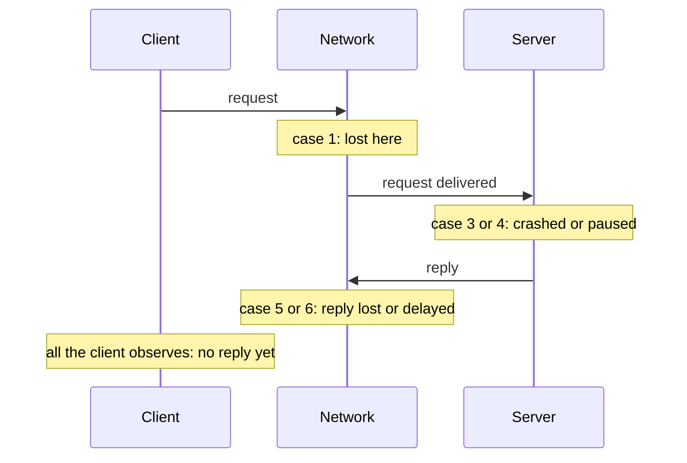

# Partial failures and unreliable networks

A program running on one computer lives in a comfortable world. An operation either works or the machine crashes; the same input gives the same result; if something is wrong with the hardware, the usual consequence is a total stop, not a subtly wrong answer. Computers are deliberately built this way - we would rather have a machine fail outright than lie.

A program spread over several computers connected by a network has no such comfort. This lesson and the two after it are a deliberate tour of what can go wrong: the network (here), clocks and pauses (next), and what a node can know at all (after that). The tone is pessimistic on purpose. Anyone who designs or operates distributed data systems needs an accurate picture of the failure modes, because building reliable systems means assuming these things *will* happen and planning for them, not hoping they will not.

## 1. Partial failure

The defining feature of a distributed system is the **partial failure**: some parts are broken while others work fine, and - this is the difficult bit - you often cannot tell which. A request you sent might have been processed or not. A node might be dead or merely slow. The failure is **nondeterministic**: try the same thing twice and you may get different results.

On a single machine we simply do not design for half-working states. In a distributed system they are the normal condition, and the software has to keep functioning in spite of them.

### Two philosophies of large-scale computing

It helps to contrast two ways of building big systems.

A **supercomputer** running a scientific simulation treats itself as one machine. It checkpoints the computation's state to durable storage every so often. When a node breaks, the whole job is stopped, the hardware is fixed, and the job resumes from the checkpoint. Partial failure is turned into total failure, which is easy to reason about.

**Internet services** cannot work like this:

- They are **online**. Users expect an answer at any hour; stopping everything for repairs is not acceptable.
- They run on **commodity machines**, cheap and individually less reliable than specialised hardware.
- They use ordinary IP and Ethernet networks rather than purpose-built interconnects.
- With thousands of machines, **something is always broken**. If recovery meant stopping the whole system, it would never be running.
- Being able to lose a node and carry on is also *useful*: it makes rolling upgrades possible, one node at a time.
- Deployments span regions, with the comparatively slow and flaky public internet in between.

So fault tolerance has to live in the software: we must build a **reliable system from unreliable components**. This is an old idea. Error-correcting codes carry data accurately over noisy radio links. TCP provides ordered, retransmitted delivery over IP, which promises nothing. The reliable layer is never perfect - a code can only correct so many flipped bits, and TCP cannot remove delay - but it hides most low-level faults and leaves a smaller set to reason about.

> [!WARNING]
> It is tempting to assume that faults are rare and to deal with them "later". At scale rare is not rare: an event with a one-in-a-million chance per request happens a thousand times a day at a billion requests. Consider a wide range of faults, and create them artificially in testing to see what your system does.

## 2. What the network does to a request

The systems in this track are **shared-nothing**: machines with their own memory and disk that communicate only by sending messages over a network. The networks in question are **asynchronous packet networks**: a node can send a message, and the network makes no promise about when it will arrive, or whether it will.

Suppose you send a request and wait for the reply. Any of the following can happen:

1. The request was lost on the way - a cable was unplugged, a switch dropped it.
2. The request is sitting in a queue and will arrive later, because the network or the recipient is overloaded.
3. The remote node has crashed or been shut down.
4. The remote node has temporarily stopped responding - a long garbage-collection pause, for instance - and will resume.
5. The remote node processed the request, and the *reply* was lost.
6. The remote node processed the request, and the reply is delayed.



From the sender's seat all six look exactly the same: **nothing comes back**. There is no way to distinguish "never arrived" from "arrived, done, reply lost".

The standard response is a **timeout**: wait a while, then give up and assume the reply is not coming. But note what the timeout does *not* tell you - whether the request was carried out. If you retry, an operation such as "charge the card" may run twice. This is the root of the need for idempotent requests, which appears again and again in later lessons.

```python-run
import random
random.seed(11)

def send(p_req_lost=0.1, p_server_down=0.05, p_reply_lost=0.1):
    """Returns (what the client sees, what really happened)."""
    if random.random() < p_req_lost:    return "timeout", "request lost - NOT executed"
    if random.random() < p_server_down: return "timeout", "server down - NOT executed"
    if random.random() < p_reply_lost:  return "timeout", "reply lost - EXECUTED"
    return "ok", "executed"

N = 100_000
outcomes = {}
for _ in range(N):
    seen, truth = send()
    outcomes[(seen, truth)] = outcomes.get((seen, truth), 0) + 1

timeouts = sum(v for (seen, _), v in outcomes.items() if seen == "timeout")
for (seen, truth), v in sorted(outcomes.items()):
    print(f"{seen:<8} {truth:<28} {v / N:6.1%}")
executed = outcomes[("timeout", "reply lost - EXECUTED")]
print(f"\nof all timeouts, {executed / timeouts:.0%} were actually executed -> blind retry would duplicate them")
```

In this toy model more than a third of the timeouts hide a request that *was* executed. The client cannot know which ones.

### Network faults do happen

A common belief is that inside a well-run data centre the network is essentially reliable. Field studies say otherwise. Measurements at medium-sized data centres have found on the order of a dozen network faults a month, half of them cutting off a single machine and half an entire rack. Redundant network gear helps less than hoped, because **human error** - a misconfigured switch, a mistaken firewall rule, a botched upgrade - is a leading cause, and redundancy does not protect against it. Public clouds have a reputation for transient glitches. Stranger faults are documented too: links that carry traffic in one direction only, interfaces that drop some packets and pass others, and yes, undersea cables damaged by sharks.

A fault that separates one group of machines from another is known as a **network partition**, or netsplit. Even if partitions are rare where you work, your software must have defined behaviour when one occurs. Untested error paths do arbitrary things: a cluster may lock up permanently even after the network heals, or it may destroy data. It is perfectly legitimate to *decide* that during a partition the system shows an error to users - but that should be a decision, and it should be tested. Fault-injection tools exist precisely to trigger such conditions on purpose.

## 3. Detecting faulty nodes

Many components need to know whether a node is alive: a load balancer should stop sending requests to a dead backend; in a leader-based database, a follower must be promoted when the leader dies. Given the uncertainty described above, how?

Occasionally the environment gives explicit negative feedback:

- If the machine is reachable and nothing listens on the port (the process crashed), the operating system refuses the connection with a `RST` or `FIN` packet. But if the node crashed *while* handling your request, you still do not know how far it got.
- If the process died and the OS survives, a script can tell other nodes straight away, so they need not wait for a timeout.
- The management interface of a switch may report that a link is down at the hardware level - if you have access to it.
- A router that knows the target address is unreachable may answer with an ICMP "destination unreachable" - though routers have no magic knowledge either.

Fast negative feedback is welcome, but you cannot rely on it. And even a *positive* acknowledgement at the TCP level only says that the remote kernel received the bytes; the application may have crashed before handling them. **Only an explicit reply from the application proves that the request was carried out.**

In general, then, you must assume that when something is wrong you may get no response at all. You retry a few times, wait for a timeout, and eventually declare the node dead.

## 4. Choosing a timeout

If a timeout is the only reliable detector, how long should it be? There is no right answer, only a trade-off.

- **Long timeout:** a truly dead node is declared dead late. Meanwhile users wait or see errors.
- **Short timeout:** faster detection, with a higher risk of declaring a node dead that was just slow for a moment - a load spike, a brief pause.

A false positive is costly. If the node was alive and in the middle of an action, and another node takes over, the action may be performed twice. And failover itself creates load: responsibilities move to other nodes, data may be copied. If the node was slow *because the system is overloaded*, moving its work to others makes them slower too; they in turn miss their heartbeats and are declared dead. In the worst case this becomes a **cascading failure** in which all nodes declare each other dead and everything stops.

Imagine, for a moment, a network that guaranteed a maximum delay $d$ for every packet, and nodes that guaranteed to handle every request within time $r$. Then every successful request would get its reply within $2d + r$, and that would be a sound timeout. Real systems give neither guarantee: asynchronous networks have **unbounded delays**, and server implementations cannot promise a maximum processing time.

### Where delay comes from

The variability of packet delay is mostly **queueing**, like cars at a junction:

- Several nodes send to the same destination at once; the **switch** queues the packets and feeds them into the outgoing link one by one. If the queue is full, packets are dropped and must be resent, even though nothing is "broken".
- At the destination, if all CPU cores are busy, the **operating system** queues the incoming request until the application can take it.
- In **virtualised** environments a virtual machine is regularly paused for tens of milliseconds while another uses the core. Incoming data waits in the hypervisor.
- **TCP flow control** makes the *sender* hold data back to avoid overloading the link or the receiver - a queue before the data even enters the network.
- TCP treats a packet as lost if no acknowledgement arrives in time, and **retransmits**. The application does not see the loss, only the extra delay.

In public clouds and multi-tenant data centres you also share switches, network interfaces and CPUs with strangers. A **noisy neighbour** running a heavy batch job can stretch your delays without warning.

```python-run
import random
random.seed(5)

def simulate(utilisation, n=40_000):
    """Single queue, random arrivals, random service times. Returns latencies in ms."""
    service_mean = 1.0
    arrival_mean = service_mean / utilisation
    t = free_at = 0.0
    lat = []
    for _ in range(n):
        t += random.expovariate(1 / arrival_mean)
        start = max(t, free_at)
        free_at = start + random.expovariate(1 / service_mean)
        lat.append(free_at - t)
    lat.sort()
    return lat[n // 2], lat[int(n * 0.99)], lat[-1]

print("load   median    p99      max   (ms)")
for u in (0.3, 0.6, 0.8, 0.9, 0.95):
    p50, p99, mx = simulate(u)
    print(f"{u:>4.0%}  {p50:6.2f}  {p99:7.1f}  {mx:7.1f}")
```

With plenty of spare capacity queues drain quickly. Near full utilisation every percentile climbs roughly tenfold, and in absolute terms the tail is what hurts: a 99th percentile of about 6 ms at 30 percent load becomes roughly 60 ms at 95 percent. A timeout tuned on a quiet day will fire constantly on a busy one.

### Measure, then adapt

Timeouts therefore have to be chosen **experimentally**: measure the distribution of round-trip times over a long period and across many machines, combine it with what your application can tolerate, and pick a point on the trade-off.

Better still, let the system adjust by itself. Rather than fixed timeouts, it can continuously track response times and their variability (the **jitter**) and move the threshold accordingly. The **phi accrual failure detector**, used in Akka and Cassandra, does this: instead of a yes/no verdict it outputs a suspicion level that rises the longer a heartbeat is overdue relative to the observed history. TCP's retransmission timeout works on the same principle.

```python-run
import random, statistics, math
random.seed(8)

class AdaptiveDetector:
    """Suspicion grows with how unusual the current silence is, given past heartbeat gaps."""
    def __init__(self): self.gaps, self.last = [], None
    def heartbeat(self, now):
        if self.last is not None: self.gaps = (self.gaps + [now - self.last])[-100:]
        self.last = now
    def suspicion(self, now):
        mean, sd = statistics.mean(self.gaps), max(statistics.pstdev(self.gaps), 1e-3)
        z = (now - self.last - mean) / sd
        p_later = 0.5 * math.erfc(z / math.sqrt(2))         # chance a heartbeat is still on its way
        return -math.log10(max(p_later, 1e-12))             # "phi": 1 ~ 10% doubt, 3 ~ 0.1%

for label, jitter in (("steady network", 0.02), ("jittery network", 0.4)):
    det, t = AdaptiveDetector(), 0.0
    for _ in range(200):
        t += max(0.05, random.gauss(1.0, jitter)); det.heartbeat(t)
    silent = next(s / 10 for s in range(10, 200) if det.suspicion(t + s / 10) > 8)
    print(f"{label:<16} declares the node dead after {silent:.1f}s of silence")
```

The same detector waits much longer on a jittery network before raising the alarm, because long gaps are normal there. A fixed timeout would be either too jumpy on one network or too sluggish on the other.

## 5. Why not a network with guaranteed delays?

The old fixed-line telephone network is remarkably dependable: delayed audio and dropped calls are rare. Why can data networks not be like that?

A telephone call sets up a **circuit**: a fixed amount of bandwidth is reserved along the whole route for the duration of the call - for example a fixed number of bits in every time frame of an ISDN line. Because the capacity is reserved, no queueing occurs, and the end-to-end delay has a fixed upper bound. Such a network is **synchronous**; it offers a **bounded delay**.

Ethernet and IP are **packet-switched**. Nothing is reserved; each packet takes whatever capacity happens to be free, and waits in a queue if none is. A TCP connection is not a circuit.

The reason for this design is **bursty traffic**. A phone call needs a constant bit rate for its duration, so a fixed reservation suits it. Fetching a web page, sending an email or transferring a file has no natural bit rate - we simply want it done as fast as possible. A circuit sized too small would make the transfer needlessly slow; sized too large, it would waste capacity, or could not be set up at all. Packet switching lets every sender use whatever is available at the moment, which gives far better utilisation of the wires.

That is a deliberate **cost-benefit choice**. Static allocation gives predictable latency and poor utilisation, which makes it expensive. Dynamic sharing gives high utilisation and unpredictable latency, which makes it cheap. The same trade-off governs CPUs: a core shared dynamically among threads is used efficiently, with variable response time; a core reserved for one task is predictable and mostly idle. **Variable delay is not a law of nature; it is the price of cheap, shared infrastructure.**

Quality-of-service mechanisms and admission control can emulate circuits on packet networks, but they are not enabled in ordinary multi-tenant data centres or on the public internet. So for the systems we build, we must assume that congestion, queueing and unbounded delay will occur, and that there is no "correct" timeout.

> [!INTERVIEW]
> A favourite question: "The client's call to your service timed out. What do you know?" The answer: almost nothing - the request may not have arrived, may be in progress, or may have completed with the reply lost. Follow with the consequences: retries must be safe (idempotency keys, or naturally idempotent operations), retries need backoff and jitter so they do not amplify overload, and "declaring a node dead" is a guess that the rest of the system must be able to survive when it is wrong.

## Pitfalls

- **Treating a timeout as proof of failure.** It is a suspicion. The other node may be alive and may have done the work.
- **Retrying non-idempotent operations blindly.** Payments, emails and increments get duplicated.
- **Aggressive timeouts plus automatic failover.** Under load this produces false positives, and the resulting failovers add more load - the recipe for a cascading failure.
- **Retries without backoff.** A wave of synchronised retries after a hiccup can keep a recovering service down. Use exponential backoff with random jitter and a retry budget.
- **Trusting a TCP acknowledgement** as evidence that the application handled the request.
- **Tuning timeouts on an idle test cluster.** Tail latency under production load is a different animal.
- **Never testing partitions.** The code that runs when the network splits is the code least likely to have been exercised.
- **Assuming redundancy covers everything.** Duplicate hardware does not help against a configuration mistake applied to both copies.

## Summary

- Distributed systems suffer **partial failures**: part of the system fails, unpredictably, while the rest keeps going. The goal is a reliable whole built from unreliable parts.
- Networks are **asynchronous**: a message may be lost, delayed, or delivered while the reply is lost, and the sender cannot tell these cases apart.
- The only general failure detector is the **timeout**, which does not reveal whether a request was executed.
- Timeout length is a trade-off between slow detection and **false positives**; premature failover can double-execute work and trigger **cascading failures**.
- Delays are **unbounded** mainly because of **queueing** - in switches, operating systems, hypervisors and TCP - made worse by shared, multi-tenant infrastructure. Tail latency rises sharply as utilisation approaches capacity.
- Choose timeouts from **measurements**, or use adaptive detectors such as **phi accrual**.
- Bounded-delay (circuit-switched) networks exist but waste capacity on bursty traffic; packet switching trades predictability for **utilisation and cost**.

```quiz
[
  {"q": "What makes partial failures in distributed systems harder to handle than failures on a single machine?",
   "options": ["They always destroy all data", "Some components fail while others work, nondeterministically, and it is often impossible to know which", "They only happen at night", "They can be prevented with better hardware"],
   "answer": 1,
   "explain": "A single machine usually works or stops. A distributed system can be half-working in ways that cannot be observed reliably from inside."},
  {"q": "A client sends a request and gets no reply. Which conclusion is justified?",
   "options": ["The request was not executed", "The server has crashed", "The request was executed twice", "None of these can be concluded; the request may have been lost, be delayed, or have been executed with the reply lost"],
   "answer": 3,
   "explain": "All these cases look identical to the sender. A timeout only says that no reply arrived in time."},
  {"q": "Why is a very short timeout for declaring nodes dead dangerous?",
   "options": ["It uses more memory", "Nodes that are only briefly slow are declared dead, which can cause duplicate work and, under load, cascading failures", "It prevents TCP retransmission", "It makes heartbeats larger"],
   "answer": 1,
   "explain": "False positives trigger failovers that shift load to other nodes. If slowness was caused by overload, this makes the remaining nodes slower too."},
  {"q": "What is the main cause of variable packet delay in data-centre networks?",
   "options": ["The speed of light", "Queueing at switches, in operating systems, in hypervisors and in TCP", "Encryption overhead", "Long cables"],
   "answer": 1,
   "explain": "When demand momentarily exceeds capacity, packets wait in queues at several layers, and queue length varies with load."},
  {"q": "Why does tail latency rise so steeply as a server approaches full utilisation?",
   "options": ["CPUs slow down when busy", "With little spare capacity, random bursts of arrivals build queues that take a long time to drain", "Networks switch to circuit mode", "Timeouts become shorter"],
   "answer": 1,
   "explain": "Queueing delay grows non-linearly with utilisation, so the slowest requests, which were already waiting behind others, become dramatically slower in absolute terms."},
  {"q": "What does a phi accrual failure detector do differently from a fixed timeout?",
   "options": ["It never declares a node dead", "It adapts to the observed distribution of heartbeat intervals and outputs a suspicion level instead of a fixed yes or no threshold", "It uses UDP instead of TCP", "It requires synchronised clocks"],
   "answer": 1,
   "explain": "By tracking mean and variability of past heartbeat gaps, it tolerates longer silences on jittery networks and reacts quickly on steady ones."},
  {"q": "Why do the internet and data-centre networks use packet switching rather than circuits with guaranteed delay?",
   "options": ["Circuits cannot carry data", "Data traffic is bursty, and reserving fixed capacity per connection would waste most of it; sharing capacity dynamically is far cheaper", "Packet switching is more secure", "Circuits are illegal for data"],
   "answer": 1,
   "explain": "Bounded delay requires reserved capacity. For bursty traffic that means low utilisation, so networks are optimised for utilisation and accept variable delay."},
  {"q": "A TCP acknowledgement for your request has been received. What does that guarantee?",
   "options": ["The application processed the request", "Only that the remote operating system received the bytes; the application may still have crashed before handling them", "The request was committed to disk", "The reply will arrive within one second"],
   "answer": 1,
   "explain": "Transport-level acknowledgement is not application-level success. Only an explicit response from the application confirms that."}
]
```

> **Source:** DDIA ch. 8 (The Trouble with Distributed Systems) - faults and partial failures, unreliable networks, timeouts and unbounded delays, synchronous versus asynchronous networks. Written in original wording with original examples.
