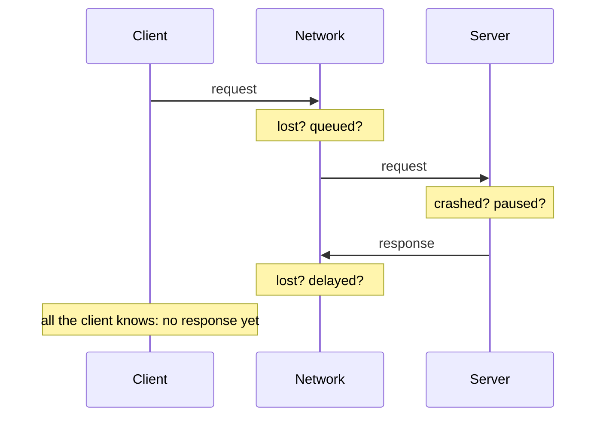

# Partial failures and unreliable networks

Chapter 8 of DDIA is pessimistic on purpose: **anything that can go wrong will go wrong**. Experienced operators of distributed systems take that as given. Our job as engineers is to build systems that meet their guarantees *despite* everything going wrong, and to do that we first need an honest picture of what can fail.

## 1. Faults and partial failures

A program on a single computer behaves predictably. If the hardware works, the same operation gives the same result (it is **deterministic**). If the hardware is broken, the usual outcome is total failure, such as a kernel panic. That is a deliberate design choice: when an internal fault occurs, we prefer a computer to **crash completely** rather than return a wrong result, because wrong results are confusing and hard to handle.

Distributed systems are different. Some parts may be broken in unpredictable ways while other parts work fine. This is a **partial failure**, and it is **nondeterministic**: an operation involving several nodes and the network may sometimes work and sometimes fail. You may not even *know* whether something succeeded, because message travel time is also nondeterministic. This is what makes distributed systems hard.

### 1.1 Cloud computing vs supercomputing

There are two philosophies for building large systems:

- **High-performance computing (HPC).** A supercomputer checkpoints its computation to durable storage from time to time. If a node fails, the usual response is to **stop the whole cluster**, repair the node, and restart from the last checkpoint. A supercomputer is more like a single-node computer: it escalates partial failure into total failure.
- **Cloud / internet services.** These cannot work that way, for several reasons:
  - They are **online** and must serve users with low latency at any time. Stopping the cluster for repair is not acceptable.
  - They use **commodity machines**, which are cheaper but fail more often.
  - They use IP and Ethernet rather than specialised network topologies.
  - The bigger the system, the more likely that **something is broken at any moment**. With thousands of nodes, it is reasonable to assume something always is.
  - If the system tolerates failed nodes, you get operational benefits such as **rolling upgrades**.
  - Geographically distributed deployments communicate over the internet, which is slow and unreliable compared with a local network.

To make distributed systems work, we must accept partial failure and **build fault-tolerance into the software**: a reliable system from unreliable components. It is unwise to assume faults are rare and hope for the best. Consider a wide range of faults, even unlikely ones, and create them artificially in testing.

> [!NOTE]
> Building reliable systems from unreliable parts is an old idea. Error-correcting codes transmit data accurately over a noisy channel. TCP gives reliable, ordered delivery on top of IP, which may drop, delay, duplicate or reorder packets. There is always a limit, though: TCP cannot remove delays, and it cannot help if the cable is unplugged.

## 2. Unreliable networks

DDIA focuses on **shared-nothing** systems: machines with their own memory and disk that communicate only over a network. The internet and most datacenter networks are **asynchronous packet networks**. A node can send a message, but the network gives **no guarantee** about when it will arrive, or whether it arrives at all. If you send a request and expect a response, many things can go wrong:

1. Your request may have been **lost** (someone unplugged a cable).
2. Your request may be **waiting in a queue** and will be delivered later (the network or recipient is overloaded).
3. The remote node may have **failed** (crashed or powered down).
4. The remote node may have **temporarily stopped responding** (a long garbage-collection pause) and will respond later.
5. The remote node processed your request, but the **response was lost**.
6. The remote node processed your request, but the **response is delayed**.



From the sender's point of view these cases are **indistinguishable**. The only information you have is that no response has arrived yet. The usual way to handle this is a **timeout**: after a while you give up and assume the response will not come. Even then you do not know whether the remote node received your request, and a request still sitting in a queue may be delivered after you gave up.

### 2.1 Network faults in practice

Networks are not reliable even inside a single well-run datacenter. DDIA cites studies:

- A medium-sized datacenter saw about **12 network faults per month**. Half disconnected a single machine and half an entire rack.
- Adding redundant networking gear does not reduce faults as much as hoped, because it does not protect against **human error** such as misconfigured switches, a major cause of outages.
- Public clouds have frequent transient glitches. A switch software upgrade can trigger a topology reconfiguration that delays packets for **more than a minute**.
- Stranger faults happen too: sharks biting undersea cables, and network interfaces that drop all inbound packets while still sending outbound ones. A link working in one direction does not guarantee the other direction.

When one part of the network is cut off from the rest, that is a **network partition** (netsplit).

Even if faults are rare in your environment, your software must handle them, because they *can* occur. If error handling for network faults is not defined and tested, arbitrarily bad things can happen: a cluster may deadlock permanently even after the network recovers, or even delete data. Handling a fault does not have to mean *tolerating* it. Showing users an error during network problems can be a valid choice. What matters is that you know how the software reacts and that it recovers. Deliberately triggering network problems (the idea behind **Chaos Monkey** and **Jepsen**) is how you find out.

### 2.2 Detecting faults

Systems need to detect faulty nodes automatically. A load balancer must stop routing to a dead node, and a single-leader database must promote a follower when the leader dies. Sometimes you get explicit feedback:

- If the machine is reachable but no process listens on the port (the process crashed), the OS closes or refuses TCP connections with a **RST or FIN** packet. If the node crashed *while handling* your request, though, you cannot tell how much it processed.
- If the process crashed but the OS is still running, a script can **notify other nodes** so they take over quickly without waiting for a timeout. HBase does this.
- Management interfaces of datacenter switches can report link failures at the hardware level, if you have access to them.
- A router may reply with **ICMP Destination Unreachable** if it is sure the address is unreachable.

You cannot count on any of this. Even if TCP acknowledged a packet, the application may have crashed before handling it. To be sure a request succeeded you need a **positive response from the application itself**. In general, assume you will get no response at all, retry a few times, wait for a timeout, and eventually declare the node dead.

## 3. Timeouts and unbounded delays

If a timeout is the only sure way of detecting a fault, how long should it be? There is no simple answer.

- A **long timeout** means a long wait before a node is declared dead, while users wait or see errors.
- A **short timeout** detects faults faster but risks declaring a node dead when it only suffered a temporary slowdown.

Declaring a live node dead causes real problems. If it was in the middle of an action (say, sending an email) and another node takes over, the action may be performed **twice**. Its responsibilities move to other nodes, adding load. If the system was already struggling, this can cause a **cascading failure**: in the extreme, all nodes declare each other dead and everything stops.

Imagine a network that guaranteed a maximum packet delay $d$, and nodes that always handle a request within time $r$. Then every successful request would get a response within $2d + r$, and that would be a perfect timeout. Real systems have **neither guarantee**. Asynchronous networks have **unbounded delays**, and servers cannot promise a maximum handling time.

### 3.1 Network congestion and queueing

Variable packet delay is mostly caused by **queueing**:

- If several nodes send to the same destination at once, the **switch** queues packets and feeds them into the destination link one by one. If the queue fills, packets are **dropped** and must be resent, even though the network is working.
- At the destination, if all CPU cores are busy, the **operating system** queues the request until the application can handle it.
- In virtualised environments, a VM is often **paused for tens of milliseconds** while another VM uses the core. Incoming data is buffered by the hypervisor meanwhile.
- **TCP flow control** (backpressure) limits the sender's rate, so data queues at the sender before even entering the network. TCP also retransmits lost packets after a timeout, which the application sees as extra delay.

> [!NOTE]
> **TCP vs UDP.** Latency-sensitive applications such as videoconferencing and VoIP use UDP. It has no flow control and does not retransmit lost packets, so it avoids some causes of variable delay. UDP is a good choice when **delayed data is worthless**: in a phone call there is no time to retransmit a lost packet before its audio is due to be played.

Queueing delays vary most when a system is close to its capacity. In public clouds, resources are shared, so a **noisy neighbour** can make delays highly variable.

In such environments you can only choose timeouts **experimentally**: measure the distribution of round-trip times over a long period and many machines. Better still, systems can continually measure response times and their variability (**jitter**) and adjust timeouts automatically. A **Phi Accrual failure detector**, used in **Akka** and **Cassandra**, does this.

```python-run
import random, math, statistics
random.seed(3)

# Phi accrual failure detector (simplified: normal model of heartbeat gaps)
gaps = [random.gauss(1.0, 0.1) for _ in range(200)]   # heartbeats about every 1 s
mu, sigma = statistics.mean(gaps), statistics.stdev(gaps)

def phi(elapsed):
    """phi = -log10( P(next heartbeat arrives later than 'elapsed') )"""
    z = (elapsed - mu) / sigma
    p_later = 0.5 * math.erfc(z / math.sqrt(2))
    return -math.log10(max(p_later, 1e-300))

for elapsed in [0.9, 1.1, 1.3, 1.5, 2.0, 3.0]:
    p = phi(elapsed)
    print(f"no heartbeat for {elapsed:.1f}s -> phi = {p:7.2f}  {'SUSPECT' if p > 8 else 'alive'}")
print("(Cassandra's default phi_convict_threshold is 8)")
```

Instead of a binary verdict at a fixed timeout, phi rises continuously with suspicion and adapts to the observed variance of heartbeat arrivals.

```python-run
import random
random.seed(1)
# How timeout choice trades false positives against detection delay
rtts = [random.lognormvariate(-3.0, 0.8) for _ in range(100_000)]   # seconds, heavy tail
rtts.sort()
for timeout in [0.05, 0.1, 0.25, 0.5, 1.0, 2.0]:
    false_pos = sum(1 for r in rtts if r > timeout) / len(rtts)
    print(f"timeout {timeout:>5.2f}s: healthy requests wrongly timed out = {false_pos:8.4%}, "
          f"detection delay for a real crash >= {timeout:.2f}s")
```

## 4. Synchronous vs asynchronous networks

Why not fix this in hardware and make the network deliver packets with a fixed maximum delay?

Compare the traditional fixed-line telephone network. A phone call establishes a **circuit**: a fixed, guaranteed amount of bandwidth is allocated along the entire route for the duration of the call. An ISDN network runs at 4,000 frames per second, and a call gets 16 bits in each frame. There is no queueing, because the space is already reserved in every hop, so the maximum end-to-end latency is fixed. This is a **bounded delay**, and such a network is called **synchronous**.

A TCP connection is very different. A circuit is reserved bandwidth that nobody else can use. TCP packets **opportunistically use whatever bandwidth is available**. Ethernet and IP are **packet-switched** protocols, which queue and therefore have unbounded delays.

Datacenter networks use packet switching because they are optimised for **bursty traffic**. An audio call transfers a constant number of bits per second. Requesting a web page or transferring a file has no particular bandwidth requirement, and we just want it done quickly. With a circuit you would have to guess a bandwidth allocation. Guess too low and the transfer is needlessly slow while capacity sits unused. Guess too high and the circuit cannot be set up. TCP instead adapts its rate to the available capacity.

> [!NOTE]
> **Latency and resource utilisation.** Variable delays are a consequence of *dynamic resource partitioning*. Static allocation (circuits, a dedicated CPU per thread) gives bounded latency at the price of low utilisation and high cost. Dynamic sharing (packets, multi-tenancy) gives high utilisation and low cost at the price of variable delay. It is a cost/benefit trade-off, not a law of nature. With current technology, we must assume congestion, queueing and unbounded delays will happen, so there is no "correct" timeout value.

> [!INTERVIEW]
> "How do you detect that a node is down?" You **cannot know for sure**. You use heartbeats and timeouts, preferably adaptive ones such as phi accrual. Explain the trade-off: short timeouts cause false positives, duplicated actions and cascading failover, while long timeouts delay recovery. Add that a missing response does not tell you whether the request executed, which is why you need idempotent operations, fencing tokens and consensus.

## 5. Summary

- **Partial failure** defines distributed systems: some components fail, nondeterministically, while others work.
- Online services cannot stop the world on failure as HPC does, so fault tolerance must live in software.
- **Asynchronous packet networks** give no delivery or timing guarantees. A missing response is ambiguous.
- Network faults are common in practice. Test how your software reacts to them.
- **Timeouts** are the only general failure detector. Delays are unbounded because of queueing in switches, operating systems, hypervisors and TCP. Measure, and adapt.
- Packet switching gives up bounded latency in exchange for utilisation on bursty traffic.

```quiz
[
  {"q": "Why is partial failure the core difficulty of distributed systems?",
   "options": ["Nodes are slower than single machines", "Some parts fail nondeterministically while others work, and you may not even know whether an operation succeeded", "Networks are always partitioned", "Disks fail more often"],
   "answer": 1,
   "explain": "A single machine tends to fail totally; a distributed system must cope with ambiguity."},
  {"q": "You send a request and receive no response. What can you conclude?",
   "options": ["The server crashed", "The request was lost", "Nothing definite: the request or response may be lost or delayed, or the node may have crashed or paused", "The server processed the request"],
   "answer": 2,
   "explain": "These cases are indistinguishable in an asynchronous network."},
  {"q": "How do supercomputers typically handle a node failure?",
   "options": ["Hinted handoff", "Stop the whole job, repair the node, restart from the last checkpoint", "Leader election", "Ignore it"],
   "answer": 1,
   "explain": "HPC escalates partial failure to total failure, which online services cannot accept."},
  {"q": "What is a danger of choosing a timeout that is too short?",
   "options": ["Slow failure detection", "Declaring a slow but live node dead, causing duplicated actions and cascading load", "Packet loss", "Lower throughput"],
   "answer": 1,
   "explain": "Moving load away from a merely overloaded node can make the overload worse."},
  {"q": "Which of these gives bounded network delay?",
   "options": ["Switch queueing", "TCP flow control", "A circuit-switched network with reserved bandwidth", "VM pauses"],
   "answer": 2,
   "explain": "Circuits reserve capacity in every hop so there is no queueing; the others cause variable delay."},
  {"q": "Why do datacenters use packet switching rather than circuits?",
   "options": ["Circuits are less reliable", "Packet switching handles bursty traffic efficiently by using whatever bandwidth is available", "Circuits cannot carry TCP", "Packet switching guarantees latency"],
   "answer": 1,
   "explain": "Circuits need a bandwidth guess up front and waste capacity for bursty transfers."},
  {"q": "What does a phi accrual failure detector output?",
   "options": ["A fixed timeout", "A continuous suspicion level based on the observed distribution of heartbeat arrival times", "The switch status", "A GPS timestamp"],
   "answer": 1,
   "explain": "It adapts to observed jitter; Cassandra and Akka use it."}
]
```

> **Source:** DDIA ch. 8, "The Trouble with Distributed Systems" (Faults and Partial Failures; Unreliable Networks).
