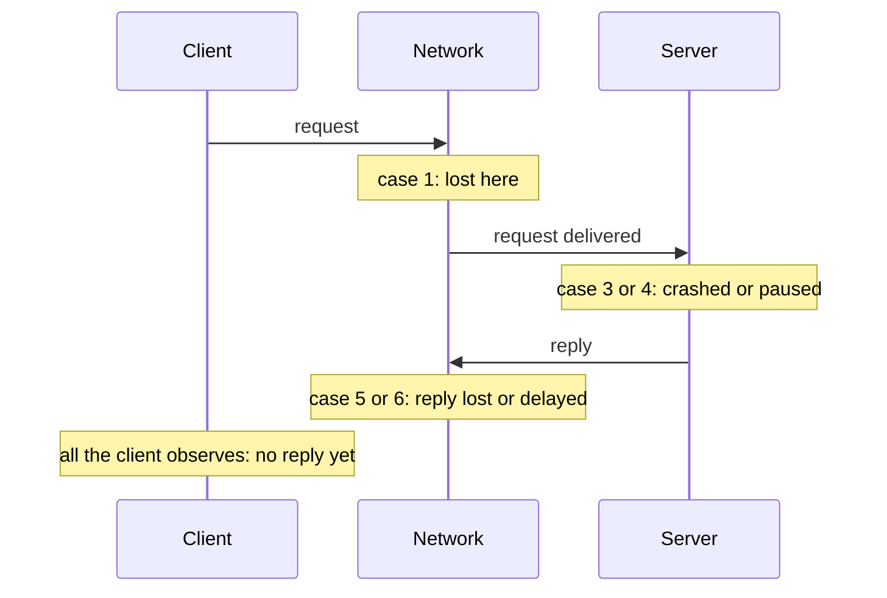

# Partial failures and unreliable networks

> **Before this lesson:** you should know the words fault, failure, node and cascading failure from [Reliability and maintainability](#/lesson/databases/reliability-maintainability); percentiles and tail latency from [Scalability](#/lesson/databases/scalability-percentiles); timeouts and idempotence from [Modes of data flow](#/lesson/databases/dataflow-modes); and failover from [Single-leader replication](#/lesson/databases/leader-follower). No knowledge of networking is assumed.

## In plain words

A **distributed system** is a group of computers that work together by sending messages to one another over a network. Every replicated or partitioned database from the earlier lessons is one. This lesson is about the single fact that makes such systems hard: when you send a message and hear nothing back, you cannot know why.

An everyday picture: you send a friend a text asking them to book a table for dinner, and no reply comes. Maybe the text never arrived. Maybe they have not looked at their phone. Maybe their phone is off. Or maybe they read it, booked the table, and their reply got lost. From where you sit, all four look identical: silence. If you now book a table yourself, you may end up with two. If you do nothing, you may end up with none. And however long you wait, the silence does not tell you which situation you are in.

Computers on a network are in that position constantly. The only tool they have is to wait for a while and then guess, which is called a **timeout**. This lesson explains why the guess can be wrong, how to choose how long to wait, and why networks were built to behave this way.

Why this matters for a job: most serious production incidents in backend systems involve a slow or unreachable machine being handled badly, with retries that double-charge customers or a "dead" server that was only slow. "Your call to another service timed out. What do you know?" is a classic interview question, and the correct answer ("almost nothing") is the starting point for designing anything reliable.

## The comfortable world of one machine

A program running on one computer lives in a comfortable world. An operation either works or the machine crashes; the same input gives the same result; if something is wrong with the hardware, the usual consequence is a total stop, not a subtly wrong answer. Computers are deliberately built this way - we would rather have a machine fail outright than lie.

A program spread over several computers connected by a network has no such comfort. This lesson and the two after it are a deliberate tour of what can go wrong: the network (here), clocks and pauses (next), and what a node can know at all (after that). The tone is pessimistic on purpose. Anyone who designs or operates distributed data systems needs an accurate picture of the failure modes, because building reliable systems means assuming these things *will* happen and planning for them, not hoping they will not.

## 1. Partial failure

The defining feature of a distributed system is the **partial failure**: some parts are broken while others work fine, and - this is the difficult bit - you often cannot tell which. A request you sent might have been processed or not. A node might be dead or merely slow. The failure is **nondeterministic**: try the same thing twice and you may get different results.

On a single machine nobody designs for a state in which half the computer works. In a distributed system such half-working states are the normal condition, and the software has to keep functioning in spite of them.

### Two philosophies of large-scale computing

It helps to contrast two ways of building big systems.

A **supercomputer** running a scientific simulation treats itself as one machine. Every so often it saves the complete state of the calculation to disk, which is called taking a **checkpoint**. When one of its nodes breaks, the whole job is stopped, the hardware is repaired, and the job starts again from the last checkpoint. A partial failure is deliberately turned into a total one, which is much easier to reason about.

**Internet services** cannot work like this:

- They are **online**. Users expect an answer at any hour; stopping everything for repairs is not acceptable.
- They run on **commodity machines**, cheap and individually less reliable than specialised hardware.
- They use ordinary, general-purpose networking equipment, the same technology as an office network, and not specially built high-reliability links.
- With thousands of machines, **something is always broken**. If recovery meant stopping the whole system, it would never be running.
- Being able to lose a node and carry on is also *useful*: it makes rolling upgrades possible, one node at a time.
- Deployments span regions, with the comparatively slow and flaky public internet in between.

So the ability to tolerate faults has to live in the software: we must build a **reliable system from unreliable components**. This is an old idea with well-known examples. Radio links are noisy, yet data crosses them accurately, because extra check information is sent along with it that lets the receiver detect and repair damaged bits. The internet itself is another example. Its basic delivery service, **IP** (Internet Protocol), promises nothing: a message may be lost, repeated or arrive out of order. On top of it runs **TCP** (Transmission Control Protocol), which numbers the pieces of a message, resends any that go missing, and puts them back in order. The reliable layer is never perfect. TCP cannot make a delayed message arrive sooner. But it hides most low-level faults and leaves a smaller set to think about.

> [!WARNING]
> It is tempting to assume that faults are rare and to deal with them "later". At scale rare is not rare: an event with a one-in-a-million chance per request happens a thousand times a day at a billion requests. Consider a wide range of faults, and create them artificially in testing to see what your system does.

## 2. What the network does to a request

The systems in this track are shared-nothing: each machine has its own memory and disk, and machines cooperate only by sending messages over a network. Three facts about those networks are needed here.

- Data travels in small units called **packets**. A long message is cut into many packets, each of which is sent separately.
- Between the sender and the receiver are devices that pass packets along. A **switch** connects machines within one building; a **router** connects networks to one another.
- The networks in question are **asynchronous**: a machine can send a packet, and the network makes no promise about when it will arrive, or whether it will arrive at all.

Suppose you send a request and wait for the reply. Any of the following can happen:

1. The request was lost on the way - a cable was unplugged, a switch dropped it.
2. The request is sitting in a queue and will arrive later, because the network or the recipient is overloaded.
3. The remote node has crashed or been shut down.
4. The remote node has temporarily stopped responding - a long garbage-collection pause, for instance - and will resume.
5. The remote node processed the request, and the *reply* was lost.
6. The remote node processed the request, and the reply is delayed.



From the sender's seat all six look exactly the same: **nothing comes back**. There is no way to distinguish "never arrived" from "arrived, done, reply lost".

The standard response is a **timeout**: wait a while, then give up and assume the reply is not coming. But note what the timeout does *not* tell you - whether the request was carried out. If you retry, an operation such as "charge the card" may run twice. This is the root of the need for idempotent requests, which appears again and again in later lessons.

The program below is a toy model of that uncertainty. Each request can be lost on the way, can find the server down, or can be carried out with its reply lost.

```python-run
import random
random.seed(11)

def send(p_req_lost=0.1, p_server_down=0.05, p_reply_lost=0.1):
    """Returns (what the client sees, what really happened)."""
    if random.random() < p_req_lost:    return "timeout", "request lost - NOT executed"
    if random.random() < p_server_down: return "timeout", "server down - NOT executed"
    if random.random() < p_reply_lost:  return "timeout", "reply lost - EXECUTED"
    return "ok", "executed"

N = 100_000
outcomes = {}
for _ in range(N):
    seen, truth = send()
    outcomes[(seen, truth)] = outcomes.get((seen, truth), 0) + 1

timeouts = sum(v for (seen, _), v in outcomes.items() if seen == "timeout")
for (seen, truth), v in sorted(outcomes.items()):
    print(f"{seen:<8} {truth:<28} {v / N:6.1%}")
executed = outcomes[("timeout", "reply lost - EXECUTED")]
print(f"\nof all timeouts, {executed / timeouts:.0%} were actually executed -> blind retry would duplicate them")
```

What each part does:

- `send()` plays out one request. `random.random()` gives a number between 0 and 1, so `random.random() < 0.1` is true one time in ten. The function checks three possible mishaps in turn and returns a pair: what the client observes, and what really happened.
- In three of the four outcomes the client observes the same thing, `"timeout"`. Only the second element of the pair, which the client cannot see, tells them apart.
- The loop sends 100,000 requests and counts each (seen, truth) combination in the dictionary `outcomes`.
- The last lines print each combination as a share of all requests, then work out what fraction of the timeouts concealed a request that had in fact been carried out.

```
ok       executed                      76.9%
timeout  reply lost - EXECUTED          8.5%
timeout  request lost - NOT executed   10.0%
timeout  server down - NOT executed     4.6%

of all timeouts, 37% were actually executed -> blind retry would duplicate them
```

In this toy model more than a third of the timeouts hide a request that *was* executed. The client cannot know which ones.

### Network faults do happen

A common belief is that inside a well-run data centre the network is essentially reliable. Field studies say otherwise. Measurements at medium-sized data centres have found on the order of a dozen network faults a month, half of them cutting off a single machine and half an entire rack. Redundant network gear helps less than hoped, because **human error** - a misconfigured switch, a mistaken firewall rule, a botched upgrade - is a leading cause, and redundancy does not protect against it. Public clouds have a reputation for transient glitches. Stranger faults are documented too: links that carry traffic in one direction only, interfaces that drop some packets and pass others, and yes, undersea cables damaged by sharks.

A fault that separates one group of machines from another is known as a **network partition**, or netsplit. Even if partitions are rare where you work, your software must have defined behaviour when one occurs. Untested error paths do arbitrary things: a cluster may lock up permanently even after the network heals, or it may destroy data. It is perfectly legitimate to *decide* that during a partition the system shows an error to users - but that should be a decision, and it should be tested. Fault-injection tools exist precisely to trigger such conditions on purpose.

## 3. Detecting faulty nodes

Many components need to know whether a node is alive: a load balancer should stop sending requests to a dead backend; in a leader-based database, a follower must be promoted when the leader dies. Given the uncertainty described above, how?

Occasionally the environment gives explicit negative feedback:

- **A refused connection.** A program that accepts network requests listens on a numbered **port**. If the machine is up but the program has crashed, nothing is listening on its port, and the operating system refuses the connection at once, so the sender gets a quick, definite "no". But if the program crashed *while* handling your request, you still do not know how far it got.
- **A notification from the machine itself.** If the program died and the operating system survived, a script on that machine can tell the other nodes immediately, so they need not wait for a timeout.
- **A report from the network equipment.** A switch can report that the cable to a machine has gone dead, if you have access to the switch's management interface.
- **An "unreachable" message.** A router that knows it cannot deliver to an address may send back a message saying so. Routers have no special knowledge of whether a machine is healthy, though.

Fast negative feedback is welcome, but you cannot rely on it. And even a *positive* acknowledgement at the TCP level only says that the remote kernel received the bytes; the application may have crashed before handling them. **Only an explicit reply from the application proves that the request was carried out.**

A further term: a **heartbeat** is a small message that a node sends at regular intervals for no purpose other than to show it is still alive. Other nodes watch for it, and a run of missing heartbeats is the usual sign that something is wrong.

In general, then, you must assume that when something is wrong you may get no response at all. You retry a few times, wait for a timeout, and eventually declare the node dead.

## 4. Choosing a timeout

If a timeout is the only reliable detector, how long should it be? There is no right answer, only a trade-off.

- **Long timeout:** a truly dead node is declared dead late. Meanwhile users wait or see errors.
- **Short timeout:** faster detection, with a higher risk of declaring a node dead when it was only slow for a moment, because of a spike in load or a brief pause.

A false positive is costly. If the node was alive and in the middle of an action, and another node takes over, the action may be performed twice. And failover itself creates load: responsibilities move to other nodes, data may be copied. If the node was slow *because the system is overloaded*, moving its work to others makes them slower too; they in turn miss their heartbeats and are declared dead. In the worst case this becomes a **cascading failure** in which all nodes declare each other dead and everything stops.

Imagine, for a moment, a network that guaranteed a maximum delay $d$ for every packet, and nodes that guaranteed to handle every request within time $r$. Then every successful request would get its reply within $2d + r$, and that would be a sound timeout. Real systems give neither guarantee: asynchronous networks have **unbounded delays**, and server implementations cannot promise a maximum processing time.

### Where delay comes from

The variability of packet delay is mostly **queueing**, like cars at a junction:

- Several machines send to the same destination at the same moment. The switch has to feed their packets into one outgoing cable one at a time, so it holds the rest in a queue. If the queue fills up, further packets are thrown away and have to be sent again, although nothing is broken.
- At the destination, if all processor cores are busy, the operating system holds the incoming request in a queue until the application is ready for it.
- In the cloud, your program runs in a virtual machine that shares a real processor with other virtual machines. The software that shares it out, called a **hypervisor**, regularly pauses one virtual machine for some tens of milliseconds to let another run. Data arriving during a pause has to wait.
- TCP limits how fast a sender may send, to avoid overwhelming the network or the receiver. This is **flow control**, and it means data can queue up at the sender before it has even entered the network.
- TCP assumes a packet is lost if it has not been acknowledged within a certain time, and sends it again. The application never sees the loss. It sees only the extra delay.

In public clouds and multi-tenant data centres you also share switches, network interfaces and CPUs with strangers. A **noisy neighbour** running a heavy batch job can stretch your delays without warning.

The next program measures how queueing delay grows as a server gets busier. It simulates a single server with requests arriving at random moments.

```python-run
import random
random.seed(5)

def simulate(utilisation, n=40_000):
    """Single queue, random arrivals, random service times. Returns latencies in ms."""
    service_mean = 1.0
    arrival_mean = service_mean / utilisation
    t = free_at = 0.0
    lat = []
    for _ in range(n):
        t += random.expovariate(1 / arrival_mean)
        start = max(t, free_at)
        free_at = start + random.expovariate(1 / service_mean)
        lat.append(free_at - t)
    lat.sort()
    return lat[n // 2], lat[int(n * 0.99)], lat[-1]

print("load   median    p99      max   (ms)")
for u in (0.3, 0.6, 0.8, 0.9, 0.95):
    p50, p99, mx = simulate(u)
    print(f"{u:>4.0%}  {p50:6.2f}  {p99:7.1f}  {mx:7.1f}")
```

What each part does:

- `utilisation` is the fraction of time the server is busy: 0.3 means it is working 30% of the time.
- Each request takes 1 millisecond to serve on average (`service_mean`). To hit the wanted utilisation, requests must arrive on average every `service_mean / utilisation` milliseconds.
- `random.expovariate` produces random gaps and random service times whose averages are the given values, a standard model for independent arrivals.
- `t` is the arrival time of the current request. `free_at` is the moment the server finishes the previous one. A request starts at whichever is later: `start = max(t, free_at)`. If the server is still busy when the request arrives, the difference is time spent queueing.
- `free_at - t` is the request's total response time: waiting plus service. All 40,000 are collected, sorted, and the median, the 99th percentile and the maximum are returned.

```
load   median    p99      max   (ms)
 30%    0.97      6.4     12.5
 60%    1.74     12.1     29.4
 80%    3.66     23.6     45.5
 90%    6.36     41.2     57.7
 95%   10.53     58.3     83.0
```

With plenty of spare capacity queues drain quickly. Near full utilisation every percentile climbs roughly tenfold, and in absolute terms the tail is what hurts: a 99th percentile of about 6 ms at 30 percent load becomes roughly 60 ms at 95 percent. A timeout tuned on a quiet day will fire constantly on a busy one.

### Measure, then adapt

Timeouts therefore have to be chosen **experimentally**: measure the distribution of round-trip times over a long period and across many machines, combine it with what your application can tolerate, and pick a point on the trade-off.

Better still, let the system adjust the timeout by itself. It can keep measuring how long responses take and how much that time varies (the variation is called **jitter**), and move the threshold to match. A well-known method of this kind is the **phi accrual failure detector**, used in the Akka framework and in Cassandra. It does not give a yes-or-no verdict. It outputs a suspicion level, called phi, that rises the longer a heartbeat is overdue compared with the pattern seen so far. TCP decides when to resend a packet on the same principle.

```python-run
import random, statistics, math
random.seed(8)

class AdaptiveDetector:
    """Suspicion grows with how unusual the current silence is, given past heartbeat gaps."""
    def __init__(self): self.gaps, self.last = [], None
    def heartbeat(self, now):
        if self.last is not None: self.gaps = (self.gaps + [now - self.last])[-100:]
        self.last = now
    def suspicion(self, now):
        mean, sd = statistics.mean(self.gaps), max(statistics.pstdev(self.gaps), 1e-3)
        z = (now - self.last - mean) / sd
        p_later = 0.5 * math.erfc(z / math.sqrt(2))         # chance a heartbeat is still on its way
        return -math.log10(max(p_later, 1e-12))             # "phi": 1 ~ 10% doubt, 3 ~ 0.1%

for label, jitter in (("steady network", 0.02), ("jittery network", 0.4)):
    det, t = AdaptiveDetector(), 0.0
    for _ in range(200):
        t += max(0.05, random.gauss(1.0, jitter)); det.heartbeat(t)
    silent = next(s / 10 for s in range(10, 200) if det.suspicion(t + s / 10) > 8)
    print(f"{label:<16} declares the node dead after {silent:.1f}s of silence")
```

What each part does:

- `heartbeat(now)` is called whenever a heartbeat arrives. It records the gap since the previous one, keeping the most recent 100 gaps.
- `suspicion(now)` works out how unusual the current silence is. It computes the mean of the past gaps and their **standard deviation**, a measure of how much they vary. `z` expresses how far beyond the usual gap the current silence has gone, in units of that variation. `p_later` is the estimated chance that a heartbeat is merely late and still on its way. The function returns phi, which grows as that chance shrinks: phi of 1 means about 10% chance the node is still alive, phi of 3 means about 0.1%.
- The loop tries two networks. On each, 200 heartbeats arrive about one second apart, with small random variation on the steady network and large variation on the jittery one.
- The line starting `silent =` then imagines the heartbeats stopping and finds how many seconds of silence it takes for phi to pass 8.

```
steady network   declares the node dead after 1.2s of silence
jittery network  declares the node dead after 3.0s of silence
```

The same detector waits much longer on a jittery network before raising the alarm, because long gaps are normal there. A fixed timeout would be either too jumpy on one network or too sluggish on the other.

## 5. Why not a network with guaranteed delays?

The old fixed-line telephone network is remarkably dependable: delayed audio and dropped calls are rare. Why can data networks not be like that?

A telephone call sets up a **circuit**: a fixed amount of carrying capacity is reserved along the entire route for as long as the call lasts. The capacity of a link, the amount of data it can carry per second, is its **bandwidth**. Because the call's share is reserved, its data never waits in a queue, and the delay from end to end has a fixed upper limit. A network that works this way is called **synchronous**, and it offers a **bounded delay**.

The internet, and the networks inside datacenters, are **packet-switched**. Nothing is reserved. Each packet takes whatever capacity happens to be free at that moment and waits in a queue if none is. A TCP connection is not a circuit.

The reason for this design is **bursty traffic**, meaning traffic that comes in sudden bursts with quiet periods between. A phone call needs the same number of bits every second for its whole duration, so a fixed reservation suits it. Loading a web page or transferring a file has no natural rate: the aim is to finish as quickly as possible, and then nothing is sent until the next request. A circuit reserved too small would make the transfer needlessly slow. One reserved too large would waste capacity while idle. Packet switching lets every sender use whatever is free at the moment, which makes far better use of the cables.

That is a deliberate **cost-benefit choice**. Reserving capacity gives predictable delay and poor use of the equipment, which makes it expensive. Sharing capacity as needed gives good use of the equipment and unpredictable delay, which makes it cheap. The same trade-off applies to processors: a core shared among many tasks is used efficiently and responds in a variable time, while a core reserved for one task responds predictably and sits mostly idle. **Variable delay is not a law of nature. It is the price of cheap, shared infrastructure.**

Techniques exist that imitate circuits on packet networks by giving some traffic priority, but they are not switched on in ordinary shared datacenters or on the public internet. So for the systems we build, we must assume that congestion, queueing and unbounded delay will occur, and that there is no "correct" timeout.

> [!INTERVIEW]
> A favourite question: "The client's call to your service timed out. What do you know?" The answer: almost nothing - the request may not have arrived, may be in progress, or may have completed with the reply lost. Follow with the consequences: retries must be safe (idempotency keys, or naturally idempotent operations), retries need backoff and jitter so they do not amplify overload, and "declaring a node dead" is a guess that the rest of the system must be able to survive when it is wrong.

## Pitfalls

- **Treating a timeout as proof of failure.** It is a suspicion. The other node may be alive and may have done the work.
- **Retrying non-idempotent operations blindly.** Payments, emails and increments get duplicated.
- **Aggressive timeouts plus automatic failover.** Under load this produces false positives, and the resulting failovers add more load - the recipe for a cascading failure.
- **Retries without backoff.** A wave of synchronised retries after a hiccup can keep a recovering service down. Use exponential backoff with random jitter and a retry budget.
- **Trusting a TCP acknowledgement** as evidence that the application handled the request.
- **Tuning timeouts on an idle test cluster.** Tail latency under production load is a different animal.
- **Never testing partitions.** The code that runs when the network splits is the code least likely to have been exercised.
- **Assuming redundancy covers everything.** Duplicate hardware does not help against a configuration mistake applied to both copies.

## Summary

- Distributed systems suffer **partial failures**: part of the system fails, unpredictably, while the rest keeps going. The goal is a reliable whole built from unreliable parts.
- Networks are **asynchronous**: a message may be lost, delayed, or delivered while the reply is lost, and the sender cannot tell these cases apart.
- The only general failure detector is the **timeout**, which does not reveal whether a request was executed.
- Timeout length is a trade-off between slow detection and **false positives**; premature failover can double-execute work and trigger **cascading failures**.
- Delays are **unbounded** mainly because of **queueing** - in switches, operating systems, hypervisors and TCP - made worse by shared, multi-tenant infrastructure. Tail latency rises sharply as utilisation approaches capacity.
- Choose timeouts from **measurements**, or use adaptive detectors such as **phi accrual**.
- Bounded-delay (circuit-switched) networks exist but waste capacity on bursty traffic; packet switching trades predictability for **utilisation and cost**.

## Glossary

- **Distributed system** - several computers cooperating by exchanging messages over a network.
- **Partial failure** - some parts of a system are broken while others work, often without a way to tell which.
- **Nondeterministic** - not giving the same outcome every time.
- **Checkpoint** - a saved copy of a computation's complete state, from which it can be restarted.
- **IP / TCP** - the internet's basic, unreliable packet delivery / the layer on top that resends lost packets and restores their order.
- **Packet** - a small unit of data sent across a network.
- **Switch / router** - a device connecting machines within a network / a device connecting networks.
- **Asynchronous network** - a network that gives no promise about when, or whether, a message arrives.
- **Timeout** - giving up waiting for a reply after a chosen time.
- **Network partition (netsplit)** - a fault that cuts one group of machines off from another.
- **Port** - a number identifying one program's network endpoint on a machine.
- **Heartbeat** - a regular small message a node sends to show it is alive.
- **False positive** (in failure detection) - declaring a node dead when it is alive.
- **Unbounded delay** - no upper limit on how long a message can take.
- **Queueing** - waiting in line because the resource ahead is busy.
- **Hypervisor** - the software that shares one physical machine among several virtual machines.
- **Flow control** - TCP limiting how fast a sender sends.
- **Noisy neighbour** - another customer's workload on shared equipment that slows yours down.
- **Jitter** - variation in delay from one message to the next.
- **Phi accrual failure detector** - a failure detector that outputs a suspicion level based on the history of heartbeat gaps.
- **Standard deviation** - a measure of how much a set of values varies around its average.
- **Circuit** - capacity reserved along a route for the length of a connection.
- **Bandwidth** - the amount of data a link can carry per second.
- **Synchronous network / bounded delay** - a network with reserved capacity / a guaranteed maximum delay.
- **Packet switching** - sending each packet separately through whatever capacity is free.
- **Bursty traffic** - traffic that arrives in bursts separated by quiet periods.

```quiz
[
  {"q": "What makes partial failures in distributed systems harder to handle than failures on a single machine?",
   "options": ["They always destroy all data", "Some components fail while others work, nondeterministically, and it is often impossible to know which", "They only happen at night", "They can be prevented with better hardware"],
   "answer": 1,
   "explain": "A single machine usually works or stops. A distributed system can be half-working in ways that cannot be observed reliably from inside."},
  {"q": "A client sends a request and gets no reply. Which conclusion is justified?",
   "options": ["The request was not executed", "The server has crashed", "The request was executed twice", "None of these can be concluded; the request may have been lost, be delayed, or have been executed with the reply lost"],
   "answer": 3,
   "explain": "All these cases look identical to the sender. A timeout only says that no reply arrived in time."},
  {"q": "Why is a very short timeout for declaring nodes dead dangerous?",
   "options": ["It uses more memory", "Nodes that are only briefly slow are declared dead, which can cause duplicate work and, under load, cascading failures", "It prevents TCP retransmission", "It makes heartbeats larger"],
   "answer": 1,
   "explain": "False positives trigger failovers that shift load to other nodes. If slowness was caused by overload, this makes the remaining nodes slower too."},
  {"q": "What is the main cause of variable packet delay in data-centre networks?",
   "options": ["The speed of light", "Queueing at switches, in operating systems, in hypervisors and in TCP", "Encryption overhead", "Long cables"],
   "answer": 1,
   "explain": "When demand momentarily exceeds capacity, packets wait in queues at several layers, and queue length varies with load."},
  {"q": "Why does tail latency rise so steeply as a server approaches full utilisation?",
   "options": ["CPUs slow down when busy", "With little spare capacity, random bursts of arrivals build queues that take a long time to drain", "Networks switch to circuit mode", "Timeouts become shorter"],
   "answer": 1,
   "explain": "Queueing delay grows non-linearly with utilisation, so the slowest requests, which were already waiting behind others, become dramatically slower in absolute terms."},
  {"q": "What does a phi accrual failure detector do differently from a fixed timeout?",
   "options": ["It never declares a node dead", "It adapts to the observed distribution of heartbeat intervals and outputs a suspicion level instead of a fixed yes or no threshold", "It uses UDP instead of TCP", "It requires synchronised clocks"],
   "answer": 1,
   "explain": "By tracking mean and variability of past heartbeat gaps, it tolerates longer silences on jittery networks and reacts quickly on steady ones."},
  {"q": "Why do the internet and data-centre networks use packet switching rather than circuits with guaranteed delay?",
   "options": ["Circuits cannot carry data", "Data traffic is bursty, and reserving fixed capacity per connection would waste most of it; sharing capacity dynamically is far cheaper", "Packet switching is more secure", "Circuits are illegal for data"],
   "answer": 1,
   "explain": "Bounded delay requires reserved capacity. For bursty traffic that means low utilisation, so networks are optimised for utilisation and accept variable delay."},
  {"q": "A TCP acknowledgement for your request has been received. What does that guarantee?",
   "options": ["The application processed the request", "Only that the remote operating system received the bytes; the application may still have crashed before handling them", "The request was committed to disk", "The reply will arrive within one second"],
   "answer": 1,
   "explain": "Transport-level acknowledgement is not application-level success. Only an explicit response from the application confirms that."}
]
```

> **Source:** DDIA ch. 8 (The Trouble with Distributed Systems) - faults and partial failures, unreliable networks, timeouts and unbounded delays, synchronous versus asynchronous networks. Written in original wording with original examples.
