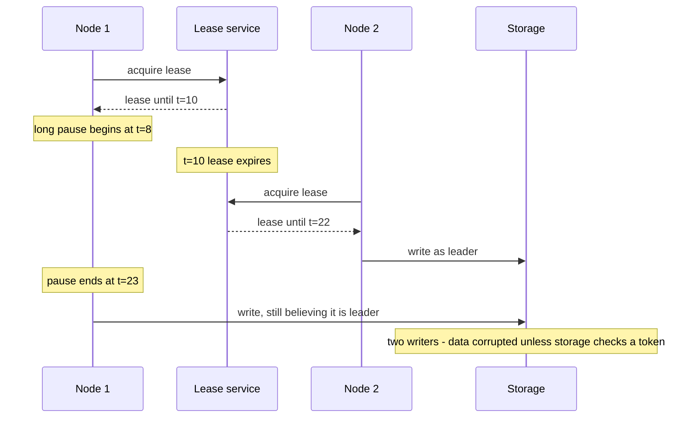

# Unreliable clocks and process pauses

> **Before this lesson:** read [Partial failures and unreliable networks](#/lesson/databases/networks-faults) for asynchronous networks, timeouts and virtual machines. Last write wins and version vectors come from [Detecting concurrent writes](#/lesson/databases/concurrent-writes), snapshot isolation from [ACID, read committed and snapshot isolation](#/lesson/databases/acid-weak-isolation), and leaders from [Single-leader replication](#/lesson/databases/leader-follower).

## In plain words

Every computer has a clock, and no two of them agree exactly. Programs spread across several machines keep being tempted to compare times taken from different clocks ("which of these two changes was made later?"), and the answer they get is sometimes wrong. That is the first half of this lesson.

The second half is stranger. A running program can be frozen for many seconds at any point, by its own memory management or by the system it runs on, and when it wakes up nothing tells it that time has passed. It carries on from the exact instruction where it stopped, with a picture of the world that is now out of date.

An everyday picture for clocks: three friends agree to meet "at noon by my watch", but one watch is four minutes fast and another two minutes slow. Each arrives on time by their own watch and each believes the others are late. Nobody is lying. There is no single "now" that they share.

An everyday picture for pauses: you check that the road is clear, then fall asleep on your feet for fifteen seconds, then step out. The check was correct when you made it. It tells you nothing about the road at the moment you act.

Why this matters for a job: timestamps are everywhere in software, and using the wrong kind of clock is a classic bug with a one-line fix. Databases that pick a winner between conflicting writes by timestamp lose data when clocks disagree. And any design that uses a lock with an expiry time must survive the question interviewers always ask: "what if the holder pauses right after checking that the lock is still valid?"

## Two questions about time

Software constantly asks two kinds of question about time. *How long* did something take - has this request timed out, what is the 99th-percentile latency, how long has the user been on the page? And *when* did something happen - when does this cache entry expire, what timestamp goes into the log line, which of these two writes came later?

On one machine there is one clock, and although it may be wrong, it is at least wrong in the same way for every program on that machine. In a distributed system every machine has its own clock. Inside each is a small quartz crystal that vibrates at a nearly fixed rate, and the machine tells time by counting the vibrations. "Nearly" is the problem: every crystal runs a little fast or a little slow. The machines can compare their clocks only by exchanging messages, and those take an unknown time to arrive. There is no shared "now".

This lesson examines what a clock can and cannot tell you, why timestamps from different machines are a poor basis for ordering events, and then turns to a second, related hazard: your program can be **frozen** at any line, for seconds, without knowing it. The two problems meet in one of the most instructive bugs in distributed systems - the lease that expired while its holder was not looking.

## 1. Two clocks for two questions

Every modern computer offers at least two different clocks. Using the wrong one is a classic bug.

### Time-of-day clocks

A **time-of-day clock** answers "what is the date and time?". It reports the kind of time you would read from a clock on the wall, which is why its reading is called **wall-clock time**. Computers usually express it as the number of seconds (or milliseconds) since a fixed starting moment called the **epoch**: midnight at the start of 1 January 1970, in the worldwide standard time zone known as UTC. Python's `time.time()` and Java's `System.currentTimeMillis()` read this clock.

To keep these clocks roughly in agreement, machines regularly ask a time server for the correct time and adjust themselves. The standard method is **NTP**, the Network Time Protocol. In principle, then, a timestamp from one machine means the same as a timestamp from another. But the adjustment is also this clock's weakness. If the local clock has wandered too far from the server's, it may be **reset** to the correct value in one jump, and that jump can go *backwards* as easily as forwards. A clock that can jump is unsuitable for measuring how much time has passed.

### Monotonic clocks

A **monotonic clock** answers "how much time has passed?". `System.nanoTime()`, Python's `time.monotonic()` and `CLOCK_MONOTONIC` are examples. It is guaranteed to move only forward.

Its *absolute* value is meaningless - it might be nanoseconds since boot, or anything else. Only the **difference** between two readings on the same machine means something. Comparing monotonic readings from two different computers is nonsense.

NTP still influences a monotonic clock, gently: when it finds the local oscillator running fast or slow, it adjusts the *rate* at which the clock advances (this is called **slewing**) by a small fraction of a percent. It never makes it jump. In a distributed system, measuring a timeout or a duration with a monotonic clock is normally fine, since no synchronisation between nodes is assumed.

The program below shows both clocks. The first part times a small calculation with the monotonic clock. The second part imitates what happens to a stopwatch built on the wall clock when NTP resets it during the measurement.

```python-run
import time

# Durations: always use the monotonic clock
t0 = time.monotonic()
sum(i * i for i in range(200_000))
print(f"elapsed (monotonic): {(time.monotonic() - t0) * 1000:.1f} ms")

# What happens to a wall-clock based stopwatch if NTP steps the clock back mid-measurement?
class WallClock:
    def __init__(self): self.offset = 0.0
    def now(self): return 1_700_000_000.0 + self.offset

wall = WallClock()
start = wall.now()
wall.offset += 0.250        # 250 ms of real work pass...
wall.offset -= 0.400        # ...then NTP steps the clock back by 400 ms
print(f"elapsed (wall clock): {(wall.now() - start) * 1000:.0f} ms  <- negative duration!")
```

What each part does:

- `t0 = time.monotonic()` takes a reading before the work. The line with `sum(...)` is some work to time. Taking a second reading afterwards and subtracting gives the time that passed, in seconds. Multiplying by 1000 turns it into milliseconds.
- `WallClock` is a pretend time-of-day clock whose reading can be shifted by changing `offset`.
- `start = wall.now()` is the stopwatch's starting reading. Then 250 milliseconds of work are imitated by moving the clock forward, and an NTP correction is imitated by moving it back 400 milliseconds.
- The last line subtracts the start reading from the current one.

```
elapsed (monotonic): 16.0 ms
elapsed (wall clock): -150 ms  <- negative duration!
```

The first number depends on how fast your computer is, so yours will differ. The second is always -150: the stopwatch reports that the work finished 150 milliseconds before it began.

A negative duration will crash a naive rate limiter, confuse a retry loop, or produce a timeout that never fires.

## 2. How accurate can synchronised clocks be?

A monotonic clock needs no synchronisation. A time-of-day clock is only useful if it is set from an external source, and that process is much less precise than one would hope.

- **Drift.** A clock's gradual wandering from the correct time is called **drift**. The rate of a quartz crystal changes with temperature. A commonly assumed limit for servers is 200 parts per million, which means up to 200 microseconds of error for every second that passes. That is about 6 milliseconds if the clock is corrected every 30 seconds, and about **17 seconds** if it is corrected once a day.
- **Forced resets.** If the difference from the time server is too large, the machine may refuse to adjust, or may reset its clock in one jump. Programs then see time leap.
- **Blocked NTP.** A mistake in network configuration can cut a machine off from its time servers. Its error then grows steadily, and this can go unnoticed for a long time.
- **Network delay.** The time server's answer takes an unknown time to arrive, so the adjustment can never be more accurate than that uncertainty. Over the public internet it is typically tens of milliseconds, and far more when the network is congested.
- **Bad servers.** Some time servers report the wrong time. Machines ask several and ignore any that disagree with the rest, which helps and is not foolproof.
- **Leap seconds.** Occasionally an extra second is inserted into the world's official time to keep it in step with the Earth's rotation. A minute with 61 seconds breaks software that never expected one, and has brought down large systems. A common workaround is to **smear** the leap second: spread the adjustment thinly over a whole day.
- **Virtual machines.** A virtual machine's clock is simulated. When the virtual machine is paused for a while and then resumed, the program inside sees its clock leap forward.
- **Devices you do not control.** A user's phone may have its clock deliberately set wrong.

Much better accuracy is achievable with effort: GPS receivers, the Precision Time Protocol, careful deployment and monitoring. But it takes considerable expertise, and if anything is misconfigured, drift goes unnoticed.

> [!WARNING]
> A defective clock rarely announces itself. A crashed CPU or a dead network link is noticed immediately. A clock that is slowly drifting keeps the software running while data is silently lost. If your system depends on synchronised clocks, **monitor the offsets between all machines** and take a node out of the cluster when its clock strays too far.

## 3. Relying on clocks across machines

### Ordering events by timestamp

It is tempting to decide "which write happened last?" by comparing timestamps. Consider a database with multi-leader replication, where each write is stamped by the node that accepts it.

```python-run
# Replication with last-write-wins. Node B's clock runs 4 ms behind node A's.
SKEW_B = -4                                             # ms

real_time = 0
def stamp(node): return real_time + (SKEW_B if node == "B" else 0)

store = {"A": None, "B": None}                          # each replica: (timestamp, value)
def apply(replica, ts, value):
    if store[replica] is None or ts > store[replica][0]:
        store[replica] = (ts, value)

real_time = 100                                         # client 1 writes price = 10 via node A
w1 = (stamp("A"), "price=10")
for r in store: apply(r, *w1)

real_time = 102                                         # 2 ms LATER, client 2 has seen 10 and raises it via node B
w2 = (stamp("B"), "price=11")
for r in store: apply(r, *w2)

print("write 1 stamped", w1[0], "| write 2 stamped", w2[0])
print("final state:", store)
print("the causally later write (price=11) was discarded, and nobody was told")
```

What each part does:

- `SKEW_B = -4` says node B's clock is 4 milliseconds behind. **Clock skew** is the difference between two clocks at the same moment.
- `real_time` is the true time, which no node can see. `stamp(node)` returns what that node's clock reads: the true time, minus 4 if the node is B.
- `store` holds each replica's current value as a pair (timestamp, value). `apply` is the last-write-wins rule: accept an incoming write only if its timestamp is larger than the one already stored.
- At true time 100, a client sets the price to 10 through node A. The write is stamped 100 and applied to both replicas.
- At true time 102, a second client, who has seen the price of 10, raises it to 11 through node B. Node B's clock reads 98, so the write is stamped 98.

```
write 1 stamped 100 | write 2 stamped 98
final state: {'A': (100, 'price=10'), 'B': (100, 'price=10')}
the causally later write (price=11) was discarded, and nobody was told
```

The second write clearly happened later - its author had even seen the first value - yet it carries the *smaller* timestamp, because node B's clock is a few milliseconds slow. Every replica drops it. Resolving conflicts this way is known as **last write wins (LWW)**; many multi-leader and leaderless stores do it by default. Its problems:

- Writes can **vanish silently**: whatever a slow-clocked node writes loses against values stamped by a fast-clocked node, until real time has caught up with the difference.
- LWW **cannot tell sequential from concurrent** writes. Detecting causality requires version vectors.
- Two nodes can produce the same timestamp, so an additional tiebreaker is needed, which may also violate causality.

Could synchronisation be made good enough to avoid this? The clocks would have to be accurate to better than the network delay between nodes, and the synchronisation itself runs over that network. For ordering events, **logical clocks** - counters that are incremented, not oscillators that are read - are the safer tool. They measure only relative order, not time of day. We will meet them in the lesson on ordering.

### A reading is an interval, not a point

A clock happily reports a time in nanoseconds. That does not make it accurate to nanoseconds. With a public NTP server the uncertainty may be tens of milliseconds, and with a local high-quality source perhaps a millisecond or less.

It would be more honest to think of a reading as a **range**: "the time is very probably somewhere between 14:03:07.2 and 14:03:07.5". Ordinary clock APIs give you a single number and keep the error bar to themselves. An exception is Google's **TrueTime** API in Spanner, which returns a pair `[earliest, latest]` and guarantees that the true time lies within it.

### Snapshots across data centres

Snapshot isolation needs transaction ids that increase monotonically, so that "does this snapshot include that write?" has a clear answer. On one node a counter does the job. Across many machines in several data centres, generating a global monotonically increasing id efficiently is hard.

Could a timestamp from a synchronised clock serve as the transaction id? Only if the uncertainty is handled. Spanner does it like this: if two confidence intervals do not overlap - A's latest possible time is before B's earliest - then A definitely happened before B. To make that hold, Spanner **deliberately waits out the uncertainty** before committing a read-write transaction: it waits for the length of the confidence interval, so that any transaction that might read the data starts at a time that is unambiguously later. The smaller the uncertainty, the shorter the wait, which is why Google equips each data centre with GPS receivers and atomic clocks to keep it within roughly 7 ms.

## 4. Process pauses

Now a hazard that has nothing to do with clocks being wrong and everything to do with time passing unnoticed.

A leader in a single-leader database must know that it is still the leader. One way is a **lease**: a lock with an expiry time, obtained from the other nodes and renewed periodically. If the leader dies, it stops renewing, the lease runs out, and another node can take over. The leader's request loop might look like this:

```text
loop:
    request = get_incoming_request()
    if lease.expiry - now() < 10 seconds:
        lease = lease.renew()
    if lease.is_valid():
        process(request)
```

Two things are wrong. First, the expiry was set by a *different* machine and is being compared with the local clock; with a skew of a few seconds the comparison is meaningless. Second - and this remains even if only the local monotonic clock is used - the code assumes that almost no time passes between checking the lease and processing the request.

Suppose the thread stops for 15 seconds right after the `is_valid()` check. When it resumes, the lease has expired and another node is now leader. But the code does not look at the clock again until the next iteration. It carries on and processes the request as if nothing had happened.

The program below plays out that scenario with a simulated clock.

```python-run
class Lease:
    def __init__(self, holder, expires): self.holder, self.expires = holder, expires

now = 0.0
lease = Lease("node-1", expires=10.0)
storage = []

def leader_step(node, pause):
    """Check lease, (maybe get paused), then write - the classic check-then-act gap."""
    global now, lease
    ok = lease.holder == node and now < lease.expires
    print(f"t={now:>4.1f}  {node} checks lease: {'valid' if ok else 'invalid'}")
    if not ok: return
    now += pause                                           # a stop-the-world pause happens HERE
    if pause: print(f"t={now:>4.1f}  {node} resumes after a {pause}s pause, unaware anything happened")
    storage.append((now, node))
    print(f"t={now:>4.1f}  {node} writes to storage")

now = 8.0
# During node-1's pause the lease expires at t=10 and node-2 takes over at t=12:
leader_step("node-1", pause=15.0)
lease = Lease("node-2", expires=22.0)                      # (this happened at t=12, while node-1 was frozen)
print("       lease is held by", lease.holder, "- yet storage contains a write from node-1:", storage)
```

What each part does:

- A `Lease` records who holds it and when it expires. Node 1 holds one that expires at time 10.
- `leader_step(node, pause)` is one turn of the leader's loop. It first checks the lease: is this node the holder, and is the current time before the expiry?
- If the check passes, the line `now += pause` moves time forward. That stands for the program being frozen at exactly this point. The node's own code does nothing during the pause and does not know it happened.
- Then the node writes to storage, relying on the check it made before the pause.
- The script starts at time 8 and gives node 1 a 15-second pause. The next line records what happened elsewhere in the meantime: the lease passed to node 2.

```
t= 8.0  node-1 checks lease: valid
t=23.0  node-1 resumes after a 15.0s pause, unaware anything happened
t=23.0  node-1 writes to storage
       lease is held by node-2 - yet storage contains a write from node-1: [(23.0, 'node-1')]
```

At time 8 the lease was valid. At time 23 node 1 wrote anyway, thirteen seconds after its lease ran out and while node 2 was the rightful leader.

Is a 15-second freeze realistic? There are many ways for a thread to stop for a long time:

- **Garbage collection.** Many programming languages reclaim unused memory automatically. In some, such as Java, the reclaiming process occasionally halts every part of the program until it has finished. This is called a "stop-the-world" pause. Pauses of several seconds, and in bad cases minutes, have been observed in programs holding a lot of memory.
- **Suspending a virtual machine.** A virtual machine can be frozen and resumed later, for example to move it to a different physical computer without shutting it down. The freeze can last any length of time.
- **Laptops and phones** freeze whenever the lid is closed or the device goes to sleep.
- **Sharing the processor.** The operating system regularly takes the processor away from one thread and gives it to another (a context switch), and a hypervisor does the same between virtual machines. On a heavily loaded machine, a thread may wait a long time for its next turn.
- **Slow disk access.** A thread that reads a file has to wait for the disk. If the disk is busy, or the file is really on another machine across a network, the wait can be long. Such reads sometimes happen where the programmer did not expect them.
- **Paging.** When memory is short, the operating system moves some of a program's data out to disk. If the program then touches that data, an ordinary memory access turns into a slow disk read. A machine that spends most of its time moving data in and out like this is said to be **thrashing**. Servers often have paging switched off for this reason.
- **Being stopped on purpose.** An operator can halt a running program with a single key press or command, and it stays halted until someone resumes it.

In all these cases the thread is interrupted at an arbitrary point and resumed later **without being told**. On a single machine, programmers have tools for making code safe when threads are interrupted, because the threads share the same memory and can coordinate through it. Those tools do not carry over to a distributed system, where machines share no memory and have only messages over an unreliable network.

A node therefore has to reckon with being frozen for a long while *between any two instructions*. During the pause the rest of the world moves on, and may declare the node dead. When it resumes it may not notice that it was asleep until it next checks the clock.



The fix is not to make the node smarter about its own state - it cannot be. The fix is for the storage to reject requests from holders of an outdated lease, using a **fencing token**. That is the subject of the next lesson.

### Can pauses be eliminated?

In some systems software *must* respond within a fixed time: the computer that fires a car's airbag cannot be busy collecting garbage. Such **hard real-time** systems specify a deadline for every operation and are built so it is always met. That requires support from every layer: a real-time operating system that guarantees CPU time, libraries that document worst-case execution times, restricted or no dynamic memory allocation, and a great deal of testing and measurement. It is expensive, it limits which languages and tools can be used, and it generally gives *lower* throughput, because meeting deadlines takes priority over everything else. For server-side data systems it is rarely economical. They live with pauses.

("Real-time" on the web usually means only that updates are pushed to users quickly, with no hard deadline.)

### Limiting the damage of garbage collection

Short of real-time engineering, a few practical measures help:

- **Treat a collection as a short planned outage.** If the runtime can warn that a node needs a collection soon, the node can stop accepting new requests, let other nodes take them, finish what it has, and collect while idle. This hides pauses from clients and reduces tail latency.
- **Collect only short-lived objects, and restart before a full collection is needed.** The collector for short-lived objects is fast. Before enough long-lived garbage accumulates to need a full pause, the process is restarted on a schedule, one node at a time with traffic shifted away - a rolling restart.

Neither removes pauses entirely, but both reduce their effect on users.

> [!INTERVIEW]
> If you propose a lock or lease in a design, expect: "What if the holder pauses after checking the lease?" The answer: the holder cannot detect this itself, so safety must come from the resource - every grant carries a monotonically increasing token, and the resource refuses any operation with a token lower than one it has already seen. Mentioning that the same reasoning applies to GC pauses, VM migration and slow disks shows you understand that this is not an exotic case.

## Pitfalls

- **Measuring durations with the time-of-day clock.** It can jump. Use the monotonic clock for timeouts, latency and rate limits.
- **Comparing monotonic readings between machines.** Their values have no common reference.
- **Ordering writes by wall-clock timestamp.** Clock skew causes silent data loss with last-write-wins.
- **Treating a timestamp as exact.** Every reading has an uncertainty, and it is often larger than the interval you are trying to resolve.
- **Not monitoring clock offset.** Drift is invisible until data is gone.
- **Check-then-act on a lease.** Time may pass between the check and the action; the node cannot tell.
- **Comparing a remote expiry time with a local clock.** Grant a lease as a duration and measure it locally with the monotonic clock - and still fence.
- **Assuming pauses are milliseconds.** Full collections, VM migrations and swapping produce pauses of seconds.

## Summary

- **Time-of-day clocks** give calendar time, are synchronised by NTP, and may jump backward or forward. **Monotonic clocks** only move forward and are meant for measuring **durations** on one machine.
- Synchronisation is limited by **drift**, **network delay**, misbehaving servers, **leap seconds** and **virtualisation**. A clock reading is best understood as a **confidence interval**.
- **Last write wins** on wall-clock timestamps silently drops writes when clocks are skewed and cannot detect concurrency. Use **logical clocks** for ordering.
- Using clocks for cross-node snapshot ordering is possible only by accounting for uncertainty explicitly, as Spanner does by **waiting out** its TrueTime interval.
- A process can be **paused** at any point - garbage collection, VM suspension, scheduling, I/O, paging - and resumes unaware. A node therefore cannot trust its own belief that it still holds a **lease**.
- Hard real-time guarantees are possible but too costly for most server software; instead, limit pauses operationally and make correctness independent of timing by having the resource check **fencing tokens**.

## Glossary

- **Time-of-day clock** - a clock that reports the date and time; it can be reset and may jump.
- **Wall-clock time** - the date and time as a clock on the wall would show it.
- **Epoch** - the fixed starting moment from which computers count time: the start of 1 January 1970, UTC.
- **UTC** - the worldwide standard time zone.
- **NTP (Network Time Protocol)** - the usual method by which machines adjust their clocks to a time server.
- **Monotonic clock** - a clock that only moves forward, meant for measuring elapsed time on one machine.
- **Slewing** - adjusting a clock's rate slightly, without making it jump.
- **Drift** - a clock's gradual wandering from the correct time.
- **Clock skew** - the difference between two clocks at the same moment.
- **Leap second** - an extra second occasionally inserted into official time.
- **Smearing** - spreading a leap second's adjustment over many hours.
- **Last write wins (LWW)** - resolving a conflict by keeping the write with the largest timestamp.
- **Logical clock** - a counter used to order events, not a measure of real time.
- **Confidence interval** (of a clock) - the range in which the true time very probably lies.
- **TrueTime** - Google's clock interface that returns an earliest and a latest possible time.
- **Lease** - a lock that expires after a set time unless renewed.
- **Process pause** - a period in which a program is frozen and does nothing, without being aware of it.
- **Garbage collection** - automatic reclaiming of memory a program no longer uses.
- **Stop-the-world pause** - a garbage collection that halts the whole program until it finishes.
- **Context switch** - the operating system moving the processor from one thread to another.
- **Paging / thrashing** - moving a program's data between memory and disk / spending most of the time doing so.
- **Hard real-time system** - a system built so that every operation finishes within a guaranteed deadline.
- **Fencing token** - an increasing number issued with each lease, which storage uses to reject requests from an outdated holder.

```quiz
[
  {"q": "Which clock should be used to measure how long a request took?",
   "options": ["The time-of-day clock, because it is synchronised with NTP", "The monotonic clock, because it never jumps backward", "Either, they are equivalent", "A clock on another machine"],
   "answer": 1,
   "explain": "A time-of-day clock may be stepped by NTP during the measurement, giving a wrong or even negative duration. The monotonic clock is designed for elapsed time."},
  {"q": "Why is it meaningless to compare monotonic clock values from two different machines?",
   "options": ["They use different units", "The absolute value has no defined reference point, such as time since boot; only differences on the same machine have meaning", "They are encrypted", "Monotonic clocks are always synchronised, so the comparison is trivial"],
   "answer": 1,
   "explain": "Each machine's monotonic clock starts from an arbitrary origin."},
  {"q": "In a store using last-write-wins, node B's clock is 4 ms behind node A's. A client writes through A and 2 ms later another client overwrites the value through B. What happens?",
   "options": ["The second write wins, as intended", "The second write gets a smaller timestamp and is silently discarded", "Both values are kept as siblings", "The database raises a conflict error"],
   "answer": 1,
   "explain": "The later write carries an earlier timestamp because of skew, so LWW considers it older and drops it without telling anyone."},
  {"q": "What does it mean to treat a clock reading as a confidence interval?",
   "options": ["The clock reports two time zones", "The true time lies somewhere in a range around the reading, whose width depends on drift and synchronisation error", "The clock is only read at intervals", "The reading is always exact to the last digit"],
   "answer": 1,
   "explain": "Resolution is not accuracy. Spanner's TrueTime makes the range explicit by returning earliest and latest bounds."},
  {"q": "Why does Spanner wait before committing a read-write transaction?",
   "options": ["To batch disk writes", "To let the clock uncertainty interval pass, so that later transactions get timestamps that are unambiguously greater", "To give replicas time to elect a leader", "To avoid garbage collection"],
   "answer": 1,
   "explain": "If intervals cannot overlap, timestamp order matches real order. Waiting out the uncertainty guarantees this, which is why small uncertainty matters."},
  {"q": "A leader checks that its lease is valid and is then paused for 15 seconds by a garbage collection before performing a write. Why is this dangerous?",
   "options": ["The write will be slow", "The lease may have expired and another node may have become leader, but the paused node continues as if it still held the lease", "Garbage collection deletes the lease", "The clock stops during the pause"],
   "answer": 1,
   "explain": "The node cannot notice its own pause between the check and the action, so two nodes may act as leader. The resource must reject the stale one."},
  {"q": "Which of the following can pause a process for a long time without its knowledge?",
   "options": ["Only garbage collection", "Garbage collection, VM suspension or migration, operating-system scheduling, paging and slow synchronous I/O", "Only network partitions", "Nothing; processes always know when they are paused"],
   "answer": 1,
   "explain": "Many layers can pre-empt a thread at an arbitrary instruction. The thread continues afterwards with no notification."},
  {"q": "Why do most server-side data systems not use hard real-time techniques to eliminate pauses?",
   "options": ["Real-time operating systems do not exist", "Guaranteed response times need support from every layer, restrict languages and tools, and reduce throughput, which is too costly for typical services", "Pauses never matter for servers", "The law forbids it"],
   "answer": 1,
   "explain": "Hard real-time is engineered for safety-critical devices. For data systems it is cheaper to tolerate pauses and make correctness independent of timing."}
]
```

> **Source:** DDIA ch. 8 (The Trouble with Distributed Systems) - unreliable clocks, process pauses. Written in original wording with original examples.
