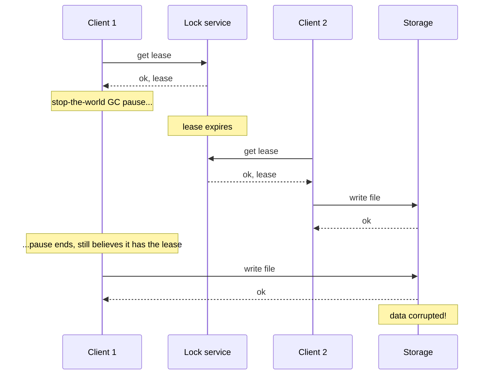
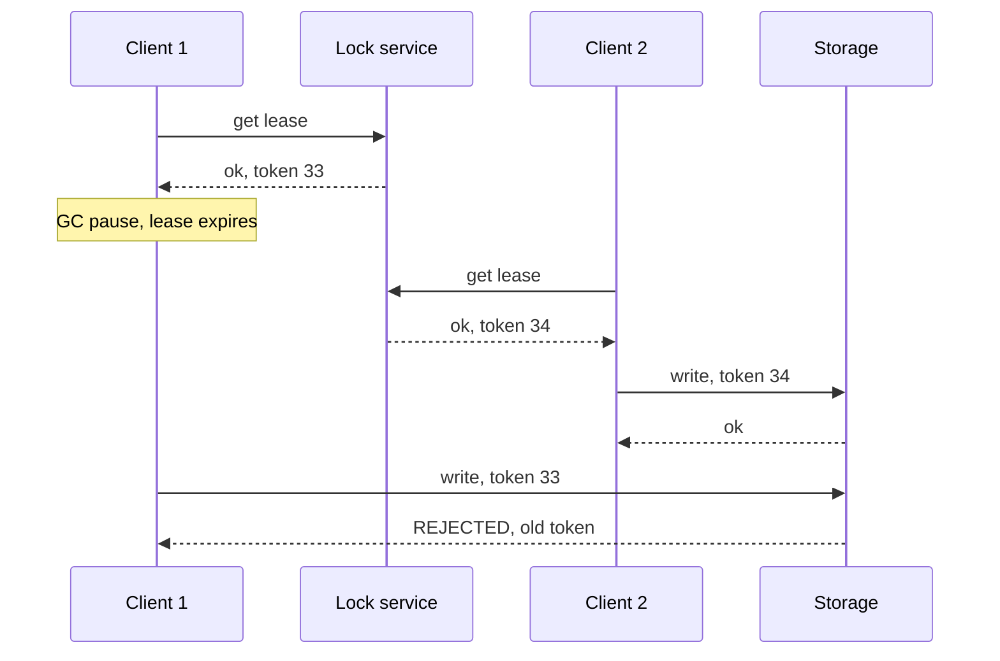

# Truth, majorities, fencing tokens and Byzantine faults

So far in Chapter 8 we have seen that a node cannot trust the network (messages get lost or delayed), cannot trust its clock, and cannot even trust that it has been running continuously. A node can only **guess** what state other nodes are in, based on the messages it receives or does not receive. This lesson asks: in such a world, how does a system decide what is *true*?

## 1. The truth is defined by the majority

Picture three scenarios:

1. A node can **receive** all messages sent to it, but every outgoing message is dropped or delayed. The node works perfectly, yet the other nodes hear nothing from it. After a timeout they declare it dead.
2. The node notices that its messages are not being acknowledged and realises there must be a network fault. It is still wrongly declared dead and can do nothing about it.
3. The node suffers a long stop-the-world GC pause. All its threads stop for a minute. The other nodes wait, retry, lose patience, declare it dead, and "load it onto the hearse". Then the GC finishes and the node's threads continue as if nothing had happened. From its own perspective hardly any time has passed.

The moral: **a node cannot necessarily trust its own judgement of a situation.** A distributed system cannot rely on a single node, because a node may fail at any time. Instead, many distributed algorithms rely on a **quorum**, which means voting among the nodes. Decisions require some minimum number of votes from several nodes, to reduce dependence on any one node.

This includes decisions about declaring nodes dead. If a quorum of nodes declares another node dead, it must be considered dead, even if it feels very much alive. The individual node must abide by the quorum decision and step down.

Most commonly the quorum is an **absolute majority** of more than half the nodes. A majority quorum lets the system keep working if individual nodes fail: with 3 nodes one failure is tolerated, and with 5 nodes two. It is still safe, because there can be only **one majority** in the system. Two majorities with conflicting decisions cannot exist at the same time.

## 2. The leader and the lock

Frequently, a system requires there to be only **one** of some thing:

- only one node may be the **leader** for a database partition, to avoid split brain,
- only one transaction or client may hold the **lock** for a particular resource,
- only one user may register a particular **username**.

Implementing this needs care. Even if a node believes it is "the chosen one" (the leader, the lock holder), that does not mean a quorum of nodes agrees. A node may have been the leader formerly, but if the others declared it dead in the meantime (because of a network interruption or GC pause), it may have been demoted and another leader elected.

If a node continues acting as the chosen one even though the majority has declared it dead, a carelessly designed system has a problem. DDIA's example is a data corruption bug caused by an incorrect implementation of locking. (This is not theoretical: HBase used to have this bug.) You want to ensure that a file in a storage service can be accessed by only one client at a time, because simultaneous writes would corrupt it. You implement this by requiring a client to obtain a **lease** from a lock service before accessing the file.



This is the process-pause problem from the previous lesson. Client 1 held the lease, paused for too long, and its lease expired. Client 2 acquired the lease and started writing. When client 1 woke up, it believed (incorrectly) that it still had a valid lease and wrote to the file as well. The two clients' writes clash and corrupt the file.

## 3. Fencing tokens

When using a lock or lease to protect access to some resource, we must ensure that a node under a false belief of being "the chosen one" cannot disrupt the rest of the system. A fairly simple technique that achieves this is called **fencing**.

Assume that every time the lock server grants a lock or lease, it also returns a **fencing token**: a number that **increases every time** a lock is granted (incremented by the lock service). Every time a client sends a write request to the storage service, it must include its current fencing token.



Client 1 acquires the lease with token 33, then goes into a long pause and the lease expires. Client 2 acquires the lease with token 34 and sends its write to the storage service, including token 34. Later, client 1 comes back to life and sends its write with token 33. The storage server **remembers that it has already processed a write with a higher token (34)**, so it rejects the request with token 33.

If **ZooKeeper** is used as the lock service, the transaction ID `zxid` or the node version `cversion` can be used as a fencing token. Since they are guaranteed to be monotonically increasing, they have the required properties.

This mechanism requires the **resource itself to take an active role** in checking tokens, by rejecting any writes with an older token than one already processed. It is not sufficient to rely on clients checking their lock status themselves. For resources that do not explicitly support fencing tokens, you might still work around the limitation (for a file storage service, you could include the fencing token in the filename). Some kind of check is necessary to avoid processing requests outside of the lock's protection.

Checking a token on the server side may seem like a drawback, but it is arguably a good thing: it is unwise for a service to assume that its clients will always be well behaved, because the clients are often run by people whose priorities are very different from those of the people running the service.

```python-run
class LockService:
    def __init__(self): self.token = 32
    def acquire(self):
        self.token += 1
        return self.token

class Storage:
    def __init__(self): self.max_token, self.data = 0, None
    def write(self, token, value):
        if token < self.max_token:
            return f"REJECT token {token} < {self.max_token}"
        self.max_token, self.data = token, value
        return f"ok (token {token})"

lock, store = LockService(), Storage()
t1 = lock.acquire()                 # client 1 gets token 33, then pauses (lease expires)
t2 = lock.acquire()                 # client 2 gets token 34
print("client 2:", store.write(t2, "from client 2"))
print("client 1:", store.write(t1, "from zombie client 1"))
print("stored  :", store.data)
```

> [!INTERVIEW]
> "Is a Redis `SET key value NX PX 30000` lock safe?" On its own it gives *mutual exclusion in the common case*, not a guarantee. The holder can be paused past the TTL, or the Redis primary can fail over before the lock is replicated. For **efficiency** locks (avoid duplicate work) that is fine. For **correctness** locks, the protected resource must check a monotonically increasing **fencing token**, which requires a lock service with a linearizable counter (ZooKeeper `zxid`, etcd revision).

## 4. Byzantine faults

Fencing tokens can detect and block a node that is *inadvertently* acting in error, for example because it has not yet found out that its lease expired. If the node deliberately wanted to subvert the system's guarantees, it could easily do so by sending messages with a fake fencing token.

So far we have assumed that nodes are **unreliable but honest**. They may be slow or never respond (because of a fault), and their state may be outdated (because of a GC pause or network delays), but we assume that if a node *does* respond, it is telling the "truth": to the best of its knowledge, it is playing by the rules of the protocol.

Distributed systems problems become much harder if there is a risk that nodes may "lie" (send arbitrary faulty or corrupted responses). For example, a node may claim to have received a particular message when in fact it did not. Such behaviour is known as a **Byzantine fault**, and the problem of reaching consensus in this untrusting environment is known as the **Byzantine Generals Problem**.

> [!NOTE]
> **The Byzantine Generals Problem** generalises the Two Generals Problem. There are $n$ generals who need to agree, and their endeavour is hampered by the fact that there are some **traitors** in their midst. Most of the generals are loyal and send truthful messages, but the traitors may try to deceive and confuse the others by sending fake or untrue messages. It is not known in advance who the traitors are.

A system is **Byzantine fault-tolerant** if it continues to operate correctly even if some of the nodes are malfunctioning and not obeying the protocol, or if malicious attackers are interfering with the network. This concern is relevant in specific circumstances:

- In **aerospace** environments, the data in a computer's memory or CPU register could become corrupted by radiation, leading it to respond to other nodes in arbitrarily unpredictable ways. Since a system failure would be very expensive (an aircraft crashing, or a rocket colliding with the International Space Station), flight control systems must tolerate Byzantine faults.
- In a system with **multiple participating organisations**, some participants may attempt to cheat or defraud others. In such circumstances, it is not safe for a node to simply trust another node's messages, since they may be sent with malicious intent. Peer-to-peer networks like **Bitcoin and other blockchains** can be considered a way of getting mutually untrusting parties to agree whether a transaction happened or not, without relying on a central authority.

In the kinds of systems DDIA discusses, we can usually safely assume that there are **no Byzantine faults**. In your datacenter, all the nodes are controlled by your organisation (so they can hopefully be trusted), and radiation levels are low enough that memory corruption is not a major problem. Protocols for making systems Byzantine fault-tolerant are quite complicated, and fault-tolerant embedded systems rely on support from the hardware level. In most server-side data systems, the cost of deploying Byzantine fault-tolerant solutions makes them impractical.

Web applications do need to expect arbitrary and malicious behaviour of clients that are under end-user control, such as web browsers. This is why **input validation, sanitisation and output escaping** are so important: to prevent SQL injection and cross-site scripting, for example. We typically do not use Byzantine fault-tolerant protocols here. We simply make the server the authority on deciding what client behaviour is and is not allowed.

A bug in the software could be regarded as a Byzantine fault, but if you deploy the same software to all nodes, a Byzantine fault-tolerant algorithm cannot save you. Most Byzantine fault-tolerant algorithms require a **supermajority of more than two-thirds** of the nodes to be functioning correctly (if you have four nodes, at most one may malfunction). To use this approach against bugs, you would need four independent implementations of the same software and hope that a bug appears in only one of them.

### 4.1 Weak forms of lying

Although we assume that nodes are generally honest, it can be worth adding mechanisms to software that guard against **weak forms of "lying"**: invalid messages due to hardware issues, software bugs and misconfiguration. Such protection mechanisms are not full-blown Byzantine fault tolerance, as they would not withstand a determined adversary, but they are simple and pragmatic steps towards better reliability:

- Network packets do sometimes get corrupted due to hardware issues or bugs in operating systems, drivers and routers. Usually, corrupted packets are caught by the checksums built into TCP and UDP, but sometimes they evade detection. Simple measures are usually sufficient protection, such as **checksums in the application-level protocol**.
- A publicly accessible application must carefully **sanitise any inputs** from users, for example checking that a value is within a reasonable range and limiting the size of strings to prevent denial of service through large memory allocations.
- **NTP clients** can be configured with multiple server addresses. When synchronising, the client contacts all of them, estimates their errors, and checks that a majority of servers agree on some time range. As long as most of the servers are okay, a misconfigured NTP server that is reporting an incorrect time is detected as an outlier and excluded.

## 5. System model and reality

Many algorithms have been designed to solve distributed systems problems. To be useful, they need to tolerate the various faults we have discussed. Algorithms need to be written in a way that does not depend too heavily on the details of the hardware and software configuration on which they are run. This in turn requires that we somehow formalise the kinds of faults that we expect to happen in a system. We do this by defining a **system model**, which is an abstraction that describes what things an algorithm may assume.

**Timing assumptions.** Three system models are in common use:

- **Synchronous model.** Assumes **bounded** network delay, bounded process pauses and bounded clock error. This does not imply exactly synchronised clocks or zero network delay. It just means you know these will never exceed some fixed upper bound. The synchronous model is not a realistic model of most practical systems, because unbounded delays and pauses do occur.
- **Partially synchronous model.** The system behaves like a synchronous system **most of the time**, but it sometimes exceeds the bounds for network delay, process pauses and clock drift. This is a **realistic model of many systems**: most of the time, networks and processes are quite well behaved, but we have to reckon with the fact that any timing assumptions may be shattered occasionally. When this happens, network delay, pauses and clock error may become arbitrarily large.
- **Asynchronous model.** An algorithm is not allowed to make **any timing assumptions**. It does not even have a clock (so it cannot use timeouts). Some algorithms can be designed for the asynchronous model, but it is very restrictive.

**Node failure assumptions.** The three most common system models for nodes are:

- **Crash-stop faults.** A node can fail in only one way, namely by crashing. The node may suddenly stop responding at any moment, and thereafter that node is gone forever. It never comes back.
- **Crash-recovery faults.** Nodes may crash at any moment, and perhaps start responding again after some unknown time. Nodes are assumed to have **stable storage** (non-volatile disk storage) that is preserved across crashes, while the in-memory state is assumed to be lost.
- **Byzantine (arbitrary) faults.** Nodes may do absolutely anything, including trying to trick and deceive other nodes.

For modelling real systems, the **partially synchronous model with crash-recovery faults** is generally the most useful model.

### 5.1 Correctness of an algorithm: safety and liveness

To define what it means for an algorithm to be **correct**, we can describe its **properties**. For example, if we are generating fencing tokens for a lock, we may require the algorithm to have the following properties:

- **Uniqueness.** No two requests for a fencing token return the same value.
- **Monotonic sequence.** If request $x$ returned token $t_x$, and request $y$ returned token $t_y$, and $x$ completed before $y$ began, then $t_x < t_y$.
- **Availability.** A node that requests a fencing token and does not crash eventually receives a response.

It is worth distinguishing between two different kinds of properties: **safety** and **liveness**. In the example just given, uniqueness and monotonic sequence are safety properties, but availability is a liveness property.

- **Safety** is often informally defined as *nothing bad happens*. If a safety property is violated, we can point at a particular point in time at which it was broken (for the uniqueness property, we can identify the particular operation in which a duplicate fencing token was returned). After a safety property has been violated, the violation cannot be undone. The damage is already done.
- **Liveness** is often informally defined as *something good eventually happens*. Liveness properties often include the word "eventually" in their definition (and yes, eventual consistency is a liveness property). A liveness property may not hold at some point in time (for example, a node may have sent a request but not yet received a response), but there is always hope that it may be satisfied in the future.

For distributed algorithms, it is common to require that **safety properties always hold**, in all possible situations of a system model. Even if all nodes crash, or the entire network fails, the algorithm must nevertheless ensure that it does not return a wrong result. With liveness properties we are allowed to make **caveats**: for example, we could say that a request needs to receive a response only if a majority of nodes have not crashed, and only if the network eventually recovers from an outage.

### 5.2 Mapping system models to the real world

Safety and liveness properties and system models are very useful for reasoning about the correctness of a distributed algorithm. However, when implementing an algorithm in practice, the messy facts of reality come back to bite you again, and it becomes clear that the system model is a simplified abstraction of reality.

For example, algorithms in the crash-recovery model generally assume that data in stable storage survives crashes. What happens if the data on disk is corrupted, or the data is wiped out due to hardware error or misconfiguration? What happens if a server has a firmware bug and fails to recognise its hard drives on reboot, even though the drives are correctly attached to the server? Quorum algorithms rely on a node remembering the data that it claims to have stored. If a node may suffer from amnesia and forget previously stored data, that breaks the quorum condition, and thus breaks the correctness of the algorithm.

The theoretical description of an algorithm can declare that certain things are simply assumed not to happen. In non-Byzantine systems we do have to make some assumptions about faults that can and cannot happen. A real implementation may still have to include code to handle the case where something happens that was assumed to be impossible, even if that handling boils down to `printf("Sucks to be you")` and `exit(666)`: letting a human operator clean up the mess. (This is arguably the difference between computer science and software engineering.)

That is not to say that theoretical, abstract system models are worthless. Quite the opposite. They are incredibly helpful for distilling the complexity of real systems down to a manageable set of faults that we can reason about, so that we can understand the problem and try to solve it systematically. We can prove algorithms correct by showing that their properties always hold in some system model. Proving an algorithm correct does not mean its implementation on a real system will necessarily always behave correctly. It is a very good first step, because theoretical analysis can uncover problems in an algorithm that might remain hidden for a long time in a real system, and that only come to bite you when your assumptions (for example, about timing) are defeated due to unusual circumstances. **Theoretical analysis and empirical testing are equally important.**

## 6. Summary

- A node cannot trust its own view. **Truth is decided by a majority quorum**, and a node declared dead must step down.
- "Only one leader / lock holder" breaks when a paused node wakes up with a stale belief. **Fencing tokens** (monotonically increasing numbers checked *by the resource*) make this safe.
- **Byzantine faults** (nodes that lie) matter in aerospace and in systems of mutually distrusting parties (blockchains). Datacenter systems usually assume honest nodes and add cheap defences: checksums, input validation, several NTP sources.
- **System models**: synchronous / partially synchronous / asynchronous timing, and crash-stop / crash-recovery / Byzantine faults. Real systems are best modelled as partially synchronous with crash-recovery.
- **Safety** (nothing bad happens) must always hold. **Liveness** (something good eventually happens) may come with caveats.

```quiz
[
  {"q": "Why do distributed algorithms rely on a majority quorum rather than a single node's judgement?",
   "options": ["Majorities are faster", "A single node may be wrong about its own state (e.g., paused or partitioned), and only one majority can exist at a time", "Nodes always lie", "To reduce storage"],
   "answer": 1,
   "explain": "Two disjoint majorities are impossible, so majority decisions cannot conflict."},
  {"q": "In the lease example, why does client 1 corrupt the file?",
   "options": ["The lock service gave two leases at once", "Client 1 was paused past its lease expiry and resumed writing, believing it still held the lease", "The storage service crashed", "Client 2 forged a token"],
   "answer": 1,
   "explain": "A paused process does not notice the pause; its belief is stale."},
  {"q": "What property must a fencing token have?",
   "options": ["It must be random", "It must increase every time the lock is granted", "It must be a timestamp from the client's clock", "It must be secret"],
   "answer": 1,
   "explain": "The resource rejects any write with a token lower than one it has already seen."},
  {"q": "Who must check the fencing token?",
   "options": ["The client", "The lock service only", "The protected resource (e.g., the storage service) on every write", "Nobody"],
   "answer": 2,
   "explain": "Clients cannot be relied on to check their own lock status; they may be the zombie."},
  {"q": "What is a Byzantine fault?",
   "options": ["A node crashing", "A node behaving arbitrarily, including sending false or corrupted messages", "A network partition", "A slow disk"],
   "answer": 1,
   "explain": "Most datacenter systems assume nodes are unreliable but honest, so Byzantine tolerance is rarely used."},
  {"q": "Which system model best describes most real datacenter systems?",
   "options": ["Synchronous with crash-stop", "Partially synchronous with crash-recovery faults", "Asynchronous with Byzantine faults", "Synchronous with Byzantine faults"],
   "answer": 1,
   "explain": "Timing bounds usually hold but are occasionally exceeded; nodes crash and restart with stable storage."},
  {"q": "Which of these is a liveness property?",
   "options": ["No two fencing tokens are equal", "Tokens increase monotonically", "A node that requests a token and does not crash eventually receives a response", "A committed write is never lost"],
   "answer": 2,
   "explain": "Liveness says something good eventually happens; safety says nothing bad happens."},
  {"q": "Byzantine fault-tolerant algorithms typically require what fraction of nodes to be correct?",
   "options": ["More than one half", "More than two thirds", "All of them", "At least one"],
   "answer": 1,
   "explain": "With four nodes at most one may be faulty; this is a supermajority requirement."}
]
```

> **Source:** DDIA ch. 8, "Knowledge, Truth and Lies" (the truth is defined by the majority, fencing tokens, Byzantine faults, system model and reality).
