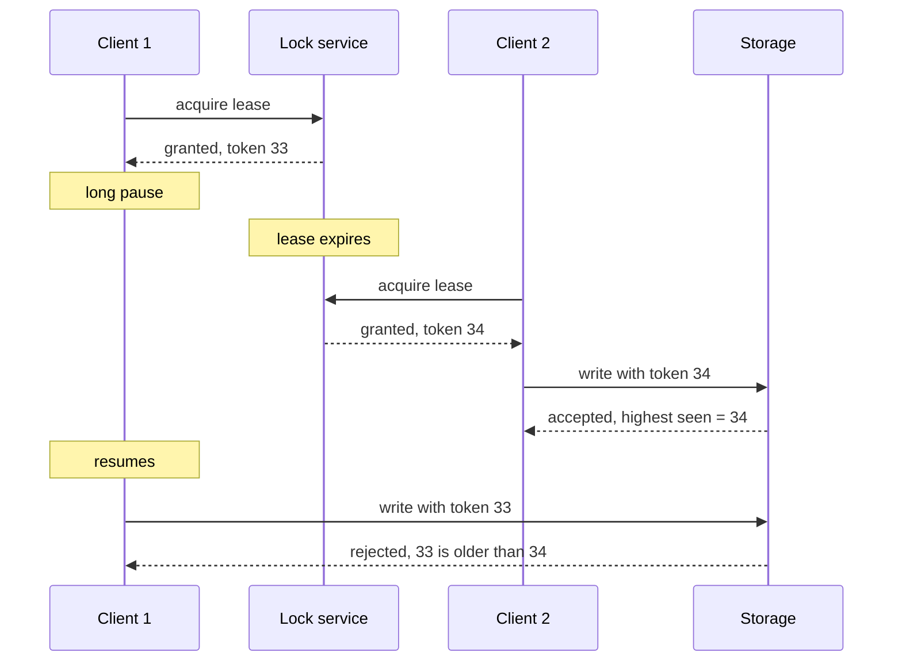
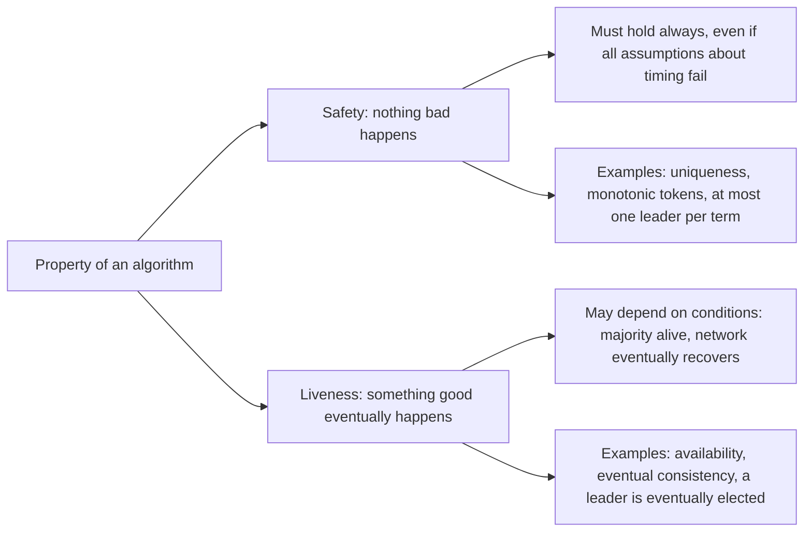

# Truth, majorities, fencing tokens and Byzantine faults

The two preceding lessons took away most of what a program normally relies on. Messages may be lost or arbitrarily delayed. Clocks disagree. A process may be frozen at any instruction and wake up later without noticing. Put together, these facts lead to an unsettling conclusion: **a node in a distributed system cannot be sure of anything beyond its own local state**. All it can do is draw inferences from the messages it receives - or does not receive.

This lesson asks how correct systems can be built on such thin ground. The answers come in three layers. First, *who decides what is true*: not any single node, but a quorum. Second, *how do we stop a node that is wrong about itself* from doing damage: fencing tokens. Third, *how do we reason rigorously* about algorithms in such an environment: system models, and the distinction between safety and liveness. Along the way we look at the far nastier case of nodes that lie on purpose.

## 1. A node cannot judge itself

Consider three situations.

**The one-way link.** A node can receive every message sent to it, but a faulty network interface drops everything it sends. It hears requests, computes answers, and transmits them into the void. The other nodes, getting no replies, declare it dead. The node itself is like a patient who can hear the doctors saying he has passed away and cannot make himself heard.

**The half-aware node.** A slightly luckier node notices that nobody acknowledges its messages and concludes that something is wrong with the network. It is still declared dead by the others, and there is nothing it can do about that.

**The sleeper.** A node is paused for a full minute by a stop-the-world garbage collection. Its threads are frozen; no requests are handled. The other nodes wait, time out, declare it dead and elect a replacement. Then the pause ends. From the node's own perspective no time has passed - it finishes the statement it was executing as if nothing had happened.

In all three cases the node's opinion about its own status - alive, in charge, holding the lock - differs from the rest of the system's opinion. And in a system that must make progress, the rest of the system has to win.

### The majority decides

A distributed system therefore cannot depend on the judgement of one node, since any node may fail or be cut off at any time. Decisions are made by a **quorum**: a vote among the nodes, most commonly requiring an **absolute majority**, more than half.

That includes decisions about who is dead. If a quorum declares a node dead, it *is* dead as far as the system is concerned, however lively it feels. The node must accept the verdict and step down.

Why more than half? Because **two majorities of the same set always share at least one member**, so there cannot be two disjoint groups each believing it has the authority to decide. With three nodes, one failure is tolerated; with five, two. The system keeps working with a minority of nodes down, and it stays safe, since a minority can never decide alone.

```python-run
from itertools import combinations

def majorities(n):
    need = n // 2 + 1
    return [set(c) for c in combinations(range(n), need)]

for n in (3, 4, 5, 7):
    ms = majorities(n)
    overlap = all(a & b for a in ms for b in ms)
    print(f"n={n}: majority size {n // 2 + 1}, tolerates {n - (n // 2 + 1)} failures, "
          f"every pair of majorities overlaps: {overlap}")

# A network split of 5 nodes into {0,1} and {2,3,4}
side_a, side_b = {0, 1}, {2, 3, 4}
print("side A can decide:", len(side_a) > 5 // 2, "| side B can decide:", len(side_b) > 5 // 2)
```

Note that four nodes tolerate no more failures than three - an even cluster size buys nothing. And in a split, at most one side can have a majority.

## 2. The leader and the lock

Systems often need exactly one of something:

- one node that is the leader of a database partition, to avoid split brain;
- one transaction or client holding the lock on a resource, to prevent concurrent conflicting writes;
- one user who gets a particular username.

Implementing "exactly one" in a distributed system needs care. A node may sincerely believe it is "the chosen one" - partition leader, lock holder - although a quorum no longer agrees. It may have been the leader once; then the others, hearing nothing from it during a network interruption or a GC pause, declared it dead and promoted someone else.

If such a node carries on acting as leader, and other parts of the system accept what it says, things break. Consider a storage service that only one client at a time may write to, with exclusivity arranged through a lock service. A real bug of exactly this kind once affected HBase:

1. Client 1 obtains the lease.
2. Client 1 is paused for a long time by garbage collection.
3. The lease expires. Client 2 obtains it and starts writing.
4. Client 1 wakes up, still convinced that its lease is valid, and writes too.

Two writers, one file, corrupted data. The lock service did nothing wrong, and neither did client 2. Client 1's belief was simply out of date, and nothing checked it.

## 3. Fencing tokens

The protection has to sit at the **resource**, because that is the one place every write must pass through.

Every time the lock service grants the lock or lease, it also hands out a **fencing token**: a number that increases with every grant. A client must include its current token in every write request to the storage service. The storage service remembers the highest token it has processed and **rejects any request with a lower one**.



Client 1 never learns in advance that it was paused. It finds out when the storage service turns its request away - and that is enough. Correctness no longer depends on timeouts being right, on clocks, or on the client's good behaviour.

```python-run
class LockService:
    def __init__(self): self.token, self.holder = 0, None
    def grant(self, client):
        self.token += 1; self.holder = client
        return self.token

class Storage:
    def __init__(self, fencing): self.fencing, self.highest, self.log = fencing, 0, []
    def write(self, client, token, data):
        if self.fencing and token < self.highest:
            return f"REJECT {client} (token {token} < {self.highest})"
        self.highest = max(self.highest, token)
        self.log.append((client, data))
        return f"accept {client} (token {token})"

for fencing in (False, True):
    locks, store = LockService(), Storage(fencing)
    t1 = locks.grant("client-1")                 # client-1 gets the lease, then freezes
    t2 = locks.grant("client-2")                 # lease expired; client-2 takes over
    print(f"--- fencing {'on' if fencing else 'off'}")
    print(store.write("client-2", t2, "v2 of the file"))
    print(store.write("client-1", t1, "stale v1 of the file"))     # the zombie wakes up
    print("stored:", [d for _, d in store.log])
```

Practical notes:

- If **ZooKeeper** is the lock service, the transaction id `zxid` or a node's version `cversion` can be used as the token; both are guaranteed to increase monotonically. An **etcd** revision or a consensus term number serve equally well.
- The resource itself must take part in the check. It is **not sufficient for clients to check their own lock status**. For a resource that does not understand tokens you may be able to smuggle one in - for instance, include it in a file name, or use a conditional write - but some check on the server side is unavoidable.
- This is another case of a general principle: a service should not assume its clients are well behaved. The people who run a service and the people who write its clients often have different priorities, so services protect themselves.

> [!INTERVIEW]
> "Is a Redis lock safe?" The precise answer separates two purposes. For **efficiency** - avoiding duplicate work, where an occasional double execution costs a little - a lease with a timeout is fine. For **correctness** - where two holders at once would corrupt data - no lease is sufficient by itself, whatever the lock service, because the holder may pause after acquiring it. You need a fencing token checked by the resource, and the token must come from a system that can order grants reliably.

## 4. Byzantine faults

Fencing tokens catch a node that is *honestly mistaken*. A node that deliberately sent a forged, high token could walk straight through. So far we have assumed that nodes are unreliable but **honest**: slow, silent, out of date - yet whatever they say is true to the best of their knowledge and they follow the protocol.

Drop that assumption and the problem becomes far harder. A node that sends false or contradictory messages - claiming to have received something it never got, telling different peers different things - exhibits a **Byzantine fault**. Reaching agreement in the presence of such nodes is the **Byzantine Generals Problem**, named after a thought experiment about generals who must agree on a battle plan although some of them are traitors sending conflicting messages. A system that continues to operate correctly even if some nodes malfunction arbitrarily or are controlled by an adversary is **Byzantine fault-tolerant**.

Where it matters:

- **Aerospace and other safety-critical control systems.** Radiation can corrupt memory or CPU registers, making a component behave unpredictably. A failure could cost lives, so flight control systems tolerate such faults.
- **Systems with mutually distrusting participants.** In a blockchain, there is no central authority and any participant may try to cheat. The network must agree on whether a transaction happened without trusting individual nodes.

In the kind of systems this track is about - databases and services inside your own data centres - Byzantine faults are normally **not** assumed, for good reasons:

- All nodes are run by one organisation, so they are presumed not to be malicious, and radiation levels on the ground are low.
- Protocols that tolerate Byzantine faults are intricate and costly, and they typically work only while **over two thirds** of the nodes are healthy - one traitor already calls for four nodes.
- They do not help against **software bugs**: if every node runs the same code, the same bug affects all of them. One would need several independent implementations.
- They do not help against **attackers** either: an attacker who compromises one node can usually compromise the rest in the same way. Authentication, access control, encryption and firewalls remain the main defences.

Clients on the public internet are another matter. A web browser or a mobile app is under the user's control and may send anything. That is why servers validate and sanitise input. But the usual model there is simply that the server is the authority and decides what is allowed - no Byzantine agreement required.

### Weak forms of lying

Even when nodes are assumed honest, cheap precautions against accidental "lies" from hardware faults, bugs and misconfiguration are worthwhile:

- **Checksums** in the application protocol. Packets are occasionally corrupted in ways that slip past the checksums of TCP and Ethernet, for example through buggy network equipment or faulty memory.
- **Input validation.** Check that values from users lie within sensible ranges and limit the size of strings, so malformed input cannot exhaust memory or trigger undefined behaviour. Internal services can be less paranoid, but basic sanity checks are still wise.
- **Several time sources.** An NTP client that consults multiple servers, estimates their errors and discards the ones that disagree with the majority is robust against one badly configured server.

```python-run
import zlib, statistics

# 1. End-to-end checksum catches corruption that lower layers missed
payload = b'{"account": 42, "amount": 1500}'
frame = (payload, zlib.crc32(payload))
corrupted = (payload.replace(b"1500", b"9500"), frame[1])          # a flipped digit in transit
for name, (data, crc) in (("intact", frame), ("corrupted", corrupted)):
    print(f"{name:<9} checksum ok: {zlib.crc32(data) == crc}")

# 2. Outlier rejection among time sources (offsets in ms reported by five NTP servers)
offsets = [1.2, -0.8, 0.4, 3600_000.0, 0.9]                        # one server is an hour off
med = statistics.median(offsets)
trusted = [o for o in offsets if abs(o - med) < 50]
print("naive mean offset :", round(statistics.mean(offsets), 1), "ms")
print("after outlier drop:", round(statistics.mean(trusted), 2), "ms using", len(trusted), "servers")
```

## 5. System models

Algorithms have to tolerate the faults we have listed without depending too heavily on the details of particular hardware and software. To reason precisely, we write down the faults we expect as a **system model**: an abstraction stating what an algorithm may assume.

**Timing assumptions** - three common models:

| Model | Assumption | Realism |
|---|---|---|
| **Synchronous** | Network delay, process pauses and clock error all have known, fixed upper bounds | Not realistic for most practical systems |
| **Partially synchronous** | The system behaves synchronously *most of the time*, but occasionally exceeds the bounds for network delay, pauses and clock drift - sometimes by a lot | **A realistic model of most systems** |
| **Asynchronous** | No timing assumptions whatsoever; there is not even a clock, so timeouts cannot be used | Very restrictive; few algorithms are possible |

**Node failure assumptions** - three common models:

| Model | Assumption |
|---|---|
| **Crash-stop** | A node can fail in only one way: it stops and never comes back |
| **Crash-recovery** | A node may crash at any moment and may start responding again after an unknown time. Stable storage survives the crash; in-memory state is lost |
| **Byzantine (arbitrary)** | A node may do absolutely anything, including deceiving other nodes |

The pairing that describes real deployments best is **partial synchrony together with crash-recovery faults**. Good algorithms keep working when timing goes wrong for a while and when nodes restart.

### Safety and liveness

What does it mean for an algorithm to be *correct* in a given model? We state the **properties** it must have. For fencing-token generation, for example:

- **Uniqueness:** no two requests receive the same token.
- **Monotonic sequence:** if request $x$ received token $t_x$ and request $y$ received $t_y$, and $x$ completed before $y$ began, then $t_x < t_y$.
- **Availability:** whoever asks for a token and stays up gets an answer sooner or later.

These fall into two fundamentally different classes.

- A **safety** property says *nothing bad happens*. If it is violated, you can point to the exact moment it went wrong, and the damage cannot be undone. Uniqueness and monotonic sequence are safety properties: once a duplicate token has been issued, it has been issued.
- A **liveness** property says *something good eventually happens*. It may not hold at a given moment, but there is always hope that it will be satisfied later. Availability is a liveness property; its definition typically contains the word "eventually". So does eventual consistency.

The distinction is what makes hard system models manageable. For distributed algorithms we commonly demand that **safety always holds**, in every situation the model allows - even if all nodes crash or the whole network fails, the algorithm must never return a wrong result. For **liveness** we may attach conditions: we promise an answer only on condition that most nodes are still running and that the network comes back at some point. The partially synchronous model fits exactly: during the bad periods we guarantee no progress, but we still guarantee no mistakes.



### Models and reality

A system model is a simplification, and reality has a habit of stepping outside it. Algorithms in the crash-recovery model assume that data on stable storage survives a crash. What if the disk is corrupted, or a firmware bug makes it lose data, or a misconfiguration wipes it? Quorum algorithms assume a node remembers what it previously stored and promised. A node that "forgets" breaks the quorum condition, and with it the algorithm's correctness.

A theoretical description can simply declare such things impossible. An implementation cannot. It may still need code for the supposedly impossible case, even if all that code does is log an error and exit, so that a human can clean up. That is the difference between computer science and software engineering.

None of this makes models useless. On the contrary, they are how we tame the overwhelming complexity of real systems into a set of faults we can reason about. **Proving an algorithm correct shows that it always satisfies its properties within the model** - a real implementation can still have bugs, but the proof is an excellent first step, and theoretical analysis regularly uncovers problems that would stay hidden for years in a running system, striking only when an unusual combination of circumstances defeats an assumption. Analysis and testing are both needed.

## Pitfalls

- **A node trusting its own belief** that it is the leader or holds a lock. That belief may be arbitrarily stale.
- **Fencing implemented only on the client side.** A client that checks its own lease before writing is exactly the check-then-act gap; the resource must enforce the token.
- **Even-sized clusters.** Four nodes tolerate one failure, like three, at higher cost and with a higher chance of a tied split.
- **Using a lock service that cannot produce monotonically increasing tokens** for a correctness-critical lock.
- **Reaching for Byzantine fault tolerance to fix bugs or security problems.** Identical software has identical bugs, and a compromised node usually means all are compromised.
- **Skipping application-level checksums and input validation** because "the network already does that".
- **Confusing safety with liveness.** "The system was unavailable for a minute" and "the system returned a wrong answer" are different kinds of failure; only the first is acceptable during a partition.
- **Treating a proof in a model as proof about production.** Know which assumptions of the model your deployment might violate (lost disks, unsynchronised config, forgotten state).

## Summary

- A node knows only what messages tell it, and cannot reliably judge its own status. **Truth is decided by a quorum**, usually a majority, because any two majorities overlap; a node declared dead by a quorum must step down.
- Leases and locks can be held by nodes whose belief is out of date. **Fencing tokens** - increasing numbers issued with each grant and checked by the resource - make such zombie writers harmless.
- **Byzantine faults** are arbitrary or malicious behaviour. Tolerating them matters in aerospace and between mutually distrusting parties; ordinary data-centre systems assume honest nodes, and use checksums, validation and redundant time sources against accidental corruption.
- **System models** state assumptions about timing (synchronous, partially synchronous, asynchronous) and node failures (crash-stop, crash-recovery, Byzantine). Partial synchrony with crash-recovery matches most real systems.
- **Safety** properties must never be violated; **liveness** properties may hold only under conditions. Proofs within a model are valuable, and implementations must still handle what the model rules out.

```quiz
[
  {"q": "Why does a distributed system use a majority quorum rather than a single node's judgement to declare a node dead or elect a leader?",
   "options": ["A majority is faster to contact", "Any single node may be faulty or isolated, and two majorities always overlap, so two conflicting decisions cannot both be made", "It reduces network traffic", "Majorities do not need timeouts"],
   "answer": 1,
   "explain": "The overlap of majorities is what prevents split decisions, and no individual node's view can be trusted."},
  {"q": "A cluster has 5 nodes. How many node failures can it tolerate while still being able to form a majority?",
   "options": ["1", "2", "3", "4"],
   "answer": 1,
   "explain": "A majority of 5 is 3, so up to 2 nodes may be unavailable. Six nodes would also tolerate only 2."},
  {"q": "A client holds a lease, pauses for a long time, and then writes after the lease has passed to another client. What prevents data corruption?",
   "options": ["The client checks its lease before every write", "The storage service rejects writes carrying a fencing token lower than one it has already seen", "A shorter lease timeout", "NTP synchronisation"],
   "answer": 1,
   "explain": "The paused client cannot detect its own staleness. Only the resource, comparing monotonically increasing tokens, can reject the outdated writer."},
  {"q": "What property must fencing tokens have?",
   "options": ["They must be random", "They must increase every time the lock is granted", "They must encode the client's IP address", "They must expire after one use"],
   "answer": 1,
   "explain": "Monotonic increase lets the resource tell a newer grant from an older one by a simple comparison."},
  {"q": "Why are Byzantine fault-tolerant protocols usually not used inside a single organisation's data centre?",
   "options": ["They are illegal", "Nodes are trusted to be honest, the protocols are costly, and they would not protect against shared software bugs or a compromise that affects every node", "They cannot run on Linux", "They require GPS clocks"],
   "answer": 1,
   "explain": "The threat they address is rarely present there, while their cost is high. Bugs and attackers typically affect all nodes at once, which the protocols do not survive."},
  {"q": "Which system model best describes most real distributed systems?",
   "options": ["Synchronous with crash-stop faults", "Partially synchronous with crash-recovery faults", "Asynchronous with Byzantine faults", "Synchronous with Byzantine faults"],
   "answer": 1,
   "explain": "Systems behave well most of the time but occasionally exceed timing bounds, and nodes crash and come back with their disk state intact."},
  {"q": "Which of these is a liveness property?",
   "options": ["No two clients ever receive the same fencing token", "Tokens are issued in increasing order", "Every request from a non-crashed node eventually receives a response", "At most one leader exists per term"],
   "answer": 2,
   "explain": "Liveness says something good eventually happens. The other three are safety properties: a violation happens at a definite moment and cannot be undone."},
  {"q": "During a long network partition, what do we normally require of a well-designed consensus-based system?",
   "options": ["It must keep making progress on both sides", "It may stop making progress, but it must never violate its safety properties", "It may return incorrect results as long as it stays available", "It must shut down permanently"],
   "answer": 1,
   "explain": "Safety must hold unconditionally. Liveness is allowed to depend on conditions such as a majority being reachable."}
]
```

> **Source:** DDIA ch. 8 (The Trouble with Distributed Systems) - knowledge, truth and lies: the majority, fencing tokens, Byzantine faults, system model and reality. Written in original wording with original examples.
