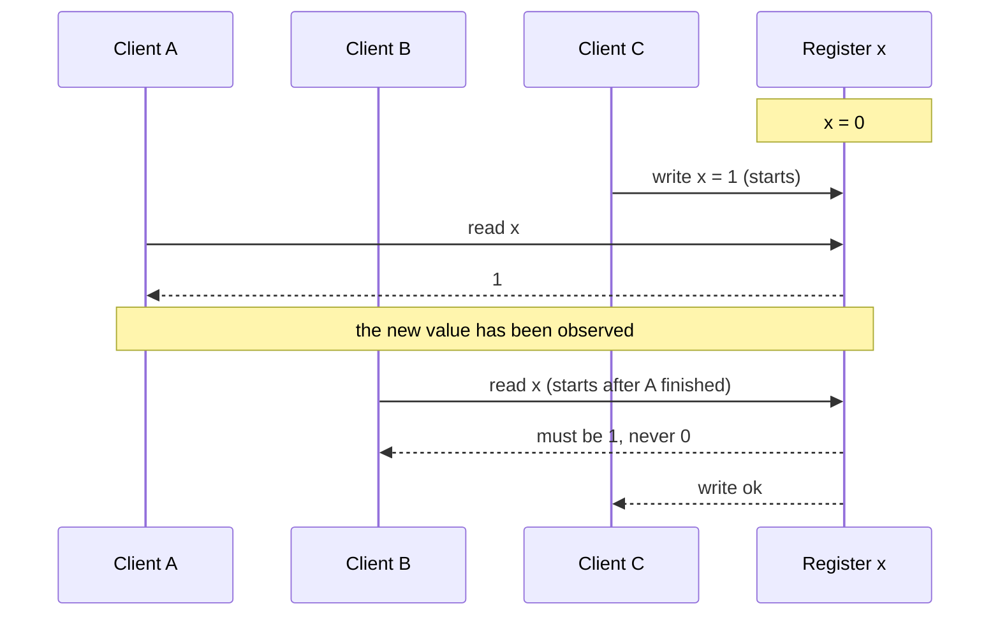
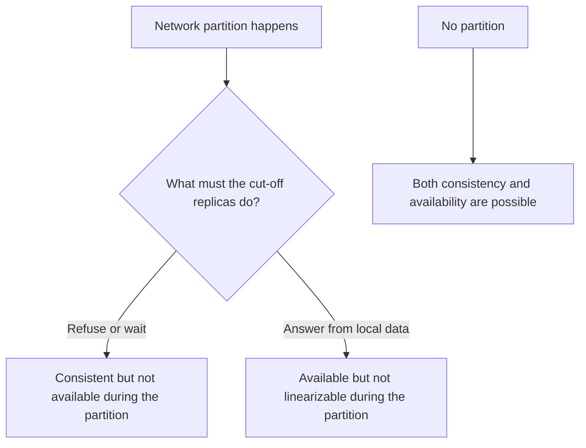

# Linearizability and the CAP theorem

> **Before this lesson:** you need replication, replication lag and eventual consistency from [Single-leader replication](#/lesson/databases/leader-follower); quorums, read repair and last write wins from [Multi-leader and leaderless replication](#/lesson/databases/multi-leader-leaderless); serializability and snapshot isolation from [Serializability](#/lesson/databases/serializability); and network partitions, leases and majorities from the three lessons ending with [Truth, majorities, fencing tokens](#/lesson/databases/truth-fencing).

## In plain words

A replicated database keeps several copies of the data, and the copies are not always in step. **Linearizability** is the promise that the database will hide this from you completely: it will behave as if there were exactly **one copy**, and every read will see the result of every write that finished before it.

An everyday picture: a football stadium has one scoreboard. The instant a goal is added, everyone looking at it sees the new score, and nobody who looks afterwards can ever see the old one. Now imagine the score is instead shown on fifty separate screens around the ground, each updated a moment apart. Two friends on opposite sides text each other: "It's 2-1!" "No, mine says 1-1." Linearizability means making the fifty screens act like the one scoreboard.

That promise has a price, and the second half of the lesson is about it. Suppose the cable to some of the screens is cut. Those screens have two choices: keep showing the last score they received, which may now be wrong, or go blank until the cable is repaired. They cannot be both up to date and switched on. That choice, between being correct and being available when part of the network is cut off, is the **CAP theorem**.

One word used below: **consensus** is the problem of getting several nodes to agree on something reliably, even when some of them fail. It has its own lesson shortly. Here it is enough to know that algorithms for it exist and that coordination services such as ZooKeeper are built on them.

Why this matters for a job: "strong consistency", "eventual consistency" and "CAP" are among the most used and most misused terms in system design. Interviewers ask about them constantly, and a precise answer stands out. In daily work, knowing which few operations really need the one-copy guarantee (locks, unique usernames, account balances) and which do not is what keeps a system both correct and fast.

## Why eventual consistency is not enough

Replicated databases usually promise **eventual consistency**: stop writing, wait long enough, and all replicas will hold the same data. A better name might be *convergence*. As a guarantee for application developers it is thin. It says nothing about *when* the replicas converge, and until they do, a read may return anything from the newest value to a long-outdated one. You write a value, read it back at once, and get the old one, because the read landed on a different replica.

Bugs caused by such behaviour are miserable to find. Everything works in testing, where there is little concurrency and no faults; the edge cases appear only under load or when the network misbehaves.

This lesson examines the strongest consistency model in common use, **linearizability**. Its idea is easy to state: make a replicated system behave as though **there were only one copy of the data**, and every operation on it took effect at a single instant. We will define it carefully, separate it from serializability (with which it is constantly confused), see where it is truly needed, look at which replication methods can provide it, and then face its cost - which is where the CAP theorem comes in.

## 1. The idea: one copy, atomic operations

Linearizable behaviour means that the moment a write has finished for one client, no client anywhere may be shown the previous value again. The illusion of a single copy means that the value read is always the most recent one, never something from a stale replica or cache. Linearizability is a **recency guarantee**. It also goes by the names *atomic consistency*, *strong consistency*, *immediate consistency* and *external consistency*.

A small scene shows what a violation looks like. An online auction closes. Dana's phone shows the final result: her bid won. She tells Eli, sitting next to her, who reloads the page on his own phone - and sees the auction still marked as open, since his request was served by a replica that lags behind. If Dana and Eli had loaded their pages at the same moment, differing results would be unremarkable. But Eli reloaded *after* hearing the outcome, so he rightly expects a result at least as recent as hers. His stale read violates linearizability.

## 2. What exactly makes a system linearizable

Consider one item in the database, which the literature calls a **register**: a key in a key-value store, a row, a document. Clients perform operations on it. Each operation takes some time - from the moment the request is sent until the response arrives - and the client does not know exactly when in that interval the database acted on it.

Start with two operations, `read(x)` and `write(x, v)`, and one writer changing `x` from 0 to 1 while other clients read:

- A read that **completes before the write begins** must return 0.
- A read that **begins after the write has completed** must return 1.
- A read that **overlaps** with the write may return 0 or 1; either is defensible, since we cannot tell whether the write had taken effect at the moment the read was processed.

That is not yet enough. If reads overlapping the write could flip back and forth between old and new, a client could see 1 and a later client 0. So linearizability adds a constraint: imagine that somewhere between the start and the end of each operation there is one **point in time** at which it takes effect, as if instantaneously. Those points must form a valid sequence for a single register. The consequence: **the first time anyone is shown the new value, the old one is gone for good - every read that starts later, from any client, gets the new value**, whether or not the writer has been told that its write is finished.



Read the diagram from top to bottom. Client C starts writing 1. While that write is still in progress, client A reads and is shown 1. From that moment the new value has been seen by someone. Client B starts its read after A's has finished, so B must also get 1, even though C has not yet been told that its write is complete.

Add a third operation, `cas(x, v_old, v_new)` - atomic **compare-and-set**: if the current value equals `v_old`, set it to `v_new`, otherwise leave it and report an error. Linearizability then requires that the outcomes of all reads, writes and compare-and-sets be explainable by *some* ordering of those effect points that never goes backwards in time.

It is possible to test for this, at some computational cost, by recording the start time, end time and result of every operation and checking whether a valid sequential ordering exists.

The program below performs that test by brute force on two short recorded histories.

```python-run
from itertools import permutations

def linearizable(history, initial=0):
    """history: list of (start, end, kind, arg, result). Brute force over all orders (fine for tiny histories)."""
    for order in permutations(range(len(history))):
        # real-time constraint: if a finished before b started, a must come first
        pos = {op: i for i, op in enumerate(order)}
        if any(history[a][1] < history[b][0] and pos[a] > pos[b]
               for a in range(len(history)) for b in range(len(history))):
            continue
        value, ok = initial, True
        for i in order:
            _, _, kind, arg, result = history[i]
            if kind == "write": value = arg
            elif result != value: ok = False; break
        if ok: return True
    return False

#            start end  kind    arg result
good = [(0,   10, "write", 1, None),      # long-running write
        (2,    4, "read",  None, 0),      # overlaps: may see old
        (5,    7, "read",  None, 1),      # overlaps: sees new
        (11,  12, "read",  None, 1)]
bad  = [(0,   10, "write", 1, None),
        (2,    4, "read",  None, 1),      # someone already saw the new value...
        (5,    7, "read",  None, 0)]      # ...then a LATER read sees the old one
print("history 1 linearizable:", linearizable(good))
print("history 2 linearizable:", linearizable(bad))
```

What each part does:

- A history is a list of operations. Each is a tuple: the time it started, the time it ended, whether it was a read or a write, the value written (for a write) and the value returned (for a read).
- `permutations(range(len(history)))` produces every possible ordering of the operations. The function tries each ordering in turn as a candidate for "the order in which they really took effect".
- The first check discards any ordering that contradicts real time. If operation `a` had already finished before operation `b` started, then `a` must come before `b`. Operations that overlapped in time may go in either order.
- The second check replays the ordering against a single value. A write sets the value. A read must have returned exactly the current value, or this ordering is rejected.
- If any ordering passes both checks, the history is linearizable.

```
history 1 linearizable: True
history 2 linearizable: False
```

In the first history, the two reads that overlap the write see 0 and then 1, which fits the ordering "read 0, write, read 1, read 1". In the second, a read that finished at time 4 saw 1 and a read that started at time 5 saw 0. No ordering can explain that, because the second read came strictly later and would have to see a value that had already been replaced.

The second history is precisely the auction scene: a later read travelling back in time.

### Not the same as serializability

The names are similar; the guarantees are different.

| | Serializability | Linearizability |
|---|---|---|
| A property of | **Transactions**, each possibly touching many objects | Single **reads and writes** of one register |
| Promises | The result equals that of *some* serial order of the transactions | Operations appear to take effect at one instant, in an order consistent with **real time**; reads see the latest value |
| Says nothing about | Whether that serial order matches real time | Grouping several operations into a unit |

A database may give both; the combination is called **strict serializability**. Two-phase locking and actual serial execution are typically linearizable as well. **Serializable snapshot isolation is not**, by design: a transaction reads from a snapshot which, deliberately, does not include writes made after it was taken.

## 3. Where linearizability is needed

For many uses a slightly stale read is harmless. In a few situations linearizability is a requirement for correctness.

**Locks and leader election.** A system with a single leader must be sure there is one leader, not two. A common method is a lock: every node that starts tries to take it, and the one that succeeds is leader. However the lock is built, it must be linearizable - **all nodes must agree on who holds it**. Coordination services such as ZooKeeper and etcd exist largely to provide this; they implement linearizable operations on top of consensus.

**Constraints and uniqueness.** A username or email address must identify one account; a file path must name one file. Enforcing that as data is written, so that of two simultaneous attempts exactly one succeeds, needs linearizability. It resembles a lock on the name, or an atomic compare-and-set from "unused" to the claiming user. The same holds for "an account balance never goes below zero", "do not sell more stock than there is", "a seat is booked once". Each needs a single up-to-date value that all nodes agree on. (Some of these can be handled loosely in practice - an oversold item can be apologised for - but a hard uniqueness constraint cannot.)

**Cross-channel timing dependencies.** The auction scene involved a second communication channel: Dana *told* Eli. Without that channel he would never have known his result was stale. Systems contain such channels too. Suppose a video upload service stores the original file in file storage and then puts a message on a queue asking a worker to transcode it. If the file storage is not linearizable, the worker - which may be fast - can fetch the file before it is visible, or fetch an older version of it. The queue is a second channel between the web server and the worker, and it races against the storage's internal replication.

## 4. Which replication methods can provide it

Linearizability means "behave like one copy". The trivially correct implementation is one copy, which tolerates no faults. With replication:

| Replication method | Linearizable? |
|---|---|
| **Single-leader** | *Potentially.* If reads go to the leader, or to synchronously updated followers. Not if the implementation uses snapshot isolation by design, or has concurrency bugs. It also depends on really knowing who the leader is: a node that wrongly believes it is leader will serve stale reads, and asynchronous failover can lose committed writes, violating both durability and linearizability |
| **Consensus algorithms** | *Yes.* They resemble single-leader replication but include measures against split brain and stale replicas. ZooKeeper and etcd implement linearizable storage this way |
| **Multi-leader** | *No.* Several nodes accept writes concurrently and replicate asynchronously; conflicting writes are the direct result of having no single copy |
| **Leaderless** | *Probably not.* Vendors sometimes claim "strong consistency" for quorum reads and writes ($w + r > n$). Last-write-wins based on wall clocks is almost certainly non-linearizable, since clock timestamps are not guaranteed to match the real order of events. Sloppy quorums also break it. Even strict quorums can fail, as shown next |

### Quorums are not enough

Take $n = 3$, $w = 3$, $r = 2$, so $w + r > n$. The value is 0. A writer starts sending `x = 1` to all three replicas; the messages arrive at different times.

- Reader A queries two replicas, one of which already has the new value: A returns **1**.
- Reader B *starts after A has finished* and happens to query the two replicas that have not received the write yet: B returns **0**.

The quorum condition was satisfied throughout, yet B saw an older value than A, later in time.

The program below reproduces that case, then shows what repairs it.

```python-run
replicas = {"r1": 0, "r2": 0, "r3": 0}

def quorum_read(names, repair=False):
    value = max(replicas[n] for n in names)                 # newest among the replies (values double as versions)
    if repair:
        for n in names: replicas[n] = value                 # synchronous read repair before returning
    return value

for repair in (False, True):
    replicas.update(r1=0, r2=0, r3=0)
    replicas["r1"] = 1                                      # the write x=1 has reached only r1 so far
    a = quorum_read(["r1", "r2"], repair)                   # reader A
    b = quorum_read(["r2", "r3"], repair)                   # reader B, strictly after A
    print(f"read repair {'on ' if repair else 'off'}: A sees {a}, then B sees {b}",
          "-> not linearizable" if (a, b) == (1, 0) else "-> consistent")
```

What each part does:

- `replicas` holds the value on each of three replicas. Because the only values are 0 and 1, the larger value is also the newer one, so `max` picks the newest reply.
- `quorum_read(names, repair)` reads from the named replicas and returns the newest value among them. With `repair` on, it first writes that newest value back to every replica it contacted, and only then returns. That is read repair done **synchronously**, meaning before the reader gets its answer.
- In each round the write of 1 has reached only `r1`. Reader A asks `r1` and `r2`. Then reader B asks `r2` and `r3`.

```
read repair off: A sees 1, then B sees 0 -> not linearizable
read repair on : A sees 1, then B sees 1 -> consistent
```

Without repair, A sees the new value and B, reading later, sees the old one. With synchronous repair, A's read pushes the value 1 onto `r2` before returning, so B, which also asks `r2`, finds it.

Dynamo-style quorums can be made linearizable at a price: a reader must perform **read repair synchronously** before returning, and a writer must first read the latest state from a quorum. Even then, only reads and writes are covered. A linearizable compare-and-set cannot be built this way; it requires consensus. It is safest to assume that a leaderless Dynamo-style system does not provide linearizability.

## 5. The cost

Suppose a database is replicated across two data centres and the link between them fails. Each data centre works internally, and clients can reach whichever is near them. What now?

- With **multi-leader** replication each side keeps accepting writes, queues the changes, and exchanges them when the link returns. The application stays up.
- With **single-leader** replication the leader lives in one data centre. Clients that can only reach the other cannot write, and cannot make linearizable reads either. They can read from the local follower, but those reads may be stale. If the application requires linearizable reads and writes, it has an outage for those clients.

This holds for any linearizable database, however it is built:

- If the application **requires linearizability** and some replicas are cut off from the others, those replicas cannot process requests while disconnected: they must wait or return an error. They are **unavailable**.
- If the application **does not require linearizability**, each replica can handle requests on its own even when disconnected. The application stays **available**, and its behaviour is not linearizable.

Systems that do not need linearizability can therefore be more tolerant of network problems. That insight became famous as the **CAP theorem**.



### Reading CAP correctly

CAP is often summarised as "consistency, availability, partition tolerance: pick two". That phrasing misleads, because a network partition is a fault and not a design option - it will happen whether you pick it or not. A better statement: **when a partition occurs, choose either consistency or availability**. A more reliable network makes the choice arise less often; it never makes it disappear.

Further cautions:

- "Consistency" in CAP means linearizability specifically. "Availability" has a strict formal definition - every request to a non-failed node must receive a response - that many systems advertised as "highly available" do not actually meet.
- CAP considers one consistency model and one kind of fault. Slow networks, crashed nodes and every other trade-off are outside its scope.
- Many systems are neither CP nor AP by those definitions - for example, a single-leader database with asynchronous followers is neither linearizable nor available in the formal sense.

CAP was historically valuable: it encouraged engineers to explore designs that give up strict consistency, which produced the wave of non-relational databases. As a tool for designing systems today it has little practical use. Better to describe concretely what a system does under each failure.

### Performance, not only faults

Here is the more fundamental point. Few systems drop linearizability mainly for fault tolerance. They drop it for **speed**.

Even the memory inside a single computer is not linearizable. A modern processor has several cores, and each keeps a small private store of recently used values so that it can work faster. A value changed by one core is not instantly visible to the others unless the program specifically asks for that. Nobody would say the cores have been cut off from each other by a network fault. The designers gave up the one-copy behaviour for a different reason: to make memory access fast.

There is a proven result behind this: a linearizable read or write cannot be faster than **some multiple of how unpredictable the network delay is**. Where delays vary widely - as they do in most networks - linearizable operations will inevitably be slow. Weaker consistency models can be much faster, and for latency-sensitive systems that trade-off matters every single day, not only when a cable is cut. Extensions of CAP such as PACELC make this explicit: during a **p**artition choose between **a**vailability and **c**onsistency; **e**lse, between **l**atency and **c**onsistency.

> [!INTERVIEW]
> Avoid "it's a CP system" as a complete answer. Say what happens: "During a partition, clients on the minority side get errors for writes and for consistent reads; they can still do stale reads from the local replica if the application opts in. Outside of partitions the cost of linearizable reads is one round trip to the leader or a quorum." Then say which operations in the design really need that guarantee - usually only locks, uniqueness and a few invariants - and that the rest can use cheaper, weaker reads.

## Pitfalls

- **Treating "strong consistency" on a product page as linearizability.** Ask what happens to reads from followers, during failover, and with quorum reads.
- **Confusing linearizability with serializability.** One is about recency of single-object operations, the other about isolation of multi-object transactions. Snapshot isolation is serialisable-ish but intentionally not linearizable.
- **Assuming $w + r > n$ gives linearizability.** Without synchronous read repair, and with last-write-wins, it does not.
- **Reading from followers for decisions that need the latest value** (uniqueness checks, lock ownership).
- **Hidden second channels.** A message queue, an email, a URL handed to another service: any of them can outrun the database's replication.
- **Paying for linearizability everywhere.** It costs latency on every operation. Reserve it for the parts that need it.
- **Using CAP as a classification scheme.** It describes one trade-off under one fault.

## Summary

- **Linearizability** makes a replicated system look like a single copy with atomic operations. It is a recency guarantee: once a new value has been returned to anyone, no later read may return the old one.
- It concerns individual operations on a **register**; **serializability** concerns transactions. Both together are **strict serializability**.
- It is required for **locks and leader election**, for **uniqueness and similar hard constraints**, and wherever a **second communication channel** makes staleness observable.
- **Consensus** provides it; **single-leader** replication can, with care; **multi-leader** cannot; **leaderless** quorums generally do not.
- Its costs are **unavailability** of disconnected replicas during a network partition - the content of the **CAP theorem** - and, more pervasively, **higher latency** in normal operation, which is the usual reason systems choose weaker models.

## Glossary

- **Eventual consistency (convergence)** - if writes stop, all replicas end up with the same data, with no promise about when.
- **Linearizability** - the system behaves as if there were one copy of the data and every operation took effect at a single instant; also called strong, atomic, immediate or external consistency.
- **Recency guarantee** - a promise that reads return the most recent value.
- **Register** - one item in a database that can be read and written, such as a key or a row.
- **Compare-and-set (cas)** - changing a value only if it currently equals an expected value, as one indivisible step.
- **History** - a record of the operations performed, with their start times, end times and results.
- **Strict serializability** - serializability and linearizability together.
- **Consensus** - several nodes reliably agreeing on something despite failures.
- **Coordination service** - a small, highly reliable store (ZooKeeper, etcd) offering linearizable operations for locks and leader election.
- **Uniqueness constraint** - a rule that a value, such as a username, may be used only once.
- **Cross-channel timing dependency** - a second route by which information travels, which can reveal that a read was stale.
- **Synchronous read repair** - updating stale replicas during a read, before the result is returned.
- **Network partition** - a fault that cuts some nodes off from others.
- **Availability (in CAP)** - every request to a working node receives a response.
- **CAP theorem** - when a network partition occurs, a system must choose between linearizability and availability.
- **CP / AP** - informal labels for systems that choose consistency / availability during a partition.
- **PACELC** - an extension of CAP: during a partition choose availability or consistency; otherwise choose low latency or consistency.

```quiz
[
  {"q": "What does linearizability guarantee?",
   "options": ["Transactions execute in some serial order", "The system behaves as if there were a single copy of the data, with each operation taking effect atomically at one point in time", "Replicas eventually converge", "Writes are never lost when a disk fails"],
   "answer": 1,
   "explain": "It is a recency guarantee for individual operations: after a write completes, or once any reader has seen the new value, all later reads return it."},
  {"q": "Client A's read returns the new value of x while a write is still in progress. Client B's read begins after A's has completed. What may B's read return in a linearizable system?",
   "options": ["Either the old or the new value", "Only the new value", "Only the old value", "An error"],
   "answer": 1,
   "explain": "Once the new value has been observed, the register has switched. A later read returning the old value would mean going back in time."},
  {"q": "Which statement distinguishes serializability from linearizability correctly?",
   "options": ["They are two names for the same property", "Serializability is an isolation property of multi-object transactions; linearizability is a recency guarantee for single-object reads and writes", "Linearizability is weaker than read committed", "Serializability requires synchronised clocks"],
   "answer": 1,
   "explain": "A system can have one without the other. Serializable snapshot isolation, for example, is serialisable but not linearizable, because it reads from a snapshot."},
  {"q": "Why must a lock used for leader election be linearizable?",
   "options": ["To make it faster", "All nodes must agree on who holds the lock; otherwise two nodes could both believe they are leader", "Because locks store large values", "To allow reads from any replica"],
   "answer": 1,
   "explain": "Split brain arises precisely when different nodes see different lock states. Coordination services provide linearizable operations for this reason."},
  {"q": "Which replication approach provides linearizability by design?",
   "options": ["Multi-leader replication", "Leaderless replication with last-write-wins", "Consensus algorithms such as those used by ZooKeeper and etcd", "Asynchronous single-leader replication with reads from followers"],
   "answer": 2,
   "explain": "Consensus protocols include protection against split brain and stale replicas. The others allow concurrent writes or stale reads."},
  {"q": "With n = 3, w = 3, r = 2, how can a quorum read still violate linearizability?",
   "options": ["It cannot, because w + r > n", "While a write is in flight, one reader may see the new value from a replica that has it and a later reader may contact only replicas that do not yet have it", "Because r must equal n", "Because quorum reads are always stale by one second"],
   "answer": 1,
   "explain": "The quorum condition guarantees overlap for completed writes, not a consistent switch-over during a concurrent write. Synchronous read repair is needed to close the gap."},
  {"q": "What is the most accurate reading of the CAP theorem?",
   "options": ["Choose any two of consistency, availability and partition tolerance", "When a network partition occurs, a system must choose between linearizability and availability", "Consistent systems can never be available", "Partitions can be avoided with good hardware, so CAP does not apply"],
   "answer": 1,
   "explain": "Partitions are faults, not options. The choice exists only while one is happening; without a partition both properties are achievable."},
  {"q": "Why do many systems give up linearizability even when network partitions are rare?",
   "options": ["Linearizability is illegal in some regions", "Linearizable operations are inherently slower, with response time tied to the uncertainty of network delay, so weaker models give better latency all the time", "It requires more disk space", "It prevents the use of indexes"],
   "answer": 1,
   "explain": "The performance cost is paid on every operation, not only during faults. This is the else-latency-or-consistency half of PACELC."}
]
```

> **Source:** DDIA ch. 9 (Consistency and Consensus) - consistency guarantees, linearizability, the cost of linearizability and the CAP theorem. Written in original wording with original examples.
