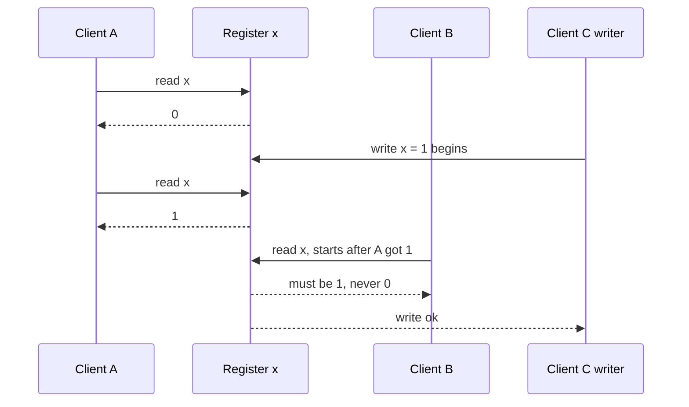
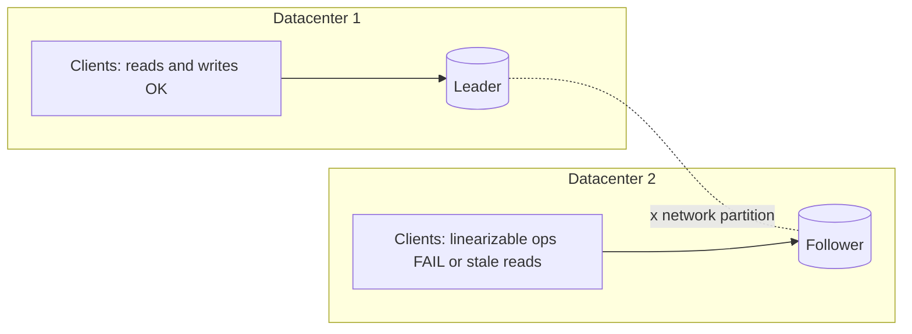

# Linearizability and the CAP theorem

Chapter 8 listed everything that can go wrong. The simplest response is to let the whole service fail and show an error. If that is unacceptable, we need ways to **tolerate** faults. The best way to build fault-tolerant systems is to find **general-purpose abstractions with useful guarantees**, implement them once, and let applications rely on them. Transactions are one such abstraction. Chapter 9 introduces another: **consensus**, getting all nodes to agree on something. First we need to explore the range of guarantees a distributed system can offer.

## 1. Consistency guarantees

Most replicated databases provide at least **eventual consistency**: if you stop writing and wait some unspecified length of time, all read requests eventually return the same value. A better name might be **convergence**. It is a very weak guarantee. It says nothing about *when* replicas converge. Until then, reads could return anything. If you write a value and immediately read it back, there is no guarantee you see what you just wrote.

Eventual consistency is hard for application developers because it is so different from a normal single-threaded program, where a variable you assign keeps its value. The edge cases only become apparent when there is a fault or high concurrency, so bugs are subtle and hard to find by testing.

Stronger guarantees exist. They cost performance or fault tolerance, but they are easier to use correctly. The strongest in common use is **linearizability**.

## 2. What is linearizability?

In an eventually consistent database, asking two replicas the same question at the same time may give two different answers. Wouldn't it be simpler if the database gave the **illusion that there is only one replica**? Then every client would have the same view of the data.

That is the idea behind **linearizability** (also called *atomic consistency*, *strong consistency*, *immediate consistency* or *external consistency*). The system appears as if there were **only one copy of the data**, and all operations on it are **atomic**. As soon as one client successfully completes a write, **all** clients reading from the database must be able to see the value just written. Linearizability is a **recency guarantee**.

DDIA's example of a violation: Alice and Bob sit in the same room checking the 2014 football World Cup final on their phones. Alice refreshes and sees the final score, and tells Bob. Bob then reloads his own phone, but his request goes to a lagging replica that still shows the game as ongoing. Bob's query started *after* he heard Alice's result, so he expects a result at least as recent as hers. Getting a stale one violates linearizability.

### 2.1 What makes a system linearizable?

Consider a **register** `x` (one key in a key-value store) and three clients. Each operation takes some time: it has a start (request sent) and an end (response received). Because of variable network delays, a client does not know exactly when the database processed its request, only that it happened somewhere between those two moments.

- If a read completes **before** a write begins, it must return the old value.
- If a read begins **after** a write completes, it must return the new value.
- If a read **overlaps** in time with a write (they are *concurrent*), it might return either.

That is not yet enough. If reads concurrent with a write could flip back and forth between old and new values, a reader would see a value go backwards. So we add one more constraint: imagine there is some point in time, between the start and end of the write, at which the value of `x` atomically flips from old to new. **After any one read has returned the new value, all following reads, on the same or other clients, must also return the new value**, even if the write operation has not yet completed.



Each operation can be seen as taking effect **atomically at some point** between its start and end. If you join those points up in order, the line must always move **forward in time**, never backward. That gives the recency guarantee: once a new value has been written or read, all later reads see it until it is overwritten again.

It is possible, though computationally expensive, to test whether a system's behaviour is linearizable by recording the timings of all requests and responses and checking whether they can be arranged into a valid sequential order. **Jepsen** does this.

```python-run
from itertools import permutations

def linearizable(history, initial=0):
    """history: list of (op, value, start, end). op is 'w' (write value) or 'r' (read returned value).
    Brute force: find a total order consistent with real-time order and register semantics."""
    n = len(history)
    for order in permutations(range(n)):
        pos = {op: i for i, op in enumerate(order)}
        # real-time constraint: if a ended before b started, a must come first
        if any(history[a][3] < history[b][2] and pos[a] > pos[b] for a in range(n) for b in range(n)):
            continue
        val, ok = initial, True
        for i in order:
            op, v, _, _ = history[i]
            if op == "w": val = v
            elif v != val: ok = False; break
        if ok:
            return True
    return False

good = [("w", 1, 2, 6), ("r", 0, 1, 3), ("r", 1, 4, 5), ("r", 1, 7, 8)]
bad  = [("w", 1, 2, 9), ("r", 1, 3, 4), ("r", 0, 5, 6)]     # new value seen, then old value
print("history 1 linearizable?", linearizable(good))
print("history 2 linearizable?", linearizable(bad), "(a read went back in time)")
```

### 2.2 Linearizability vs serializability

The two are easily confused, because both words suggest "can be arranged in a sequential order". They are different guarantees:

- **Serializability** is an **isolation** property of **transactions**, where each transaction may read and write **several objects**. It guarantees that transactions behave as if they had executed in *some* serial order. That order may differ from the order in which they actually ran.
- **Linearizability** is a **recency guarantee** on reads and writes of a **register (an individual object)**. It does not group operations into transactions, so it does not prevent problems such as write skew unless you take extra measures.

A database may provide both. That combination is known as **strict serializability** or strong one-copy serializability. Two-phase locking and actual serial execution are typically linearizable. **Serializable snapshot isolation is not linearizable**, by design: it reads from a consistent snapshot, which does not include writes more recent than the snapshot.

## 3. Relying on linearizability

When is linearizability a requirement, not a nice-to-have?

- **Locking and leader election.** A single-leader system must ensure there is indeed only one leader, not several (split brain). One way to elect a leader is with a lock: every node that starts up tries to acquire the lock, and the one that succeeds becomes the leader. The lock must be linearizable: all nodes must agree which node owns it. Coordination services such as **ZooKeeper** and **etcd** are often used for this. They use consensus algorithms to implement linearizable operations in a fault-tolerant way.
- **Constraints and uniqueness guarantees.** A username or email address must uniquely identify one user. A file storage service cannot have two files with the same path and name. A bank balance must never go negative. You must not sell more items than are in stock. Two people must not book the same seat. Enforcing such a constraint as data is written requires linearizability: there has to be a single up-to-date value that all nodes agree on. It is like a lock or an atomic compare-and-set. (Looser constraints, such as overbooking a flight and compensating later, may not need it.)
- **Cross-channel timing dependencies.** In the Alice and Bob example, the violation was noticed only because of an extra communication channel: Alice's voice. Similar situations arise in computer systems. Suppose a web server stores an uploaded photo in a file storage service and then puts a message on a queue telling an image resizer to make thumbnails. If the storage service is not linearizable, the resizer may fetch the image before it is visible, or fetch an old version, and produce thumbnails of the wrong image. The queue is a second channel that races with replication inside the storage service.

## 4. Implementing linearizable systems

Linearizability means behaving as though there were only one copy of the data. The simplest implementation is to really use one copy, but that tolerates no faults. So we replicate. Which replication methods can be made linearizable?

| Replication method | Linearizable? |
|---|---|
| **Single-leader** | **Potentially.** If you read from the leader or from synchronously updated followers. Not every single-leader database is linearizable, either by design (snapshot isolation) or because of concurrency bugs. Using the leader for reads assumes you know for sure who the leader is. A delusional leader can violate it, and with async replication failover may lose committed writes. |
| **Consensus algorithms** | **Yes.** They resemble single-leader replication but contain measures to prevent split brain and stale replicas. This is how ZooKeeper and etcd work. |
| **Multi-leader** | **No.** They concurrently process writes on several nodes and replicate asynchronously, producing conflicts that need resolution. Conflicts are an artifact of not having a single copy. |
| **Leaderless** | **Probably not.** People sometimes claim "strong consistency" with quorum reads and writes ($w + r > n$). Depending on configuration this is not quite true. LWW with time-of-day clocks is almost certainly nonlinearizable, and sloppy quorums ruin any chance of it. Even strict quorums can be nonlinearizable. |

### 4.1 Linearizability and quorums

Intuitively, strict quorums in a Dynamo-style model should be linearizable. With variable network delays, race conditions are possible. Take $n = 3, w = 3, r = 2$. The initial value of $x$ is 0. A writer sends $x = 1$ to all three replicas. Concurrently, reader A reads from two nodes and sees the new value on one of them. Reader B, starting *after* A finished, reads from a different pair of nodes and gets the old value 0 from both. The quorum condition is met, yet this execution is nonlinearizable: B's request began after A's completed, but B returned the old value while A returned the new one.

It is possible to make Dynamo-style quorums linearizable at the cost of reduced performance: a reader must perform **read repair synchronously** before returning results, and a writer must read the latest state of a quorum of nodes before sending its writes. Even then, only linearizable read and write operations can be implemented this way. A linearizable **compare-and-set** cannot, because it requires a consensus algorithm.

## 5. The cost of linearizability

Consider a database deployed in two datacenters with a **network interruption** between them. The network inside each datacenter works, and clients can reach their local datacenter, but the datacenters cannot connect to each other.

- With **multi-leader** replication, each datacenter continues operating normally. Writes from one are queued and exchanged when the network is restored.
- With **single-leader** replication, the leader must be in one of the datacenters. Any writes and any linearizable reads must be sent to the leader. Clients connected only to the follower datacenter cannot contact the leader, so they cannot make any writes or any linearizable reads. They can still read from the follower, but the reads might be stale (nonlinearizable). An application that requires linearizable reads and writes becomes **unavailable** in the datacenter that cannot reach the leader.



### 5.1 The CAP theorem

This issue is not specific to single-leader and multi-leader replication. Any linearizable database has this problem, however it is implemented. The trade-off is:

- If your application **requires linearizability** and some replicas are disconnected from the others by a network problem, then those replicas cannot process requests while disconnected. They must wait until the network is fixed or return an error. Either way they are **unavailable**.
- If your application **does not require linearizability**, it can be written so that each replica processes requests independently, even when disconnected (multi-leader, for example). The application remains **available** during the network problem, but its behaviour is **not linearizable**.

Applications that do not require linearizability can be more tolerant of network problems. This insight is known as the **CAP theorem**, named by Eric Brewer in 2000. CAP was originally proposed as a rule of thumb, without precise definitions, to start a discussion about trade-offs in databases. It encouraged engineers to explore a wider design space of distributed shared-nothing systems.

> [!WARNING]
> **CAP is often presented as "Consistency, Availability, Partition tolerance: pick 2 out of 3". That is misleading.** Network partitions are a kind of fault, so they are not something you have a choice about. They will happen whether you like it or not. When the network works, a system can provide both consistency (linearizability) and total availability. When a network fault occurs, you have to choose between linearizability and total availability. A better phrasing is ***either Consistent or Available when Partitioned***.

In discussions of CAP there are several contradictory definitions of *availability*, and the formal theorem does not match its usual meaning. Many so-called "highly available" (fault-tolerant) systems do not meet CAP's idiosyncratic definition. The formally defined CAP theorem also has a very narrow scope: it considers one consistency model (linearizability) and one kind of fault (network partitions). It says nothing about network delays, dead nodes or other trade-offs. So although CAP has been historically influential, it has **little practical value for designing systems**. Kleppmann advises avoiding the term.

### 5.2 Linearizability and network delays

Few systems are actually linearizable in practice. Even **RAM on a modern multi-core CPU is not linearizable**: if a thread on one core writes to a memory address and a thread on another core reads the same address shortly afterwards, it is not guaranteed to read the value written, unless a memory barrier or fence is used. Every CPU core has its own memory cache and store buffer. Memory access goes to the cache first by default, and changes are written out to main memory asynchronously, because cache access is much faster than main memory. It makes no sense to use CAP to justify this: within one computer we usually assume reliable communication. The reason for dropping linearizability here is **performance, not fault tolerance**.

The same is true of many distributed databases that choose not to provide linearizable guarantees: they do so mainly to **increase performance**. Linearizability is slow all the time, not only during a network fault. Attiya and Welch proved that if you want linearizability, the response time of read and write requests is **at least proportional to the uncertainty of delays in the network**. In a network with highly variable delays, the response time of linearizable reads and writes is inevitably high. A faster algorithm for linearizability does not exist, but weaker consistency models can be much faster. This trade-off matters for latency-sensitive systems.

> [!INTERVIEW]
> "Explain CAP." Say what it actually states: during a **network partition**, a system must choose between **linearizability** and **availability** of every non-failed node. Partition tolerance is not optional. Then show nuance: (1) CAP's C is linearizability, not ACID consistency; (2) the choice only arises during a partition; (3) many systems give up linearizability for **latency**, not for availability (this is the **PACELC** refinement: if Partition then A or C, Else Latency or Consistency); (4) classify by example: ZooKeeper, etcd and Spanner choose consistency, while Cassandra and Dynamo choose availability.

## 6. Summary

- **Linearizability** makes a replicated system look like a single copy with atomic operations. It is a recency guarantee: once any read returns a new value, all later reads do too.
- It differs from **serializability** (transaction isolation, any serial order). Both together are *strict serializability*.
- Needed for **locks and leader election**, **uniqueness constraints** and **cross-channel timing dependencies**.
- Single-leader replication is potentially linearizable, consensus algorithms are, multi-leader is not, and leaderless quorums generally are not.
- **CAP**: when partitioned, choose consistency or availability. In practice, systems mostly drop linearizability for **performance**.

```quiz
[
  {"q": "Linearizability is best described as...",
   "options": ["An isolation level for multi-object transactions", "A recency guarantee that makes the system appear to have a single copy of the data with atomic operations", "Eventual convergence of replicas", "A replication topology"],
   "answer": 1,
   "explain": "Once a write completes, or any read sees the new value, all later reads must see it."},
  {"q": "Client A reads x and gets the new value 1. Client B then starts a read and gets the old value 0. Is this linearizable?",
   "options": ["Yes", "No: after any read returns the new value, all later reads must return it too", "Only if the write has not finished", "Only with quorums"],
   "answer": 1,
   "explain": "Values must not go back in time, even while the write is still in progress."},
  {"q": "How does serializability differ from linearizability?",
   "options": ["They are the same", "Serializability concerns transactions over multiple objects in some serial order; linearizability concerns recency of single-object reads and writes", "Serializability is weaker in every case", "Linearizability requires transactions"],
   "answer": 1,
   "explain": "Both together are called strict serializability."},
  {"q": "Which replication approach is linearizable by design?",
   "options": ["Multi-leader", "Leaderless with sloppy quorums", "Consensus-based replication (ZooKeeper, etcd)", "Async single-leader with reads from followers"],
   "answer": 2,
   "explain": "Consensus algorithms prevent split brain and stale replicas."},
  {"q": "Why does leader election via a lock require linearizability?",
   "options": ["For speed", "All nodes must agree on who holds the lock; otherwise two nodes may both believe they are leader", "To compress data", "To avoid using clocks"],
   "answer": 1,
   "explain": "A non-linearizable lock can produce split brain."},
  {"q": "What does the CAP theorem really say?",
   "options": ["Pick any two of three properties at design time", "When a network partition occurs, you must choose between linearizability and availability", "Consistency is impossible in distributed systems", "Availability always wins"],
   "answer": 1,
   "explain": "Partitions are not a choice; the trade-off appears only when one happens."},
  {"q": "According to DDIA, why do many systems give up linearizability?",
   "options": ["Only for fault tolerance", "Mainly for performance: linearizable operations are slow in proportion to network delay uncertainty", "Because it is impossible to implement", "Because of the SQL standard"],
   "answer": 1,
   "explain": "Even CPU memory is not linearizable across cores, for performance reasons."},
  {"q": "Why can strict quorum reads and writes (w + r > n) still be non-linearizable?",
   "options": ["Quorums never overlap", "With variable delays, a later read from a different quorum can return an older value than an earlier read that saw a partially applied write", "Quorums require clocks", "Because of ZooKeeper"],
   "answer": 1,
   "explain": "Synchronous read repair can fix this at a performance cost."}
]
```

> **Source:** DDIA ch. 9, "Consistency and Consensus" (Consistency Guarantees; Linearizability; the cost of linearizability and the CAP theorem).
