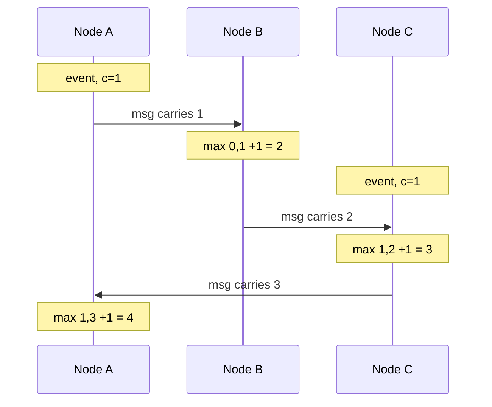
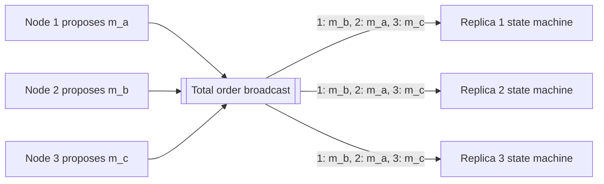

# Ordering, causality, Lamport clocks and total order broadcast

A linearizable register behaves as if there is one copy of the data and every operation takes effect at a single point in time. That definition implies operations are executed in some well-defined **order**. Ordering has come up repeatedly in this track:

- The main job of the leader in single-leader replication is to determine the **order of writes** in the replication log.
- Serializability is about ensuring transactions behave as if executed in **some sequential order**.
- Timestamps and clocks are attempts to bring order into a disorderly world.

There are deep connections between ordering, linearizability and consensus.

## 1. Ordering and causality

Ordering keeps coming up because it helps preserve **causality**:

- In consistent prefix reads, an observer saw an answer before its question. The question *caused* the answer.
- With multi-leader replication, some writes could overtake others, so an update could arrive for a row that does not exist yet. The row must be created before it is updated.
- In detecting concurrent writes, if A happened before B then B might know about A or build on it. If they are concurrent there is no causal link.
- A snapshot under snapshot isolation is **consistent with causality**: if it contains an answer, it must contain the question.
- Write skew involved causal dependencies: Alice was allowed to go off call because the transaction *thought* Bob was still on call.

Causality imposes an ordering on events: cause comes before effect. If a system obeys the ordering imposed by causality, we say it is **causally consistent**.

### 1.1 The causal order is not a total order

A **total order** allows any two elements to be compared. Natural numbers are totally ordered. Mathematical sets are not: is $\{a, b\}$ greater than $\{b, c\}$? Neither is a subset of the other, so they are **incomparable**. Sets are **partially ordered**.

- **Linearizability** gives a **total order** of operations. If the system behaves as though there is one copy of the data and every operation is atomic, then for any two operations we can always say which happened first.
- **Causality** defines a **partial order**. Two events are ordered if they are causally related, and incomparable if they are concurrent.

So a linearizable datastore has **no concurrent operations**: there is a single timeline. Concurrency would mean the timeline branches and merges again, as in Git's version history.

### 1.2 Linearizability is stronger than causal consistency

Linearizability **implies** causality. Any linearizable system preserves causality correctly. That makes linearizable systems simple to understand, but linearizability harms performance and availability, especially with significant network delays.

The good news is that a middle ground exists. A system can be causally consistent without paying the performance cost of linearizability. In fact, **causal consistency is the strongest possible consistency model that does not slow down due to network delays and remains available in the face of network failures**. In many cases, systems that appear to require linearizability really only require causal consistency.

### 1.3 Capturing causal dependencies

To maintain causality, you need to know which operation happened before which. If one operation happened before another, they must be processed in that order on every replica. This is the idea behind **version vectors** (lesson 12), generalised to the whole database. The database needs to know which version of the data the application read, which is why the version number from the prior read is passed back on a write. SSI conflict detection uses a similar idea.

## 2. Sequence number ordering

Explicitly tracking all causal dependencies can become impractical, because clients read lots of data before writing. A better way is to use **sequence numbers** or **timestamps** to order events. The timestamp need not come from a time-of-day clock. It can come from a **logical clock**, an algorithm that generates a sequence of numbers to identify operations, typically using counters incremented for every operation.

Such sequence numbers are compact and provide a **total order**. We can create them in a total order that is **consistent with causality**: if A causally happened before B, then A gets a lower sequence number than B. Concurrent operations may be ordered arbitrarily.

In a single-leader database, the replication log defines a total order of writes consistent with causality: the leader increments a counter for each operation.

### 2.1 Noncausal sequence number generators

Without a single leader (multi-leader, leaderless, or a partitioned database), people use various methods:

- Each node generates its own independent set of sequence numbers. With two nodes, one generates only odd numbers and the other only even numbers.
- Attach a timestamp from a time-of-day clock (physical clock) to each operation. This is what LWW does.
- Preallocate blocks of sequence numbers: node A claims 1 to 1,000 and node B claims 1,001 to 2,000.

These perform better and scale better than pushing everything through one leader. They produce unique, approximately increasing numbers. The problem is that the numbers are **not consistent with causality**. The odd/even scheme cannot tell you which of an odd-numbered and an even-numbered operation happened first. Physical timestamps are subject to clock skew. With block allocation, one operation may get number 1,001 and a causally *later* one number 50.

### 2.2 Lamport timestamps

There is a simple method for generating sequence numbers that **is** consistent with causality: the **Lamport timestamp**, proposed in 1978 by Leslie Lamport in one of the most-cited papers in distributed systems.

Each node has a unique identifier and keeps a **counter** of the number of operations it has processed. The Lamport timestamp is the pair **(counter, node ID)**. Two nodes may sometimes have the same counter value, but including the node ID makes each timestamp unique.

A Lamport timestamp has no relationship to a physical clock, but it provides total ordering: given two timestamps, the one with the greater counter is greater. If counters are equal, the one with the greater node ID is greater.

The key idea that makes them consistent with causality:

> Every node and every client keeps track of the **maximum counter value it has seen so far**, and includes that maximum on every request. When a node receives a request or response with a maximum counter value greater than its own counter, it immediately **increases its own counter to that maximum**.

The rules in full:

1. Before a local event (including a send), a node does `counter += 1`.
2. Every message carries the sender's counter.
3. On receive, the node sets `counter = max(local, received) + 1`.



As long as the maximum counter value is carried along with every operation, the scheme ensures that the ordering from Lamport timestamps is consistent with causality, because every causal dependency results in an increased timestamp.

```python-run
class Node:
    def __init__(self, nid): self.id, self.c, self.log = nid, 0, []
    def local(self, what):
        self.c += 1; self.log.append(((self.c, self.id), what)); return self.c
    def send(self, what):
        return self.local(f"send {what}")
    def recv(self, ts, what):
        self.c = max(self.c, ts) + 1; self.log.append(((self.c, self.id), f"recv {what}"))

a, b, c = Node("A"), Node("B"), Node("C")
a.local("write x")
m1 = a.send("m1"); c.local("write y")
b.recv(m1, "m1")
m2 = b.send("m2"); c.recv(m2, "m2")
m3 = c.send("m3"); a.recv(m3, "m3")

events = sorted(a.log + b.log + c.log)            # total order by (counter, node id)
for ts, what in events:
    print(ts, what)
```

Sorting by `(counter, node)` gives a total order in which every send precedes its receive.

> [!NOTE]
> **Lamport timestamps vs version vectors.** Version vectors can distinguish whether two operations are **concurrent** or whether one is causally dependent on the other. Lamport timestamps **always enforce a total ordering**. From the total order of Lamport timestamps you **cannot tell** whether two operations are concurrent or causally dependent. The advantage of Lamport timestamps is that they are more compact. Formally: $A \to B \Rightarrow L(A) < L(B)$, but the converse does not hold.

### 2.3 Timestamp ordering is not sufficient

Lamport timestamps define a total order consistent with causality, but they are not quite sufficient for many common problems.

Consider a system that needs to ensure a **username uniquely identifies a user account**. If two users concurrently try to create an account with the same username, one should succeed and the other fail. At first glance, a total ordering of operations seems enough: pick the one with the lower timestamp as the winner.

That approach works for determining the winner **after the fact**: once you have collected all the username creation operations in the system, you can compare their timestamps. It is not sufficient when a node has **just received a request** from a user and must decide **right now** whether the request succeeds. At that moment the node does not know whether another node is concurrently creating an account with the same username, and what timestamp that other node may assign.

To be sure that no other node is in the process of concurrently creating an account with the same username and a lower timestamp, you would have to check with **every other node**. If one of them has failed or is unreachable, the system would grind to a halt. That is not the fault-tolerant system we need.

The problem is that the total order of operations only emerges **after** you have collected all of the operations. If another node has generated some operations but you do not yet know what they are, you cannot construct the final ordering. To implement something like a uniqueness constraint, a total ordering is not enough. You also need to know **when that order is finalised**. This idea of knowing when your total order is finalised is captured in **total order broadcast**.

## 3. Total order broadcast

If your program runs on a single CPU core, defining a total ordering of operations is easy: it is the order in which they were executed. In a distributed system, getting all nodes to agree on the same total ordering is tricky.

Single-leader replication determines a total order by choosing one node as leader and sequencing all operations on a single CPU core on the leader. The challenge is how to scale if throughput exceeds what one leader can handle, and how to handle failover if the leader fails. In the distributed systems literature this problem is known as **total order broadcast** or **atomic broadcast**.

Total order broadcast is usually described as a protocol for exchanging messages between nodes. Informally, it requires two **safety** properties to always be satisfied:

- **Reliable delivery.** No messages are lost. If a message is delivered to one node, it is delivered to all nodes.
- **Totally ordered delivery.** Messages are delivered to every node **in the same order**.

A correct algorithm must ensure these properties hold even if a node or the network is faulty. Messages will not be delivered while the network is interrupted, but the algorithm can keep retrying so that they get through when the network is repaired (and then they must still be delivered in the correct order).

### 3.1 Using total order broadcast

Consensus services such as ZooKeeper and etcd actually implement total order broadcast. This hints at the strong connection between total order broadcast and consensus.

- **Database replication.** If every message represents a write to the database, and every replica processes the same writes in the same order, then the replicas remain consistent with each other (aside from temporary replication lag). This principle is known as **state machine replication**.
- **Serializable transactions.** If every message represents a deterministic transaction to be executed as a stored procedure, and if every node processes those messages in the same order, then the partitions and replicas of the database are kept consistent.
- **A log.** Another way of looking at total order broadcast is that it is a way of creating a **log** (as in a replication log, transaction log or write-ahead log): delivering a message is like appending to the log. Since all nodes must deliver the same messages in the same order, all nodes can read the log and see the same sequence of messages.
- **Fencing tokens.** Every request to acquire the lock is appended as a message to the log, and all messages are sequentially numbered in the order they appear in the log. The sequence number can then serve as a fencing token, because it is monotonically increasing. In ZooKeeper, this sequence number is called `zxid`.

An important aspect is that the order is **fixed at the time the messages are delivered**: a node is not allowed to retroactively insert a message into an earlier position in the order if later messages have already been delivered. This makes total order broadcast stronger than timestamp ordering.



### 3.2 Implementing linearizable storage using total order broadcast

Total order broadcast is **asynchronous**: messages are guaranteed to be delivered reliably in a fixed order, but there is no guarantee about *when* a message will be delivered (so one recipient may lag behind the others). By contrast, linearizability is a recency guarantee: a read is guaranteed to see the latest value written.

If you have total order broadcast, you can build linearizable storage on top of it. For example, you can ensure that usernames uniquely identify user accounts. Imagine that for every possible username, you can have a linearizable register with an atomic **compare-and-set** operation. Every register initially has the value `null`. When a user wants to create a username, you execute a compare-and-set on the register for that username, setting it to the user account ID, under the condition that the previous register value is `null`.

You can implement such a linearizable compare-and-set operation by using total order broadcast as an **append-only log**:

1. **Append a message** to the log, tentatively indicating the username you want to claim.
2. **Read the log**, and wait for the message you appended to be delivered back to you.
3. **Check for any messages** claiming the username you want. If the first message for your desired username is your own message, then you are successful: you can commit the username claim (perhaps by appending another message to the log) and acknowledge it to the client. If the first message for your desired username is from another user, you abort the operation.

Because log entries are delivered to all nodes in the same order, if there are several concurrent writes, all nodes will agree on which one came first. Choosing the first of the conflicting writes as the winner and aborting later ones ensures that all nodes agree on whether a write was committed or aborted.

```python-run
class TotalOrderLog:
    """Stand-in for a consensus-backed log: append returns a global sequence number."""
    def __init__(self): self.entries = []
    def append(self, msg):
        self.entries.append(msg); return len(self.entries) - 1

def claim_username(log, node, username):
    my_seq = log.append({"claim": username, "by": node})        # 1. append
    for seq, e in enumerate(log.entries):                        # 2. read the log in order
        if e["claim"] == username:                               # 3. first claim wins
            return seq == my_seq
    return False

log = TotalOrderLog()
# two nodes race for the same name; the log decides the order for everybody
r1 = claim_username(log, "node-1", "ada")
r2 = claim_username(log, "node-2", "ada")
r3 = claim_username(log, "node-2", "grace")
print("node-1 claims 'ada'  :", r1)
print("node-2 claims 'ada'  :", r2)
print("node-2 claims 'grace':", r3)
```

This procedure ensures linearizable writes. It does not guarantee linearizable **reads**: if you read from a store that is asynchronously updated from the log, it may be stale. To make reads linearizable, you can sequence reads through the log (append a message, wait for it to be delivered, and perform the read then), fetch the position of the latest log message in a linearizable way and wait for all entries up to that position, or read from a replica that is synchronously updated on writes.

### 3.3 Implementing total order broadcast using linearizable storage

The reverse construction also works. Assume you have a linearizable register that stores an integer and that has an atomic **increment-and-get** operation (or an atomic compare-and-set). For every message you want to send through total order broadcast, you increment-and-get the linearizable integer, and then attach the value you got from the register as a **sequence number** to the message. You can then send the message to all nodes (resending any lost messages), and the recipients will deliver the messages **consecutively by sequence number**.

Unlike Lamport timestamps, the numbers you get from incrementing the linearizable register form a sequence with **no gaps**. Thus, if a node has delivered message 4 and receives an incoming message with a sequence number of 6, it knows that it must wait for message 5 before it can deliver message 6. The same is not the case with Lamport timestamps. This is the key difference between total order broadcast and timestamp ordering.

How hard could it be to make a linearizable integer with an atomic increment-and-get operation? If things never failed, it would be easy: keep it in a variable on one node. The problem lies in handling the situation when network connections to that node are interrupted, and restoring the value when that node fails. In general, if you think hard enough about linearizable sequence number generators, you inevitably end up with a **consensus algorithm**.

This is no coincidence: it can be proved that a **linearizable compare-and-set (or increment-and-get) register and total order broadcast are both equivalent to consensus**. If you can solve one of these problems, you can transform it into a solution for the others.

> [!INTERVIEW]
> "How do you generate globally unique, ordered IDs?" Options and trade-offs: a single-leader counter (total order, bottleneck, single point of failure); **Snowflake-style** IDs (timestamp + machine id + sequence: scalable and roughly time-ordered, but *not* causally consistent); **Lamport timestamps** (causally consistent total order, but you only know the order after the fact); a **consensus-backed sequencer** such as ZooKeeper's `zxid` or an etcd revision (gap-free, finalised order: what you need for uniqueness and fencing).

## 4. Summary

- Causality gives a **partial order**. Linearizability gives a **total order** and implies causality. **Causal consistency** is the strongest model that stays available under partitions.
- Sequence numbers from odd/even schemes, physical clocks or preallocated blocks are *not* causally consistent.
- **Lamport timestamps** `(counter, nodeId)` with the max-on-receive rule give a causally consistent total order, but they cannot detect concurrency, and the order is known only after the fact.
- **Total order broadcast** = reliable + identically ordered delivery. It is state machine replication, a log, and the basis for fencing tokens.
- Total order broadcast, linearizable compare-and-set and **consensus** are equivalent problems.

```quiz
[
  {"q": "Causality defines what kind of order on events?",
   "options": ["A total order", "A partial order: concurrent events are incomparable", "No order", "A random order"],
   "answer": 1,
   "explain": "Only causally related events are ordered; linearizability imposes a total order."},
  {"q": "Which statement about causal consistency is made in DDIA?",
   "options": ["It is weaker than eventual consistency", "It is the strongest consistency model that does not slow down due to network delays and remains available under network failures", "It requires consensus", "It is the same as linearizability"],
   "answer": 1,
   "explain": "Many systems that seem to need linearizability actually only need causal consistency."},
  {"q": "A node with Lamport counter 5 receives a message carrying counter 9. What is its counter after processing the receive?",
   "options": ["6", "9", "10", "14"],
   "answer": 2,
   "explain": "counter = max(5, 9) + 1 = 10."},
  {"q": "What can you NOT determine from two Lamport timestamps?",
   "options": ["Which one sorts first in the total order", "Whether the two events were concurrent or causally related", "Which node generated each", "Their counter values"],
   "answer": 1,
   "explain": "Lamport timestamps always impose a total order; version vectors are needed to detect concurrency."},
  {"q": "Why are Lamport timestamps insufficient to enforce a unique-username constraint?",
   "options": ["They are not unique", "The total order is only known after collecting all operations; a node cannot decide immediately whether its claim is first", "They need synchronized clocks", "They cannot be compared"],
   "answer": 1,
   "explain": "You need to know when the order is finalized, which is what total order broadcast provides."},
  {"q": "The two safety properties of total order broadcast are...",
   "options": ["Durability and isolation", "Reliable delivery and totally ordered delivery", "Availability and partition tolerance", "Monotonic reads and read-your-writes"],
   "answer": 1,
   "explain": "If a message is delivered to one node it is delivered to all, and all nodes deliver in the same order."},
  {"q": "What is state machine replication?",
   "options": ["Copying disk blocks", "Every replica applies the same deterministic operations in the same total order, so they stay consistent", "Using CRDTs", "Last write wins"],
   "answer": 1,
   "explain": "Total order broadcast delivers the ordered log that drives each replica's state machine."},
  {"q": "How do sequence numbers from a linearizable increment-and-get differ from Lamport timestamps?",
   "options": ["They are larger", "They have no gaps, so a node knows it must wait for message 5 before delivering 6", "They are random", "They need no coordination"],
   "answer": 1,
   "explain": "Gap-freeness lets recipients know the order is complete up to a point."}
]
```

> **Source:** DDIA ch. 9, "Ordering Guarantees" (ordering and causality, sequence number ordering, Lamport timestamps, total order broadcast).
