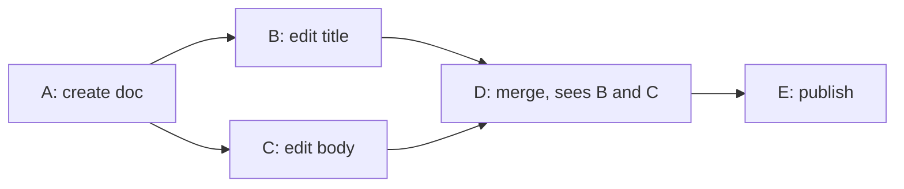
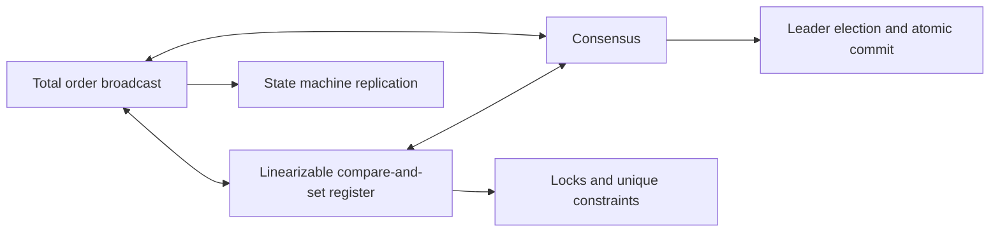

# Ordering, causality, Lamport clocks and total order broadcast

Look back over this track and one idea keeps returning in different clothes: **order**. The whole job of a leader in single-leader replication is to decide the order of writes, so that followers apply them identically. Serializability means transactions behave as if executed in *some* order. Linearizability means operations appear to happen in one well-defined order that agrees with real time. Timestamps and clocks were attempts to impose order on a messy world - which write happened later?

This lesson treats ordering as a subject in its own right. It turns out that there are two notions of order, a weak one (causal order, a *partial* order) and a strong one (a *total* order), that the weak one is cheap and the strong one expensive, and that the strong one - in the form of **total order broadcast** - is equivalent to consensus. Understanding where the boundary lies explains why some things can be done with clever counters and others need a full consensus protocol.

## 1. Why order matters: causality

Order matters because it preserves **causality** - cause comes before effect.

- A reply only makes sense after the message it replies to. A reader who sees the reply first is confused.
- A row has to be created before it can be updated. A replica that receives the update first has nothing to apply it to.
- If operation B was made by someone who had already seen the result of operation A, then A *happened before* B. If neither knew of the other, they are **concurrent**.
- A snapshot that is "consistent" is consistent *with causality*: if it contains an effect, it contains everything that led to it. Reading a snapshot means seeing the effects of everything that causally happened before a point in time, and nothing after.
- Write skew arises when a decision (allow this admin to step down) is causally dependent on an observation (there are two admins) that is no longer true.
- In the auction scene of the previous lesson, Eli's stale result was a causality violation: his query came causally *after* Dana's announcement.

A system that respects the order imposed by cause and effect is **causally consistent**. Snapshot isolation provides it, for example.

### A partial order, not a total order

A **total order** lets you compare any two elements: of two distinct integers one is greater. A **partial order** allows some pairs to be incomparable: of the sets $\{a, b\}$ and $\{b, c\}$, neither contains the other.

The two consistency models differ in exactly this way:

- **Linearizability** imposes a total order. The system behaves as one copy with atomic operations, so for any two operations we can say which took effect first. There are no concurrent operations in this view: a single timeline.
- **Causality** defines a partial order. Two operations are ordered if one happened before the other; if they are concurrent they are simply incomparable. The history is not a line but a graph that forks and merges - much like the commit history in Git, where branches are created by concurrent work and joined again by merges.



Here B and C are concurrent. A total order would force us to pretend one came first; the causal order honestly says neither did.

### Causal consistency is the strongest model that stays available

Linearizability **implies** causality: any linearizable system preserves causal order. But linearizability costs latency and availability under network trouble, as the last lesson showed.

The good news is that linearizability is not the only way to preserve causality. Causal consistency can be had on its own, and it is the **strongest consistency model that does not slow down because of network delays and remains available during network failures**. In many cases an application that seems to need linearizability really needs only causal consistency.

### Keeping track of causal dependencies

To maintain causal consistency, a replica that processes an operation must make sure that everything causally preceding it has already been processed; if something is missing, the later operation waits. To do that, the system has to know *which version of the data the client had seen* when it issued the write.

That is what version numbers and **version vectors** do in leaderless stores: the client passes back the version from its last read, and the database can tell whether a write builds on a previous one or is concurrent with it. The conflict detection of serializable snapshot isolation works on the same information - at commit, it checks whether the version a transaction read is still current.

Tracking every dependency explicitly becomes unwieldy when clients read a lot before writing. Is there something more compact?

## 2. Ordering with sequence numbers

A better trick: give every operation a **sequence number** or **timestamp** from a **logical clock** - a counter, not an oscillator. Sequence numbers are compact, a few bytes, and they provide a total order.

We want that total order to be **consistent with causality**: if A happened before B, A's number is smaller. Concurrent operations may be ordered arbitrarily. A total order with that property captures all the causal information and adds some extra ordering on top.

With a **single leader** this is easy. The leader increments a counter for every operation in its replication log, and a follower that applies the log in order is always causally consistent, though possibly behind.

### Generators that are not causal

Without a single leader - multi-leader or leaderless replication, or a partitioned database - people use various schemes:

- Each node generates its own sequence; one produces only odd numbers, the other only even ones, or some bits of the number are reserved for a node id.
- Stamp each operation with the wall-clock time, at fine enough granularity. This is what last-write-wins does.
- Hand out blocks of numbers in advance: node A takes 1 to 1,000, node B takes 1,001 to 2,000, and each allocates from its block.

All three scale better than routing everything through one counter, and all produce unique, roughly increasing numbers. But **none is consistent with causality**:

- Nodes process operations at different rates, so the odd counter may lag far behind the even one, and an odd-numbered operation cannot be compared meaningfully with an even-numbered one.
- Physical clocks are skewed; a later operation may get an earlier timestamp.
- With blocks, an operation numbered 1,500 on node B may well have happened before one numbered 300 on node A.

### Lamport timestamps

There is a simple scheme that *is* consistent with causality, due to Leslie Lamport (1978), in one of the most cited papers of the field.

- Every node has a unique id and keeps a counter of the operations it has processed.
- A **Lamport timestamp** is the pair **(counter, node id)**. Two nodes may have the same counter value, but the node id makes every timestamp unique.
- Comparison: the larger counter is the larger timestamp; with equal counters, the larger node id wins.
- The key rule: **all participants, clients included, keep track of the highest counter they have come across and attach it to each request they send**. A node that receives a request or response carrying a counter greater than its own immediately raises its own counter to that maximum - and then increments for its next operation.

So information about "how far the counters have got" spreads along every message. An effect, which was produced after receiving a message from its cause, always gets a larger timestamp than the cause.

```python-run
class Node:
    def __init__(self, name): self.name, self.counter = name, 0
    def local(self, what):
        self.counter += 1
        return (self.counter, self.name, what)
    def send(self, what):
        return self.local(what)                           # the message carries this timestamp
    def receive(self, msg, what):
        self.counter = max(self.counter, msg[0])          # fast-forward to what we have seen
        return self.local(what)

a, b, c = Node("A"), Node("B"), Node("C")
events = []
events.append(a.local("A edits draft"))
events.append(a.local("A edits draft again"))
m1 = a.send("A sends draft to B");          events.append(m1)
events.append(c.local("C does unrelated work"))
events.append(b.receive(m1, "B receives draft"))          # jumps from 0 past 3
m2 = b.send("B sends comments to C");       events.append(m2)
events.append(c.receive(m2, "C receives comments"))       # jumps from 1 past 5

for ts in sorted(events):                                 # total order: by (counter, node id)
    print(ts)
```

Node B had done nothing, yet its first event gets counter 4, because it must come after the message it reacts to. C's unrelated work at counter 1 is concurrent with A's events; the total order places it somewhere, arbitrarily but deterministically.

**Lamport timestamps versus version vectors.** They serve different purposes. From two version vectors you can read off whether one operation built on the other or whether they were concurrent. A Lamport timestamp cannot - from two timestamps alone you cannot tell concurrency from causal order - but it always gives a total order, and it is far more compact. The practice problems `db-lamport-order` and `db-vector-clock-compare` let you implement both.

### A total order after the fact is not enough

Lamport timestamps yield a total order consistent with causality. That still does not solve some common problems. Take the classic: a system must guarantee that a username is claimed by one account only. Two users try to create the same name at the same moment.

It seems the total order settles it: the request with the lower timestamp wins. That works for deciding the winner **afterwards**, once all the create-username operations in the system have been collected and compared. But a node that has just received a request must decide **now** whether to accept it. At that moment it does not know whether some other node is concurrently handling a request for the same name with a lower timestamp. To be sure, it would have to ask every other node - and if one of them is down or unreachable, the system stops.

The problem is that the total order only **emerges** after all operations are known. To implement a uniqueness constraint you need to know when the order is **final**: when you are certain that nothing can still be inserted before a given operation. Knowing that is the subject of total order broadcast.

```python-run
# Two nodes each receive a "claim the name kiwi" request, concurrently.
req_node1 = {"ts": (7, "node1"), "name": "kiwi", "user": "ana"}
req_node2 = {"ts": (6, "node2"), "name": "kiwi", "user": "raj"}

# Afterwards, with all requests on the table, the order is clear:
winner = min([req_node1, req_node2], key=lambda r: r["ts"])
print("in hindsight the winner is:", winner["user"])

# But at decision time node1 only knows its own request:
known_to_node1 = [req_node1]
decision = min(known_to_node1, key=lambda r: r["ts"])["user"]
print("node1, deciding immediately, tells", decision, "that the name is theirs  <- wrong")
print("to be safe node1 must hear from every node that no lower timestamp exists -> blocks if any node is down")
```

## 3. Total order broadcast

Single-leader replication determines a total order by choosing one node as leader and sequencing all operations on one CPU core. The difficulties are how to scale beyond one leader's throughput and how to fail over when it dies. In the distributed-systems literature the underlying problem is called **total order broadcast** or **atomic broadcast**.

The usual formulation is a message-passing protocol that never violates two **safety** properties:

- **Reliable delivery.** No message is lost: what one node gets, every node gets.
- **Totally ordered delivery.** The sequence in which messages arrive is identical on all nodes.

A correct algorithm must maintain both even when nodes or the network are faulty. Of course messages cannot be delivered while the network is interrupted; the algorithm keeps retrying, so that they get through, in the right order, once the network is repaired.

### What it is good for

- **Database replication.** Let each message be a write. Replicas that apply an identical sequence of writes end up identical, give or take some lag. This principle is **state machine replication**. ZooKeeper and etcd implement total order broadcast for exactly this.
- **Serializable transactions.** Let each message be a deterministic stored-procedure transaction. Executing them in one agreed order on every node keeps all copies in step.
- **A log.** Delivering a message is appending to a log - replication log, transaction log, write-ahead log. Since every node receives an identical sequence, every node that reads the log reads the same thing. The order is **fixed at the time of delivery**: a node may not insert a message at an earlier position if later messages have already been delivered. This is what makes it stronger than timestamp ordering.
- **Fencing tokens.** Every request to acquire a lock is appended to the log, and the messages are numbered in the order they appear. The sequence number is a fencing token, because it increases monotonically. ZooKeeper's `zxid` is such a number.

### Linearizable storage from total order broadcast

Linearizable systems order all their operations totally. Is total order broadcast therefore the same thing? Not quite, but the two are close relatives.

Total order broadcast is asynchronous: messages are guaranteed to be delivered reliably in a fixed order, with no guarantee about *when*; one recipient may lag behind the others. Linearizability is a recency guarantee: what you read is the most recent write.

Given total order broadcast, linearizable storage can be built on top. Take the username problem. Assume an append-only log as shared storage:

1. Append a message to the log, tentatively stating the username you want to claim.
2. Read the log, and wait until the message you appended is delivered back to you.
3. Check all messages claiming that username. If the first one is yours, you have it - commit the claim (perhaps by appending another message) and acknowledge to the client. If the first message for the name came from someone else, abort.

Because log entries reach all nodes in the same order, all nodes agree, when there are several concurrent claims, on which came first. Choosing the first as the winner and aborting the rest makes all nodes agree on whether a write was committed or aborted. The same pattern implements a linearizable compare-and-set.

```python-run
class SharedLog:
    """Stands in for total order broadcast: one agreed sequence, visible to every node."""
    def __init__(self): self.entries = []
    def append(self, msg): self.entries.append(msg); return len(self.entries) - 1

log = SharedLog()

def claim(node, user, name):
    my_pos = log.append({"node": node, "user": user, "name": name})   # 1. append a tentative claim
    return my_pos                                                     # (the node then waits for delivery)

def outcome(my_pos):
    me = log.entries[my_pos]                                          # 2. my own message has come back
    first = next(e for e in log.entries if e["name"] == me["name"])   # 3. first claim for this name wins
    return "granted" if first is me else f"rejected ({first['user']} was first)"

# three concurrent claims arrive at different nodes; the log fixes one order for all of them
p1 = claim("node1", "ana", "kiwi")
p2 = claim("node2", "raj", "kiwi")
p3 = claim("node3", "li",  "mango")
for who, pos in (("ana", p1), ("raj", p2), ("li", p3)):
    print(who, "->", outcome(pos))
```

Compare with the previous snippet: here node 2 does not need to poll anyone. It waits until its own entry is delivered; at that point everything before it in the log is final.

That procedure makes **writes** linearizable. Reads need separate care, since a node reading its local state may be behind. Options:

- Sequence the read through the log too: append a message, read the log, and perform the actual read when the message comes back. The message's position defines the point in time of the read. (Quorum reads in etcd work somewhat like this.)
- If the log lets you fetch the position of the latest message in a linearizable way, query that position, wait until all entries up to it have been delivered to you, then read. (ZooKeeper's `sync()` operation follows this idea.)
- Read from a replica that is updated synchronously on writes and therefore certain to be up to date. (Chain replication uses this.)

### Total order broadcast from linearizable storage

The construction also works in reverse. Assume a linearizable register holding an integer, with an atomic **increment-and-get** operation (or an atomic compare-and-set, which can do the same job).

The algorithm is short: whenever a node wants to broadcast a message, it first performs increment-and-get on the register and uses the number it gets back as that message's sequence number. Then send the message to all nodes, resending if lost; recipients deliver messages **consecutively by sequence number**.

Unlike Lamport timestamps, the numbers from a linearizable counter form a sequence **without gaps**. A node that has delivered message 4 and receives message 6 knows that it must wait for 5 before delivering 6. With Lamport timestamps there is no such knowledge - a node that has seen timestamp 4 and then 6 cannot tell whether a 5 exists. This absence of gaps is precisely what timestamp ordering lacks and total order broadcast has.

How hard is it to build a linearizable integer with atomic increment-and-get? Trivial, if nothing ever failed: a variable on one node. The difficulty is what to do when the network connection to that node is interrupted, and how to restore the value when it crashes. Thinking hard enough about linearizable sequence number generators leads inevitably to a **consensus** algorithm.

That is no coincidence. There is a formal result behind it: a linearizable register with compare-and-set (or increment-and-get), total order broadcast, and consensus are **all the same problem in different guises**: a solution to any one can be transformed into a solution for the others.



> [!INTERVIEW]
> "Can you use timestamps to enforce a unique username across data centres?" No: a timestamp order - even a causally consistent Lamport order - is only known once all operations have been gathered, and a uniqueness decision has to be made immediately. You need to know that the order is *final* up to your operation, which is what a totally ordered log (consensus) provides. A crisp way to put it: Lamport clocks tell you the order of the events you know about; total order broadcast tells you that there are no events you do not know about.

## Pitfalls

- **Using wall-clock timestamps as sequence numbers.** Clock skew breaks causality; a later operation can sort before an earlier one.
- **Assuming per-node counters or pre-allocated blocks give a meaningful order.** They give uniqueness, nothing more.
- **Expecting Lamport timestamps to detect concurrency.** They totally order events but cannot tell you that two events were concurrent; use version vectors for that.
- **Forgetting the max rule.** A Lamport clock that only increments locally, without fast-forwarding on received messages, does not respect causality.
- **Enforcing constraints from a non-final order.** Any scheme where the order is only complete "eventually" cannot make immediate uniqueness decisions.
- **Demanding a total order where a causal one suffices.** A total order means funnelling everything through consensus, with its cost in throughput and availability.
- **Reading local state after a linearizable write and assuming the read is linearizable too.** The reading node may lag; sequence the read or sync first.

## Summary

- Ordering exists to preserve **causality**. Causal order is a **partial order**: concurrent operations are incomparable. **Linearizability** imposes a **total order** and implies causal consistency, at a cost.
- **Causal consistency** is the strongest model that remains available during network faults; it requires tracking which versions an operation depended on.
- **Sequence numbers** from a single leader are consistent with causality. Per-node counters, physical timestamps and pre-allocated blocks are not.
- **Lamport timestamps** - (counter, node id), with every node fast-forwarding to the highest counter it sees - give a compact total order consistent with causality, but cannot detect concurrency and do not tell you when the order is final.
- **Total order broadcast** delivers the same messages to all nodes in the same, fixed order. It underlies state machine replication, serialisable execution, logs and fencing tokens.
- Total order broadcast, a linearizable compare-and-set register and **consensus** are equivalent problems: each can be built from the others.

```quiz
[
  {"q": "Why is causal order described as a partial order?",
   "options": ["Because it only covers part of the database", "Because concurrent operations are not ordered relative to each other, while causally related ones are", "Because it ignores writes", "Because it applies only to a single node"],
   "answer": 1,
   "explain": "If neither operation knew about the other, neither happened before the other. A partial order permits such incomparable pairs."},
  {"q": "Which statement about linearizability and causal consistency is correct?",
   "options": ["Causal consistency implies linearizability", "Linearizability implies causal consistency, but causal consistency can be achieved without the performance and availability cost of linearizability", "They are unrelated", "Neither can be achieved in a distributed system"],
   "answer": 1,
   "explain": "A total order consistent with real time preserves causality. The converse does not hold, and causal consistency is the strongest model that stays available under partitions."},
  {"q": "Two nodes generate sequence numbers independently, one using odd numbers and the other even numbers. What is wrong with this scheme?",
   "options": ["The numbers are not unique", "The numbers are unique but not consistent with causality, since one node's counter may lag far behind the other's", "It requires consensus", "It uses too much memory"],
   "answer": 1,
   "explain": "Nodes advance at different rates, so a causally later operation on the slower node can have a smaller number."},
  {"q": "What is the rule that makes Lamport timestamps consistent with causality?",
   "options": ["Nodes synchronise their physical clocks with NTP", "Every node keeps the maximum counter it has seen and, on receiving a larger one in a message, raises its own counter to that value before incrementing", "Counters are reset after each message", "Only the leader may increment the counter"],
   "answer": 1,
   "explain": "Carrying the maximum along with every message guarantees that an effect always gets a larger timestamp than its cause."},
  {"q": "Given the Lamport timestamps of two events, what can you NOT determine?",
   "options": ["Which one comes first in the total order", "Whether the two events were concurrent or causally related", "Which node generated each", "Whether the timestamps are equal"],
   "answer": 1,
   "explain": "Lamport timestamps always produce an order, even for concurrent events. Detecting concurrency needs version vectors."},
  {"q": "Why are Lamport timestamps insufficient to enforce a unique username at the moment a request arrives?",
   "options": ["They are too large to store", "The total order is only known after collecting all operations; a node cannot know right away whether another node has a concurrent request with a lower timestamp", "They cannot be compared", "They require synchronised clocks"],
   "answer": 1,
   "explain": "Immediate decisions need to know the order is final. That requires hearing from every node, or using total order broadcast."},
  {"q": "Which two properties define total order broadcast?",
   "options": ["Low latency and high throughput", "Reliable delivery to all nodes, and delivery of messages to every node in the same order", "Encryption and authentication", "Bounded delay and synchronised clocks"],
   "answer": 1,
   "explain": "If a message is delivered to one node it is delivered to all, and all nodes see the same sequence. No timing guarantee is included."},
  {"q": "What does it mean that total order broadcast is equivalent to consensus?",
   "options": ["They use the same network packets", "An algorithm solving one can be converted into an algorithm solving the other, and likewise for a linearizable compare-and-set register", "Neither can be implemented", "Both are weaker than causal consistency"],
   "answer": 1,
   "explain": "Agreeing on the next message in the sequence is a consensus decision, and repeated consensus yields a totally ordered log. The three abstractions are interchangeable."}
]
```

> **Source:** DDIA ch. 9 (Consistency and Consensus) - ordering guarantees: ordering and causality, sequence number ordering, total order broadcast. Written in original wording with original examples.
