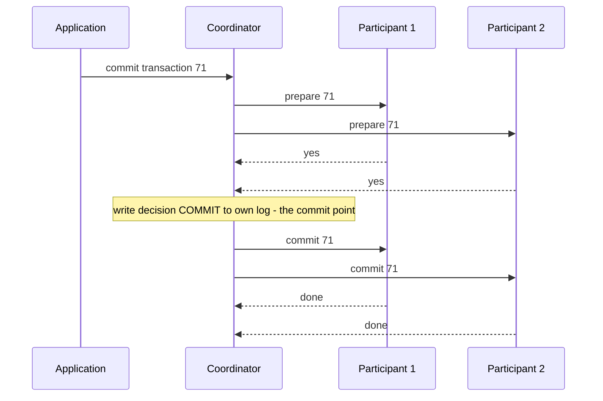
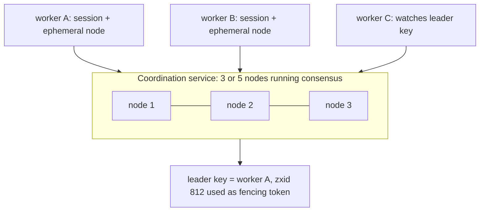

# Distributed transactions, 2PC and consensus

> **Before this lesson:** read [Ordering, causality, Lamport clocks and total order broadcast](#/lesson/databases/ordering) and [Linearizability and the CAP theorem](#/lesson/databases/linearizability). You also need atomicity, commit, abort and locks from [ACID, read committed and snapshot isolation](#/lesson/databases/acid-weak-isolation); two-phase locking from [Serializability](#/lesson/databases/serializability); and majorities, leases, fencing tokens, safety and liveness from [Truth, majorities, fencing tokens](#/lesson/databases/truth-fencing).

## In plain words

**Consensus** means getting several computers to agree on one answer and stick to it, even though some of them may crash and messages between them may be lost or delayed. "Which of us is the leader?" "Did this transaction commit?" "Who gets this username?" Every one of those is a consensus question.

This lesson covers two ways of reaching agreement.

The first is for a transaction that touches several databases at once. An everyday picture: a group of friends is booking a holiday together, and it only goes ahead if *everyone* can come. An organiser phones each friend: "Can you definitely come? Once you say yes, you cannot back out." If all say yes, the organiser writes "GO" in a notebook and phones everyone again to confirm. If anyone says no, the organiser writes "CANCELLED". This is **two-phase commit**. Its weakness is plain to see: suppose the organiser's phone dies straight after the first round of calls. Every friend who said yes is stuck. They promised not to back out, they do not know what was decided, and they cannot book anything else for those dates until the organiser reappears.

The second way removes that single point of weakness. There is no permanent organiser. The group elects one by majority vote, every decision also needs a majority, and if the organiser disappears the group elects another. As long as more than half the group can talk to one another, decisions keep being made, and no two contradictory decisions can ever both pass. This is **fault-tolerant consensus**, and its best-known algorithms are Paxos and Raft.

Why this matters for a job: you will almost never implement these algorithms, but you will rely on them daily, because Kubernetes, Kafka and most modern distributed databases are built on them. Interviewers ask "what happens in two-phase commit if the coordinator crashes?" and "how does Raft prevent two leaders?" because the answers show whether you understand what your infrastructure guarantees and what it does not.

## Agreement is the hard part

Nearly everything hard in distributed data systems reduces to one problem: **getting several nodes to agree on something**. Which node is the leader? Did this transaction commit? Who owns this username? What is the next entry in the log? It sounds as if it should be easy. It is one of the most subtle problems in computing, and many systems have been broken by the belief that a simple scheme would do.

This lesson covers two forms of agreement. The first is **atomic commit**: all participants of a transaction must reach the same verdict, commit or abort. Its standard solution, two-phase commit, is widely deployed and has a serious weakness. The second is **fault-tolerant consensus**, the family of algorithms - Paxos, Raft, Zab, Viewstamped Replication - that overcome that weakness and that power the coordination services modern infrastructure depends on. The goal is not to make you able to implement Raft from memory, but to understand what these protocols guarantee, what they cost, and when to rely on a system that implements them for you.

## 1. Atomic commit

On a single node, atomicity is the job of the storage engine. When asked to commit, the database writes the transaction's changes durably, usually to a write-ahead log, and then appends a **commit record**. If it crashes before the commit record is safely on disk, recovery discards the transaction; if it crashes after, the transaction stands. Everything hinges on one moment on one disk.

Now let one transaction span several machines. It might update rows in two partitions, or a row and an index entry that live on different nodes. Suppose the application sends "commit" to each node and lets each one decide for itself. That does not work:

- One node may find a constraint violation and abort while the others commit.
- Some commit requests may be lost in the network.
- A node may crash before writing its commit record and roll back on recovery.

Then some nodes have the transaction and others do not, which is exactly what atomicity forbids. And a commit cannot be taken back: once data is committed it is visible to other transactions, which may already have acted on it. So **a node may commit only when it is certain that every other participant will commit too**.

### Two-phase commit

**Two-phase commit (2PC)** is the classic algorithm for this. (Do not confuse it with two-phase *locking*, which is about isolation.) It introduces a new role, the **coordinator**, also called transaction manager, which may be a library inside the application process or a separate service. The database nodes are the **participants**.

The application reads and writes on the participants as usual. When it is ready to commit, the coordinator runs two phases:

- **Phase 1 - prepare.** The coordinator asks every participant: *can you commit?*
- **Phase 2 - commit or abort.** If *all* said yes, the coordinator tells everyone to commit. If any said no, or did not answer, it tells everyone to abort.



A wedding ceremony is a fair analogy: the officiant asks each of the two whether they will, and only after both have said "I do" is the marriage pronounced. Before that, either can still back out; after, neither can.

### Two points of no return

Why does this ensure atomicity when one-phase commit does not? The protocol is easiest to understand as a set of promises.

1. The coordinator issues a globally unique transaction id.
2. Each participant runs its local part of the transaction under that id. At this stage anyone may still abort.
3. On *prepare*, a participant that answers **yes** first makes sure it can definitely commit under all circumstances: it writes all the transaction's data to disk and checks every constraint. By saying yes it **gives up its right to abort**, without yet committing. A crash, a power cut or a full disk is no longer an excuse.
4. When all answers are in, the coordinator makes the final decision and **writes it to its own log on disk**. This is the **commit point**.
5. The coordinator sends the decision to all participants and **retries for ever** until each has acknowledged. A participant that crashed in the meantime must carry out the decision when it comes back.

So there are two irrevocable steps: a participant's *yes* vote, and the coordinator's logged decision. Single-node commit merges both into the one act of writing a commit record.

### When the coordinator fails

If a participant fails, or the network fails, before it has voted, the coordinator aborts. If a commit or abort message is lost, the coordinator retries. The awkward case is the coordinator itself.

A participant that has voted yes can no longer abort on its own initiative, and it does not know whether to commit. If the coordinator crashes or becomes unreachable at this moment, the participant can only **wait**. Its transaction is said to be **in doubt**.

It cannot time out and abort: the coordinator may have decided to commit and told another participant, so aborting would break atomicity. It cannot commit either: another participant may have voted no. Asking the other participants might occasionally reveal the answer, but that is not part of 2PC.

The only way forward is for the coordinator to recover, read its log, and tell the participants what was decided. A transaction with no commit record in the coordinator's log is aborted. That is why the coordinator must write the decision to disk *before* sending it out, and why the coordinator's log is as critical as the databases themselves.

The program below runs the protocol for four cases: everyone votes yes, one participant votes no, and two cases where the coordinator crashes after collecting the votes.

```python-run
def two_phase_commit(votes, coordinator_crash=None):
    """votes: list of 'yes'/'no'. coordinator_crash: None | 'before_log' | 'after_log'."""
    states = ["prepared" if v == "yes" else "aborted" for v in votes]     # phase 1 outcome
    decision = "commit" if all(v == "yes" for v in votes) else "abort"
    if coordinator_crash == "before_log":
        return None, states                         # nothing durable: recovery will abort
    log = decision                                  # the commit point
    if coordinator_crash == "after_log":
        return log, states                          # decided, but nobody has been told
    final = "committed" if decision == "commit" else "aborted"
    return log, [final] * len(votes)

for votes, crash in ([["yes", "yes", "yes"], None],
                     [["yes", "no", "yes"], None],
                     [["yes", "yes", "yes"], "after_log"],
                     [["yes", "yes", "yes"], "before_log"]):
    log, states = two_phase_commit(votes, crash)
    stuck = states.count("prepared")
    print(f"votes={votes} crash={crash!s:<10} log={log!s:<6} participants={states}"
          + (f"  <- {stuck} in doubt, holding locks" if stuck else ""))
```

What each part does:

- `votes` is the list of answers the participants give in phase 1.
- `states` is each participant's condition after phase 1. A participant that voted yes is `"prepared"`: it has promised to commit if told to and can no longer abort by its own choice. One that voted no has already aborted.
- `decision` is commit only if `all` the votes are yes.
- If the coordinator crashes `"before_log"`, the function returns with no log entry. The decision was never recorded.
- Otherwise `log = decision` stands for writing the decision to the coordinator's disk: the commit point.
- If the coordinator crashes `"after_log"`, the decision is on disk but no participant has been told.
- With no crash, every participant ends as committed or aborted.
- The `print` line reports the votes, the crash point, the log and the participants' states, and counts how many are stuck in `"prepared"`.

```
votes=['yes', 'yes', 'yes'] crash=None       log=commit participants=['committed', 'committed', 'committed']
votes=['yes', 'no', 'yes'] crash=None       log=abort  participants=['aborted', 'aborted', 'aborted']
votes=['yes', 'yes', 'yes'] crash=after_log  log=commit participants=['prepared', 'prepared', 'prepared']  <- 3 in doubt, holding locks
votes=['yes', 'yes', 'yes'] crash=before_log log=None   participants=['prepared', 'prepared', 'prepared']  <- 3 in doubt, holding locks
```

In the last two cases every participant sits in the prepared state. In one of them the decision exists on the coordinator's disk; in the other it does not. The participants cannot tell the difference and must wait in both.

### Three-phase commit

Because participants can be stuck waiting, 2PC is called a **blocking** atomic commit protocol. A non-blocking variant, three-phase commit, exists in theory. Its correctness rests on message delays and response times having known upper limits, which amounts to having a **perfect failure detector**: something that never mistakes a slow node for a dead one. In a network with unbounded delays, a timeout is not such a mechanism. So 3PC cannot guarantee atomicity in practice, and 2PC remains in use despite its problem.

## 2. Distributed transactions in practice

Distributed transactions have a mixed reputation. Some engineers regard them as an essential safety feature. Others say they cause operational trouble, hurt performance badly and promise more than they deliver, and many cloud services choose not to offer them. Reported slowdowns go up to a factor of ten. Much of that cost comes from two sources: each participant and the coordinator must force extra writes onto the disk (with `fsync`) so the protocol survives a crash, and the two phases need extra messages back and forth over the network.

It helps to separate two things that share the name:

- **Database-internal distributed transactions.** All participants run the same database software (VoltDB, MySQL Cluster's NDB engine, Spanner, CockroachDB). The system can use whatever protocol and optimisations it likes, and these often work well.
- **Heterogeneous distributed transactions.** The participants are different technologies - two databases from different vendors, or a database and a message broker. Atomic commit across them is much harder.

### Exactly-once processing across systems

The appeal of heterogeneous transactions is clear in one case: consuming a message from a queue and committing the database changes it caused should succeed or fail **together**. With an atomic commit covering both, a failure of either one aborts both, the message is redelivered, and no partial effect remains. The message is thus effectively processed exactly once. This works only if *every* system affected can take part in the same protocol - an email already sent by a mail server that does not support 2PC will be sent again on retry.

### XA

**XA** (eXtended Architecture) is a standard from 1991 for implementing 2PC across heterogeneous technologies. Many relational databases (PostgreSQL, MySQL, DB2, SQL Server, Oracle) and message brokers (ActiveMQ, HornetQ, MSMQ, IBM MQ) support it.

XA is not a network protocol. It is a C API for talking to a transaction coordinator, with bindings for other languages (JTA in the Java world). The coordinator is usually a library loaded into the same process as the application. It tracks the participants, collects their prepare responses, and uses a log on the **application server's local disk** to record each decision.

If the application process crashes or its machine dies, the coordinator goes with it, and participants with prepared transactions are in doubt. Nothing gets resolved until that application server is running again and its coordinator library has replayed the log. Database drivers cannot contact each other directly.

### Why in-doubt transactions hurt: locks

Why is a transaction in doubt such a serious matter? Could the rest of the system not carry on and leave it alone?

The trouble is **locking**. A transaction holds row-level locks on everything it modified, to prevent dirty writes; under serialisable isolation with two-phase locking it also holds shared locks on everything it read. Those locks stay in place for as long as the outcome is unknown. So while a transaction is in doubt, its locks stay. If the coordinator is down for 20 minutes, the locks are held for 20 minutes. If its log is lost entirely, they are held **for ever**, or until an administrator intervenes.

Other transactions that want those rows wait. In some systems even readers are blocked. Large parts of the application can become unavailable because of one stuck coordinator.

### Orphans and heuristic decisions

In theory, a coordinator that restarts recovers its state from the log and resolves everything. In practice **orphaned** in-doubt transactions do occur - the log was lost or corrupted, say, by a software bug - and they sit in the database holding locks. Rebooting the database servers does not help, because a correct 2PC implementation must keep the locks of an in-doubt transaction across restarts.

At that point a human has to step in and settle each stuck transaction by hand: look at the participants, find out whether any has already committed or aborted, and apply the same outcome to the rest - probably under pressure, during an outage.

Many XA implementations offer an emergency exit called a **heuristic decision**: a participant unilaterally commits or aborts an in-doubt transaction without the coordinator's say. "Heuristic" here is a polite word for *possibly breaking atomicity*. It is meant for getting out of catastrophic situations, not for routine use.

### Limitations

XA solves a real problem, and it brings real operational problems:

- A coordinator that lives on one unreplicated machine is a **single point of failure** for everything that depends on it, and that is how many of them ship by default.
- Application servers are otherwise stateless and can be added or removed at will. With an embedded coordinator, the server's **local log becomes crucial durable state**, as important as the databases.
- Because XA must work with a wide range of systems, it is a **lowest common denominator**. It cannot detect deadlocks across different systems, and it does not work with serialisable snapshot isolation, which would need a protocol for identifying conflicts across systems.
- 2PC **amplifies failures**: every participant must respond for the transaction to commit, so one broken part stops everything - the opposite of fault tolerance.

## 3. Fault-tolerant consensus

Loosely speaking, consensus is about making a group of nodes settle on one answer. If several people try to take the last seat on a flight at once, or several nodes each try to become leader, a consensus algorithm determines the one winner.

The formal statement: any node may **propose** a value, and the algorithm picks one of the proposals as the **decision**. It must satisfy:

- **Uniform agreement.** No two nodes decide differently.
- **Integrity.** No node decides twice.
- **Validity.** The decided value is one that some node actually proposed.
- **Termination.** Each node that keeps running reaches a decision sooner or later.

Agreement and integrity are the core: everyone decides the same thing, and a decision is final. Validity rules out trivial algorithms such as "always decide null". **Termination** is what makes the problem hard, because it expresses fault tolerance. Without it, you could appoint one node as dictator and let it decide everything - which works until that node fails. 2PC is essentially that: when the coordinator fails, in-doubt participants cannot decide. Termination demands progress even if some nodes fail.

It is a liveness property; the other three are safety properties. Naturally there is a limit: if every node crashes, nothing can decide. A consensus algorithm requires that **a majority of nodes** be working in order to terminate. (Safety, in most implementations, holds even if a majority fails or the network is badly disrupted: the system may stop, but it will not make contradictory decisions.) These algorithms assume non-Byzantine nodes.

### Consensus and total order broadcast

Four algorithm families dominate: **Viewstamped Replication**, **Paxos**, **Raft** and **Zab**. Most of them do not implement the one-value formalism above directly. What they agree on is an ever-growing **sequence** of values - so in effect they are **total order broadcast** algorithms.

Total order broadcast, remember, hands every node the same messages in the same order, each exactly once. That amounts to performing many rounds of consensus: in each round nodes propose the message they want to send next and decide on the next message in the order. Agreement gives all nodes the same order; integrity prevents duplicates; validity prevents invented messages; termination prevents loss. Running a separate single-value consensus for every message would be wasteful, so Viewstamped Replication, Raft and Zab are built around the sequence from the outset; the corresponding refinement of Paxos is known as Multi-Paxos.

### Epochs and two rounds of voting

Single-leader replication looks like a total order broadcast: the leader takes all writes and applies them in one order. So why did the replication lesson not need consensus? Because of how the leader was chosen. If humans pick and configure the leader, you have a consensus algorithm of the dictatorship kind: when the leader fails, the system stops accepting writes until a person fixes it. Automatic failover brings us closer, but raises the danger of **split brain**: two nodes each believing they are leader.

So we seem to need a leader to reach consensus, and consensus to choose a leader. The way out of the circle is that consensus protocols do not promise a unique leader for all time. They make a weaker guarantee.

Each protocol numbers its periods of leadership - Raft says *term*, Paxos *ballot number*, Viewstamped Replication *view number*; we will say **epoch** - and promises only that **no epoch ever has two leaders**.

Whenever the current leader is thought to be dead, the nodes start a vote to elect a new one. The election gets a new, higher epoch number; epochs are totally ordered and increase monotonically. If two leaders from different epochs conflict - perhaps the earlier one was not dead after all - the leader with the **higher epoch wins**.

Before a leader may decide anything, it must check that no other leader with a higher epoch exists who might decide otherwise. A leader cannot trust its own belief (recall "the truth is defined by the majority"). Instead it collects votes from a **quorum**: for each decision it sends the proposed value to the other nodes and waits for a majority to respond in favour. A node votes in favour only if it knows of no leader with a higher epoch.

So there are **two rounds of voting**: one to elect a leader, one to vote on the leader's proposal. The crucial requirement is that the two quorums **overlap**: if a proposal is accepted, at least one of the nodes that voted for it must also have taken part in the latest leader election. Therefore, if the vote on a proposal reveals no higher epoch, the leader can conclude that no election with a higher epoch has happened, that it still holds the leadership, and that it may safely decide the value.

This looks like 2PC, with important differences. In 2PC the coordinator is not elected. And 2PC needs a yes from **every** participant, whereas consensus needs only a **majority**. On top of that, a consensus algorithm specifies how a freshly elected leader brings the other nodes' state into line with its own, which is what keeps the safety properties intact across leader changes. Those differences are what make them fault-tolerant where 2PC is not.

### Raft in brief

Raft was designed to be easier to understand than Paxos, and it is the algorithm inside etcd, Consul and many databases.

- Every node is a **follower**, a **candidate** or the **leader**. Time is divided into **terms**.
- The leader sends periodic heartbeats. A follower that hears nothing for a randomised **election timeout** becomes a candidate, increments the term, votes for itself and asks the others for their votes.
- A node gives at most **one vote per term**, and only to a candidate whose log is **at least as up to date** as its own. A candidate that gathers a majority becomes leader. The randomised timeouts make split votes unlikely.
- The leader appends client commands to its log and sends them to the followers. An entry is **committed** once it is stored on a majority, and then it is applied to the state machine.
- Because of the voting rule, a newly elected leader always holds every committed entry. It forces followers' logs to match its own, overwriting any uncommitted entries that conflict.

In the last bullet points, a **state machine** means the node's copy of the data together with the rule for changing it: apply the same commands in the same order and you arrive at the same state. The program below models only the voting rule, which is the part that keeps committed data safe.

```python-run
class RaftNode:
    def __init__(self, name): self.name, self.term, self.voted_for, self.log = name, 0, {}, []

def request_vote(voter, candidate, term):
    """Grant at most one vote per term, and only to a candidate with an up-to-date log."""
    if term < voter.term or voter.voted_for.get(term) not in (None, candidate.name):
        return False
    last = lambda n: (n.log[-1][0] if n.log else 0, len(n.log))          # (last term, length)
    if last(candidate) < last(voter):
        return False
    voter.term, voter.voted_for[term] = term, candidate.name
    return True

def elect(candidate, reachable, cluster_size, term):
    votes = sum(request_vote(v, candidate, term) for v in [candidate] + reachable)
    won = votes > cluster_size // 2
    return f"{candidate.name} asks for term {term}: {votes}/{cluster_size} votes -> {'LEADER' if won else 'no quorum'}"

nodes = {n: RaftNode(n) for n in "ABCDE"}
for n in "ABC":                                   # A, B, C hold a committed entry from term 1
    nodes[n].log, nodes[n].term = [(1, "x=1")], 1
nodes["D"].term = nodes["E"].term = 1             # D and E were slow and missed it

A, B, C, D, E = (nodes[n] for n in "ABCDE")
print(elect(D, [E, C], 5, term=2), " <- stale log: C refuses, the committed entry cannot be lost")
print(elect(D, [E], 5, term=3),    " <- minority side of a partition can never elect a leader")
print(elect(B, [A, C, D, E], 5, term=4))
```

What each part does:

- A `RaftNode` has a name, the latest term it knows of, a record of whom it voted for in each term, and a log of entries. Each log entry is a pair (term in which it was written, command).
- `request_vote(voter, candidate, term)` decides whether `voter` gives its vote. It refuses if the term is older than one the voter already knows, or if the voter has already voted for someone else in this term.
- The helper `last(n)` describes how up to date a node's log is, as a pair: the term of its last entry and the log's length. Python compares pairs left to right, so a later last term wins, and with equal terms the longer log wins. If the candidate's log is behind the voter's, the vote is refused.
- Otherwise the voter records the vote and returns `True`.
- `elect` has the candidate ask itself and every node it can reach, counts the votes, and checks for a majority of the whole cluster (`cluster_size // 2` is half, rounded down, so the count must exceed it).
- The setup gives nodes A, B and C a committed entry from term 1. D and E missed it and have empty logs.

```
D asks for term 2: 2/5 votes -> no quorum  <- stale log: C refuses, the committed entry cannot be lost
D asks for term 3: 2/5 votes -> no quorum  <- minority side of a partition can never elect a leader
B asks for term 4: 5/5 votes -> LEADER
```

In the first election D can reach E and C. D and E vote for D, but C refuses because D's log lacks the committed entry. Two votes out of five is not a majority. In the second, D can reach only E: a minority cannot elect anyone. In the third, B has the committed entry and can reach everyone, so it wins.

The first line shows the safety argument in action: a node with an incomplete log cannot win, because any majority contains at least one node that has the committed entry and will refuse to vote for it.

### What consensus costs

Consensus algorithms are a major achievement: they bring concrete safety properties (agreement, integrity, validity) to systems where everything else is uncertain, they stay fault-tolerant as long as a majority is working, and they provide total order broadcast and hence linearizable atomic operations. They are not free.

- Voting on proposals before deciding is a form of **synchronous replication**. Many databases are configured for asynchronous replication, accepting the risk of losing committed data on failover, for the sake of performance.
- They need a **strict majority**: three nodes to tolerate one failure, five to tolerate two. A minority cut off by a network fault stops completely.
- Most assume a **fixed set of nodes**. Dynamic membership extensions exist but are much less well understood.
- They rely on **timeouts** to detect a failed leader. Where network delay is highly variable - geographically distributed systems especially - nodes often falsely believe the leader has failed. Safety is unaffected, but frequent elections wreck performance: the system can spend more time choosing leaders than doing work.
- Some are sensitive to particular network faults. Raft has known edge cases in which one consistently unreliable link makes leadership bounce back and forth.

## 4. Membership and coordination services

**ZooKeeper** and **etcd** usually get introduced as "distributed key-value stores" or as services for coordination and configuration. Their API looks like a database: read and write the value for a key, iterate over keys. Why go to the trouble of consensus for that?

Application developers rarely use them directly as a general database. You are far more likely to depend on one indirectly, through Kubernetes, Kafka, HBase or Hadoop YARN. Their design target is a **small dataset held completely in RAM** (and persisted to disk so it survives restarts), with every node carrying a full replica kept in sync by fault-tolerant total order broadcast.

ZooKeeper - modelled on Google's Chubby lock service - offers a combination of features that is very useful for building distributed systems:

- **Linearizable atomic operations.** With an atomic compare-and-set you can implement a lock: if several nodes try concurrently, exactly one succeeds. Because consensus sits underneath, this holds up through node crashes and network interruptions. Such a lock normally takes the form of a **lease** that runs out by itself, so a holder that dies cannot keep it for ever.
- **Total ordering of operations.** When a resource is protected by a lock or lease, a **fencing token** is needed to stop clients from conflicting after a process pause. ZooKeeper puts all operations into one total order and labels each with a transaction id (`zxid`) and a version number that only ever go up - ready-made tokens.
- **Failure detection.** Clients keep a long-lived session and exchange periodic heartbeats with the service. If the heartbeats stop for longer than the session timeout, the session is declared dead, and any locks it held can be released automatically (ZooKeeper calls these *ephemeral nodes*).
- **Change notifications.** A client can read locks and values created by another client and also **watch** them for changes. Without any polling it finds out that a peer has joined (the peer writes a value) or died (the peer's session expires and its ephemeral nodes are removed).

Only the linearizable atomic operations strictly require consensus. It is the combination that makes such services so valuable.

**Typical uses.**

- **Assigning work to nodes.** Choosing one of several instances of a process as leader or primary; choosing which node runs a scheduled job. Deciding which partition of a database, message stream or file store lives on which node, and **rebalancing** as nodes join or fail. All achievable with atomic operations, ephemeral nodes and notifications. An application may grow to thousands of nodes; running majority votes among that many would be terribly inefficient. Instead the coordination service runs on a fixed small number of nodes - three or five - and serves any number of clients. The work of coordinating is "outsourced" to it.
- **Service discovery.** Finding the address to connect to in order to reach a given service. Coordination services, like DNS, are used for this, although service discovery does not actually need consensus - DNS manages with layers of caching and is certainly not linearizable. Electing a leader, on the other hand, does require consensus - and once the coordination service holds that answer anyway, it is the natural place for other services to look it up.
- **Membership services.** Determining which nodes are currently active, live members of a cluster. With unbounded network delays one cannot reliably detect whether another node has failed. But coupling failure detection with consensus lets the nodes *agree* on who is considered alive and who is not. A node may still be wrongly declared dead; nevertheless, agreement on the membership is very useful - choosing a leader could be as simple as picking the lowest-numbered current member, which works only if all nodes agree on who the members are.

The kind of data such a service manages changes slowly: "the node at this address is the leader for partition 7" changes on a timescale of minutes or hours. It is not meant for the fast-changing runtime state of an application.



> [!INTERVIEW]
> "Why doesn't your service implement leader election itself?" Because doing so correctly means implementing consensus, and implementations written from scratch have a poor track record. The right move is to rely on ZooKeeper, etcd or Consul. A complete answer names the building blocks: a lease obtained by a linearizable compare-and-set; an ephemeral key or session, so that the lease disappears when its holder dies; watches, so that the other nodes notice; and a fencing token taken from the service's ever-increasing revision number, because the old leader may not know it has been replaced.

## Pitfalls

- **Assuming 2PC is fault-tolerant.** It guarantees atomicity, not availability: a coordinator failure blocks prepared participants, which keep holding locks.
- **Timing out an in-doubt transaction.** A participant that aborts on its own after voting yes can violate atomicity. Heuristic decisions are an emergency measure only.
- **Coordinator state on ephemeral storage.** With an embedded XA coordinator, the application server's disk holds the commit decisions. Losing it creates orphaned transactions.
- **Expecting exactly-once from distributed transactions when a participant cannot join them.** Any external side effect outside the protocol is repeated on retry.
- **Even-numbered or two-node consensus clusters.** Two nodes tolerate no failure, since a majority of two is two. Use three or five.
- **Stretching a consensus group over a slow, variable network without tuning.** False leader suspicion causes repeated elections.
- **Using a coordination service as a general database.** It is built for small, slowly changing metadata.
- **Homemade leader election**, with heartbeats and "lowest id wins", and no consensus underneath: a reliable source of split brain.
- **Forgetting fencing.** Even with a correct consensus service, a deposed leader may keep acting until it learns of its replacement.

## Summary

- **Atomic commit** requires all participants of a distributed transaction to reach the same outcome. **Two-phase commit** achieves it with a coordinator and two irrevocable steps: each participant's **yes** vote, and the coordinator's **logged decision**.
- 2PC is **blocking**: if the coordinator fails after participants have prepared, they are **in doubt** and must wait, holding locks. Three-phase commit does not fix this in realistic networks.
- **XA** standardises 2PC across heterogeneous systems. It makes exactly-once message processing possible, and brings single points of failure, stuck locks, orphaned transactions and lowest-common-denominator behaviour.
- **Consensus** is defined by agreement, integrity, validity and **termination**. It tolerates the failure of a minority of nodes. Paxos, Raft, Zab and Viewstamped Replication decide a sequence of values, i.e. they implement total order broadcast.
- These algorithms use **epochs** (terms) with a unique leader per epoch, and **overlapping majority quorums** for electing a leader and for accepting its proposals. Raft adds the rule that only a candidate with an up-to-date log can win.
- Consensus costs synchronous replication, a majority requirement, mostly static membership, and sensitivity to timeouts.
- **Coordination services** (ZooKeeper, etcd) package consensus as linearizable operations, ordered transaction ids, sessions with failure detection and change notifications; they are used for leader election, work assignment, service discovery and membership.

## Glossary

- **Consensus** - several nodes agreeing on one value and never going back on it, despite failures.
- **Atomic commit** - all participants in a transaction reaching the same outcome, commit or abort.
- **Commit record** - the entry in a log that marks a transaction as committed.
- **Distributed transaction** - a transaction that involves more than one node or system.
- **Two-phase commit (2PC)** - an atomic commit protocol with a prepare phase and a commit-or-abort phase.
- **Coordinator (transaction manager)** - the component that runs 2PC and records the decision.
- **Participant** - a database node taking part in a distributed transaction.
- **Prepare** - the first phase, in which each participant promises it can commit.
- **Commit point** - the moment the coordinator durably records its decision.
- **In doubt** - the state of a participant that has voted yes and has not yet learned the decision.
- **Blocking protocol** - a protocol in which a failure can leave participants unable to proceed.
- **XA** - a standard interface for running 2PC across different products.
- **Heterogeneous distributed transaction** - one whose participants are different technologies.
- **Orphaned transaction** - an in-doubt transaction whose coordinator can no longer resolve it.
- **Heuristic decision** - a participant settling an in-doubt transaction by itself, possibly breaking atomicity.
- **Single point of failure** - one component whose failure stops everything that depends on it.
- **Uniform agreement / integrity / validity / termination** - no two nodes decide differently / no node decides twice / the decision was proposed by some node / every working node eventually decides.
- **Paxos, Raft, Zab, Viewstamped Replication** - the main families of consensus algorithm.
- **Epoch (term, ballot number, view number)** - a numbered period of leadership; each has at most one leader.
- **Election timeout** - how long a follower waits without hearing from the leader before starting an election.
- **Follower / candidate / leader** - the three roles of a node in Raft.
- **Committed entry** (in Raft) - a log entry stored on a majority of nodes.
- **State machine** - a node's data together with the rule that the same commands in the same order give the same result.
- **Coordination service** - a small consensus-based store (ZooKeeper, etcd, Consul) used for locks, leader election and cluster information.
- **Ephemeral node** - a key in ZooKeeper that is removed automatically when the session that created it ends.
- **Watch** - a request to be notified when a key changes.
- **Membership service** - a service by which nodes agree on which members of a cluster are alive.

```quiz
[
  {"q": "In two-phase commit, what is the commit point after which the transaction's outcome can no longer change?",
   "options": ["When the application calls commit", "When the first participant votes yes", "When the coordinator has written its decision durably to its own log", "When the last participant acknowledges the commit"],
   "answer": 2,
   "explain": "The logged decision is the fact. Everything after that is delivery, which the coordinator retries until every participant has complied."},
  {"q": "A participant has voted yes in the prepare phase and then loses contact with the coordinator. What may it do?",
   "options": ["Abort after a timeout", "Commit after a timeout", "Nothing but wait, keeping its locks, until it learns the coordinator's decision", "Ask the client to decide"],
   "answer": 2,
   "explain": "By voting yes it gave up the right to abort, and it cannot know whether the others voted yes. The transaction is in doubt."},
  {"q": "Why are in-doubt transactions a serious operational problem?",
   "options": ["They consume network bandwidth", "They hold their locks until resolved, which can block other transactions for as long as the coordinator is unavailable", "They are automatically committed twice", "They delete the write-ahead log"],
   "answer": 1,
   "explain": "Locks cannot be released before the outcome is known. A coordinator that is down, or a lost coordinator log, can freeze large parts of an application."},
  {"q": "Which property distinguishes a fault-tolerant consensus algorithm from two-phase commit?",
   "options": ["Agreement", "Validity", "Termination: it still reaches a decision when a minority of nodes, including the current leader, has failed", "Integrity"],
   "answer": 2,
   "explain": "2PC satisfies the safety properties but blocks when the coordinator fails. Consensus adds progress as long as a majority is reachable."},
  {"q": "What do epoch numbers, called terms in Raft, guarantee?",
   "options": ["That there is only ever one leader in the lifetime of the cluster", "That within each epoch there is at most one leader, and a leader from a higher epoch overrides one from a lower epoch", "That clocks are synchronised", "That no elections are needed"],
   "answer": 1,
   "explain": "A unique leader for all time is impossible to guarantee, so protocols guarantee uniqueness per epoch and use the epoch order to resolve conflicts."},
  {"q": "Why must the quorum that elects a leader overlap with the quorum that accepts the leader's proposals?",
   "options": ["To reduce the number of messages", "So that at least one node in any accepting quorum would know of a newer election, allowing a deposed leader to discover that it has been replaced", "To allow even-sized clusters", "Because followers cannot store data"],
   "answer": 1,
   "explain": "With overlapping majorities, if no voter reports a higher epoch, no newer leader can exist, so the decision is safe."},
  {"q": "A Raft cluster of five nodes is split by the network into groups of two and three. What happens?",
   "options": ["Both groups elect a leader and accept writes", "Only the group of three can elect a leader and commit entries; the group of two cannot make progress", "The whole cluster shuts down permanently", "The group of two takes over because it is smaller"],
   "answer": 1,
   "explain": "Electing a leader and committing an entry both need a majority, which is three out of five. The minority side stays safe but unavailable."},
  {"q": "Which ZooKeeper feature lets a lock be released automatically when its holder crashes?",
   "options": ["Watches", "Ephemeral nodes tied to the client's session, which disappear when the session times out", "The zxid", "Snapshots"],
   "answer": 1,
   "explain": "The session is kept alive by heartbeats. When they stop, the service ends the session and removes the ephemeral nodes it owned."}
]
```

> **Source:** DDIA ch. 9 (Consistency and Consensus) - distributed transactions and consensus: atomic commit and two-phase commit, distributed transactions in practice, fault-tolerant consensus, membership and coordination services. Raft details follow Ongaro and Ousterhout, "In Search of an Understandable Consensus Algorithm" (2014). Written in original wording with original examples.
