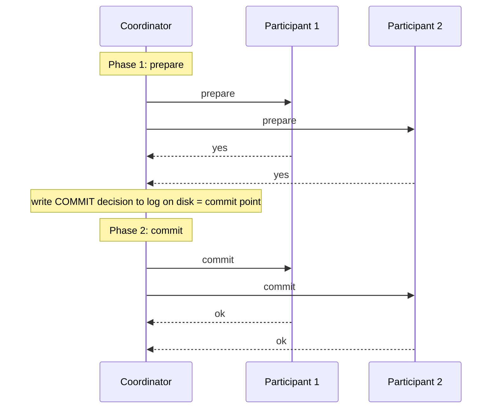
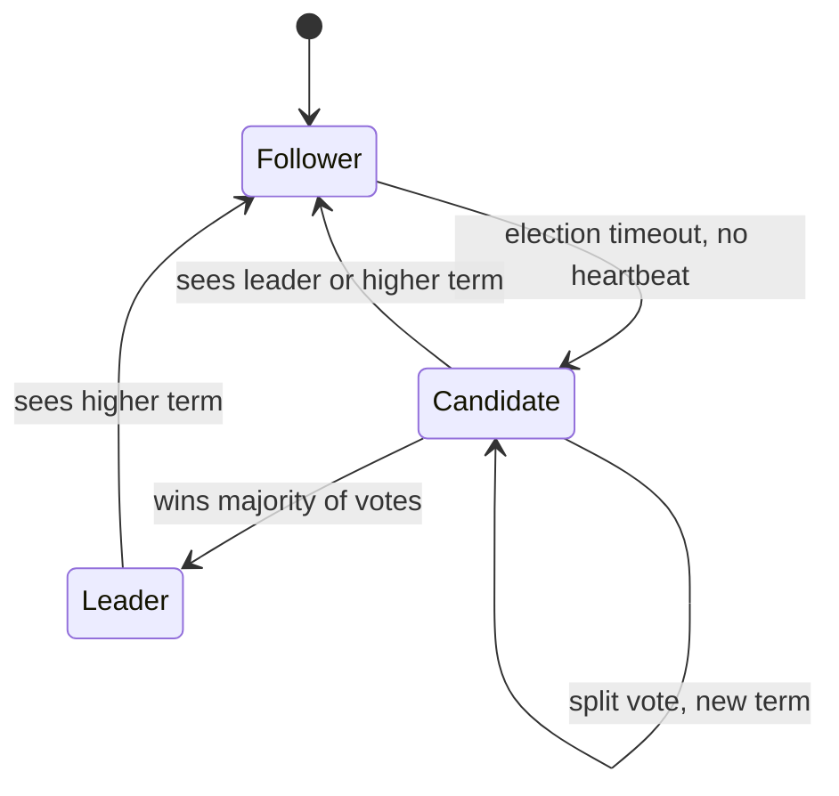
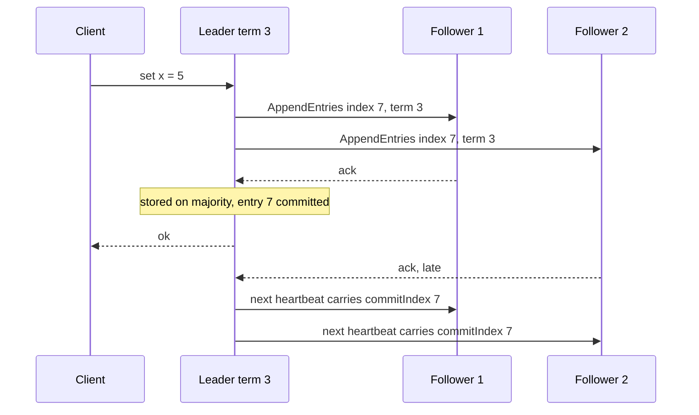

# Distributed transactions, 2PC and consensus

**Consensus** is one of the most important problems in distributed computing: *get several nodes to agree on something*. It sounds easy and is surprisingly subtle. Situations that need it:

- **Leader election.** In single-leader replication all nodes must agree which node is the leader. If two nodes both believe they are leader (split brain), data diverges.
- **Atomic commit.** A transaction spanning several nodes or partitions may fail on some nodes and succeed on others. To keep atomicity, all nodes must agree on the outcome: all commit, or all abort.

> [!NOTE]
> **The FLP result.** Fischer, Lynch and Paterson proved that no algorithm can always reach consensus if there is a risk that a node may crash, in the *asynchronous* system model, where algorithms cannot use clocks or timeouts. If the algorithm may use timeouts, or some other way of identifying suspected crashed nodes, consensus becomes solvable. FLP is a theoretical result. Distributed systems achieve consensus in practice.

## 1. Atomic commit and two-phase commit (2PC)

On a single node, atomicity is implemented by the storage engine. When a client asks to commit, the database makes the transaction's writes durable (typically in a write-ahead log) and then appends a **commit record** to the log on disk. If the database crashes before the commit record is written, the transaction is rolled back on recovery. After it is written, the transaction is committed. Commitment hinges on one moment on one disk.

With several nodes it is not sufficient to send a commit request to each and let them commit independently. The commit could succeed on some and fail on others: some detect a constraint violation, some commit requests get lost, some nodes crash before writing the commit record. A node must only commit once it is certain that all the other nodes will commit too, because **a commit is irrevocable**. Once data is committed, other transactions can see it and rely on it.

### 1.1 Two-phase commit

**Two-phase commit** is an algorithm for atomic commit across several nodes. It is a classic and is used internally in some databases and offered to applications as **XA transactions**.

2PC uses a new component: a **coordinator** (transaction manager). It is often a library inside the application process requesting the transaction (embedded in a Java EE container, for example), or a separate service. The database nodes are **participants**.

A 2PC transaction begins with the application reading and writing data on several participants, as normal. When the application is ready to commit, the coordinator starts:

- **Phase 1 (prepare).** The coordinator sends a **prepare** request to each participant, asking whether it can commit.
- **Phase 2 (commit or abort).**
  - If **all** participants reply "yes", the coordinator sends a **commit** request, and the commit takes place.
  - If **any** participant replies "no", the coordinator sends an **abort** request to all.



It is like a Western wedding ceremony: the minister asks each party whether they will marry the other, and after both say "I do", pronounces them married.

### 1.2 A system of promises

Why does 2PC ensure atomicity when one-phase commit does not? Look at the details:

1. The application requests a globally unique **transaction ID** from the coordinator.
2. It begins a single-node transaction on each participant, attaching the global ID. If anything goes wrong at this stage, the coordinator or any participant can abort.
3. When the application is ready to commit, the coordinator sends a **prepare** request to all participants, tagged with the global ID. If any request fails or times out, the coordinator sends an abort to all.
4. When a participant receives the prepare request, it makes sure that it can **definitely commit the transaction under all circumstances**. This includes writing all transaction data to disk and checking for conflicts or constraint violations. By replying "yes", the participant **surrenders the right to abort**, without actually committing.
5. When the coordinator has all responses, it makes a definitive decision and **writes it to its transaction log on disk**, so it knows the decision in case it crashes later. This is the **commit point**.
6. Once the decision is on disk, the commit or abort request goes to all participants. If the request fails or times out, the coordinator **must retry forever** until it succeeds. There is no going back. If a participant crashed in the meantime, the transaction is committed when it recovers. Having voted "yes", it cannot refuse.

So the protocol has two crucial "points of no return": when a participant votes "yes", it promises it will definitely be able to commit later. Once the coordinator decides, the decision is irrevocable. Those promises ensure atomicity.

```python-run
def two_phase_commit(votes, coordinator_crashes_after_prepare=False):
    """votes: participant -> 'yes' | 'no' | None (timeout). Returns (decision, participant states)."""
    state = {p: "working" for p in votes}
    # phase 1
    for p, v in votes.items():
        state[p] = "prepared (in doubt)" if v == "yes" else "aborted"
    if coordinator_crashes_after_prepare:
        return "UNKNOWN (coordinator down)", state
    decision = "commit" if all(v == "yes" for v in votes.values()) else "abort"
    # phase 2 (retried forever until delivered)
    for p in votes:
        if state[p].startswith("prepared"):
            state[p] = "committed" if decision == "commit" else "aborted"
    return decision, state

print(two_phase_commit({"db1": "yes", "db2": "yes", "db3": "yes"}))
print(two_phase_commit({"db1": "yes", "db2": "no",  "db3": "yes"}))
print(two_phase_commit({"db1": "yes", "db2": None,  "db3": "yes"}))      # timeout -> abort
print(two_phase_commit({"db1": "yes", "db2": "yes"}, coordinator_crashes_after_prepare=True))
```

### 1.3 Coordinator failure

If a participant or the network fails during prepare, the coordinator aborts. If one fails during phase 2, the coordinator retries indefinitely. What if the **coordinator** crashes?

If the coordinator fails before sending the prepare requests, a participant can safely abort. Once a participant has received a prepare request and voted "yes", it can no longer abort unilaterally. It must wait to hear from the coordinator. If the coordinator crashes or the network fails at that point, the participant can do nothing but wait. Its transaction is **in doubt** or **uncertain**.

A timeout does not help here. If the participant unilaterally aborts after a timeout, it could end up inconsistent with another participant that has committed. Unilaterally committing is equally unsafe, because another participant may have aborted. In principle the participants could communicate among themselves to find out how each voted and come to some agreement, but that is not part of the 2PC protocol.

The only way 2PC can complete is by **waiting for the coordinator to recover**. This is why the coordinator must write its decision to a transaction log on disk before sending commit or abort requests: when it recovers, it reads the log to determine the status of all in-doubt transactions. Any transaction without a commit record in the coordinator's log is aborted. The commit point of 2PC thus comes down to a regular single-node atomic commit on the coordinator.

For this reason 2PC is called a **blocking** atomic commit protocol.

### 1.4 Three-phase commit

An alternative called three-phase commit (3PC) is **nonblocking** in theory. It assumes a network with **bounded delay** and nodes with bounded response times. In most practical systems, with unbounded network delay and process pauses, it cannot guarantee atomicity. Nonblocking atomic commit requires a **perfect failure detector**, a reliable mechanism for telling whether a node has crashed. In a network with unbounded delay, a timeout is not a reliable failure detector. So 2PC continues to be used despite the coordinator failure problem.

## 2. Distributed transactions in practice

Distributed transactions, especially those implemented with 2PC, have a mixed reputation. They provide an important safety guarantee that would be hard to achieve otherwise. They are also criticised for causing operational problems, killing performance and promising more than they can deliver. Distributed transactions in MySQL are reported to be over **10 times slower** than single-node transactions. Much of the cost comes from the additional disk forcing (`fsync`) required for crash recovery and the additional network round trips.

Two quite different kinds are often conflated:

- **Database-internal distributed transactions.** Some distributed databases support internal transactions among their nodes (VoltDB, MySQL Cluster's NDB engine, Spanner, CockroachDB). All participants run the same software, which allows optimisations.
- **Heterogeneous distributed transactions.** The participants are two or more different technologies: two databases from different vendors, or even non-database systems such as message brokers.

### 2.1 Exactly-once message processing

Heterogeneous transactions allow diverse systems to be integrated in powerful ways. For example, a message from a message queue can be acknowledged as processed **if and only if** the database transaction for processing the message was successfully committed. This is implemented by atomically committing the message acknowledgement and the database writes in a single transaction. If either the message delivery or the database transaction fails, both are aborted, so the message broker may safely redeliver the message later. By atomically committing the message and its side effects, we ensure the message is **effectively processed exactly once**, even if it took a few retries. This only works if all systems affected by the transaction can use the same atomic commit protocol.

### 2.2 XA transactions

**X/Open XA** (eXtended Architecture) is a standard for implementing two-phase commit across heterogeneous technologies, introduced in 1991. It is supported by many traditional relational databases (PostgreSQL, MySQL, DB2, SQL Server, Oracle) and message brokers (ActiveMQ, HornetQ, MSMQ, IBM MQ). XA is not a network protocol. It is a C API for interfacing with a transaction coordinator. In Java, it is implemented by the Java Transaction API (JTA).

### 2.3 Holding locks while in doubt

Why do we care so much about a transaction being stuck in doubt? The problem is **locking**. Database transactions usually take a row-level exclusive lock on any rows they modify, to prevent dirty writes. For serializable isolation with two-phase locking, the database also takes shared locks on any rows read by the transaction.

The database cannot release those locks until the transaction commits or aborts. So with two-phase commit, a transaction must hold onto its locks throughout the time it is in doubt. If the coordinator has crashed and takes 20 minutes to restart, those locks are held for 20 minutes. If the coordinator's log is entirely lost for some reason, those locks are held **forever**, or at least until an administrator resolves the situation manually. While those locks are held, no other transaction can modify those rows. Other transactions cannot simply continue with their business. This can cause large parts of your application to become unavailable until the in-doubt transaction is resolved.

### 2.4 Recovering from coordinator failure

In theory, if the coordinator crashes and is restarted, it should cleanly recover its state from the log and resolve any in-doubt transactions. In practice, **orphaned** in-doubt transactions do occur: transactions for which the coordinator cannot decide the outcome for whatever reason (the transaction log has been lost or corrupted because of a software bug). These transactions cannot be resolved automatically, so they sit forever in the database, holding locks and blocking other transactions. Even rebooting your database servers will not fix this, because a correct implementation of 2PC must preserve the locks of an in-doubt transaction across restarts.

The only way out is for an **administrator to manually decide** whether to commit or roll back the transactions. Many XA implementations have an emergency escape hatch called **heuristic decisions**: allowing a participant to unilaterally decide to abort or commit an in-doubt transaction without a definitive decision from the coordinator. "Heuristic" here is a euphemism for *probably breaking atomicity*.

### 2.5 Limitations of distributed transactions

XA transactions solve the real problem of keeping several participant data systems consistent with each other, but they introduce major operational problems. The transaction coordinator is itself a kind of database (in which transaction outcomes are stored):

- If the coordinator is not replicated but runs on a single machine, it is a **single point of failure** for the entire system.
- Many server-side applications are developed in a stateless model, with all persistent state stored in a database. When the coordinator is part of the application server, its logs become a crucial part of the durable system state, so application servers are **no longer stateless**.
- Since XA needs to be compatible with a wide range of data systems, it is necessarily a **lowest common denominator**. It cannot detect deadlocks across different systems, and it does not work with SSI.
- For database-internal distributed transactions, the limitations are not so great. There remains the problem that for 2PC to successfully commit a transaction, **all** participants must respond. If any part of the system is broken, the transaction also fails. Distributed transactions thus have a tendency of **amplifying failures**, which runs counter to our goal of building fault-tolerant systems.

## 3. Fault-tolerant consensus

Informally, consensus means getting several nodes to agree on something. If several people concurrently try to book the last seat on an aeroplane, or the same seat in a theatre, or try to register an account with the same username, a consensus algorithm could be used to determine which one of these mutually incompatible operations should be the winner.

The consensus problem is normally formalised as follows: one or more nodes may **propose** values, and the consensus algorithm **decides** on one of those values. A consensus algorithm must satisfy these properties:

- **Uniform agreement.** No two nodes decide differently.
- **Integrity.** No node decides twice.
- **Validity.** If a node decides value $v$, then $v$ was proposed by some node.
- **Termination.** Every node that does not crash eventually decides some value.

Uniform agreement and integrity define the core idea: everyone decides on the same outcome, and once you have decided, you cannot change your mind. Validity rules out trivial solutions (always deciding `null`). **Termination** formalises fault tolerance. It is a **liveness** property, while the other three are **safety** properties.

If you did not care about fault tolerance, satisfying the first three properties would be easy: hardcode one node to be the "dictator" and let it make all the decisions. If that one node fails, the system can no longer decide anything. This is what 2PC does with its coordinator, and so 2PC does not satisfy termination.

The system model of consensus assumes that when a node crashes, it suddenly disappears and never comes back. Any algorithm that has to wait for a node to recover cannot satisfy termination. There is a limit to the number of failures an algorithm can tolerate: any consensus algorithm requires at least a **majority of nodes** to be functioning correctly in order to assure termination. That majority can safely form a quorum. Thus termination is subject to the assumption that fewer than half of the nodes are crashed or unreachable. Most implementations of consensus ensure that the safety properties are always met, even if a majority of nodes fail or there is a severe network problem. A large-scale outage can stop the system from being able to process requests, but it cannot corrupt the consensus system by causing it to make invalid decisions.

### 3.1 Consensus algorithms and total order broadcast

The best-known fault-tolerant consensus algorithms are **Viewstamped Replication (VSR)**, **Paxos**, **Raft** and **Zab**. Most of these algorithms do not directly use the formal model described here (proposing and deciding on a single value). Instead, they decide on a **sequence** of values, which makes them **total order broadcast** algorithms.

Total order broadcast is equivalent to repeated rounds of consensus (each consensus decision corresponding to one message delivery). Viewstamped Replication, Raft and Zab implement total order broadcast directly, because that is more efficient than doing repeated rounds of one-value-at-a-time consensus. In the case of Paxos, this optimisation is known as **Multi-Paxos**.

### 3.2 Epoch numbering and quorums

All of the consensus protocols discussed so far internally use a **leader** in some form, but they do not guarantee that the leader is unique. Instead, they make a weaker guarantee: the protocols define an **epoch number** (called the *ballot number* in Paxos, *view number* in Viewstamped Replication, and **term number** in Raft) and guarantee that **within each epoch, the leader is unique**.

Every time the current leader is thought to be dead, a vote is started among the nodes to elect a new leader. This election is given an incremented epoch number, and thus epoch numbers are totally ordered and monotonically increasing. If there is a conflict between two different leaders in two different epochs (perhaps because the previous leader actually was not dead after all), then the leader with the **higher epoch number prevails**.

Before a leader is allowed to decide anything, it must first check that there is not some other leader with a higher epoch number which might take a conflicting decision. How does a leader know that it has not been ousted by another node? A node cannot necessarily trust its own judgement. Instead, it must **collect votes from a quorum of nodes**. For every decision that a leader wants to make, it must send the proposed value to the other nodes and wait for a quorum of nodes to respond in favour of the proposal. The quorum typically, but not always, consists of a majority of nodes. A node votes in favour of a proposal only if it is not aware of any other leader with a higher epoch.

Thus, we have **two rounds of voting**: once to choose a leader, and a second time to vote on a leader's proposal. The key insight is that the quorums for those two votes must **overlap**: if a vote on a proposal succeeds, at least one of the nodes that voted for it must have also participated in the most recent leader election. Thus, if the vote on a proposal does not reveal any higher-numbered epoch, the current leader can conclude that no leader election with a higher epoch number has happened, and therefore be sure that it still holds the leadership. It can then safely decide the proposed value.

This voting process looks superficially similar to two-phase commit. The biggest differences are that in 2PC the coordinator is **not elected**, and that fault-tolerant consensus algorithms only require votes from a **majority** of nodes, whereas 2PC requires a "yes" vote from **every** participant.

### 3.3 Raft in a nutshell

Raft (Ongaro and Ousterhout, 2014) was designed to be understandable. Every node is a **follower**, **candidate** or **leader**.



- **Leader election.** Followers expect periodic heartbeats. If one hears nothing for a *randomised* election timeout, it increments its **term**, becomes a candidate, votes for itself and asks the others for votes. Each node grants **at most one vote per term**, and only to a candidate whose log is **at least as up to date** as its own. A candidate that gets a majority becomes leader for that term. Randomised timeouts make split votes rare.
- **Log replication.** Clients send commands to the leader. The leader appends each command to its log and sends `AppendEntries` to followers. Once an entry is stored on a **majority**, it is **committed**, and each node applies it to its state machine in log order.
- **Safety.** Because a new leader needs votes from a majority, and every committed entry is on a majority, the two majorities overlap. The vote restriction guarantees a new leader already has every committed entry. A leader that discovers a higher term steps down immediately.



```python-run
def request_vote(voter, candidate):
    """Raft vote rule. voter/candidate: dict(term, voted_for, last_log_term, last_log_index)."""
    if candidate["term"] < voter["term"]:
        return False                                   # stale candidate
    if candidate["term"] > voter["term"]:
        voter["term"], voter["voted_for"] = candidate["term"], None
    if voter["voted_for"] not in (None, candidate["id"]):
        return False                                   # one vote per term
    up_to_date = (candidate["last_log_term"], candidate["last_log_index"]) >= \
                 (voter["last_log_term"], voter["last_log_index"])
    if up_to_date:
        voter["voted_for"] = candidate["id"]
    return up_to_date

def node(i, term, llt, lli): return dict(id=i, term=term, voted_for=None, last_log_term=llt, last_log_index=lli)

cluster = [node("n1", 3, 3, 7), node("n2", 3, 3, 7), node("n3", 3, 2, 5), node("n4", 3, 3, 6), node("n5", 3, 2, 5)]
for cand_id in ("n3", "n1"):
    nodes = [dict(n) for n in cluster]
    cand = next(n for n in nodes if n["id"] == cand_id)
    cand["term"] += 1; cand["voted_for"] = cand["id"]
    votes = 1 + sum(request_vote(v, cand) for v in nodes if v is not cand)
    print(f"{cand_id} (log term {cand['last_log_term']}, index {cand['last_log_index']}) gets {votes}/5 votes ->",
          "LEADER" if votes > len(nodes) // 2 else "loses: its log is behind")
```

`n3` is missing committed entries, so the nodes with longer logs refuse it. That is how Raft guarantees a new leader never loses committed data.

### 3.4 Limitations of consensus

Consensus algorithms are a huge breakthrough for distributed systems: they bring concrete safety properties (agreement, integrity and validity) to systems where everything else is uncertain, and they remain fault-tolerant. They provide total order broadcast, and therefore they can also implement linearizable atomic operations in a fault-tolerant way. They are not used everywhere, because the benefits come at a cost:

- The process by which nodes vote on proposals before they are decided is a kind of **synchronous replication**. Databases are often configured to use asynchronous replication for better performance.
- Consensus systems always require a **strict majority** to operate. You need a minimum of three nodes to tolerate one failure, or five nodes to tolerate two failures. If a network failure cuts off some nodes from the rest, only the majority portion of the network can make progress.
- Most consensus algorithms assume a **fixed set of nodes** that participate in voting, which means that you cannot just add or remove nodes in the cluster. Dynamic membership extensions are much less well understood.
- Consensus systems generally rely on **timeouts** to detect failed nodes. In environments with highly variable network delays, especially geographically distributed systems, it often happens that a node falsely believes the leader to have failed due to a transient network issue. Although this error does not harm the safety properties, frequent leader elections result in terrible performance.

## 4. Membership and coordination services

Projects like **ZooKeeper** or **etcd** are often described as "distributed key-value stores" or "coordination and configuration services". You rarely use ZooKeeper directly as an application developer. You rely on it indirectly via some other project: HBase, Hadoop YARN, OpenStack Nova and Kafka all rely on ZooKeeper running in the background.

ZooKeeper and etcd are designed to hold **small amounts of data that can fit entirely in memory** (although they still write to disk for durability). That small amount of data is replicated across all the nodes using a fault-tolerant total order broadcast algorithm. ZooKeeper is modelled after Google's **Chubby** lock service, implementing not only total order broadcast (and hence consensus), but also an interesting set of other features:

- **Linearizable atomic operations.** Using an atomic compare-and-set operation, you can implement a lock: if several nodes concurrently try to perform the same operation, only one of them will succeed. A distributed lock is usually implemented as a **lease**, which has an expiry time so that it is eventually released in case the client fails.
- **Total ordering of operations.** When some resource is protected by a lock or lease, you need a **fencing token** to prevent clients from conflicting with each other in the case of a process pause. ZooKeeper provides this by totally ordering all operations and giving each operation a monotonically increasing transaction ID (`zxid`) and version number (`cversion`).
- **Failure detection.** Clients maintain a long-lived session on ZooKeeper servers, and the client and server periodically exchange **heartbeats** to check that the other node is still alive. If the heartbeats cease for a duration that is longer than the session timeout, ZooKeeper declares the session to be dead. Any locks held by a session can be configured to be automatically released when the session times out (**ephemeral nodes**).
- **Change notifications.** Not only can one client read locks and values that were created by another client, but it can also **watch** them for changes. Thus, a client can find out when another client joins the cluster, or if another client fails. By subscribing to notifications, a client avoids having to frequently poll to find out about changes.

Typical uses: **allocating work to nodes** (choosing a leader among several instances of a job scheduler, or deciding which partition is assigned to which node and rebalancing when nodes join or fail), **service discovery** (finding out which IP address you need to connect to in order to reach a particular service), and **membership services** (determining which nodes are currently active and live members of a cluster).

ZooKeeper runs on a fixed number of nodes (usually three or five) and performs its majority votes among those nodes while supporting a potentially large number of clients. Thus, ZooKeeper provides a way of "outsourcing" some of the work of coordinating nodes (consensus, operation ordering and failure detection) to an external service. Normally, the kind of data managed by ZooKeeper is quite slow-changing: it represents information like "the node running on 10.1.1.23 is the leader for partition 7", which may change on a timescale of minutes or hours.

> [!INTERVIEW]
> Compare **2PC** and **Raft/Paxos**, since people confuse them. 2PC: atomic commit across *different* data (each participant holds different rows), needs **all** participants to vote yes, and **blocks** if the coordinator fails. Raft/Paxos: agreement among *replicas of the same* data, needs only a **majority**, and survives leader failure via election. Real systems combine them: Spanner and CockroachDB run 2PC *across* shards, where each shard (and the coordinator state) is a Paxos/Raft group, which removes the coordinator single point of failure.

## 5. Summary

- **2PC** = prepare (participants promise) + commit/abort (coordinator's logged decision is the commit point). It is atomic but **blocking**: in-doubt participants hold locks until the coordinator recovers.
- XA spreads 2PC across heterogeneous systems. It is operationally painful and amplifies failures.
- **Consensus** = agreement, integrity, validity, **termination**. It needs a majority and uses **epochs/terms** plus overlapping quorums. Paxos, Raft, Zab and VSR implement total order broadcast.
- **Raft**: randomised election timeouts, one vote per term, up-to-date log check, commit on majority.
- **ZooKeeper/etcd** package consensus as linearizable CAS, ordered ids (fencing), sessions with ephemeral nodes, and watches.

```quiz
[
  {"q": "In two-phase commit, what does a participant promise by voting 'yes' in the prepare phase?",
   "options": ["That it has already committed", "That it will definitely be able to commit if asked, giving up its right to abort unilaterally", "That it will abort on timeout", "Nothing binding"],
   "answer": 1,
   "explain": "It durably writes the transaction's data so it can commit even after a crash."},
  {"q": "What is the commit point of 2PC?",
   "options": ["When the first participant votes yes", "When the coordinator writes its commit decision to its log on disk", "When the client sends COMMIT", "When all participants acknowledge the commit"],
   "answer": 1,
   "explain": "After that the decision is irrevocable and is retried forever."},
  {"q": "A participant has voted 'yes' and the coordinator crashes. What can the participant do?",
   "options": ["Abort after a timeout", "Commit after a timeout", "Only wait, holding its locks, until the coordinator recovers", "Ask the client"],
   "answer": 2,
   "explain": "The transaction is in doubt; deciding unilaterally could violate atomicity. 2PC is a blocking protocol."},
  {"q": "Which consensus property does 2PC fail to provide?",
   "options": ["Uniform agreement", "Integrity", "Validity", "Termination"],
   "answer": 3,
   "explain": "If the coordinator fails, in-doubt participants cannot decide, so progress is not guaranteed."},
  {"q": "How many nodes are needed to tolerate two failures in a consensus system?",
   "options": ["3", "4", "5", "2"],
   "answer": 2,
   "explain": "A majority of 5 is 3, so two nodes can fail."},
  {"q": "What do epoch/term numbers guarantee?",
   "options": ["Globally unique leader at all times", "At most one leader within each epoch; a higher epoch overrides a lower one", "Synchronized clocks", "No elections"],
   "answer": 1,
   "explain": "A stale leader discovers the higher epoch when it fails to gather a quorum."},
  {"q": "In Raft, why does a voter refuse a candidate whose log is less up to date?",
   "options": ["To save bandwidth", "To ensure any elected leader already holds every committed entry", "Because of clock skew", "To prefer older nodes"],
   "answer": 1,
   "explain": "Committed entries are on a majority; the election majority overlaps it, and the check picks a node that has them."},
  {"q": "Which ZooKeeper feature lets a lock be released automatically when its holder dies?",
   "options": ["Watches", "Ephemeral nodes tied to a session with heartbeats", "zxid", "Snapshots"],
   "answer": 1,
   "explain": "When the session times out, ephemeral nodes are deleted."}
]
```

> **Source:** DDIA ch. 9, "Distributed Transactions and Consensus" (atomic commit and 2PC, distributed transactions in practice, fault-tolerant consensus, membership and coordination services). Raft details: Ongaro & Ousterhout, "In Search of an Understandable Consensus Algorithm" (2014).
