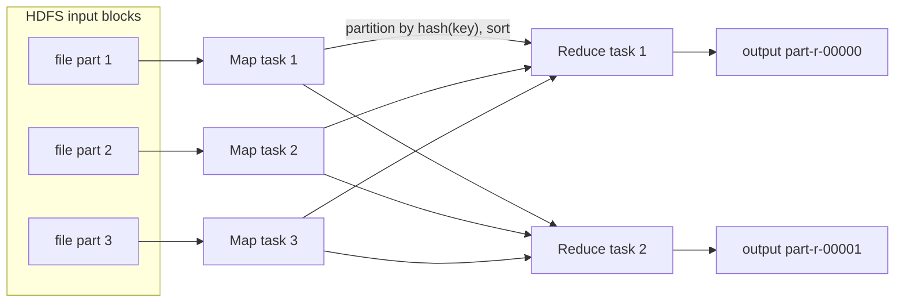

# From Unix pipes to MapReduce

Parts I and II of DDIA dealt with *requests and queries*. Part III is about **derived data**: integrating several data systems into one coherent application. DDIA separates stored data into two kinds:

- **Systems of record** (sources of truth) hold the authoritative version of data. Each fact is represented exactly once.
- **Derived data systems** are the result of transforming or processing data from another system: caches, indexes, materialized views, denormalised values. If you lose derived data, you can recreate it from the source.

Three styles of system exist:

| Type | Triggered by | Measured by |
|---|---|---|
| **Services** (online) | A request from a client; a response is sent back as quickly as possible | Response time, availability |
| **Batch processing** (offline) | A large, bounded input dataset; a job runs for minutes to days and produces output | **Throughput** |
| **Stream processing** (near-real-time) | Events shortly after they happen; input is unbounded | Latency, throughput |

Batch processing is an old form of computing (punch-card tabulating machines were used for the 1890 US Census), and it is an important building block for reliable, scalable and maintainable applications.

## 1. Batch processing with Unix tools

Say you have a web server log and want the five most popular pages:

```bash
cat /var/log/nginx/access.log |
  awk '{print $7}' |      # extract the URL (7th whitespace-separated field)
  sort             |      # sort URLs alphabetically
  uniq -c          |      # collapse adjacent duplicates, prefix a count
  sort -r -n       |      # sort by count, descending
  head -n 5               # first five lines
```

This pipeline processes gigabytes of logs in seconds, and you can modify it easily. You could do the same in a short script that keeps an in-memory hash table of URL counts. The two differ in an instructive way:

- The **hash table** approach needs memory proportional to the number of *distinct* URLs. Fine if that fits in RAM.
- The **sorting** approach scales past memory. GNU `sort` automatically spills to disk and uses a mergesort over sorted chunks (the same principle as SSTables and LSM-trees), and it parallelises across CPU cores. The bottleneck is the rate at which the input can be read from disk.

```python-run
from collections import Counter
log = """\
1.2.3.4 - - [27/Feb/2015:17:55:11 +0000] "GET /css/site.css HTTP/1.1" 200 3377
1.2.3.4 - - [27/Feb/2015:17:55:12 +0000] "GET /index.html HTTP/1.1" 200 1023
5.6.7.8 - - [27/Feb/2015:17:56:01 +0000] "GET /index.html HTTP/1.1" 200 1023
5.6.7.8 - - [27/Feb/2015:17:56:09 +0000] "GET /about.html HTTP/1.1" 200 512
9.9.9.9 - - [27/Feb/2015:17:57:30 +0000] "GET /index.html HTTP/1.1" 304 0
"""
urls = [line.split()[6] for line in log.splitlines()]          # awk '{print $7}'

# (a) hash aggregation: memory ~ number of distinct keys
print("hash:", Counter(urls).most_common(2))

# (b) sort + uniq -c: works with sequential I/O on data bigger than memory
out, prev, n = [], None, 0
for u in sorted(urls) + [None]:
    if u != prev and prev is not None:
        out.append((n, prev)); n = 0
    prev, n = u, n + 1
print("sort:", sorted(out, reverse=True)[:2])
```

### 1.1 The Unix philosophy

Doug McIlroy described the idea of connecting programs "like a garden hose". The **Unix philosophy** (1978) can be summed up as:

1. Make each program do **one thing well**. To do a new job, build afresh instead of complicating old programs with new features.
2. Expect the **output of every program to become the input to another**, as yet unknown, program. Do not clutter output with extraneous information.
3. Design and build software to be **tried early**, ideally within weeks. Throw away clumsy parts and rebuild them.
4. Use **tools** in preference to unskilled help to lighten a programming task.

This sounds a lot like Agile and DevOps today. What makes the composition work?

- **A uniform interface.** In Unix that interface is a **file** (a file descriptor): an ordered sequence of bytes. Many programs treat that byte sequence as ASCII text with `\n`-separated records. Because everything speaks the same interface, any program's output can be any program's input. It is not perfect (parsing `$7` is fragile), but it is remarkable that so many tools interoperate.
- **Separation of logic and wiring.** Programs read `stdin` and write `stdout` and do not care where those are connected. The shell user wires up input and output however they want. This is a form of **loose coupling**, or *inversion of control*.
- **Transparency and experimentation.** Input files are normally treated as **immutable**, so you can run commands as often as you want. You can end a pipeline at any point, pipe into `less` and inspect. You can write the output of one stage to a file and use it as the input to the next stage, which lets you restart the later stage without re-running everything.

The biggest limitation of Unix tools is that they run on a **single machine**. That is where Hadoop comes in.

## 2. MapReduce and distributed filesystems

**MapReduce** is a bit like Unix tools, but distributed across potentially thousands of machines. Like Unix tools, it is a blunt but effective instrument. A single MapReduce job is comparable to a single Unix process: it takes one or more inputs and produces one or more outputs. As with most Unix tools, running a MapReduce job normally **does not modify the input** and has no side effects other than producing the output. Output files are written once, sequentially.

Unix tools use `stdin` and `stdout`. MapReduce jobs read and write files on a **distributed filesystem**. In Hadoop's implementation, that is **HDFS** (Hadoop Distributed File System), an open-source reimplementation of the Google File System (GFS). Object stores such as Amazon S3 are used the same way.

HDFS is based on the **shared-nothing** principle, in contrast to the shared-disk approach of NAS and SAN. It needs no special hardware, only computers connected by a conventional datacenter network. A daemon process runs on each machine and exposes a network service that lets other nodes access files stored on that machine. A central server called the **NameNode** keeps track of which file blocks are stored on which machine. Conceptually, HDFS creates **one big filesystem** that can use the space on the disks of all machines running the daemon. File blocks are **replicated** on several machines (or protected by an erasure coding scheme such as Reed-Solomon) to tolerate machine and disk failures. HDFS has scaled well: the biggest deployments run on tens of thousands of machines with hundreds of petabytes.

### 2.1 MapReduce job execution

MapReduce is a programming framework for writing code to process large datasets in a distributed filesystem. The pattern is very similar to the log analysis example:

1. Read a set of input files and break them up into **records**. (In the log example, each record is one line.)
2. Call the **mapper** function to extract a key and value from each input record. (`awk '{print $7}'`: the key is the URL and the value is empty.)
3. **Sort** all the key-value pairs by key. (The first `sort` command.)
4. Call the **reducer** function to iterate over the sorted key-value pairs. If there are several occurrences of the same key, the sorting has made them adjacent in the list, so it is easy to combine those values without keeping much state in memory. (`uniq -c`.)

Those four steps are one MapReduce job. Steps 2 (map) and 4 (reduce) are where you write your custom data-processing code. Step 1 is handled by the input format parser. Step 3, the sort step, is **implicit** in MapReduce: you do not have to write it, because the output from the mappers is always sorted before it is given to the reducers.

- **Mapper.** Called once for every input record. Its job is to extract the key and value from the record. For each input, it may generate any number of key-value pairs (including none). It keeps no state from one input record to the next, so each record is handled independently.
- **Reducer.** The framework takes the key-value pairs produced by the mappers, collects all the values belonging to the same key, and calls the reducer with an iterator over that collection of values. The reducer can produce output records (such as the number of occurrences of the same URL).

### 2.2 Distributed execution of MapReduce

The main difference from Unix pipelines is that MapReduce can **parallelise** a computation across many machines, without you having to write code to explicitly handle the parallelism. The mapper and reducer only operate on one record at a time. They do not need to know where their input is coming from or where their output is going, so the framework can handle the complexities of moving data between machines.



- The input is typically a directory in HDFS. Each file or file block is a separate **partition** that can be processed by a separate **map task**.
- The scheduler tries to run each mapper on one of the machines that stores a replica of the input file, provided that machine has enough spare RAM and CPU. This principle is known as **putting the computation near the data**. It saves copying the input file over the network, which reduces network load and increases locality.
- The application code is first copied to the appropriate machines (JAR files in Hadoop). The map task starts and reads the input file, passing one record at a time to the mapper callback.
- The reduce side is also partitioned. The number of map tasks is determined by the number of input file blocks, but the **number of reduce tasks is configured by the job author**. To ensure that all key-value pairs with the same key end up at the same reducer, the framework uses a **hash of the key** to determine which reduce task should receive a particular key-value pair.
- The key-value pairs must be **sorted**, but the dataset is likely too large to be sorted with a conventional sorting algorithm on a single machine. Instead, the sorting is performed in stages. Each map task partitions its output by reducer, based on the hash of the key. Each of these partitions is written to a **sorted file** on the mapper's local disk, using a technique similar to SSTables and LSM-trees.
- Whenever a mapper finishes reading its input file and writing its sorted output files, the MapReduce scheduler notifies the reducers that they can start fetching the output files from that mapper. The reducers connect to each of the mappers and download the files of sorted key-value pairs for their partition. The process of partitioning by reducer, sorting, and copying data partitions from mappers to reducers is known as the **shuffle** (a confusing term: unlike shuffling a deck of cards, there is no randomness in MapReduce).
- The reduce task takes the files from the mappers and **merges** them together, preserving the sort order. The reducer is called with a key and an iterator that incrementally scans over all records with the same key. The output records from the reducer are written to a file on the distributed filesystem.

```python-run
import hashlib
from itertools import groupby

def run_mapreduce(inputs, mapper, reducer, n_reducers=2):
    # MAP: each input split is processed independently
    map_outputs = [[kv for record in split for kv in mapper(record)] for split in inputs]
    # SHUFFLE: partition by hash(key), sort within each partition
    def part(k): return int(hashlib.md5(str(k).encode()).hexdigest(), 16) % n_reducers
    partitions = [[] for _ in range(n_reducers)]
    for out in map_outputs:
        for k, v in out:
            partitions[part(k)].append((k, v))
    results = []
    for i, p in enumerate(partitions):
        p.sort(key=lambda kv: kv[0])                      # merge of sorted mapper files
        # REDUCE: one call per key with an iterator of values
        out = [reducer(k, [v for _, v in grp]) for k, grp in groupby(p, key=lambda kv: kv[0])]
        print(f"reducer {i}: {out}")
        results.extend(out)
    return sorted(results)

splits = [["the quick brown fox", "the lazy dog"], ["the dog barks", "quick quick"]]
wc = run_mapreduce(splits,
                   mapper=lambda line: [(w, 1) for w in line.split()],
                   reducer=lambda word, counts: (word, sum(counts)))
print(wc)
```

### 2.3 MapReduce workflows

The range of problems you can solve with a single MapReduce job is limited. In the log analysis example, a single MapReduce job could determine the number of page views per URL, but not the most popular URLs, since that requires a second round of sorting. It is very common for MapReduce jobs to be chained together into **workflows**, such that the output of one job becomes the input to the next job.

The Hadoop MapReduce framework has no particular support for workflows, so the chaining is done implicitly by directory name: the first job is configured to write its output to a designated directory in HDFS, and the second job is configured to read that same directory as its input. Chained MapReduce jobs are less like pipelines of Unix commands (which pass the output of one process as input to another process directly, using only a small in-memory buffer) and more like a sequence of commands where each command's output is written to a temporary file, and the next command reads from the temporary file.

A batch job's output is only considered valid when the job has completed successfully (MapReduce discards the partial output of a failed job). Therefore, one job in a workflow can only start when the prior jobs have completed successfully. To handle these dependencies between job executions, various **workflow schedulers** for Hadoop have been developed, including Oozie, Azkaban, Luigi, **Airflow** and Pinball. Workflows consisting of 50 to 100 MapReduce jobs are common when building recommendation systems. Higher-level tools for Hadoop, such as **Pig**, **Hive**, Cascading, Crunch and FlumeJava, set up workflows of multiple MapReduce stages that are automatically wired together appropriately.

## 3. The output of batch workflows

Why run all these jobs? What is the result once they finish? Batch processing is neither transaction processing nor analytics. It is closer to analytics in that a batch process typically scans over large portions of an input dataset. The output of a batch process is often not a report but some other kind of structure.

- **Building search indexes.** Google's original use of MapReduce was to build indexes for its search engine, implemented as a workflow of 5 to 10 MapReduce jobs. If you need to perform a full-text search over a fixed set of documents, a batch process is a very effective way of building the indexes: the mappers partition the set of documents as needed, each reducer builds the index for its partition, and the index files are written to the distributed filesystem. Since querying a search index by keyword is a read-only operation, these index files are **immutable** once they have been created.
- **Key-value stores as batch process output.** Another common use is to build **machine learning systems** such as classifiers (spam filters, anomaly detection, image recognition) and **recommendation systems** (people you may know, products you may be interested in, related searches). The output of those batch jobs is often some kind of database: for example, a database that can be queried by user ID to obtain suggested friends for that user.

How does the output from the batch process get back into a database where the web application can query it? The most obvious choice might be to use the client library for your favourite database directly within a mapper or reducer, and to write from the batch job directly to the database server, one record at a time. This is a **bad idea**:

- Making a network request for every single record is orders of magnitude slower than the normal throughput of a batch task.
- MapReduce jobs often run many tasks in parallel. If all the mappers or reducers concurrently write to the same output database, with a rate expected of a batch process, that database can easily be **overwhelmed**, and its performance for queries is likely to suffer.
- Normally, MapReduce provides a clean all-or-nothing guarantee for job output. Writing to an external system from inside a job produces **externally visible side effects** that cannot be hidden in this way. Partially completed jobs' results may be visible to other systems.

A much better solution is to **build a brand-new database inside the batch job** and write it as files to the job's output directory in the distributed filesystem. Those data files are then immutable once written, and can be loaded in bulk into servers that handle read-only queries. Various key-value stores support building database files in MapReduce jobs, including Voldemort, Terrapin, ElephantDB and HBase bulk loading. Because the old data files remain available, **rolling back** to the previous version is easy if anything goes wrong.

### 3.1 Philosophy of batch process outputs

The Unix philosophy encourages experimentation by being very explicit about dataflow: a program reads its input and writes its output. In the process, the input is left unchanged, any previous output is completely replaced with the new output, and there are no other side effects. MapReduce jobs follow the same philosophy:

- If you introduce a bug into the code and the output is wrong or corrupted, you can simply roll back to a previous version of the code and rerun the job, and the output will be correct again. Or, even simpler, you can keep the old output in a different directory and simply switch back to it. (Databases with read-write transactions do not have this property: if you deploy buggy code that writes bad data to the database, then rolling back the code will do nothing to fix the data in the database.) The idea of being able to recover from buggy code has been called **human fault tolerance**.
- As a consequence of this ease of rolling back, feature development can proceed more quickly than in an environment where mistakes could mean irreversible damage. This principle of **minimising irreversibility** is beneficial for Agile software development.
- If a map or reduce task fails, the MapReduce framework automatically re-schedules it and runs it again on the same input. If the failure is due to a bug in the code, it will keep crashing and eventually cause the job to fail after a few attempts. If the failure is due to a transient issue, the fault is tolerated. This **automatic retry is only safe because inputs are immutable** and outputs from failed tasks are discarded by the MapReduce framework.
- The same set of files can be used as input for various different jobs, including monitoring jobs that calculate metrics and evaluate whether a job's output has the expected characteristics.
- Like Unix tools, MapReduce jobs **separate logic from wiring** (configuring the input and output directories), which provides a separation of concerns and enables potential reuse of code.

## 4. Comparing Hadoop to distributed databases

Hadoop is somewhat like a distributed version of Unix, where HDFS is the filesystem and MapReduce is a quirky implementation of a Unix process. When the MapReduce paper was published, none of this was new. **Massively parallel processing (MPP)** databases had implemented parallel join algorithms a decade earlier (Gamma, Teradata, Tandem NonStop SQL). The biggest difference is that MPP databases focus on parallel execution of analytic SQL queries on a cluster of machines, while the combination of MapReduce and a distributed filesystem provides something much more like a **general-purpose operating system** that can run arbitrary programs.

- **Diversity of storage.** Databases require you to structure data according to a particular model. Files in a distributed filesystem are just byte sequences, which can be written using any data model and encoding. Hadoop opened up the possibility of indiscriminately dumping data into HDFS, and only later figuring out how to process it further. By contrast, MPP databases typically require careful upfront modelling of the data and query patterns before importing the data into the database's proprietary storage format. The idea is similar to a data warehouse: simply bringing data together from various parts of a large organisation in one place is valuable. This has been dubbed a **data lake** or enterprise data hub. Indiscriminate data dumping shifts the burden of interpreting the data: instead of forcing the producer of a dataset to bring it into a standardised format, the interpretation of the data becomes the consumer's problem (the **schema-on-read** approach). This has been called the **sushi principle**: "raw data is better".
- **Diversity of processing models.** MPP databases are **monolithic**, tightly integrated pieces of software that take care of storage layout on disk, query planning, scheduling and execution. They are highly tuned for specific SQL queries. Not all kinds of processing can be sensibly expressed as SQL queries. If you are building machine learning and recommendation systems, or full-text search indexes with relevance ranking models, or performing image analysis, you most likely need a more general model of data processing. MapReduce gave engineers the ability to easily run their own code over large datasets. With HDFS and MapReduce, you *can* build a SQL query execution engine on top of it, and indeed this is what the **Hive** project did. Various other processing models have been developed on top of Hadoop too. Crucially, those various processing models can all be run on a single shared-use cluster of machines, all accessing the same files on the distributed filesystem.
- **Designing for frequent faults.** If a node crashes while a query is executing, most MPP databases abort the entire query, and either let the user resubmit the query or automatically run it again. As queries normally run for a few seconds or a few minutes at most, this way of handling errors is acceptable. MPP databases also prefer to keep as much data as possible in memory (using hash joins, for example) to avoid the cost of reading from disk. MapReduce, on the other hand, can tolerate the failure of a map or reduce task **without it affecting the job as a whole** by retrying work at the granularity of an individual task. It is also very eager to write data to disk, partly for fault tolerance, and partly on the assumption that the dataset will be too big to fit in memory anyway.

Why does MapReduce bother with task-level fault tolerance when machine failures are fairly rare? At Google, MapReduce was designed to run on clusters where batch jobs ran at **low priority** and could be **preempted** at any time by higher-priority processes needing their resources. A MapReduce task that runs for an hour has an approximately **5% risk** of being terminated to make space for a higher-priority process. This rate is more than an order of magnitude higher than the rate of failures due to hardware issues. It is the reason MapReduce is designed to tolerate frequent unexpected task termination: not because the hardware is particularly unreliable, but because the freedom to arbitrarily terminate processes enables better resource utilisation in a computing cluster.

> [!INTERVIEW]
> "How does MapReduce work?" Draw **input splits → map → shuffle (partition by hash of key, sort, merge) → reduce → output files**. Mention: computation moves to the data, mappers and reducers are pure functions so failed tasks can be retried, inputs are immutable, and output is written atomically. Then note that it is now mostly a *conceptual* baseline: Spark and Flink keep the model but avoid materialising every intermediate result.

## 5. Summary

- The Unix philosophy (small tools, a uniform interface, immutable inputs, logic separate from wiring) explains the design of batch systems.
- **MapReduce** = map (emit key-value pairs) → **shuffle** (partition, sort, merge) → reduce (process all values for a key), on a distributed filesystem (HDFS).
- Jobs chain into **workflows** run by schedulers such as Airflow. Outputs are immutable files: search indexes or bulk-loaded read-only databases.
- Immutable inputs and discarded partial outputs make retries safe and give **human fault tolerance**.
- Compared with MPP databases, Hadoop offers diverse storage (data lake, schema-on-read), diverse processing models, and task-level fault tolerance designed for preemption.

```quiz
[
  {"q": "In the Unix log-analysis pipeline, why can sort + uniq -c handle datasets larger than memory while a hash table cannot?",
   "options": ["sort uses less CPU", "sort spills sorted chunks to disk and merges them with sequential I/O; a hash table needs all distinct keys in RAM", "uniq is distributed", "awk compresses data"],
   "answer": 1,
   "explain": "External mergesort is the same principle as SSTables and LSM-trees."},
  {"q": "What is the 'uniform interface' that makes Unix tools composable?",
   "options": ["JSON", "Files: ordered sequences of bytes, often newline-separated text", "SQL", "HTTP"],
   "answer": 1,
   "explain": "Any program's output can be another's input because all speak the same interface."},
  {"q": "In MapReduce, what guarantees that all values for the same key reach the same reducer?",
   "options": ["The mapper sorts them", "The framework partitions map output by a hash of the key", "The NameNode", "Reducers share memory"],
   "answer": 1,
   "explain": "Hash partitioning by key routes each key to exactly one reduce task."},
  {"q": "What does 'shuffle' mean in MapReduce?",
   "options": ["Randomly permuting records", "Partitioning map output by reducer, sorting it, and copying it to reducers", "Compressing output", "Scheduling tasks"],
   "answer": 1,
   "explain": "Despite the name, there is no randomness involved."},
  {"q": "Why is writing directly to a production database from reducers a bad idea?",
   "options": ["Reducers cannot open sockets", "It is slow per record, can overwhelm the database, and creates visible side effects that break the all-or-nothing job guarantee", "Databases reject batch writes", "It requires XA"],
   "answer": 1,
   "explain": "Better: build immutable database files in the job and bulk-load them."},
  {"q": "What makes automatic retry of failed map/reduce tasks safe?",
   "options": ["Two-phase commit", "Inputs are immutable and the output of failed tasks is discarded", "Tasks are idempotent by magic", "Locks"],
   "answer": 1,
   "explain": "Re-running a pure function on the same input gives the same output with no side effects."},
  {"q": "Why was MapReduce designed for frequent task failures at Google?",
   "options": ["Hardware was extremely unreliable", "Low-priority batch tasks were frequently preempted to free resources for higher-priority work", "Networks were slow", "Disks were small"],
   "answer": 1,
   "explain": "An hour-long task had roughly a 5% chance of being preempted."},
  {"q": "What is a 'data lake' approach?",
   "options": ["Carefully modelling data before loading", "Dumping raw data in any format into a distributed filesystem and interpreting it later (schema-on-read)", "Using only SQL", "Replicating OLTP databases"],
   "answer": 1,
   "explain": "It shifts interpretation to the consumer and speeds up data collection."}
]
```

> **Source:** DDIA ch. 10, "Batch Processing" (Batch Processing with Unix Tools; MapReduce and Distributed Filesystems; the output of batch workflows; comparing Hadoop to distributed databases).
