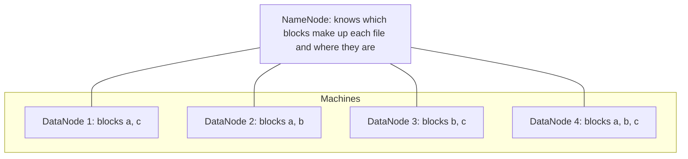
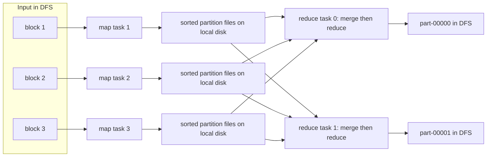

# From Unix pipes to MapReduce

Every system discussed so far in this track answers questions on demand: a request arrives, the database looks something up or changes something, a reply goes back within milliseconds. A large part of real data work does not look like that at all. Building a search index, training a recommendation model, computing last month's invoices, or producing the table that a dashboard reads - these jobs take a huge pile of existing data and grind through all of it, with nobody waiting on the other end of a socket.

This is **batch processing**, and it is the first topic of the part of the track that deals with *derived data*: datasets that are computed from other datasets. A useful distinction to carry through the remaining lessons:

- A **system of record** is where a fact is first written and where it is considered authoritative. If two copies disagree, this one wins.
- A **derived dataset** is the output of some transformation applied to other data - an index, a cache, an aggregate table, a trained model. Losing it is an inconvenience, not a disaster, because it can be regenerated from its source.

And three styles of computation, distinguished by what triggers them and how we judge them:

| Style | Starts when | Input | We care most about |
|---|---|---|---|
| Online service | a request arrives | one request | response time, availability |
| Batch job | a schedule or a person starts it | a large dataset of known, fixed size | throughput: how long for the whole input |
| Stream job | events show up | an endless sequence of events | how far behind real time it runs |

This lesson covers the batch style from its humblest form - a few Unix commands joined by pipes - up to MapReduce running on thousands of machines. The claim is that the second is the first, scaled out, and that the design principles which make shell pipelines pleasant are exactly the ones that make large batch systems manageable.

## 1. A log analysis in one line

Suppose a web shop keeps an access log, one line per request, and you want to know which five products pages were requested most often yesterday. With standard tools:

```bash
grep ' /product/' access.log |   # keep only product page requests
  cut -d' ' -f7 |                # field 7 is the request path
  sort |                         # bring identical paths next to each other
  uniq -c |                      # collapse each run into "count path"
  sort -rn |                     # largest count first
  head -n 5                      # top five
```

Nobody would call this elegant, yet it has remarkable properties. It was written in a minute. Each stage can be tested on its own by cutting the pipeline short. It handles a multi-gigabyte file without complaint. And changing the question - top clients instead of top pages, errors only, a different day - means editing one stage.

### Two ways to count, and why it matters

The same answer could come from a ten-line script that walks the file once and increments a counter per path in a dictionary. The two approaches differ in the resource they consume:

- The **hash table** approach holds one entry for every *distinct* key in memory. With a few thousand distinct product pages it is the fastest option. With hundreds of millions of distinct keys it no longer fits.
- The **sort** approach never needs the whole dataset in memory. A good `sort` implementation reads a chunk, sorts it, writes it to a temporary file, repeats, and finally merges the sorted chunks - sequential I/O throughout, and it can use several CPU cores. Once the data is sorted, counting is a single pass that only ever remembers the current key.

That second technique - sort chunks, then merge - is the same one LSM-trees use for their segments, and as we will see it is the heart of MapReduce.

```python-run
import heapq, itertools
from collections import Counter

paths = ["/product/7", "/product/2", "/product/7", "/cart", "/product/9", "/product/2",
         "/product/7", "/product/4", "/product/9", "/product/7", "/product/2", "/product/1"]

# (a) hash aggregation: memory grows with the number of distinct keys
print("hash :", Counter(paths).most_common(3))

# (b) external sort: sort small chunks ("runs"), merge them lazily, count adjacent duplicates
CHUNK = 4
runs = [sorted(paths[i:i + CHUNK]) for i in range(0, len(paths), CHUNK)]
print("runs :", runs)
merged = heapq.merge(*runs)                       # streams; never holds everything at once
counts = [(len(list(group)), key) for key, group in itertools.groupby(merged)]
print("sort :", sorted(counts, reverse=True)[:3])
```

## 2. Why the Unix approach works so well

The pipeline above is a small demonstration of a design philosophy that Unix's creators articulated in the 1970s and that has aged very well. Compressed into four habits:

1. Build programs that do **one job**, and do it properly.
2. Assume the output of your program will become the **input of another** you have never heard of. So do not clutter it with decoration, and do not demand interactive input.
3. Get something working **early**, try it, and be willing to throw away the awkward parts.
4. Prefer **writing a tool** to doing a repetitive task by hand.

Three concrete mechanisms make that philosophy practical.

### A uniform interface

Programs can only be combined freely if they agree on how to exchange data. In Unix the agreement is minimal: everything is a **file descriptor** delivering an ordered sequence of bytes, and by convention the bytes are lines of text. A file on disk, a network socket, a terminal and the output of another process all look the same. That is why `sort` can be placed after `cut` although neither was written with the other in mind.

It is easy to underestimate how unusual this is. Most software cannot be connected to other software without an export step, an API client or a custom adapter. Even databases that share a data model make it hard to move data between them.

The weakness of the convention is that "a line of text" carries no structure. Every tool has to re-parse fields, and `cut -d' ' -f7` is a guess about the log format that breaks the day somebody adds a field or a URL contains a space.

### Logic separated from wiring

A typical filter reads **standard input** and writes **standard output**. It neither knows nor cares what those are connected to. The decision - a file, a pipe to the next program, the screen - is made by whoever launches it. This is loose coupling in its purest form: the program holds the logic, the shell holds the plumbing. You can replace the input by a test file or insert your own program in the middle of someone else's pipeline without modifying anything.

The limit of the model is its shape: one input, one output. Programs that need several inputs or outputs fall back on file names given as arguments, and pipes do not extend across machines.

### Experimentation is safe

- Input files are treated as **read-only**. You can run a command again and again with different options and the source data is never harmed.
- You can stop a pipeline anywhere, pipe into `less`, and look at the intermediate data.
- You can save the output of an expensive early stage to a file and restart from there.

This combination - immutable input, inspectable intermediate results, restartable stages - makes debugging far more comfortable than in systems where running the code changes the data it runs on.

> [!NOTE]
> The one thing Unix tools cannot do is leave the machine. Everything above works on a single computer. The rest of this lesson is about keeping these properties while spreading the work over a cluster.

## 3. A file system across many machines

MapReduce reads its input from and writes its output to a **distributed file system**; in the Hadoop world that is HDFS, the open-source counterpart of Google's GFS. Object stores such as Amazon S3 fill the same role today.

HDFS is built on the shared-nothing idea: ordinary servers with ordinary disks, connected by an ordinary data-centre network, with no special shared storage hardware.



- A daemon on every machine, the **DataNode**, offers the local disks to the cluster.
- A central **NameNode** keeps the directory: which blocks belong to which file, and which machines hold each block.
- Files are cut into large **blocks** (128 MB is typical), and each block is stored on several machines - commonly three copies, or an erasure-coded form that tolerates losses with less overhead. When a disk or a whole machine dies, the missing copies are re-created elsewhere from the survivors.

The result behaves like one enormous disk whose capacity grows by adding machines, and that survives routine hardware failure. Deployments with thousands of nodes and hundreds of petabytes exist. Because the storage machines also have CPUs, computation can be scheduled *where the data already is*.

## 4. The MapReduce model

MapReduce is a framework for running a computation over files in such a file system. The programmer supplies two functions; the framework supplies everything else. Compare its steps with the pipeline from section 1:

| Step | In the pipeline | In MapReduce | Who writes it |
|---|---|---|---|
| Split input into records | lines separated by newline | input format parser | framework |
| Pull out what matters | `grep`, `cut` | **map** function | you |
| Bring equal keys together | `sort` | shuffle: partition and sort by key | framework |
| Combine values per key | `uniq -c` | **reduce** function | you |
| Write the result | `> file` | one output file per reducer | framework |

The contract of the two functions:

- **map** is called once per input record. It may emit any number of key-value pairs - none, one or many. It keeps no memory between calls, so every record is handled independently.
- **reduce** is called once per distinct key. It receives that key and an iterator over every value emitted for it by any mapper, and it may emit output records.

Because mappers are stateless and independent, the framework can run any number of them at once. Because all values of a key are delivered to one reducer call, the reducer can aggregate without coordination.

```python-run
from collections import defaultdict

log = """\
10.0.0.1 GET /product/7 200
10.0.0.2 GET /product/2 200
10.0.0.1 GET /cart 200
10.0.0.3 GET /product/7 404
10.0.0.2 GET /product/7 200
10.0.0.9 GET /product/2 200
10.0.0.1 GET /product/9 500
""".splitlines()

def map_fn(line):                               # called once per record
    ip, method, path, status = line.split()
    if path.startswith("/product/"):
        yield path, 1

def reduce_fn(key, values):                     # called once per key, values arrive together
    yield key, sum(values)

NUM_REDUCERS = 2
def partition(key):                             # same key -> same reducer, always
    return sum(key.encode()) % NUM_REDUCERS

# two "mapper tasks", each over its own slice of the input
splits = [log[:4], log[4:]]
reducer_inputs = [defaultdict(list) for _ in range(NUM_REDUCERS)]
for task, split in enumerate(splits):
    for line in split:
        for k, v in map_fn(line):
            reducer_inputs[partition(k)][k].append(v)

for r, data in enumerate(reducer_inputs):
    out = [kv for key in sorted(data) for kv in reduce_fn(key, data[key])]
    print(f"part-{r:05d}:", out)
```

Each reducer writes its own output file, which is why the result of a MapReduce job is a *directory* of `part-` files.

## 5. How a job runs on the cluster



**Map phase.** The input is a directory; each file block becomes the input of one **map task**. The scheduler tries to start each task on a machine that already stores a copy of its block, so the data does not have to cross the network. The principle is to *move the computation to the data*, since code is small and data is large. The job's code (JAR files in Hadoop) is copied to the machine, the task starts, reads its block record by record and calls the map function.

**Shuffle.** The number of **reduce tasks** is chosen by the job's author. For each emitted pair, the framework hashes the key to decide which reduce task it belongs to. Each map task writes its output into one file per reduce task on its *local* disk, sorted by key - using the chunk-sort-and-merge technique from section 1 if the output exceeds memory. When a map task finishes, the reduce tasks are told and fetch their file from it. This whole procedure of partitioning, sorting and copying is called the **shuffle** (a misleading word: the outcome is perfectly ordered).

**Reduce phase.** A reduce task merges the sorted files it received from all map tasks into one sorted stream. Equal keys are now adjacent - even if they came from different mappers - so the task can hand the reduce function one key at a time with an iterator over its values. Output goes to a file in the distributed file system, replicated like any other.

### Failure handling

On a cluster of thousands of commodity machines, something is always broken. MapReduce handles this at the granularity of a single task: if a map or reduce task dies, the framework starts it again, possibly elsewhere. That is safe for the same reason rerunning a shell command is safe: **the input is immutable and a task's output only counts once the task has finished**. A half-written file from a failed attempt is thrown away. The user-supplied functions should therefore be deterministic and free of external side effects, because they may be executed more than once.

Slow machines are handled similarly: a task that lags far behind may be started a second time on another node (**speculative execution**), and whichever copy finishes first wins.

> [!INTERVIEW]
> "Walk me through what happens between map and reduce" is a frequent question. Cover: hash partitioning by key into as many buckets as there are reducers; each mapper sorting its output per partition and spilling to local disk; reducers pulling their partition from every mapper; a merge of the sorted runs so that all values of a key arrive together. Mention that this step moves the data over the network and usually dominates the job's running time.

### Putting your own key in charge

Almost all the expressive power of MapReduce lies in the choice of key. The mapper's real task is to *send each record to the right place*:

- Key = word → word count.
- Key = user id → everything about one user arrives together (grouping, sessionisation).
- Key = join attribute, emitted by mappers over two different datasets → a join (next lesson).
- Key = (user id, timestamp) with partitioning on user id only → each user's events arrive in time order.

## 6. Workflows: many jobs in a row

A single MapReduce job can do one round of "group by a key". The top-five query from section 1 needs two rounds: first count per path, then sort by count. In practice that means **two jobs**, the second reading the first one's output directory.

Realistic pipelines chain dozens of jobs; large recommendation or reporting pipelines can involve fifty or more. MapReduce itself knows nothing about such chains. To it, each job is independent: its input is a directory, its output is another directory. It is as if every stage of a shell pipeline wrote to a temporary file and the next stage read that file.

Several things grew up around this limitation:

- **Workflow schedulers** (Oozie, Azkaban, Luigi, Airflow) record which job depends on which output and start a job only when its inputs are complete. A job's output is considered valid only if the job succeeded, so a failed job in the middle stops everything downstream cleanly.
- **Higher-level languages** (Pig, Hive, Cascading and others) let you write a query or a dataflow and compile it into a chain of MapReduce stages.

Writing every intermediate result to replicated storage, and starting each job only after its predecessor has completely finished, is robust but slow. That cost is what dataflow engines such as Spark and Flink were designed to remove - the subject of the next lesson.

```python-run
# Two chained "jobs": (1) count per path, (2) order by count. Job 2 only sees job 1's output.
from itertools import groupby

requests = ["/p/7", "/p/2", "/p/7", "/p/9", "/p/2", "/p/7", "/p/4", "/p/9", "/p/7"]

def run_job(records, map_fn, reduce_fn):
    pairs = sorted(kv for rec in records for kv in map_fn(rec))           # map + shuffle
    return [out for key, grp in groupby(pairs, key=lambda kv: kv[0])      # reduce
            for out in reduce_fn(key, [v for _, v in grp])]

job1_output = run_job(requests, lambda path: [(path, 1)], lambda k, vs: [(k, sum(vs))])
print("job 1 output directory:", job1_output)

# job 2: key = negative count so the framework's sort puts the busiest page first
job2_output = run_job(job1_output, lambda kv: [(-kv[1], kv[0])], lambda k, vs: [(v, -k) for v in vs])
print("job 2 output, top 3   :", job2_output[:3])
```

## 7. What carried over from Unix, and what did not

| Unix pipeline | MapReduce |
|---|---|
| Files and pipes of bytes as the uniform interface | Files in a distributed file system as the uniform interface |
| Programs that read stdin and write stdout | Map and reduce functions that never open files or sockets themselves; the framework wires them up |
| Input never modified; rerunning is harmless | Input never modified; failed tasks are rerun automatically |
| `sort` as the workhorse | Shuffle as the workhorse |
| One machine | Thousands of machines, with data locality |
| Intermediate data flows through small in-memory pipe buffers | Intermediate data between jobs is fully written to the file system |
| Schema-less text lines | Whatever the files contain; structured formats such as Avro and Parquet are common |

The last-but-one row is the important regression, and the reason MapReduce is rarely used directly any more. Its ideas, however, live on unchanged in its successors.

## Pitfalls

- **Too few distinct keys or one giant key.** All values of a key go to one reducer. A dominant key turns a parallel job into a sequential one.
- **Side effects in map or reduce.** Tasks are retried and speculatively duplicated. Writing to an external database or sending requests from inside them produces duplicates.
- **Assuming output order across reducers.** Each `part-` file is sorted internally; the files are not sorted relative to each other unless you use a range partitioner.
- **Many small files.** Each file occupies metadata in the NameNode and tends to become its own map task; millions of tiny files overwhelm both.
- **Forgetting the hash-versus-sort trade-off.** Grouping in memory is quickest until the distinct keys stop fitting; then it fails abruptly, whereas sorting degrades gracefully.
- **Parsing by position.** Splitting text on spaces and taking "field 7" is fragile. Use structured, self-describing file formats for anything long-lived.
- **Reaching for a cluster for data that fits on a laptop.** A single machine with sorted files or a columnar engine is simpler and often faster below a few hundred gigabytes.

## Summary

- **Batch processing** takes a bounded input and produces **derived data**; the measure of success is throughput.
- A Unix pipeline is a small batch system. Its strengths come from single-purpose tools, a **uniform interface**, **separation of logic from wiring**, and **immutable inputs** that make experiments safe.
- Counting by **hash table** needs memory for every distinct key; **sorting and merging** scales beyond memory using sequential I/O.
- A **distributed file system** stores large replicated blocks on ordinary machines and lets computation run next to the data.
- **MapReduce** asks for two functions: a stateless **map** that emits key-value pairs and a **reduce** that sees all values of one key. The framework's **shuffle** partitions by key hash, sorts, and merges.
- Tasks that fail are simply **rerun**, which is safe because inputs are immutable and outputs are only published on success.
- Complex computations are **workflows** of many jobs glued together by schedulers and higher-level languages; materialising every intermediate result is MapReduce's main inefficiency.

```quiz
[
  {"q": "What distinguishes a derived dataset from a system of record?",
   "options": ["It is stored on faster disks", "It can be recreated by reprocessing other data, whereas the system of record is the authoritative original", "It is always smaller", "It cannot be queried"],
   "answer": 1,
   "explain": "Indexes, caches, aggregates and models are computed from source data. If lost, they can be rebuilt; the system of record cannot."},
  {"q": "You must count occurrences of 2 billion distinct keys on a machine with 16 GB of RAM. Which approach works?",
   "options": ["An in-memory hash table with one counter per key", "Sort the data in chunks on disk, merge the sorted runs, and count adjacent equal keys", "Load everything into a Python list", "It is impossible on one machine"],
   "answer": 1,
   "explain": "External merge sort uses sequential disk I/O and bounded memory. A hash table would need an entry for every distinct key and would not fit."},
  {"q": "Why can two Unix programs written by different people be combined with a pipe?",
   "options": ["They share a common database", "They agree on a uniform interface: an ordered stream of bytes on a file descriptor", "The shell translates between their formats", "They were compiled together"],
   "answer": 1,
   "explain": "Files, pipes and sockets all present the same byte-stream interface, so the output of any program can be the input of any other."},
  {"q": "In MapReduce, what guarantees that a reducer sees all values for a given key?",
   "options": ["Mappers communicate with each other to group keys", "The framework partitions mapper output by a hash of the key, so every pair with that key is routed to the same reduce task and sorted", "The reducer scans the whole input again", "Keys are unique by definition"],
   "answer": 1,
   "explain": "Partitioning by key hash followed by sorting and merging is the shuffle. It is the framework's job, not the programmer's."},
  {"q": "Why does the scheduler try to run a map task on a machine that stores the task's input block?",
   "options": ["To save disk space", "To avoid copying large input data over the network", "Because other machines cannot read the file system", "To make the task deterministic"],
   "answer": 1,
   "explain": "Shipping a small program to the data is far cheaper than shipping gigabytes of data to the program."},
  {"q": "A map task crashes halfway through. What does MapReduce do, and why is it safe?",
   "options": ["It aborts the whole job, because partial output cannot be undone", "It reruns that task; the input is immutable and the failed attempt's partial output is discarded", "It skips that part of the input", "It asks the reducer to guess the missing values"],
   "answer": 1,
   "explain": "Fault tolerance works per task. Because nothing is modified in place and output only counts on success, retrying has no visible effect apart from time."},
  {"q": "Why does finding the top five most requested pages take two MapReduce jobs?",
   "options": ["Because reducers cannot add numbers", "One round groups by page to count, and a second round is needed to order the results by count", "Because HDFS limits jobs to one input file", "Because map functions cannot emit more than one pair"],
   "answer": 1,
   "explain": "A single job performs one grouping/sorting step by one key. Sorting by a different key, the count, needs another shuffle."},
  {"q": "What is the main inefficiency of chaining many MapReduce jobs into a workflow?",
   "options": ["The jobs share memory and interfere", "Every intermediate result is fully written to the distributed file system and the next job starts only after the previous one finishes", "Reducers cannot read files", "Workflows cannot be scheduled automatically"],
   "answer": 1,
   "explain": "Materialising and replicating all intermediate state costs I/O and delays downstream stages. Dataflow engines avoid this by treating the workflow as one job."}
]
```

> **Source:** DDIA ch. 10 (Batch Processing) - batch processing with Unix tools, MapReduce and distributed file systems. Written in original wording with original examples.
