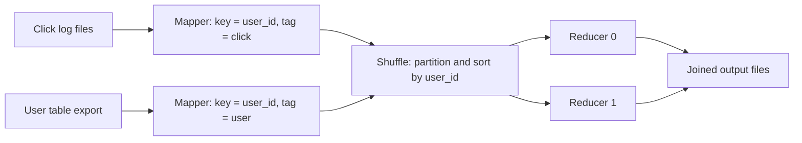
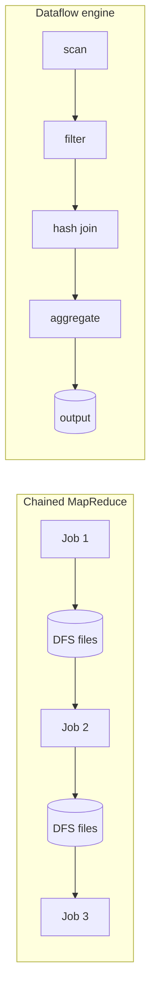

# Batch joins and dataflow engines

The previous lesson treated a batch job as "read some files, group by a key, write some files". Real analytical work almost never stops at one dataset. The click log says *user 4711 viewed page X*; whether that user is a paying customer, which country they live in and how old their account is all sit in a different dataset. Bringing related records together is a **join**, and in batch processing a join is the operation that decides whether a job takes four minutes or four hours.

This lesson has two halves. The first is about how joins and groupings are executed when the data is spread over thousands of files and no index exists. The second is about what came after classic MapReduce: **dataflow engines** such as Spark, Flink and Tez, which keep the good ideas (immutable inputs, deterministic functions, automatic retry) and discard the bad ones (writing every intermediate step to a replicated file system).

## 1. Why batch joins look different from OLTP joins

In a transactional database a join usually touches a handful of rows. The query planner picks an index, looks up the ten orders belonging to one customer and stops. The cost is proportional to the *result*.

A batch job has the opposite profile. It wants the answer for **every** customer at once. Doing one index lookup per record against a remote database would mean billions of network round trips, would be limited by the throughput of that database, and would make the job nondeterministic, because the database may change while the job runs. So batch systems take a different approach:

1. Get a **copy** of every dataset involved into the same distributed file system (typically via a nightly export or a change stream).
2. Read each dataset in full, sequentially.
3. Arrange for matching records to **meet on the same machine**.

Step 3 is the interesting one, and there are essentially only two ways to do it: bring matching records together by **sorting/partitioning both sides on the join key**, or load the **smaller side into memory** and probe it while streaming the bigger side.

> [!NOTE]
> Sequential scans sound wasteful, but a disk or object store delivers hundreds of megabytes per second sequentially and only a few hundred random lookups per second per spindle. When you need most of the data anyway, scanning wins by orders of magnitude.

## 2. Reduce-side joins: let the shuffle do the work

Take two inputs: an activity log `(user_id, url)` and a user table `(user_id, birth_year)`. We want to know which age groups visit which pages.

Run **two different mappers**, one over each input. Both emit the join key, `user_id`, as the MapReduce key. The framework's shuffle then does what it always does: it partitions by key, sorts, and hands each reducer all records for one key together. The reducer sees the profile row and every click of the same user side by side and can output the combined records.



This is called a **sort-merge join**, because mapper output is sorted and the reducer merges the sorted runs from both sides.

### Secondary sort

A naive reducer would have to buffer all records of a user until it finds the profile row. A common refinement is to make the sort key a pair `(user_id, tag)` with the user row's tag ordering first, while still partitioning on `user_id` alone. The reducer then always receives the profile record first, remembers one small value, and streams through the clicks without buffering. This trick is called a **secondary sort**. It keeps reducer memory constant no matter how active a user is.

```python-run
from itertools import groupby

users  = [(3, 1990), (1, 1984), (2, 2001)]                      # (user_id, birth_year)
clicks = [(1, "/home"), (3, "/cart"), (1, "/pay"), (4, "/home"), (3, "/home")]

# "map": tag each record; tag 0 sorts before tag 1 so the user row arrives first
mapped  = [((uid, 0), year) for uid, year in users]
mapped += [((uid, 1), url)  for uid, url  in clicks]

# "shuffle": sort by (join key, tag)
mapped.sort(key=lambda kv: kv[0])

# "reduce": one group per user_id, constant memory per group
for uid, group in groupby(mapped, key=lambda kv: kv[0][0]):
    birth_year = None
    for (_, tag), value in group:
        if tag == 0:
            birth_year = value                 # at most one profile row, seen first
        else:
            print(uid, value, birth_year)      # inner join would skip birth_year None
```

User 4 has clicks but no profile; whether to emit that row with a missing year (left outer join) or drop it (inner join) is one `if` in the reducer.

### Grouping is the same mechanism

`GROUP BY` works exactly like this with a single input: the mapper emits the grouping key, the reducer aggregates. **Sessionisation** - collecting all events of one user session in order - is a grouping by session id or user id with a secondary sort on timestamp. Whenever you hear "bring all the X for the same Y together", think "make Y the shuffle key".

### Skew: when one key is enormous

The promise "all records with the same key go to one reducer" becomes a problem when one key has a disproportionate share of the data. A celebrity account with fifty million followers, a `null` user id for logged-out traffic, a default country code - such **hot keys** make one reducer run for hours while the others finish in seconds. The job is only as fast as its slowest task.

Remedies, roughly in order of effort:

- **Filter junk keys early.** A surprising amount of skew is `null`, empty string or a test account.
- **Combiners / map-side pre-aggregation** for groupings: sum per mapper before shuffling, so that the hot key ships a few thousand partial counts and not a billion ones. This only works for aggregations that can be applied in pieces (sum, max, count - not median).
- **Salting.** Append a random number from `0..N-1` to the hot key on the big side so it spreads over N reducers, and replicate the matching row of the small side N times, once for each salt value. For aggregations, do it in two stages: aggregate by `(key, salt)`, then by `key`.
- **Automatic skew handling.** Pig's skewed join, Hive's skew join optimisation and Spark's adaptive query execution sample the keys first, detect the heavy ones and treat them specially.

> [!INTERVIEW]
> "Your Spark job is stuck at 199 of 200 tasks" is the classic skew question. A strong answer names the cause (one partition holds a hot key), how to confirm it (task-level input size and shuffle read metrics in the UI, or a quick `count by key` on a sample), and at least two fixes (salting, broadcast join if the other side is small, filtering nulls, enabling adaptive skew handling).

## 3. Map-side joins: use what you know about the data

A reduce-side join assumes nothing about the inputs, and pays for that generality by sorting and shipping *everything* across the network. If you know more, you can skip the shuffle and do the join in the mapper.

| Variant | Requirement | How it works |
|---|---|---|
| **Broadcast hash join** | One side fits in memory | Every mapper loads the small dataset into a hash table, then streams its block of the large dataset and probes |
| **Partitioned hash join** (bucketed join) | Both sides are partitioned the same way: same key, same hash function, same number of partitions | Mapper for partition *i* of the big side loads only partition *i* of the other side |
| **Map-side merge join** | Same partitioning **and** both sorted by the key | Mapper merges the two sorted files like a zipper; nothing needs to fit in memory |

```python-run
import time, random
random.seed(1)

users  = {uid: 1950 + uid % 60 for uid in range(50_000)}             # small side
clicks = [(random.randrange(60_000), "/p%d" % (i % 100)) for i in range(400_000)]

# Broadcast hash join: build once, probe while streaming
t = time.perf_counter()
joined = [(uid, url, users[uid]) for uid, url in clicks if uid in users]
t_hash = time.perf_counter() - t

# Sort-merge join: sort both sides, then merge
t = time.perf_counter()
u_sorted, c_sorted = sorted(users.items()), sorted(clicks)
out, i = [], 0
for uid, url in c_sorted:
    while i < len(u_sorted) and u_sorted[i][0] < uid:
        i += 1
    if i < len(u_sorted) and u_sorted[i][0] == uid:
        out.append((uid, url, u_sorted[i][1]))
t_merge = time.perf_counter() - t

print("rows joined:", len(joined), len(out))
print("hash join  %.3fs   sort-merge %.3fs" % (t_hash, t_merge))
```

Both produce the same rows. The hash join avoids the sort; the merge join's cost is dominated by it. On a cluster the gap is far larger, because the sort implies moving every byte over the network.

There is a subtle consequence for the *output*. A reduce-side join produces output partitioned and sorted by the join key. A map-side join produces output arranged like the large input. If another join follows, that layout determines whether the next step can also be done map-side. Knowing how your datasets are physically laid out - bucket counts, sort columns - is therefore valuable metadata, which is why table catalogues (Hive metastore, Iceberg, Delta) record it.

## 4. What batch jobs are for, and why their output is immutable

Batch output is rarely a report read by a human. More often it is another **data structure**:

- **Search indexes.** The original use of MapReduce at Google: mappers partition the documents, reducers build index files for their partition, the files are shipped to the search servers.
- **Precomputed key-value stores.** Recommendation lists, feature tables for ML models, fraud scores. The job writes complete, read-only database files; the serving nodes then download them and atomically switch over. Writing record by record from inside the job into a live database is tempting but harmful: it is slow, it can overwhelm the serving database, and if a task is retried or run speculatively its side effects happen twice.
- **Training sets and model artefacts** in ML pipelines, which follow the same pattern: derive, write a new versioned directory, switch a pointer.

The principle underneath all three is the same one that makes Unix pipes pleasant to work with: **inputs are never modified, outputs are fully replaced**. That gives you properties that are hard to get any other way:

- A buggy job can be fixed and rerun; the old output is simply discarded. Rolling back is switching the pointer to yesterday's directory.
- Automatic retries are safe, because a failed attempt's partial output is thrown away and the rerun reads identical input.
- The same input can feed several experimental jobs without them interfering.

> [!TIP]
> When you design a pipeline step, ask "can I delete the output and run it again without anyone noticing?" If the answer is yes, the step is idempotent and operations become boring - which is the goal.

### How this compares to MPP databases

Massively parallel analytical databases (Teradata, Redshift, Snowflake, BigQuery) had parallel joins long before Hadoop. The distinguishing features of the Hadoop style were elsewhere:

- **Storage is just files.** You can dump data first and decide how to interpret it later. That shifts the modelling burden to the reader but removes a bottleneck when dozens of teams want to land data.
- **Arbitrary code.** Not everything is a SQL query; feature extraction, image processing and model training can read the same files.
- **Built for frequent faults.** MapReduce assumed that tasks get killed often (at Google mostly because higher-priority work pre-empted them), so it retries individual tasks and writes eagerly to disk. An MPP database typically aborts the whole query when a node dies, which is perfectly reasonable for queries that take seconds.

Today the two worlds have largely merged: warehouses read open file formats, and Spark has a cost-based SQL optimiser.

## 5. The cost of materialising everything

A realistic pipeline chains many joins and groupings: fifty to a hundred MapReduce jobs is not unusual. Each job in classic MapReduce is completely independent. Its only way to pass data to the next job is to write a full output directory to the distributed file system, where it is replicated three times, and then have the next job read it back. This is **materialisation of intermediate state**, and it hurts in three ways:

1. A job can only start when all its predecessors have completely finished, so one slow straggler task delays everything downstream.
2. Mappers are often redundant: they merely re-read a file that the previous reducer just wrote, with the same partitioning.
3. Replicating temporary data to several nodes is wasted I/O.

Compare with a Unix pipeline: `sort | uniq -c` streams data through a small in-memory buffer; nobody writes the intermediate result to a temp file first.

## 6. Dataflow engines

Spark, Flink and Tez treat an entire workflow as **one job**: a directed acyclic graph of operators through which records flow.



What this buys:

- **Sorting only where needed.** MapReduce sorts between every map and reduce. A dataflow engine can choose a hash join or hash aggregation that needs no sort.
- **Operator fusion.** Consecutive steps that need no repartitioning (a filter followed by a projection) run in the same process, passing records as function calls.
- **Global planning.** Because the scheduler sees the whole graph, it can place a consumer on the machine that holds the producer's output and pick join strategies using size estimates.
- **Local or in-memory intermediate data.** Shuffle output goes to local disk or memory, not to a replicated file system.
- **Pipelining.** Downstream operators start as soon as their input begins to arrive.
- **Process reuse.** No new JVM for every task.

The operators are generalisations of map and reduce - any function can be plugged in - so the same code that ran as MapReduce can be executed on Tez or Spark by flipping a setting in Hive or Pig.

### Fault tolerance without materialisation

If intermediate data is not durably stored, what happens when a machine dies? The engine **recomputes** the lost piece from data that still exists: an earlier intermediate stage, or ultimately the original input. To do that it must remember how each dataset was derived. Spark calls this the **lineage** of a resilient distributed dataset (RDD); Flink takes periodic **checkpoints** of operator state instead.

Recomputation has one sharp requirement: the operators must be **deterministic**. Suppose a lost partition had already been partly consumed by a downstream operator. If recomputing produces different records, the downstream operator has now seen two contradictory versions of its input. Sources of accidental nondeterminism include iteration order of hash maps, random numbers without a fixed seed, reading the system clock and calling external services. If an operator cannot be made deterministic, the fix is to kill its downstream operators as well and rerun them too.

```python-run
# A toy lineage: each dataset remembers its parent and the function that derives it.
class Dataset:
    def __init__(self, parent=None, fn=None, source=None):
        self.parent, self.fn, self.source, self.cache = parent, fn, source, None
    def map(self, f):    return Dataset(self, lambda rows: [f(r) for r in rows])
    def filter(self, p): return Dataset(self, lambda rows: [r for r in rows if p(r)])
    def compute(self, depth=0):
        if self.cache is not None:
            print("  " * depth + "cache hit")
            return self.cache
        if self.parent is None:
            print("  " * depth + "read source")
            self.cache = list(self.source)
        else:
            print("  " * depth + "recompute from parent")
            self.cache = self.fn(self.parent.compute(depth + 1))
        return self.cache

raw     = Dataset(source=range(10))
squares = raw.map(lambda x: x * x)
evens   = squares.filter(lambda x: x % 2 == 0)

print(evens.compute())
print("-- a node holding `evens` and `squares` dies --")
evens.cache = squares.cache = None
print(evens.compute())          # only the lost pieces are rebuilt; `raw` survives
```

Recomputation is not always cheaper than materialising. If the intermediate result is tiny compared to the input, or the computation is very CPU-heavy, saving it is wiser - which is what `persist()` and `checkpoint()` in Spark are for.

### The final output is still materialised

"No materialisation" refers to intermediate state only. The job's final output goes to durable storage as before, so that consumers get a complete, immutable dataset and the atomic-switch pattern from section 4 still applies.

## 7. Iterative and graph processing

Algorithms such as PageRank, connected components or shortest paths repeat a step until nothing changes. Expressed as chained MapReduce jobs, every iteration rereads and rewrites the whole graph even if only a few vertices changed.

The **Pregel** model (implemented by Apache Giraph, Spark GraphX and Flink Gelly) restructures this as "think like a vertex". In each round (a *superstep*) a vertex receives the messages sent to it in the previous round, updates its own state, and sends messages along its edges. A vertex that receives nothing does no work. The framework guarantees that messages are delivered exactly once in the following round and checkpoints vertex state periodically for fault tolerance.

```python-run
# Connected components, Pregel style: each vertex adopts the smallest id it hears of.
edges = [(1, 2), (2, 3), (4, 5), (6, 6), (5, 7)]
nbrs = {}
for a, b in edges:
    nbrs.setdefault(a, set()).add(b); nbrs.setdefault(b, set()).add(a)

label = {v: v for v in nbrs}
inbox = {v: [v] for v in nbrs}            # superstep 0: everybody is active
step = 0
while inbox:
    outbox = {}
    for v, msgs in inbox.items():
        best = min(msgs)
        if best < label[v] or step == 0:
            label[v] = min(label[v], best)
            for n in nbrs[v]:
                if label[v] < label[n]:
                    outbox.setdefault(n, []).append(label[v])
    inbox, step = outbox, step + 1
    print("superstep", step, "active vertices:", len(outbox))
print(label)
```

Notice how the number of active vertices shrinks each round. The weak point of this model on a cluster is communication: graph partitioning is hard, so most messages cross machine boundaries. If the graph fits in the memory of one large machine, a single-node library will very likely beat a distributed one.

## 8. Higher-level APIs and the return of declarative queries

Hand-written MapReduce jobs were laborious, so higher-level layers appeared quickly: Hive and Spark SQL for SQL, Pig, Cascading, and the DataFrame/Dataset APIs. Beyond convenience, these layers matter for performance. If you express a join as a relational operator and a filter as a declarative expression, the engine's optimiser can:

- choose the join algorithm (broadcast vs sort-merge) from statistics;
- reorder joins to shrink intermediate results;
- push filters and column selections down into the file reader, so that a columnar format such as Parquet skips whole column chunks;
- generate tight, vectorised code for simple expressions.

If you instead pass an opaque lambda, the engine must call it row by row and can infer nothing. A practical rule: use built-in expressions and SQL functions where they exist, and reach for user-defined functions only for logic that truly needs them.

> [!INTERVIEW]
> A common follow-up: "Why is a Python UDF in Spark slow?" Because the optimiser cannot see inside it (no predicate push-down, no column pruning through it), and rows must be serialised between the JVM and a Python worker. Vectorised (Arrow-based) UDFs reduce the second cost, not the first.

## Pitfalls

- **Joining against a live database from inside a job.** It couples the job's speed and correctness to an OLTP system and breaks reruns. Join against a snapshot in the file system.
- **Assuming a broadcast join is free.** The small side is shipped to every executor and must fit in each one's memory; "small" tables have a habit of growing.
- **Ignoring skew until production.** Test data is usually uniform; real keys follow power laws.
- **Nondeterministic operators** (unseeded sampling, `now()`, unordered collections that influence output) silently break recomputation-based recovery and make debugging impossible.
- **Side effects in tasks.** Tasks may run more than once (retry, speculative execution). Sending emails or incrementing external counters inside a task will double-count.
- **Too many or too few partitions.** Thousands of tiny files overload the file system's metadata service and the scheduler; a handful of huge partitions spill to disk and cannot be parallelised.
- **Reaching for a cluster too early.** A single machine with a columnar engine handles surprisingly large data, with far less operational overhead.

## Summary

- A batch join works by co-locating matching records, either through the shuffle (**reduce-side sort-merge join**) or by exploiting size or layout (**broadcast**, **partitioned hash** and **merge** joins on the map side).
- Grouping, sessionisation and joining are all "choose the right shuffle key"; **secondary sort** controls the order of records within a key.
- **Hot keys** are the main practical performance problem; fix them with filtering, pre-aggregation, salting or adaptive execution.
- Batch outputs are derived, **immutable** datasets that are swapped in atomically; this makes reruns and rollbacks trivial.
- **Dataflow engines** model the whole workflow as one operator graph, avoid unnecessary sorting and materialisation, and recover from faults by **recomputation from lineage** or checkpoints - which requires deterministic operators.
- Graph algorithms use the vertex-centric **Pregel** model; declarative APIs let optimisers pick join strategies and push work down to the storage format.

```quiz
[
  {"q": "In a reduce-side join of a click log with a user table, what makes matching records meet?",
   "options": ["Each mapper queries the user database over the network", "Both mappers emit the join key, and the shuffle routes equal keys to the same reducer in sorted order", "The reducers load the whole user table into memory", "The file system stores the two datasets in the same blocks"],
   "answer": 1,
   "explain": "The mappers only extract the key; partitioning and sorting by that key during the shuffle is what brings both sides together in one reducer call."},
  {"q": "What is the purpose of a secondary sort in a join?",
   "options": ["To sort the final output by a second column for display", "To make the reducer receive records for one key in a chosen order, for example the single profile row before all activity rows", "To balance load between reducers", "To remove duplicate keys before the shuffle"],
   "answer": 1,
   "explain": "Sorting on (key, tag) while partitioning on key alone lets the reducer keep one small value in memory and stream the rest, instead of buffering a whole group."},
  {"q": "When is a broadcast hash join the right choice?",
   "options": ["When both inputs are huge and unsorted", "When one input is small enough to fit in the memory of every task", "When the join key is heavily skewed on both sides", "Only when both inputs are sorted by the join key"],
   "answer": 1,
   "explain": "The small side is loaded into an in-memory hash table in each task, and the large side is streamed past it with no shuffle of the large side."},
  {"q": "A job hangs with one task processing 90 percent of the shuffle data. Which fix addresses the root cause?",
   "options": ["Increase the replication factor of the output", "Add more executors", "Salt the hot key on the large side and replicate the matching rows on the small side", "Switch the output format from Parquet to CSV"],
   "answer": 2,
   "explain": "The problem is a hot key: all its records hash to one partition. More machines do not help because one key cannot be split unless you change the key, which is what salting does."},
  {"q": "Why should batch jobs write complete new output files instead of updating a serving database row by row?",
   "options": ["Databases cannot accept writes from batch systems", "Row-by-row writes from retried or speculative tasks produce partial and duplicated side effects, and can overload the serving system", "File formats are always faster to query than databases", "It reduces the size of the output"],
   "answer": 1,
   "explain": "Immutable, atomically swapped output keeps the job rerunnable and isolates the serving system from the batch workload."},
  {"q": "How does a dataflow engine such as Spark recover an intermediate dataset lost in a machine failure?",
   "options": ["It reads the three replicas the file system kept of every intermediate result", "It restarts the entire workflow from the beginning in all cases", "It recomputes the lost partitions from surviving ancestors using the recorded lineage", "It asks the user to resubmit the job"],
   "answer": 2,
   "explain": "Intermediate state is not replicated; the engine tracks how each partition was derived and reruns just the necessary operators on the necessary inputs."},
  {"q": "Why must operators be deterministic for recomputation-based fault tolerance?",
   "options": ["Nondeterministic code cannot be serialised", "A recomputed partition could differ from the lost one that downstream operators already partly consumed, leaving them with inconsistent input", "Deterministic code uses less memory", "The scheduler refuses to run random functions"],
   "answer": 1,
   "explain": "Recovery assumes that rerunning an operator on the same input reproduces the same output. If not, downstream state built from the first attempt contradicts the second."},
  {"q": "What does the Pregel model change compared with running an iterative graph algorithm as repeated MapReduce jobs?",
   "options": ["It stores the graph in a relational database", "Vertices keep state between rounds and only vertices that receive messages do work, so unchanged parts of the graph are not reprocessed", "It removes the need for fault tolerance", "It guarantees that all messages stay on one machine"],
   "answer": 1,
   "explain": "Each superstep processes only the messages produced in the previous one; MapReduce would reread and rewrite the entire graph every iteration."}
]
```

> **Source:** DDIA ch. 10 (Batch Processing) - reduce-side and map-side joins, output of batch workflows, beyond MapReduce. Written in original wording with original examples.
