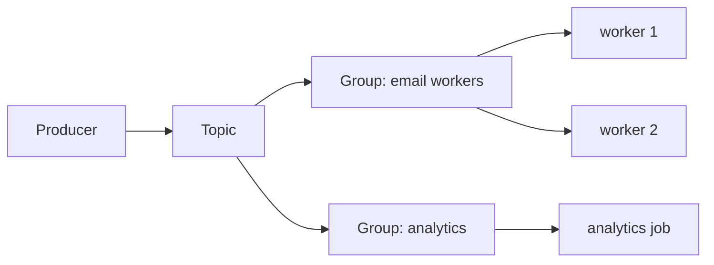
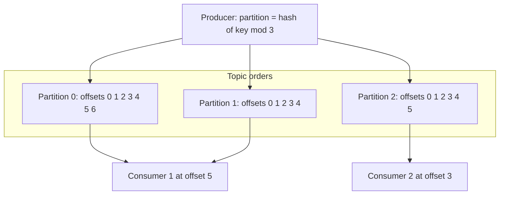

# Message brokers and partitioned logs

A batch job starts from a file that already exists and has an end. Much of the data we care about is not like that. Customers keep clicking, sensors keep measuring, services keep emitting log lines. Cutting this never-ending flow into daily files and processing each file after midnight means that every insight is up to a day old. **Stream processing** removes the artificial boundary: handle each piece of data shortly after it is produced.

Before we can process a stream we need a way to *transport* it: something that takes records from the programs that produce them and delivers them to the programs that consume them, reliably, at high volume, and without the two sides having to know about each other. That transport layer is the topic of this lesson. It comes in two families that behave very differently - traditional **message brokers** and **log-based brokers** such as Apache Kafka - and understanding the difference is one of the most useful things a backend or ML engineer can carry into a system-design interview.

## 1. Vocabulary

- An **event** (or message, or record) is a small, self-contained, immutable description of something that happened, normally with a timestamp: "order 9812 was paid at 14:03:22".
- A **producer** (publisher, sender) creates events. A **consumer** (subscriber, recipient) handles them.
- Related events are grouped into a **topic** or **stream**, the streaming counterpart of a file or table.

A file is written once and read many times. In a similar way, an event is produced once and may be handled by any number of consumers.

### Why not just poll a database?

You could have producers insert rows into a table and consumers repeatedly ask "anything new since id 5512?". It works at small scale, but polling has an awkward trade-off: poll rarely and you add latency, poll often and most queries return nothing while still loading the database. What you want is for consumers to be **notified** when something arrives. Databases offer little for this (triggers, `LISTEN/NOTIFY`), so dedicated messaging systems grew up around the need.

## 2. Two questions that classify any messaging system

**What happens when producers are faster than consumers?** There are only three possibilities:

1. **Drop** messages.
2. **Buffer** them in a queue - and then decide what happens when the queue outgrows memory (crash? spill to disk? how does disk I/O affect throughput?).
3. Apply **backpressure**: block the producer until the consumer catches up. TCP flow control and Unix pipes work this way.

**What happens when a node crashes or goes offline - are messages lost?** Durability needs disk writes and/or replication, both of which cost throughput. Whether loss is acceptable depends on the application: dropping one temperature reading out of thousands is harmless; dropping a payment event is not, and for a counter, losing messages means the count is simply wrong.

Keep these two questions in mind; every design below is a different pair of answers.

## 3. Direct messaging without a broker

Some systems send messages straight from producer to consumer:

- UDP multicast for market data feeds, where low latency beats reliability.
- Brokerless libraries such as ZeroMQ, which implement publish/subscribe over TCP.
- Metrics agents (StatsD style) that fire UDP packets at a collector.
- **Webhooks**: the consumer exposes an HTTP endpoint, the producer calls it whenever an event occurs.

These are simple and fast, but they push reliability into application code and assume both sides are online at the same time. If the consumer is down, messages are usually lost; if the producer crashes, the retries it was holding in memory vanish too.

## 4. Message brokers

The widely used alternative is to put a **message broker** (message queue) in the middle: a server that both producers and consumers connect to as clients. The broker absorbs the unreliability of clients coming and going, and the durability question moves to one place.

A consequence is that delivery becomes **asynchronous**: the producer gets confirmation that the broker has stored the message, not that anyone has processed it. That may happen milliseconds later, or hours later if consumers are backed up.

### Brokers are not databases

Some brokers can take part in transactions and store data durably, yet they differ from databases in spirit:

| | Database | Traditional broker |
|---|---|---|
| Data lifetime | Kept until explicitly deleted | Deleted once delivered and acknowledged |
| Working set | Can be huge | Assumes queues are short; throughput often degrades when they grow |
| Finding data | Indexes, ad hoc queries | Subscribe to a topic, maybe with a pattern |
| Result of a query | Point-in-time snapshot; no notification on change | No queries, but clients are notified of new data |

This is the model standardised by JMS and AMQP and implemented by RabbitMQ, ActiveMQ, IBM MQ, Azure Service Bus, Google Pub/Sub and others.

### Several consumers on one topic

Two patterns exist, and they can be combined:

- **Load balancing** (competing consumers, shared subscription): each message goes to *one* of the consumers. You add consumers to parallelise expensive work.
- **Fan-out**: each message goes to *every* subscribed consumer group. Independent systems (search indexer, fraud model, audit trail) each see the complete stream.



Within "email workers" messages are divided up; "analytics" independently receives all of them.

### Acknowledgements and redelivery

A consumer may crash at any moment, so the broker cannot consider a message done when it is merely sent. The consumer must **acknowledge** it after finishing. If the connection drops or times out without an acknowledgement, the broker assumes the worst and delivers the message again to another consumer.

Two consequences follow directly:

1. **Duplicates.** If the work was done but the acknowledgement got lost, the message is processed twice. This is *at-least-once* delivery. Consumers must therefore be **idempotent** or deduplicate.
2. **Reordering.** With load balancing, a redelivered message arrives after messages that were sent later.

```python-run
queue = [f"m{i}" for i in range(1, 7)]
processed, attempt = [], {}

while queue:
    msg = queue.pop(0)
    attempt[msg] = attempt.get(msg, 0) + 1
    # the worker that picks up m2 and m4 crashes on the first try, before acknowledging
    if msg in ("m2", "m4") and attempt[msg] == 1:
        print(f"{msg}: worker crashed, no ack -> redelivered after the timeout")
        queue.insert(2, msg)            # meanwhile other workers have moved on
        continue
    processed.append(msg)

print("processing order:", processed)
```

The output order differs from the send order even though the broker tried to preserve it. If messages are independent that is fine. If they are causally related ("create account", then "update account") it is a bug waiting to happen, and the usual cure is to avoid load balancing for such a queue - one consumer per queue - at the cost of parallelism.

> [!INTERVIEW]
> "Does your queue guarantee ordering?" is almost never a yes/no question. The precise answer has three parts: ordering *within what* (queue, partition, key), under *which consumer pattern* (single or competing), and *what happens on redelivery*.

## 5. The log-based alternative

A traditional broker treats messages as transient: once acknowledged they are gone. A new consumer sees only messages that arrive after it subscribes, and you cannot rerun a consumer over last week's messages because they no longer exist. Databases and files do not behave this way - reading does not destroy what was read.

Could we have the durable, rereadable nature of a file together with the low-latency notification of a broker? Yes: make the broker an **append-only log**.

- A producer appends its message to the end of the log.
- A consumer reads the log sequentially and, when it reaches the end, waits to be told about new data - conceptually `tail -f`.

### Partitions and offsets

One log on one disk has a throughput ceiling, so the log is **partitioned**. A topic is a set of partitions; each partition is an independent log living on some machine and is replicated to others for fault tolerance. Inside a partition every message receives a monotonically increasing **offset**. Messages within a partition are totally ordered; across partitions there is no ordering guarantee at all.



Apache Kafka, Amazon Kinesis, Apache Pulsar and Redpanda follow this design. Because writes are sequential appends and reads are sequential scans, a commodity cluster can handle millions of messages per second while still persisting everything to disk and replicating it.

### How consumption works

The broker does not assign individual messages to consumers. It assigns **whole partitions** to the members of a **consumer group**. Each consumer reads its partitions front to back, single-threaded per partition, and periodically records how far it got: the **committed offset**. That is the only bookkeeping needed - no per-message acknowledgements. Everything below the offset has been processed, everything above has not.

This is the same idea as the log sequence number in single-leader database replication: the broker is the leader, the consumer is a follower, and the offset lets a follower reconnect and resume without missing anything.

If a consumer dies, another member of its group takes over the partition and starts from the last committed offset. Messages processed after that commit but before the crash are handled a second time - so the at-least-once caveat and the need for idempotence still apply.

```python-run
class Partition:
    def __init__(self): self.log = []
    def append(self, msg):
        self.log.append(msg); return len(self.log) - 1          # offset

class Topic:
    def __init__(self, n): self.parts = [Partition() for _ in range(n)]
    def send(self, key, value):
        p = sum(key.encode()) % len(self.parts)                  # deterministic toy hash
        return p, self.parts[p].append((key, value))

topic = Topic(3)
for i, user in enumerate(["ann", "bob", "ann", "cy", "bob", "ann", "dee", "cy"]):
    p, off = topic.send(user, f"event{i}")
print({i: [v for _, v in p.log] for i, p in enumerate(topic.parts)})

# A consumer group = a dict of committed offsets per partition
committed = {0: 0, 1: 0, 2: 0}
def poll(part, max_n=2):
    start = committed[part]
    return start, topic.parts[part].log[start:start + max_n]

start, batch = poll(1)
print("consumer reads", batch, "from offset", start)
# ...crash before commit: the replacement consumer reads the same batch again
start, batch2 = poll(1)
print("after crash  ", batch2, "(duplicates -> must be idempotent)")
committed[1] = start + len(batch2)
print("after commit ", poll(1)[1])
```

All events of one user land in the same partition, so they stay in order. That is the purpose of the **partition key**: choose the key such that everything that must be ordered relative to each other shares it.

### Comparing the two styles

| | AMQP/JMS-style broker | Log-based broker |
|---|---|---|
| Delivery unit | Individual message | Partition assigned to a consumer |
| Parallelism | Add consumers freely | At most one consumer per partition per group, so partitions cap parallelism |
| Slow message | Other consumers carry on | Blocks everything behind it in that partition (**head-of-line blocking**) |
| Ordering | Lost under load balancing with redelivery | Preserved within a partition |
| After processing | Message deleted | Message stays until retention expires |
| Replay | Impossible | Reset the offset and read again |
| Fan-out cost | Each subscriber needs its own copy/queue | Any number of groups read the same log |
| Best for | Task queues: expensive, independent jobs where order does not matter | High-volume event streams where order per key matters and processing is fast |

> [!TIP]
> A quick heuristic: if you would describe the work as "jobs to be done" (send this email, resize this image), you want a task queue. If you would describe it as "facts that happened" (user signed up, price changed), you want a log.

### Disk space and retention

An append-only log grows forever unless something trims it. The log is split into **segments**; old segments are deleted or archived once they exceed a time or size limit. The log is thus effectively a very large, disk-based **ring buffer**. Back-of-envelope: a 6 TB disk written at 150 MB/s fills in about eleven hours, so a broker with such a disk can hold at least eleven hours of traffic even at full write speed - in practice days or weeks, since traffic is rarely at the maximum. Tiered storage, which moves old segments to object storage, extends this to months or indefinitely.

Because every message hits disk anyway, throughput stays roughly constant regardless of how much history is retained. That is unlike brokers that hold queues in memory and slow down sharply when they have to page them out.

### When a consumer falls behind

In terms of section 2, the log is a form of **buffering** with a large but fixed-size buffer. A consumer that lags so far that its offset points at an already deleted segment will miss messages. Two points make this tolerable:

- The buffer is large, so there is time: monitor **consumer lag** (latest offset minus committed offset) and alert long before it approaches the retention window. A human can fix a slow consumer in hours; the log gives them days.
- A lagging consumer harms only itself. It does not slow down producers or other consumer groups. This is an operational gift: you can attach an experimental consumer to a production topic, and when you remove it, nothing is left behind except an offset entry.

### Replay

Consuming from a traditional broker is destructive. Consuming from a log is a **read-only** operation; the only thing that changes is the consumer's offset, and that is under the consumer's control. You can start a new consumer group at offset zero to build a new derived view from history, or rewind an existing group to reprocess the last day after fixing a bug. This makes streaming resemble batch processing, where output is a repeatable function of immutable input, and it is the foundation for the ideas in the next two lessons.

## 6. Kafka in practice: the knobs that matter

You do not need to memorise Kafka's configuration, but a few concepts come up constantly.

- **Replication.** Each partition has a leader and followers. The followers that are caught up form the **in-sync replica set** (ISR).
- **Producer acknowledgements.** `acks=0` (fire and forget), `acks=1` (leader has written it), `acks=all` (all in-sync replicas have it). Combined with `min.insync.replicas=2` on a replication factor of 3, `acks=all` means an acknowledged write survives the loss of one broker.
- **Idempotent producer.** Retries after a timeout could append the same message twice; with idempotence enabled, the broker deduplicates using a producer id and sequence number.
- **Consumer commit timing.** Commit *after* processing gives at-least-once. Commit *before* processing gives at-most-once (a crash loses the in-flight batch). There is no setting that magically gives exactly-once to arbitrary side effects; that needs idempotent writes or transactions, covered two lessons from now.
- **Rebalancing.** When group membership changes, partitions are reassigned. During a rebalance, processing pauses, and uncommitted work is repeated.
- **Number of partitions.** It sets the maximum parallelism of each consumer group and cannot be reduced later. Increasing it changes which partition a key maps to, which breaks per-key ordering for keys that are in flight.
- **Retention.** Time-based, size-based, or **log compaction** (keep the latest value per key), which the next lesson relies on.

```python-run
# How much lag is tolerable? A tiny capacity model.
produce_rate   = 12_000      # msgs/s into the topic
consume_rate   =  9_000      # msgs/s the group currently manages
retention_h    = 72
current_lag    = 50_000_000  # msgs

growth = produce_rate - consume_rate
retained = produce_rate * 3600 * retention_h
hours_left = (retained - current_lag) / growth / 3600
print(f"lag grows by {growth * 3600:,} msgs/hour")
print(f"data loss for this consumer in about {hours_left:.0f} hours unless it speeds up")
# Scaling out only helps up to the partition count:
for consumers, partitions in [(3, 12), (12, 12), (20, 12)]:
    print(consumers, "consumers on", partitions, "partitions ->", min(consumers, partitions), "active")
```

> [!INTERVIEW]
> Design prompt: "Order events must be processed in order per customer, at 50k events per second, and a new fraud model should be able to train on the last 30 days." Sketch: a log-based topic keyed by `customer_id` (per-key order), enough partitions for the consumer parallelism you need plus headroom, replication factor 3 with `acks=all`, 30-day retention or tiered storage, one consumer group per downstream system, idempotent consumers, and alerting on lag.

## Pitfalls

- **Choosing the partition key carelessly.** A key with few distinct values, or one dominant value, creates a hot partition; a random key destroys the ordering you needed.
- **Assuming global order.** Only a single-partition topic is totally ordered, and it scales to one consumer per group.
- **Poison messages.** In a log, a message that always fails blocks its partition forever. Have a policy: bounded retries, then divert to a dead-letter topic and move on.
- **Slow per-message work on a log.** Calling a slow external API for each record turns head-of-line blocking into growing lag. Either batch, parallelise within the consumer while committing carefully, or use a task queue.
- **Treating the broker's acknowledgement as "processed".** It only means stored.
- **Committing offsets on a timer without regard to processing.** Auto-commit can advance past records that have been fetched but not yet handled.
- **Forgetting retention when planning replays.** You cannot reprocess what has been deleted.

## Summary

- A messaging system decouples producers from consumers; classify it by what it does under **overload** (drop, buffer, backpressure) and under **failure** (lose or persist).
- **Traditional brokers** deliver individual messages, track acknowledgements, delete after processing, and support both load balancing and fan-out. Redelivery causes duplicates and, under load balancing, reordering.
- **Log-based brokers** store messages in partitioned append-only logs. Consumers track an **offset**; order is preserved within a partition; reading is non-destructive, so **replay** and independent consumer groups are cheap.
- The price of the log model is that parallelism is bounded by the partition count and a slow message blocks its partition.
- Operate logs by watching **consumer lag** against the retention window, and make consumers **idempotent** because delivery is at-least-once in both families.

```quiz
[
  {"q": "A producer emits faster than consumers can handle. Which three behaviours can a messaging system choose from?",
   "options": ["Encrypt, compress or batch messages", "Drop messages, buffer them, or apply backpressure to the producer", "Replicate, partition or index messages", "Retry, reorder or deduplicate messages"],
   "answer": 1,
   "explain": "Every design is some mix of dropping, queueing and slowing the sender. Logs are a large on-disk buffer; TCP and Unix pipes use backpressure."},
  {"q": "With a traditional broker and several competing consumers, why can messages be processed out of order?",
   "options": ["Brokers shuffle messages for fairness", "An unacknowledged message is redelivered later, after newer messages have already gone to other consumers", "Consumers sort messages by size", "Fan-out duplicates every message"],
   "answer": 1,
   "explain": "Load balancing plus redelivery breaks ordering: the retried message is handled after messages that were originally sent after it."},
  {"q": "In a log-based broker, what does a consumer group need to store to resume after a crash?",
   "options": ["An acknowledgement flag for every message", "A copy of all unprocessed messages", "One committed offset per partition", "The list of producers"],
   "answer": 2,
   "explain": "Because a partition is read sequentially, a single number says that everything before it is done and everything after it is pending."},
  {"q": "Events for one customer must be handled in the order they were produced. What ensures this in Kafka?",
   "options": ["Setting acks=all", "Using the customer id as the partition key so all of that customer's events go to one partition", "Running more consumers than partitions", "Enabling log compaction"],
   "answer": 1,
   "explain": "Ordering is guaranteed only within a partition, and the key determines the partition."},
  {"q": "A topic has 8 partitions and a consumer group has 12 members. How many members actively receive data?",
   "options": ["12", "8", "4", "1"],
   "answer": 1,
   "explain": "A partition is assigned to at most one member of a group, so the partition count caps parallelism; the other four members sit idle as standbys."},
  {"q": "What happens to a consumer whose offset falls behind the oldest retained segment?",
   "options": ["Producers are blocked until it catches up", "The broker crashes", "It misses the deleted messages, while producers and other consumer groups are unaffected", "The broker automatically extends retention"],
   "answer": 2,
   "explain": "The log is a bounded buffer. Falling off the end loses data for that consumer only, which is why lag is monitored against retention."},
  {"q": "Which workload fits a traditional task queue better than a partitioned log?",
   "options": ["Replaying a month of events to build a new search index", "Per-account ordered processing of ledger entries", "Rendering videos, where each job is slow and independent and order is irrelevant", "Feeding the same events to five independent teams"],
   "answer": 2,
   "explain": "Slow, independent jobs benefit from per-message delivery and free scaling of workers; in a log each slow job would block its partition."},
  {"q": "A consumer commits its offset after processing each batch. Which delivery guarantee results?",
   "options": ["At-most-once", "At-least-once", "Exactly-once for all side effects", "No guarantee at all"],
   "answer": 1,
   "explain": "A crash after processing but before the commit causes the batch to be read again, so records may be handled twice but are never skipped."}
]
```

> **Source:** DDIA ch. 11 (Stream Processing) - transmitting event streams, message brokers, partitioned logs; Apache Kafka documentation for the configuration concepts. Written in original wording with original examples.
