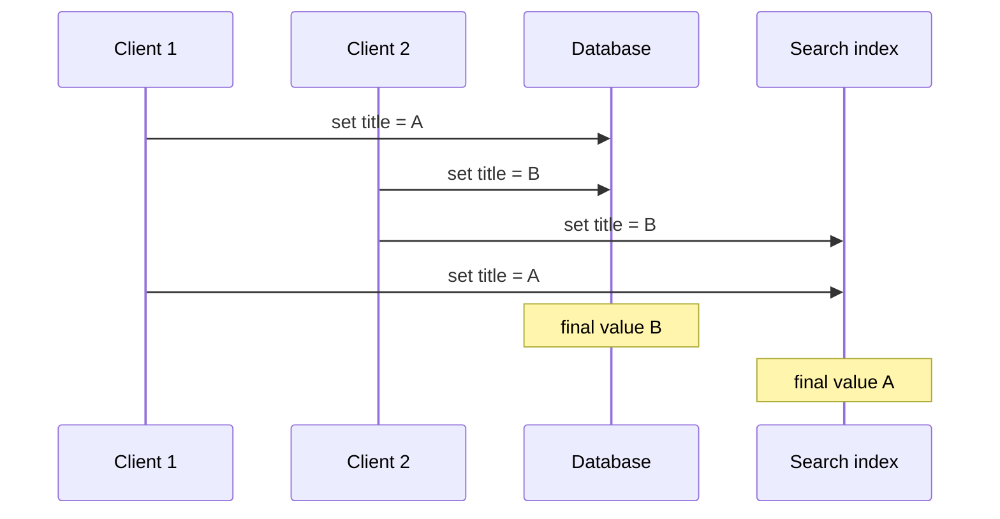
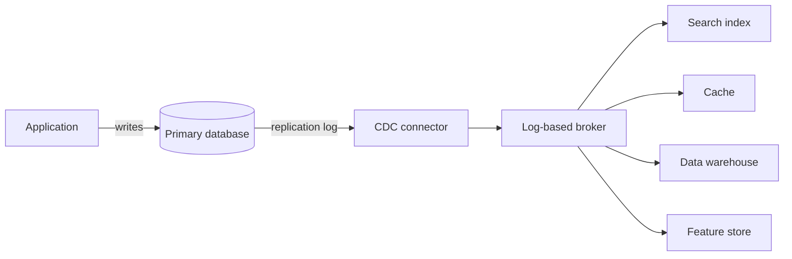

# Databases and streams: CDC and event sourcing

No single storage system is good at everything. A typical product keeps its authoritative data in a relational database, copies it into a search engine for full-text queries, into a cache for speed, into a warehouse for analytics, and into a feature store or vector index for machine learning. Each copy is shaped for a different question. The hard part is not building any one of them; it is keeping all of them **in agreement** as the data changes thousands of times per second.

This lesson looks at that problem through one idea borrowed from the previous lesson: the ordered, replayable log. A database's stream of changes turns out to *be* such a log, and once you treat it as one, synchronising other systems becomes a matter of "read the log in order and apply it". We then go a step further with **event sourcing**, where the log of events is not a by-product of the database but the primary record itself.

## 1. The trap of dual writes

The obvious way to keep a database and a search index in sync is to have the application write to both:

```text
db.update(product)
search.index(product)
```

This is called **dual writes**, and it fails in two distinct ways.

**Race conditions.** Two clients update the same item concurrently. Client 1 sets the title to "A", client 2 sets it to "B". The database happens to process 1 then 2; because of network timing the search index receives 2 then 1. The database ends with "B", the index with "A". Neither system reported an error, and nothing will ever repair the difference.



**Partial failure.** The first write succeeds and the second fails (timeout, crash, deploy). Now one system has the change and the other does not. Making "both or neither" hold across two different technologies is the atomic commit problem, and solving it with two-phase commit across heterogeneous systems is expensive and fragile.

```python-run
import itertools

def run(order):
    db = idx = None
    for client, target in order:
        if target == "db":  db = client
        else:               idx = client
    return db, idx

steps = [("A", "db"), ("A", "idx"), ("B", "db"), ("B", "idx")]
bad = 0
total = 0
for perm in itertools.permutations(steps):
    # each client still writes db before idx
    if perm.index(("A", "db")) < perm.index(("A", "idx")) and perm.index(("B", "db")) < perm.index(("B", "idx")):
        total += 1
        db, idx = run(perm)
        if db != idx:
            bad += 1
            example = perm
print(f"{bad} of {total} legal interleavings leave db and index permanently different")
print("example:", example, "->", run(example))
```

A third of the possible interleavings end in divergence. The root cause is that there are **two leaders**: the database decides one order of writes, the index decides another. The cure is to have a single place that decides the order and to make everything else follow it.

## 2. Change data capture

Every database that supports replication already produces an ordered record of all its changes: the write-ahead log or binlog that followers consume. **Change data capture (CDC)** means exposing that record to the outside world as a stream that other systems can subscribe to.



The database is the leader; the search index, cache and warehouse are **followers** of a different kind. They apply changes in the exact order in which the database committed them, so the race from section 1 cannot happen. A log-based broker is the natural transport because it preserves order per partition and lets each consumer proceed at its own pace.

### How it is implemented

- **Parsing the replication log.** This is the robust way. Tools include Debezium (PostgreSQL logical decoding, MySQL binlog, and others), Maxwell, Oracle GoldenGate, and the built-in change streams of MongoDB, DynamoDB Streams, CockroachDB changefeeds and similar features.
- **Triggers** that copy every change into a changelog table. This works everywhere, but adds write overhead and tends to be fragile.
- **Polling** on an `updated_at` column. Simple, but it misses deletes and intermediate values, and relies on clock-based columns being maintained correctly.

CDC is normally **asynchronous**: the database commits without waiting for consumers. A slow consumer therefore does not slow down the application, but all the replication-lag effects apply - the search index is a moment behind the database, and "I just saved it, why can't I find it?" is a real user experience issue to design for.

### The initial snapshot

A newly added consumer cannot build a full copy of the database from last week's changes alone; rows that have not changed for a year would be missing. Keeping the entire change history forever is usually not affordable. The standard procedure is therefore:

1. Take a **consistent snapshot** of the database and note the log position it corresponds to.
2. Load the snapshot into the new system.
3. Start applying changes from exactly that log position.

The need for the snapshot position to line up exactly with the log is the same requirement as when you set up a new replica.

### Log compaction: a log that can replace the snapshot

There is an elegant alternative for keyed data. If each change record carries the primary key and the **complete new value** of the row, then an older record for the same key is made obsolete by a newer one. A **compacted** log periodically discards obsolete records in the background and keeps at least the most recent record for every key. A deletion is represented by a record with a null value, a **tombstone**, which is itself removed after a while.

The size of a compacted topic is then proportional to the size of the database, not to the number of writes ever made. A new consumer can start at offset zero, read through the whole topic and end up with a full copy of the current state - no separate snapshot mechanism needed. (This is the same compaction idea as in log-structured storage engines, applied to a message topic.)

```python-run
changes = [
    ("user:1", {"name": "Ana",  "plan": "free"}),
    ("user:2", {"name": "Ben",  "plan": "free"}),
    ("user:1", {"name": "Ana",  "plan": "pro"}),
    ("user:3", {"name": "Cleo", "plan": "pro"}),
    ("user:2", None),                                  # tombstone: Ben deleted his account
    ("user:1", {"name": "Ana M.", "plan": "pro"}),
]

def compact(log):
    latest = {}
    for offset, (key, _) in enumerate(log):
        latest[key] = offset                           # remember last offset per key
    return [log[o] for o in sorted(latest.values())]   # original order preserved

def materialise(log):
    state = {}
    for key, value in log:
        if value is None: state.pop(key, None)
        else:             state[key] = value
    return state

compacted = compact(changes)
print("log length", len(changes), "->", len(compacted))
print(materialise(changes) == materialise(compacted), materialise(compacted))
```

Replaying the full log and replaying the compacted log give the same final state - that equality is the correctness condition for compaction.

> [!INTERVIEW]
> "How would you keep Elasticsearch in sync with Postgres?" The weak answer is "write to both in the service". The strong answer: capture changes from the write-ahead log (for example with Debezium) into a Kafka topic keyed by primary key, have an indexing consumer apply them idempotently, bootstrap with a snapshot or a compacted topic, monitor lag, and be explicit that the index is eventually consistent with the database.

### The outbox pattern

Sometimes you want to publish a *business event* ("OrderPlaced") rather than raw row changes, and you want it published if and only if the database transaction commits. Writing to the database and then to the broker would be dual writes again. The **transactional outbox** avoids it: within the same database transaction, insert the event into an `outbox` table. A CDC connector streams that table to the broker. Atomicity comes from the single local transaction; delivery comes from the log.

## 3. Event sourcing

CDC extracts a log from a database that was designed in the usual mutable way; the application is unaware of it. **Event sourcing** turns the design around. The application itself records every state change as an **immutable event** in an append-only event store, and the event log is the source of truth. Whatever you query - current balances, shopping carts, seat maps - is *derived* from the log.

The events are also at a different level. A CDC record says "column `status` of row 81 changed from 2 to 3". An event-sourced event says "customer cancelled the booking, reason: schedule conflict". It captures **intent**, in the vocabulary of the business, not the mechanics of a particular schema.

Why would you do this?

- **Auditability.** Accountants worked this out long ago: a ledger is append-only, a mistake is fixed by a compensating entry, not with an eraser. The balance is a derived number.
- **Debugging.** You can see how the system reached a state, and replay the events against a fixed version of the code.
- **Evolution.** New features often need a new view of old facts. With a complete history you can build that view retroactively; with only current state the information may already be overwritten.
- **Information that mutable state destroys.** "Item added to cart, then removed" leaves no trace in a current-state table, yet it is valuable to an analyst or a recommender.

### Deriving current state

Users want to see the present, not a history, so an event-sourced system needs a deterministic function that folds the events into current state. Mathematically, state is the **integral** of the event stream over time, and the stream is the **derivative** of the state.

A difference from CDC matters for storage: because an event expresses intent rather than a full new value, a later event usually does **not** make earlier ones obsolete. "Removed 1 item" means nothing without the earlier "added 3 items". Log compaction by key therefore does not apply. Instead, systems store periodic **snapshots** of derived state purely as an optimisation, so that recovery replays only the events after the snapshot. The full log is still kept.

```python-run
events = [
    ("AccountOpened",  {"id": "acc1", "owner": "Ravi"}),
    ("MoneyDeposited", {"id": "acc1", "amount": 200}),
    ("MoneyWithdrawn", {"id": "acc1", "amount": 50}),
    ("MoneyDeposited", {"id": "acc1", "amount": 25}),
    ("WithdrawalReversed", {"id": "acc1", "amount": 50, "reason": "ATM fault"}),
]

def apply(state, event):
    kind, data = event
    if kind == "AccountOpened":
        return {"owner": data["owner"], "balance": 0, "tx_count": 0}
    delta = {"MoneyDeposited": +1, "MoneyWithdrawn": -1, "WithdrawalReversed": +1}[kind]
    return {**state, "balance": state["balance"] + delta * data["amount"], "tx_count": state["tx_count"] + 1}

state = None
for i, e in enumerate(events):
    state = apply(state, e)
    if i == 2:
        snapshot = (i, state)                      # optimisation only
print("current:", state)

# time travel: what did the account look like after the third event?
print("as of event 2:", snapshot[1])

# recovery from snapshot = replay only the tail
s = snapshot[1]
for e in events[snapshot[0] + 1:]:
    s = apply(s, e)
print("rebuilt from snapshot matches:", s == state)

# a completely different view from the same log
print("reversals:", [d["reason"] for k, d in events if k == "WithdrawalReversed"])
```

The reversal does not delete the faulty withdrawal. Both stay in the record, and the balance is correct because the fold takes both into account.

### Commands versus events

A request arriving from a user is a **command**: "reserve seat 14C". It may still be rejected - the seat may be taken, the card may be declined. The application validates the command against current state, and only if it is acceptable does it append an **event**: "seat 14C reserved". From that moment the event is a **fact**. It happened. Consumers of the event stream are not allowed to reject it; if the reservation is cancelled later, that is another fact appended after it.

Consequences for design:

- All validation that can fail must happen **synchronously, before** the event is written. That usually means a serialisable transaction or a single-threaded writer per partition (per aggregate), so two commands for the same seat cannot both pass the check.
- Alternatively, split the interaction into two events - a tentative request and a later confirmation - so that validation itself can be asynchronous.
- Name events in the past tense. `SeatReserved` is an event; `ReserveSeat` is a command.

> [!WARNING]
> Event sourcing is not "publish everything to Kafka". A message broker topic with seven-day retention is not an event store. The defining property is that the log is the durable, complete system of record from which state can be rebuilt.

## 4. State, streams and immutability

The two views of data are complementary. A table is a cache of the latest value for each key in a log; a log is the story of how the table came to be. Keeping the log as the primary artefact has several attractive consequences.

**Many read models from one write model.** If writes go to an append-only log, you can attach any number of consumers that each maintain a view optimised for one kind of query: a key-value view for lookups, a search index, an aggregate cube, an embedding index. Adding a new view does not touch existing ones; you run a new consumer from the beginning of the log. This separation of the write-side form from the read-side forms is called **command query responsibility segregation (CQRS)**. It also dissolves much of the normalisation-versus-denormalisation debate: the log is the normalised truth, and each view may be as denormalised as its queries require, because it can always be rebuilt.

**Simpler recovery from bugs.** If faulty code writes bad data into a mutable database, the damage is done and often hard even to identify. If faulty code produces a wrong *view* from an immutable log, you fix the code and rebuild the view.

**Simpler concurrency for writers.** A user action becomes one self-contained event appended in one place - a single atomic write - instead of a multi-object transaction touching several tables.

### The costs

**Asynchronous views are stale.** A user submits a change and immediately reads from a view that has not yet processed it. Options: update the view synchronously in the same transaction as the append (possible when both live in the same system); have the client hold on to its own change and overlay it; or let reads wait until the view has reached the write's log position, which requires tracking that position in the request.

**Histories grow.** For workloads that mostly add data, immutability is cheap. For workloads with a small dataset that is updated very frequently, the history can dwarf the current state, and compaction and garbage collection become operationally important.

**Deletion that must be real.** Sometimes data has to be gone, not just superseded: privacy legislation, a user closing their account, sensitive information published by mistake. Appending "please ignore the earlier event" is not enough. Truly removing data from an immutable log is awkward because copies live in segments, backups and every derived view. A widely used technique is **crypto-shredding**: encrypt each user's personal data with a per-user key held in a small mutable store, and delete the key when erasure is required, leaving the ciphertext unreadable. Another is to keep personal data out of events entirely and store only references.

**Schema evolution of events.** Events live for years, so consumers must be able to read every historical version. Plan for versioned event types and upcasting from the start (see the encoding lesson).

**Side effects on replay.** Rebuilding a view by replaying events must not send the confirmation emails again. Keep external side effects in separate consumers that track what they have already done.

## Pitfalls

- **Dual writes disguised as "we publish an event after saving".** If the save and the publish are not atomic, you have the partial-failure problem. Use CDC or an outbox.
- **CDC consumers that are not idempotent.** Delivery is at-least-once; applying "set X to 5" twice is harmless, applying "add 5 to X" twice is not. Prefer full-value records or track applied log positions.
- **Coupling consumers to the source schema.** Raw CDC exposes internal table structure to every downstream team; a column rename becomes a breaking change. An outbox with deliberately designed events gives you a stable contract.
- **Losing ordering when partitioning the change stream.** Key by primary key so that all changes to one row stay in order.
- **Treating events as commands.** If a consumer can "reject" an event, the validation was done in the wrong place.
- **Event sourcing everything.** It pays off where history and intent are valuable (payments, orders, bookings, inventory). For a simple settings table it is ceremony without benefit.

## Summary

- Dual writes let two systems disagree permanently, through **races** and **partial failures**. The fix is one authoritative order of changes.
- **Change data capture** exposes the database's own commit log as a stream; downstream systems become followers that apply changes in commit order. Bootstrapping needs a **snapshot at a known log position** or a **compacted** keyed log.
- The **outbox pattern** publishes business events atomically with a local transaction.
- **Event sourcing** makes an append-only log of business-level, immutable events the system of record; current state is a deterministic fold over the events, with snapshots as an optimisation.
- **Commands** can be rejected; **events** are facts. Validate before appending.
- Logs enable **multiple derived views** (CQRS), auditing and easy recovery, at the price of eventual consistency of views, growing history, and difficult true deletion.

```quiz
[
  {"q": "Why can dual writes leave a database and a search index permanently inconsistent even when every individual write succeeds?",
   "options": ["Search indexes cannot store the same values as databases", "Two concurrent updates can be applied in different orders by the two systems", "The database always rejects the second write", "Network packets are encrypted differently for each system"],
   "answer": 1,
   "explain": "Each system picks its own order of arrival. Without one authority defining the order, the last writer differs between them and nothing reconciles it."},
  {"q": "What does change data capture use as its source of ordered changes?",
   "options": ["Periodic full table exports", "The application's HTTP access log", "The database's replication log, such as the write-ahead log or binlog", "A random sample of rows"],
   "answer": 2,
   "explain": "The replication log already records every committed change in commit order; CDC makes it available to non-database consumers."},
  {"q": "A new consumer must build a complete copy of a table from a CDC stream that only retains seven days. What is needed?",
   "options": ["Nothing, seven days always contains every row", "A consistent snapshot taken at a known log position, followed by changes from that position", "A larger consumer group", "Two-phase commit between the consumer and the database"],
   "answer": 1,
   "explain": "Rows unchanged for more than seven days are absent from the stream, so the consumer loads a snapshot and then continues from the exact matching offset."},
  {"q": "What does log compaction guarantee for a keyed topic?",
   "options": ["Every message ever written is retained", "At least the most recent record for each key is retained, so replaying yields the current state", "Messages are sorted by key", "Tombstones are never removed"],
   "answer": 1,
   "explain": "Older records for a key are superseded by newer full-value records and can be discarded; the topic size tracks the number of keys, not the number of writes."},
  {"q": "Why can an event-sourced log generally not be compacted by key the way a CDC log can?",
   "options": ["Event stores do not support deletion of any kind", "Events describe intent and incremental actions, so later events do not make earlier ones obsolete", "Events have no keys", "Compaction only works on relational tables"],
   "answer": 1,
   "explain": "The current state depends on the whole sequence. Systems keep the full log and use snapshots of derived state to speed up recovery."},
  {"q": "Which statement about commands and events is correct?",
   "options": ["Events may be rejected by downstream consumers if they violate a rule", "A command is a request that may fail validation; once accepted and recorded it becomes an event, an immutable fact", "Commands are stored forever and events are discarded", "They are two names for the same thing"],
   "answer": 1,
   "explain": "Validation happens before the append. After that, consumers must accept the event; corrections are made by appending further events."},
  {"q": "A service must update its orders table and publish an OrderPlaced event atomically. Which approach achieves this without distributed transactions?",
   "options": ["Publish to the broker first, then write the database", "Write the database, then publish, and hope both succeed", "Insert the event into an outbox table in the same local transaction and stream that table via CDC", "Have the consumer poll the orders API every second"],
   "answer": 2,
   "explain": "The local transaction makes the order and the outbox row atomic, and the log-based relay delivers the event at least once afterwards."},
  {"q": "A user must be erased from a system built on an immutable event log. Which technique is commonly used?",
   "options": ["Append an event saying the user is deleted and do nothing else", "Encrypt the user's personal data with a per-user key and delete the key on request", "Increase the replication factor", "Reset all consumer offsets"],
   "answer": 1,
   "explain": "Crypto-shredding makes every copy of the ciphertext, including backups and derived data that kept it encrypted, unreadable without rewriting the log."}
]
```

> **Source:** DDIA ch. 11 (Stream Processing) - databases and streams: keeping systems in sync, change data capture, event sourcing, state, streams and immutability. Written in original wording with original examples.
