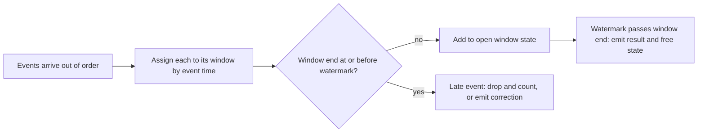
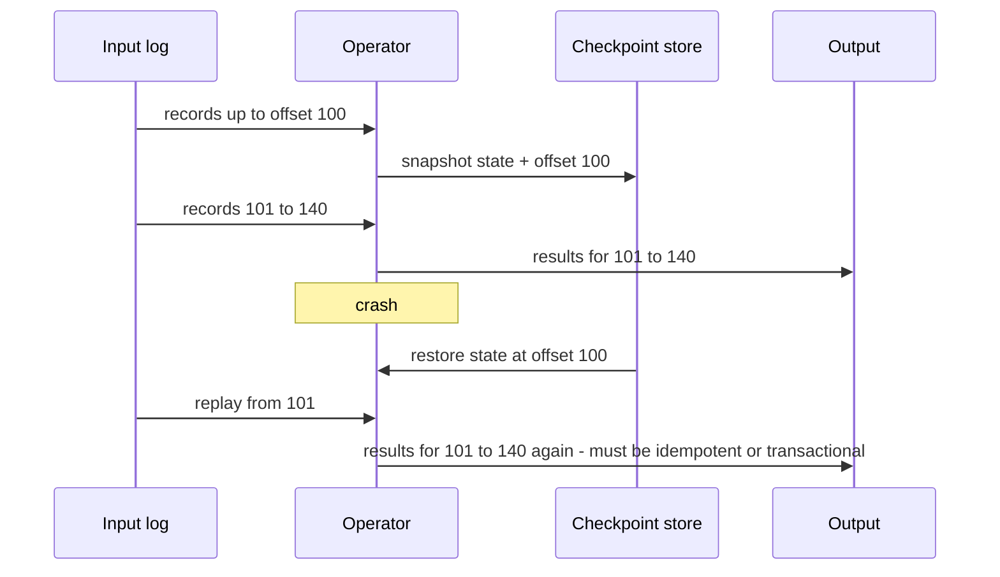

# Processing streams: time, windows, joins, fault tolerance

The last two lessons explained how events get from A to B and where streams come from. Now we look at what you *do* with a stream once you have it. In outline a stream processor is just like a batch job - read input, transform, write output, without modifying the input - but one property changes everything: **the input never ends**.

That one fact breaks several assumptions we relied on in batch processing. You cannot sort an infinite dataset, so sort-merge joins are out. You cannot wait for the input to finish before emitting results, so "the answer" becomes something that is continuously revised. And you cannot simply rerun the job from the beginning after a crash if it has been running for three years. This lesson works through how real systems (Flink, Kafka Streams, Spark Structured Streaming, Beam/Dataflow) handle these problems: reasoning about **time**, chopping the stream into **windows**, **joining** streams with other streams and with tables, and recovering from failures without double counting.

## 1. What stream processors are used for

There are three broad things you can do with an incoming event:

1. Write it to a database, cache or index, so other clients can query it - this is the "keep derived systems in sync" use from the previous lesson, and it amounts to maintaining a **materialised view**.
2. Push it to humans: alerts, notifications, live dashboards.
3. Produce one or more **output streams** from the input streams. Such a processing step is called an **operator**, and operators are chained into a pipeline or dataflow graph.

Typical applications:

- **Complex event processing (CEP).** You declare a *pattern* ("three failed logins followed by a password change within five minutes") and the engine emits a match whenever the stream satisfies it. Roles are inverted compared with a database: the queries are stored long-term and the data flows past them.
- **Stream analytics.** Rates, rolling averages, percentiles over a time interval, comparison with last week. These often use probabilistic sketches (HyperLogLog for distinct counts, t-digest for percentiles) to bound memory.
- **Maintaining materialised views** and search indexes, including online feature computation for ML models ("number of transactions on this card in the last ten minutes").
- **Search on streams.** Store the queries, run each new document against them (percolation): alert me when a listing matching my criteria appears.

## 2. Reasoning about time

A batch job that counts purchases per hour looks at the timestamp *inside each record*. The wall clock of the machine running the job is irrelevant; you can process a year of history in ten minutes and get the same, deterministic answer.

Streaming frameworks are tempted to take a shortcut and use the processor's own clock to decide which window an event belongs to. That is simple, and it is fine as long as the gap between an event happening and being processed is negligible. It stops being fine the moment there is any significant delay.

- **Event time**: when the event actually occurred, according to the device or service where it happened.
- **Processing time**: when the stream processor handles it.

Delays between the two have many causes: queueing, network faults, a consumer restart, backlog after an outage, a mobile device that was offline, or a deliberate replay of old data. And delay leads to **out-of-order** arrival.

```python-run
# A steady 10 events/s. The consumer is down from t=3 to t=6, then catches up quickly.
events = [(sec + i / 10, None) for sec in range(10) for i in range(10)]     # (event_time, _)

def processing_time(event_time):
    if 3 <= event_time < 6:                 # arrived while we were down
        return 6 + (event_time - 3) * 0.05  # drained in a burst after the restart
    return event_time + 0.01

by_event, by_proc = {}, {}
for et, _ in events:
    pt = processing_time(et)
    by_event[int(et)] = by_event.get(int(et), 0) + 1
    by_proc[int(pt)]  = by_proc.get(int(pt), 0) + 1

print("sec  by_event_time  by_processing_time")
for s in range(10):
    print(f"{s:>3}  {by_event.get(s, 0):>13}  {by_proc.get(s, 0):>18}")
```

The true rate was constant. Measured by processing time it shows three silent seconds followed by a spike of forty - an artefact of the consumer's restart that looks exactly like a traffic anomaly. Any alerting or model feature built on that number is wrong.

### When is a window complete?

Using event time raises a new question that batch never had: how do you know that all events for the window 10:00-10:01 have arrived? You cannot. Some might still be sitting in a buffer on a machine that is temporarily partitioned from the network.

Practical systems use a **watermark**: a moving assertion "I believe no more events with a timestamp earlier than T will arrive". The watermark is typically derived from the largest timestamp seen so far, minus an allowance for disorder. When the watermark passes the end of a window, the window is declared complete and its result is emitted.

Events that arrive after their window has closed are **stragglers** (late events). You have two choices:

1. **Ignore them**, and monitor the number dropped; if it becomes significant, raise an alarm.
2. **Publish a correction**: an updated value for the window, possibly with a retraction of the old value. Downstream consumers must then be able to cope with updates.

The allowance is a business trade-off between **latency** (how soon results appear) and **completeness** (how much data they include). Lambda-style setups sidestep the choice by emitting a fast approximate result now and a corrected batch result later; modern engines achieve the same within one system by allowing late updates.



### Whose clock?

Event time is only as good as the clock that assigned it. Servers are generally synchronised reasonably well; user devices are not - a phone's clock may be wrong by hours, by accident or on purpose. A useful technique for events buffered on a device is to record **three** timestamps:

1. the time the event occurred, by the device clock;
2. the time the event was sent to the server, by the device clock;
3. the time the server received it, by the server clock.

Subtracting 2 from 3 estimates the device clock's offset (network delay is negligible compared with clock errors of minutes or hours). Applying that offset to 1 gives an estimate of the true event time.

> [!INTERVIEW]
> When asked to design any real-time metric, state explicitly which time you aggregate on and how you treat late data. "Windows are on event time with a watermark of thirty seconds; later events are counted in a late-data metric and corrected by a daily batch job" is the kind of sentence that distinguishes someone who has run streaming systems from someone who has only read the API docs.

## 3. Types of windows

| Window | Definition | Example | An event belongs to |
|---|---|---|---|
| **Tumbling** | Fixed length, no overlap | Per-minute counts | Exactly one window |
| **Hopping** | Fixed length, advances by a smaller step, so windows overlap | 5-minute window every 1 minute | length / hop windows |
| **Sliding** | All events within some interval of each other | "Within 5 minutes of each other" | Defined relative to other events |
| **Session** | No fixed length; groups events of one key separated by gaps shorter than a timeout | User visits ending after 30 min of inactivity | One session, which can grow and merge |

A hopping window can be implemented cheaply by computing tumbling windows of the hop size and combining adjacent ones. Sessions are the tricky ones: an out-of-order event can bridge two sessions that had already been considered separate, so the engine has to **merge** window state.

```python-run
events = sorted([("u1", 2), ("u1", 7), ("u1", 31), ("u1", 34), ("u2", 5), ("u1", 12), ("u2", 50), ("u2", 58)])

def tumbling(ts, size):       return [(ts // size * size, ts // size * size + size)]
def hopping(ts, size, hop):
    first = (ts - size) // hop * hop + hop
    return [(s, s + size) for s in range(max(first, 0), ts + 1, hop)]

print("t=34 tumbling(10):", tumbling(34, 10))
print("t=34 hopping(20, 10):", hopping(34, 20, 10))

def sessions(evts, gap):
    out = {}
    for user, ts in sorted(evts, key=lambda e: (e[0], e[1])):
        s = out.setdefault(user, [])
        if s and ts - s[-1][1] <= gap:
            s[-1][1] = ts; s[-1][2] += 1          # extend the current session
        else:
            s.append([ts, ts, 1])                 # [start, end, count]
    return out
print("sessions(gap=10):", sessions(events, 10))
```

## 4. Stream joins

Enriching and correlating are just as necessary for unbounded data as for bounded data, but since new events can show up at any time, joins need state and rules about time. Three kinds are worth distinguishing.

### Stream-stream join (window join)

Example: a search service logs a *search* event when results are shown and a *click* event when the user clicks a result. To compute the click-through rate per query you must pair them. A click may come seconds or hours after the search - or never - and because of network delays it may even arrive *before* its search.

The operator keeps **state** for both streams: recent events indexed by the join key (the session id), retained for the join window, say one hour. Each arriving event is stored and also probed against the other side's index. A match emits a "search was clicked" record. When a search expires from the state without a match, the operator emits "search was not clicked" - which is equally important for an unbiased click-through rate.

### Stream-table join (enrichment)

Example: every activity event carries a user id, and you want to attach the user's country and plan. Calling the user database for each event would be slow and would overload it. Instead, keep a **local copy** of the table inside the stream processor - an in-memory hash table or a local embedded index - and look up each event there.

This is the streaming twin of the broadcast hash join in batch. The difference is that the stream job runs for ever, so the local copy must be kept current: the processor subscribes to the table's **changelog** (via CDC) and applies updates as they come. Seen that way, a stream-table join is really a stream-stream join in which one side has an infinitely long window ("back to the beginning of time") and newer records overwrite older ones.

```python-run
# One merged, ordered input: profile changes (table changelog) and activity events
log = [
    ("profile", "u1", {"plan": "free"}),
    ("click",   "u1", "/pricing"),
    ("profile", "u1", {"plan": "pro"}),
    ("click",   "u1", "/dashboard"),
    ("click",   "u9", "/home"),                 # no profile yet
    ("profile", "u9", {"plan": "free"}),
]

table = {}                                      # local materialised copy
for kind, user, payload in log:
    if kind == "profile":
        table[user] = payload                   # apply the changelog
    else:
        plan = table.get(user, {}).get("plan", "UNKNOWN")
        print(f"{user} {payload:<11} plan_at_event_time={plan}")
```

### Table-table join (materialised view maintenance)

Example: a social timeline. Maintaining each user's home timeline means joining the stream of posts with the stream of follow relationships. When someone posts, the post is added to all their followers' timelines; when someone follows a new account, that account's recent posts are added; unfollows and deletions remove entries. The operator maintains a materialised view of the join between two tables, and each change on either side produces a change to the view.

### Time-dependence of joins

All three joins hold state derived from one input and probe it with another, so the **order** in which events from different streams are interleaved affects the result. Within one partition the order is fixed; *across* streams or partitions it generally is not. If a profile update and an activity event happen close together, which is processed first? The run above gave `plan=free` for the first click only because the changelog record happened to be consumed before it.

This matters whenever the correct answer depends on the state "as of then". When you compute tax on an invoice, you need the rate valid on the sale date, not today's rate, even when reprocessing old data. In data warehousing this is the **slowly changing dimension** problem, and a common solution is to version the dimension: give each version of the tax rate an identifier and store that identifier in the invoice event. The join becomes deterministic, at the cost of never being able to compact away old versions.

> [!WARNING]
> A join whose result depends on arrival order across partitions is **nondeterministic**: rerunning the job on the same input can give different output. If that matters for your use case (billing, anything audited), make the time dependence explicit with versioned lookups or event-time-aware (temporal) joins.

## 5. Fault tolerance

A failed batch task is simply rerun; its partial output is discarded and replaced, so the result looks as if every record was processed exactly once even though some were physically processed more than once. This principle - visible effects happen once despite retries - is usually called **exactly-once semantics**; *effectively-once* describes it more honestly.

In streaming we cannot wait for the job to finish before making output visible, because it never finishes. Several techniques fill the gap.

### Micro-batching and checkpointing

- **Micro-batching** (Spark Streaming) cuts the stream into small blocks, around a second each, and treats every block as a tiny batch job. The batch size implicitly becomes a tumbling window by processing time.
- **Checkpointing** (Flink) periodically takes a consistent snapshot of all operator state together with the input positions and writes it to durable storage. Barriers flow through the dataflow with the records to mark where each snapshot cuts. After a crash, operators restore the latest snapshot and the input is replayed from the recorded offsets.

Inside the framework, both give exactly-once. But as soon as output **leaves** the processor - a row written to an external database, a message to another broker, an email - a restart would repeat those side effects. The framework's own rollback cannot unsend an email.

### Atomic commit, revisited

To get exactly-once across the boundary, the outputs and side effects of processing an event must take effect **if and only if** the processing is recorded as successful: messages sent downstream, database writes, operator state changes and the acknowledgement of the input (advancing the consumer offset) must all happen atomically or not at all.

That sounds like distributed transactions, and it is - but kept inside one framework rather than spanning heterogeneous technologies. Kafka transactions, for instance, allow a processor to atomically write output messages, state changelog updates and offset commits; consumers configured to read only committed data never see the output of an aborted attempt. The overhead of the commit protocol is amortised by handling many messages per transaction.

### Idempotence

The alternative needs no transactions. An **idempotent** operation has the same effect whether you perform it once or several times. Setting a key to a fixed value is idempotent; incrementing a counter is not.

A non-idempotent operation can often be made idempotent with a little metadata. Each message from a log-based broker has a persistent, monotonically increasing offset. If the consumer stores the offset of the last applied message *together with* the value it writes, it can recognise a redelivered message and skip it.

```python-run
import random
random.seed(3)

deposits = [(off, amt) for off, amt in enumerate([50, 20, 70, 10, 30])]     # (offset, amount)
# at-least-once delivery: some messages are redelivered after a simulated crash
delivered = []
for msg in deposits:
    delivered.append(msg)
    if random.random() < 0.5:
        delivered.append(msg)                                               # duplicate
print("deliveries:", [off for off, _ in delivered])

naive = sum(amt for _, amt in delivered)

store = {"balance": 0, "last_offset": -1}            # value and offset written atomically
for off, amt in delivered:
    if off <= store["last_offset"]:
        continue                                     # already applied
    store = {"balance": store["balance"] + amt, "last_offset": off}

print("true total 180 | naive:", naive, "| idempotent:", store["balance"])
```

Relying on idempotence carries assumptions: after a restart the same messages must be replayed in the same order (a log-based broker gives you this), processing must be deterministic, and no other node may update the same value concurrently. When failing over from one processing node to another, **fencing** (see the fencing-token lesson) may be needed so that a node wrongly believed dead does not keep writing.

### Rebuilding state after a failure

Window aggregates, join indexes and local table copies are state that must survive a crash. Options:

- Keep the state in a remote database and replicate it there - simple, but a network round trip per event is slow.
- Keep the state **local** to the operator and replicate it periodically: Flink snapshots to a distributed file system or object store; Kafka Streams writes every state change to a compacted changelog topic and rebuilds the local store by replaying it.
- Sometimes no replication is needed at all: a short window's state can be recomputed by replaying the input, and a local copy of a table can be rebuilt from the compacted CDC topic.

Which is best depends on how fast local disk is compared with the network and how large the state is.



> [!INTERVIEW]
> "Does Kafka give exactly-once?" A careful answer: within a Kafka-to-Kafka pipeline, transactions make the read-process-write cycle atomic, so the effects are exactly-once. For any external sink you need either an idempotent write keyed by something stable (event id, or offset stored with the value) or a sink that participates in a two-phase commit with the checkpoint. Delivery itself is still at-least-once; it is the *effect* that is deduplicated.

## Pitfalls

- **Windowing by processing time by accident.** Many frameworks default to it. After any backlog the numbers are wrong, and replays produce different results from the original run.
- **Stalled watermarks.** With several input partitions, the watermark is the minimum over all of them; one idle partition holds everything back, so no windows close. Configure idleness handling.
- **Unbounded state.** A join without a time bound or a grouping by a high-cardinality key with no expiry will eventually exhaust memory. Every piece of state needs a retention rule.
- **Trusting client timestamps.** Device clocks can be far off; clamp or correct them, and decide what to do with events from "the future", which would otherwise push the watermark forward and make everything else look late.
- **Non-idempotent sinks.** Incrementing counters in an external store from an at-least-once pipeline overcounts after every restart.
- **Nondeterministic joins presented as facts.** Enrichment with "whatever the profile is right now" gives different answers on replay.
- **Assuming the framework's exactly-once covers side effects** such as emails, webhooks or payments. It does not; use idempotency keys.

## Summary

- Stream processing is batch processing with unbounded input; no end means no global sort, continuous output, and long-lived state.
- Distinguish **event time** from **processing time**. Aggregating by processing time produces artefacts whenever there is delay or replay.
- **Watermarks** estimate completeness; late events are either dropped and counted or trigger corrections. The lateness allowance trades latency against completeness.
- Windows come as **tumbling**, **hopping**, **sliding** and **session** variants.
- Joins need state: **stream-stream** (both sides buffered within a window), **stream-table** (local copy of the table kept fresh by its changelog), **table-table** (maintaining a materialised view). Their results can depend on cross-stream ordering unless you version the data.
- Fault tolerance combines **checkpoints or micro-batches** with **atomic commit** of state, output and offsets, or with **idempotent** writes; operator state is rebuilt from snapshots or changelogs.

```quiz
[
  {"q": "A consumer was down for ten minutes and then processed the backlog in thirty seconds. A requests-per-minute chart windowed by processing time will show:",
   "options": ["A flat line, because the events carry their own timestamps", "A gap followed by a large spike that never happened in reality", "Slightly lower values spread evenly", "No data at all for the whole day"],
   "answer": 1,
   "explain": "Processing time records when the processor saw the events, so the outage and catch-up appear as a drop and a burst. Event-time windowing would show the true steady rate."},
  {"q": "What is a watermark?",
   "options": ["A checksum that detects corrupted messages", "The offset of the last committed message", "An estimate that no more events older than a certain event time are expected, used to decide when windows are complete", "A limit on the number of partitions"],
   "answer": 2,
   "explain": "Since completeness can never be known for sure, the watermark is a heuristic threshold. Events older than it are treated as late."},
  {"q": "Which window type has no fixed duration and is defined by a period of inactivity?",
   "options": ["Tumbling", "Hopping", "Session", "Sliding"],
   "answer": 2,
   "explain": "A session window groups events for a key until a gap longer than the timeout occurs, so its length depends on the data."},
  {"q": "A five-minute hopping window advances every minute. To how many windows does a single event belong?",
   "options": ["1", "5", "60", "It depends on the key"],
   "answer": 1,
   "explain": "Window length divided by hop size: 5 / 1 = 5 overlapping windows contain any given instant."},
  {"q": "How does a stream processor typically implement a stream-table join for enrichment?",
   "options": ["It queries the remote database for every event", "It keeps a local copy of the table and updates it from the table's changelog stream", "It sorts both inputs and merges them", "It waits until the stream ends"],
   "answer": 1,
   "explain": "Local lookups avoid a network call per event, and consuming the change stream keeps the copy fresh for a job that runs indefinitely."},
  {"q": "Why can a stream join be nondeterministic when replayed?",
   "options": ["Hash functions change between runs", "The relative order of events from different streams or partitions is not fixed, and the join result depends on which arrives first", "Windows are randomly sized", "Checkpoints alter the data"],
   "answer": 1,
   "explain": "Order is only guaranteed within a partition. If a profile update and an activity event interleave differently on replay, the enrichment differs. Versioned lookups fix this."},
  {"q": "After a crash, a stream processor restores its last checkpoint and replays input. What is required so that an external database sink does not double count?",
   "options": ["Nothing, checkpoints undo external writes automatically", "The writes must be idempotent, for example by storing the last applied offset with the value, or the sink must commit atomically with the checkpoint", "A larger retention period", "More partitions"],
   "answer": 1,
   "explain": "The framework can roll back its own state but not side effects outside it. Idempotent writes or a transactional sink make the replay harmless."},
  {"q": "Which operation is idempotent?",
   "options": ["Increment the visit counter by one", "Append the event to a list", "Set the user's status to active", "Send a notification email"],
   "answer": 2,
   "explain": "Setting a value to a constant gives the same result however often it is applied. The others accumulate an additional effect each time."}
]
```

> **Source:** DDIA ch. 11 (Stream Processing) - processing streams: uses, reasoning about time, stream joins, fault tolerance. Written in original wording with original examples.
