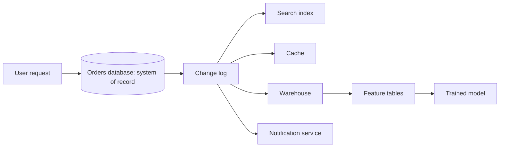
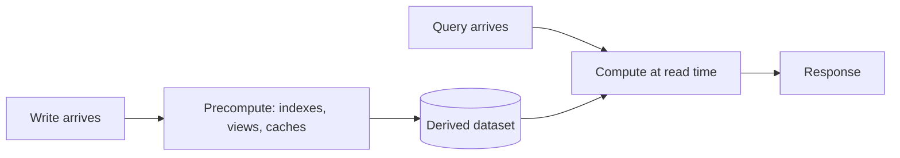

# Data integration and unbundling databases

Up to this point each lesson has examined one mechanism in isolation: a storage engine, a replication scheme, a transaction protocol, a batch or stream processor. Real systems are never one mechanism. They are five or ten of them wired together, and most production incidents do not happen *inside* a component - they happen in the wiring: the cache that disagrees with the database, the index that silently missed a day of updates, the report that double-counted after a retry.

This lesson zooms out. It asks how to assemble specialised tools into one system that behaves coherently, and it proposes a way of thinking that makes the wiring itself principled: treat the whole organisation's data infrastructure as **one big database, taken apart**. A conventional database internally maintains indexes, materialised views and replicas in sync with its tables. If we use a log to do the same job between *separate* systems, we get those features at a scale and variety that no single product offers. This idea is known as **unbundling the database**, or the database turned inside out.

Unlike earlier lessons, parts of this one are a perspective on design rather than settled engineering fact. Treat it as a toolbox of arguments you can use, and argue against, in design reviews.

## 1. Why there is no one tool

Every data-processing technique in this track is a trade-off. Log-structured engines favour writes, B-trees favour reads; a row store suits transactions, a column store suits scans; an inverted index answers keyword queries, a graph index answers path queries, a vector index answers similarity queries. Vendors like to claim that their product covers every case. In practice a product can be excellent at only a few access patterns, and an application of any size needs several:

| Need | Typical tool |
|---|---|
| Transactions on current state | Relational OLTP database |
| Keyword and faceted search | Search engine with inverted index |
| Ad hoc analytics over history | Columnar warehouse or lakehouse |
| Sub-millisecond lookups | In-memory cache |
| Similarity search for ML | Vector index |
| Notifications and async work | Message broker |

The moment the same information lives in more than one of these, you have a **data integration** problem: each copy must be kept consistent with the others, and somebody must be able to say which copy is right when they differ.

## 2. Reason about dataflow explicitly

The single most useful habit is to be clear, for every piece of data, about **where it is written first** and **what is derived from what**. Draw the arrows.



In this picture there is exactly one place where an order is first written. Everything else is a function of the log of changes. If the search index is wrong, you know two things immediately: the fix is upstream or in the indexing function, and you can repair the index by recomputing it.

Compare that with letting the application write to the database *and* the search index *and* the cache directly. As we saw in the CDC lesson, two writers can be interleaved differently in each system, and nothing defines which copy is correct. Funnelling every input through a single system that fixes an order - and deriving the rest by processing that order - is an application of **state machine replication**: deterministic processing of the same ordered input yields the same state everywhere.

### Derived data versus distributed transactions

There are two classical ways to keep several systems consistent:

- **Distributed transactions**: decide an order using locks, and make all systems commit or abort together using an atomic commit protocol. The promise is strong: once the transaction commits, every system reflects it (which gives you reading your own writes).
- **Log-based derivation**: decide an order using a log, and have each system apply the log on its own schedule, with deterministic retry and idempotence. The promise is weaker in timing - derived systems lag - but the failure behaviour is far better.

The difference shows when something breaks. A distributed transaction ties the participants' fates together: if one is slow or down, all stall, and the coordinator is a further single point of trouble. A fault in a log consumer is **contained**: that consumer falls behind and later catches up, while the system of record and all other consumers carry on. For integrating *heterogeneous* systems, there is also no widely supported transaction protocol to use in the first place. The reasonable conclusion is that log-based derivation is the more promising default for integration, with the explicit understanding that derived views are updated asynchronously and you must design for that.

### The limits of a single total order

"One log that orders everything" is easy while the system is small. It gets harder as you grow:

- A totally ordered log needs all events to pass through **one leader**. When throughput exceeds what one machine can handle, you partition, and the order of events in different partitions is then undefined.
- With several **geographic regions**, each normally has its own leader, because synchronous cross-region coordination is too slow. Events originating in different regions have no defined order.
- **Microservices** that each own their state share no log at all.
- **Clients with offline state** (mobile apps) update locally and sync later; client and server will see events in different orders.

Deciding a total order of events is formally equivalent to consensus, and designing consensus that scales beyond a single node's throughput and works across regions remains an open problem.

Often no total order is needed. Events that are unrelated can be processed in any order. What you need is **causal** order: an effect must not be processed before its cause. Consider a messaging app where one user removes another from their contacts and then posts something they do not want that person to see. If "unfriend" lives in one partition and "message" in another, a notification service joining them may see the message first and notify the wrong person. Approaches, none of them free:

- Logical timestamps give a total order without coordination, but receivers must handle events delivered out of order.
- Record, with each event, an identifier of the state the user saw when making the decision; later events can refer to it, which captures the causal dependency explicitly.
- Conflict-resolution algorithms (CRDT-style merges) help with state that is modified in unexpected order, but not when actions have external side effects such as sending a notification.

> [!INTERVIEW]
> When you propose "put it all on Kafka", expect the follow-up: "what about ordering across partitions?" Have the answer ready: order is per partition; choose the key so that causally related events share one; where that is impossible, carry explicit version or dependency information in the events and make the consumer check it.

## 3. Batch and stream together

Batch and stream processors are the machines that turn inputs into derived outputs. They share principles - deterministic functions, immutable input, appended output - and differ mainly in that streams are unbounded. Spark runs streams as micro-batches; Flink runs batches as bounded streams. The conceptual gap is small.

### Asynchrony is a feature

Maintaining derived state asynchronously is what gives log-based systems their fault containment. It also lets one input feed many partitions' worth of derived data: a secondary index that covers several partitions would need a multi-partition transaction if maintained synchronously, whereas asynchronous maintenance needs only a log.

### Reprocessing as a way to evolve

Stream processing reflects new input in derived views quickly. Batch processing lets you **reprocess** large amounts of history to derive a *new* view from the same data. Together they change how systems evolve.

Without reprocessing, schema changes are limited to simple things like adding an optional field. With it, you can restructure a dataset into an entirely different model. And you can do it **gradually**: keep the old view, build the new one alongside as a second independently derived view, shift a small fraction of users to it, compare, and proceed - with the old view still there if you have to go back. A railway analogy helps: when nineteenth-century lines needed to change track gauge, engineers laid a third rail so that trains of both gauges could run during the transition, then removed the old rail. Dual-running derived views is the third rail. Every step being reversible is what gives you the confidence to move quickly.

```python-run
events = [
    {"user": "ana", "action": "view",  "item": "book"},
    {"user": "ana", "action": "buy",   "item": "book"},
    {"user": "ben", "action": "view",  "item": "lamp"},
    {"user": "ana", "action": "view",  "item": "lamp"},
    {"user": "ben", "action": "buy",   "item": "lamp"},
    {"user": "cy",  "action": "view",  "item": "book"},
]

def view_v1(log):                       # original read model: purchases per user
    out = {}
    for e in log:
        if e["action"] == "buy":
            out[e["user"]] = out.get(e["user"], 0) + 1
    return out

def view_v2(log):                       # new idea, months later: conversion per item
    seen, bought = {}, {}
    for e in log:
        target = seen if e["action"] == "view" else bought
        target[e["item"]] = target.get(e["item"], 0) + 1
    return {item: round(bought.get(item, 0) / n, 2) for item, n in seen.items()}

print("v1 (still serving):", view_v1(events))
print("v2 (built from the same history, no migration of v1):", view_v2(events))
```

The second view did not exist when the events were recorded, and it needs information (views that did not lead to a purchase) which a "current state" table of purchases would never have kept.

### Lambda architecture and its successor

One early proposal for combining the two was the **lambda architecture**: record immutable events; run a stream processor that quickly produces an approximate view and a batch processor that later produces the corrected one; merge both at query time. The reasoning was that batch is simpler and more trustworthy, streaming faster but less reliable.

The idea of deriving views from an immutable event log has lasted. The two-pipeline mechanics have not aged well:

- The same logic has to be written and maintained twice, in two frameworks, and the outputs kept equivalent.
- The two outputs have to be merged for reads, which is easy for simple aggregations over tumbling windows and hard for joins or sessionisation.
- Recomputing all history frequently is expensive, so batch layers end up incremental anyway - and then face the same windowing and straggler problems as streaming.

The current approach is to run **one** engine that offers (a) replay of historical events through the same code that handles live ones, (b) exactly-once semantics so that results after failures match a failure-free run, and (c) windowing by event time, because processing time is meaningless during a replay.

## 4. Unbundling the database

At an abstract level a database, a Hadoop cluster and an operating system all do the same job: they store data and let you process and query it. Unix offers low-level, composable pieces (files, pipes); relational databases offer a high-level integrated whole (SQL, transactions). The interesting question is whether you can have composability *and* high-level guarantees.

### A database is already a dataflow system

Think about what happens when you run `CREATE INDEX`. The database scans a consistent snapshot of the table, extracts and sorts the indexed field values, writes the index, then applies the backlog of writes made in the meantime, and from then on updates the index on every write. That is exactly the procedure for setting up a new follower or bootstrapping a CDC consumer: **snapshot plus log**. The index is a derived view of the table, and the database keeps it in sync automatically.

Features a database bundles and their unbundled counterparts:

| Inside one database | Across systems |
|---|---|
| Secondary index | Search engine fed by a change stream |
| Materialised view | Precomputed cache or OLAP cube maintained by a stream processor |
| Replication log | Change data capture or event log |
| Trigger / stored procedure | Stream processing operator |
| Full-text index feature | Dedicated full-text service |

Viewed like this, the dataflow across an organisation looks like one enormous database in which batch and stream processors and ETL jobs play the role of the subsystems that keep indexes and views up to date.

```python-run
class TinyDB:
    """A 'database' that is nothing but a log plus derived views registered on it."""
    def __init__(self):
        self.log, self.views = [], {}
    def create_view(self, name, apply, initial):
        state = initial()
        for rec in self.log:                 # backfill: replay the snapshot/history
            apply(state, rec)
        self.views[name] = (apply, state)    # then keep it updated from the log
    def write(self, rec):
        self.log.append(rec)
        for apply, state in self.views.values():
            apply(state, rec)
    def view(self, name): return self.views[name][1]

db = TinyDB()
db.write({"id": 1, "city": "Oslo",  "amount": 30})
db.write({"id": 2, "city": "Lima",  "amount": 20})

def by_city(state, r): state.setdefault(r["city"], []).append(r["id"])      # secondary index
def totals(state, r):  state[r["city"]] = state.get(r["city"], 0) + r["amount"]  # materialised view

db.create_view("idx_city", by_city, dict)          # created late: backfilled from the log
db.write({"id": 3, "city": "Oslo", "amount": 5})
db.create_view("sum_city", totals, dict)
db.write({"id": 4, "city": "Lima", "amount": 1})

print(db.view("idx_city"))
print(db.view("sum_city"))
```

An index and a materialised view are the same construct here: a function folded over the log, backfilled on creation and updated on write. Replace the in-process loop by a durable log and independent consumers, and you have the unbundled architecture.

### Two routes to composition

- **Federated databases (unifying reads).** One query interface over many underlying stores - sometimes called polystore. Engines such as Trino or PostgreSQL foreign data wrappers follow this route. Applications that want a specialised store can still go to it directly; others get one SQL view over everything.
- **Unbundled databases (unifying writes).** Federation does little for the harder problem: keeping writes to several systems in sync. Within one database a consistent index is built in. Across systems you need the equivalent - change capture and event logs that reliably connect storage systems' writes - which follows the Unix tradition of small tools communicating through a uniform, low-level interface.

Unifying writes is the harder engineering problem and the more valuable one. The log-based approach gives **loose coupling** in two senses:

- *System level*: a slow or failed consumer is buffered by the log; faults stay local instead of escalating into system-wide outages the way they do when components are tied together with distributed transactions.
- *Human level*: teams can build, deploy and run their consumer independently. The log is a well-defined interface between them, with ordering and durability strong enough to rely on.

> [!WARNING]
> Unbundling is not a goal in itself. Operating several pieces of infrastructure has real cost: learning curves, configuration, monitoring, upgrades. If one product does everything you need, use it. The aim of composition is breadth - serving more kinds of workload well than any one product can - not to beat a single database at the workload it was built for. Building for scale you do not have is wasted effort that also locks you into an inflexible design.

## 5. Designing applications around dataflow

A spreadsheet is the friendliest dataflow system there is: put a formula in a cell and it recalculates whenever its inputs change, without you asking. That is the behaviour we want from data systems: when a record changes, every index, cache and view depending on it should refresh automatically, with the added demands of durability, scale and fault tolerance.

### Application code as a derivation function

When one dataset is derived from another, some function does the transformation. For a secondary index it is trivial (extract a field, sort). For a full-text index it involves language processing. For an ML system the function is feature extraction and model training, and the "derived dataset" is the model itself. For a cache it may be the same aggregation logic the user interface would otherwise run.

Standard derivations are built into databases; custom ones need application code, and databases have historically been a poor environment for running it (stored procedures, triggers). Deployment platforms and stream processors are far better at dependency management, versioning, rolling upgrades, monitoring and integration. It therefore makes sense for some parts of a system to specialise in **durable state** and others in **running application code**, with the two connected by streams of changes.

Most web applications already separate stateless services from a database. What they lack is the subscription: a typical database lets you read the current value but not be told when it changes, so applications poll. Thinking in dataflow means treating a change of state as a first-class event that code can react to - and that reaction may produce further state changes, for other code to react to.

### Stream operators versus services

Consider a purchase in one currency that must be priced in another using the current exchange rate.

- **Service style**: the purchase handler makes a synchronous call to an exchange-rate service for each purchase.
- **Dataflow style**: the purchase processor subscribes to the stream of rate updates ahead of time and keeps the latest rates in a local table. Processing a purchase is then a local lookup - a stream-table join.

The second is faster (no network hop per purchase) and more robust (the purchase path keeps working if the rate service is down). The fastest and most reliable network request is the one you never make. It does make the join time-dependent: if purchases are reprocessed later, the *historical* rate must be used, so rates need to be versioned.

## 6. The read path, the write path and where to draw the line

Every derived view sits at a boundary between two kinds of work:

- the **write path**: whatever is precomputed eagerly when data comes in;
- the **read path**: whatever is computed lazily when somebody asks.



A full-text index does a moderate amount of work on write (update the postings lists) so that a read only has to intersect a few lists. With no index, writes would be free and every read would scan every document. At the other extreme you could precompute results for every possible query - reads become instant and the write path becomes impossibly expensive. Caching the results of the most frequent queries is a point in between. **Indexes, caches and materialised views all shift the boundary**: more work on write buys less work on read.

```python-run
import time, random
random.seed(0)
docs = {i: [random.randrange(500) for _ in range(40)] for i in range(20_000)}   # doc -> word ids

# Option A: no write-path work. Every read scans everything.
t = time.perf_counter()
hits_scan = [d for d, words in docs.items() if 7 in words and 99 in words]
scan = time.perf_counter() - t

# Option B: build an inverted index on the write path, reads intersect two postings lists.
t = time.perf_counter()
index = {}
for d, words in docs.items():
    for w in set(words):
        index.setdefault(w, set()).add(d)
build = time.perf_counter() - t
t = time.perf_counter()
hits_idx = sorted(index[7] & index[99])
lookup = time.perf_counter() - t

print("same answer:", hits_scan == hits_idx, "|", len(hits_idx), "hits")
print(f"scan per query {scan*1e3:.1f} ms | index build {build*1e3:.1f} ms once | indexed query {lookup*1e3:.3f} ms")
```

### Extending the write path to the device

The boundary need not sit at the server. Modern web and mobile apps keep state on the device and can work offline, which makes on-device state effectively a **cache of server state**: the screen is a materialised view of client model objects, which are in turn a replica of state in a data centre.

Most client-server interaction is request/response: a page shows a snapshot and stays stale until the user reloads. Server-sent events and WebSockets let the server **push** changes, so the write path extends all the way to the user's screen. Because a device is sometimes offline, the techniques from log-based messaging apply directly: the device remembers its offset and on reconnection asks for everything since. Reactive UI frameworks already handle the last hop by re-rendering from a stream of state changes; the missing pieces are datastores and protocols that expose change subscriptions instead of only supporting "fetch current value".

### Reads as events

The same reasoning can be turned onto reads. A read request may be sent through the stream processor as an event and joined against the state - a one-off stream-table join. Logging reads as events lets you reconstruct what a user saw before making a decision, which is useful for tracking causal dependencies and for audit; the cost is extra storage and I/O. Queries that need data from several partitions can use the stream processor's existing machinery for message routing and joins, as some fraud-scoring and graph-traversal systems do, instead of a database's distributed query executor.

## Pitfalls

- **No declared system of record.** If two stores are both written directly and both considered authoritative, inconsistencies have no resolution. Decide, and document, which is the source.
- **Derived data that cannot be rebuilt.** A cache or index populated only by incremental updates, with no way to recompute from source, will drift and can never be verified.
- **Assuming cross-partition order.** Causally related events placed in different partitions can be processed in the wrong order by a downstream join.
- **Running lambda-style duplicate logic by accident.** A "quick" streaming job plus a "correct" nightly job that implement the same business rule slightly differently is a steady source of mismatched numbers.
- **Unbundling too early.** Six systems and a broker for a product with a few thousand users is cost without benefit; a single relational database with a couple of indexes is a perfectly good bundled dataflow engine.
- **Forgetting that derived views lag.** User-facing flows that write and immediately read from a derived store need a plan for reading their own writes.

## Summary

- No single tool fits all access patterns, so the real problem is **integration**: keeping several representations of the same data consistent.
- Make dataflow explicit: one **system of record** per fact, everything else **derived** through deterministic, idempotent processing of an ordered log. Compared with distributed transactions this gives up synchronous timing and gains fault containment.
- A **total order** stops being available with multiple partitions, regions, services or offline clients; fall back to **causal** ordering and explicit dependency information.
- Batch and stream are two modes of the same derivation machinery; **reprocessing** history enables gradual, reversible evolution. A single engine with replay, exactly-once and event-time windows replaces the two-pipeline **lambda architecture**.
- A database's indexes, views and replicas are derived data kept in sync internally; **unbundling** applies the same pattern across systems, with logs as the uniform interface. Federation unifies reads; unbundling unifies writes.
- Indexes, caches and materialised views move the boundary between the **write path** and the **read path**; that boundary can extend to the end-user device through pushed change streams.

```quiz
[
  {"q": "What is the main advantage of deriving a search index from the database's change log instead of having the application write to both?",
   "options": ["The search index becomes strongly consistent with zero lag", "A single ordered log defines one sequence of writes, so the index cannot end up with a different order than the database", "It removes the need for a search engine", "It makes writes to the database faster"],
   "answer": 1,
   "explain": "One system decides the order and the others follow it deterministically, which eliminates the races and partial failures of dual writes. The index is still updated asynchronously."},
  {"q": "Compared with distributed transactions, integrating systems through an asynchronous event log:",
   "options": ["Gives stronger timing guarantees and worse fault isolation", "Gives weaker timing guarantees, since derived systems lag, but contains faults so one slow consumer does not stall the others", "Cannot tolerate consumer crashes", "Requires all systems to use the same storage engine"],
   "answer": 1,
   "explain": "Atomic commit couples the participants' availability. With a log, a failed consumer simply falls behind and catches up later."},
  {"q": "Which situation makes a single total order of all events impractical?",
   "options": ["A single-node database with one writer", "Multiple partitions or regions, each with its own leader", "A table with a secondary index", "A nightly batch job"],
   "answer": 1,
   "explain": "A total order requires all events to pass through one leader. Once there are several leaders, events in different partitions or regions have no defined relative order."},
  {"q": "Why has the lambda architecture largely been replaced by unified engines?",
   "options": ["Immutable event logs turned out to be a bad idea", "Maintaining the same logic in two separate batch and stream pipelines and merging their outputs is costly and error-prone", "Batch processing can no longer handle large data", "Stream processors cannot replay history"],
   "answer": 1,
   "explain": "The principle of deriving views from an immutable log survives. Modern engines provide replay, exactly-once semantics and event-time windowing in a single code path."},
  {"q": "In the unbundled-database view, a secondary index inside a relational database corresponds to what across systems?",
   "options": ["A load balancer", "A derived dataset, such as a search index, kept up to date by consuming the system of record's change stream", "A backup tape", "A distributed lock"],
   "answer": 1,
   "explain": "Both are derived from the primary data by a transformation function, backfilled from a snapshot and then maintained from the stream of changes."},
  {"q": "What does a federated query engine primarily unify, and what does it leave unsolved?",
   "options": ["It unifies writes and leaves reads unsolved", "It unifies reads across many stores but does not keep writes to those stores in sync", "It unifies hardware and leaves software unsolved", "It unifies backups but not restores"],
   "answer": 1,
   "explain": "Federation offers one query interface. Synchronising writes across heterogeneous systems is the harder problem that log-based integration addresses."},
  {"q": "Adding a materialised view for an expensive query moves work:",
   "options": ["From the write path to the read path", "From the read path to the write path", "From the server to the network", "Nowhere, it only uses more disk"],
   "answer": 1,
   "explain": "The result is precomputed when data changes, so reads become cheap. Indexes and caches shift the same boundary."},
  {"q": "A team gradually migrates to a new data model by building the new view from the event log alongside the old one and shifting traffic step by step. What property makes this safe?",
   "options": ["Every step is reversible because the old view still exists and both are derived from the same source", "The new view is guaranteed to be bug free", "Reprocessing is free", "Users never notice schema changes"],
   "answer": 0,
   "explain": "Because derived views can be rebuilt and run side by side, a problem with the new one is handled by routing traffic back to the old one."}
]
```

> **Source:** DDIA ch. 12 (The Future of Data Systems) - data integration, unbundling databases, designing applications around dataflow. Written in original wording with original examples.
