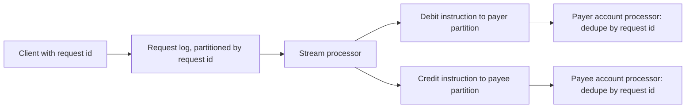

# Aiming for correctness and doing the right thing

A stateless service that crashes can be restarted and nothing of value is lost. A system that stores data is different: its mistakes last. A double-charged card, a lost order or a merged pair of accounts stays wrong until a person notices and repairs it - and often no one notices for a long time.

For decades the standard tool for building correct stateful applications has been the transaction: atomicity, isolation and durability. Earlier lessons showed that this foundation is less solid than it looks. Weak isolation levels are the default in most databases and are easy to misunderstand; many distributed stores have dropped multi-object transactions altogether; and even a perfectly serialisable database cannot protect you from an application that uses it wrongly.

This final DDIA lesson has two parts. The first is technical: how to get strong correctness in systems built from asynchronous dataflow, without paying for distributed transactions everywhere. Its key ideas are the **end-to-end argument**, **idempotent operations with request identifiers**, the separation of **timeliness** from **integrity**, and **auditing**. The second part is about a different kind of correctness: whether what we build with data is good for the people the data describes. Both belong in an engineer's judgement.

## 1. The end-to-end argument

### "Exactly once" is harder than it looks

Stream processors advertise exactly-once semantics. Remember what that means: if something fails mid-way, the work is retried, and the system arranges that the *final effect* is the same as if no fault had occurred. The most broadly applicable way to achieve it is to make operations **idempotent**, so that a repeat is harmless.

Now follow a real request from a real user. A person taps "Pay 40" in a banking app. The request reaches the server, the server runs a transaction that debits one account and credits another, the transaction commits - and the response is lost because the phone went into a tunnel. The app shows a spinner, then an error. The person taps again.

From the database's point of view the second tap is a brand-new transaction. Every layer underneath did its job:

- TCP suppresses duplicate *packets*, but only within one connection. The retry uses a new connection.
- The database transaction is atomic, but it knows nothing about a previous, separate transaction with the same intent.
- Two-phase commit between an application server and the database does not help either: the duplicate originates in the **user's device**, outside any transaction boundary.

The money moves twice.

### Operation identifiers

The repair must cover the whole path. The client generates a unique identifier for the *operation* - a UUID created when the form is first shown, or a hash of the relevant form fields - and sends it with every attempt. The server records the identifier in the same transaction as the effect, protected by a uniqueness constraint. A second attempt with the same identifier hits the constraint and is recognised as a repeat.

```python-run
import sqlite3, uuid

db = sqlite3.connect(":memory:")
db.executescript("""
  CREATE TABLE accounts (id TEXT PRIMARY KEY, balance INTEGER);
  CREATE TABLE requests (request_id TEXT PRIMARY KEY, src TEXT, dst TEXT, amount INTEGER);
  INSERT INTO accounts VALUES ('alice', 100), ('bob', 0);
""")

def transfer(request_id, src, dst, amount):
    try:
        with db:                                           # one atomic transaction
            db.execute("INSERT INTO requests VALUES (?,?,?,?)", (request_id, src, dst, amount))
            db.execute("UPDATE accounts SET balance = balance - ? WHERE id = ?", (amount, src))
            db.execute("UPDATE accounts SET balance = balance + ? WHERE id = ?", (amount, dst))
        return "applied"
    except sqlite3.IntegrityError:
        return "duplicate ignored"

rid = str(uuid.uuid4())                                    # created once, on the client
print(transfer(rid, "alice", "bob", 40))                   # response lost in transit...
print(transfer(rid, "alice", "bob", 40))                   # ...user retries with the SAME id
print(dict(db.execute("SELECT id, balance FROM accounts")))
print(transfer(str(uuid.uuid4()), "alice", "bob", 40), "<- a retry with a fresh id would pay twice")
print(dict(db.execute("SELECT id, balance FROM accounts")))
```

The `requests` table is doing two jobs: it suppresses duplicates, and it is an **event log** of what was asked for - the balances could be derived from it. Payment APIs call this identifier an *idempotency key*.

### The general principle

This is an instance of a classic systems-design insight, the **end-to-end argument**: a function such as duplicate suppression can be implemented completely and correctly only with the knowledge of the endpoints of the communication. Lower layers may offer a partial version as a performance optimisation, but they cannot replace the end-to-end one.

It applies beyond duplicates:

- **Integrity checks.** Ethernet, TCP and TLS all have checksums, yet they cannot catch corruption caused by a bug in the sending or receiving software, or by the disk the data rests on. Only a checksum computed at the origin and verified at the final destination covers the whole path.
- **Encryption.** Wi-Fi encryption protects against people listening to the radio, TLS against the network in between, but only end-to-end encryption protects against a compromised server.

Lower-level reliability features are still worth having - they greatly reduce how often the higher layer has to deal with a problem. They are just not sufficient. Transactions are a wonderful abstraction that collapses many failure modes into commit or abort, and the lesson here is not to discard them but to recognise that the application has to carry certain safeguards (like the request id) through from end to end.

> [!INTERVIEW]
> "How do you make this POST endpoint safe to retry?" Expected answer: the client supplies an idempotency key; the server stores it atomically with the effect under a unique constraint (or stores the response against the key and replays it); the key has a defined scope and expiry. Bonus: mention that the retry may arrive *while* the first attempt is still running, so the insert of the key must come first and act as a lock.

## 2. Enforcing constraints without distributed transactions

Uniqueness is the archetypal constraint: one account per username, one booking per seat, no negative stock. Others - "balance never below zero", "do not oversell" - have the same shape.

### Uniqueness needs a single decision point

If several nodes can concurrently accept conflicting writes, somebody must decide which wins. That is consensus. The usual implementation is to route all decisions about a given value to one place:

- Partition by the value that must be unique (hash of the username), so all requests for the same username reach the same partition.
- Have a **single-threaded** processor consume that partition's log in order. For each request it checks its local state: if the name is free, record it as taken and emit a success message; otherwise emit a rejection.
- The client waits for the outcome on an output stream.

The log's ordering *is* the decision. Whichever request sits earlier in the partition wins, deterministically. Throughput scales by adding partitions, because each can be processed independently. What does not work is asynchronous multi-leader replication, since two leaders could each accept a conflicting value.

```python-run
# Requests for the same username are routed to the same partition and processed in log order.
requests = [("r1", "claim", "kiwi"), ("r2", "claim", "mango"), ("r3", "claim", "kiwi"),
            ("r4", "claim", "Kiwi"), ("r5", "claim", "mango")]

NUM_PARTITIONS = 3
partitions = [[] for _ in range(NUM_PARTITIONS)]
for req in requests:
    name = req[2].lower()                                  # normalise before routing!
    partitions[sum(name.encode()) % NUM_PARTITIONS].append(req)

for p, log in enumerate(partitions):
    taken = set()                                          # local state of this partition's processor
    for rid, _, name in log:                               # single-threaded, in log order
        key = name.lower()
        outcome = "REJECTED" if key in taken else "ok"
        taken.add(key)
        print(f"partition {p}: {rid} {name:<6} -> {outcome}")
```

### Operations that span partitions

Suppose a transfer touches three things that live in different partitions: the request record, the payer's account and the payee's account. The traditional design is an atomic commit across the three. The same correctness can be reached with a pipeline:

1. The client's request, carrying a unique request id, is appended **durably to a log**, partitioned by request id. This single append is the atomic point: the request either exists or it does not.
2. A stream processor reads the request and emits two messages: a debit instruction to the payer's partition and a credit instruction to the payee's partition, both carrying the request id.
3. Downstream processors apply the instructions, **deduplicating by request id**.

If the processor in step 2 crashes, it resumes from its last checkpoint and may emit the instructions again; that is harmless because step 3 ignores repeats. No message is lost because the log is durable. The outcome is all-or-nothing and effectively-once, achieved with *single-partition atomic writes plus idempotence* and no cross-partition commit protocol.



If the transfer needs validation - is the payer allowed to overdraw? - add a stage in the payer's partition that checks and emits an accepted or rejected event before any credit is issued.

## 3. Timeliness and integrity

"Consistency" bundles two requirements that deserve separate names.

- **Timeliness**: users observe the system in an up-to-date state. A stale read violates timeliness, but the violation is temporary: wait and retry, and it resolves.
- **Integrity**: the absence of corruption - no lost data, no contradictory or false data. If a derived dataset no longer matches its source, or a debit has no corresponding credit, waiting fixes nothing. Somebody has to find and repair it.

A slogan: violations of timeliness are *eventual consistency*; violations of integrity are *perpetual inconsistency*.

In most applications integrity matters far more. Your card statement not yet showing this morning's purchase is unremarkable; a statement whose balance does not equal the sum of its transactions would be alarming.

ACID transactions give both at once, so the distinction never came up. Asynchronous dataflow systems split them deliberately: they give up timeliness by default (derived views lag) while keeping integrity central. The integrity mechanisms we have now seen are:

- representing a write as a **single immutable message**, appended atomically;
- deriving all other state through **deterministic** functions of that message;
- passing a **client-generated request id** through every stage for end-to-end deduplication;
- keeping messages immutable and permitting **reprocessing** of derived data to recover from bugs.

### Constraints are often looser than they seem

Strict enforcement requires a synchronous decision. Many businesses do not really need that, because they already have a procedure for handling a violation after the fact:

- Two people register the same username at the same moment: tell one of them, apologetically, to choose another.
- More orders than stock: order more, apologise for the delay, offer a discount. Warehouses lose items to forklifts anyway, so the process has to exist regardless.
- Airlines and hotels overbook on purpose and compensate bumped customers.
- A withdrawal beyond the balance: charge an overdraft fee and ask for the money back.

Such a correction is a **compensating transaction**. If the cost of occasionally apologising is acceptable, the write can be accepted optimistically and validated afterwards. What you must not do is lose the reservation or the money - that is integrity. So a sound architecture preserves integrity everywhere and enforces timeliness only for the few constraints that truly require it.

### Coordination-avoiding systems

Putting these together: dataflow systems can maintain integrity without atomic commit, linearizability or synchronous cross-partition coordination, and many constraints can be checked asynchronously. Such **coordination-avoiding** designs perform better and tolerate faults better than systems that coordinate synchronously - for example, they can run across several data centres with asynchronous replication between regions, each continuing to operate when cut off from the others. Timeliness is weaker; integrity remains strong. Serialisable transactions still have their place for the small part of the application that needs them.

Another way to say it: coordination reduces the number of apologies you must issue for inconsistencies but also reduces performance and availability, which in turn causes apologies for outages. The aim is the sweet spot - neither too many inconsistencies nor too many availability problems.

> [!TIP]
> In a design discussion, sort each invariant into one of three bins: must be enforced synchronously (rare; needs a single decision point), can be detected and compensated (common), or is not really an invariant. The exercise usually removes most of the perceived need for distributed transactions.

## 4. Trust, but verify

All reasoning about correctness rests on a **system model**: assumptions about what can go wrong. We assume processes crash, networks drop packets and clocks drift; we also assume that data written and fsynced stays written, and that the CPU adds correctly. These are judgements about probability, not certainties.

- Hardware does corrupt data. Bits flip in memory and on disk at low but non-zero rates, and at large scale low-probability events occur daily.
- Software has bugs, including mature databases - cases of unique constraints not holding or isolation levels being weaker than documented have been found in widely used products.
- Application code has more bugs than database code, and frequently uses database features incorrectly.

So do not assume integrity; **check** it. Checking that data is still intact is called **auditing**. Mature storage systems do it continuously: large file systems and object stores read files back in the background, compare replicas and repair silently corrupted blocks. Backups deserve the same scepticism - a backup is only known to work once a restore from it has been tested.

### Designing for auditability

A transaction that mutates several rows leaves little evidence of *why*. The transaction log may say which rows changed, but the application logic that decided on those changes is gone.

Event-based systems are easier to audit. The user's input is recorded as an immutable event, and every state update is the result of a deterministic derivation from events. Then:

- running the same events through the same version of the code must reproduce the same output, so a derived store can be checked by recomputation;
- a hash of the event log can verify that the stored events have not been altered;
- when something unexpected is found, you can replay to the exact situation in which it arose - a kind of time-travel debugging.

Checking integrity at the ends of a pipeline - is what comes out consistent with what went in? - covers every disk, network, service and algorithm in between, which is the end-to-end argument once more.

```python-run
import hashlib, json

def chain(events):
    """Each entry's hash covers the previous hash, so history cannot be altered unnoticed."""
    h, out = "0" * 64, []
    for e in events:
        h = hashlib.sha256((h + json.dumps(e, sort_keys=True)).encode()).hexdigest()
        out.append(h)
    return out

def balances(events):
    b = {}
    for e in events:
        b[e["from"]] = b.get(e["from"], 0) - e["amount"]
        b[e["to"]]   = b.get(e["to"], 0) + e["amount"]
    return b

log = [{"from": "bank", "to": "ana", "amount": 100},
       {"from": "ana",  "to": "ben", "amount": 30},
       {"from": "ben",  "to": "cy",  "amount": 10}]
published_head = chain(log)[-1]                      # e.g. shared with an auditor
derived_store  = balances(log)                       # the "database" users query

# Audit 1: the derived store must equal a recomputation from the log
print("derived view intact:", derived_store == balances(log))
# Audit 2: money is neither created nor destroyed
print("sum of balances:", sum(derived_store.values()))

# Somebody quietly edits history and the derived store
log[1]["amount"] = 3
derived_store = balances(log)
print("recomputation still matches (the edit was consistent):", derived_store == balances(log))
print("hash chain detects tampering:", chain(log)[-1] != published_head)
```

Cryptographic tools generalise the last step: **Merkle trees** let you prove efficiently that a record is contained in a dataset, and transparency logs (as used for TLS certificates) make an append-only log publicly verifiable. Building auditability into ordinary data systems, at acceptable performance cost, is an area that deserves more attention than it gets.

## 5. Doing the right thing

Every system is built for a purpose, and has consequences far beyond that purpose. Much of the data we handle describes people: what they do, where they go, what they like, who they know. Engineers who build these systems carry responsibility for the effects, whether or not it is in the job description. What follows is not a set of rules; it is a set of questions worth asking.

### Predictive systems

Using data to predict the weather harms no one. Using it to predict whether a person will repay a loan, reoffend, or be a good employee changes individual lives. As algorithmic decisions spread, someone labelled risky by one system may be refused jobs, flats, insurance and credit across the board, with no clear way to appeal.

- **Bias.** A model learns from historical decisions. If those decisions were discriminatory, the model reproduces the pattern and lends it an appearance of objectivity. Removing the protected attribute is not enough, because other features (postcode, purchase history) correlate with it. Predictive systems extrapolate from the past; if the past was unjust, they encode the injustice. Moving beyond it takes human moral judgement.
- **Accountability.** When a human errs, they can be asked for reasons and held responsible. When a model errs, who answers? A score in the bottom decile says little about any individual, and probabilistic outputs will be wrong for particular people even when the overall distribution is right. People need a way to understand and contest decisions made about them.
- **Feedback loops.** A prediction can create the conditions that confirm it. A person who loses work through bad luck misses payments; their credit score falls; a low score makes it harder to be hired; and so the score falls further. Thinking about the system as a whole - including the people responding to it - is necessary to see these loops.

> [!NOTE]
> For ML engineers this is practical, not abstract: evaluate metrics per subgroup and not only on average, log model inputs and versions so decisions can be explained later, and provide a human path for review and correction.

### Privacy and tracking

When a user enters data explicitly because they want a service to do something for them, the system serves the user. When their activity is recorded as a side effect and used for other ends - most often advertising - the relationship changes: the service has interests of its own that may conflict with the user's.

A thought experiment helps: replace the word *data* with *surveillance* and reread the product description. "Our surveillance-driven organisation collects real-time surveillance streams and stores them in our surveillance warehouse" is not how anyone wants to describe their work, yet it is frequently accurate.

- **Consent** is weak when users cannot realistically understand what is collected or how it is combined, and when declining means losing a service that has become a practical necessity because everyone else uses it. Data about one person often reveals things about others who never agreed to anything.
- **Privacy** does not mean keeping everything secret. It means having the freedom to decide what to reveal to whom. When data is extracted through tracking, that decision is transferred from the individual to the company.
- **Data as asset and as liability.** Collected data attracts thieves, hostile insiders and legal demands, and it will exist under whatever management or government comes later. A useful way to think: data is a hazardous material - handle it deliberately, and do not keep what you do not need.

There is a historical parallel. The industrial revolution created enormous prosperity along with polluted air and rivers and dangerous working conditions; it took a long time for safeguards to be established, and they are now uncontroversial. Data is this era's raw material and privacy harm its pollution. Later generations will judge how we dealt with it.

Practical habits that follow: collect only what the feature needs (**data minimisation**), bind data to the purpose it was collected for, set retention periods and actually delete, restrict and log internal access, design erasure in from the start, and say out loud in design reviews when something would be unwelcome to the people it affects. Regulation such as the GDPR turns some of this into law, but compliance is a floor, not a definition of good practice.

## Pitfalls

- **Believing the database makes you safe.** A serialisable transaction cannot detect that the same business operation was submitted twice.
- **Server-generated idempotency keys.** The id must originate where the retry originates - at the client - and be stable across attempts.
- **Recording the request id outside the transaction that performs the effect.** If they are not atomic, a crash between them reintroduces the duplicate or loses the operation.
- **Confusing lag with corruption.** Treating every stale read as a bug leads to over-coordination; treating real integrity violations as "eventual consistency" leads to silent data loss.
- **Never testing restores or recomputing derived data.** Unverified backups and unverifiable caches fail exactly when needed.
- **Aggregate-only model evaluation.** Good overall accuracy can hide large harm to a subgroup.
- **Keeping data "in case it is useful".** Unbounded retention increases breach impact and legal exposure without a matching benefit.

## Summary

- Reliable low-level components do not add up to a correct application. By the **end-to-end argument**, properties like duplicate suppression and integrity checking must be enforced at the endpoints; **client-generated operation ids** recorded atomically with the effect make requests idempotent.
- **Uniqueness** and similar constraints need one decision point per conflicting value: a partitioned log with a single-threaded consumer provides it. Multi-partition operations can be made correct with a durable request log, deterministic stages and deduplication, without atomic commit.
- Separate **timeliness** (up to date; violations heal) from **integrity** (uncorrupted; violations persist). Dataflow systems relax the first and protect the second. Many business constraints can be handled by **compensating** afterwards.
- Hardware and software fail in ways the system model ignores, so **audit**: verify backups, recompute derived data, and use immutable, hash-verifiable event logs for traceability.
- Data systems affect people. Consider **bias**, **accountability** and **feedback loops** in predictive systems, and treat personal data with restraint: minimise, limit purpose, expire, and give individuals control.

```quiz
[
  {"q": "A user clicks Pay, the transaction commits, the response is lost, and the user clicks again. Why does the database's transaction mechanism not prevent a double payment?",
   "options": ["Transactions are not atomic", "The retry is a new, independent transaction; the database has no way to know it expresses the same intent", "TCP delivers every packet twice", "The isolation level was too low"],
   "answer": 1,
   "explain": "Duplicate suppression in TCP or within a transaction does not span separate requests from the client. Only an end-to-end identifier links the two attempts."},
  {"q": "Where must an idempotency key be generated for it to protect against user-level retries?",
   "options": ["In the database, as an auto-increment id", "In the load balancer", "At the client, once per logical operation, and reused for every retry", "In the stream processor"],
   "answer": 2,
   "explain": "The key must be the same for all attempts of one operation, so it has to come from the endpoint where the retries originate."},
  {"q": "What does the end-to-end argument say about reliability features in lower layers such as TCP checksums?",
   "options": ["They make application-level checks unnecessary", "They are useless and should be removed", "They help reduce the frequency of problems but cannot by themselves guarantee the property across the whole path", "They only work on local networks"],
   "answer": 2,
   "explain": "Lower layers cover only their own hop or connection. Full correctness needs a check that spans from the original sender to the final receiver."},
  {"q": "How can a log-based system enforce a unique username without a distributed transaction?",
   "options": ["Let every replica accept claims and merge them later", "Route all claims for the same name to one partition and have a single-threaded consumer decide in log order", "Use last-write-wins on timestamps", "Check for the name in a cache before writing"],
   "answer": 1,
   "explain": "The partition's total order provides the single decision point: the first claim in the log wins and later ones are rejected deterministically."},
  {"q": "Which of the following is an integrity violation rather than a timeliness violation?",
   "options": ["A search index that is three seconds behind the database", "A dashboard showing yesterday's totals", "A debit recorded without the matching credit ever being applied", "A read replica lagging during a deploy"],
   "answer": 2,
   "explain": "Lag resolves itself with time. A missing credit is permanent corruption that needs explicit detection and repair."},
  {"q": "An online shop occasionally sells one more item than it has and then apologises with a voucher. This is an example of:",
   "options": ["Two-phase commit", "A compensating transaction for a loosely enforced constraint", "A Byzantine fault", "Linearizable storage"],
   "answer": 1,
   "explain": "The constraint is validated after the fact and the violation is corrected by a business process, which avoids synchronous coordination on every order."},
  {"q": "Why are event-sourced, deterministic dataflow systems easier to audit than systems that mutate rows in place?",
   "options": ["They never contain bugs", "The inputs are preserved immutably, so derived state can be recomputed and compared, and the history can be verified with hashes", "They store less data", "They do not need backups"],
   "answer": 1,
   "explain": "Reproducibility from a recorded input is what allows checking: rerun the derivation and compare, or replay to the moment a problem arose."},
  {"q": "A credit-scoring model lowers a person's score after a missed payment, which makes employment harder, which leads to more missed payments. This illustrates:",
   "options": ["Data minimisation", "A self-reinforcing feedback loop", "Purpose limitation", "Crypto-shredding"],
   "answer": 1,
   "explain": "The system's output changes the conditions that feed its future input. Such loops are only visible when the whole system, including people's responses, is considered."}
]
```

> **Source:** DDIA ch. 12 (The Future of Data Systems) - aiming for correctness, doing the right thing. Written in original wording with original examples.
