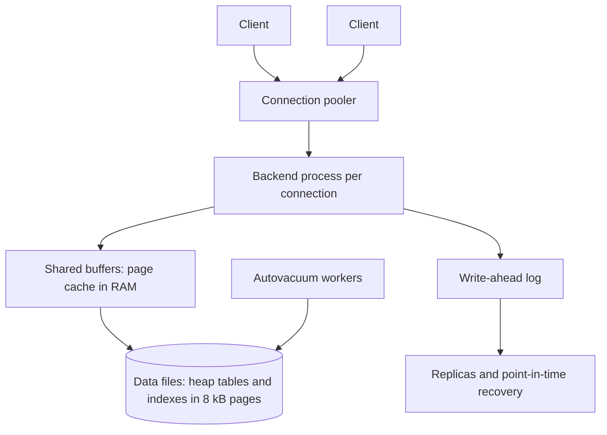

# PostgreSQL essentials and indexes in practice

> **Before this lesson:** you need B-trees, pages, heap files, secondary, clustered, covering and concatenated indexes from [B-trees](#/lesson/databases/btrees); the write-ahead log from the same lesson; MVCC, snapshots and isolation levels from [ACID, read committed and snapshot isolation](#/lesson/databases/acid-weak-isolation); `FOR UPDATE` and write skew from [Lost updates, write skew and phantoms](#/lesson/databases/lost-updates-write-skew). You should be able to read a basic `SELECT ... WHERE ... ORDER BY` query.

## In plain words

**PostgreSQL** (often shortened to Postgres) is a free, open-source relational database, and the one you are most likely to be handed in a new job. This lesson is the practical counterpart to the theory in the earlier modules: what goes on inside it, and how to make its queries fast.

Most of the lesson is about **indexes**, because most slow queries are slow for want of the right one. An everyday picture: a library with a million books shelved in the order they were bought. To find every book by one author you would have to walk past every shelf. The card catalogue fixes that: a cabinet of cards sorted by author, each card saying where the book stands. But a catalogue sorted by author is no help for finding books by year of publication. That needs a second cabinet, sorted by year. And every new book now means writing and filing one card per cabinet. An index is such a cabinet: it makes one kind of search fast, and it makes every addition a little slower.

Three skills come out of this lesson:

1. Knowing which searches a given index can serve, especially an index on several columns.
2. Reading the database's own description of how it will run a query, called a **query plan**.
3. Recognising the handful of mistakes behind most performance problems.

Why this matters for a job: "this query is slow, what do you do?" is asked in almost every backend interview, and it is asked again by reality in the first month of almost every backend job. The answer is a short routine, given in section 6.

## Why PostgreSQL

The first twelve modules explained how databases work in principle. This last module is about using them well in day-to-day engineering, starting with the database you are most likely to meet: PostgreSQL. It is the default relational choice for new projects, it backs a large share of ML platforms (experiment tracking, feature metadata, labelling tools, application backends), and with extensions it also serves as a document store, a queue, a time-series store and a vector database.

The goal here is practical fluency. After this lesson you should be able to describe what happens inside PostgreSQL when a query runs, choose the right index for a query, read an `EXPLAIN` plan, and recognise the handful of mistakes that cause most production performance problems. The runnable examples use SQLite, which ships with Python and shares the relevant index behaviour; wherever PostgreSQL differs, the text says so.

## 1. How PostgreSQL is put together

A mental model of the server pays off every time something is slow.



- **One process per connection.** Each client connection gets its own server process with its own memory. Connections are therefore expensive: thousands of mostly idle ones waste memory and scheduling time. This is why production setups place a **connection pooler** (PgBouncer, or a pool inside the application) in front and keep the number of real server connections small - often only a few times the number of CPU cores.
- **Heap tables and separate indexes.** Rows live in *heap* files in no particular order, in 8 kB pages. Every index, including the primary key, is a separate structure whose entries point at heap locations. (Contrast with MySQL/InnoDB, where the table itself is a B-tree clustered on the primary key.)
- **Write-ahead log.** Every change is appended to the WAL and flushed before the commit is acknowledged; data pages are written back lazily. The WAL also feeds streaming replicas, point-in-time recovery, and logical decoding for change data capture.
- **MVCC.** An `UPDATE` does not overwrite a row. It writes a new row version and marks the old one as expired; a `DELETE` only marks. Readers see the versions that their snapshot allows, so readers never block writers and writers never block readers.
- **Vacuum.** The price of MVCC is that dead row versions accumulate. **Autovacuum** reclaims them, refreshes planner statistics, and maintains the visibility map. A table that is updated heavily and vacuumed too rarely suffers **bloat**: it grows, and scans slow down.

Two terms in that last point. The **planner** (or optimiser) is the part of the database that decides how to carry out a query. To choose well it keeps **statistics** about each table, such as how many rows it has and how common each value is. The **visibility map** is a small record of which pages contain only row versions that every transaction can see, which lets some operations skip those pages.

> [!WARNING]
> A transaction left open for hours - an abandoned notebook session, a forgotten `BEGIN` in a console - forces PostgreSQL to keep every row version newer than its snapshot. Vacuum cannot clean up, tables bloat, and performance degrades for everybody. Setting `idle_in_transaction_session_timeout` is cheap insurance.

### Isolation levels as PostgreSQL implements them

| Level | Behaviour in PostgreSQL |
|---|---|
| `READ COMMITTED` (default) | Each *statement* gets a fresh snapshot. No dirty reads; non-repeatable reads and lost updates through read-modify-write are possible |
| `REPEATABLE READ` | Snapshot isolation: one snapshot for the whole transaction. A conflicting concurrent update makes the transaction fail with a serialisation error; write skew is still possible |
| `SERIALIZABLE` | Serialisable snapshot isolation: also detects dangerous read-write dependency patterns and aborts one transaction. The application must retry |

`READ UNCOMMITTED` is accepted as syntax but behaves like `READ COMMITTED`. With the two higher levels, code must be prepared to catch SQLSTATE `40001` and rerun the transaction.

## 2. Features worth knowing

- **Rich types**: `jsonb` (binary JSON with indexing), arrays, ranges, `uuid`, `timestamptz`, enums, and through extensions geometry (PostGIS) and vectors (pgvector).
- **Upsert**: `INSERT ... ON CONFLICT (key) DO UPDATE SET ...` - an atomic insert-or-update, and the natural way to write idempotent consumers.
- **`RETURNING`**: get the affected rows back from `INSERT`/`UPDATE`/`DELETE` without a second query.
- **CTEs and window functions** for analytical SQL (covered in the SQL track).
- **Row locks**: `SELECT ... FOR UPDATE` locks the selected rows until commit. `FOR UPDATE SKIP LOCKED` skips rows that someone else has locked, which turns a table into a serviceable job queue.
- **Constraints**: primary key, unique, foreign key, check, and exclusion constraints (for example "no two bookings of the same room with overlapping time ranges").
- **Declarative partitioning** by range, list or hash, mainly to make dropping old data and maintaining huge tables manageable.

```sql
-- A job queue: each worker claims one job, workers never block each other
WITH next AS (
  SELECT id FROM jobs
  WHERE status = 'queued'
  ORDER BY created_at
  FOR UPDATE SKIP LOCKED
  LIMIT 1
)
UPDATE jobs SET status = 'running', started_at = now()
FROM next WHERE jobs.id = next.id
RETURNING jobs.id, jobs.payload;
```

Reading that statement: the part inside `WITH next AS ( ... )` selects the ID of the oldest queued job and locks that row. `SKIP LOCKED` tells it to pass over any row another worker has already locked, so two workers never wait for each other and never pick the same job. The `UPDATE` then marks the chosen job as running, and `RETURNING` hands back its ID and contents in the same round trip.

## 3. What an index really is

Without an index, the only way to find rows matching a condition is to read the whole table: a **sequential scan**, cost proportional to table size. An index is an additional data structure, maintained on every write, that lets the database find matching rows without looking at all of them. This is the trade-off met throughout this track - **work is moved from the read path to the write path**.

The default index is a **B-tree**: a balanced tree with a large fan-out, whose leaves contain the indexed values in sorted order together with pointers to the rows. Because the leaves are sorted, a B-tree supports:

- equality: `WHERE email = 'a@b.c'`
- ranges: `WHERE created_at >= '2026-01-01'`
- prefix matches: `WHERE name LIKE 'abc%'` (with a suitable collation or operator class)
- sorted output: `ORDER BY created_at DESC LIMIT 20` can read the index in order and stop early
- `MIN`/`MAX` by reading one end

Lookup cost is the tree height, which grows with the logarithm of the row count - three or four page reads for hundreds of millions of rows.

The program below creates a table of 100,000 events and runs the same query before and after adding an index.

```python-run
import sqlite3, time, random
random.seed(42)
db = sqlite3.connect(":memory:")
db.execute("CREATE TABLE events (id INTEGER PRIMARY KEY, user_id INT, kind TEXT, ts INT, amount REAL)")
kinds = ["view"] * 90 + ["cart"] * 8 + ["purchase"] * 2          # skewed on purpose
db.executemany("INSERT INTO events (user_id, kind, ts, amount) VALUES (?,?,?,?)",
               [(random.randrange(20_000), random.choice(kinds), i, random.random() * 100) for i in range(100_000)])

def plan(sql):
    return " | ".join(r[3] for r in db.execute("EXPLAIN QUERY PLAN " + sql))

def timed(sql, n=20):
    t = time.perf_counter()
    for _ in range(n): db.execute(sql).fetchall()
    return (time.perf_counter() - t) / n * 1e3

q = "SELECT * FROM events WHERE user_id = 4242"
print("before:", plan(q), f"-> {timed(q):.2f} ms")
db.execute("CREATE INDEX idx_events_user ON events (user_id)")
print("after: ", plan(q), f"-> {timed(q):.3f} ms")
```

What each part does:

- The first lines create an in-memory SQLite database with one table, `events`, and insert 100,000 rows with random user IDs.
- `plan(sql)` asks the database how it would run a query. `EXPLAIN QUERY PLAN` returns rows describing the steps, and the fourth field of each row is the human-readable description.
- `timed(sql, n=20)` runs a query 20 times and returns the average time in milliseconds.
- The script prints the plan and the timing for a search by `user_id`, creates an index on that column, and prints both again.

Typical output (times vary by machine, and the wording of plans varies slightly between SQLite versions):

```
before: SCAN events -> 2.79 ms
after:  SEARCH events USING INDEX idx_events_user (user_id=?) -> 0.005 ms
```

`SCAN events` means the whole table was read. `SEARCH ... USING INDEX` means the index was used to go straight to the matching rows.

A full scan became an index search, and the query got faster by two or three orders of magnitude. Notice what the experiment did *not* measure: every `INSERT` into `events` is now slightly slower, for ever.

## 4. Composite indexes and the leftmost-prefix rule

An index on several columns, `(user_id, ts)`, is sorted by `user_id` first and by `ts` within each user - like a phone book sorted by surname, then first name. That ordering determines which queries can use it:

| Query condition | Uses `(user_id, ts)` efficiently? |
|---|---|
| `user_id = 7` | Yes - a leading prefix |
| `user_id = 7 AND ts > 1000` | Yes - equality on the first column, range on the second |
| `user_id = 7 ORDER BY ts DESC LIMIT 10` | Yes - rows for that user are already in `ts` order |
| `ts > 1000` | No - `ts` values are scattered across all users |
| `user_id > 7 AND ts = 1000` | Only the `user_id` range; `ts` becomes a filter |

A rule of thumb for column order: **equality columns first, then one range or sort column**. Once the index has been traversed by a range condition, the columns after it are no longer in a useful order.

```python-run
import sqlite3, random
random.seed(1)
db = sqlite3.connect(":memory:")
db.execute("CREATE TABLE events (id INTEGER PRIMARY KEY, user_id INT, kind TEXT, ts INT, amount REAL)")
db.executemany("INSERT INTO events (user_id, kind, ts, amount) VALUES (?,?,?,?)",
               [(random.randrange(5000), random.choice(["view", "cart", "purchase"]), i, 1.0) for i in range(50_000)])
db.execute("CREATE INDEX idx_user_ts ON events (user_id, ts)")
db.execute("ANALYZE")

def plan(sql):
    return " | ".join(r[3] for r in db.execute("EXPLAIN QUERY PLAN " + sql))

print("1", plan("SELECT * FROM events WHERE user_id = 7"))
print("2", plan("SELECT * FROM events WHERE user_id = 7 AND ts > 40000"))
print("3", plan("SELECT * FROM events WHERE user_id = 7 ORDER BY ts DESC LIMIT 10"))
print("4", plan("SELECT * FROM events WHERE ts > 49990"))
print("5", plan("SELECT user_id, ts FROM events WHERE user_id = 7"))
```

What each part does:

- The setup creates the same kind of table with 50,000 rows and one composite index on `(user_id, ts)`. `ANALYZE` makes the database gather statistics about the data.
- The five `print` lines ask for the plan of five queries, numbered to match the discussion.

```
1 SEARCH events USING INDEX idx_user_ts (user_id=?)
2 SEARCH events USING INDEX idx_user_ts (user_id=? AND ts>?)
3 SEARCH events USING INDEX idx_user_ts (user_id=?)
4 SCAN events
5 SEARCH events USING COVERING INDEX idx_user_ts (user_id=?)
```

Plans 1 to 3 search the index, and 3 needs no separate sort step. Plan 4 has to scan the table because `ts` is not a leading column. Plan 5 says **covering index**: every column the query needs is in the index, so the table is not touched at all.

### Covering indexes and index-only scans

If an index contains all columns a query reads, the database can answer from the index alone. PostgreSQL calls this an **index-only scan**. You can add payload columns that are not part of the search key with `INCLUDE`:

```sql
CREATE INDEX idx_orders_cust ON orders (customer_id, created_at) INCLUDE (total_cents);
```

One PostgreSQL-specific detail: because visibility information is stored in the heap and not in the index, an index-only scan can skip the heap only for pages that the **visibility map** marks as all-visible. On a table with many recent changes that has not been vacuumed, an "index-only" scan still visits the heap. Another reason to keep autovacuum healthy.

## 5. Specialised indexes

**Partial index** - index only the rows you query. If 98 percent of jobs are `done` and you only ever look for the queued ones:

```sql
CREATE INDEX idx_jobs_queued ON jobs (created_at) WHERE status = 'queued';
```

The index is tiny, stays in memory, and costs nothing when rows in other states are written. The query's `WHERE` clause must imply the index predicate. Partial *unique* indexes express rules such as "at most one active subscription per user".

**Expression index** - index the result of a function. A condition like `WHERE lower(email) = 'x@y.z'` cannot use a plain index on `email`, because the index is sorted by the raw value. Index the expression itself:

```sql
CREATE INDEX idx_users_email_lower ON users (lower(email));
```

**Other access methods**

| Type | Good for | Example |
|---|---|---|
| **GIN** (inverted index) | Values that contain many elements: `jsonb` containment, arrays, full-text `tsvector`, trigram search for `LIKE '%abc%'` | `CREATE INDEX ON docs USING gin (tags)` |
| **GiST** | Geometric and range data, nearest-neighbour, overlap; exclusion constraints | PostGIS geometry, `tstzrange` |
| **BRIN** | Huge append-only tables where the column correlates with physical order (timestamps in a log): stores min/max per block range, kilobytes in size | `USING brin (created_at)` |
| **Hash** | Equality only; rarely better than a B-tree | |
| **HNSW / IVFFlat** (pgvector) | Approximate nearest-neighbour search on embeddings | next lesson |

The program below tries a partial index and an expression index.

```python-run
import sqlite3, random
random.seed(5)
db = sqlite3.connect(":memory:")
db.execute("CREATE TABLE jobs (id INTEGER PRIMARY KEY, status TEXT, created INT, email TEXT)")
db.executemany("INSERT INTO jobs (status, created, email) VALUES (?,?,?)",
               [("done" if random.random() < 0.98 else "queued", i, f"User{i}@Example.com") for i in range(100_000)])

def plan(sql):
    return " | ".join(r[3] for r in db.execute("EXPLAIN QUERY PLAN " + sql))
def pages(name):
    return db.execute("SELECT count(*) FROM dbstat WHERE name = ?", (name,)).fetchone()[0]

db.execute("CREATE INDEX idx_full    ON jobs (status, created)")
db.execute("CREATE INDEX idx_partial ON jobs (created) WHERE status = 'queued'")
db.execute("CREATE INDEX idx_email_l ON jobs (lower(email))")

try:
    print("pages: full index", pages("idx_full"), "| partial index", pages("idx_partial"))
except sqlite3.OperationalError:
    print("(dbstat not available in this build; the partial index holds ~2% of the rows)")

print(plan("SELECT * FROM jobs INDEXED BY idx_partial WHERE status = 'queued' ORDER BY created LIMIT 5"))
print(plan("SELECT * FROM jobs WHERE lower(email) = 'user77@example.com'"))
print(plan("SELECT * FROM jobs WHERE email LIKE '%77@Example.com'"))
```

What each part does:

- The table `jobs` gets 100,000 rows, about 98% with status `done`. Email addresses are stored with mixed capital letters.
- Three indexes are created: a full index on `(status, created)`, a partial index on `created` covering only queued jobs, and an expression index on `lower(email)`.
- `pages(name)` asks SQLite how many storage pages an index occupies. That information comes from an optional feature called `dbstat`. If your SQLite does not include it, the `try` block prints a note instead.
- The last three lines print the plans of three queries. `INDEXED BY` in the first one tells SQLite which index to use.

Typical output:

```
(dbstat not available in this build; the partial index holds ~2% of the rows)
SCAN jobs USING INDEX idx_partial
SEARCH jobs USING INDEX idx_email_l (<expr>=?)
SCAN jobs
```

The first query reads the small partial index in order, which is exactly the queued jobs sorted by creation time. The second uses the expression index: `<expr>` stands for `lower(email)`. The third finds no usable index and scans the table.

The last query has a leading wildcard, so no B-tree can help; in PostgreSQL the answer would be a trigram GIN index or full-text search.

## 6. Reading a query plan

`EXPLAIN` shows the plan the optimiser chose; `EXPLAIN (ANALYZE, BUFFERS)` also **executes** the query and reports real row counts, timings and page accesses. A PostgreSQL plan looks like this:

```text
Limit  (cost=0.43..12.61 rows=20 width=48) (actual time=0.03..0.09 rows=20 loops=1)
  ->  Index Scan Backward using idx_orders_cust on orders
        (cost=0.43..5234.10 rows=8600 width=48) (actual time=0.03..0.08 rows=20 loops=1)
        Index Cond: (customer_id = 4711)
        Buffers: shared hit=6
Planning Time: 0.12 ms
Execution Time: 0.11 ms
```

How to read it:

1. **Read from the innermost node outwards.** Each node passes rows to its parent.
2. **Node types.** `Seq Scan` reads the whole table. `Index Scan` walks the index and fetches each matching row from the heap. `Index Only Scan` avoids the heap. `Bitmap Heap Scan` first collects matching locations from one or more indexes, sorts them by page, then reads the pages - the middle ground for medium selectivity. Joins are `Nested Loop` (good when the outer side is small and the inner side is indexed), `Hash Join` (large unsorted inputs, equality) and `Merge Join` (both inputs sorted).
3. **Estimated versus actual rows.** This is the most informative comparison in the output. If the planner expected 10 rows and found 200,000, its statistics are stale or the columns are correlated; a bad plan usually follows. Run `ANALYZE`, or create extended statistics.
4. **`Rows Removed by Filter`.** A large number means the database fetched many rows only to discard them - a sign that the index does not match the predicate.
5. **Buffers.** `shared read` means pages came from disk; a high count explains slow first runs.

### Why the planner sometimes ignores your index

An index scan pays a random page access per matching row. If the condition matches a large fraction of the table - `WHERE kind = 'view'` when 90 percent of rows are views - reading the table sequentially is cheaper, and the planner rightly chooses that. **Selectivity** decides whether an index helps. Low-cardinality columns such as booleans and status flags are poor candidates for a plain index and good candidates for a partial one covering the rare value.

> [!INTERVIEW]
> "This query is slow - what do you do?" A structured answer: (1) run `EXPLAIN (ANALYZE, BUFFERS)`; (2) find the node where most time is spent and compare estimated with actual rows; (3) check whether a suitable index exists and whether the predicate can use it (function on the column? type mismatch? leading wildcard? wrong column order?); (4) check statistics and bloat; (5) only then consider rewriting the query, adding an index - weighing the write cost - or changing the schema.

## 7. Patterns that matter in practice

**Keyset pagination.** `OFFSET 100000 LIMIT 20` makes the database produce and throw away 100,000 rows; page 5,000 is slow no matter what indexes exist. Remember the last key seen instead:

```sql
SELECT * FROM posts
WHERE (created_at, id) < ($last_created_at, $last_id)
ORDER BY created_at DESC, id DESC
LIMIT 20;
```

With an index on `(created_at, id)`, every page costs the same.

**The N+1 query problem.** An ORM loads 100 orders and then issues one query per order for its customer: 101 round trips. Fetch with a join or with one `WHERE id = ANY($1)` query.

**Batch writes.** Thousands of single-row `INSERT`s, each in its own transaction, mean thousands of WAL flushes. Use multi-row inserts or `COPY`, and wrap batches in a transaction. For bulk loads into a new table, create the indexes afterwards.

**Schema changes without downtime.** `CREATE INDEX` blocks writes to the table while it builds; `CREATE INDEX CONCURRENTLY` does not, at the cost of taking longer. Many `ALTER TABLE` forms take an exclusive lock, briefly or for a full rewrite - set a `lock_timeout` and check which kind you are running.

**Foreign keys need indexes on the referencing side.** PostgreSQL does not create them automatically. Without one, deleting a parent row scans the whole child table.

**Monitoring.** `pg_stat_statements` shows which queries consume the most total time - usually a cheap query executed millions of times, not the one slow report. `pg_stat_user_indexes` reveals indexes that are never used and only add write cost.

## Pitfalls

- **A function or cast on the indexed column.** `WHERE date(created_at) = '2026-03-01'` cannot use an index on `created_at`. Rewrite as a range: `created_at >= '2026-03-01' AND created_at < '2026-03-02'`.
- **Implicit type mismatch.** Comparing a `text` column with a number, or a `bigint` key with a `numeric` parameter, can silently prevent index use.
- **Indexing everything.** Each index slows down writes, consumes memory and lengthens vacuum. Index for the queries you actually run.
- **Wrong column order in a composite index.** `(ts, user_id)` does not serve `WHERE user_id = ?`.
- **`SELECT *` in hot paths.** It defeats index-only scans and ships columns nobody reads.
- **Long transactions and idle-in-transaction sessions** block vacuum and hold locks.
- **Too many direct connections.** Use a pooler; size the pool by cores, not by request concurrency.
- **Trusting `EXPLAIN` without `ANALYZE`.** Estimates are guesses; the actual numbers tell you what happened. (Remember that `EXPLAIN ANALYZE` really runs the statement - wrap data-modifying statements in a transaction and roll back.)
- **Assuming the default isolation level protects check-then-write logic.** Under `READ COMMITTED`, two transactions can both read "seat is free" and both book it. Use a unique constraint, `SELECT ... FOR UPDATE`, or `SERIALIZABLE` with retries.

## Summary

- PostgreSQL runs a **process per connection**, stores rows in an unordered **heap** with separate indexes, makes changes durable through the **WAL**, and provides concurrency through **MVCC**, which needs **vacuum** to remove dead versions.
- An index trades write cost for read speed. **B-trees** serve equality, range, prefix and ordering; **composite** indexes follow the **leftmost-prefix** rule - equality columns first, then a range or sort column.
- **Covering**, **partial** and **expression** indexes tailor an index to a query; **GIN**, **GiST**, **BRIN** and vector indexes serve data that a B-tree cannot.
- Use `EXPLAIN (ANALYZE, BUFFERS)`; compare estimated with actual row counts; remember that **selectivity** decides whether an index is worth using.
- Prefer **keyset pagination**, avoid N+1 queries, batch writes, build indexes **concurrently**, pool connections, and keep transactions short.

## Glossary

- **PostgreSQL (Postgres)** - a widely used open-source relational database.
- **Connection pooler** - a component that shares a small number of database connections among many clients.
- **Heap** (in PostgreSQL) - the file where a table's rows are stored in no particular order.
- **Write-ahead log (WAL)** - the append-only record of every change, written before the change is acknowledged.
- **MVCC** - keeping several versions of each row so readers and writers do not block one another.
- **Vacuum / autovacuum** - the process that removes row versions no transaction can see any more.
- **Bloat** - wasted space from dead row versions that have not been cleaned up.
- **Planner (optimiser)** - the part of the database that chooses how to run a query.
- **Statistics** - the database's summary of what a table contains, used by the planner.
- **Visibility map** - a record of which pages hold only row versions visible to everyone.
- **Upsert** - an insert that becomes an update if the row already exists.
- **`RETURNING`** - a clause that hands back the rows a write statement affected.
- **`SKIP LOCKED`** - an option that passes over rows locked by other transactions instead of waiting.
- **Sequential scan** - reading an entire table to find matching rows.
- **Index** - an extra structure that lets the database find rows without reading the whole table.
- **Composite index** - an index on several columns, sorted by the first, then the second, and so on.
- **Leftmost-prefix rule** - a composite index helps only queries that constrain its leading columns.
- **Covering index / index-only scan** - an index containing every column a query needs / answering from the index without touching the table.
- **Partial index** - an index over only the rows that satisfy a condition.
- **Expression index** - an index on the result of a function applied to a column.
- **GIN / GiST / BRIN** - PostgreSQL index types for multi-element values / geometric and range data / very large tables whose values follow physical order.
- **Query plan (`EXPLAIN`)** - the database's description of how it will run a query.
- **`EXPLAIN ANALYZE`** - running the query and reporting what really happened at each step.
- **Selectivity** - the fraction of rows a condition matches; the smaller, the more an index helps.
- **Cardinality** - the number of distinct values in a column.
- **Keyset pagination** - fetching the next page by filtering on the last key seen, instead of using `OFFSET`.
- **N+1 query problem** - one query for a list, then one more query per item in it.

```quiz
[
  {"q": "Which query can efficiently use a B-tree index on (user_id, created_at)?",
   "options": ["WHERE created_at > '2026-01-01'", "WHERE user_id = 7 ORDER BY created_at DESC LIMIT 10", "WHERE lower(user_name) = 'ana'", "WHERE created_at = '2026-01-01' OR user_id > 0"],
   "answer": 1,
   "explain": "Equality on the leading column positions the scan, and rows for that user are already sorted by created_at, so the top 10 are read without sorting."},
  {"q": "Why does PostgreSQL need vacuum?",
   "options": ["To compress the write-ahead log", "Because MVCC leaves dead row versions behind after updates and deletes, which must be reclaimed", "To rebuild all indexes nightly", "To convert heap tables into B-trees"],
   "answer": 1,
   "explain": "Updates create new row versions and deletes only mark rows. Vacuum removes versions no snapshot can see and also maintains statistics and the visibility map."},
  {"q": "A table has a status column where 98 percent of rows are 'done' and queries only look for 'queued'. The best index is:",
   "options": ["A plain B-tree on status", "A partial index on the lookup column WHERE status = 'queued'", "A BRIN index on status", "No index can help"],
   "answer": 1,
   "explain": "A partial index contains only the rare rows, so it is small and cheap to maintain, and it is exactly what the queries need."},
  {"q": "The planner chooses a sequential scan for WHERE kind = 'view' although an index on kind exists, and 90 percent of rows match. This is:",
   "options": ["A bug in the planner", "Correct, because fetching most of the table through random index lookups costs more than reading it sequentially", "Caused by a missing primary key", "A sign that the WAL is full"],
   "answer": 1,
   "explain": "Index scans pay per matching row. With low selectivity a sequential read of all pages is cheaper."},
  {"q": "WHERE date(created_at) = '2026-03-01' does not use the index on created_at. What is the idiomatic fix?",
   "options": ["Add more RAM", "Rewrite the condition as a half-open range on created_at, or create an expression index", "Switch to a hash index", "Use SELECT DISTINCT"],
   "answer": 1,
   "explain": "The index is ordered by the raw column value, not by the function result. A range predicate on the column itself can use it."},
  {"q": "Why is OFFSET-based pagination slow for deep pages, and what replaces it?",
   "options": ["OFFSET locks the table; use a cursor", "The database must generate and discard all skipped rows; keyset pagination continues from the last seen key instead", "OFFSET disables indexes; use a hash join", "It is not slow if LIMIT is small"],
   "answer": 1,
   "explain": "Cost grows with the offset. Filtering on the sort key of the last row lets an index jump straight to the next page."},
  {"q": "In an EXPLAIN ANALYZE output, a node shows rows=12 estimated and rows=250000 actual. What does this most likely indicate?",
   "options": ["The query returned the wrong result", "The planner's statistics are stale or misleading, so it may have chosen a poor plan", "The index is corrupted", "The table has no primary key"],
   "answer": 1,
   "explain": "Plan choice depends on row estimates. A large misestimate is the usual root cause of a bad join order or scan type; running ANALYZE or adding extended statistics addresses it."},
  {"q": "What does SELECT ... FOR UPDATE SKIP LOCKED enable?",
   "options": ["Reading uncommitted data", "Several workers taking different rows from a queue table without waiting on each other", "Skipping the write-ahead log", "Index-only scans on locked tables"],
   "answer": 1,
   "explain": "Each worker locks the rows it selects and passes over rows already locked by others, which gives a simple and safe job queue."}
]
```

> **Source:** PostgreSQL documentation (indexes, EXPLAIN, MVCC and vacuum, transaction isolation, explicit locking); DDIA ch. 3 and ch. 7 for the underlying principles. Written in original wording with original examples.
