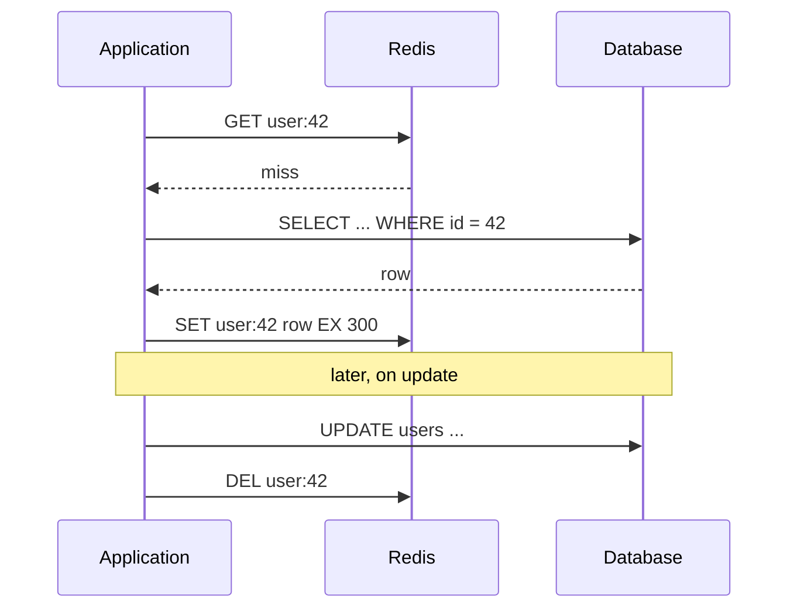
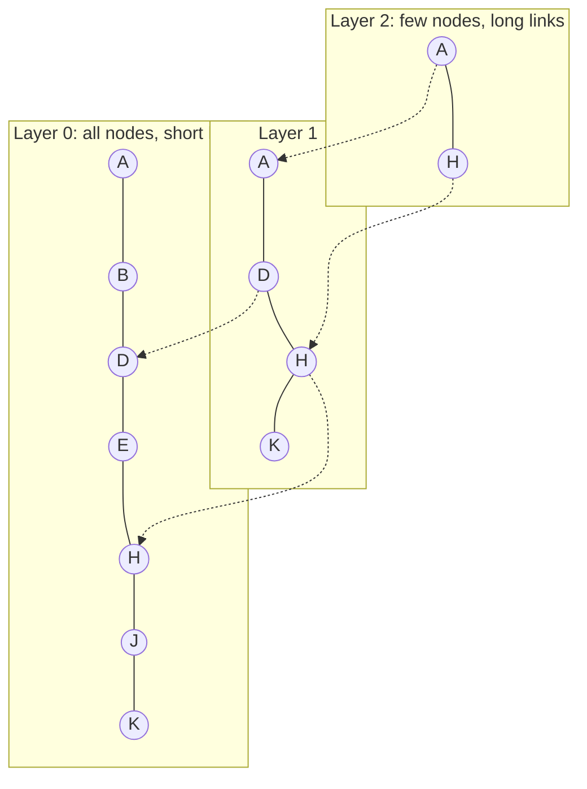

# Redis and vector databases

A relational database is the right default, but two other kinds of system appear in nearly every ML-backed product. One is **Redis**, an in-memory data-structure server used for caching, counters, rate limiting, queues and online feature lookup. The other is the **vector database** (or a vector index inside an existing database), which answers "which stored items are most similar to this one?" - the retrieval step behind semantic search, recommendations and retrieval-augmented generation (RAG).

They solve different problems, but they share a theme: each gives up some of the generality or guarantees of a relational database to be extremely good at one access pattern. Redis trades durability and rich queries for microsecond in-memory operations. A vector index trades exactness for speed, returning *approximately* the nearest neighbours. Using either well means knowing what was traded away.

## Part 1 - Redis

### 1. The model: one thread, everything in memory

Redis keeps its whole dataset in RAM and executes commands on a **single thread**, one after another. Those two choices explain most of its behaviour:

- **Speed.** No disk access on the read path and no lock contention: a simple command takes microseconds, and one instance handles on the order of a hundred thousand operations per second.
- **Atomic commands for free.** Since commands never interleave, `INCR counter` is atomic without any locking. This is serial execution - the simplest route to serialisability - applied to an entire server.
- **One slow command stalls everybody.** `KEYS *` on a large instance, a big `SMEMBERS`, or a long Lua script blocks every other client until it finishes. Use incremental `SCAN`, and keep collections bounded.
- **Capacity is RAM.** The dataset must fit in memory, so think about key size, expiry and eviction from day one.

### 2. Data structures are the API

Redis is not merely a string-to-string map. Each value has a type with its own commands, and choosing the right type is most of the design work.

| Type | Core operations | Typical use |
|---|---|---|
| String | `GET`, `SET` with `EX`/`NX`, `INCR` | Cached objects, counters, flags, simple locks |
| Hash | `HSET`, `HGET`, `HINCRBY` | An object with fields: a session, a feature row per entity |
| List | `LPUSH`, `RPOP`, `BRPOP` | Simple queues, recent-items lists |
| Set | `SADD`, `SISMEMBER`, `SINTER` | Membership, tags, deduplication |
| Sorted set | `ZADD`, `ZRANGE`, `ZRANGEBYSCORE`, `ZRANK` | Leaderboards, priority queues, time-ordered indexes, sliding-window rate limits |
| Stream | `XADD`, `XREADGROUP`, `XACK` | An append-only log with consumer groups |
| HyperLogLog | `PFADD`, `PFCOUNT` | Approximate distinct counts in about 12 kB |
| Bitmap, geo, and module types | | Presence flags, proximity queries, JSON, search and vector indexes |

A sorted set, for instance, is implemented as a skip list plus a hash table: insertion and rank queries are logarithmic, and reading a range by score is logarithmic plus the size of the result.

### 3. Expiry and eviction

Any key can carry a **time to live**: `SET session:9f2 <data> EX 1800`. Expired keys are removed lazily when accessed, and by a background sampler.

When memory reaches `maxmemory`, the **eviction policy** decides what happens: `noeviction` (writes fail), `allkeys-lru` or `allkeys-lfu` (drop the least recently or least frequently used key - the usual choice for a pure cache), or the `volatile-*` variants (only consider keys that have a TTL). Redis approximates LRU by sampling a few keys, not by maintaining an exact ordering.

> [!WARNING]
> Do not mix cache data and data you cannot afford to lose in one instance with an `allkeys-*` policy. The eviction algorithm does not know that your job queue matters more than a cached thumbnail URL.

### 4. Durability and replication

Being in-memory does not have to mean losing everything on restart. There are two persistence mechanisms, often combined:

- **RDB snapshots.** At intervals the server forks; the child process writes a point-in-time dump while the parent keeps serving, sharing memory pages copy-on-write. Files are compact and restart is fast, but everything since the last snapshot is lost in a crash.
- **AOF (append-only file).** Each write command is appended to a log. With `appendfsync everysec` - the common setting - at most about a second of writes is lost; `always` syncs every command at a high throughput cost. The file is compacted by periodic rewriting.

**Replication** is asynchronous leader-follower. A write is acknowledged before the replicas have it, so a failover can lose recently acknowledged writes. **Sentinel** monitors a leader and promotes a replica when it fails. **Redis Cluster** shards the keyspace into 16,384 **hash slots** (`CRC16(key) mod 16384`) distributed over several leaders; operations involving multiple keys only work when all keys are in the same slot, which you force with *hash tags*: `{user42}:cart` and `{user42}:profile` hash only the part in braces.

The practical conclusion: treat Redis as a **fast, mostly reliable** store. It is excellent for data that can be recomputed or whose occasional loss is tolerable. For a system of record, use a database with synchronous durability.

### 5. Patterns

**Cache-aside.** The application checks the cache; on a miss it reads the database, then writes the value to the cache with a TTL. On an update it writes the database and **deletes** the cache key - deleting is safer than setting, since two concurrent writers could otherwise leave the older value in the cache.



Three classic failure modes:

- **Stampede (thundering herd).** A popular key expires and a thousand requests miss at once, all hitting the database. Mitigations: a short per-key lock so only one request recomputes, serving the stale value while refreshing in the background, and adding random jitter to TTLs so keys do not all expire together.
- **Penetration.** Repeated lookups for keys that do not exist always miss and always reach the database. Cache the negative result briefly, or put a Bloom filter in front.
- **Staleness.** A cache is derived data that lags its source. Choose TTLs deliberately and decide which reads must bypass the cache.

```python-run
import time, random
random.seed(2)

class TinyRedis:
    """GET/SET with TTL and LRU eviction - enough to study cache behaviour."""
    def __init__(self, capacity): self.cap, self.data = capacity, {}   # dict keeps insertion order
    def get(self, k, now):
        item = self.data.get(k)
        if item is None or item[1] <= now:
            self.data.pop(k, None); return None
        self.data[k] = self.data.pop(k)                  # move to most-recent position
        return item[0]
    def set(self, k, v, ttl, now):
        self.data.pop(k, None)
        if len(self.data) >= self.cap:
            self.data.pop(next(iter(self.data)))         # evict least recently used
        self.data[k] = (v, now + ttl)

db_reads = 0
def slow_db(k):
    global db_reads; db_reads += 1
    return f"row-{k}"

def run(capacity, ttl, requests=20_000, keys=1000):
    global db_reads; db_reads = 0
    cache, hits = TinyRedis(capacity), 0
    for now in range(requests):
        k = min(int(random.paretovariate(1.1)), keys)    # skewed popularity, like real traffic
        v = cache.get(k, now)
        if v is None: cache.set(k, slow_db(k), ttl, now)
        else: hits += 1
    return hits / requests

for cap, ttl in [(10, 10_000), (50, 10_000), (200, 10_000), (200, 200)]:
    print(f"capacity={cap:<4} ttl={ttl:<6} hit rate={run(cap, ttl):.1%}  db reads={db_reads}")
```

Since access is heavily skewed, a cache holding 5 percent of the keys absorbs the great majority of reads. Shortening the TTL trades hit rate for freshness.

**Rate limiting.** A fixed window (`INCR` a key named after the current minute, with an expiry) is simple but lets a burst straddle the boundary. A **sliding window** keeps request timestamps in a sorted set: remove entries older than the window, count the rest, add the new one - executed atomically in a Lua script or a `MULTI` transaction.

```python-run
import bisect

class SlidingWindowLimiter:
    """Models ZREMRANGEBYSCORE + ZCARD + ZADD on one sorted set per client."""
    def __init__(self, limit, window): self.limit, self.window, self.z = limit, window, {}
    def allow(self, client, now):
        ts = self.z.setdefault(client, [])
        del ts[:bisect.bisect_right(ts, now - self.window)]      # drop entries outside the window
        if len(ts) >= self.limit:
            return False
        ts.append(now)
        return True

lim = SlidingWindowLimiter(limit=3, window=10)
for t in [0, 1, 2, 3, 9, 10.5, 11.5, 12.5, 13]:
    print(f"t={t:<5} {'allowed' if lim.allow('ana', t) else 'REJECTED'}")
```

**Other staples.** Leaderboards with sorted sets (`ZINCRBY`, `ZREVRANGE`). Online feature serving with a hash per entity, written by a batch or streaming job and read by the model server in under a millisecond. Idempotency keys with `SET key value NX EX 86400`. Work queues with streams and consumer groups, which give acknowledgements and redelivery - unlike plain pub/sub, which is fire-and-forget and drops messages for subscribers that are offline.

> [!INTERVIEW]
> **Distributed locks with Redis** are a favourite probe. `SET lock:x <random-token> NX PX 30000` acquires the lock; release it with a script that deletes the key only if the token still matches. Then state the limitation yourself: the lock is a *lease*. A client paused beyond the expiry can still act as if it held the lock, and asynchronous replication can lose the lock on failover. That is fine for efficiency ("avoid doing the same work twice"). For correctness, the protected resource must verify a **fencing token**, or you should use a consensus-backed coordination service.

**Round trips.** Because each command is so cheap, network latency dominates. **Pipelining** sends many commands in one batch; `MGET` fetches many keys at once. Fetching 200 feature keys one by one costs 200 round trips, a pipeline costs one.

## Part 2 - Vector databases

### 6. Embeddings and similarity

An **embedding model** maps an item - a sentence, an image, a user - to a vector of a few hundred to a few thousand floating-point numbers, trained so that semantically similar items end up close together. "How do I reset my password?" and "I forgot my login credentials" share almost no words, but their embeddings are near neighbours. Search by meaning then reduces to a geometric problem: given a query vector $q$, find the $k$ stored vectors nearest to it.

| Metric | Formula | Notes |
|---|---|---|
| Euclidean (L2) distance | $\lVert a-b \rVert_2$ | Smaller means closer |
| Inner (dot) product | $a \cdot b$ | Larger means closer; sensitive to vector length |
| Cosine similarity | $\dfrac{a \cdot b}{\lVert a \rVert \lVert b \rVert}$ | Direction only |

For vectors normalised to unit length all three produce the same ranking, since $\lVert a-b \rVert^2 = 2 - 2\,a\cdot b$. Use the metric the embedding model was trained with; normalising once at write time and using the dot product is a common simplification.

### 7. Why an ordinary index does not work

**Exact** search compares the query with every stored vector: $O(N \cdot d)$. For a hundred thousand vectors that is perfectly acceptable - a vectorised scan takes a few milliseconds, and it is the correct baseline. For a hundred million vectors of 1,024 dimensions it is hundreds of gigabytes of arithmetic for each query.

B-trees and spatial trees do not rescue us. They work by splitting space so that most regions can be excluded, and in high dimensions that fails - the **curse of dimensionality**: distances concentrate, nearly every region is "close enough" to need checking, and tree search degenerates into a full scan. So we relax the problem and accept **approximate nearest neighbours (ANN)**: return most of the true top $k$, much faster. Quality is measured as **recall@k**, the fraction of the true $k$ nearest neighbours that the index returned.

### 8. IVF: cluster, then look in a few clusters

An **inverted file index** runs k-means over the vectors to obtain `nlist` centroids and assigns each vector to its nearest centroid. A query finds the `nprobe` centroids closest to it and scans only the vectors in those lists.

- Larger `nprobe` means higher recall and more work; `nprobe = nlist` is exact search.
- A frequent starting point is `nlist` near $\sqrt{N}$.
- The index is quick to build and compact, but it needs a training step, and if the data distribution shifts the centroids become stale.

```python-run
import random, math
random.seed(7)
D, N, NLIST, K = 8, 4000, 32, 10

# clustered data, the way embeddings of documents about related topics are
topics = [[random.gauss(0, 1) for _ in range(D)] for _ in range(40)]
vecs = [[c + random.gauss(0, 0.45) for c in random.choice(topics)] for _ in range(N)]

def d2(a, b): return sum((x - y) ** 2 for x, y in zip(a, b))

# crude k-means: random initial centroids and a few refinement rounds
cent = random.sample(vecs, NLIST)
for _ in range(4):
    lists = [[] for _ in range(NLIST)]
    for i, v in enumerate(vecs):
        lists[min(range(NLIST), key=lambda c: d2(v, cent[c]))].append(i)
    cent = [[sum(vecs[i][j] for i in l) / len(l) for j in range(D)] if l else cent[c] for c, l in enumerate(lists)]

queries = [[c + random.gauss(0, 0.45) for c in random.choice(topics)] for _ in range(30)]
exact = [set(sorted(range(N), key=lambda i: d2(q, vecs[i]))[:K]) for q in queries]

print("nprobe  recall@10  vectors scanned per query")
for nprobe in (1, 2, 4, 8, 32):
    recall = scanned = 0
    for q, truth in zip(queries, exact):
        probe = sorted(range(NLIST), key=lambda c: d2(q, cent[c]))[:nprobe]
        cand = [i for c in probe for i in lists[c]]
        scanned += len(cand)
        recall += len(truth & set(sorted(cand, key=lambda i: d2(q, vecs[i]))[:K])) / K
    print(f"{nprobe:>6}  {recall / len(queries):>9.2f}  {scanned // len(queries):>8} of {N}")
```

Recall climbs towards 1.0 as more lists are probed, and the cost grows in proportion. That curve - recall against work - is the essential trade-off of every ANN index. The `db-ivf-search` problem asks you to implement this search.

### 9. HNSW: navigating a graph

**Hierarchical navigable small world** graphs are the most widely used ANN index today. Each vector is a node linked to a number of near neighbours. Search is greedy: start somewhere, move to whichever neighbour is closest to the query, and repeat until no neighbour improves. To avoid a slow crawl across a huge graph, HNSW stacks **layers**: the top layer holds few nodes with long-range links, and each layer below is denser. A search enters at the top, makes large jumps, and descends, refining as it goes - the same principle as a skip list.



The parameters you will see:

- `M` - links per node. More links mean better recall and more memory.
- `ef_construction` - how wide the search is while inserting. Higher values build a better graph more slowly.
- `ef_search` - the size of the candidate list at query time. This is the knob you tune in production for recall against latency.

HNSW gives very high recall at low latency, needs no training step, and supports incremental inserts. Its costs are memory (the vectors plus the graph, usually all in RAM), slow builds, and awkward deletions (nodes are tombstoned and cleaned up later).

```python-run
import random
random.seed(3)
D, N, M = 6, 1500, 8
vecs = [[random.random() for _ in range(D)] for _ in range(N)]
def d2(a, b): return sum((x - y) ** 2 for x, y in zip(a, b))

# single-layer navigable graph: connect each new node to its M nearest existing nodes
nbrs = {0: set()}
for i in range(1, N):
    near = sorted(nbrs, key=lambda j: d2(vecs[i], vecs[j]))[:M]
    nbrs[i] = set(near)
    for j in near: nbrs[j].add(i)

def search(q, ef):
    visited, cand = {0}, [0]
    best = [0]                                    # up to ef closest nodes found so far
    while cand:
        cur = min(cand, key=lambda j: d2(q, vecs[j])); cand.remove(cur)
        worst = max(best, key=lambda j: d2(q, vecs[j]))
        if len(best) >= ef and d2(q, vecs[cur]) > d2(q, vecs[worst]):
            break
        for n in nbrs[cur]:
            if n not in visited:
                visited.add(n); cand.append(n); best.append(n)
        best = sorted(best, key=lambda j: d2(q, vecs[j]))[:ef]
    return best[:5], len(visited)

queries = [[random.random() for _ in range(D)] for _ in range(40)]
for ef in (5, 20, 80):
    rec = vis = 0
    for q in queries:
        truth = set(sorted(range(N), key=lambda j: d2(q, vecs[j]))[:5])
        got, v = search(q, ef)
        rec += len(truth & set(got)) / 5; vis += v
    print(f"ef={ef:<3} recall@5={rec/len(queries):.2f}  distance computations ~{vis//len(queries)} of {N}")
```

Even this one-layer toy finds most of the true neighbours while evaluating a fraction of the vectors, and raising `ef` buys recall with extra work.

### 10. Compression: product quantisation

A hundred million 1,024-dimensional `float32` vectors need about 400 GB. **Product quantisation (PQ)** cuts each vector into sub-vectors and replaces each sub-vector by the id of its nearest entry in a small learned codebook, so the vector is stored in a few dozen bytes. Distances are computed approximately from precomputed tables. The usual recipe is to fetch more candidates than needed with the compressed index and then **re-rank** them with the full-precision vectors. Scalar quantisation (`float32` to `int8`) and binary quantisation are simpler alternatives. IVF and PQ are commonly combined into IVF-PQ.

### 11. From an index to a database

An ANN library is only an index. A vector **database** adds what applications need around it:

- **Metadata filtering.** "Nearest documents *where tenant = 17 and language = 'de'*" is harder than it sounds. *Post-filtering* (search first, then filter) can return fewer than $k$ results when the filter is selective. *Pre-filtering* (filter first, then exact search over the survivors) is accurate but slow when the filter is loose. Good engines integrate the filter into the graph traversal, or choose a strategy from the estimated selectivity.
- **Hybrid search.** Dense vectors capture meaning but can miss exact tokens such as part numbers, error codes or names. Combining a keyword ranking (BM25) with the vector ranking - for example by reciprocal rank fusion - is reliably better than either alone, and a cross-encoder **re-ranker** on the top results improves precision further.
- **Operations.** Persistence, replication, sharding, updates and deletes, access control.

**Which system?** If you already run PostgreSQL and have up to a few million vectors, the `pgvector` extension (HNSW and IVFFlat indexes) keeps vectors next to relational data, with transactions, joins and one fewer system to operate. Dedicated engines (Qdrant, Milvus, Weaviate, Pinecone, Vespa, or the vector features of OpenSearch and Redis) become worthwhile at larger scale, with heavy filtering, or with strict latency targets.

```sql
-- pgvector: schema, index and a filtered similarity query
CREATE EXTENSION IF NOT EXISTS vector;
CREATE TABLE chunks (id bigserial PRIMARY KEY, doc_id bigint, tenant int, body text, embedding vector(768));
CREATE INDEX ON chunks USING hnsw (embedding vector_cosine_ops);
SELECT id, body FROM chunks
WHERE tenant = 17
ORDER BY embedding <=> $1          -- cosine distance to the query embedding
LIMIT 5;
```

> [!INTERVIEW]
> For "design retrieval for a RAG system", cover the full path: chunking strategy; embedding model, with the *same* model for documents and queries; exact search as the baseline and as ground truth for measuring recall; HNSW or IVF with stated tuning knobs; metadata filters and tenant isolation; hybrid retrieval plus re-ranking; how the index stays in sync with the source documents (change data capture, deletions, re-embedding when the model changes); and evaluation of both retrieval quality and end-to-end answer quality.

## Pitfalls

- **Treating Redis as durable by default.** Asynchronous replication and once-a-second fsync mean acknowledged writes can be lost.
- **Unbounded keys or missing TTLs.** Memory fills up, and then the eviction policy decides what you lose.
- **Blocking commands** (`KEYS`, huge range reads, long scripts) on a single-threaded server.
- **A lock without fencing** used to protect correctness.
- **Cache invalidation by setting rather than deleting**, and forgetting that the cache lags the database.
- **Reaching for an ANN index too early.** Below roughly a hundred thousand vectors, exact search is fast, simple and 100 percent accurate.
- **Never measuring recall.** An ANN index fails silently: it always returns *something*. Compare against exact search on a sample of queries.
- **Mixing embedding models or metrics.** Vectors from different models are not comparable; changing the model means re-embedding everything.
- **Post-filtering with selective filters**, returning two results when ten were requested.
- **Assuming similar means relevant.** Vector similarity is a first-stage retriever; add keyword signals and re-ranking where precision matters.

## Summary

- **Redis** is a single-threaded, in-memory server whose value lies in its data structures: strings, hashes, lists, sets, sorted sets, streams. Commands are atomic; one slow command blocks all clients.
- Persistence (RDB, AOF) and asynchronous replication make Redis reasonably, not strictly, durable. Use TTLs and an eviction policy; shard with Cluster and hash tags.
- Core patterns: **cache-aside** with stampede protection, **rate limiting**, leaderboards, feature serving, idempotency keys, and leases - with **fencing** when correctness depends on the lock.
- **Vector search** finds nearest neighbours of an embedding under cosine, dot-product or L2 similarity. Exact search is linear, so large collections use **ANN** indexes and measure **recall**.
- **IVF** clusters and probes a few lists (`nprobe`); **HNSW** greedily navigates a layered proximity graph (`M`, `ef_search`); **PQ** compresses vectors, usually followed by re-ranking.
- A vector database adds **filtering**, **hybrid search**, persistence and operations. Start with `pgvector` when you already use PostgreSQL; move to a dedicated engine when scale or latency requires it.

```quiz
[
  {"q": "Why is INCR atomic in Redis without any explicit locking?",
   "options": ["Redis uses two-phase commit for every command", "Commands are executed one at a time on a single thread, so no other command can interleave", "Each key has its own mutex", "Clients must wrap it in a transaction"],
   "answer": 1,
   "explain": "Serial execution means a command runs to completion before the next begins. The same property makes a slow command block every client."},
  {"q": "A Redis leader acknowledges a write and crashes before its replica receives it; the replica is promoted. What happens to the write?",
   "options": ["It is recovered from the client", "It is lost, because replication is asynchronous", "The promotion is refused", "It is replayed from the eviction log"],
   "answer": 1,
   "explain": "Acknowledgement does not wait for replicas, so failover can drop recently acknowledged writes. Redis should not be the only copy of critical data."},
  {"q": "In the cache-aside pattern, what should the application do with the cache entry when the underlying row is updated?",
   "options": ["Nothing, the cache updates itself", "Delete the cache key after writing the database", "Write the cache first and the database later", "Increase the TTL"],
   "answer": 1,
   "explain": "Deleting forces the next read to reload the fresh value and avoids races in which two writers leave the older value in the cache."},
  {"q": "A hot cache key expires and hundreds of concurrent requests recompute it simultaneously. Which measure addresses this?",
   "options": ["Lower the TTL", "Let only one request recompute, behind a short per-key lock, or serve the stale value while refreshing, and add jitter to TTLs", "Disable persistence", "Use KEYS to find the key faster"],
   "answer": 1,
   "explain": "This is a cache stampede. The fix is to collapse concurrent recomputation into one and to avoid synchronised expiry."},
  {"q": "Why do large vector collections use approximate rather than exact nearest-neighbour search?",
   "options": ["Exact search gives wrong answers in high dimensions", "Exact search must compare the query with every vector, and tree-style indexes stop pruning effectively in high dimensions", "Approximate search uses less accurate embeddings", "Exact search cannot use cosine similarity"],
   "answer": 1,
   "explain": "Exact search is linear in the collection size, and the curse of dimensionality defeats space-partitioning trees, so ANN trades a little recall for large speedups."},
  {"q": "In an IVF index, what is the effect of increasing nprobe?",
   "options": ["Lower recall and lower latency", "Higher recall and higher query cost, because more clusters are scanned", "A smaller index on disk", "Faster index build"],
   "answer": 1,
   "explain": "More probed lists means more candidates examined. With nprobe equal to the number of lists the search is exhaustive."},
  {"q": "Which statement about HNSW is correct?",
   "options": ["It requires a k-means training step before any insert", "It searches a layered proximity graph greedily, with upper layers providing long-range jumps, and ef_search trades recall for latency", "It stores vectors only on disk and uses almost no memory", "It always returns the exact nearest neighbours"],
   "answer": 1,
   "explain": "HNSW needs no training and supports incremental inserts. Its costs are memory for vectors plus graph, and build time."},
  {"q": "A similarity query requests the top 10 with the filter tenant = 17, which matches 0.1 percent of the data. The engine searches first and filters afterwards. What is the likely result?",
   "options": ["Exactly 10 perfect results", "Far fewer than 10 results, because most of the nearest candidates belong to other tenants", "An error", "All vectors in the database"],
   "answer": 1,
   "explain": "Post-filtering discards most candidates when the filter is selective. Pre-filtering or filter-aware traversal is needed."}
]
```

> **Source:** Redis documentation (data types, persistence, replication, cluster specification, eviction); Malkov and Yashunin, HNSW (2016); Jegou et al., product quantisation; pgvector documentation. Written in original wording with original examples.
