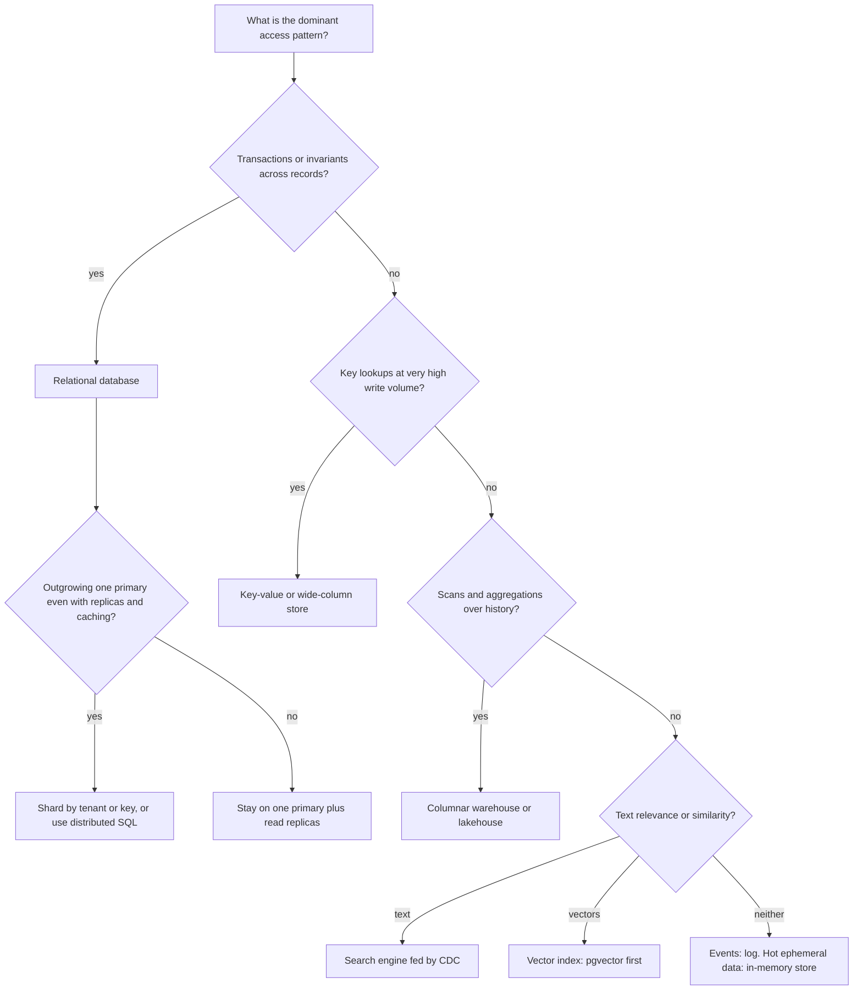
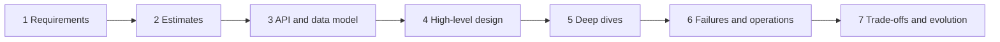

# Choosing a database and the system-design playbook

This closing lesson turns the previous thirty-two into a way of making decisions. In an interview it is the question "design a system that does X". At work it is the design document you write before building a feature. In both cases nobody expects you to recite how an LSM-tree compacts. They want to see that you can go from vague requirements to a concrete design, name the trade-offs you are making, and explain what would cause you to change your mind.

The lesson has three parts: a method for **choosing storage** from access patterns, a repeatable **playbook** for system-design conversations with the arithmetic that supports it, and three **worked designs** from the ML engineering world that pull the track's ideas together.

## 1. Start from the workload, not from the product

The most common design mistake is to begin with a technology ("let's use Cassandra") and then bend the problem to fit. Reverse the order. A storage decision is a function of a few questions; answer them first, in writing.

**What are the access patterns?**

- Point lookups by key? Range scans? Multi-attribute filters? Joins across entities? Full-text search? Aggregations over many rows? Similarity search? Graph traversals?
- List the three to five most important queries literally. "Get a user's 20 most recent orders" already tells you the index you need.

**What is the read/write shape?**

- Read-heavy or write-heavy? What are the peak rates? How large is a record, and how fast does the dataset grow?
- Is the data mutable (profiles) or append-only (events)? Append-only data makes almost everything easier.

**What does correctness require?**

- Which invariants exist ("no double booking", "balance never negative")? Those parts need transactions or a single decision point.
- Which reads must see the latest write, and which may be stale by seconds or minutes?
- What does losing the last second of writes cost? What does an hour of downtime cost?

**What are the operational constraints?**

- Latency targets expressed as percentiles (p99, not the average).
- Team size and expertise. A system no one on the team can debug at 3 a.m. is a liability, however elegant.
- Managed service or self-hosted; budget; compliance and data residency.

### The map of options

| Family | Examples | Strong at | Weak at |
|---|---|---|---|
| Relational (OLTP) | PostgreSQL, MySQL | Transactions, joins, constraints, flexible queries, secondary indexes | Write scaling beyond one primary; very large analytical scans |
| Distributed SQL | Spanner, CockroachDB, YugabyteDB | Horizontal scale with serialisable transactions | Latency of cross-region consensus, cost, operational complexity |
| Key-value / wide-column | DynamoDB, Cassandra, ScyllaDB, Bigtable | Enormous write volume, predictable key lookups, multi-region availability | Ad hoc queries, joins; data model must be designed around queries |
| Document | MongoDB, Firestore | Self-contained aggregates, flexible schema | Many-to-many relationships, cross-document invariants |
| In-memory | Redis, Memcached | Sub-millisecond lookups, counters, ephemeral state | Durability, datasets larger than RAM |
| Search | Elasticsearch, OpenSearch | Full-text relevance, faceting, log exploration | Being a system of record; transactional updates |
| Columnar analytics | BigQuery, Snowflake, ClickHouse, DuckDB | Scans and aggregations over billions of rows | Point updates, high-rate small transactions |
| Data lake / lakehouse | Parquet on object storage with Iceberg or Delta | Cheap storage for huge history, open formats, ML training data | Low-latency serving |
| Log / stream | Kafka, Kinesis, Pulsar | Ordered durable event transport, replay, decoupling | Queries by anything other than offset |
| Vector | pgvector, Qdrant, Milvus | Similarity search on embeddings | Everything else |
| Graph | Neo4j, Neptune | Multi-hop traversals over highly connected data | Bulk analytics, simple CRUD |
| Time series | TimescaleDB, InfluxDB, Prometheus | Time-ordered appends, downsampling, retention policies | General-purpose transactions |



> [!TIP]
> The honest default for a new product is **one relational database**. It handles far more load than most people expect - tens of thousands of simple queries per second on one well-indexed node - and it keeps every option open. Add a second system when you can point to a specific access pattern that the first cannot serve, and make that system *derived* from the first.

### System of record versus derived stores

When a design contains several stores, label each one. Exactly one store is the **source of truth** for any given fact; the others (cache, search index, warehouse, feature store, vector index) are **derived**, are populated from the source by change data capture or batch jobs, and can be rebuilt. That one sentence in a design discussion answers most "what if they disagree?" questions before they are asked.

## 2. Back-of-envelope arithmetic

You cannot choose between one node and a hundred without numbers. Estimation in interviews is not about precision; it is about showing that your design is in the right order of magnitude. A few constants are worth memorising:

| Quantity | Rough value |
|---|---|
| Seconds per day | 86,400, about $10^5$ |
| 1 million requests per day | about 12 per second on average |
| Peak versus average | assume 2 to 10 times |
| Main-memory reference | around 100 ns |
| SSD random read | around 100 microseconds |
| Round trip within a data centre | around 0.5 ms |
| Round trip between continents | 100 to 150 ms |
| Sequential disk or network throughput | hundreds of MB per second |
| One relational primary on good hardware | thousands to low tens of thousands of simple writes per second |
| `float32` embedding with 768 dimensions | about 3 kB |

```python-run
def estimate(daily_active_users, writes_per_user, reads_per_user, bytes_per_record,
             years=3, peak_factor=5, replication=3):
    writes_day = daily_active_users * writes_per_user
    reads_day  = daily_active_users * reads_per_user
    avg_w, avg_r = writes_day / 86_400, reads_day / 86_400
    raw = writes_day * bytes_per_record * 365 * years
    return {
        "avg writes/s":  round(avg_w),
        "peak writes/s": round(avg_w * peak_factor),
        "avg reads/s":   round(avg_r),
        "peak reads/s":  round(avg_r * peak_factor),
        "read:write":    f"{reads_day / writes_day:.0f}:1",
        "raw storage TB": round(raw / 1e12, 2),
        "with replication + 30% index overhead TB": round(raw * replication * 1.3 / 1e12, 2),
    }

# A messaging feature: 20M daily users, 15 messages sent and 150 reads each, 300 bytes per message
for k, v in estimate(20_000_000, 15, 150, 300).items():
    print(f"{k:<45}{v}")
```

Read the output as an engineer: a few thousand writes per second on average and well over ten thousand at peak is beyond a comfortable single relational primary, and roughly a hundred terabytes of raw data will not sit on one machine - so this workload needs partitioning. Run the same function with 200,000 daily users and the answer is "one PostgreSQL instance, and stop worrying".

```python-run
import math

# How many shards, and what do quorum settings give?
def shards_needed(peak_writes, total_tb, writes_per_node=5_000, tb_per_node=2, headroom=0.5):
    by_write = peak_writes / (writes_per_node * headroom)
    by_size  = total_tb / (tb_per_node * headroom)
    return math.ceil(max(by_write, by_size)), ("writes" if by_write > by_size else "storage")

print("shards:", shards_needed(peak_writes=17_000, total_tb=98.6))

def quorum(n, w, r):
    return {"overlap (w + r > n)": w + r > n,
            "tolerates node failures for writes": n - w,
            "tolerates node failures for reads": n - r}
for cfg in [(3, 2, 2), (3, 1, 1), (5, 3, 3), (3, 3, 1)]:
    print(cfg, quorum(*cfg))

# Availability of components in series and in parallel
def series(*a):   return math.prod(a)
def parallel(a, k): return 1 - (1 - a) ** k
print(f"3 services at 99.9% in series: {series(0.999, 0.999, 0.999):.4%}")
print(f"2 redundant replicas of a 99% component: {parallel(0.99, 2):.4%}")
```

Three dependencies that are each "three nines" give you less than three nines overall; redundancy is how you get it back.

## 3. The system-design playbook

A design conversation of forty-five minutes goes well when it follows a predictable arc. The steps below also work as the section headings of a real design document.



**1. Requirements (about five minutes).** Ask before drawing. Functional: what must users be able to do - pick the two or three core use cases and explicitly park the rest. Non-functional: scale, latency targets, consistency needs, availability target, durability. Repeat them back as a short list. The best candidates deliberately *narrow* the problem.

**2. Estimates.** Requests per second, data volume and read/write ratio, as in section 2. State the conclusion the numbers lead to: "this fits on one node" or "this needs sharding".

**3. API and data model.** Write the handful of endpoints or operations and the main entities with their keys. Then derive the indexes from the queries. Deciding the **partition key** here - and saying which queries it makes cheap and which it makes expensive - is often the most consequential choice in the entire design.

**4. High-level design.** Boxes and arrows: clients, load balancer, stateless services, the system of record, caches, asynchronous pipeline, derived stores. Trace one write and one read through the diagram out loud.

**5. Deep dives.** The interviewer will choose one or two; if they do not, choose the riskiest part yourself. This is where the material of this track pays off:

| Topic | Questions to answer |
|---|---|
| Replication | Single leader, multi-leader or leaderless? Synchronous or asynchronous? What happens to reads during replica lag - read-your-writes, monotonic reads? |
| Partitioning | Hash or range? Which key? Hot keys? How is data rebalanced, and how are requests routed? How do secondary indexes work across partitions? |
| Transactions | Which operations need atomicity or isolation? Which isolation level? Can the invariant be confined to one partition? |
| Consistency | Where is linearizability really needed (locks, uniqueness, leader election), and where is eventual consistency enough? |
| Caching | What is cached, with what TTL, how is it invalidated, and what happens during a stampede? |
| Asynchronous work | Queue or log? Ordering guarantee? Idempotent consumers? Dead-letter handling? |

**6. Failures and operations.** Walk through the failure of each box: a database primary, a cache node, a consumer, an entire region. What does the user see? What is lost? How does the system recover, and how would you notice - which metrics and alerts (latency percentiles, error rates, replication lag, consumer lag, queue depth)? Mention backups *and restore tests*, schema migrations and rollout strategy.

**7. Trade-offs and evolution.** Say what you gave up and when you would revisit: "I chose asynchronous replication for write latency, accepting that failover can lose the last few hundred milliseconds of writes. If this were a ledger I would switch to synchronous replication to one replica." Sketch what changes at ten times the scale.

> [!INTERVIEW]
> Phrases that signal seniority, because they show you know the cost of what you propose: "the source of truth is X, everything else is derived and can be rebuilt"; "that gives at-least-once delivery, so the consumer is idempotent, keyed by the event id"; "ordering is per partition, so I key by account"; "the view lags, so after a write this user's reads go to the primary for a few seconds"; "that is a timeliness issue, not an integrity issue".

## 4. Worked design A: an online feature store

**Problem.** A fraud model scores card transactions within 50 ms. It needs features such as "number of transactions by this card in the last 10 minutes" and "average amount over 30 days", and the *same* feature definitions must be used for training.

**Requirements.** Online reads: 20,000 per second, p99 under 10 ms, by entity key. Freshness: seconds for the short-window features, a day for the long ones. Training needs historical feature values **as they were at the time of each past transaction**.

**Design.**

- **Source of truth for events:** transactions are appended to a log (Kafka), keyed by card id for per-card ordering.
- **Streaming path:** a stream processor computes windowed aggregates by event time and writes them to the **online store**, a key-value system (Redis or DynamoDB), one hash per card. Writes are idempotent upserts keyed by `(card, feature, window)`.
- **Batch path:** the same events land in a lakehouse as Parquet. Daily jobs compute long-window features and write them both to the online store and to an **offline store** of timestamped feature values.
- **Serving:** the model service fetches all features for a card with one pipelined read.
- **Training:** a **point-in-time join** between labelled transactions and the offline store selects, for each example, the latest feature value with a timestamp at or before the example's time.

```python-run
import bisect

# offline store: per card, feature values with the time they became valid (sorted)
history = {"card1": [(100, 0.0), (200, 35.5), (300, 80.0)],
           "card2": [(150, 12.0)]}

def as_of(card, ts):
    """Latest feature value known at time ts - never a value from the future."""
    rows = history.get(card, [])
    i = bisect.bisect_right(rows, (ts, float("inf"))) - 1
    return rows[i][1] if i >= 0 else None

labelled = [("card1", 250, "fraud"), ("card1", 90, "ok"), ("card2", 400, "ok"), ("card1", 300, "ok")]
for card, ts, label in labelled:
    print(card, ts, label, "avg_amount_feature =", as_of(card, ts),
          "| leaky latest value =", history[card][-1][1])
```

The "leaky" column is what a naive join against the *current* feature table gives: for the transaction at time 250 it would use a value computed at time 300 - information from the future. A model trained that way looks excellent offline and disappoints in production. This is the time-dependent join problem from the stream-processing lesson appearing as **training-serving skew**.

**Failure thinking.** If the stream processor falls behind, features go stale: monitor consumer lag and expose feature age to the model service. If the online store loses a node, features are rebuilt from the log and the offline store, because it is derived data. If the online store is unreachable, the model falls back to default values and the decision is flagged.

## 5. Worked design B: retrieval for a RAG assistant

**Problem.** Employees ask questions; the system retrieves relevant passages from two million internal documents and a language model answers with citations. Documents change daily and have access permissions.

**Design.**

- **Source of truth:** the document systems themselves. A metadata table in PostgreSQL records each document's version, permissions and chunk list.
- **Ingestion pipeline (asynchronous, idempotent):** change events → chunking → embedding → upsert into the vector index keyed by `(doc_id, chunk_no, version)`. Deletions and permission changes travel through the same pipeline. When the embedding model changes, a batch job rebuilds a new index next to the old one, and traffic is switched after evaluation - the dual-running pattern.
- **Storage choice:** about 20 million chunks of 768 dimensions is roughly 60 GB of raw vectors. That is feasible in pgvector with HNSW on a large instance, or in a dedicated vector engine with quantisation. Start with whichever your team already operates.
- **Query path:** embed the query → hybrid retrieval (vector plus keyword) with a **permission filter** applied inside the search → re-rank the top 50 → pass the top 5 to the model with source links.
- **Evaluation:** a labelled set of questions with known relevant passages; track recall@k of retrieval separately from answer quality.

**The trade-off to say out loud:** the index is eventually consistent with the documents. For content freshness that is acceptable. For **permissions** it is not, so permissions are checked again against the source of truth before a passage is shown.

## 6. Worked design C: experiment tracking and metrics

**Problem.** Training jobs log hyperparameters, metrics every few steps, and artefacts. Users compare runs in a dashboard.

- **Run metadata** (who, when, parameters, status, lineage): relational. It is relational data with joins and constraints, at tiny volume.
- **Metric time series:** append-only and written at high frequency. A time-partitioned table or a columnar store; the access pattern is "all points for these runs and this metric". Batch writes on the client; downsample for display.
- **Artefacts** (checkpoints, datasets): object storage, with only the URI and a content hash in the database. Never put large blobs in the OLTP database.
- **Search across runs:** start with indexes in PostgreSQL (`jsonb` with GIN for parameters); add a search engine only if that proves insufficient.

The pattern in all three designs is the same: a small, well-defined system of record; logs to move changes; derived stores shaped for each read pattern; idempotent consumers; and an explicit statement of what may be stale.

## Pitfalls

- **Résumé-driven architecture.** Choosing technology for novelty. Every additional system is another thing to monitor, upgrade, secure and understand during incidents.
- **Designing for imaginary scale.** Sharding a database that would fit in memory wastes effort and removes joins and transactions you will miss.
- **Ignoring access patterns in NoSQL modelling.** In key-value and wide-column stores the queries dictate the schema; an unanticipated query usually means a new table or a full scan.
- **Averages instead of percentiles**, and average load instead of peak load.
- **Choosing a hot or low-cardinality partition key**, or a monotonically increasing one in a range-partitioned store.
- **No stated source of truth**, with dual writes between stores.
- **Treating caches and indexes as reliable.** They are derived; plan for rebuilding and for staleness.
- **Skipping the failure walk-through.** A diagram of the happy path is half a design.
- **Leaking future information into training data** by joining labels against current feature values.
- **Forgetting people and operations**: backups that were never restored, migrations with no rollback, alerts nobody owns.

## Summary

- Choose storage from the **workload**: access patterns, read/write shape, correctness needs and operational constraints. A single **relational database** is the default; add specialised stores for specific patterns and keep them **derived** from one source of truth.
- Use **back-of-envelope numbers** - requests per second at peak, storage with replication, latency constants - to decide whether one node is enough.
- Follow the **playbook**: requirements, estimates, API and data model (including the partition key), high-level design, deep dives, failures and operations, trade-offs.
- Deep dives reuse this track: replication mode and lag anomalies, partitioning and hot keys, isolation levels and invariants, where linearizability is needed, caching, logs versus queues and idempotent consumers.
- ML systems apply the same ideas: **feature stores** separate online and offline paths and need **point-in-time** joins; **RAG** retrieval is a derived, eventually consistent index with filtering and evaluation; **experiment tracking** splits metadata, time series and artefacts.
- A design is judged by how clearly its **trade-offs** and **failure behaviour** are stated, not by how many components it has.

```quiz
[
  {"q": "What should a storage decision start from?",
   "options": ["The most popular database on job boards", "The concrete access patterns, read/write volumes and correctness requirements of the workload", "The cloud provider's newest product", "Whatever the previous project used"],
   "answer": 1,
   "explain": "Databases differ in which queries and guarantees they make cheap. Listing the actual queries and invariants first reveals which family fits."},
  {"q": "A service receives 50 million writes per day. Roughly what is the average write rate?",
   "options": ["About 6 per second", "About 600 per second", "About 6,000 per second", "About 60,000 per second"],
   "answer": 1,
   "explain": "50,000,000 / 86,400 is about 580 per second. With a peak factor of 5 that is around 3,000 per second, still within reach of a single well-tuned primary."},
  {"q": "A design has PostgreSQL, a Redis cache, a search index and a warehouse. Which statement describes a sound arrangement?",
   "options": ["The application writes to all four directly", "PostgreSQL is the system of record and the other three are derived from its changes and can be rebuilt", "Each store is authoritative for the fields it indexes", "The cache is the source of truth because it is fastest"],
   "answer": 1,
   "explain": "One source of truth with derived stores avoids dual-write inconsistencies and gives a clear answer when copies disagree."},
  {"q": "Three services, each with 99.9 percent availability, must all be up for a request to succeed. The combined availability is approximately:",
   "options": ["99.99 percent", "99.9 percent", "99.7 percent", "97 percent"],
   "answer": 2,
   "explain": "Availabilities in series multiply: 0.999 cubed is about 0.997. Redundancy within each tier is needed to regain the lost nines."},
  {"q": "In a feature store, why must training data be built with a point-in-time join?",
   "options": ["It is faster than a normal join", "So each training example only uses feature values that were available at its own timestamp, avoiding leakage of future information", "Because online stores cannot be queried", "To reduce storage cost"],
   "answer": 1,
   "explain": "Joining against the latest values gives the model information it would not have had at prediction time, inflating offline metrics and causing training-serving skew."},
  {"q": "Which workload is the best fit for a columnar warehouse?",
   "options": ["Booking seats with a no-double-booking invariant", "Aggregating two years of click events by country and week", "Storing user sessions with a 30-minute expiry", "Finding passages similar to a query embedding"],
   "answer": 1,
   "explain": "Large scans and aggregations over a few columns of many rows are what column-oriented storage is built for. The others call for a transactional store, an in-memory store and a vector index respectively."},
  {"q": "In a design interview, after presenting the happy-path architecture, what most strengthens the answer?",
   "options": ["Adding more technologies to the diagram", "Walking through the failure of each component, what users see, and how the system recovers and is monitored", "Quoting exact benchmark numbers", "Avoiding any mention of trade-offs"],
   "answer": 1,
   "explain": "Reliability is judged by behaviour under faults. Explaining failure modes, recovery and observability shows operational maturity."},
  {"q": "A RAG system's vector index is updated asynchronously from the document store. Which concern must not rely on the index being current?",
   "options": ["Ranking quality", "Access permissions, which should be verified against the source of truth before a passage is shown", "Chunk size", "The choice of similarity metric"],
   "answer": 1,
   "explain": "A lagging index is acceptable for freshness of content, but showing a passage after access was revoked is a security failure, so permissions are rechecked at read time."}
]
```

> **Source:** Synthesis of DDIA ch. 1-12 applied to practical design; PostgreSQL, Redis and Apache Kafka documentation for the component characteristics. Written in original wording with original examples.
