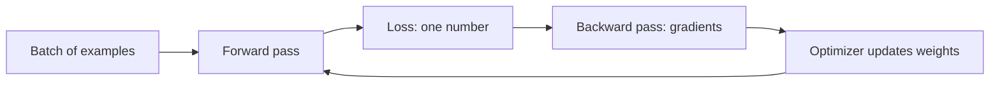
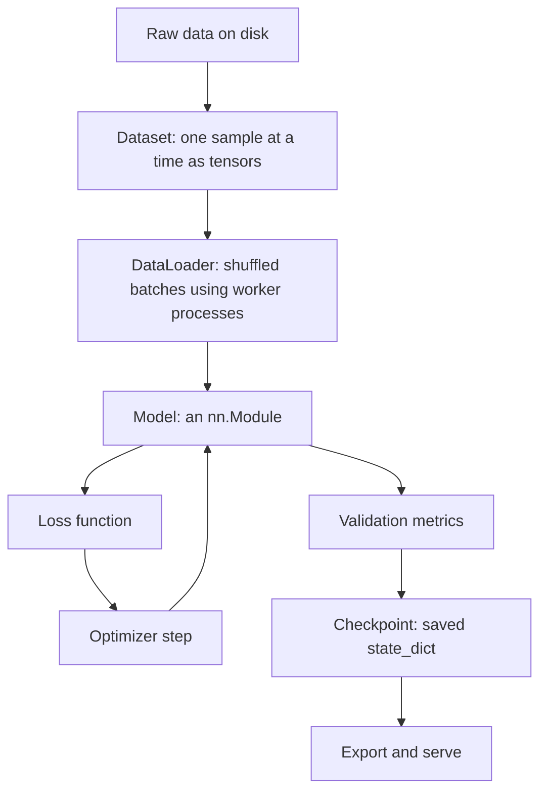

# What deep learning is and where PyTorch fits

> **Before this lesson:** nothing is required. It helps to have met the general idea of machine learning (a program that improves from examples instead of hand-written rules) in [What machine learning is (and isn't)](#/lesson/ml/what-is-ml), and to be able to read basic Python. Every maths idea used here is explained when it first appears.

## In plain words

**Deep learning** is a way of building programs that learn a task from examples by passing data through many simple, adjustable stages called **layers**. Each layer is a small mathematical function with knobs, called **parameters** or **weights**, that training turns until the whole chain produces the right answers. "Deep" refers to the number of layers stacked one after another, not to anything mysterious.

An everyday picture: imagine a factory assembly line that turns raw ore into a car. The first stations do crude work (melt, cut), the middle stations shape parts, and the last stations assemble the finished product. Nobody hands the early stations a list of rules for what a car looks like. Instead, the factory manager looks at each finished car, sees how far it is from the order, and sends small corrections back down the line. After thousands of cars, every station has tuned itself. A deep network is that line: raw pixels or words go in, each layer refines the representation a little, and the error at the end is sent backwards to adjust every station.

**PyTorch** is a free, open-source Python library for building and training these networks. It gives you multi-dimensional arrays that can run on graphics cards, automatic computation of the corrections each layer needs, ready-made layers, optimisers, data-loading tools and ways to ship the trained model.

Why it matters for a job: deep learning powers image recognition, speech, translation, recommendation and the large language models behind chat assistants. PyTorch is the dominant framework in research and very common in industry, so Big Tech and Singapore-based AI teams (banks, ride-hailing, e-commerce, government technology agencies) expect machine-learning engineers to read and write PyTorch code, explain what happens inside a training step and reason about performance on a GPU. This track teaches exactly that, from zero.

> [!NOTE]
> PyTorch cannot run inside your browser, so PyTorch listings in this track are static (read them, do not run them). Every idea is also implemented in **runnable NumPy**, the standard Python array library, with function names that mirror PyTorch so you can see the mapping line by line.

## 1. From hand-written rules to learned features

Classic programming means writing rules: "if the email contains 'lottery' and comes from an unknown sender, mark it as spam". Classic machine learning (the subject of the [Machine Learning](#/lesson/ml/what-is-ml) track) replaced hand-written rules with a model fitted to data, but a person still had to design the **features**: the numeric columns the model sees, such as "number of exclamation marks" or "average word length". For tables of business data this works very well, and gradient-boosted trees remain the strongest default there.

For raw signals such as photos, audio and text, designing features by hand is extremely hard. What numeric column says "there is a cat in this picture"? Researchers spent decades crafting edge detectors and texture descriptors with modest success. Deep learning changed the division of labour: you feed the network raw data (pixel brightness values, audio samples, word identifiers) and it **learns its own features**. Early layers end up detecting simple patterns such as edges and colour blobs; middle layers combine them into textures and parts; late layers respond to whole objects. Nobody programs those detectors. They emerge because they help reduce the error.

This is called **representation learning**: the model learns a useful way to represent the input, as a list of numbers, on its way to the answer. The final list of numbers that summarises an input is often called an **embedding** or **feature vector**.

| approach | who designs the features | typical data | example model |
|---|---|---|---|
| rules | a programmer, by hand | anything | if/else logic |
| classic ML | a person, by hand | tables | logistic regression, gradient-boosted trees |
| deep learning | the network itself | images, audio, text, also tables | convolutional networks, transformers |

## 2. What a deep network actually is

Strip away the vocabulary and a neural network is a **function**: a rule that turns an input into an output. What makes it special is that the function is built from many small pieces, each with adjustable numbers inside.

The most common piece is a **linear layer** (also called a dense or fully connected layer). It takes a list of input numbers, multiplies them by a grid of weights, adds a list of numbers called the **bias**, and outputs a new list. After it we usually apply an **activation function**, a simple non-linear squashing rule such as "replace negative numbers with zero" (called **ReLU**, rectified linear unit). The activation is essential: without it, a stack of linear layers collapses into one linear layer and can only draw straight-line boundaries.

Here is a tiny two-layer network written in NumPy. The class and attribute names (`Linear`, `weight`, `bias`, `forward`) are the ones PyTorch uses.

```python-run
import numpy as np

rng = np.random.default_rng(0)

class Linear:
    """Mirror of torch.nn.Linear: y = x @ weight.T + bias."""
    def __init__(self, in_features, out_features):
        bound = 1 / np.sqrt(in_features)                       # PyTorch's default init range
        self.weight = rng.uniform(-bound, bound, (out_features, in_features))
        self.bias = rng.uniform(-bound, bound, out_features)
    def forward(self, x):
        return x @ self.weight.T + self.bias
    def num_params(self):
        return self.weight.size + self.bias.size

def relu(x):
    return np.maximum(x, 0)

layer1 = Linear(4, 8)        # 4 input numbers -> 8 hidden numbers
layer2 = Linear(8, 3)        # 8 hidden numbers -> 3 output scores

x = rng.normal(size=(5, 4))  # a batch of 5 examples, 4 numbers each
hidden = relu(layer1.forward(x))
scores = layer2.forward(hidden)

print("input shape :", x.shape)
print("hidden shape:", hidden.shape)
print("output shape:", scores.shape)
print("parameters  :", layer1.num_params() + layer2.num_params())
print("first row of scores:", scores[0].round(3))
```

**Reading this code line by line**

- `rng = np.random.default_rng(0)` creates a random-number generator with a fixed **seed** (starting value), so the output is the same every run.
- `Linear.__init__` creates the weight grid with shape `(out_features, in_features)`, the same layout PyTorch uses, and fills it with small random numbers. Random starting values matter: if every weight started equal, every hidden unit would compute the same thing forever.
- `forward` computes `x @ weight.T + bias`. The `@` symbol is matrix multiplication; `.T` is the transpose (rows and columns swapped). Adding `bias` (shape `(out_features,)`) to every row works through **broadcasting**, NumPy's rule for stretching a smaller array to match a larger one.
- `x` has shape `(5, 4)`: five examples (the **batch**) of four numbers each. Processing several examples at once is standard because hardware is much faster on big blocks of arithmetic.
- The printout shows the shapes `(5, 4) → (5, 8) → (5, 3)` and a parameter count of $4 \times 8 + 8 + 8 \times 3 + 3 = 67$.

Those 67 numbers are everything the network "knows". Training means finding values for them that make the outputs useful. A modern image model has tens of millions of such numbers, and a large language model has billions, but the principle is identical.

## 3. How training works, in one paragraph

Training repeats four steps thousands or millions of times:

1. **Forward pass**: run a batch of examples through the network to get predictions.
2. **Loss**: compare predictions with the correct answers using a **loss function**, a formula that outputs one number measuring how wrong the predictions are (lower is better).
3. **Backward pass**: compute the **gradient** of the loss with respect to every parameter. A gradient tells you, for each knob, which direction to turn it to increase the loss, and how strongly. The algorithm that computes all gradients efficiently by working backwards through the layers is **backpropagation**.
4. **Update**: move every parameter a small step in the opposite direction of its gradient. The step size is the **learning rate**. This rule is **gradient descent**.



You will build each of these pieces by hand in the [learning module](#/lesson/deep-learning/learning-from-data) and then see how PyTorch automates them.

## 4. Why deep learning took off when it did

Neural networks date back to the 1950s, and backpropagation was popularised in the 1980s. They became dominant only around 2012, when a convolutional network called AlexNet won the ImageNet image-recognition competition by a wide margin. Four things came together:

- **Data.** Large labelled datasets such as ImageNet (over a million photos in a thousand categories) gave big models enough examples to learn from without memorising.
- **Compute.** **GPUs** (graphics processing units), chips built to shade millions of pixels in parallel for video games, turned out to be ideal for the matrix multiplications at the heart of neural networks. NVIDIA's **CUDA** platform let researchers program them for general arithmetic.
- **Techniques.** Better activation functions (ReLU), weight initialisation rules, dropout, normalisation layers and residual connections made deep networks trainable. Each has its own lesson in this track.
- **Software.** Libraries with automatic differentiation removed the need to derive gradients by hand, so researchers could try a new architecture in an afternoon.

Since then, the same recipe has scaled to speech recognition, machine translation, protein structure prediction and, with the **transformer** architecture, to large language models. Transformers and attention are covered in the [LLM Practice](#/lesson/llm-practice/attention-from-scratch) track; this track gives you the foundations they build on.

## 5. What PyTorch is made of

PyTorch grew out of Torch, an older library written in the Lua language, and was released for Python by Facebook (now Meta) in 2017. Since 2022 it is governed by the PyTorch Foundation under the Linux Foundation. Its 2.0 release in 2023 added a compiler, `torch.compile`, while keeping the original "write normal Python" style.

The library is organised into a few major parts. You will meet every one of them in this track:

| part | what it gives you | lesson |
|---|---|---|
| `torch` (tensors) | multi-dimensional arrays on CPU or GPU, hundreds of maths operations | [Tensors](#/lesson/deep-learning/tensors-basics) |
| `torch.autograd` | automatic gradients of any computation | [Autograd](#/lesson/deep-learning/autograd) |
| `torch.nn` | layers, loss functions, the `Module` base class | [nn.Module](#/lesson/deep-learning/nn-module) |
| `torch.optim` | optimisers (SGD, Adam, AdamW) and learning-rate schedulers | [Optimisers](#/lesson/deep-learning/optimizers-validation) |
| `torch.utils.data` | `Dataset` and `DataLoader` for feeding batches | [Data loading](#/lesson/deep-learning/datasets-dataloaders) |
| `torch.amp`, `torch.compile` | mixed precision and compilation for speed | [Mixed precision](#/lesson/deep-learning/memory-mixed-precision) |
| `torch.export`, `torch.onnx` | packaging a model for production | [Serving and export](#/lesson/deep-learning/serving-export) |

Around the core sit domain libraries: **torchvision** (image datasets, transforms, pretrained models), **torchaudio**, and the huge third-party ecosystem, most visibly Hugging Face Transformers, which is built on PyTorch.

### Eager execution

PyTorch runs each operation the moment Python reaches it. This is called **eager execution**. If you write `c = a + b`, the addition happens immediately and `c` holds real numbers you can print. That makes debugging natural: you can put a `print` or a debugger breakpoint anywhere inside a model.

The alternative, used by early TensorFlow, was to first describe a whole computation as a **graph** (a data structure of operations) and run it later. Graphs are easier to optimise but harder to debug. PyTorch's answer since version 2 is `torch.compile`, which captures graphs from your ordinary Python code automatically when you ask for speed. You get eager debugging and compiled performance from the same code.

### The landscape

- **TensorFlow / Keras** (Google): still widely deployed, especially in older production systems and on mobile through TensorFlow Lite (now called LiteRT). Keras 3 can run on several backends, including PyTorch and JAX.
- **JAX** (Google): a functional NumPy-like library with composable transformations (`grad`, `jit`, `vmap`); popular for large-scale research on TPUs (Google's tensor processing units).
- **PyTorch**: the default in research papers and in most open-source model releases.

In interviews, the framework matters less than the concepts. If you understand tensors, gradients, the training loop and how memory and compute scale, you can move between frameworks quickly.

## 6. Anatomy of a deep-learning project

Every project in this track, from a toy classifier to the CT-scan project, follows the same skeleton:



- A **dataset** turns files on disk into tensors one example at a time.
- A **data loader** groups examples into shuffled batches, often using several background processes so the GPU never waits.
- The **model** is a subclass of `nn.Module` that holds layers and parameters.
- The **training loop** runs forward, loss, backward and update, and periodically evaluates on held-out **validation data** (examples never used for training) to check that the model generalises rather than memorises.
- A **checkpoint** saves the learned parameters so training can resume or the model can be deployed.
- **Export** packages the model so a server, phone or C++ program can run it without the training code.

Here is the skeleton in PyTorch. Do not worry about every name yet; each line is taught later.

```python
import torch
from torch import nn
from torch.utils.data import DataLoader

device = "cuda" if torch.cuda.is_available() else "cpu"      # pick a GPU when one exists

model = nn.Sequential(nn.Linear(4, 8), nn.ReLU(), nn.Linear(8, 3)).to(device)
loss_fn = nn.CrossEntropyLoss()
optimizer = torch.optim.AdamW(model.parameters(), lr=1e-3)
train_loader = DataLoader(train_dataset, batch_size=64, shuffle=True, num_workers=4)

for epoch in range(10):
    model.train()
    for x, y in train_loader:
        x, y = x.to(device), y.to(device)
        optimizer.zero_grad()          # clear old gradients
        loss = loss_fn(model(x), y)    # forward pass and loss
        loss.backward()                # backward pass: fill .grad of every parameter
        optimizer.step()               # update the parameters

torch.save(model.state_dict(), "model.pt")
```

- `torch.cuda.is_available()` checks for an NVIDIA GPU; `.to(device)` moves the model's parameters (and later each batch) onto it. Model and data must live on the same device.
- `nn.Sequential` chains layers: this is the same 4 → 8 → 3 network as the NumPy demo.
- `nn.CrossEntropyLoss` is the standard loss for choosing one class out of several.
- `AdamW` is a popular optimiser; `lr` is the learning rate.
- `DataLoader` yields batches of 64 shuffled examples, prepared by 4 worker processes.
- An **epoch** is one full pass over the training data.
- `state_dict()` is a dictionary of all parameter tensors, the standard thing to save.

## 7. Hardware and setup

You can learn everything in this track on a laptop CPU; the NumPy demos run in the browser. For real training:

- **NVIDIA GPU with CUDA**: the standard. Memory (VRAM) is often the binding constraint: it must hold the parameters, their gradients, the optimiser's extra state and the intermediate results of the forward pass. The [GPU memory lesson](#/lesson/deep-learning/memory-mixed-precision) shows how to estimate it.
- **Apple silicon**: PyTorch supports the `"mps"` device (Metal Performance Shaders) on recent Macs.
- **Cloud and notebooks**: hosted notebooks with free or cheap GPUs are the usual way to start; companies use cloud GPU instances or in-house clusters.
- **Installation**: install from the selector on pytorch.org, which picks the right build for your operating system and CUDA version.

> [!TIP]
> A common beginner surprise: the GPU is fast only when it is kept busy. If data loading, Python overhead or tiny batches leave it idle, a GPU run can be barely faster than a CPU run. Throughput is a skill in itself, covered in the [torch.compile and input pipelines lesson](#/lesson/deep-learning/compile-throughput).

## 8. Where deep learning is the wrong tool

Interviewers like candidates who know the limits:

- **Small tabular data**: a few thousand rows of mixed numeric and categorical columns is usually better served by gradient-boosted trees, which train in seconds and need little tuning.
- **Need for explanation**: in regulated settings (credit decisions in banking, for example) a simple, explainable model may be required.
- **No labels and no budget**: deep networks are data-hungry; without enough labelled examples, start from a **pretrained model** (one already trained on a large dataset), which is the topic of the [next lesson](#/lesson/deep-learning/pretrained-models).
- **Strict latency on tiny devices**: very small models or classic methods may be the only thing that fits.

> [!INTERVIEW]
> **"Why would you choose a deep network over gradient-boosted trees?"** Choose deep learning when the input is raw, high-dimensional and structured in space or time (images, audio, text), when you have a lot of data or a good pretrained model to start from, and when learned representations beat hand-made features. Choose trees for modest tabular datasets, where they are faster, stronger out of the box and easier to explain. Mention that the two can be combined: embeddings from a network can be fed as features to a tree model.

## Summary

- Deep learning trains chains of simple, parameterised layers end to end; the network learns its own features from raw data.
- A network is a function with millions of adjustable numbers; training repeats forward pass, loss, backward pass and update.
- The field took off around 2012 thanks to big labelled datasets, GPUs, better techniques and automatic differentiation.
- PyTorch provides tensors, autograd, `nn`, `optim`, data utilities, compilation and export; it runs eagerly, so ordinary Python debugging works.
- A project flows from raw data through Dataset, DataLoader, model, loss and optimiser to validation, checkpoints and deployment.

## Glossary

- **Deep learning**: learning with neural networks made of many stacked layers.
- **Layer**: one stage of a network, a small function with parameters.
- **Parameter / weight**: an adjustable number inside the model that training changes.
- **Bias**: a parameter added after the multiplication in a linear layer, letting the output shift.
- **Linear (dense, fully connected) layer**: multiplies its input by a weight matrix and adds a bias.
- **Activation function**: a non-linear rule applied after a layer, such as ReLU.
- **ReLU (rectified linear unit)**: replaces negative values with zero.
- **Feature**: a number describing an input that a model uses.
- **Representation learning**: the model learning its own features from raw data.
- **Embedding / feature vector**: a learned list of numbers summarising an input.
- **Batch**: a group of examples processed together.
- **Loss function**: a formula giving one number that measures how wrong the predictions are.
- **Gradient**: for each parameter, the direction and strength of change that increases the loss.
- **Backpropagation**: the efficient backwards computation of all gradients.
- **Gradient descent**: updating parameters against their gradients, scaled by the learning rate.
- **Learning rate**: the size of each update step.
- **Epoch**: one full pass over the training data.
- **GPU / CUDA**: a massively parallel processor / NVIDIA's platform for programming it.
- **Eager execution**: running each operation immediately as Python reaches it.
- **Validation data**: examples held back from training to measure generalisation.
- **Checkpoint**: a saved copy of a model's parameters (and often optimiser state).
- **Pretrained model**: a model already trained on a large dataset, reused for a new task.

## Check yourself

```quiz
[
  {"q": "What does the word 'deep' in deep learning refer to?", "options": ["The number of layers stacked in the network", "The size of the training dataset", "The use of GPUs", "How hard the maths is"], "answer": 0,
   "explain": "Deep networks stack many layers; each refines the representation produced by the one before."},
  {"q": "Why must a network contain non-linear activation functions between linear layers?", "options": ["Without them, a stack of linear layers is equivalent to a single linear layer", "They make training faster on GPUs", "They reduce the number of parameters", "They are needed to compute the bias"], "answer": 0,
   "explain": "Composing linear maps gives another linear map, so depth would add nothing without non-linearities."},
  {"q": "A linear layer maps 10 inputs to 4 outputs. How many parameters does it have?", "options": ["44", "40", "14", "10"], "answer": 0,
   "explain": "The weight grid has 4 × 10 = 40 entries and the bias has 4, so 44 in total."},
  {"q": "What is eager execution?", "options": ["Each operation runs immediately when Python reaches it", "The whole model is compiled before any data is seen", "Training starts before the data is loaded", "Gradients are computed during the forward pass only"], "answer": 0,
   "explain": "Eager mode makes PyTorch code behave like normal Python, which simplifies debugging; torch.compile adds graph capture on top when you want speed."},
  {"q": "Which of these was NOT one of the main drivers of deep learning's rise around 2012?", "options": ["Hand-designed image features becoming more accurate", "Large labelled datasets", "GPUs for parallel arithmetic", "Libraries with automatic differentiation"], "answer": 0,
   "explain": "The shift was away from hand-designed features: networks learned their own."},
  {"q": "For a dataset of 5,000 rows with 20 mixed numeric and categorical columns, a strong first model is usually…", "options": ["Gradient-boosted trees", "A 50-layer convolutional network trained from scratch", "A large language model", "A recurrent network"], "answer": 0,
   "explain": "On modest tabular data, boosted trees are typically stronger, faster and easier to explain."},
  {"q": "In the training loop, what does the backward pass produce?", "options": ["The gradient of the loss with respect to each parameter", "The predictions for the batch", "A new batch of data", "The updated weights"], "answer": 0,
   "explain": "The optimizer step uses those gradients afterwards to update the weights."}
]
```

> **Source:** Stevens, Antiga & Viehmann, *Deep Learning with PyTorch*, ch. 1 (the deep learning revolution, why PyTorch, how PyTorch supports a project, hardware); PyTorch documentation (docs.pytorch.org) for the current state of `torch.compile` and the PyTorch Foundation.
