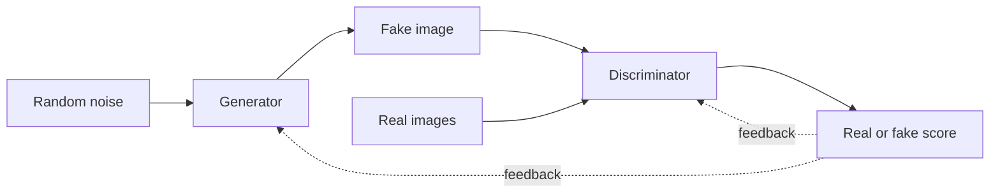

# Running pretrained models: classifiers, GANs and hubs

> **Before this lesson:** read [What deep learning is and where PyTorch fits](#/lesson/deep-learning/why-deep-learning) for the words layer, parameter, batch, forward pass and GPU. You do not need to know how training works yet: here we only *use* networks that someone else trained.

## In plain words

A **pretrained model** is a network whose parameters were already learned by someone else, usually on a very large dataset with a lot of computing power. You download the architecture (the code describing the layers) plus the learned numbers (the **weights file**), and you can make predictions immediately.

The everyday analogy is hiring an experienced chef instead of training a teenager from scratch. The chef already knows knife skills, sauces and timing. You only need to show them your menu. In the same way, a network trained to recognise a thousand everyday object categories has already learned to detect edges, textures, shapes and object parts, and that knowledge transfers to new jobs.

Why it matters for a job: very few teams train large models from nothing. The normal workflow is to start from a published model, check how it behaves on your data, and then adapt it (fine-tuning is covered in the [end-to-end lesson](#/lesson/deep-learning/end-to-end-finetuning)). Interviewers expect you to know how to load a model correctly, prepare inputs exactly the way it was trained, switch it to inference mode and interpret its outputs. Getting any of these wrong gives silently bad predictions, which is one of the most common real-world bugs.

## 1. The ImageNet classification task

Most famous image models were trained on **ImageNet**, a dataset of more than a million photographs, each labelled with one of 1,000 categories such as particular dog breeds, vehicles, foods and household objects. The task is **image classification**: given a picture, output which category it shows.

The network does not output a single word. It outputs 1,000 numbers, one **score** per category. Raw scores like these are called **logits**. To turn them into probabilities we apply **softmax**, which exponentiates every score and divides by the total so the results are positive and add up to 1:

$$p_i = \frac{e^{z_i}}{\sum_j e^{z_j}}$$

Here $z_i$ is the logit for category $i$ and $p_i$ its probability. The predicted class is the one with the largest score. Competitions report **top-1 accuracy** (the highest-scoring class is correct) and **top-5 accuracy** (the correct class is among the five highest). In 2012 the AlexNet network reached a top-5 error of roughly 15%, far ahead of the runner-up's roughly 26%, which is the result that launched the deep-learning boom. Modern architectures such as ResNet (residual networks, explained in the [residual connections lesson](#/lesson/deep-learning/depth-residuals)) and vision transformers push top-1 accuracy past 80%.

## 2. Loading a pretrained classifier with torchvision

**torchvision** is PyTorch's companion library for computer vision. Its `models` module contains dozens of architectures with downloadable weights. The current API names the weights explicitly:

```python
import torch
from torchvision import models
from torchvision.models import ResNet50_Weights

weights = ResNet50_Weights.DEFAULT          # the best available weights for this architecture
model = models.resnet50(weights=weights)    # builds the layers and loads the learned numbers
model.eval()                                # switch to inference behaviour

preprocess = weights.transforms()           # the exact input pipeline used in training
categories = weights.meta["categories"]     # list of 1,000 human-readable class names
```

Line by line:

- `ResNet50_Weights.DEFAULT` is an **enum** (a named constant) that points at the recommended weights file; the first call downloads it and caches it on disk.
- `models.resnet50(weights=...)` constructs the 50-layer residual network and copies the weights in. Calling it with `weights=None` gives the same architecture with random weights, ready to train from scratch.
- `model.eval()` puts the model in **evaluation mode**. Some layers behave differently in training and inference: dropout stops dropping units, and batch normalisation uses its stored statistics instead of the current batch's (both are explained in the [model design module](#/lesson/deep-learning/regularisation)). Forgetting `eval()` is a classic bug: predictions change from run to run and accuracy drops.
- `weights.transforms()` returns the preprocessing function that matches these weights.
- `weights.meta["categories"]` maps output position 0 to 999 to class names.

> [!NOTE]
> Older tutorials (and the source book) write `models.resnet50(pretrained=True)`. That argument was deprecated in torchvision 0.13 in favour of `weights=`. Recognise the old form when reading code, but write the new one.

## 3. Preparing the input exactly as in training

A pretrained network has only ever seen inputs prepared in one particular way. The standard ImageNet recipe is:

1. **Resize** so the shorter side is 256 pixels (or a model-specific size).
2. **Centre crop** a 224 × 224 square.
3. **Convert to a tensor**: change the pixel layout from height × width × channels (how image files store it) to channels × height × width (how PyTorch expects it), and scale the 0 to 255 integers to decimals between 0 and 1.
4. **Normalise** each colour channel: subtract the channel mean and divide by the channel standard deviation measured on ImageNet, mean `[0.485, 0.456, 0.406]` and standard deviation `[0.229, 0.224, 0.225]` for red, green and blue.
5. **Add a batch dimension**: the model expects a batch, so a single image of shape `(3, 224, 224)` becomes `(1, 3, 224, 224)`.

Here is the whole pipeline and the post-processing in NumPy, using a made-up image and pretend logits so it runs in the browser. Function names mirror their PyTorch counterparts.

```python-run
import numpy as np

rng = np.random.default_rng(42)
image = rng.integers(0, 256, size=(300, 400, 3), dtype=np.uint8)   # H x W x C, like a decoded JPEG

def center_crop(img, size):
    h, w = img.shape[:2]
    top, left = (h - size) // 2, (w - size) // 2
    return img[top:top + size, left:left + size]

def to_tensor(img):
    """Mirror of transforms.ToTensor: HWC uint8 0..255 -> CHW float 0..1."""
    return img.transpose(2, 0, 1).astype(np.float32) / 255.0

def normalize(t, mean, std):
    mean = np.array(mean, dtype=np.float32)[:, None, None]   # shape (3, 1, 1) broadcasts over H and W
    std = np.array(std, dtype=np.float32)[:, None, None]
    return (t - mean) / std

x = center_crop(image, 224)
x = to_tensor(x)
x = normalize(x, [0.485, 0.456, 0.406], [0.229, 0.224, 0.225])
batch = x[None]                                    # same as x.unsqueeze(0) in PyTorch
print("batch shape:", batch.shape, " dtype:", batch.dtype)
print("per-channel mean after normalising:", batch.mean(axis=(0, 2, 3)).round(2))

# Pretend the model produced these logits for 6 classes.
categories = ["tabby cat", "golden retriever", "espresso", "laptop", "bicycle", "pizza"]
logits = np.array([2.1, 0.3, -1.0, 4.0, 1.2, -0.5])

def softmax(z):
    z = z - z.max()                                  # subtract the max for numerical safety
    e = np.exp(z)
    return e / e.sum()

probs = softmax(logits)
top = np.argsort(probs)[::-1][:3]                  # like torch.topk(probs, 3)
for i in top:
    print(f"{categories[i]:>16s}: {probs[i] * 100:5.1f}%")
```

**Reading this code line by line**

- The fake image has shape `(300, 400, 3)` and type `uint8` (unsigned 8-bit integers, 0 to 255), which is what an image-decoding library returns.
- `center_crop` cuts the middle 224 × 224 square by computing the top-left corner.
- `to_tensor` uses `transpose(2, 0, 1)` to move the channel axis first, converts to 32-bit floats and divides by 255.
- `normalize` reshapes the three means and standard deviations to `(3, 1, 1)` so they **broadcast**: each channel's value is subtracted from every pixel of that channel only.
- Random pixels are not ImageNet photos, so the printed channel means are not exactly 0, but they are in the right range. On real photos the result is roughly centred on zero with spread around one, which is what the network saw in training.
- `softmax` subtracts the largest logit before exponentiating. This does not change the result (the factor cancels in the division) but prevents overflow when logits are large. You will implement a careful version in the problems of the images module.
- `np.argsort(probs)[::-1][:3]` sorts indices by probability from high to low and keeps three, which is what `torch.topk` returns.

The equivalent PyTorch inference code is:

```python
from PIL import Image

img = Image.open("photo.jpg").convert("RGB")
batch = preprocess(img).unsqueeze(0)              # (1, 3, 224, 224)

with torch.inference_mode():                      # no gradient bookkeeping: faster, less memory
    logits = model(batch)                         # (1, 1000)
probs = logits.softmax(dim=1)
top5 = probs.topk(5, dim=1)
for p, idx in zip(top5.values[0], top5.indices[0]):
    print(f"{categories[idx]}: {p.item():.1%}")
```

- `torch.inference_mode()` is a **context manager** (a `with` block that switches a setting on and off) that tells autograd not to record operations, because we will not compute gradients. It saves memory and time. `torch.no_grad()` is the older, slightly less strict equivalent.
- `softmax(dim=1)` applies softmax across the 1,000 class scores of each row; `dim` is PyTorch's name for NumPy's `axis`.
- `.item()` converts a one-element tensor to a plain Python number.

> [!WARNING]
> The three most common inference bugs: forgetting `model.eval()`; feeding images normalised differently from training (for example 0 to 255 instead of normalised values, or BGR channel order from OpenCV instead of RGB); and forgetting the batch dimension. Each gives confident but wrong answers, not an error message.

## 4. A model always answers

A classifier trained on 1,000 categories will output a probability distribution over those 1,000 categories for **any** input, including a photo of something it has never seen or random noise. It cannot say "none of the above". Even its confidence can be misleading: modern networks are often **overconfident**, giving 95% to a wrong answer. Two consequences for real systems:

- Inputs that differ from the training data, called **out-of-distribution** inputs, need their own checks (for example, a separate detector, or rejecting predictions below a confidence threshold, with the threshold chosen on validation data).
- Probabilities may need **calibration**, adjusting them so that "70% confident" really means right about 70% of the time. A simple method is **temperature scaling**: divide the logits by a constant chosen on validation data before softmax.

## 5. Models that create: GANs and image-to-image translation

Not every network classifies. A **generative model** produces new data. The best-known older family is the **generative adversarial network (GAN)**. It has two networks trained against each other:

- The **generator** turns random numbers into a fake image.
- The **discriminator** looks at an image and outputs the probability that it is real.

The discriminator is rewarded for telling real from fake; the generator is rewarded for fooling it. As they compete, the generator's images become more realistic. Think of a forger and an art inspector who both improve because of each other.



**CycleGAN** extends the idea to translating images between two domains without paired examples, for instance turning daytime street photos into night-time ones when you have a pile of day photos and a separate pile of night photos but no matched pairs. It uses two generators (day to night, night to day) and requires that going there and back returns roughly the original image, called **cycle consistency**.

Today, most image generation uses **diffusion models**, which learn to remove noise step by step, but GANs remain common interview material and are still used where fast, one-step generation matters.

## 6. Models that describe: captioning

An **image captioning** model combines two parts: a convolutional network that turns the image into a feature vector (the "encoder"), and a language model that generates a sentence word by word conditioned on that vector (the "decoder"). Older systems used recurrent networks for the decoder; current vision-language models use transformers (see [the LLM Practice track](#/lesson/llm-practice/transformer-block)). The lesson for us is architectural: complex systems are often built by connecting pretrained pieces.

## 7. Model hubs and loading safely

A **model hub** is a public catalogue of pretrained models you can load with one call.

- **Torch Hub** loads models published in a GitHub repository that contains a `hubconf.py` file listing entry points:

```python
import torch
model = torch.hub.load("pytorch/vision", "resnet18", weights="IMAGENET1K_V1")
print(torch.hub.list("pytorch/vision")[:5])     # names of available entry points
```

- **Hugging Face Hub** is now the largest catalogue, with hundreds of thousands of models for vision, text and audio, loaded through libraries such as `transformers` and `timm`.

Loading a model from the internet means running someone else's code and reading their files, so treat it like installing a package:

- `torch.load` reads files written with Python's **pickle** format, which can execute arbitrary code when loaded. Since PyTorch 2.6, `torch.load` defaults to `weights_only=True`, which only allows tensors and simple containers. Keep that default for files you did not create.
- The **safetensors** format stores only raw tensors, cannot execute code and loads quickly; it is the preferred format on Hugging Face Hub.
- `torch.hub.load` imports Python code from the repository; only use repositories you trust, and pin a specific version (a tag or commit) in production.

> [!INTERVIEW]
> **"You load a pretrained ResNet and its accuracy on your validation photos is terrible. What do you check?"** In order: is the model in `eval()` mode; is preprocessing identical to training (resize, crop, RGB order, scaling to 0 to 1, ImageNet mean and std); is there a batch dimension; are the class indices mapped to the right names; and do your photos actually resemble ImageNet (medical scans or satellite images may need fine-tuning). Only then suspect the model itself.

## Summary

- Pretrained models give you learned weights for free; torchvision provides architectures plus a `weights=` enum with matching preprocessing and class names.
- Inputs must be prepared exactly as in training: resize, crop, channel-first layout, scale to 0 to 1, normalise per channel, add a batch dimension.
- Use `model.eval()` and `torch.inference_mode()` for prediction; convert logits with softmax and read the top-k classes.
- Classifiers always answer and are often overconfident; out-of-distribution inputs need explicit handling.
- GANs pit a generator against a discriminator; CycleGAN translates between domains without pairs; captioning chains an image encoder with a language decoder.
- Load weights only from trusted sources; prefer `weights_only=True` and safetensors.

## Glossary

- **Pretrained model**: a network with parameters already learned on a large dataset.
- **Weights file**: the stored parameter values of a trained model.
- **ImageNet**: a dataset of over a million photos in 1,000 categories, the classic benchmark.
- **Logits**: raw class scores output by a network before softmax.
- **Softmax**: converts scores into positive probabilities that sum to 1.
- **Top-1 / top-5 accuracy**: the correct class is the highest / among the five highest scores.
- **Evaluation mode (`eval()`)**: switches dropout and batch normalisation to inference behaviour.
- **Inference mode**: a context that disables gradient recording during prediction.
- **Normalisation (of inputs)**: subtracting a mean and dividing by a standard deviation per channel.
- **Out-of-distribution input**: an input unlike the training data.
- **Calibration / temperature scaling**: making confidence match accuracy / dividing logits by a fitted constant.
- **Generative model**: a model that produces new data.
- **GAN (generative adversarial network)**: a generator and discriminator trained against each other.
- **CycleGAN / cycle consistency**: unpaired domain translation / requiring a round trip to return the original.
- **Diffusion model**: a generator that learns to remove noise step by step.
- **Model hub**: a catalogue of pretrained models loadable by name.
- **Pickle / safetensors**: Python's general (code-executing) serialisation / a tensors-only safe format.

## Check yourself

```quiz
[
  {"q": "Why must you call model.eval() before predicting with a pretrained ResNet?", "options": ["Batch normalisation and dropout behave differently in training and inference", "It downloads the weights", "It turns off the GPU", "It converts logits to probabilities"], "answer": 0,
   "explain": "In eval mode, batch norm uses stored running statistics and dropout is disabled, giving deterministic, correct predictions."},
  {"q": "A single preprocessed image has shape (3, 224, 224). What shape should you pass to the model?", "options": ["(1, 3, 224, 224)", "(224, 224, 3)", "(3, 224, 224)", "(224, 224)"], "answer": 0,
   "explain": "Models expect a batch dimension first; unsqueeze(0) adds it."},
  {"q": "What does transforms.ToTensor do to a decoded RGB image?", "options": ["Moves channels first and scales 0–255 integers to 0–1 floats", "Normalises with ImageNet mean and std", "Crops to 224 × 224", "Converts RGB to grayscale"], "answer": 0,
   "explain": "Normalisation is a separate step that follows."},
  {"q": "Why subtract the maximum logit before computing softmax?", "options": ["To avoid overflow in exp without changing the result", "To make the probabilities sum to 1", "To remove the bias term", "To sort the classes"], "answer": 0,
   "explain": "The common factor cancels between numerator and denominator, so the probabilities are identical but exp never sees huge numbers."},
  {"q": "In a GAN, what is the discriminator trained to do?", "options": ["Tell real images from generated ones", "Generate images from noise", "Classify images into 1,000 categories", "Compress images"], "answer": 0,
   "explain": "The generator is trained to fool it; the competition improves both."},
  {"q": "Since PyTorch 2.6, torch.load defaults to weights_only=True. Why?", "options": ["Pickle files can execute arbitrary code, so only tensors and simple containers are allowed", "It makes loading faster on GPUs", "It drops the optimizer state", "It converts weights to half precision"], "answer": 0,
   "explain": "Unrestricted unpickling of an untrusted file is a code-execution risk."},
  {"q": "You show an ImageNet classifier a chest X-ray. What happens?", "options": ["It still outputs a probability distribution over its 1,000 everyday categories", "It raises an error", "It outputs 'unknown'", "It returns all zeros"], "answer": 0,
   "explain": "Classifiers cannot abstain; out-of-distribution inputs need separate handling."}
]
```

> **Source:** Stevens, Antiga & Viehmann, *Deep Learning with PyTorch*, ch. 2 (pretrained image classifiers, GANs and CycleGAN, captioning, Torch Hub); torchvision documentation, "Models and pre-trained weights"; PyTorch documentation for `torch.load` and `torch.hub`.
