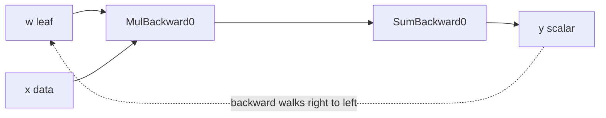

# Autograd in depth: graphs, backward, no_grad and gradient checks

> **Before this lesson:** you need the loss, the gradient, the chain rule and the gradient-descent loop from [Learning as parameter estimation](#/lesson/deep-learning/learning-from-data), and broadcasting from [Tensors](#/lesson/deep-learning/tensors-basics). A Python class with methods such as `__add__` is used; each is explained.

## In plain words

**Autograd** (automatic differentiation) is the part of PyTorch that computes gradients for you. While your code runs the forward pass, PyTorch quietly writes down every operation in a diagram called the **computational graph**. When you call `loss.backward()`, it walks that diagram backwards from the loss, applying the chain rule at every step, and deposits the gradient of the loss with respect to each parameter in that parameter's `.grad` attribute.

An everyday comparison: hiking a trail and dropping a breadcrumb at every fork, each labelled with which way you went. To get home you do not need a map; you follow the breadcrumbs in reverse. The forward pass drops breadcrumbs (operations and their inputs); the backward pass follows them home, collecting gradients.

Why it matters for a job: you will rarely write gradients by hand again, but you will constantly debug autograd. Why is `.grad` `None`? Why did memory blow up during evaluation? Why did "one of the variables needed for gradient computation has been modified by an inplace operation" appear? Why did gradients double? Interviewers ask candidates to implement a miniature autograd and to explain `no_grad`, `detach` and gradient accumulation. By the end of this lesson you will have built one that trains a model.

## 1. Tracking operations: requires_grad and the graph

A tensor created with `requires_grad=True` is one we want gradients for, usually a parameter. Every operation involving such a tensor produces an output that also requires gradients and remembers how it was made in its `grad_fn` attribute.

```python
import torch

w = torch.tensor([2.0, -1.0], requires_grad=True)   # a leaf: created by us, not by an operation
x = torch.tensor([3.0, 4.0])                        # data: no gradient needed
y = (w * x).sum()                                   # y = 2*3 + (-1)*4 = 2
print(y, y.grad_fn)          # tensor(2., grad_fn=<SumBackward0>) <SumBackward0 object at ...>
print(w.is_leaf, y.is_leaf)  # True False
y.backward()                 # dy/dw = x
print(w.grad)                # tensor([3., 4.])
print(x.grad)                # None: x did not require gradients
```

Vocabulary:

- A **leaf tensor** is one you created directly (parameters, inputs). Gradients are stored in `.grad` only for leaves that require them. Intermediate results get gradients during the backward pass, but PyTorch discards them to save memory unless you call `.retain_grad()` on them.
- `grad_fn` points to the backward function of the operation that created the tensor (`SumBackward0`, `MulBackward0`, and so on). Following `grad_fn.next_functions` walks the graph.
- The graph is built **dynamically** as the code runs, a style called **define-by-run**. An `if` statement or a loop with a data-dependent number of iterations produces a different graph each time, which is natural for variable-length inputs.



## 2. What backward actually computes

`y.backward()` requires `y` to be a **scalar** (a single number), because "the gradient" is defined for one output. It applies the chain rule from `y` back to every leaf.

If the output is a tensor, you must say how to combine its elements by passing a `gradient` argument of the same shape: `out.backward(gradient=v)`. Mathematically PyTorch computes a **vector-Jacobian product**. The **Jacobian** $J$ of a function with many inputs and many outputs is the table of all partial derivatives $\partial \text{out}_i / \partial \text{in}_j$. Instead of building that table, which could have billions of entries, PyTorch computes $v^\top J$ directly, one cheap local step per operation. With a scalar loss, $v$ is the single number 1, which is what `backward()` uses by default.

This is called **reverse-mode** differentiation. It costs roughly one extra forward pass regardless of how many parameters there are, which is why it is the method of choice when you have millions of parameters and one loss. (Forward mode, the alternative, is efficient when there are few inputs and many outputs.)

### Gradients accumulate

Every call to `backward()` **adds** to `.grad`:

```python
w = torch.tensor(1.0, requires_grad=True)
(3 * w).backward(); print(w.grad)   # tensor(3.)
(3 * w).backward(); print(w.grad)   # tensor(6.)  added, not replaced
w.grad = None                       # what optimizer.zero_grad() does by default (set_to_none=True)
```

Accumulation is deliberate: it lets one parameter used in several places collect the sum of all its contributions, and it enables **gradient accumulation**, where you run backward on several small batches before a single optimizer step to simulate a larger batch. The price is that you must clear gradients before each new step. Since PyTorch 2.0, `optimizer.zero_grad()` sets gradients to `None` rather than filling them with zeros, which saves a little memory and time.

### The graph is freed after backward

To save memory, `backward()` frees the graph's saved intermediate values as it goes. Calling `backward()` twice through the same graph raises an error saying the saved tensors have been freed. If you truly need two backward passes (rare: for example, two losses sharing a trunk computed once), pass `retain_graph=True` to the first one. The usual fix is to add the losses and call `backward()` once.

## 3. Turning tracking off: no_grad, inference_mode, detach

Recording the graph costs memory (every intermediate needed for backward is kept alive) and time. Turn it off whenever you do not need gradients:

- `with torch.no_grad():` disables recording inside the block. Use it for validation loops and for **manually updating parameters** (an update like `w -= lr * w.grad` must not itself be recorded).
- `with torch.inference_mode():` is a stricter, faster version for pure inference; tensors created inside cannot later be used in a graph that needs gradients.
- `t.detach()` returns a view of `t` that shares storage but is cut out of the graph. Use it to log a value, to convert to NumPy, or to stop gradients flowing into part of a model on purpose.
- `param.requires_grad_(False)` permanently stops computing gradients for a parameter, the standard way to **freeze** layers during fine-tuning.

```python
with torch.no_grad():
    for p in model.parameters():
        p -= lr * p.grad          # a manual SGD step, not recorded in any graph

running_loss += loss.item()       # .item() returns a Python float: no graph is kept alive
history.append(loss.detach())     # a tensor without the graph (on the same device)
```

> [!WARNING]
> A classic memory leak: `total_loss += loss` inside the training loop. `loss` carries its whole graph, so `total_loss` keeps every batch's graph alive and memory grows until the program crashes. Use `loss.item()` (or `loss.detach()`).

## 4. Operations autograd cannot differentiate

Gradient-based learning needs every step between parameters and loss to have a useful slope.

- `argmax`, `round`, comparisons (`>`) and integer casts have zero or undefined slope almost everywhere; gradients stop there. This is why we train classifiers with cross-entropy on probabilities, not with accuracy.
- Integer tensors cannot require gradients.
- ReLU has a corner at 0; PyTorch uses slope 0 there by convention, and in practice it never matters.
- In-place operations that overwrite a value saved for backward trigger the version-counter error described in the [storage lesson](#/lesson/deep-learning/tensor-storage).

## 5. Building a tensor autograd engine in NumPy

To demystify all of this, here is a working reverse-mode engine for NumPy arrays. It supports addition (with broadcasting), multiplication, matrix multiplication, ReLU, mean and squaring, which is enough to train a small network. Names mirror PyTorch.

```python-run
import numpy as np

def unbroadcast(grad, shape):
    """Sum a gradient back down to `shape` (undo broadcasting): the gradient of a stretched input
    is the sum of the gradients of all the copies it was stretched into."""
    while grad.ndim > len(shape):
        grad = grad.sum(axis=0)
    for i, n in enumerate(shape):
        if n == 1 and grad.shape[i] != 1:
            grad = grad.sum(axis=i, keepdims=True)
    return grad

class Tensor:
    def __init__(self, data, requires_grad=False, _parents=(), _op=""):
        self.data = np.asarray(data, dtype=np.float64)
        self.requires_grad = requires_grad
        self.grad = None
        self._parents, self._op, self._backward = _parents, _op, lambda: None

    def _wrap(self, other):
        return other if isinstance(other, Tensor) else Tensor(other)

    def __add__(self, other):
        other = self._wrap(other)
        out = Tensor(self.data + other.data, self.requires_grad or other.requires_grad, (self, other), "add")
        def _backward():
            self._accumulate(unbroadcast(out.grad, self.data.shape))
            other._accumulate(unbroadcast(out.grad, other.data.shape))
        out._backward = _backward
        return out

    def __mul__(self, other):
        other = self._wrap(other)
        out = Tensor(self.data * other.data, self.requires_grad or other.requires_grad, (self, other), "mul")
        def _backward():
            self._accumulate(unbroadcast(out.grad * other.data, self.data.shape))
            other._accumulate(unbroadcast(out.grad * self.data, other.data.shape))
        out._backward = _backward
        return out

    def __sub__(self, other):
        return self + self._wrap(other) * -1.0

    def __matmul__(self, other):
        out = Tensor(self.data @ other.data, self.requires_grad or other.requires_grad, (self, other), "matmul")
        def _backward():
            self._accumulate(out.grad @ other.data.T)     # dL/dA = dL/dOut @ B^T
            other._accumulate(self.data.T @ out.grad)     # dL/dB = A^T @ dL/dOut
        out._backward = _backward
        return out

    def relu(self):
        out = Tensor(np.maximum(self.data, 0), self.requires_grad, (self,), "relu")
        out._backward = lambda: self._accumulate(out.grad * (self.data > 0))
        return out

    def pow2(self):
        out = Tensor(self.data ** 2, self.requires_grad, (self,), "pow")
        out._backward = lambda: self._accumulate(out.grad * 2 * self.data)
        return out

    def mean(self):
        out = Tensor(self.data.mean(), self.requires_grad, (self,), "mean")
        out._backward = lambda: self._accumulate(np.full_like(self.data, out.grad / self.data.size))
        return out

    def _accumulate(self, g):
        if self.requires_grad:
            self.grad = g if self.grad is None else self.grad + g   # gradients ADD up

    def backward(self):
        order, seen = [], set()
        def visit(t):                                  # topological sort: parents before children
            if id(t) not in seen:
                seen.add(id(t))
                for p in t._parents:
                    visit(p)
                order.append(t)
        visit(self)
        self.grad = np.ones_like(self.data)            # d(loss)/d(loss) = 1
        for t in reversed(order):
            if t.grad is not None:                     # constants never receive a gradient
                t._backward()

# --- use it: a 2-layer network learning y = x1 * x2 on random points
rng = np.random.default_rng(0)
X = rng.uniform(-1, 1, size=(256, 2)); Y = (X[:, :1] * X[:, 1:])          # target shape (256, 1)
W1 = Tensor(rng.normal(0, 1, (2, 16)), requires_grad=True); b1 = Tensor(np.zeros((1, 16)), requires_grad=True)
W2 = Tensor(rng.normal(0, 0.3, (16, 1)), requires_grad=True); b2 = Tensor(np.zeros((1, 1)), requires_grad=True)
params, lr = [W1, b1, W2, b2], 0.1

for step in range(1, 2001):
    h = (Tensor(X) @ W1 + b1).relu()
    pred = h @ W2 + b2
    loss = (pred - Tensor(Y)).pow2().mean()
    for p in params: p.grad = None                     # optimizer.zero_grad()
    loss.backward()
    for p in params: p.data -= lr * p.grad             # optimizer.step()
    if step in (1, 100, 500, 2000):
        print(f"step {step:4d}  loss {loss.data:.5f}")
print("b1.grad shape:", b1.grad.shape, "(summed back over the batch by unbroadcast)")
```

**Reading this code line by line**

- Every operation creates an output `Tensor` that records its parents and defines a `_backward` closure (a small function that remembers the variables around it). The closure applies that operation's local derivative to `out.grad` and passes the result to each parent.
- `unbroadcast` is the subtle part. The bias `b1` has shape `(1, 16)` but was added to a `(256, 16)` matrix, so it was implicitly copied 256 times. Each copy receives a gradient; the bias's total gradient is their **sum**. PyTorch does exactly this internally, which is why a bias's gradient has the bias's own shape.
- The matrix-multiplication rule: for `Out = A @ B`, the gradients are `dOut @ B.T` for `A` and `A.T @ dOut` for `B`. You can check the shapes: `(256, 16) @ (16, 1)` gives `(256, 1)`; the gradient for `W2` is `(16, 256) @ (256, 1) = (16, 1)`, matching `W2`.
- `_accumulate` adds to an existing gradient, mirroring PyTorch's accumulation.
- `backward` sorts the graph topologically (each node after everything it depends on), seeds the loss's gradient with 1, then calls each node's `_backward` from the loss towards the leaves.
- The network learns the product $x_1 x_2$, a function no linear model can represent; the loss falls steadily over the 2,000 steps.

## 6. Checking gradients

Whenever you write a backward function by hand (a custom layer, a custom loss, or an interview exercise), check it numerically. PyTorch provides `torch.autograd.gradcheck`, which compares analytic gradients with finite differences. It needs **float64** inputs, because finite differences in float32 are too noisy.

```python
from torch.autograd import gradcheck
inp = torch.randn(4, 3, dtype=torch.float64, requires_grad=True)
print(gradcheck(torch.nn.functional.softplus, (inp,)))     # True when the gradients agree
```

Here is the same check against our NumPy engine, using the **relative error** $\frac{|a - n|}{\max(|a|, |n|)}$ between analytic value $a$ and numeric value $n$. Values around $10^{-7}$ or smaller mean the gradient is right; values above about $10^{-3}$ almost always mean a bug.

```python-run
import numpy as np

rng = np.random.default_rng(1)
X, Y = rng.normal(size=(5, 3)), rng.normal(size=(5, 1))
W = rng.normal(size=(3, 1)); b = np.zeros((1, 1))

def loss_of(W, b):
    h = np.maximum(X @ W + b, 0)
    return ((h - Y) ** 2).mean()

# analytic gradient by the chain rule
z = X @ W + b; h = np.maximum(z, 0)
dh = 2 * (h - Y) / h.size
dz = dh * (z > 0)
gW, gb = X.T @ dz, dz.sum(axis=0, keepdims=True)

# numeric gradient by central differences
eps, nW = 1e-6, np.zeros_like(W)
for i in range(W.shape[0]):
    Wp, Wm = W.copy(), W.copy(); Wp[i, 0] += eps; Wm[i, 0] -= eps
    nW[i, 0] = (loss_of(Wp, b) - loss_of(Wm, b)) / (2 * eps)
rel = np.abs(gW - nW) / np.maximum(np.abs(gW) + np.abs(nW), 1e-12)
print("analytic:", gW.ravel().round(6))
print("numeric :", nW.ravel().round(6))
print("max relative error:", rel.max())
```

## 7. Custom operations

Occasionally you need an operation whose backward PyTorch cannot derive or should compute differently (for numerical stability, or to save memory). You subclass `torch.autograd.Function` and write both directions:

```python
class ClampedExp(torch.autograd.Function):
    @staticmethod
    def forward(ctx, x):
        y = torch.exp(x.clamp(max=20))
        ctx.save_for_backward(y)          # keep what backward needs
        return y

    @staticmethod
    def backward(ctx, grad_out):
        (y,) = ctx.saved_tensors
        return grad_out * y               # d/dx exp(x) = exp(x)

out = ClampedExp.apply(torch.randn(3, requires_grad=True))
```

`ctx` is a context object for passing saved values from forward to backward. `backward` receives the gradient of the loss with respect to the output and returns the gradient with respect to each input. (This toy ignores the clamp in backward, which is the kind of choice a custom function lets you make deliberately.) Verify any such function with `gradcheck`.

## 8. Higher-order and functional gradients

- `torch.autograd.grad(outputs, inputs)` returns gradients as a tuple instead of writing them into `.grad`. It is handy when you need gradients of something other than the training loss, such as a gradient penalty.
- Passing `create_graph=True` records the backward computation itself, so you can differentiate a gradient again (second derivatives), used in some meta-learning and regularisation methods.
- The `torch.func` module offers JAX-style function transforms (`grad`, `vmap` for automatic batching, `jacrev`) for advanced use.

> [!INTERVIEW]
> **"Why does PyTorch accumulate gradients instead of overwriting them, and how would you train with an effective batch of 256 when only 64 fit in memory?"** Accumulation makes shared parameters collect the sum of all their uses and lets several backward calls add up. For a bigger effective batch, run four micro-batches of 64, divide each loss by 4 (so the sum equals the mean over 256), call `backward()` after each, and call `optimizer.step()` and `zero_grad()` once every four micro-batches. Mention that batch normalisation statistics still see only 64 examples at a time.

## Summary

- Operations on tensors with `requires_grad=True` build a dynamic computational graph; `grad_fn` links each result to its creator.
- `backward()` on a scalar applies the chain rule in reverse (a vector-Jacobian product) and stores gradients in the `.grad` of leaf tensors.
- Gradients accumulate across `backward()` calls: clear them each step; use accumulation deliberately for large effective batches.
- The graph is freed after backward; `retain_graph=True` keeps it when really needed.
- `no_grad`, `inference_mode`, `detach` and `requires_grad_(False)` stop tracking; use `.item()` for logging to avoid memory leaks.
- Broadcasting in the forward pass becomes summation in the backward pass.
- Check hand-written gradients with finite differences in float64; extend autograd with `torch.autograd.Function`.

## Glossary

- **Autograd (automatic differentiation)**: computing derivatives by recording operations and applying the chain rule.
- **Computational graph**: the record of operations connecting inputs and parameters to the output.
- **Leaf tensor**: a tensor created directly by the user rather than by an operation.
- **grad_fn**: the backward function attached to a tensor produced by an operation.
- **Define-by-run**: building the graph while the code executes.
- **Jacobian**: the table of partial derivatives of every output with respect to every input.
- **Vector-Jacobian product**: $v^\top J$, what reverse-mode differentiation computes efficiently.
- **Reverse mode**: differentiating from the output back to the inputs.
- **Gradient accumulation**: summing gradients over several backward calls before an update.
- **retain_graph**: keeping the graph after backward for a second pass.
- **no_grad / inference_mode**: contexts that disable graph recording.
- **detach**: a view cut out of the graph.
- **Freezing**: stopping gradient computation for some parameters.
- **Topological order**: an ordering where each node follows everything it depends on.
- **Unbroadcasting**: summing a gradient over the axes along which an input was broadcast.
- **gradcheck / relative error**: PyTorch's numeric gradient test / the size of a difference relative to the values compared.

## Check yourself

```quiz
[
  {"q": "After y = (w * x).sum(); y.backward() with w = [2, -1] (requires_grad) and x = [3, 4], what is w.grad?", "options": ["[3, 4]", "[2, -1]", "[6, -4]", "2"], "answer": 0,
   "explain": "dy/dw_i = x_i."},
  {"q": "You call loss.backward() twice in a row on the same graph without options. What happens?", "options": ["An error, because saved intermediate values were freed after the first backward", "Gradients are overwritten", "Nothing; the second call is ignored", "The learning rate doubles"], "answer": 0,
   "explain": "Use retain_graph=True on the first call if a second pass is truly needed."},
  {"q": "A bias of shape (16,) is added to activations of shape (64, 16). What shape is the bias gradient, and how is it formed?", "options": ["(16,), the sum over the 64 rows of the upstream gradient", "(64, 16), copied from upstream", "(64,), summed over features", "(1,), the total sum"], "answer": 0,
   "explain": "Broadcasting copies the bias into every row; the backward pass sums the copies' gradients."},
  {"q": "Why does 'total_loss += loss' inside a training loop cause memory to grow?", "options": ["Each loss keeps its computational graph alive", "Python floats are large", "The optimizer stores every loss", "backward() is called twice"], "answer": 0,
   "explain": "Use loss.item() or loss.detach() for logging."},
  {"q": "Which context should wrap a manual parameter update like p -= lr * p.grad?", "options": ["torch.no_grad()", "torch.enable_grad()", "torch.autograd.grad()", "No context is needed"], "answer": 0,
   "explain": "The update must not be recorded in the graph, and in-place changes to leaves that require grad are refused otherwise."},
  {"q": "Why does gradcheck require float64 inputs?", "options": ["Finite differences in float32 are too imprecise to compare reliably", "Autograd does not work in float32", "float64 is faster", "Gradients are always stored as float64"], "answer": 0,
   "explain": "Subtracting two nearly equal losses loses many digits; float64 leaves enough precision."},
  {"q": "Which operation blocks useful gradients from flowing to the parameters?", "options": ["argmax", "exp", "matrix multiplication", "addition"], "answer": 0,
   "explain": "argmax is piecewise constant, so its derivative is zero almost everywhere."},
  {"q": "For Out = A @ B with upstream gradient G = dL/dOut, what is dL/dA?", "options": ["G @ B.T", "A.T @ G", "G @ A.T", "B @ G"], "answer": 0,
   "explain": "Check shapes: G is (m, n) and B is (k, n), so G @ B.T is (m, k), the shape of A."}
]
```

> **Source:** Stevens, Antiga & Viehmann, *Deep Learning with PyTorch*, ch. 5 (PyTorch's autograd, accumulating grad functions, switching autograd off); PyTorch documentation, "Autograd mechanics", `torch.autograd.gradcheck`, `torch.autograd.Function`, `torch.inference_mode`.
