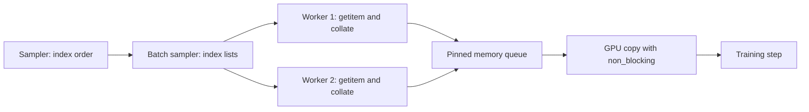

# Dataset, transforms and DataLoader (workers, pinning, samplers)

> **Before this lesson:** you need image tensors and per-channel normalisation from [Real-world data as tensors](#/lesson/deep-learning/data-as-tensors), mini-batches from [Optimisers and validation](#/lesson/deep-learning/optimizers-validation), and devices from [storage, strides, views and devices](#/lesson/deep-learning/tensor-storage). Python classes with `__len__` and `__getitem__` are explained below.

## In plain words

Training needs a steady stream of mini-batches: read some examples from disk, decode them, apply random changes, convert to tensors, stack them into a batch, move the batch to the GPU, and do it again, millions of times. PyTorch splits this into two roles:

- A **Dataset** knows how many examples there are and how to produce example number $i$ as tensors. It is a librarian who can fetch any one book by its catalogue number.
- A **DataLoader** decides *which* examples go into each batch and in what order, fetches them (optionally with several helper processes working in parallel), and glues them into batch tensors. It is the delivery service that collects books from the librarian in shuffled order, packs them into boxes and keeps the trucks rolling so the reader (the GPU) never waits.

Why it matters for a job: a fast model fed by a slow input pipeline wastes expensive GPUs. "My GPU utilisation is 30%, why?" is a classic question, and the answer is usually the data loader. You will also meet bugs here that never raise errors: unshuffled training data, identical random augmentations in every worker, labels remapped wrongly when filtering classes.

## 1. The Dataset protocol

A **map-style dataset** is any object with two methods:

- `__len__(self)`: the number of examples, used by `len(dataset)`.
- `__getitem__(self, i)`: example `i`, used by `dataset[i]`. It usually returns a tuple `(input_tensor, label)`.

Python calls these "dunder" (double-underscore) methods automatically: `len(d)` calls `d.__len__()` and `d[3]` calls `d.__getitem__(3)`. That is the whole contract; PyTorch's `torch.utils.data.Dataset` base class adds nothing essential.

```python
import torch
from torch.utils.data import Dataset

class CsvDataset(Dataset):
    def __init__(self, features, labels, transform=None):
        self.x = torch.as_tensor(features, dtype=torch.float32)
        self.y = torch.as_tensor(labels, dtype=torch.int64)
        self.transform = transform

    def __len__(self):
        return len(self.y)

    def __getitem__(self, i):
        x = self.x[i]
        if self.transform is not None:
            x = self.transform(x)
        return x, self.y[i]
```

For data too large to fit in memory, `__init__` stores only file paths and `__getitem__` opens and decodes one file. Expensive one-time work (parsing an index file, building a list of samples) belongs in `__init__`; per-example work belongs in `__getitem__`.

An **IterableDataset** instead defines `__iter__` and yields examples in a stream. Use it when random access is impossible or wasteful, such as reading a huge log file sequentially or consuming a message queue.

### torchvision datasets

torchvision ships ready-made datasets. **CIFAR-10**, used throughout this module, holds 60,000 colour images of 32 × 32 pixels in ten classes (aeroplane, car, bird, cat, deer, dog, frog, horse, ship, truck): 50,000 for training and 10,000 for testing.

```python
from torchvision import datasets

train_raw = datasets.CIFAR10(root="data", train=True, download=True)
img, label = train_raw[0]            # a PIL image (Python Imaging Library) and an int
len(train_raw), train_raw.classes    # 50000, ['airplane', 'automobile', ...]
```

## 2. Transforms

A **transform** is a function applied to each example inside `__getitem__`. torchvision provides many, composed into a pipeline. The current API lives in `torchvision.transforms.v2`:

```python
from torchvision.transforms import v2

train_tf = v2.Compose([
    v2.RandomHorizontalFlip(p=0.5),          # data augmentation (training only)
    v2.RandomCrop(32, padding=4),
    v2.ToImage(),                            # PIL image -> tensor image, C x H x W, uint8
    v2.ToDtype(torch.float32, scale=True),   # to float in [0, 1]
    v2.Normalize(mean=[0.4914, 0.4822, 0.4465], std=[0.2470, 0.2435, 0.2616]),
])
val_tf = v2.Compose([v2.ToImage(), v2.ToDtype(torch.float32, scale=True),
                     v2.Normalize(mean=[0.4914, 0.4822, 0.4465], std=[0.2470, 0.2435, 0.2616])])
train_set = datasets.CIFAR10("data", train=True, transform=train_tf)
```

- The older `transforms.ToTensor()` (from the original `torchvision.transforms` module, used by the source book) does the conversion and scaling in one step; you will see it in most existing code. Both give a float tensor of shape `(3, 32, 32)` in [0, 1].
- `Normalize` subtracts the per-channel mean and divides by the per-channel standard deviation. The numbers above are the commonly used CIFAR-10 training-set statistics. For your own data, compute them over the training set once, as the [normalisation problem](#/lesson/deep-learning/pretrained-models) in module 0 practises.
- Random transforms (flips, crops, colour changes) are **data augmentation**: each epoch sees a slightly different version of every image, which fights overfitting. They belong only in the training pipeline; validation must be deterministic. Augmentation is covered in depth in the [augmentation lesson](#/lesson/deep-learning/augmentation).

### Subsets and relabelling

To train on a subset of classes (say only "cat" versus "dog"), filter the indices and **remap** the labels to 0 and 1, because a two-output model with `CrossEntropyLoss` requires targets 0 and 1, not the original 3 and 5:

```python
keep = {3: 0, 5: 1}                                     # cat -> 0, dog -> 1
pairs = [(img, keep[y]) for img, y in train_set if y in keep]   # simple, but loads everything into memory
```

For large datasets, store indices instead (`torch.utils.data.Subset(dataset, indices)`) and remap labels in a small wrapper dataset or in the target transform.

## 3. The DataLoader

```python
from torch.utils.data import DataLoader

train_loader = DataLoader(
    train_set,
    batch_size=128,
    shuffle=True,             # new random order every epoch
    num_workers=4,            # 4 background processes prepare batches
    pin_memory=True,          # page-locked host memory for faster GPU copies
    persistent_workers=True,  # keep workers alive between epochs
    drop_last=True,           # skip the final incomplete batch
)
val_loader = DataLoader(val_set, batch_size=256, shuffle=False, num_workers=4, pin_memory=True)

for images, labels in train_loader:          # images: (128, 3, 32, 32), labels: (128,)
    images = images.to(device, non_blocking=True)
    labels = labels.to(device, non_blocking=True)
    ...
```

What each piece does:

- **Sampler**: decides the order of indices. `shuffle=True` uses a `RandomSampler` (a fresh permutation each epoch); `shuffle=False` uses a `SequentialSampler`. You can pass your own `sampler=`, such as a `WeightedRandomSampler` for class balancing (see the [imbalance lesson](#/lesson/deep-learning/imbalance-metrics)) or a `DistributedSampler` that gives each GPU its own shard in multi-GPU training.
- **Batch sampler**: groups indices into lists of `batch_size`. With `drop_last=True` the final short batch is skipped, which keeps batch statistics stable and shapes constant (helpful for compiled models).
- **collate_fn**: turns a list of examples into one batch. The default **stacks** tensors along a new first dimension and works recursively through tuples, lists and dicts. Variable-length examples (sentences of different lengths, images with different numbers of boxes) need a custom `collate_fn` that pads or keeps lists.
- **num_workers**: with 0, everything runs in the main process between training steps. With $k > 0$, $k$ worker processes each build whole batches in parallel, and each keeps about `prefetch_factor` batches (default 2) ready ahead of time.
- **pin_memory**: copies batches into **pinned** (page-locked) CPU memory, which the GPU can read directly. Combined with `.to(device, non_blocking=True)` the copy can overlap with GPU computation.
- **persistent_workers**: without it, workers are shut down and restarted every epoch, which is slow when each worker has expensive setup.

## 4. A DataLoader from scratch

The demo implements a `DataLoader` with shuffling, batching, `drop_last` and a default collate function in NumPy, then uses it for two epochs. Names and behaviour mirror PyTorch.

```python-run
import numpy as np

class TensorDataset:
    """Like torch.utils.data.TensorDataset: example i is a tuple of the i-th rows."""
    def __init__(self, *arrays):
        assert all(len(a) == len(arrays[0]) for a in arrays)
        self.arrays = arrays
    def __len__(self):
        return len(self.arrays[0])
    def __getitem__(self, i):
        return tuple(a[i] for a in self.arrays)

def default_collate(samples):
    """Stack field by field: a list of (x, y) tuples -> (stacked x, stacked y)."""
    first = samples[0]
    if isinstance(first, tuple):
        return tuple(default_collate([s[k] for s in samples]) for k in range(len(first)))
    if isinstance(first, dict):
        return {key: default_collate([s[key] for s in samples]) for key in first}
    return np.stack(samples)

class DataLoader:
    def __init__(self, dataset, batch_size=1, shuffle=False, drop_last=False, collate_fn=default_collate, seed=0):
        self.dataset, self.batch_size, self.shuffle = dataset, batch_size, shuffle
        self.drop_last, self.collate_fn = drop_last, collate_fn
        self.rng = np.random.default_rng(seed)               # like passing generator=...
    def __iter__(self):
        n = len(self.dataset)
        order = self.rng.permutation(n) if self.shuffle else np.arange(n)   # the sampler
        for start in range(0, n, self.batch_size):                           # the batch sampler
            idx = order[start:start + self.batch_size]
            if self.drop_last and len(idx) < self.batch_size:
                return
            yield self.collate_fn([self.dataset[i] for i in idx])
    def __len__(self):
        n = len(self.dataset)
        return n // self.batch_size if self.drop_last else -(-n // self.batch_size)

X = np.arange(10 * 3, dtype=np.float32).reshape(10, 3)    # 10 examples, 3 features
y = np.arange(10) % 2
loader = DataLoader(TensorDataset(X, y), batch_size=4, shuffle=True, drop_last=False, seed=42)
print("batches per epoch:", len(loader))
for epoch in range(2):
    print(f"epoch {epoch}:")
    for xb, yb in loader:
        print("   x batch", xb.shape, " labels", yb, " first column", xb[:, 0])
loader.drop_last = True
print("with drop_last:", len(loader), "batches, sizes", [b[0].shape[0] for b in loader])
print("dict collate:", default_collate([{"img": np.zeros(2), "id": 1}, {"img": np.ones(2), "id": 2}]))
```

**Reading this code line by line**

- `TensorDataset` returns one row of each array per index, the simplest useful dataset.
- `default_collate` recurses into tuples and dicts and stacks the leaves, which is why a dataset returning `(image, label)` produces a loader yielding `(images, labels)`.
- `__iter__` builds a fresh permutation per epoch when shuffling (so epoch 0 and epoch 1 differ), slices it into batches, and stops early on a short final batch when `drop_last` is set.
- `__len__` is the number of batches: ceiling division without `drop_last`, floor division with it. Ten examples in batches of four give 3 batches (4, 4, 2), or 2 with `drop_last`.

## 5. Workers, randomness and other traps

- **Seeding**: each worker process gets its own copy of the dataset. PyTorch seeds each worker's `torch` and Python `random` generators differently, but older code that uses NumPy's global random generator in transforms can produce **identical augmentations in every worker**. Use `torch` random functions in transforms, or set `worker_init_fn` to reseed NumPy per worker. Pass `generator=torch.Generator().manual_seed(0)` to the DataLoader for a reproducible shuffle.
- **Start method**: on Windows and macOS, workers start by launching a fresh Python interpreter that imports your script ("spawn"). Code that creates the DataLoader must sit under `if __name__ == "__main__":`, and the dataset and transforms must be picklable (no lambdas defined inside functions).
- **Files and connections**: open file handles, database connections or HDF5 files lazily inside `__getitem__` (or per worker), not in `__init__`, because handles do not survive being copied into worker processes.
- **Memory growth**: a dataset holding millions of small Python objects (a list of dicts) can appear to leak memory in workers, because reading Python objects updates their reference counts and forces the operating system to copy memory pages. Store metadata in NumPy arrays or tensors instead.
- **How many workers?** Start near the number of CPU cores divided by the number of GPUs, and measure. If the GPU is idle while the CPU is busy decoding, add workers, move augmentation to the GPU, or pre-process data offline into a faster format.
- **Validation loaders** do not need shuffling and can use larger batches, since no gradients are stored.



> [!INTERVIEW]
> **"GPU utilisation is low during training. How do you find and fix the cause?"** Time the loop with the model step removed (iterate the loader only): if that alone is as slow as training, the input pipeline is the bottleneck. Fixes in order: raise `num_workers`, enable `pin_memory` with `non_blocking=True`, use `persistent_workers`, decode cheaper (smaller images, faster codecs, pre-resized files), move augmentation to the GPU, cache pre-processed data. If the loader is fast, look at the model side: tiny batches, `.item()` calls forcing synchronisation each step, or Python overhead that `torch.compile` can remove.

## Summary

- A map-style Dataset implements `__len__` and `__getitem__`; an IterableDataset streams with `__iter__`.
- Transforms run per example; `ToImage` plus `ToDtype(scale=True)` (or the older `ToTensor`) and `Normalize` prepare images; random augmentations belong only in training.
- Filtering classes requires remapping labels to 0..C−1.
- The DataLoader combines a sampler, a batch sampler and a collate function; `shuffle`, `drop_last`, `num_workers`, `pin_memory` and `persistent_workers` control order and speed.
- Watch worker seeding, the spawn start method, lazily opened files and Python-object memory growth.

## Glossary

- **Dataset (map-style)**: an object returning example `i` via `__getitem__` and its size via `__len__`.
- **IterableDataset**: a dataset that yields examples as a stream.
- **Transform**: a per-example preprocessing function.
- **Data augmentation**: random, label-preserving changes to training examples.
- **CIFAR-10**: 60,000 tiny colour images in ten classes.
- **Sampler / batch sampler**: decides index order / groups indices into batches.
- **collate_fn**: combines a list of examples into a batch.
- **drop_last**: skipping the last incomplete batch.
- **Worker process**: a background process that prepares batches.
- **prefetch_factor**: batches each worker prepares in advance.
- **Pinned (page-locked) memory**: host memory the GPU can copy from directly and asynchronously.
- **non_blocking**: an asynchronous host-to-GPU copy.
- **persistent_workers**: keeping workers alive across epochs.
- **WeightedRandomSampler / DistributedSampler**: sampling by per-example weights / sharding data across GPUs.
- **Spawn start method**: starting workers as fresh interpreters that import the main script.

## Check yourself

```quiz
[
  {"q": "Which two methods must a map-style Dataset implement?", "options": ["__len__ and __getitem__", "__iter__ and __next__", "forward and backward", "fit and transform"], "answer": 0,
   "explain": "len(dataset) and dataset[i] are all the DataLoader needs."},
  {"q": "A dataset has 1,000 examples and batch_size=64. How many batches per epoch with drop_last=False, and with drop_last=True?", "options": ["16 and 15", "15 and 16", "16 and 16", "15 and 15"], "answer": 0,
   "explain": "1000 / 64 = 15.6: 15 full batches plus one of 40, which drop_last discards."},
  {"q": "What does the default collate_fn do with a list of (image, label) tuples?", "options": ["Stacks images into one tensor and labels into another", "Concatenates everything into a flat list", "Pads images to the same size", "Shuffles the examples"], "answer": 0,
   "explain": "It recurses into the tuple and stacks each field along a new batch dimension."},
  {"q": "You filter CIFAR-10 to cats (label 3) and dogs (label 5) and train a 2-output model with CrossEntropyLoss. What must you do with the labels?", "options": ["Remap them to 0 and 1", "Keep them as 3 and 5", "One-hot encode them to length 10", "Convert them to floats"], "answer": 0,
   "explain": "Targets must be valid indices into the model's output dimension."},
  {"q": "What do pin_memory=True and non_blocking=True achieve together?", "options": ["Faster host-to-GPU copies that can overlap with computation", "Smaller batches", "Deterministic shuffling", "Lower CPU memory use"], "answer": 0,
   "explain": "Page-locked memory allows asynchronous DMA transfers to the GPU."},
  {"q": "Why should random augmentation be absent from the validation pipeline?", "options": ["Validation must be deterministic and reflect real inputs", "Augmentation is too slow", "It would change the labels", "Validation sets are too small"], "answer": 0,
   "explain": "Random changes would make validation scores noisy and not comparable across epochs."},
  {"q": "On Windows, a script with num_workers=4 crashes or re-runs itself repeatedly. The usual cause?", "options": ["The DataLoader code is not under if __name__ == '__main__': with the spawn start method", "Windows does not support worker processes", "pin_memory is True", "The batch size is odd"], "answer": 0,
   "explain": "Spawned workers import the main script; unguarded top-level code runs again in each."},
  {"q": "All four workers produce the same 'random' crops for corresponding samples. A likely cause?", "options": ["Transforms use NumPy's global random generator, which is copied identically into each worker", "shuffle=False", "drop_last=True", "pin_memory=True"], "answer": 0,
   "explain": "Use torch's random functions or reseed NumPy in worker_init_fn."}
]
```

> **Source:** Stevens, Antiga & Viehmann, *Deep Learning with PyTorch*, ch. 7 (CIFAR-10, the Dataset class, dataset transforms, normalising data, building a two-class subset) and ch. 11 (care and feeding of data loaders); PyTorch documentation, `torch.utils.data`; torchvision documentation, `transforms.v2`.
