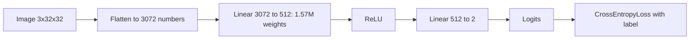

# A first image classifier: softmax, cross-entropy and its limits

> **Before this lesson:** you need `nn.Sequential` and parameter counting from [nn.Module, state_dict and checkpointing](#/lesson/deep-learning/nn-module), activations from [Neurons, layers and activation functions](#/lesson/deep-learning/neurons-activations), and the DataLoader from [Dataset, transforms and DataLoader](#/lesson/deep-learning/datasets-dataloaders). Logarithms are used: $\ln$ is the natural logarithm, the inverse of $e^x$, and $\ln$ of a number between 0 and 1 is negative.

## In plain words

We now build a complete classifier: images in, a decision out. The first attempt is deliberately naive. Flatten each small colour image into one long list of numbers and feed it to a stack of fully connected layers. The network outputs one score per class; **softmax** turns scores into probabilities; **cross-entropy** measures how much probability the model gave to the correct class; gradient descent does the rest.

This model works, up to a point, and its failures are the most instructive part. A fully connected network has no idea that neighbouring pixels belong together, and if an object moves a few pixels to the right, the network sees a completely different input. Understanding exactly why motivates the convolutional networks of the [next lesson](#/lesson/deep-learning/convolutions).

Analogy: imagine recognising a friend's face from a list of 3,072 numbers read out loud in a fixed order, without being told which numbers were next to each other in the photo. You could memorise which positions tend to be dark for that friend, but if they stood one step to the left in the next photo, every number would shift and your memory would be useless.

Why it matters for a job: softmax plus cross-entropy is the loss behind nearly every classifier and every language model (predicting the next token is a classification over the vocabulary). Interviewers expect you to derive its gradient, explain why it uses logits and log-probabilities, and implement it in a numerically stable way.

## 1. The task and the naive model

Take two CIFAR-10 classes, say ships and trucks, and remap their labels to 0 and 1 as shown in the [data-loading lesson](#/lesson/deep-learning/datasets-dataloaders). Each image is a tensor of shape `(3, 32, 32)`, which flattens to $3 \times 32 \times 32 = 3{,}072$ numbers.

```python
from torch import nn

model = nn.Sequential(
    nn.Flatten(),            # (N, 3, 32, 32) -> (N, 3072)
    nn.Linear(3072, 512),
    nn.ReLU(),
    nn.Linear(512, 2),       # two logits: one per class
)
n_params = sum(p.numel() for p in model.parameters())   # 1,574,402
```

The parameter count is $3{,}072 \times 512 + 512 + 512 \times 2 + 2 = 1{,}574{,}402$, almost all of it in the first layer. Hold on to that number.

## 2. From scores to probabilities: softmax

The model's outputs are **logits**: arbitrary real numbers, larger meaning "more likely". To interpret them as probabilities they must be non-negative and sum to 1. **Softmax** achieves both:

$$\text{softmax}(z)_i = \frac{e^{z_i}}{\sum_{j} e^{z_j}}$$

Properties worth knowing:

- Exponentiation makes every value positive; dividing by the sum makes them add to 1.
- It preserves order: the largest logit gets the largest probability, so `argmax` of the logits equals `argmax` of the probabilities. You do not need softmax to make a prediction, only to report a confidence.
- Adding the same constant to every logit changes nothing, because $e^{z_i + c} = e^c e^{z_i}$ and $e^c$ cancels. This is the key to stable computation: subtract the largest logit first so that the largest exponent is $e^0 = 1$ and nothing overflows.
- Scaling all logits up makes the distribution sharper (more confident); scaling them down makes it flatter. Dividing logits by a **temperature** before softmax is used for calibration and for sampling text from language models.

## 3. Measuring wrongness: cross-entropy

For one example whose correct class is $y$, the **cross-entropy loss** is minus the log of the probability assigned to the correct class:

$$\ell = -\ln p_y = -\ln \frac{e^{z_y}}{\sum_j e^{z_j}} = -z_y + \ln \sum_j e^{z_j}$$

Over a batch we average. Reading it:

- If the model gives the right class probability 1, the loss is $-\ln 1 = 0$.
- Probability 0.5 costs $\ln 2 \approx 0.69$; with two classes, that is exactly the loss of a model that guesses. With $C$ classes, a model that knows nothing outputs uniform probabilities and scores $\ln C$, a handy sanity check at the start of training (about 2.30 for ten classes).
- Probability 0.01 costs about 4.6, and the loss grows without limit as the probability approaches 0. Confident mistakes are punished very hard.

This loss is also the **negative log-likelihood (NLL)**: the likelihood of the data under the model is the product of the probabilities it assigned to the true labels, and taking minus the log turns the product into a sum to minimise. That is why PyTorch offers `nn.NLLLoss`, which expects log-probabilities, and `nn.LogSoftmax`. The combination `LogSoftmax` then `NLLLoss` is exactly `nn.CrossEntropyLoss` applied to logits, which is what you should use:

```python
loss_fn = nn.CrossEntropyLoss()      # input: logits (N, C); target: class indices (N,) of dtype int64
loss = loss_fn(logits, targets)
```

The right-hand form $-z_y + \ln \sum_j e^{z_j}$ shows why PyTorch wants logits: the **log-sum-exp** $\ln \sum_j e^{z_j}$ can be computed stably as $m + \ln \sum_j e^{z_j - m}$ with $m = \max_j z_j$. Computing softmax first and then taking a logarithm can produce $\ln 0 = -\infty$ when a probability underflows to zero.

### Why not mean squared error?

You could compare the probability vector with a one-hot target using MSE. It works poorly: when the model is confidently wrong, softmax is saturated and the MSE gradient becomes tiny, so the model learns slowly exactly when it should learn fastest. Cross-entropy's gradient stays large in that situation, as the next section shows.

### The beautiful gradient

Differentiating $\ell = -z_y + \ln\sum_j e^{z_j}$ with respect to each logit gives

$$\frac{\partial \ell}{\partial z_i} = p_i - \mathbb{1}[i = y]$$

where $\mathbb{1}[i = y]$ is 1 for the correct class and 0 otherwise. In words: the gradient is "predicted probabilities minus the one-hot target". If the model gives the correct class 0.01, that logit's gradient is $-0.99$: a strong push upward. This simple form is why softmax and cross-entropy are always used together.

### Useful options

- `weight=` gives each class a weight in the average, a tool for class imbalance.
- `ignore_index=` (default −100) skips targets with that value, used for padding tokens.
- `label_smoothing=0.1` replaces the hard one-hot target with 0.9 on the true class and the remaining 0.1 spread evenly over all classes, which discourages over-confidence and often improves calibration.
- `reduction="none"` returns one loss per example instead of the mean, which the [CT project](#/lesson/deep-learning/training-application) uses to compute per-sample metrics.
- For two classes you can instead use one logit with `nn.BCEWithLogitsLoss`; the two formulations are equivalent.

## 4. Training it, in NumPy

Here is a complete classifier trained with mini-batch SGD, written in NumPy with a stable `log_softmax`, cross-entropy and the backward pass derived above. The data are synthetic 12 × 12 grayscale images containing a "plus" or an "×" pattern at a random position, plus noise. Crucially, **training images only place the pattern in the left half of the image**, and we test both on new images drawn the same way and on images with the pattern in the right half.

```python-run
import numpy as np

rng = np.random.default_rng(0)
PLUS = np.array([[0, 1, 0], [1, 1, 1], [0, 1, 0]], float)
CROSS = np.array([[1, 0, 1], [0, 1, 0], [1, 0, 1]], float)

def make_images(n, allowed_cols):
    X = rng.normal(0, 0.2, (n, 12, 12))
    y = rng.integers(0, 2, n)                              # 0 = plus, 1 = cross
    for i in range(n):
        r, c = rng.integers(0, 10), rng.choice(allowed_cols)
        X[i, r:r + 3, c:c + 3] += PLUS if y[i] == 0 else CROSS
    return X.reshape(n, -1), y                             # flatten, like nn.Flatten()

X_train, y_train = make_images(2000, np.arange(0, 4))     # pattern in columns 0..5
X_val, y_val = make_images(500, np.arange(0, 4))          # same distribution
X_shift, y_shift = make_images(500, np.arange(6, 10))     # same patterns, moved right

def log_softmax(z):
    z = z - z.max(axis=1, keepdims=True)                   # stability: largest logit becomes 0
    return z - np.log(np.exp(z).sum(axis=1, keepdims=True))

def cross_entropy(logits, target):
    return -log_softmax(logits)[np.arange(len(target)), target].mean()

W1 = rng.normal(0, np.sqrt(2 / 144), (144, 64)); b1 = np.zeros(64)
W2 = rng.normal(0, np.sqrt(1 / 64), (64, 2));   b2 = np.zeros(2)
forward = lambda X: np.maximum(X @ W1 + b1, 0) @ W2 + b2
accuracy = lambda X, y: (forward(X).argmax(axis=1) == y).mean()

lr, batch = 0.3, 64
print("loss before training:", round(cross_entropy(forward(X_train), y_train), 3), " (ln 2 =", round(np.log(2), 3), ")")
for epoch in range(1, 21):
    order = rng.permutation(len(X_train))
    for s in range(0, len(order), batch):
        idx = order[s:s + batch]
        x, t = X_train[idx], y_train[idx]
        z1 = x @ W1 + b1; h = np.maximum(z1, 0); logits = h @ W2 + b2
        g = np.exp(log_softmax(logits))                    # softmax probabilities
        g[np.arange(len(t)), t] -= 1                       # p - onehot
        g /= len(t)                                        # mean over the batch
        gW2, gb2 = h.T @ g, g.sum(axis=0)
        gz1 = (g @ W2.T) * (z1 > 0)                        # back through ReLU
        gW1, gb1 = x.T @ gz1, gz1.sum(axis=0)
        W1 -= lr * gW1; b1 -= lr * gb1; W2 -= lr * gW2; b2 -= lr * gb2
    if epoch in (1, 5, 10, 20):
        print(f"epoch {epoch:2d}  train loss {cross_entropy(forward(X_train), y_train):.3f}  "
              f"train acc {accuracy(X_train, y_train):.3f}  val acc {accuracy(X_val, y_val):.3f}  "
              f"shifted acc {accuracy(X_shift, y_shift):.3f}")
```

**Reading this code line by line**

- `make_images` adds a 3 × 3 pattern at a random row and at one of the allowed columns, then flattens each image into 144 numbers.
- `log_softmax` subtracts each row's maximum before exponentiating, then subtracts the log of the sum: the stable log-sum-exp.
- `cross_entropy` picks out each row's log-probability for the true class with fancy indexing and averages the negatives.
- The initial loss is close to $\ln 2 \approx 0.693$, confirming the model starts by guessing.
- The backward pass starts from `softmax - onehot`, divided by the batch size because the loss is a mean, then follows the chain rule through the second layer, the ReLU mask and the first layer, as in the [autograd lesson](#/lesson/deep-learning/autograd).

**What the output shows**

- Training accuracy reaches 100% and validation accuracy on images from the same distribution climbs to around 90%. The gap between them is **overfitting**: the model has memorised details of its 2,000 training images.
- Accuracy on the **shifted** images stays near 50%, the level of random guessing, even though they contain exactly the same two patterns. The weights connected to the right-hand pixels never learned anything useful, because during training nothing interesting ever appeared there.

## 5. The limits of going fully connected

The shifted-image result is the heart of the problem. A fully connected layer treats every pixel position as an unrelated input with its own weights:

- **No translation invariance.** A pattern learned at one position is not recognised at another. To cope, the network would need to see every object at every position in training, which multiplies the data needed. (Translation means shifting position; **translation invariance** means the answer does not change when the input shifts.)
- **No notion of locality.** The network does not know that pixel (5, 5) is next to (5, 6). Neighbourhood structure, the most important fact about images, must be rediscovered from data.
- **Parameter explosion.** Our 32 × 32 model already has 1.6 million parameters. A 1,024 × 1,024 colour photo has about 3.1 million inputs; one fully connected layer with 1,024 outputs would have about 3.2 billion weights (roughly 13 GB in float32) before learning anything. Too many parameters for the data also means more overfitting.

The structure we want: the same small detector applied at every position (so a pattern learned once is recognised everywhere, with a few parameters shared across positions), looking only at a small neighbourhood. That is exactly a **convolution**.



## 6. The same thing in PyTorch

```python
import torch

optimizer = torch.optim.SGD(model.parameters(), lr=1e-2)
loss_fn = nn.CrossEntropyLoss()

for epoch in range(20):
    model.train()
    for images, labels in train_loader:              # images (64, 3, 32, 32), labels (64,) int64
        loss = loss_fn(model(images), labels)
        optimizer.zero_grad()
        loss.backward()
        optimizer.step()

    model.eval()
    correct = total = 0
    with torch.no_grad():
        for images, labels in val_loader:
            preds = model(images).argmax(dim=1)          # no softmax needed for the decision
            correct += (preds == labels).sum().item()
            total += labels.numel()
    print(f"epoch {epoch}: val accuracy {correct / total:.3f}")
```

On the real two-class CIFAR subset, a model like this typically reaches near-perfect training accuracy while validation accuracy stalls in the low-to-mid 80s percent: the same overfitting pattern as the demo, for the same reasons.

> [!INTERVIEW]
> **"Implement cross-entropy from logits. Why not compute softmax and then the log?"** Write `log_softmax(z) = z - max(z) - log(sum(exp(z - max(z))))` and the loss as the mean of minus the true-class log-probabilities. Computing softmax first can underflow a small probability to exactly 0, giving `log(0) = -inf` and a `nan` gradient; the log-sum-exp form never exponentiates a large positive number and never takes the log of 0. Then state the gradient: softmax minus one-hot, divided by the batch size.

## Summary

- A fully connected classifier flattens the image, applies linear layers and activations, and outputs one logit per class.
- Softmax turns logits into probabilities; it preserves order and is unchanged by adding a constant, which enables the stable max-subtraction trick.
- Cross-entropy is minus the log-probability of the true class (negative log-likelihood); uniform guessing scores ln C.
- `nn.CrossEntropyLoss` takes logits and int64 class indices and equals `LogSoftmax` plus `NLLLoss`; its gradient with respect to the logits is probabilities minus one-hot.
- Fully connected networks ignore locality, lack translation invariance and explode in parameter count, motivating convolutions.

## Glossary

- **Flatten**: reshaping each example into a single vector.
- **Logits**: raw class scores before softmax.
- **Softmax**: exponentiate and normalise scores into probabilities.
- **Temperature**: a divisor applied to logits to sharpen or flatten softmax.
- **Cross-entropy loss**: minus the log-probability assigned to the correct class.
- **Negative log-likelihood (NLL)**: minus the log of the probability the model gives the observed data.
- **Log-sum-exp**: $\ln \sum e^{z_j}$, computed stably by subtracting the maximum.
- **Label smoothing**: softening one-hot targets to discourage over-confidence.
- **Accuracy**: the fraction of predictions that are correct.
- **Translation invariance**: the output not changing when the input is shifted.
- **Locality**: the idea that nearby inputs (pixels) are related.
- **Parameter explosion**: the rapid growth of weights in fully connected layers on large inputs.

## Check yourself

```quiz
[
  {"q": "What does nn.CrossEntropyLoss expect as its inputs?", "options": ["Logits of shape (N, C) and int64 class indices of shape (N,)", "Softmax probabilities and one-hot targets", "Log-probabilities and float targets", "Logits and one-hot float targets only"], "answer": 0,
   "explain": "It applies log-softmax internally; class-index targets are the standard form."},
  {"q": "A 10-class model with random weights reports an initial cross-entropy near 2.3. What does this suggest?", "options": ["It is outputting roughly uniform probabilities, as expected at the start", "It is already well trained", "There is a bug in the loss", "The learning rate is too high"], "answer": 0,
   "explain": "Uniform probabilities give a loss of ln 10 ≈ 2.303."},
  {"q": "What is the gradient of the softmax cross-entropy loss with respect to the logits for one example?", "options": ["Softmax probabilities minus the one-hot target", "The one-hot target", "Probabilities times (1 − probabilities)", "The logits minus the target index"], "answer": 0,
   "explain": "∂ℓ/∂z_i = p_i − 1[i = y]."},
  {"q": "Why subtract the maximum logit before computing softmax?", "options": ["It prevents overflow without changing the result", "It makes the probabilities sum to 1", "It improves accuracy", "It removes the need for a loss function"], "answer": 0,
   "explain": "Softmax is unchanged by adding a constant to every logit."},
  {"q": "A model assigns probability 0.01 to the correct class. Roughly what is its cross-entropy for that example?", "options": ["4.6", "0.01", "0.99", "1.0"], "answer": 0,
   "explain": "−ln(0.01) ≈ 4.6; confident mistakes are expensive."},
  {"q": "How many parameters does nn.Linear(3072, 512) have?", "options": ["1,573,376", "1,572,864", "3,584", "512"], "answer": 0,
   "explain": "3072 × 512 weights plus 512 biases."},
  {"q": "The demo's fully connected model scores ~50% on images where the pattern moved to unseen columns. Why?", "options": ["Each pixel position has its own weights, so patterns learned in one place are not recognised elsewhere", "The learning rate was too low", "The images were not normalised", "Softmax cannot handle shifted inputs"], "answer": 0,
   "explain": "Fully connected layers lack translation invariance; convolutions share weights across positions."}
]
```

> **Source:** Stevens, Antiga & Viehmann, *Deep Learning with PyTorch*, ch. 7 (building a fully connected model, representing output as probabilities, softmax, a loss for classifying, NLL and cross-entropy, training the classifier, the limits of going fully connected); PyTorch documentation, `nn.CrossEntropyLoss`.
