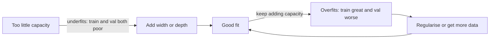

# Training a convnet and fighting overfitting

> **Before this lesson:** you need the convnet from [Convolutions, pooling and building a convnet](#/lesson/deep-learning/convolutions), validation curves and AdamW from [Optimisers and validation](#/lesson/deep-learning/optimizers-validation), and `train()`/`eval()` modes from [nn.Module, state_dict and checkpointing](#/lesson/deep-learning/nn-module).

## In plain words

Once a model trains, the next problem is almost always **overfitting**: the model gets better and better on its training examples while getting no better, or worse, on new ones. **Regularisation** is the family of techniques that discourage memorisation and push the model towards simpler, more general solutions. The main tools are penalising large weights (**weight decay**), randomly switching off units during training (**dropout**), stopping at the right time (**early stopping**), and showing the model varied versions of the data (**data augmentation**).

Think of a student who prepares for a driving test by memorising the exact route used in last year's exam. They will ace that route and crash on any other. Regularisation is the instructor who varies the route, removes the satnav now and then, and ends the lesson before the student starts memorising potholes.

Why it matters for a job: the gap between training and validation performance is the first thing an interviewer will ask about when you describe a model, and "how would you reduce overfitting?" is among the most common questions in machine-learning interviews. You need to know each technique, how it is implemented in PyTorch, what it costs, and how they interact.

## 1. Training the convnet properly

The [small convnet](#/lesson/deep-learning/convolutions) trains with exactly the loop from earlier lessons, with three practical additions:

```python
device = torch.device("cuda" if torch.cuda.is_available() else "cpu")
model = SmallConvNet().to(device)                               # parameters to the GPU once
optimizer = torch.optim.SGD(model.parameters(), lr=1e-2, momentum=0.9)
loss_fn = nn.CrossEntropyLoss()

def run_epoch(loader, train):
    model.train(train)                                          # train(True) or eval mode
    total_loss = correct = count = 0
    with torch.set_grad_enabled(train):                         # no graphs when evaluating
        for images, labels in loader:
            images, labels = images.to(device), labels.to(device)   # each batch to the GPU
            logits = model(images)
            loss = loss_fn(logits, labels)
            if train:
                optimizer.zero_grad()
                loss.backward()
                optimizer.step()
            total_loss += loss.item() * len(labels)
            correct += (logits.argmax(1) == labels).sum().item()
            count += len(labels)
    return total_loss / count, correct / count

for epoch in range(1, 101):
    train_loss, train_acc = run_epoch(train_loader, train=True)
    val_loss, val_acc = run_epoch(val_loader, train=False)
```

- Model and data must be on the same device; move the model once and each batch inside the loop.
- `torch.set_grad_enabled(flag)` is a switchable `no_grad`, handy when one function serves both phases.
- Measure **accuracy** alongside loss on both sets every epoch. Loss is what the optimiser sees; accuracy (or whatever metric the business cares about) is what you report.

On a two-class CIFAR subset, a convnet like this typically ends with training accuracy well above validation accuracy, for example in the high nineties versus around 90%. That gap is the overfitting this lesson attacks.

## 2. Capacity: the root of the trade-off

A model's **capacity** is, informally, how complicated a function it can represent. Capacity grows with **width** (channels or units per layer) and **depth** (number of layers). More capacity lets the model fit genuinely complex patterns, and also lets it memorise noise. Too little capacity gives **underfitting**: both training and validation performance are poor.



The modern recipe is usually: choose a model with *more* capacity than strictly needed, then regularise it. Large regularised models tend to generalise better than small unregularised ones.

## 3. Weight decay (L2 regularisation)

**L2 regularisation** adds a penalty proportional to the sum of squared weights to the loss:

$$L_{\text{total}} = L_{\text{data}} + \frac{\lambda}{2} \sum_i w_i^2$$

The penalty's gradient is $\lambda w_i$, so each step also shrinks every weight a little towards zero, hence the name **weight decay**. Why does this help? Large weights let a network produce sharp, wiggly functions that thread through individual noisy points; keeping weights small favours smoother functions. ($\lambda$, lambda, is the regularisation strength, a hyperparameter.)

Three ways to apply it in PyTorch:

```python
# 1. Explicitly in the loss (works with any optimiser; you control which parameters)
l2 = sum((p ** 2).sum() for name, p in model.named_parameters() if p.ndim > 1)
loss = loss_fn(logits, labels) + 0.5 * 1e-4 * l2

# 2. SGD's weight_decay argument: adds lambda * w to each gradient (equivalent to 1. for plain SGD)
optimizer = torch.optim.SGD(model.parameters(), lr=1e-2, momentum=0.9, weight_decay=5e-4)

# 3. AdamW: decoupled decay, w <- w - lr * lambda * w, the right choice with adaptive optimisers
optimizer = torch.optim.AdamW(model.parameters(), lr=1e-3, weight_decay=0.05)
```

**L1 regularisation** penalises $\lambda \sum |w_i|$ instead. Its gradient has constant size, so it pushes small weights all the way to exactly zero, producing **sparse** models. It is used for feature selection and compression, less often in deep networks.

The demo revisits the overfitting polynomial model from the optimisers lesson and trains it with AdamW-style decoupled weight decay at several strengths.

```python-run
import numpy as np

rng = np.random.default_rng(3)
n = 24
x = rng.uniform(-1, 1, n)
y = np.sin(3 * x) + rng.normal(0, 0.25, n)
perm = rng.permutation(n)
val_idx, train_idx = perm[:6], perm[6:]
F = np.stack([x ** k for k in range(1, 13)], axis=1)      # a very flexible model: 12 polynomial features

print(f"{'weight decay':>12} {'train MSE':>10} {'val MSE':>9} {'sum |w|':>9}")
for wd in [0.0, 1e-3, 1e-2, 1e-1, 1.0]:
    w, b = np.zeros(12), 0.0
    m, v, lr = np.zeros(13), np.zeros(13), 0.05
    for t in range(1, 10001):
        err = F[train_idx] @ w + b - y[train_idx]
        g = np.append(2 * F[train_idx].T @ err / len(err), 2 * err.mean())
        w = w * (1 - lr * wd)                                 # decoupled decay (weights only, not the bias)
        m = 0.9 * m + 0.1 * g; v = 0.999 * v + 0.001 * g * g
        step = lr * (m / (1 - 0.9 ** t)) / (np.sqrt(v / (1 - 0.999 ** t)) + 1e-8)
        w, b = w - step[:-1], b - step[-1]
    mse = lambda idx: ((F[idx] @ w + b - y[idx]) ** 2).mean()
    print(f"{wd:>12g} {mse(train_idx):>10.4f} {mse(val_idx):>9.4f} {np.abs(w).sum():>9.2f}")
```

**Reading the result**

- With no decay, training error is lowest and validation error highest, and the weights are huge (their absolute sum is in the hundreds): the polynomial bends wildly to hit noisy points.
- Moderate decay (0.01 to 0.1) raises training error slightly, lowers validation error substantially, and shrinks the weights by an order of magnitude.
- Too much decay (1.0) underfits: both errors rise. The best strength is found on the validation set, like any hyperparameter.

## 4. Dropout

**Dropout** randomly sets each unit's output to zero with probability $p$ during training, independently for every example and every step. The network cannot rely on any single unit, because that unit might vanish, so it learns redundant, distributed features. One way to see it: every training step trains a different thinned sub-network, and the full network at test time behaves like an average of all of them, a cheap **ensemble**.

The scaling detail matters. If units are dropped with probability $p$ in training but all present at test time, the next layer would see larger inputs at test time. PyTorch uses **inverted dropout**: during training, surviving values are multiplied by $1/(1-p)$, so the expected value is unchanged and evaluation needs no adjustment at all. In `eval()` mode, `nn.Dropout` is the identity.

```python-run
import numpy as np

rng = np.random.default_rng(0)

def dropout(x, p, training):
    """Mirror of torch.nn.functional.dropout (inverted dropout)."""
    if not training or p == 0:
        return x
    keep = rng.random(x.shape) >= p          # each element survives with probability 1 - p
    return x * keep / (1 - p)

x = np.ones((4, 8))
out = dropout(x, 0.5, training=True)
print("training output (survivors scaled to 2.0):\n", out)
print("eval output equals input:", np.array_equal(dropout(x, 0.5, training=False), x))

big = np.ones((1000, 1000))
for p in (0.1, 0.5, 0.9):
    o = dropout(big, p, training=True)
    print(f"p={p}: fraction zeroed {np.mean(o == 0):.3f}, mean value {o.mean():.3f} (expected 1.0)")
```

The output shows survivors scaled to 2.0 when $p = 0.5$, exact identity in evaluation mode, and an average output of about 1.0 for every $p$: inverted scaling preserves the expectation.

Where to put it and how much:

- `nn.Dropout(p)` after activations in fully connected layers, typically $p$ between 0.1 and 0.5.
- `nn.Dropout2d(p)` drops whole **channels** of a feature map, which suits convolutional layers, where neighbouring pixels are so correlated that dropping single pixels barely regularises.
- Transformers use small dropout (around 0.1) on attention weights and residual branches; many large language models pretrained on huge data use none.
- Forgetting `model.eval()` at test time leaves dropout on: predictions become random and accuracy drops. Deliberately keeping it on at test time and averaging several predictions is **Monte Carlo dropout**, a cheap uncertainty estimate.

## 5. Early stopping

Track validation loss (or the target metric) every epoch, keep a copy of the best checkpoint, and stop when it has not improved for `patience` epochs:

```python
best, bad_epochs, patience = float("inf"), 0, 10
for epoch in range(max_epochs):
    train_one_epoch()
    val_loss = evaluate()
    if val_loss < best - 1e-4:              # min_delta: ignore microscopic improvements
        best, bad_epochs = val_loss, 0
        torch.save(model.state_dict(), "best.pt")
    else:
        bad_epochs += 1
        if bad_epochs >= patience:
            break
model.load_state_dict(torch.load("best.pt", weights_only=True))
```

Early stopping is free regularisation: it limits how far the parameters can travel from their small initial values. Validation curves are noisy, so a patience of several epochs avoids stopping on a random bump. The validation set is now being used to make a decision, so report final performance on a separate test set. You will implement this logic as a problem.

## 6. Data augmentation and other regularisers

- **Data augmentation**: random flips, crops, rotations, colour changes, noise; the model sees a fresh variant of each image every epoch, which is often the single most effective regulariser for images. See the [augmentation lesson](#/lesson/deep-learning/augmentation).
- **More data**: the best regulariser of all, when available. Transfer learning from a pretrained model (see [fine-tuning](#/lesson/deep-learning/end-to-end-finetuning)) is the next best.
- **Label smoothing**: soft targets (`CrossEntropyLoss(label_smoothing=0.1)`) stop the model from pushing logits to extremes.
- **Batch normalisation** has a mild regularising side effect, because each example's normalisation depends on the random batch it lands in ([next lesson](#/lesson/deep-learning/normalisation-init)).
- **Smaller batches and higher learning rates** add gradient noise, which also tends to favour flatter minima that generalise better.
- **Stochastic depth** randomly skips whole residual blocks during training; used in deep vision models.

## 7. A practical order of attack

1. First make sure the model *can* overfit: train on a tiny subset and drive training loss to near zero. If it cannot, you have a bug or too little capacity (see [debugging training](#/lesson/deep-learning/debugging-training)).
2. Train on the full data and plot both curves.
3. If validation lags training: add augmentation, then weight decay (or raise it), then dropout; use early stopping throughout.
4. If both are poor: increase capacity, train longer, or tune the learning rate before adding any regularisation.
5. Change one thing at a time and compare on the same validation set with a fixed seed, ideally over a couple of seeds, since run-to-run noise can exceed the effect you are measuring.

> [!INTERVIEW]
> **"Your model has 99% training accuracy and 75% validation accuracy. What do you do?"** Name it (high variance, overfitting), then give an ordered plan: confirm there is no data problem (leakage, a different distribution in validation, label noise), add data augmentation, add or increase weight decay (AdamW), add dropout, use early stopping on validation, reduce capacity if needed, and get more data or start from a pretrained model. Mention that you would check per-class results to see whether the gap is uniform or concentrated in a few classes.

## Summary

- Training a convnet on a GPU means moving the model once and every batch inside the loop; track loss and accuracy on training and validation sets each epoch.
- Capacity grows with width and depth; too little underfits, too much overfits; the usual recipe is generous capacity plus regularisation.
- Weight decay shrinks weights each step (L2); use `weight_decay` with SGD and AdamW for adaptive optimisers; L1 produces sparsity.
- Inverted dropout zeroes units with probability p and scales survivors by 1/(1−p); it is the identity in eval mode; `Dropout2d` drops whole channels.
- Early stopping keeps the best validation checkpoint with a patience window.
- Augmentation, more data, label smoothing, batch norm and gradient noise also regularise.

## Glossary

- **Regularisation**: techniques that reduce overfitting by discouraging overly complex solutions.
- **Capacity**: how complex a function a model can represent.
- **Width / depth**: units or channels per layer / number of layers.
- **L2 regularisation / weight decay**: penalising squared weights / shrinking weights each step.
- **L1 regularisation**: penalising absolute weights, which drives some to exactly zero.
- **Sparse model**: one where many weights are exactly zero.
- **Dropout / inverted dropout**: randomly zeroing units in training / scaling survivors by 1/(1−p).
- **Dropout2d**: dropping whole feature-map channels.
- **Ensemble**: combining the predictions of several models.
- **Monte Carlo dropout**: averaging predictions with dropout left on to estimate uncertainty.
- **Early stopping / patience**: stopping when validation stops improving / epochs to wait before stopping.
- **min_delta**: the smallest improvement that counts.
- **Label smoothing**: softening one-hot targets.
- **Stochastic depth**: randomly skipping residual blocks during training.

## Check yourself

```quiz
[
  {"q": "With inverted dropout p = 0.2 in training mode, what happens to a surviving activation of 1.0?", "options": ["It becomes 1.25", "It stays 1.0", "It becomes 0.8", "It becomes 0.2"], "answer": 0,
   "explain": "Survivors are scaled by 1/(1 − p) = 1.25 so the expected value stays 1.0."},
  {"q": "What does nn.Dropout do after model.eval()?", "options": ["Nothing: it is the identity", "It drops units with probability p", "It scales outputs by (1 − p)", "It raises an error"], "answer": 0,
   "explain": "Inverted dropout needs no test-time correction."},
  {"q": "Why prefer AdamW over Adam(weight_decay=...) for regularisation?", "options": ["AdamW applies decay directly to weights instead of letting the adaptive denominator distort it", "AdamW is faster per step", "Adam does not support weight decay", "AdamW has no momentum"], "answer": 0,
   "explain": "Coupled L2 in Adam decays parameters unevenly."},
  {"q": "Both training and validation accuracy are low and similar. What is the likely problem?", "options": ["Underfitting: too little capacity, a bad learning rate, or a bug", "Overfitting", "Too much data augmentation is the only cause", "The validation set is too large"], "answer": 0,
   "explain": "Regularisation would make it worse; increase capacity or fix training first."},
  {"q": "Why is Dropout2d preferred over element-wise dropout after convolutional layers?", "options": ["Neighbouring pixels are highly correlated, so dropping single pixels barely regularises", "It is the only dropout that works on GPUs", "It has learnable parameters", "It doubles the receptive field"], "answer": 0,
   "explain": "Dropping entire channels forces genuinely redundant features."},
  {"q": "What does the gradient of the L2 penalty (λ/2)·Σw² contribute to each weight's update?", "options": ["λ·w, pulling each weight towards zero", "λ·sign(w)", "A constant λ", "Nothing; it only changes the loss value"], "answer": 0,
   "explain": "That proportional shrinkage is why it is called weight decay."},
  {"q": "In the weight-decay demo, what happened at the largest decay strength?", "options": ["Both training and validation error rose: underfitting", "Validation error reached its minimum", "Training error dropped to zero", "Nothing changed"], "answer": 0,
   "explain": "Regularisation strength is a hyperparameter with a sweet spot found on validation data."},
  {"q": "After using the validation set for early stopping and tuning, how should you report final performance?", "options": ["On a separate test set not used for any decision", "On the validation set", "On the training set", "On the validation and training sets combined"], "answer": 0,
   "explain": "Decisions made with the validation set bias its score optimistically."}
]
```

> **Source:** Stevens, Antiga & Viehmann, *Deep Learning with PyTorch*, ch. 8 (training the convnet, measuring accuracy, training on the GPU, model design: adding memory capacity with width, helping the model converge and generalise with weight penalties and dropout); PyTorch documentation, `nn.Dropout`, `nn.Dropout2d`, `torch.optim.AdamW`.
