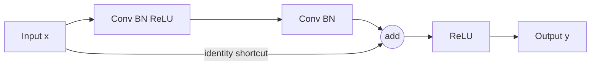

# Going deeper: vanishing gradients and residual connections

> **Before this lesson:** you need the vanishing-gradient demo from [Neurons, layers and activation functions](#/lesson/deep-learning/neurons-activations), initialisation and BatchNorm from [Normalisation layers and weight initialisation](#/lesson/deep-learning/normalisation-init), and custom `forward` methods from [nn.Module, state_dict and checkpointing](#/lesson/deep-learning/nn-module). The backward pass through a ReLU layer, from [Autograd in depth](#/lesson/deep-learning/autograd), appears in the demo.

## In plain words

Deeper networks can, in principle, represent more complex functions: each layer composes the features of the layer below. But for years, stacking more layers made networks *worse*, even on their own training data. The gradient signal reaching the early layers became vanishingly small (or exploded), so those layers barely learned.

The fix that unlocked networks with a hundred or more layers was surprisingly simple: the **residual connection** (or **skip connection**). Instead of each block replacing its input with a new representation, the block computes a *correction* and adds it to its input: output = input + block(input). If a block has nothing useful to add, it can learn to output nearly zero and pass its input through unchanged.

Think of editing a document through a chain of twenty editors. If each editor must retype the whole document from memory, errors accumulate and by the end the text is garbled. If instead each editor receives the document and only writes margin corrections on top of it, the original text always survives, and useful edits accumulate. Feedback travels back down the chain equally easily, because every editor's corrections are directly visible in the final copy.

Why it matters for a job: residual connections are in almost every modern architecture: ResNets in vision, U-Net style skips in segmentation, and the "residual stream" that runs through every transformer and large language model. Interviewers ask "why do residual connections help?", "what is the degradation problem?" and expect you to write a residual block in PyTorch with a projection shortcut.

## 1. What depth buys, and what it costs

A deeper network:

- composes more stages of features (edges, textures, parts, objects), which is how vision models build up from pixels to concepts;
- can represent some functions with far fewer parameters than a wide shallow network;
- grows its receptive field, so later layers see more of the image (recall the [receptive field](#/lesson/deep-learning/convolutions) recurrence).

The cost is in optimisation. During backpropagation, the gradient reaching layer 1 is a product of one factor per layer above it. If those factors are typically smaller than 1, the product shrinks exponentially with depth (**vanishing gradients**); if larger than 1, it grows exponentially (**exploding gradients**). Good initialisation and normalisation keep the factors near 1 at the start, but not reliably as training changes the weights.

### The degradation problem

In 2015, He and colleagues reported a striking observation: a plain 56-layer convnet had *higher training error* than a 20-layer one. This is not overfitting (overfitting means low training error and high validation error). It means the deeper network failed to find even the solution the shallower one found, although such a solution exists trivially: copy the 20-layer network and make the extra 36 layers compute the identity function. Plain layers with ReLU find it hard to learn "do nothing" exactly. This is the **degradation problem**, and it motivated residual learning.

## 2. The residual block

A **residual block** computes

$$y = x + F(x)$$

where $F$ is a small stack of layers (typically two convolutions with BatchNorm and ReLU) called the **residual branch**, and the addition of $x$ is the **identity shortcut**. Two consequences:

- **Doing nothing is easy.** If $F$'s weights are near zero, the block is the identity. Extra blocks can therefore never make the network much worse at initialisation, and each block only needs to learn a residual correction.
- **Gradients have a highway.** By the chain rule, $\frac{\partial y}{\partial x} = I + \frac{\partial F}{\partial x}$, where $I$ is the identity. The identity term means that the gradient of the loss with respect to $x$ includes the gradient with respect to $y$ unchanged, plus a correction. Stacking blocks, the gradient reaching an early layer is a *sum* over many paths, including one direct path that passes through no weight matrices at all, rather than a single long product. It cannot vanish merely because many factors are small.



### In PyTorch

```python
import torch
from torch import nn

class ResBlock(nn.Module):
    def __init__(self, in_ch, out_ch, stride=1):
        super().__init__()
        self.conv1 = nn.Conv2d(in_ch, out_ch, 3, stride=stride, padding=1, bias=False)
        self.bn1 = nn.BatchNorm2d(out_ch)
        self.conv2 = nn.Conv2d(out_ch, out_ch, 3, padding=1, bias=False)
        self.bn2 = nn.BatchNorm2d(out_ch)
        nn.init.zeros_(self.bn2.weight)            # start each block as (almost) the identity
        self.shortcut = nn.Identity()
        if stride != 1 or in_ch != out_ch:         # shapes differ: project x with a 1x1 conv
            self.shortcut = nn.Sequential(
                nn.Conv2d(in_ch, out_ch, 1, stride=stride, bias=False),
                nn.BatchNorm2d(out_ch),
            )

    def forward(self, x):
        out = torch.relu(self.bn1(self.conv1(x)))
        out = self.bn2(self.conv2(out))
        return torch.relu(out + self.shortcut(x))

class TinyResNet(nn.Module):
    def __init__(self, n_classes=10, width=32, blocks_per_stage=3):
        super().__init__()
        self.stem = nn.Sequential(nn.Conv2d(3, width, 3, padding=1, bias=False), nn.BatchNorm2d(width), nn.ReLU())
        layers, ch = [], width
        for stage, out_ch in enumerate([width, 2 * width, 4 * width]):
            for b in range(blocks_per_stage):
                stride = 2 if (b == 0 and stage > 0) else 1     # downsample at the start of stages 2 and 3
                layers.append(ResBlock(ch, out_ch, stride))
                ch = out_ch
        self.blocks = nn.Sequential(*layers)
        self.head = nn.Sequential(nn.AdaptiveAvgPool2d(1), nn.Flatten(), nn.Linear(ch, n_classes))

    def forward(self, x):
        return self.head(self.blocks(self.stem(x)))
```

- When the block changes the number of channels or downsamples with stride 2, $x$ and $F(x)$ have different shapes, so the shortcut becomes a **projection**: a 1 × 1 convolution with the same stride (plus BatchNorm) that maps $x$ to the right shape.
- `nn.Sequential(*layers)` unpacks a Python list of blocks into a registered sequential container; a plain list would not register the parameters (recall the [nn.Module rules](#/lesson/deep-learning/nn-module)).
- Zero-initialising the last BatchNorm scale ($\gamma$) in each branch makes every block start as exactly the identity (before the final ReLU), a common trick that stabilises the start of training for very deep networks.
- Global average pooling at the end means the network accepts any input size.
- Real ResNets for ImageNet use 18 to 152 layers; deeper variants use **bottleneck** blocks (1 × 1 to reduce channels, 3 × 3, then 1 × 1 to expand) to keep computation manageable.

## 3. Seeing it work

The demo trains two 30-layer fully connected ReLU networks on the same small regression task, written in NumPy with a hand-written backward pass. Both use PyTorch's default uniform initialisation for their 30 hidden layers. The only differences: the residual network adds each layer's output to its input, and (following the zero-init idea above) its branch weights start ten times smaller.

```python-run
import numpy as np

def train(residual, depth=30, width=32, steps=400, lr=0.01, seed=0):
    rng = np.random.default_rng(seed)
    X = rng.uniform(-2, 2, (256, 2))
    Y = np.sin(X[:, :1]) * np.cos(X[:, 1:])                       # target function
    W_in = rng.normal(0, np.sqrt(1 / 2), (2, width))
    bound = (0.1 if residual else 1.0) / np.sqrt(width)          # default init; residual branches start small
    Ws = [rng.uniform(-bound, bound, (width, width)) for _ in range(depth)]
    W_out = rng.normal(0, np.sqrt(1 / width), (width, 1))
    for step in range(steps):
        h = X @ W_in
        hs, zs = [h], []
        for W in Ws:                                              # forward
            z = h @ W
            zs.append(z)
            h = h + np.maximum(z, 0) if residual else np.maximum(z, 0)
            hs.append(h)
        err = h @ W_out - Y
        loss = (err ** 2).mean()
        g = 2 * err / len(Y)                                      # backward
        g_out = h.T @ g
        gh = g @ W_out.T
        grads = [None] * depth
        for i in reversed(range(depth)):
            gz = gh * (zs[i] > 0)
            grads[i] = hs[i].T @ gz
            gh = (gh if residual else 0) + gz @ Ws[i].T          # the identity path adds gh straight through
        if step == 0:
            first, last = np.linalg.norm(grads[0]), np.linalg.norm(grads[-1])
        W_in -= lr * (X.T @ gh); W_out -= lr * g_out
        for W, gW in zip(Ws, grads):
            W -= lr * gW
        if step in (0, 100, steps - 1):
            print(f"   step {step:3d}  loss {loss:.4f}")
    print(f"   gradient norm at layer 1: {first:.2e}   at layer {depth}: {last:.2e}")

print("plain 30-layer network:")
train(residual=False)
print("residual 30-layer network:")
train(residual=True)
```

**Reading the result**

- The plain network's gradient at layer 1 is around $10^{-12}$: the signal vanished on its way through 30 layers of shrinking activations. Its loss never moves from its starting value; it is effectively untrainable at this depth with this initialisation.
- The residual network's gradients are healthy at every depth, because each layer's input reaches the output directly through the chain of additions. Its loss drops to a small fraction of its starting value within a hundred steps.
- The backward line `gh = (gh if residual else 0) + gz @ Ws[i].T` is the whole story: with a residual connection, the incoming gradient passes straight through and the branch's contribution is *added*, instead of being the only path.

## 4. The family of skip connections

- **ResNet** (2015): identity shortcuts every two or three layers; won ImageNet 2015 with 152 layers and became the default convnet backbone.
- **DenseNet**: concatenates (rather than adds) every earlier feature map into each layer's input, encouraging feature reuse.
- **U-Net**: long skip connections that copy encoder feature maps across to the decoder at the same resolution, restoring fine spatial detail for segmentation ([segmentation lesson](#/lesson/deep-learning/segmentation)).
- **Transformers**: each attention and feed-forward sub-layer is wrapped as $x + \text{SubLayer}(\text{Norm}(x))$; the running sum is called the **residual stream**, and it is what lets language models stack dozens of layers ([transformer block](#/lesson/llm-practice/transformer-block)).
- **Highway networks** and LSTMs used learned gates for a similar effect before ResNets made the ungated version standard.

## 5. Deep-network hygiene checklist

Residual connections are necessary but rarely sufficient. Deep models train reliably when you also:

1. Use normalisation (BatchNorm in convnets, LayerNorm or RMSNorm with pre-norm in transformers).
2. Initialise sensibly (He for ReLU; small or zero-initialised final layers in residual branches).
3. Warm up the learning rate for the first few hundred or thousand steps and clip gradient norms ([schedules and clipping](#/lesson/deep-learning/schedules-clipping)).
4. Monitor per-layer gradient norms early in training; a layer whose gradients are many orders of magnitude smaller than others is not learning.
5. Prefer depth over width only when the data and compute justify it; a ResNet-18 or ResNet-50 is a strong, well-understood baseline.

> [!INTERVIEW]
> **"Why do residual connections help deep networks train?"** Two reasons. Optimisation: each block learns a correction $F(x)$ around the identity, so extra blocks can default to "do nothing" and depth stops hurting (the degradation problem). Gradient flow: $\partial(x + F(x))/\partial x = I + \partial F/\partial x$, so the gradient has a direct path through the additions and does not have to pass through every weight matrix; it becomes a sum over paths rather than one long product, which prevents vanishing. Then mention projection shortcuts for shape changes, zero-initialised final BatchNorm scales, and that transformers rely on the same residual stream.

## Summary

- Depth composes features and grows the receptive field, but plain deep networks suffer vanishing or exploding gradients and the degradation problem (higher training error with more layers).
- A residual block computes y = x + F(x); the identity path makes "do nothing" easy and gives gradients a direct route back.
- When shapes change, the shortcut uses a 1 × 1 convolution projection with the same stride.
- Zero-initialising the last BatchNorm γ of each branch makes every block start as the identity.
- Skip connections appear as ResNet shortcuts, DenseNet concatenations, U-Net long skips and the transformer residual stream.
- Deep training also needs normalisation, good initialisation, warmup and gradient clipping.

## Glossary

- **Depth**: the number of layers stacked in a network.
- **Vanishing / exploding gradients**: gradients shrinking / growing exponentially through layers.
- **Degradation problem**: deeper plain networks reaching higher training error than shallower ones.
- **Residual (skip) connection**: adding a block's input to its output.
- **Residual branch**: the layers F inside a residual block.
- **Identity shortcut**: the path that carries x unchanged to the addition.
- **Projection shortcut**: a 1 × 1 convolution on the shortcut to match shapes.
- **ResNet**: the residual network family introduced in 2015.
- **Bottleneck block**: a 1 × 1, 3 × 3, 1 × 1 convolution sequence that reduces then restores channels.
- **DenseNet**: a network that concatenates all previous feature maps into each layer.
- **Residual stream**: the running sum through a transformer's residual connections.
- **Stem / head**: the first layers that process raw input / the final layers that produce outputs.

## Check yourself

```quiz
[
  {"q": "What is the degradation problem?", "options": ["Deeper plain networks reaching higher TRAINING error than shallower ones", "Deeper networks overfitting more", "Accuracy dropping after deployment", "Weights decaying to zero"], "answer": 0,
   "explain": "It is an optimisation failure, not overfitting: the deeper network cannot even match the shallower one on training data."},
  {"q": "For y = x + F(x), what is ∂y/∂x?", "options": ["I + ∂F/∂x", "∂F/∂x", "I", "x · ∂F/∂x"], "answer": 0,
   "explain": "The identity term lets the gradient pass straight through."},
  {"q": "A residual block maps 64 channels at 32×32 to 128 channels at 16×16. What does the shortcut need?", "options": ["A 1×1 convolution with 128 output channels and stride 2", "Nothing; addition broadcasts", "A max-pool only", "A 3×3 convolution with 64 outputs"], "answer": 0,
   "explain": "Both the channel count and the spatial size must match before adding."},
  {"q": "Why zero-initialise the last BatchNorm γ in each residual branch?", "options": ["So each block starts as the identity, stabilising early training", "To reduce the parameter count", "To speed up inference", "To disable the shortcut"], "answer": 0,
   "explain": "F(x) starts at 0, so y = x at initialisation."},
  {"q": "In the demo, why was the plain 30-layer network's loss stuck?", "options": ["Its first-layer gradient had vanished to about 1e-12", "The learning rate was too high", "It overfitted immediately", "The data were not normalised"], "answer": 0,
   "explain": "Signals shrank through every layer, so the product of backward factors was tiny."},
  {"q": "How does a U-Net skip connection differ from a ResNet shortcut?", "options": ["It copies encoder features across to the decoder at the same resolution, typically by concatenation", "It adds every layer to the output", "It skips the loss function", "It is only used during inference"], "answer": 0,
   "explain": "Long skips restore fine spatial detail lost by downsampling."},
  {"q": "What is the 'residual stream' in a transformer?", "options": ["The running sum of the input and every sub-layer's output through residual connections", "The stream of tokens being generated", "The gradient of the loss", "The attention weights"], "answer": 0,
   "explain": "Each attention or feed-forward sub-layer reads from and adds to it."}
]
```

> **Source:** Stevens, Antiga & Viehmann, *Deep Learning with PyTorch*, ch. 8 (model design: going deeper, skip connections, building very deep models with residual blocks, initialisation, comparing designs); He et al., "Deep Residual Learning for Image Recognition" (2015); PyTorch documentation, `nn.Identity`, `nn.AdaptiveAvgPool2d`.
