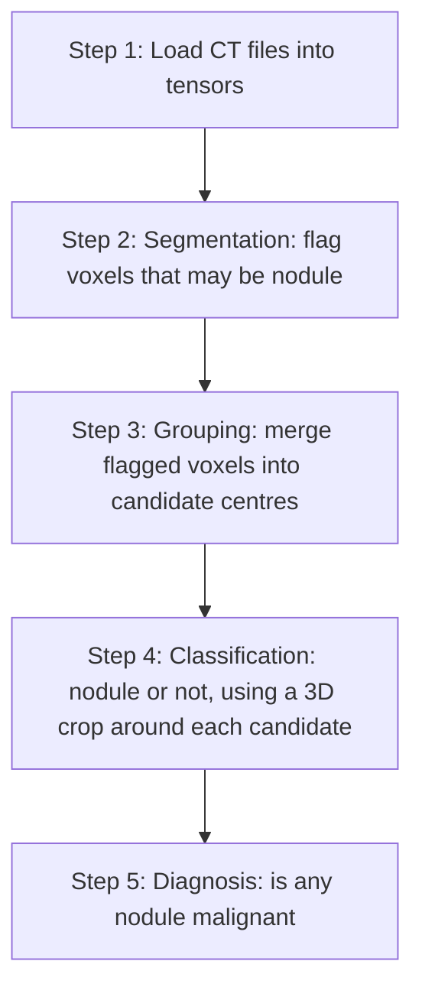

# Planning a large project: CT scans and the five-step pipeline

> **Before this lesson:** you should have finished the [images](#/lesson/deep-learning/convolutions) and [model design](#/lesson/deep-learning/depth-residuals) modules: convolutions, training loops, validation and regularisation. Volumetric (3-D) tensors were introduced in [Real-world data as tensors](#/lesson/deep-learning/data-as-tensors).

## In plain words

Toy datasets like CIFAR-10 arrive clean, small, balanced and pre-split. Real projects do not. This module follows one realistic project from raw files to a working system: **finding possible lung cancer in CT scans**. A CT scanner produces a 3-D picture of the inside of the chest; small lumps in the lungs called **nodules** can be early cancers; radiologists spend a long time searching scans for them. A system that flags suspicious spots could save them time.

The project is deliberately hard in all the ways real work is hard: the data are large 3-D volumes in a medical file format, the interesting objects are tiny, positives are extremely rare (a few hundred negatives for every positive), and no single model can sensibly do the whole job. So we break the problem into steps, each small enough to build, test and understand on its own.

An analogy: searching a large forest for a rare species of mushroom. You do not train one person to scan the entire forest and announce a final count. You first map which areas are woodland at all (segmentation), mark promising patches (grouping), send an expert to examine each patch (classification), and finally decide whether this forest has the species (diagnosis).

Why it matters for a job: interviewers at Big Tech and Singapore companies increasingly ask open-ended "design an ML system for X" questions, and the skills here transfer directly: decomposing a problem, understanding the data's physics and units, handling extreme class imbalance, choosing metrics that reflect the real goal, and deciding where deep learning helps and where plain code is better. The same pattern (candidate generation, then classification) powers recommendation, fraud detection and ad ranking.

> [!WARNING]
> This module is an engineering case study, not medical advice or a medical device. Real diagnostic software needs clinical validation, regulatory approval and careful attention to how errors affect patients.

## 1. What a CT scan is

**Computed tomography (CT)** fires X-rays through the body from many angles as the scanner rotates, and a computer reconstructs, from all those projections, a 3-D grid of how strongly each small block of tissue absorbs X-rays. Dense material such as bone absorbs a lot; air absorbs almost nothing; soft tissue and water are in between.

- The 3-D grid is made of **voxels** ("volume pixels"): small boxes, each holding one number, the tissue's **radiodensity**.
- The volume is usually stored as a stack of 2-D **slices**, each typically 512 × 512 voxels, with roughly a hundred to several hundred slices per scan.
- Voxels are often **not cubes**: within a slice they might be about 0.7 mm across, while slices may be 1 to 2.5 mm apart. This is called **anisotropic** spacing, and models must account for it.
- Densities are measured in **Hounsfield units (HU)**: air is −1000, water is 0, and dense bone is several hundred to over a thousand. The [next lesson](#/lesson/deep-learning/ct-data-pipeline) shows how to clean them.

Compared with a photo, a CT volume has one channel (density, not colour), three spatial dimensions instead of two, physically meaningful units, and a known physical size per voxel. As a tensor it has shape `(slices, rows, columns)`, and a batch for a 3-D convolution has shape `(N, 1, D, H, W)`.

## 2. What we are looking for

A **tumour** is an abnormal mass of tissue; it may be **benign** (not cancer) or **malignant** (cancer). A small, roughly round tumour in the lung, a few millimetres to a few centimetres across, is called a **nodule**. A sizeable fraction of nodules turn out to be malignant, and catching them early greatly improves outcomes, which is why screening programmes scan at-risk people.

Finding them is hard for people and machines alike:

- Nodules are tiny compared with the scan: a 5 mm nodule might occupy only around a hundred voxels out of tens of millions.
- Many other structures look similar in a single slice: blood vessels seen in cross-section appear as small bright circles too. Telling them apart needs 3-D context (a vessel continues across slices like a tube; a nodule is a blob).
- Some nodules are attached to vessels or the chest wall.

## 3. The data: LUNA

The project uses data from the **LUNA16** challenge (LUng Nodule Analysis 2016), built on top of the public **LIDC-IDRI** collection of annotated chest CT scans. It provides:

- **888 CT scans**, split into ten subsets of roughly 90 scans each, stored as `.mhd` (a small text header with metadata) plus `.raw` (the voxel data) files.
- `candidates.csv`: about **551,000 candidate locations**, each a scan identifier, an (x, y, z) position in millimetres and a 0/1 label for whether it is a nodule. Only **1,351** are labelled as nodules.
- `annotations.csv`: the nodules marked by radiologists, with their centres and **diameters** in millimetres.

The candidates were produced by earlier automatic detectors, so most are false alarms: about 400 negatives for every positive. That imbalance dominates the design of the classifier and its metrics.

```python-run
import numpy as np

n_candidates, n_nodules = 551_065, 1_351
neg = n_candidates - n_nodules
print(f"positive rate: {n_nodules / n_candidates:.4%}   negatives per positive: {neg / n_nodules:.0f}")
print(f"accuracy of a model that always answers 'not a nodule': {neg / n_candidates:.2%}")

# Size intuition: a synthetic CT-like volume with anisotropic voxels and one spherical 'nodule'.
spacing = np.array([2.5, 0.7, 0.7])                    # mm per voxel along (slice, row, column)
shape = (120, 512, 512)
print("voxels in one scan:", np.prod(shape), " float32 size: %.0f MB" % (np.prod(shape) * 4 / 1e6))
print("physical extent (mm):", (np.array(shape) * spacing).round(1))

radius_mm = 3.0                                         # a 6 mm nodule
r_vox = radius_mm / spacing                             # radius measured in voxels along each axis
print("nodule radius in voxels (slice, row, col):", r_vox.round(1))
d, h, w = np.ogrid[-3:4, -10:11, -10:11]               # a small box around the centre
inside = (d / r_vox[0]) ** 2 + (h / r_vox[1]) ** 2 + (w / r_vox[2]) ** 2 <= 1
print("voxels inside the nodule:", inside.sum(), f" fraction of the scan: {inside.sum() / np.prod(shape):.1e}")
```

**Reading the output**

- Fewer than one candidate in 400 is a nodule, so a "classifier" that always says no scores about 99.75% accuracy while finding nothing. Accuracy is useless here; the [metrics lesson](#/lesson/deep-learning/imbalance-metrics) replaces it.
- One scan of 120 slices of 512 × 512 voxels holds over 31 million values, about 126 MB in float32. A dataset of hundreds of scans cannot sit in GPU memory, and even reading it from disk repeatedly is slow, which is why the data pipeline crops and caches small regions.
- With 0.7 mm in-plane spacing and 2.5 mm between slices, a 6 mm nodule is about 8.6 voxels wide within a slice but only about 2.4 slices tall. It occupies about a hundred voxels: a few millionths of the scan.

## 4. The plan: five steps

Rather than one giant model from raw scan to diagnosis, the project uses a pipeline:



1. **Data loading**: parse the files, convert density values and coordinates, and expose crops around candidates as a PyTorch `Dataset`. Getting raw data into usable tensors is the first job in any project. ([From raw CT files to a Dataset](#/lesson/deep-learning/ct-data-pipeline))
2. **Segmentation**: a model that labels each voxel as possibly-nodule or not, producing a heat map. This focuses later steps on promising regions and ignores the rest of the anatomy. ([Segmentation with U-Net](#/lesson/deep-learning/segmentation))
3. **Grouping**: connect neighbouring flagged voxels into blobs and take each blob's centre as a candidate. This step needs no deep learning at all: a classic connected-components algorithm does it. Multistep systems almost always contain such non-learned "glue". ([End to end](#/lesson/deep-learning/end-to-end-finetuning))
4. **Nodule classification**: a 3-D convnet looks at a small crop around each candidate and decides whether it is a real nodule, removing the many false alarms. ([Training application](#/lesson/deep-learning/training-application), [metrics](#/lesson/deep-learning/imbalance-metrics), [augmentation](#/lesson/deep-learning/augmentation))
5. **Diagnosis**: classify each nodule as benign or malignant (by fine-tuning the nodule classifier) and combine per-nodule results into a per-patient answer. Since one malignant nodule is enough for concern, the patient-level score is the **maximum** over nodules; a task that asked "what fraction of tissue is affected?" would use a mean instead. ([End to end and fine-tuning](#/lesson/deep-learning/end-to-end-finetuning))

The data provides human labels for the outputs of steps 3 and 4 (candidate locations and nodule flags), so the classifier can be developed first and independently, using the known candidates, before the segmentation model exists. The book builds the classifier first for exactly that reason, and so does this module.

## 5. Why not one end-to-end model?

It is tempting to feed the whole scan to one network and train it to output "cancer: yes or no". Reasons not to:

- **Too little supervision.** A few hundred scans with one label each cannot teach a network where to look among 30 million voxels. Intermediate labels (nodule locations, voxel masks) provide far more learning signal.
- **Memory.** A whole scan at full resolution does not fit through a 3-D network on a typical GPU with a useful batch size; crops do.
- **Debuggability.** With separate steps you can measure each one (does segmentation find the known nodules? how many false alarms does classification remove?) and know which to improve. One opaque model gives one number.
- **Reuse and explanation.** A radiologist can inspect the flagged candidates and their scores, which builds trust and supports a human-in-the-loop workflow.

End-to-end models do win when you have abundant data matched to the final task. Knowing when to decompose is a judgement call, and saying so explicitly is what interviewers want to hear.

## 6. Organising a large project

A few practices from the project that apply to any serious deep-learning work:

- **Separate modules** for data (`dsets.py`), models (`model.py`) and training (`training.py`), with the training run launched as a command-line application with arguments rather than from a notebook, so runs are repeatable and can be scheduled on remote machines.
- **Cache expensive preprocessing**: decoding a CT scan takes seconds; cropping a candidate takes milliseconds once the scan is in memory. Caching crops on disk speeds every later epoch.
- **Log everything**: hyperparameters, metrics per epoch, sample images, the code version. TensorBoard (covered in the [training-application lesson](#/lesson/deep-learning/training-application)) or an experiment tracker.
- **Validate the data**: render slices and crops and look at them. Many bugs (flipped coordinates, wrong units) are obvious in a picture and invisible in a loss curve.
- **Split by patient**, never by candidate, so the same person's scan never appears in both training and validation.
- **Start simple and get a baseline**: a trivial rule (for malignancy, "larger nodules are more likely malignant") tells you whether the model is adding anything.

> [!INTERVIEW]
> **"Design a system that flags possible lung nodules in CT scans."** Clarify the goal (assist radiologists: high recall at a tolerable false-positive rate per scan), the data (scans, labelled nodule locations, rare positives), and the constraints (3-D volumes, GPU memory, regulation). Propose a pipeline: preprocessing (HU clipping, resampling, patient-level split), candidate generation (segmentation plus connected components) tuned for recall, a 3-D crop classifier tuned for precision with balanced sampling and augmentation, then patient aggregation by max. Name the metrics (recall, false positives per scan, ROC/AUC), the baselines, and the human-in-the-loop review. Mention monitoring for scanner or protocol drift after deployment.

## Summary

- CT produces a 3-D grid of radiodensity voxels in Hounsfield units, usually with anisotropic spacing; tensors have shape (slices, rows, columns).
- Nodules are tiny, rare and easily confused with vessels; LUNA16 provides 888 scans, about 551,000 candidates and 1,351 nodules: roughly 400 negatives per positive.
- The project uses five steps: load, segment, group, classify, diagnose; grouping uses classic code, not deep learning.
- Decomposition provides more supervision, fits in memory, and makes each step testable; end-to-end models need far more task-matched data.
- Good practice: modular code, command-line training apps, caching, logging, visual data checks, patient-level splits and simple baselines.

## Glossary

- **CT (computed tomography)**: reconstructing a 3-D density image from X-ray projections taken from many angles.
- **Voxel**: a 3-D pixel; one value in a volume.
- **Slice**: one 2-D layer of a CT volume.
- **Radiodensity**: how strongly tissue absorbs X-rays.
- **Hounsfield unit (HU)**: the CT density scale with air at −1000 and water at 0.
- **Anisotropic spacing**: voxels with different sizes along different axes.
- **Tumour (benign / malignant)**: an abnormal tissue mass (non-cancerous / cancerous).
- **Nodule**: a small, roughly round lump in the lung.
- **LUNA16 / LIDC-IDRI**: a nodule-detection challenge dataset / the public CT collection it is based on.
- **Candidate**: a location proposed for closer inspection.
- **Segmentation**: labelling every voxel (or pixel) with a class.
- **Grouping (connected components)**: merging neighbouring flagged voxels into objects.
- **Pipeline**: a sequence of processing steps feeding one another.
- **Human in the loop**: a workflow where people review or correct the system's outputs.

## Check yourself

```quiz
[
  {"q": "In Hounsfield units, roughly what values do air and water have?", "options": ["−1000 and 0", "0 and 1000", "0 and 1", "−1 and +1"], "answer": 0,
   "explain": "The scale is defined so water is 0 and air is about −1000."},
  {"q": "About how many LUNA candidates are negative for every positive?", "options": ["About 400", "About 4", "About 40,000", "About 1"], "answer": 0,
   "explain": "Roughly 551,000 candidates with 1,351 nodules."},
  {"q": "Why is accuracy a poor metric for the nodule classifier?", "options": ["Always predicting 'no nodule' already scores about 99.75%", "Accuracy cannot be computed for 3-D data", "Accuracy ignores the training set", "Accuracy is only for regression"], "answer": 0,
   "explain": "With extreme imbalance, accuracy rewards ignoring the rare class."},
  {"q": "Which step of the pipeline uses no deep learning?", "options": ["Grouping flagged voxels into candidate centres", "Segmentation", "Nodule classification", "Malignancy classification"], "answer": 0,
   "explain": "A classic connected-components algorithm groups voxels."},
  {"q": "How is the patient-level diagnosis computed from per-nodule malignancy scores?", "options": ["The maximum, because one malignant nodule is enough", "The mean", "The minimum", "The number of nodules"], "answer": 0,
   "explain": "The question is 'is anything suspicious?', which max answers."},
  {"q": "Why is a single end-to-end scan-to-diagnosis model a poor first choice here?", "options": ["Too little supervision, too much memory, and no way to debug individual steps", "PyTorch cannot process 3-D data", "End-to-end models cannot be trained with SGD", "CT scans have no labels"], "answer": 0,
   "explain": "Intermediate labels and crops make the problem learnable and testable."},
  {"q": "Why do vessels make nodule detection hard in a single slice?", "options": ["A vessel's cross-section looks like a small bright circle, similar to a nodule", "Vessels are invisible on CT", "Vessels have the same HU as air", "Vessels move during the scan"], "answer": 0,
   "explain": "3-D context distinguishes a tube that continues across slices from a blob."}
]
```

> **Source:** Stevens, Antiga & Viehmann, *Deep Learning with PyTorch*, ch. 9 (introduction to the use case, preparing for a large-scale project, what a CT scan is, the end-to-end detector plan, nodules, the LUNA Grand Challenge data).
