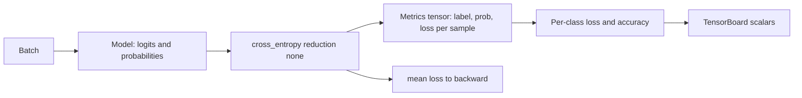

# A training application: 3D convnet, logging and TensorBoard

> **Before this lesson:** read [From raw CT files to a Dataset](#/lesson/deep-learning/ct-data-pipeline) for the `LunaDataset` and its `(1, 32, 48, 48)` crops. You need convolutions and pooling from [Convolutions, pooling and building a convnet](#/lesson/deep-learning/convolutions), BatchNorm and initialisation from [Normalisation layers and weight initialisation](#/lesson/deep-learning/normalisation-init), and cross-entropy options from [A first image classifier](#/lesson/deep-learning/image-classifier).

## In plain words

Up to now our training code lived in short snippets. A real project needs a **training application**: a program you launch from the command line with arguments ("train for 10 epochs with batch size 32 and 8 data-loading workers"), which builds the model, optimiser and data loaders, runs training and validation epochs, computes detailed metrics, writes logs and charts, and saves checkpoints, all reproducibly and unattended on a remote GPU machine.

Think of the difference between cooking dinner at home and running a restaurant kitchen. At home you improvise. In a restaurant every dish follows a written recipe, ingredients are prepped in advance, timers and tickets track every order, and a manager reviews the night's numbers. The training application is the restaurant: the cooking (gradient descent) is the same, but everything around it is organised so results are repeatable and problems are visible.

This lesson builds the nodule classifier's first version: a small **3-D convolutional network**, a training loop that records per-sample results, and logging to **TensorBoard**. Its first results look excellent (99.7% correct!) and are useless, which is the most valuable lesson in the module.

Why it matters for a job: interviewers often ask how you would structure training code for a team ("how do you make runs reproducible?", "what do you log?", "how do you compare experiments?"), and they love the "high accuracy, useless model" trap.

## 1. The application skeleton

```python
import argparse, datetime, sys
import torch
from torch.utils.data import DataLoader
from torch.utils.tensorboard import SummaryWriter

class LunaTrainingApp:
    def __init__(self, argv=None):
        parser = argparse.ArgumentParser()
        parser.add_argument("--num-workers", type=int, default=8)
        parser.add_argument("--batch-size", type=int, default=32)
        parser.add_argument("--epochs", type=int, default=1)
        parser.add_argument("--lr", type=float, default=1e-3)
        parser.add_argument("comment", nargs="?", default="")
        self.args = parser.parse_args(argv if argv is not None else sys.argv[1:])
        self.time_str = datetime.datetime.now().strftime("%Y-%m-%d_%H.%M.%S")
        self.device = torch.device("cuda" if torch.cuda.is_available() else "cpu")
        self.model = LunaModel().to(self.device)
        self.optimizer = torch.optim.SGD(self.model.parameters(), lr=self.args.lr, momentum=0.99)
        self.total_samples = 0

    def make_loader(self, is_val):
        ds = LunaDataset(val_stride=10, is_val=is_val)
        return DataLoader(ds, batch_size=self.args.batch_size, shuffle=not is_val,
                          num_workers=self.args.num_workers, pin_memory=self.device.type == "cuda")

    def main(self):
        train_dl, val_dl = self.make_loader(False), self.make_loader(True)
        for epoch in range(1, self.args.epochs + 1):
            trn_metrics = self.train_epoch(epoch, train_dl)
            self.log_metrics(epoch, "trn", trn_metrics)
            val_metrics = self.validate_epoch(epoch, val_dl)
            self.log_metrics(epoch, "val", val_metrics)

if __name__ == "__main__":
    LunaTrainingApp().main()
```

- **argparse** turns command-line text such as `--batch-size 64` into typed attributes. Accepting an optional `argv` list means the same class can be driven from a notebook or a test: `LunaTrainingApp(["--epochs", "2"]).main()`.
- `if __name__ == "__main__":` runs the app only when the file is executed directly, not when imported; it is also required for DataLoader workers on Windows and macOS.
- A timestamp string names the run's log directory and checkpoints, so runs never overwrite each other.
- On multiple GPUs, the book wraps the model in `nn.DataParallel`. Current practice is **DistributedDataParallel** (DDP), launched with `torchrun --nproc_per_node=4 train.py`, which runs one process per GPU and is faster and more scalable; see [torch.compile and multi-GPU basics](#/lesson/deep-learning/compile-throughput).
- `momentum=0.99` with SGD is the book's choice for this model; AdamW with a modest learning rate is a common alternative.

## 2. A 3-D convnet for nodules

The model has three parts, a pattern you will see in most networks:

- **Tail** (or stem): input processing. Here a `BatchNorm3d(1)` normalises the clipped HU values, so the network does not depend on their raw scale.
- **Backbone**: four blocks, each two 3 × 3 × 3 convolutions with ReLU followed by a 2 × 2 × 2 max-pool. Each block doubles the channels (8, 16, 32, 64) and halves every spatial size.
- **Head**: flatten and one linear layer to 2 logits, plus a softmax used only to report probabilities.

```python
from torch import nn

class LunaBlock(nn.Module):
    def __init__(self, in_ch, out_ch):
        super().__init__()
        self.conv1 = nn.Conv3d(in_ch, out_ch, kernel_size=3, padding=1)
        self.conv2 = nn.Conv3d(out_ch, out_ch, kernel_size=3, padding=1)
        self.pool = nn.MaxPool3d(2)

    def forward(self, x):
        x = torch.relu(self.conv1(x))
        x = torch.relu(self.conv2(x))
        return self.pool(x)

class LunaModel(nn.Module):
    def __init__(self, in_ch=1, width=8):
        super().__init__()
        self.tail = nn.BatchNorm3d(in_ch)
        self.backbone = nn.Sequential(
            LunaBlock(in_ch, width), LunaBlock(width, 2 * width),
            LunaBlock(2 * width, 4 * width), LunaBlock(4 * width, 8 * width))
        self.head = nn.Linear(8 * width * 2 * 3 * 3, 2)     # 64 channels x (2, 3, 3) = 1152 features
        for m in self.modules():                               # He initialisation for convs and linears
            if isinstance(m, (nn.Conv3d, nn.Linear)):
                nn.init.kaiming_normal_(m.weight, nonlinearity="relu")
                nn.init.zeros_(m.bias)

    def forward(self, x):                                      # x: (N, 1, 32, 48, 48)
        x = self.backbone(self.tail(x))                        # (N, 64, 2, 3, 3)
        logits = self.head(x.flatten(1))                       # (N, 2)
        return logits, torch.softmax(logits, dim=1)
```

Returning both logits (for the loss) and probabilities (for metrics) avoids computing softmax twice in the training code, and keeps the loss numerically stable since it uses logits.

```python-run
def conv3d_out(shape, k=3, p=1, s=1):
    return tuple((d + 2 * p - k) // s + 1 for d in shape)

def pool3d_out(shape, k=2):
    return tuple((d - k) // k + 1 for d in shape)

shape, ch, total = (32, 48, 48), 1, 0
total += 2 * ch                                          # BatchNorm3d tail: gamma and beta
print(f"input             channels {ch:3d}  spatial {shape}")
for out_ch in (8, 16, 32, 64):
    for _ in range(2):                                   # two 3x3x3 convolutions per block
        total += ch * out_ch * 27 + out_ch
        shape, ch = conv3d_out(shape), out_ch
    shape = pool3d_out(shape)
    print(f"after block       channels {ch:3d}  spatial {shape}")
features = ch * shape[0] * shape[1] * shape[2]
total += features * 2 + 2
print("flattened features:", features, "  head: Linear(%d, 2)" % features)
print("total parameters:", total)
```

The shape walk confirms the head size: 64 channels × 2 × 3 × 3 = 1,152 features. The whole model has a little over 200,000 parameters: small, because each candidate crop is small and the task is narrow.

## 3. Per-sample losses and a metrics tensor

The training loop needs more than an average loss. To understand an imbalanced problem we must know how each **class** fares, and later which individual candidates fail. So the loss is computed per sample with `reduction="none"`, and every sample's label, predicted probability and loss are written into a **metrics tensor** for the whole epoch:

```python
METRICS_LABEL, METRICS_PRED, METRICS_LOSS = 0, 1, 2

def compute_batch_loss(self, batch_idx, batch, batch_size, metrics):
    x, y, _uid, _center = batch
    x, y = x.to(self.device, non_blocking=True), y.to(self.device, non_blocking=True)
    logits, probs = self.model(x)
    loss_per_sample = nn.functional.cross_entropy(logits, y, reduction="none")
    start = batch_idx * batch_size
    end = start + len(y)
    metrics[METRICS_LABEL, start:end] = y.detach()
    metrics[METRICS_PRED, start:end] = probs[:, 1].detach()   # probability of "nodule"
    metrics[METRICS_LOSS, start:end] = loss_per_sample.detach()
    return loss_per_sample.mean()                              # what backward() uses

def train_epoch(self, epoch, loader):
    self.model.train()
    metrics = torch.zeros(3, len(loader.dataset), device=self.device)
    for i, batch in enumerate(loader):
        self.optimizer.zero_grad()
        loss = self.compute_batch_loss(i, batch, loader.batch_size, metrics)
        loss.backward()
        self.optimizer.step()
    self.total_samples += len(loader.dataset)
    return metrics.cpu()
```

- `.detach()` stores values without their graphs (recall the memory-leak warning in [Autograd in depth](#/lesson/deep-learning/autograd)).
- The metrics tensor lives on the GPU during the epoch and moves to the CPU once at the end, avoiding a slow device-to-host copy every batch.
- Validation is the same loop under `torch.no_grad()` with `model.eval()` and no optimiser step.
- `total_samples` counts training samples seen so far; it becomes the x-axis for charts, so runs with different batch sizes remain comparable.

## 4. Turning metrics into insight

From the metrics tensor, compute the overall loss and accuracy, and separately for each class:

```python-run
import numpy as np

rng = np.random.default_rng(0)
n, pos_rate = 55_000, 0.0025
labels = (rng.random(n) < pos_rate).astype(int)            # about 0.25% positives, like LUNA
pred_prob = np.clip(rng.normal(0.02, 0.02, n), 0, 1)       # a model that learned "always say no"
loss = -np.log(np.where(labels == 1, pred_prob, 1 - pred_prob) + 1e-7)
metrics = np.stack([labels, pred_prob, loss])               # rows: label, prediction, loss

def log_metrics(mode, metrics, threshold=0.5):
    label, pred = metrics[0] == 1, metrics[1] >= threshold
    neg_correct = ((~label) & (~pred)).sum()
    pos_correct = (label & pred).sum()
    print(f"{mode}: loss {metrics[2].mean():.4f}, {(neg_correct + pos_correct) / len(label):.2%} correct overall")
    print(f"{mode}: neg loss {metrics[2][~label].mean():.4f}, {neg_correct / (~label).sum():.2%} correct "
          f"({neg_correct} of {(~label).sum()})")
    print(f"{mode}: pos loss {metrics[2][label].mean():.4f}, {pos_correct / label.sum():.2%} correct "
          f"({pos_correct} of {label.sum()})")

log_metrics("val", metrics)
```

The pretend validation run shows the pattern the real first run produces: about 99.7% correct overall, 100% of negatives correct, and **0% of positives correct**. The model learned that answering "not a nodule" every time minimises the average loss, because positives are so rare that their large per-sample loss barely moves the average. The per-class positive loss is enormous, which is the clue.

This is why the project logs per-class numbers from the start. An overall accuracy alone would have suggested a finished model.



## 5. TensorBoard

**TensorBoard** is a web dashboard, originally from TensorFlow and fully supported by PyTorch, that plots metrics written to log files during training. You write events with a `SummaryWriter`:

```python
from torch.utils.tensorboard import SummaryWriter

trn_writer = SummaryWriter(log_dir=f"runs/{time_str}-trn-{comment}")
val_writer = SummaryWriter(log_dir=f"runs/{time_str}-val-{comment}")

val_writer.add_scalar("loss/all", val_loss, global_step=total_samples)
val_writer.add_scalar("correct/pos", pos_correct_pct, global_step=total_samples)
val_writer.add_histogram("pred_prob/pos", probs_of_positives, global_step=total_samples)
val_writer.add_image("examples/center_slice", slice_tensor, global_step=total_samples)   # (C, H, W)
```

Then launch the dashboard with `tensorboard --logdir runs` and open the printed local address in a browser. Practical habits:

- Use **separate writers** (log directories) for training and validation so their curves overlay in one chart under the same tag.
- Put tags in groups (`loss/all`, `loss/pos`, `correct/neg`) so charts organise themselves.
- Use samples seen, not epoch number, as the step.
- Log **histograms** of predicted probabilities per class: a healthy classifier separates them into two humps; the "always no" model shows both classes piled near 0.
- Log a few example images (with predictions) periodically.
- Add a short comment to each run's directory name describing what changed.

Experiment trackers such as MLflow or Weights & Biases add run tables, hyperparameter comparison and artifact storage on top of the same idea; the [MLOps track](#/lesson/mlops/mlflow-tracking) covers them.

## 6. Making runs trustworthy

- **Seed everything** (`torch.manual_seed`, NumPy, Python's `random`, DataLoader generator) and record the seed. Full bit-for-bit determinism on GPUs also needs `torch.use_deterministic_algorithms(True)` and is slower; usually "same seed, nearly the same curve" is enough.
- **Record the configuration** (all arguments, code version, dataset version) alongside the logs and inside checkpoints.
- **Report progress with time estimates**: the book's `enumerate_with_estimate` helper prints how long the epoch will take after the first few batches, which matters when one epoch takes an hour.
- **Save checkpoints** periodically and at the best validation score, with optimiser state ([checkpointing](#/lesson/deep-learning/nn-module)).
- **Smoke-test** the full pipeline with a tiny subset and one epoch before launching the real run.

> [!INTERVIEW]
> **"Your classifier reports 99.7% validation accuracy on a dataset with 0.3% positives. Are you done?"** No: always predicting the majority class gives the same number. Check per-class accuracy (recall on positives), the confusion matrix, precision and recall, and the distribution of predicted probabilities for each class. Then fix the training signal: balance the classes by sampling or loss weights, use augmentation for the rare class, and choose an operating threshold from a precision-recall curve. Report metrics that reflect the real cost of each kind of error.

## Summary

- A training application parses command-line arguments, builds model, optimiser and loaders, runs train and validation epochs, logs metrics and saves checkpoints; guard it with `if __name__ == "__main__"`.
- The nodule model has a BatchNorm3d tail, four Conv3d blocks with max-pooling (8 to 64 channels), and a linear head on 1,152 features.
- Compute per-sample losses with `reduction="none"`, record label, probability and loss in a metrics tensor, and return the mean for backward.
- Per-class metrics expose the "99.7% correct, 0% of positives found" failure that overall accuracy hides.
- TensorBoard plots scalars, histograms and images written by `SummaryWriter`; use separate train and validation writers and samples-seen as the step.
- Seed, record configuration, estimate progress, checkpoint and smoke-test.

## Glossary

- **Training application**: a command-line program that runs training end to end with logged, repeatable settings.
- **argparse**: Python's library for parsing command-line arguments.
- **Tail / backbone / head**: input processing / main feature extractor / output layers.
- **Conv3d / MaxPool3d / BatchNorm3d**: 3-D versions of convolution, pooling and batch normalisation.
- **reduction="none"**: returning one loss per sample instead of their mean.
- **Metrics tensor**: per-sample records (label, prediction, loss) collected during an epoch.
- **Per-class accuracy**: the fraction correct within each true class.
- **TensorBoard / SummaryWriter**: a metrics dashboard / the PyTorch class that writes its log files.
- **Global step**: the x-axis value for a logged metric, here samples seen.
- **Histogram (logging)**: the distribution of values such as predicted probabilities.
- **DataParallel / DistributedDataParallel**: older single-process / current multi-process ways to train on several GPUs.
- **Smoke test**: a tiny end-to-end run to catch obvious failures quickly.

## Check yourself

```quiz
[
  {"q": "Why compute the loss with reduction='none' in the training app?", "options": ["To keep per-sample losses for per-class and per-candidate metrics", "Because the mean loss cannot be backpropagated", "To make training faster", "To disable gradient computation"], "answer": 0,
   "explain": "The mean of the per-sample tensor is still used for backward()."},
  {"q": "The first model reports 99.7% overall accuracy and 0% correct on positives. What has it learned?", "options": ["To predict 'not a nodule' for everything", "To detect nodules perfectly", "To overfit the positives", "Nothing; the metrics are broken"], "answer": 0,
   "explain": "With ~0.3% positives, the majority answer minimises the average loss."},
  {"q": "With input (1, 32, 48, 48) and four blocks that each halve every spatial size while channels go 8, 16, 32, 64, how many features reach the head?", "options": ["1,152", "64", "4,608", "2,304"], "answer": 0,
   "explain": "Spatial (32, 48, 48) → (2, 3, 3); 64 × 2 × 3 × 3 = 1,152."},
  {"q": "Why use separate SummaryWriters for training and validation?", "options": ["Their curves overlay under the same tag in TensorBoard", "TensorBoard cannot store two metrics", "Validation must be written to the GPU", "It halves disk usage"], "answer": 0,
   "explain": "Each log directory becomes a separate run that can be compared on one chart."},
  {"q": "Why use samples seen, not epoch number, as the global step?", "options": ["Runs with different dataset sizes or batch sizes stay comparable", "Epoch numbers are not integers", "TensorBoard requires it", "It reduces logging cost"], "answer": 0,
   "explain": "The x-axis then reflects the amount of training actually done."},
  {"q": "What is the modern recommended way to train on several GPUs?", "options": ["DistributedDataParallel launched with torchrun", "nn.DataParallel", "Running separate scripts per GPU without coordination", "Setting num_workers to the number of GPUs"], "answer": 0,
   "explain": "DDP uses one process per GPU and scales better than single-process DataParallel."},
  {"q": "Why store .detach()ed values in the metrics tensor?", "options": ["To avoid keeping every batch's computational graph alive", "To move them to the CPU", "To convert them to integers", "To make them require gradients"], "answer": 0,
   "explain": "Attached tensors would retain graphs and leak memory across the epoch."}
]
```

> **Source:** Stevens, Antiga & Viehmann, *Deep Learning with PyTorch*, ch. 11 (a foundational model and training loop, the main entry point, initialising model, optimiser and data loaders, the first-pass network design with tail, backbone and head, computeBatchLoss and the metrics tensor, logMetrics, running the training script, "99.7% correct means we're done, right?", graphing metrics with TensorBoard); PyTorch documentation, `torch.utils.tensorboard`, DistributedDataParallel.
