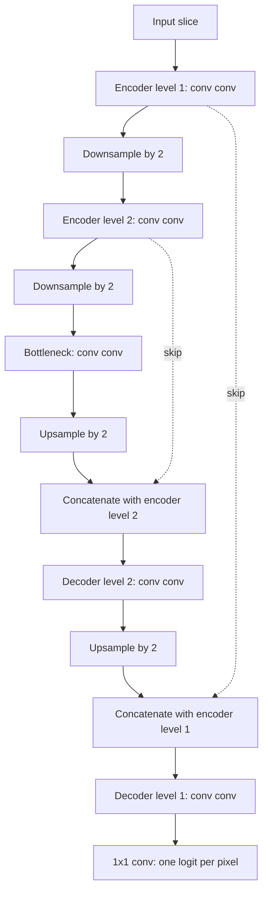

# Segmentation with U-Net and Dice loss

> **Before this lesson:** read [Planning a large project](#/lesson/deep-learning/ct-project-plan) (step 2 of the pipeline) and [Rare positives](#/lesson/deep-learning/imbalance-metrics) for precision, recall and F1. You need convolutions, pooling and transposed convolution's purpose from [Convolutions, pooling and building a convnet](#/lesson/deep-learning/convolutions), skip connections from [Going deeper](#/lesson/deep-learning/depth-residuals), and GPU augmentation from [Overfitting and data augmentation](#/lesson/deep-learning/augmentation).

## In plain words

A classifier answers one question per image: "what is this?". **Segmentation** answers a question for **every pixel** (or voxel): "which class does this point belong to?". The output is a **mask**, an image the same size as the input where each pixel holds a class label or a probability. For the CT project, the segmentation model's job is to paint a heat map of "this might be part of a nodule" over every slice, so the later steps only examine the painted regions.

Picture a colouring book where a child must colour every region of a drawing with the right colour: sky blue, grass green, house red. The child needs two things at once: an understanding of *what* each region is (that requires seeing the whole picture) and precision about *where* the edges are (that requires fine detail). Segmentation networks are designed around exactly that tension.

The classic architecture is **U-Net**: an encoder that shrinks the image while building up understanding, a decoder that grows it back to full size, and skip connections that carry fine detail across from the encoder to the decoder. Because nodules occupy a tiny fraction of each slice, the usual per-pixel loss is swamped by background, so we use **Dice loss**, which is in effect a per-pixel F1 score.

Why it matters for a job: segmentation powers medical imaging, autonomous driving (road, lane and pedestrian masks), satellite analysis, photo editing (background removal) and manufacturing inspection. U-Net-style encoder-decoders also underlie diffusion image generators. Interviewers ask you to compare detection and segmentation, explain U-Net's skips, and write Dice or IoU.

## 1. Kinds of "where is it?" tasks

| task | output | example |
|---|---|---|
| classification | one label per image | "this crop contains a nodule" |
| object detection | a box and label per object | boxes around each car |
| semantic segmentation | a class per pixel; objects of the same class are not separated | every pixel of "road" or "person" |
| instance segmentation | a separate mask per object | person 1, person 2, person 3 |

The CT project uses **semantic segmentation** with two classes (possibly-nodule versus background) and later separates individual nodules with a classic grouping algorithm ([end-to-end lesson](#/lesson/deep-learning/end-to-end-finetuning)).

## 2. The U-Net architecture

U-Net (Ronneberger and colleagues, 2015, originally for biomedical microscopy) has a characteristic U shape:



- **Encoder (contracting path)**: blocks of two 3 × 3 convolutions with ReLU, each followed by 2 × 2 max-pooling. Resolution halves and channels double at each level. Deep levels see large regions and capture *what* is present, but have lost precise *where*.
- **Decoder (expanding path)**: at each level, **upsample** by 2 (a transposed convolution, `nn.ConvTranspose2d(c, c // 2, kernel_size=2, stride=2)`, or interpolation followed by a convolution), then **concatenate** with the encoder's feature map of the same resolution, then two convolutions. Concatenation doubles the channels, giving the decoder both deep context and fine detail.
- **Skip connections**: the encoder feature maps copied across. Without them, the decoder would have to reinvent fine boundaries from a blurry bottleneck. (Contrast with ResNet's skips, which *add* features within one resolution; U-Net's *concatenate* across the U.)
- **Output**: a 1 × 1 convolution to one channel per class, giving per-pixel logits; a sigmoid turns them into probabilities for the two-class case.

```python-run
def unet_shapes(in_ch, size, depth=3, width=16):
    """Track (channels, height, width) through a padded U-Net (padding=1 keeps sizes within a level)."""
    ch, s, skips = in_ch, size, []
    print(f"input            {ch:4d} x {s} x {s}")
    for level in range(depth):
        ch = width * 2 ** level                  # two 3x3 convs with padding 1
        skips.append((ch, s))
        print(f"encoder {level + 1}        {ch:4d} x {s} x {s}   (saved for the skip)")
        assert s % 2 == 0, "size must stay divisible by 2 at every level"
        s //= 2                                  # 2x2 max-pool
    ch = width * 2 ** depth
    print(f"bottleneck       {ch:4d} x {s} x {s}")
    for skip_ch, skip_s in reversed(skips):
        s *= 2; ch //= 2                         # ConvTranspose2d(kernel 2, stride 2) halves the channels
        ch_cat = ch + skip_ch                    # concatenate with the encoder map
        ch = skip_ch                             # two 3x3 convs back down
        print(f"decoder          {ch_cat:4d} -> {ch:3d} x {s} x {s}   (after concat with skip {skip_ch})")
    print(f"output (1x1)        1 x {s} x {s}   one logit per pixel")

unet_shapes(in_ch=7, size=64)
```

The shape walk uses 7 input channels (explained in section 4) and a 64 × 64 crop. With **padded** convolutions, every level keeps its size, so the output mask matches the input exactly, provided the input size is divisible by $2^{\text{depth}}$. (The original U-Net used unpadded convolutions, so its output was smaller than its input and skip maps had to be cropped before concatenation; most implementations today pad.)

## 3. Reusing an existing U-Net

The book does not write U-Net from scratch: it adapts a published open-source implementation, which is normal practice. A small wrapper module adds what this project needs around it:

```python
import torch
from torch import nn

class UNetWrapper(nn.Module):
    def __init__(self, in_channels=7, n_classes=1, depth=3, wf=4):
        super().__init__()
        self.input_batchnorm = nn.BatchNorm2d(in_channels)    # normalise HU inputs
        self.unet = UNet(in_channels=in_channels, n_classes=n_classes, depth=depth,
                         wf=wf, padding=True, batch_norm=True, up_mode="upconv")   # 2**wf = 16 filters at level 1
        self.final = nn.Sigmoid()                             # per-pixel probability of "nodule"

    def forward(self, x):                                     # x: (N, 7, H, W)
        return self.final(self.unet(self.input_batchnorm(x)))
```

The project's training loop needs probabilities to compute its Dice loss, so the wrapper ends with a sigmoid. Libraries such as `segmentation_models_pytorch` provide U-Nets with pretrained encoders (for example a ResNet encoder trained on ImageNet), which usually train faster and better on small datasets.

## 4. 2-D or 3-D?

CT scans are volumes, so a 3-D U-Net is the natural choice, but 3-D feature maps at full resolution are enormous: a 3-D U-Net on whole scans does not fit in typical GPU memory with a useful batch size. The book's compromise is a **2-D U-Net with context slices**: to segment one slice, the model receives that slice plus the 3 slices above and 3 below as **7 input channels**. It sees some 3-D context while all convolutions stay 2-D and cheap. The trade-off: context beyond ±3 slices is invisible, and the model does not treat the depth axis as spatial (it cannot share weights along it), but it trains quickly and works well enough for candidate generation.

## 5. Building the ground-truth masks

LUNA provides nodule centres and diameters, not voxel masks. The book builds approximate masks from the image itself: starting at each annotated centre, grow a box outwards along each axis while the voxels remain dense (above about −700 HU, i.e. tissue rather than air), then mark the dense voxels inside that box as "nodule". The result is a rough but useful mask. Lesson for real projects: labels are often approximations created by heuristics, so look at them, and remember the model can only learn what the labels say.

## 6. Training data and validation

- **Training**: 64 × 64 crops (with 7 context slices) taken at random positions from a 96 × 96 region around each positive candidate. Random cropping is itself augmentation, and the GPU augmentation module adds flips, shifts, rotations and noise to whole batches.
- **Validation**: whole 512 × 512 slices, from scans in the validation split, including slices with no nodules, because that is what the model will face in production. Because the network is **fully convolutional** (no fully connected layers), it accepts any input size divisible by 8, so training on small crops and running on full slices works.
- This mismatch has consequences: during training the model rarely sees large regions of empty lung or body outside the lungs, so on full slices it flags many spurious regions. The validation precision will be low; that is acceptable here because the classifier downstream removes false positives, while every missed nodule is lost forever.

## 7. Dice loss

Per-pixel binary cross-entropy averages over every pixel. With a tiny nodule in a large crop, predicting "background everywhere" gives a small average loss, the same trap as the [imbalanced classifier](#/lesson/deep-learning/imbalance-metrics). The **Dice coefficient** measures overlap instead:

$$\text{Dice} = \frac{2\,|P \cap G|}{|P| + |G|}$$

where $P$ is the set of predicted pixels and $G$ the ground-truth pixels. It is exactly the F1 score computed over the pixels of one image: twice the true positives over (predicted positives + actual positives). Dice is 1 for perfect overlap and 0 for none, and background pixels that are correctly predicted as background do not enter the formula at all, which is why imbalance does not swamp it.

To train with it we need a differentiable version. **Soft Dice** replaces the hard sets with probabilities $p_i$ and labels $g_i \in \{0, 1\}$:

$$\text{Dice}_{\text{soft}} = \frac{2 \sum_i p_i g_i + \epsilon}{\sum_i p_i + \sum_i g_i + \epsilon}, \qquad L_{\text{Dice}} = 1 - \text{Dice}_{\text{soft}}$$

The small $\epsilon$ (the book uses 1) keeps the ratio defined when an image has no positive pixels and no predictions. The sums run over each image's pixels, giving one Dice value per sample, then averaged over the batch.

Related: **Intersection over Union (IoU, Jaccard index)** $= |P \cap G| / |P \cup G|$. Dice and IoU rank results the same way and are linked by $\text{Dice} = 2\,\text{IoU}/(1 + \text{IoU})$.

```python
def dice_loss(pred, label, eps=1.0):
    """pred: (N, 1, H, W) probabilities; label: (N, 1, H, W) of 0/1. Returns one loss per sample."""
    dims = (1, 2, 3)
    intersection = (pred * label).sum(dim=dims)
    dice = (2 * intersection + eps) / (pred.sum(dim=dims) + label.sum(dim=dims) + eps)
    return 1 - dice

loss = dice_loss(pred, label).mean() + 8 * dice_loss(pred * label, label).mean()   # extra weight on misses
```

The second term is the book's trick for **recall**. `pred * label` keeps only predictions inside the true mask, so its Dice measures only how much of the nodule was covered, penalising false negatives and ignoring false positives. Weighting it by 8 tells the model that missing nodule pixels is far worse than painting extra ones, exactly the priority of a candidate generator. The model is trained with **Adam** (learning rate $10^{-3}$), which proved more forgiving than SGD for this network.

```python-run
import numpy as np

def soft_dice(pred, label, eps=1.0):
    inter = (pred * label).sum()
    return (2 * inter + eps) / (pred.sum() + label.sum() + eps)

def bce(pred, label):
    p = np.clip(pred, 1e-7, 1 - 1e-7)
    return -(label * np.log(p) + (1 - label) * np.log(1 - p)).mean()

def iou(pred_mask, label):
    union = np.logical_or(pred_mask, label).sum()
    return np.logical_and(pred_mask, label).sum() / union if union else 1.0

H = W = 64
label = np.zeros((H, W)); label[30:34, 40:44] = 1               # a 16-pixel nodule in 4,096 pixels

candidates = {
    "all background":          np.zeros((H, W)),
    "perfect":                 label.copy(),
    "half the nodule":         np.where((label == 1) & (np.arange(W) < 42), 1.0, 0.0),
    "nodule + big false area": np.where((label == 1) | (np.arange(H)[:, None] < 8), 1.0, 0.0),
    "uncertain everywhere":    np.full((H, W), 0.5),
}
print(f"{'prediction':26s} {'BCE':>7} {'Dice loss':>10} {'recall-only Dice loss':>22} {'IoU':>6}")
for name, pred in candidates.items():
    fn_term = 1 - soft_dice(pred * label, label)
    print(f"{name:26s} {bce(pred, label):7.4f} {1 - soft_dice(pred, label):10.3f} {fn_term:22.3f} "
          f"{iou(pred > 0.5, label == 1):6.3f}")
d_iou = iou(candidates['half the nodule'] > 0.5, label == 1)
print(f"\nDice from IoU for 'half the nodule': 2*IoU/(1+IoU) = {2 * d_iou / (1 + d_iou):.3f}")
```

**Reading the table**

- Predicting background everywhere gets a BCE of only 0.063, lower than painting the nodule plus a false band (2.01), because 99.6% of its pixels are right. Its Dice loss is near the maximum (0.94; not exactly 1 because of the smoothing term $\epsilon$): it found nothing.
- Covering half the nodule gives a Dice loss of 0.32; adding a large false region to a complete detection pushes the Dice loss back up to 0.94 because precision collapsed.
- The recall-only term is 0 whenever the whole nodule is covered, regardless of false positives, which is why weighting it pushes the model towards high recall.
- An undecided prediction of 0.5 everywhere is heavily penalised by both: soft Dice treats probabilities as partial votes, so spreading probability over the background costs as much as false positives.
- For the half-covered prediction, IoU is 0.5 and the formula gives a hard Dice of 0.667, i.e. a Dice loss of about 0.33, consistent with the table (the small difference is the smoothing term).

## 8. Monitoring and saving

- Log precision, recall and Dice on validation, and write example images to TensorBoard: the CT slice, the ground-truth mask and the predicted mask overlaid in different colours (`writer.add_image`). For segmentation, looking at predictions is the fastest way to understand failures.
- Save checkpoints with the model's state, optimiser state, epoch and metrics; the book also stores a hash of the weights so a deployed model can be traced to its exact file.
- Select the checkpoint by a metric that reflects the goal; here recall (with acceptable precision) rather than plain Dice.

The result is a model with high recall and low precision: it finds the large majority of nodule voxels in validation scans, along with many false-positive regions that the classifier will later reject.

> [!INTERVIEW]
> **"Why use Dice loss instead of cross-entropy for segmenting small structures, and what are its weaknesses?"** Per-pixel cross-entropy averages over all pixels, so when the object covers 0.1% of the image the background dominates and "predict nothing" scores well. Dice measures overlap (2·TP / (predicted + actual)) and ignores true-negative background, so it directly rewards finding the object. Weaknesses: unstable gradients when an image has few or no positive pixels (hence the epsilon and often combining Dice with cross-entropy), and it treats all errors alike regardless of distance from the boundary. Mention weighting false negatives when recall matters, and IoU as the closely related evaluation metric.

## Summary

- Segmentation labels every pixel; semantic segmentation assigns classes, instance segmentation separates objects, detection draws boxes.
- U-Net: an encoder that downsamples, a decoder that upsamples, and skip connections that concatenate same-resolution encoder features; a 1 × 1 convolution gives per-pixel logits.
- Fully convolutional networks accept any (suitably divisible) input size, allowing training on crops and inference on whole slices.
- The project uses a 2-D U-Net with ±3 context slices as 7 channels, approximate masks grown from annotations, random 64 × 64 crops for training and full slices for validation.
- Soft Dice loss is a differentiable per-image F1 that ignores background; an extra Dice term on `pred * label`, weighted 8, favours recall.
- Dice = 2·IoU/(1 + IoU); log images and choose checkpoints by recall-focused metrics.

## Glossary

- **Segmentation**: assigning a class to every pixel or voxel.
- **Mask**: an image of per-pixel labels or probabilities.
- **Semantic / instance segmentation**: classes per pixel / separate masks per object.
- **Object detection**: predicting a bounding box and label per object.
- **U-Net**: an encoder-decoder segmentation network with concatenated skip connections.
- **Encoder / decoder**: the downsampling path / the upsampling path.
- **Upsampling / transposed convolution**: increasing spatial size / a learned upsampling layer.
- **Bottleneck**: the lowest-resolution level of an encoder-decoder.
- **Fully convolutional network**: a network with no fully connected layers, accepting variable input sizes.
- **Context slices**: neighbouring CT slices supplied as extra input channels.
- **Dice coefficient / soft Dice**: 2·overlap / (predicted + actual) / its probability-based differentiable version.
- **IoU (Jaccard index)**: overlap divided by union.
- **Recall-weighted loss**: a loss term that penalises false negatives more heavily.

## Check yourself

```quiz
[
  {"q": "What do U-Net's skip connections carry, and how are they combined?", "options": ["High-resolution encoder feature maps, concatenated with the decoder's upsampled maps", "Gradients only, added to the loss", "The input image, added to the output", "Class labels, multiplied with the logits"], "answer": 0,
   "explain": "They restore fine spatial detail lost by downsampling."},
  {"q": "A segmentation model predicts background everywhere on images where the object covers 0.4% of pixels. Which loss stays near its worst value?", "options": ["Dice loss", "Per-pixel binary cross-entropy", "Mean squared error", "Accuracy"], "answer": 0,
   "explain": "Dice depends only on overlap with the object; BCE is dominated by easy background pixels."},
  {"q": "If IoU = 0.5, what is the Dice coefficient?", "options": ["0.667", "0.5", "0.25", "1.0"], "answer": 0,
   "explain": "Dice = 2·IoU/(1 + IoU) = 1/1.5."},
  {"q": "Why can the project train on 64 × 64 crops but validate on 512 × 512 slices?", "options": ["The U-Net is fully convolutional, so it accepts any size divisible by 2^depth", "Crops are resized to 512 at validation", "Validation uses a different model", "PyTorch pads automatically"], "answer": 0,
   "explain": "No fully connected layers fix the input size."},
  {"q": "What does the extra term dice_loss(pred * label, label), weighted by 8, encourage?", "options": ["High recall: covering every true nodule pixel even at the cost of false positives", "High precision", "Smaller masks", "Faster convergence only"], "answer": 0,
   "explain": "pred · label ignores predictions outside the true mask, so only misses are penalised."},
  {"q": "Why does the book feed 7 slices as channels to a 2-D U-Net instead of using a 3-D U-Net?", "options": ["To get some 3-D context while keeping memory use manageable", "3-D convolutions do not exist in PyTorch", "To increase resolution", "Because CT slices are colour images"], "answer": 0,
   "explain": "Full-resolution 3-D feature maps are too large for typical GPUs."},
  {"q": "Which task separates two touching people into two masks?", "options": ["Instance segmentation", "Semantic segmentation", "Image classification", "Regression"], "answer": 0,
   "explain": "Semantic segmentation would label both only as 'person' pixels."}
]
```

> **Source:** Stevens, Antiga & Viehmann, *Deep Learning with PyTorch*, ch. 13 (adding a second model, types of segmentation, semantic segmentation, the U-Net architecture, adapting an off-the-shelf model, input size requirements, 2-D versus 3-D trade-offs, building the ground truth, training and validation data design, augmenting on the GPU, the Adam optimiser, Dice loss, images in TensorBoard, saving the model, results); Ronneberger et al., "U-Net" (2015).
