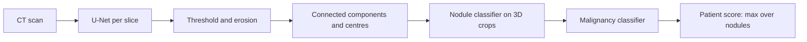

# End to end: grouping, ROC/AUC and fine-tuning

> **Before this lesson:** read the earlier project lessons, especially [Segmentation with U-Net and Dice loss](#/lesson/deep-learning/segmentation) (step 2) and [Rare positives](#/lesson/deep-learning/imbalance-metrics) (precision, recall, thresholds). You need `requires_grad_(False)` from [Autograd in depth](#/lesson/deep-learning/autograd), parameter groups from [Optimisers and validation](#/lesson/deep-learning/optimizers-validation), and pretrained models from [Running pretrained models](#/lesson/deep-learning/pretrained-models).

## In plain words

We now have two trained models, a segmenter that paints possible nodule voxels and a classifier that judges candidate crops, and a plan for a third, a **malignancy** classifier. This lesson wires them into a single pipeline that takes a raw scan and produces a list of suspicious nodules with scores, measures the whole system, and builds the malignancy model by **fine-tuning**: starting from the nodule classifier's learned weights instead of from random numbers.

It also introduces the **ROC curve** and its **AUC**, the standard way to compare classifiers across all thresholds, and a lesson every project needs: always compare against a simple **baseline**. Here the baseline is almost embarrassingly simple: call a nodule malignant if it is large.

Think of a relay race. Each runner (model) was trained separately; the race is won or lost in the handovers. A brilliant classifier is useless if the segmenter never hands it the right candidates, and a test of each runner alone does not tell you the team's time. End-to-end evaluation times the whole team.

Why it matters for a job: transfer learning and fine-tuning are how most production models are built today, from image classifiers to large language models; interviewers expect you to explain freezing, replacing heads, choosing learning rates per layer, and when to fine-tune versus extract features. ROC/AUC, baselines and end-to-end evaluation are standard ML system design topics.

## 1. From segmentation to candidates

The segmentation model outputs a probability per voxel. Turning that into a list of candidates takes three classic steps, none of them deep learning:

1. **Threshold**: keep voxels with probability above 0.5 to get a binary mask.
2. **Clean up**: a **binary erosion** removes one layer of voxels from the boundary of every flagged region, deleting tiny specks of one or two voxels that are almost always noise.
3. **Group**: **connected-component labelling** gives every set of touching flagged voxels its own integer label; each component's **centre of mass** (the average position of its voxels, optionally weighted by density) becomes a candidate centre in voxel coordinates, converted to millimetres with the [coordinate functions](#/lesson/deep-learning/ct-data-pipeline).

```python
import scipy.ndimage as ndi

mask = seg_probs > 0.5                                           # (slices, rows, cols) booleans
mask = ndi.binary_erosion(mask, iterations=1)                     # drop single-voxel noise
labels, n = ndi.label(mask)                                       # 6-connectivity in 3-D by default
centers_irc = ndi.center_of_mass(ct_hu + 1001, labels=labels, index=range(1, n + 1))   # density-weighted
candidates = [CandidateInfo(False, 0.0, series_uid, irc2xyz(c, origin, spacing, direction)) for c in centers_irc]
```

The demo implements labelling with a breadth-first flood fill (visit a voxel, then all its unvisited neighbours, and so on), which is what `ndi.label` does far faster in compiled code.

```python-run
import numpy as np
from collections import deque

def label_components(mask):
    """6-connected components of a 3-D boolean mask. Returns (labels, count)."""
    labels = np.zeros(mask.shape, dtype=int)
    count = 0
    steps = [(1, 0, 0), (-1, 0, 0), (0, 1, 0), (0, -1, 0), (0, 0, 1), (0, 0, -1)]
    for start in zip(*np.nonzero(mask)):
        if labels[start]:
            continue
        count += 1
        labels[start] = count
        queue = deque([start])
        while queue:
            z, y, x = queue.popleft()
            for dz, dy, dx in steps:
                n = (z + dz, y + dy, x + dx)
                if all(0 <= n[i] < mask.shape[i] for i in range(3)) and mask[n] and not labels[n]:
                    labels[n] = count
                    queue.append(n)
    return labels, count

rng = np.random.default_rng(0)
probs = rng.random((10, 20, 20)) * 0.3                         # mostly low probabilities
probs[3:6, 4:8, 4:8] = 0.9                                     # blob 1
probs[6:8, 12:17, 10:13] = 0.8                                 # blob 2
probs[1, 18, 1] = 0.95                                         # a single noisy voxel
mask = probs > 0.5

def erode(m):                                                  # keep voxels whose 6 neighbours are all set
    core = m.copy()
    for axis in range(3):
        for shift in (1, -1):
            core &= np.roll(m, shift, axis=axis)
    return core

for name, m in [("raw mask", mask), ("after erosion", erode(mask))]:
    lab, n = label_components(m)
    centres = [np.argwhere(lab == k).mean(axis=0).round(1) for k in range(1, n + 1)]
    print(f"{name:14s}: {n} components, sizes {[int((lab == k).sum()) for k in range(1, n + 1)]}, centres {centres}")
```

Before erosion there are three components: the two blobs and the single noisy voxel. Erosion (implemented with `np.roll`, which wraps at the borders, acceptable here because nothing touches them) removes the speck and shrinks blob 1 to its core while keeping its centre. But it also deletes blob 2 completely, because that blob is only two slices thick, so no voxel has flagged neighbours both above and below. That is the recall trade-off of clean-up steps in miniature: erosion can erase genuinely small or thin nodules, so measure how many annotated nodules survive it rather than assuming it is harmless (and consider eroding only within slices when slices are thick).

## 2. The full pipeline and its evaluation



To evaluate the system on the **validation scans** (never the training ones), match each detected candidate to the annotated nodules and count, per scan:

- nodules **missed entirely** by segmentation and grouping (no candidate near them): lost forever, the worst outcome;
- nodules **found but filtered out** by the classifier: a classifier recall problem;
- nodules **detected**; and false-positive candidates surviving classification, reported as **false positives per scan**.

These stage-by-stage counts tell you which model to improve next. The book finds that the segmenter plus grouping catches most annotated nodules, the classifier removes the great majority of false candidates, and that a meaningful number of false positives per scan remain: typical for a first system and a clear target for future work.

## 3. ROC curves and AUC

A classifier outputs a score; any threshold turns it into decisions. The **ROC curve** (receiver operating characteristic, a name from radar engineering) plots, for every possible threshold:

- the **true positive rate** TPR $= TP/(TP + FN)$ (recall) on the vertical axis, against
- the **false positive rate** FPR $= FP/(FP + TN)$ on the horizontal axis.

A useless random scorer follows the diagonal from (0, 0) to (1, 1); a perfect one goes straight up to (0, 1) and then across. The **area under the curve (AUC)** summarises it in one number: 0.5 for random, 1.0 for perfect. AUC has a neat interpretation: it is the probability that a randomly chosen positive gets a higher score than a randomly chosen negative. It does not depend on any threshold or on the class balance.

### A baseline: diameter alone

Before training a malignancy model, ask how well the simplest possible rule does. Larger nodules are more likely malignant, so use the nodule's **diameter** as the score. Sweeping a threshold over diameter gives an ROC curve and an AUC that any learned model must beat to be worth its complexity.

```python-run
import numpy as np

rng = np.random.default_rng(0)
benign = rng.lognormal(mean=np.log(6), sigma=0.45, size=300)       # diameters in mm (made up)
malignant = rng.lognormal(mean=np.log(13), sigma=0.45, size=100)
scores = np.r_[benign, malignant]
labels = np.r_[np.zeros(300, int), np.ones(100, int)]

def roc_curve(labels, scores):
    order = np.argsort(-scores)                       # descending score = lowering the threshold
    tp = np.cumsum(labels[order] == 1)
    fp = np.cumsum(labels[order] == 0)
    tpr = np.r_[0, tp / tp[-1]]
    fpr = np.r_[0, fp / fp[-1]]
    return fpr, tpr, np.r_[np.inf, scores[order]]

fpr, tpr, thr = roc_curve(labels, scores)
auc = np.trapezoid(tpr, fpr) if hasattr(np, "trapezoid") else np.trapz(tpr, fpr)
pos, neg = scores[labels == 1], scores[labels == 0]
pairwise = (pos[:, None] > neg[None, :]).mean()       # P(random malignant scores above random benign)
print(f"diameter baseline AUC (trapezoid) {auc:.3f}   pairwise-ranking estimate {pairwise:.3f}")
for target in (0.5, 0.8, 0.95):
    i = np.argmax(tpr >= target)
    print(f"to reach recall {target:.2f}: threshold {thr[i]:5.1f} mm, false positive rate {fpr[i]:.2f}")
```

**Reading the output**

- The trapezoid area under the ROC curve and the pairwise-ranking probability agree, confirming the interpretation of AUC.
- In this made-up data the diameter baseline is already strong (AUC around 0.9). Each recall target corresponds to a diameter threshold and a price in false positives: demanding 95% recall means flagging a large share of benign nodules.
- In the real project the same comparison showed that the diameter baseline is surprisingly hard to beat, a sobering and valuable fact for anyone planning a project.

## 4. Fine-tuning the nodule classifier for malignancy

Malignancy labels exist for only a few hundred nodules: far too few to train a 3-D convnet from scratch. But the nodule classifier was trained on hundreds of thousands of candidate crops and has learned features about nodule shape, texture and surroundings. **Transfer learning** reuses those features.

The recipe:

1. Build the same architecture and load the nodule classifier's weights.
2. **Replace the head**: the final linear layer is re-initialised (randomly) because its job (malignant vs benign) is new.
3. **Freeze** the rest by setting `requires_grad_(False)` on its parameters, so only the new head trains. This is called **feature extraction** or **linear probing**.
4. Optionally **unfreeze** the last block or two of the backbone as well (**fine-tuning** deeper), usually with a smaller learning rate, so higher-level features can adapt to the new task.

```python
model = LunaModel()
model.load_state_dict(torch.load("nodule_cls_best.pt", weights_only=True))
model.head = nn.Linear(model.head.in_features, 2)            # new, randomly initialised head

finetune_depth = 1                                             # 1: head only; 2: head + last block
for p in model.parameters():
    p.requires_grad_(False)
trainable = [model.head] + list(model.backbone)[-(finetune_depth - 1):] if finetune_depth > 1 else [model.head]
for module in trainable:
    for p in module.parameters():
        p.requires_grad_(True)

optimizer = torch.optim.SGD([p for p in model.parameters() if p.requires_grad], lr=3e-3, momentum=0.99)
```

Why it works: the early layers of a network learn general, reusable features (edges, blobs, textures), while late layers become task-specific. Reusing the general layers means the few malignancy labels only need to teach the task-specific part.

Results in the book: the head-only model gives a moderate AUC; fine-tuning the last convolutional block as well does better and edges past the diameter baseline, while training from scratch on so few labels overfits badly. Fine-tuning deeper with so little data risks overfitting too, so watch validation AUC closely.

## 5. Transfer learning in current practice

The CT project fine-tunes its own model; most real projects start from a large public **pretrained backbone** instead.

```python
from torchvision.models import resnet50, ResNet50_Weights

model = resnet50(weights=ResNet50_Weights.DEFAULT)
model.fc = nn.Linear(model.fc.in_features, n_classes)            # new head

backbone = [p for n, p in model.named_parameters() if not n.startswith("fc.")]
optimizer = torch.optim.AdamW([
    {"params": backbone, "lr": 1e-5},                              # small steps for pretrained layers
    {"params": model.fc.parameters(), "lr": 1e-3},                 # larger steps for the new head
], weight_decay=0.01)
```

Guidelines:

| situation | strategy |
|---|---|
| very little data, similar domain | freeze the backbone, train the head (linear probe) |
| moderate data | train the head first, then unfreeze and fine-tune everything with a small learning rate |
| lots of data or a very different domain (X-rays vs photos) | fine-tune everything; consider domain-specific pretrained weights |
| huge models (LLMs) | parameter-efficient fine-tuning such as LoRA ([LLM Practice](#/lesson/llm-practice/lora-qlora)) |

- **Discriminative learning rates** (smaller for early layers, larger for the head) protect general features from being destroyed by large early gradients from the random head.
- **Linear probe, then fine-tune** (training the head to convergence before unfreezing) avoids that same damage and is a robust default.
- Remember the pretrained preprocessing (input size, normalisation statistics) and BatchNorm behaviour: with small batches, keep BatchNorm layers in eval mode or frozen ([normalisation lesson](#/lesson/deep-learning/normalisation-init)).
- Count only trainable parameters in the optimiser, or pass all and rely on `requires_grad=False` parameters having no gradient (they are skipped).

The demo pretrains a small network on a task with plenty of data, then learns a different task that relies on the same hidden features from only 40 labelled examples, three ways.

```python-run
import numpy as np

rng = np.random.default_rng(0)
d, k = 20, 8
W_true = rng.normal(0, 1, (d, k))                       # hidden "true" features shared by both tasks
feat = lambda X: np.maximum(X @ W_true, 0)
v_a, v_b = rng.normal(0, 1, k), rng.normal(0, 1, k)

X_a = rng.normal(0, 1, (5000, d)); s_a = feat(X_a) @ v_a; y_a = (s_a > np.median(s_a)).astype(int)
X_b_all = rng.normal(0, 1, (5000, d)); s_b = feat(X_b_all) @ v_b; y_b_all = (s_b > np.median(s_b)).astype(int)
X_b, y_b = X_b_all[:40], y_b_all[:40]                   # only 40 labelled examples for task B
X_val, y_val = X_b_all[1000:], y_b_all[1000:]

def train(X, y, W1=None, b1=None, freeze=False, steps=1000, lr=0.05, hidden=32, seed=1):
    r = np.random.default_rng(seed)
    if W1 is None:
        W1, b1 = r.normal(0, np.sqrt(2 / d), (d, hidden)), np.zeros(hidden)
    W1, b1 = W1.copy(), b1.copy()
    W2, b2 = r.normal(0, np.sqrt(1 / hidden), (hidden, 2)), np.zeros(2)       # always a fresh head
    for _ in range(steps):
        idx = r.choice(len(X), min(64, len(X)), replace=False)
        x, t = X[idx], y[idx]
        z = x @ W1 + b1; h = np.maximum(z, 0); logits = h @ W2 + b2
        p = np.exp(logits - logits.max(1, keepdims=True)); p /= p.sum(1, keepdims=True)
        p[np.arange(len(t)), t] -= 1; p /= len(t)
        W2 -= lr * h.T @ p; b2 -= lr * p.sum(0)
        if not freeze:                                     # frozen backbone: requires_grad=False
            gz = (p @ W2.T) * (z > 0)
            W1 -= lr * x.T @ gz; b1 -= lr * gz.sum(0)
    acc = lambda X, y: ((np.maximum(X @ W1 + b1, 0) @ W2 + b2).argmax(1) == y).mean()
    return W1, b1, acc

W1_a, b1_a, acc_a = train(X_a, y_a, steps=4000)
print(f"pretraining on task A (5,000 labels): accuracy {acc_a(X_a, y_a):.3f}")
for name, kw in [("task B from scratch", {}), ("frozen backbone + new head", {"W1": W1_a, "b1": b1_a, "freeze": True}),
                 ("fine-tune everything", {"W1": W1_a, "b1": b1_a})]:
    _, _, acc = train(X_b, y_b, **kw)
    print(f"{name:28s}: validation accuracy {acc(X_val, y_val):.3f}")
```

With only 40 labels, the network trained from scratch generalises worst; both transfer variants, which start from features learned on task A, do clearly better. With so few labels, freezing and full fine-tuning perform similarly here; with more task-B data, fine-tuning everything usually pulls ahead.

## 6. Diagnosis, test sets and what comes next

- **Patient-level diagnosis**: the maximum malignancy probability over a patient's detected nodules, compared with the patient's true status; report recall and specificity at a chosen threshold, and AUC.
- **Test set**: everything so far was tuned on validation scans. A credible final number needs a **test set** used once: ideally scans from a different time or hospital, which also reveals sensitivity to scanner differences.
- **Ensembles**: averaging the predictions of several models (different seeds, folds or architectures) usually improves accuracy and calibration; competition winners almost always ensemble.
- **Better regularisation and data**: label smoothing, MixUp, stronger augmentation, and refining labels (better masks, consensus of several radiologists).
- **Humility**: a research pipeline is far from a clinical product, which needs prospective validation, monitoring for drift and regulatory approval.

> [!INTERVIEW]
> **"You have 500 labelled medical images. How do you build a classifier?"** Start from a pretrained backbone (ImageNet or, better, a medical-imaging model), replace the head, train the head first with the backbone frozen, then fine-tune the whole network with a smaller learning rate (discriminative rates per layer group), strong but valid augmentation, weight decay and early stopping on a patient-level validation split. Compare against a simple baseline, report ROC AUC and recall at a clinically chosen specificity with confidence intervals (small data means wide uncertainty), and consider cross-validation and an ensemble of folds.

## Summary

- Segmentation probabilities become candidates by thresholding, erosion, connected-component labelling and centres of mass: classic image processing, not deep learning.
- Evaluate the pipeline end to end on validation scans, counting misses, filtered nodules, detections and false positives per scan by stage.
- ROC curves plot TPR against FPR over all thresholds; AUC is the probability that a random positive outranks a random negative (0.5 random, 1.0 perfect).
- Always compare with a simple baseline; diameter alone is a strong malignancy predictor.
- Fine-tuning reuses learned weights: replace the head, freeze the backbone (`requires_grad_(False)`), optionally unfreeze the last blocks with smaller learning rates.
- With pretrained backbones: linear probe then fine-tune, discriminative learning rates, careful BatchNorm, PEFT for huge models; finish with a test set and consider ensembles.

## Glossary

- **Binary erosion**: removing the boundary layer of flagged regions to delete small specks.
- **Connected-component labelling**: assigning a label to each group of touching flagged voxels.
- **Centre of mass**: the (optionally weighted) average position of a component's voxels.
- **End-to-end evaluation**: measuring the whole pipeline on raw inputs, not each part alone.
- **False positives per scan**: average false detections per case.
- **ROC curve**: true positive rate against false positive rate over all thresholds.
- **AUC**: area under the ROC curve; the probability a positive outranks a negative.
- **Baseline**: a simple reference method a model must beat.
- **Transfer learning**: reusing a model trained on one task for another.
- **Feature extraction / linear probing**: freezing the backbone and training only a new head.
- **Fine-tuning**: continuing to train some or all pretrained layers on the new task.
- **Freezing**: disabling gradient updates for parameters.
- **Discriminative learning rates**: different learning rates for different layer groups.
- **Ensemble**: combining several models' predictions.
- **Test set**: data used once for the final, unbiased estimate.

## Check yourself

```quiz
[
  {"q": "Which step turns a binary segmentation mask into individual candidate nodules?", "options": ["Connected-component labelling followed by centres of mass", "A second U-Net", "Softmax over voxels", "Max pooling"], "answer": 0,
   "explain": "Each group of touching voxels becomes one candidate at its centre."},
  {"q": "What does an AUC of 0.5 mean?", "options": ["The scores rank positives and negatives no better than chance", "Half the predictions are correct at threshold 0.5", "Perfect classification", "The model always predicts positive"], "answer": 0,
   "explain": "AUC is the probability a random positive scores above a random negative."},
  {"q": "What are the axes of an ROC curve?", "options": ["False positive rate (x) and true positive rate (y)", "Precision (x) and recall (y)", "Threshold (x) and accuracy (y)", "Loss (x) and epoch (y)"], "answer": 0,
   "explain": "Precision-recall curves are a different plot."},
  {"q": "Why compare the malignancy model with a 'diameter only' rule?", "options": ["A baseline shows whether the learned model adds value over something trivial", "Diameter is required by PyTorch", "It replaces the validation set", "Because CT scans store diameters"], "answer": 0,
   "explain": "Complex models must beat simple, interpretable ones to justify themselves."},
  {"q": "In feature extraction (linear probing), which parameters are trained?", "options": ["Only the new head; the backbone is frozen", "All parameters", "Only the first layer", "Only BatchNorm layers"], "answer": 0,
   "explain": "Backbone parameters have requires_grad set to False."},
  {"q": "Why use a smaller learning rate for pretrained layers than for the new head?", "options": ["To avoid destroying useful pretrained features with large updates", "Pretrained layers have no gradients", "Heads cannot learn with small rates", "To save memory"], "answer": 0,
   "explain": "Discriminative learning rates let the random head adapt quickly while the backbone changes gently."},
  {"q": "Why does binary erosion help before grouping?", "options": ["It removes tiny isolated specks of false-positive voxels", "It enlarges nodules", "It converts probabilities to labels", "It speeds up the U-Net"], "answer": 0,
   "explain": "One-voxel regions are almost always noise; the trade-off is possibly losing very small nodules."},
  {"q": "All tuning used the validation scans. How should the final performance be reported?", "options": ["On a separate test set used once, ideally from a different source", "On the validation scans", "On the training scans", "As the best validation epoch's score"], "answer": 0,
   "explain": "Decisions made on validation data bias its score upward."}
]
```

> **Source:** Stevens, Antiga & Viehmann, *Deep Learning with PyTorch*, ch. 14 (bridging segmentation and classification, grouping voxels into candidates, classification to reduce false positives, quantitative validation, predicting malignancy, the diameter baseline and ROC/AUC, reusing preexisting weights by fine-tuning, what we see when we diagnose, training/validation/test sets, ideas for improvement); torchvision documentation (pretrained weights); SciPy documentation, `scipy.ndimage.label`.
