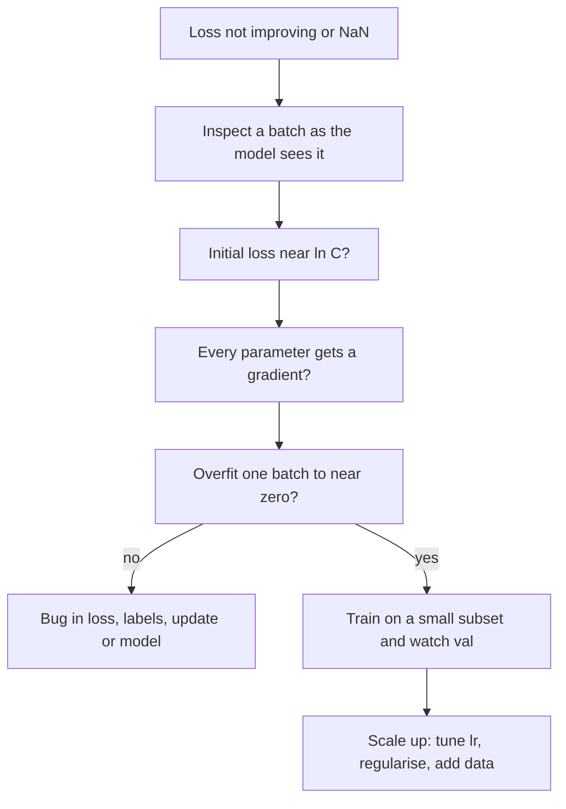

# Debugging training: overfit one batch, NaNs and gradient checks

> **Before this lesson:** you need the training loop and gradient checks from [Autograd in depth](#/lesson/deep-learning/autograd), cross-entropy from [A first image classifier](#/lesson/deep-learning/image-classifier), `train()`/`eval()` from [nn.Module, state_dict and checkpointing](#/lesson/deep-learning/nn-module), and gradient clipping and mixed precision from the two previous lessons.

## In plain words

Ordinary software bugs usually crash. Deep-learning bugs usually do not: the code runs, the loss goes down a bit, and the model is quietly worse than it should be, or useless. Softmax applied twice, labels misaligned with images, a layer accidentally frozen, augmentation leaking into validation: none of these raises an error. So debugging training needs deliberate experiments that make bugs visible.

The single most useful experiment is to **overfit one batch**: take one small batch and train on it alone, many times. A correct model and training loop should memorise it, driving the loss close to zero. If they cannot, something is broken in the model, the loss or the update, and no amount of tuning will fix it. Around that core sit a few more habits: check the loss at initialisation, check every parameter receives a gradient, verify hand-written gradients numerically, and hunt down **NaN** ("not a number") values the moment they appear.

Think of a mechanic diagnosing a car that "drives badly". Rather than tuning everything at once, they put it on a test stand and check one system at a time: does the engine rev with no load? Do the brakes grip at low speed? Overfitting one batch is putting the model on the test stand.

Why it matters for a job: "the loss is not going down", "the loss became NaN", "validation is great but production is terrible" are everyday situations, and interviewers ask candidates to describe their debugging process. A crisp, ordered checklist is one of the strongest signals of real experience.

## 1. Before training: sanity checks

1. **Look at the data.** Render a few batches *exactly as the model receives them* (after transforms), with their labels. Check shapes, dtypes, value ranges, and the label distribution per split.
2. **Check the loss at initialisation.** With $C$ balanced classes and a sensibly initialised model, the initial cross-entropy should be close to $\ln C$ (2.30 for ten classes). Much larger means the initial logits are too big (bad initialisation or unscaled inputs); much smaller means something leaks the answer.
3. **Check the output head.** A final layer biased towards the base rate (for example setting the bias of a rare-positive logit to the log-odds of the positive rate) avoids a wasteful first phase where the model only learns the class frequencies.
4. **Check that every parameter gets a gradient** after one backward pass:

```python
loss.backward()
for name, p in model.named_parameters():
    if p.requires_grad and (p.grad is None or p.grad.abs().sum() == 0):
        print("no gradient reaches", name)     # frozen by mistake, detached, unused, or a dead layer
```

5. **Run a smoke test**: a handful of steps end to end, including validation, checkpoint saving and loading. Crashes at the end of a ten-hour run are expensive.

## 2. Overfit one batch

```python
x, y = next(iter(train_loader))                  # one fixed batch; disable augmentation and dropout
model.train()
for step in range(500):
    loss = loss_fn(model(x), y)
    optimizer.zero_grad(); loss.backward(); optimizer.step()
    if step % 50 == 0:
        print(step, loss.item())                 # should head towards ~0
```

If the loss plateaus well above zero, suspect, in order: the loss function and its inputs (logits versus probabilities, target dtype and shape), the labels (aligned with inputs?), the update (is `optimizer.step()` called, are the right parameters in the optimiser, is the learning rate sane?), and the model (an accidental bottleneck, a missing activation, a frozen layer).

The demo runs the overfit-one-batch test on a small NumPy network, once correctly and three times with classic bugs.

```python-run
import numpy as np

def overfit_one_batch(bug=None, steps=300, lr=0.5):
    rng = np.random.default_rng(0)
    x = rng.normal(size=(16, 10)); y = rng.integers(0, 4, 16)        # one batch, 4 classes
    W1 = rng.normal(0, np.sqrt(2 / 10), (10, 64)); b1 = np.zeros(64)
    W2 = rng.normal(0, np.sqrt(1 / 64), (64, 4)); b2 = np.zeros(4)
    history = []
    for step in range(steps):
        z = x @ W1 + b1; h = np.maximum(z, 0); logits = h @ W2 + b2
        if bug == "softmax before the loss":
            e = np.exp(logits - logits.max(1, keepdims=True)); probs_in = e / e.sum(1, keepdims=True)
            logits_used = probs_in                                     # the loss applies log-softmax again
        else:
            logits_used = logits
        m = logits_used.max(1, keepdims=True)
        logp = logits_used - m - np.log(np.exp(logits_used - m).sum(1, keepdims=True))
        target = rng.permutation(y) if bug == "labels shuffled every step" else y
        loss = -logp[np.arange(16), target].mean()
        g = np.exp(logp); g[np.arange(16), target] -= 1; g /= 16      # d loss / d logits_used
        if bug == "softmax before the loss":                           # chain rule through the extra softmax
            g = probs_in * (g - (g * probs_in).sum(1, keepdims=True))
        gW2, gb2 = h.T @ g, g.sum(0)
        gz = (g @ W2.T) * (z > 0)
        gW1, gb1 = x.T @ gz, gz.sum(0)
        for p, gr in ((W1, gW1), (b1, gb1), (W2, gW2), (b2, gb2)):
            p -= lr * gr
        history.append(loss)
    return history

cases = [("correct", None, 0.5), ("softmax before the loss", "softmax before the loss", 0.5),
         ("labels shuffled every step", "labels shuffled every step", 0.5), ("learning rate 50", None, 50.0)]
print(f"initial loss should be near ln(4) = {np.log(4):.3f}")
with np.errstate(all="ignore"):
    for name, bug, lr in cases:
        h = overfit_one_batch(bug, lr=lr)
        print(f"{name:28s} loss at step 0: {h[0]:8.4f}   step 50: {h[50]:10.4g}   step 299: {h[299]:10.4g}")
```

**Reading the output**

- The correct loop memorises the 16 examples: the loss falls to near zero within about 50 steps.
- **Softmax before the loss** (passing probabilities to a loss that applies log-softmax itself) squashes the "logits" into [0, 1], so the second softmax can never become confident: the loss stalls far above zero. In PyTorch this is the bug of putting `nn.Softmax` at the end of a model trained with `CrossEntropyLoss`.
- **Misaligned labels** (here shuffled each step, standing in for any data-label mismatch) leave nothing consistent to learn; the loss barely moves.
- **A learning rate of 50** makes the loss explode by many orders of magnitude.

Each bug is invisible in the code's behaviour (no errors) and obvious in this one experiment.

## 3. When the loss becomes NaN

**NaN** ("not a number") is the result of undefined arithmetic such as $0/0$, $\infty - \infty$, or $\log$ of a negative number; **inf** is overflow. Once one NaN appears in a weight, it spreads to everything it touches, and training is dead. Common causes:

| cause | typical fix |
|---|---|
| learning rate too high, exploding updates | lower it, add warmup, clip gradient norms |
| `log(0)` or `log(negative)` in a hand-written loss | use `log_softmax`, `BCEWithLogitsLoss`, or clamp with a small epsilon |
| `exp` overflow | subtract the maximum (log-sum-exp), use library functions |
| division by a value near zero (normalisation of a constant input, a std of 0) | add epsilon to denominators |
| `sqrt` of 0 in the backward pass (its slope is infinite at 0) | add epsilon inside the square root |
| float16 overflow (values above 65,504) | use bfloat16, or GradScaler with float16 |
| NaN or inf already in the input data | check data with `torch.isfinite(x).all()` in the Dataset |

Tools:

```python
torch.autograd.set_detect_anomaly(True)    # slow: raises an error at the backward op that produced NaN, with a traceback
assert torch.isfinite(loss), f"non-finite loss at step {step}"
for name, p in model.named_parameters():
    if p.grad is not None and not torch.isfinite(p.grad).all():
        print("non-finite gradient in", name)
```

Anomaly detection makes training much slower; turn it on only while hunting a specific NaN, often on a saved copy of the offending batch.

```python-run
import numpy as np

logits = np.array([[1000.0, 0.0], [-5.0, 5.0]])
with np.errstate(all="ignore"):
    naive_probs = np.exp(logits) / np.exp(logits).sum(axis=1, keepdims=True)
    naive_loss = -np.log(naive_probs[np.arange(2), [1, 0]])
print("naive softmax + log:", naive_probs.round(4).tolist(), "-> loss", naive_loss)

m = logits.max(axis=1, keepdims=True)
log_probs = logits - m - np.log(np.exp(logits - m).sum(axis=1, keepdims=True))
print("stable log_softmax loss:", -log_probs[np.arange(2), [1, 0]])

x = np.array([[3.0, 3.0, 3.0]])                     # a constant input row
with np.errstate(all="ignore"):
    print("layer norm without eps:", (x - x.mean()) / x.std())
print("layer norm with eps:   ", (x - x.mean()) / np.sqrt(x.var() + 1e-5))
```

The naive softmax overflows: `exp(1000)` is infinite, so the first row's probabilities become NaN and its loss infinite (the second row happens to be fine). The stable log-softmax gives large but finite losses (1000 and 10) whose gradients are well defined, so training can recover. Normalising a constant input without an epsilon divides zero by zero.

## 4. Checking gradients and updates

- **Numerical gradient checks** for any custom layer or loss: compare with finite differences in float64 (`torch.autograd.gradcheck`), as in [Autograd in depth](#/lesson/deep-learning/autograd).
- **Update-to-weight ratio**: for each layer, the size of one optimiser update divided by the size of the weights. Around $10^{-3}$ is a common healthy value; $10^{-1}$ or more means the learning rate is too high for that layer, $10^{-6}$ means it is barely learning.
- **Per-layer gradient norms**: log them; layers whose gradients are many orders of magnitude smaller than others are not learning (vanishing gradients, a dead branch).
- **Dead units**: the fraction of ReLU units that are zero for every example in a batch; a large and growing fraction signals too high a learning rate or poor initialisation.
- **Activation statistics**: mean and standard deviation of each layer's outputs at initialisation and during training; drifting to huge or tiny values foreshadows instability.

```python-run
import numpy as np

rng = np.random.default_rng(0)
W = rng.normal(0, 0.05, (256, 256))
grad = rng.normal(0, 0.01, (256, 256))
for lr in (1e-1, 1e-2, 1e-4):
    update = lr * grad
    ratio = np.linalg.norm(update) / np.linalg.norm(W)
    verdict = "too large" if ratio > 1e-2 else ("too small" if ratio < 1e-4 else "healthy")
    print(f"lr {lr:g}: update/weight ratio {ratio:.1e}  ({verdict})")

x = rng.normal(size=(512, 256))
for name, bias in [("normal bias", 0.0), ("bias pushed very negative", -6.0)]:
    h = np.maximum(x @ W + bias, 0)
    dead = (h.max(axis=0) == 0).mean()
    print(f"{name:26s}: fraction of ReLU units dead on the whole batch = {dead:.2f}")
```

The update-to-weight ratio flags the learning rate of 0.1 as too aggressive for this layer and $10^{-4}$ as close to stalled, with 0.01 in the healthy range. A layer whose biases have been driven very negative (as can happen after a destructive update) has most of its ReLU units dead for every input, so they receive no gradient and cannot recover.

## 5. The silent-bug checklist

Bugs that produce no error, roughly in order of how often they bite:

1. `model.eval()` forgotten during validation, or `model.train()` forgotten afterwards.
2. Softmax or sigmoid applied before a loss that expects logits.
3. Targets with the wrong shape or dtype, triggering broadcasting in a hand-written or regression loss.
4. Labels misaligned with inputs after filtering, sorting or shuffling one but not the other.
5. Training data not shuffled (sorted by class, so each batch is one class).
6. Augmentation or random cropping applied to validation data.
7. Data leakage: normalisation statistics or duplicates shared across splits; splitting by sample instead of by patient or user.
8. Preprocessing mismatch between training and serving (RGB versus BGR, different resize, different normalisation).
9. `optimizer.zero_grad()` missing (gradients accumulate) or `scheduler.step()` at the wrong granularity.
10. Parameters missing from the optimiser (a plain list of layers, a module created after the optimiser, a head replaced after building the optimiser).
11. Logging `loss` tensors instead of `loss.item()` (memory growth) or computing metrics on the wrong subset.
12. Dropout probability confused between "drop" (PyTorch's `p`) and "keep" (some older frameworks).

## 6. A debugging workflow



Change one thing at a time, keep a log of what you tried, fix seeds so differences are real, and compare against a known-good baseline configuration whenever possible.

> [!INTERVIEW]
> **"Your model's training loss is not decreasing. How do you debug it?"** Look at a batch exactly as the model sees it (images, labels, ranges); check the initial loss against ln C; confirm every parameter receives a non-zero gradient; then try to overfit a single small batch with augmentation and dropout off. If it cannot, the bug is in the loss inputs (logits, target dtype and shape), the label alignment, the optimiser setup or the model; if it can, the issue is optimisation or data at scale, so sweep the learning rate, check normalisation and initialisation, and monitor gradient norms and update ratios. For NaNs: lower the learning rate, use stable loss functions, clip gradients, check inputs for non-finite values and use anomaly detection to find the operation that produced them.

## Summary

- Deep-learning bugs are mostly silent; make them visible with deliberate experiments.
- Before training: inspect batches as the model sees them, check the initial loss (about ln C), confirm every parameter gets a gradient, smoke-test the full loop.
- Overfit one batch: a correct setup drives loss near zero; failure points to the loss, labels, update or model.
- NaNs come from high learning rates, unstable log/exp/sqrt/division, float16 overflow or bad data; use stable functions, epsilons, clipping, `isfinite` checks and `set_detect_anomaly` while hunting.
- Monitor gradient norms, update-to-weight ratios (around 1e-3), dead-unit fractions and activation statistics.
- Keep a checklist of silent bugs and change one thing at a time.

## Glossary

- **Silent bug**: a mistake that degrades results without raising an error.
- **Overfit one batch**: training on a single small batch to check the setup can memorise it.
- **Smoke test**: a very short end-to-end run to catch crashes early.
- **NaN / inf**: the result of undefined arithmetic / of overflow.
- **Anomaly detection**: PyTorch's mode that locates the backward operation producing NaN.
- **Epsilon**: a tiny constant added to avoid division by zero or log of zero.
- **Update-to-weight ratio**: the size of an optimiser update relative to the weights.
- **Dead unit**: a ReLU unit that outputs zero for all inputs.
- **Activation statistics**: the mean and spread of a layer's outputs, monitored for drift.
- **Data leakage**: information from validation or test data influencing training.
- **Training-serving skew**: differences between preprocessing in training and in production.

## Check yourself

```quiz
[
  {"q": "What should happen when you train a correct model on one small batch for many steps?", "options": ["The loss approaches zero as the model memorises the batch", "The loss stays at ln C", "Validation accuracy reaches 100%", "The gradients become NaN"], "answer": 0,
   "explain": "If it cannot memorise a single batch, something in the loss, labels, update or model is broken."},
  {"q": "A model ends with nn.Softmax and is trained with nn.CrossEntropyLoss. What is the effect?", "options": ["Training stalls or is slow because softmax is applied twice", "An error is raised", "Nothing; the result is identical", "Training becomes faster"], "answer": 0,
   "explain": "The loss expects logits; probabilities in [0, 1] cannot produce confident log-softmax outputs."},
  {"q": "For a 100-class classifier at initialisation, the expected cross-entropy is about…", "options": ["4.6", "0.01", "100", "1.0"], "answer": 0,
   "explain": "ln(100) ≈ 4.605 for near-uniform predictions."},
  {"q": "Which tool reports the backward operation that first produced a NaN?", "options": ["torch.autograd.set_detect_anomaly(True)", "torch.no_grad()", "torch.compile", "model.eval()"], "answer": 0,
   "explain": "It is slow, so enable it only while investigating."},
  {"q": "Why can normalising a constant input row without an epsilon produce NaN?", "options": ["Its standard deviation is 0, giving 0/0", "Constant inputs overflow", "The mean is undefined", "ReLU outputs NaN for constants"], "answer": 0,
   "explain": "Adding epsilon inside the square root avoids division by zero."},
  {"q": "An update-to-weight ratio of about 0.2 for a layer suggests…", "options": ["The learning rate is too high for that layer", "The layer is healthy", "The layer is frozen", "The batch size is too large"], "answer": 0,
   "explain": "Around 1e-3 is typical; much larger means each step changes the weights drastically."},
  {"q": "After a backward pass, one layer's .grad is None. Possible causes?", "options": ["It is frozen, unused in forward, or its output was detached", "The learning rate is zero", "The batch was too small", "The loss used float32"], "answer": 0,
   "explain": "No gradient path connects that parameter to the loss."},
  {"q": "Validation accuracy is excellent but production accuracy is poor. A likely silent cause?", "options": ["Training-serving skew or data leakage between splits", "Too few epochs", "Gradient clipping", "Using AdamW"], "answer": 0,
   "explain": "Check preprocessing parity and how the splits were made."}
]
```

> **Source:** Stevens, Antiga & Viehmann, *Deep Learning with PyTorch*, ch. 11 and 12 (why the model is not learning, inspecting metrics per class, recognising overfitting) and ch. 5 (autograd pitfalls); PyTorch documentation, `torch.autograd.set_detect_anomaly`, `torch.autograd.gradcheck`, `torch.isfinite`.
