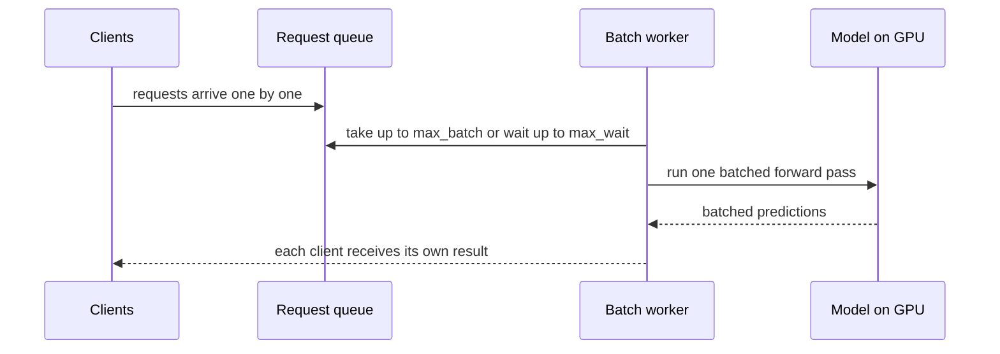

# Serving and exporting PyTorch models

> **Before this lesson:** you need checkpoints and `eval()` from [nn.Module, state_dict and checkpointing](#/lesson/deep-learning/nn-module), `inference_mode` from [Running pretrained models](#/lesson/deep-learning/pretrained-models), and `torch.compile` with graph capture from [torch.compile, input pipelines and multi-GPU basics](#/lesson/deep-learning/compile-throughput). An **HTTP API** is a program that receives requests over the network (for example "classify this image") and sends back responses; JSON is the common text format for them.

## In plain words

A trained model is only useful once other software can call it. **Serving** means running the model behind an interface, usually an HTTP endpoint, so an app or another service can send inputs and get predictions back, reliably and fast. **Exporting** means packaging the model into a form that can run without your training code, sometimes without Python at all: on a C++ server, a phone, a browser, or a specialised inference engine.

Think of a bakery. Training is developing the recipe in a test kitchen. Serving is running the shop: customers queue, orders must come out quickly, and the oven is used efficiently by baking several orders at once (**batching**). Exporting is writing the recipe down precisely enough that a franchise in another city, with different staff and equipment, bakes the same bread.

Why it matters for a job: ML engineers own the path to production. Interviewers ask how you would deploy a model with a latency budget, how dynamic batching trades latency for throughput, which export format to use (and why TorchScript is no longer the answer), and how quantisation shrinks models. These questions come up in both ML engineering and ML system design rounds.

## 1. A minimal model server

The simplest production-style server loads the model once at start-up and handles requests in a function:

```python
import io
import torch
from fastapi import FastAPI, UploadFile
from PIL import Image

app = FastAPI()
model = build_model()
model.load_state_dict(torch.load("model.pt", map_location="cpu", weights_only=True))
model.eval()                                          # inference behaviour for dropout and batch norm

@app.post("/predict")
async def predict(file: UploadFile):
    img = Image.open(io.BytesIO(await file.read())).convert("RGB")
    x = preprocess(img).unsqueeze(0)                  # identical preprocessing to training
    with torch.inference_mode():
        probs = model(x).softmax(dim=1)[0]
    top = probs.argmax().item()
    return {"label": CLASSES[top], "probability": round(probs[top].item(), 4)}
```

- Load once, not per request: loading weights takes far longer than a prediction.
- Use **exactly** the training preprocessing; a mismatch (**training-serving skew**) is the most common cause of a model that "worked offline" and fails in production.
- `model.eval()` and `torch.inference_mode()` are mandatory.
- The source book uses the Flask web framework and then an asynchronous framework to add batching; FastAPI (built on the same asynchronous ideas) is a common choice today.

## 2. What we want from deployment

- **Latency**: time from request to response, usually measured at high percentiles (p95, p99: the time within which 95% or 99% of requests finish), because tail latency is what users notice.
- **Throughput**: requests (or samples) handled per second.
- **Cost and hardware use**: GPUs are expensive and only efficient on large batches; CPUs are cheap and flexible.
- **Reliability and operations**: health checks, graceful restarts, versioned models, rollbacks, monitoring of inputs and outputs for drift (see the [MLOps track](#/lesson/mlops/mlflow-tracking)).

These pull against each other. Processing one request at a time minimises waiting but wastes the GPU; waiting to fill a big batch maximises throughput but adds queueing delay.

## 3. Dynamic request batching

A GPU processes a batch of 32 inputs in barely more time than a batch of 1. **Dynamic batching** exploits this: requests go into a queue; a worker takes up to `max_batch_size` waiting requests, but waits at most `max_wait` milliseconds for the batch to fill before running whatever it has. Under heavy traffic batches fill instantly (high throughput); under light traffic nobody waits longer than `max_wait`.



The demo simulates a single GPU worker serving a stream of random requests, comparing no batching with dynamic batching for two waiting limits.

```python-run
import numpy as np

def simulate(arrivals_ms, max_batch, max_wait_ms, cost_ms=lambda n: 8.0 + 0.5 * n):
    """One worker. A batch opens at its first request and closes when it is full or when
    max_wait has passed (or later, if the worker is still busy). Returns latencies and batch sizes."""
    lat, sizes, i, free_at, n = [], [], 0, 0.0, len(arrivals_ms)
    while i < n:
        deadline = max(arrivals_ms[i] + max_wait_ms, free_at)   # how long this batch may keep collecting
        j = i
        while j < n and j - i < max_batch and arrivals_ms[j] <= deadline:
            j += 1
        full = (j - i == max_batch)
        start = max(free_at, arrivals_ms[j - 1]) if full else deadline
        done = start + cost_ms(j - i)
        lat.extend(done - arrivals_ms[k] for k in range(i, j))
        sizes.append(j - i)
        free_at, i = done, j
    return np.array(lat), sizes

rng = np.random.default_rng(0)
arrivals = np.cumsum(rng.exponential(scale=1000 / 400, size=4000))   # about 400 requests per second
print(f"{'policy':34s} {'mean batch':>10} {'p50 ms':>8} {'p99 ms':>8}")
for name, mb, wait in [("no batching (batch size 1)", 1, 0.0),
                       ("dynamic, max 32, wait <= 2 ms", 32, 2.0),
                       ("dynamic, max 32, wait <= 10 ms", 32, 10.0)]:
    lat, sizes = simulate(arrivals, mb, wait)
    print(f"{name:34s} {np.mean(sizes):10.1f} {np.percentile(lat, 50):8.1f} {np.percentile(lat, 99):8.1f}")
```

**Reading the result**

- Each forward pass costs a fixed 8 ms plus 0.5 ms per item, a typical shape for GPU inference. Without batching the worker can complete at most about 118 requests per second, far below the 400 arriving, so the queue grows without limit and latencies explode into seconds.
- With dynamic batching, batches of several requests amortise the fixed cost, the worker keeps up, and both median and tail latencies stay at tens of milliseconds.
- A longer maximum wait builds bigger batches; whether that helps latency depends on load. Tuning `max_batch_size` and `max_wait` against real traffic is part of deploying a model. Production servers (Triton Inference Server, TorchServe-style servers, vLLM for language models with continuous batching) implement this for you.

## 4. Exporting: why and how

Training code is Python and depends on your whole repository. For production you often want a self-contained artifact that:

- runs without Python (a C++ service, a mobile app, an embedded device);
- runs on a specialised runtime (ONNX Runtime, TensorRT, a browser engine);
- is optimised ahead of time and is immune to changes in your training code.

### The current options

| route | what it produces | typical use |
|---|---|---|
| `torch.export.export` | an `ExportedProgram`: a sound, full graph of ATen operations with parameters and input shape constraints | the base format for everything below |
| AOTInductor | a compiled `.pt2` package (shared library plus weights) | low-latency server inference in C++ or Python without recompiling |
| ExecuTorch | a `.pte` program for on-device runtimes | phones, wearables, microcontrollers (replacing the older PyTorch Mobile) |
| `torch.onnx.export` | an `.onnx` model file | ONNX Runtime, TensorRT, other vendors' engines, cross-framework interoperability |
| TorchScript (`torch.jit.trace` / `script`) | a `.pt` scripted module | legacy: **deprecated** in favour of `torch.export`; still found in older systems |

```python
import torch
from torch.export import export, Dim

model.eval()
example = (torch.randn(1, 3, 224, 224),)
batch = Dim("batch", min=1, max=64)                           # declare the batch dimension as dynamic
ep = export(model, example, dynamic_shapes=({0: batch},))      # full-graph capture; errors on unsupported code
torch.export.save(ep, "model.pt2")                              # serialise the ExportedProgram

pkg = torch._inductor.aoti_compile_and_package(ep, package_path="model_aoti.pt2")   # ahead-of-time compile
runner = torch._inductor.aoti_load_package(pkg)                 # load and call like a function
print(runner(torch.randn(8, 3, 224, 224)).shape)

torch.onnx.export(model, example, "model.onnx", input_names=["image"],
                  dynamic_shapes=({0: batch},), dynamo=True)   # dynamo=True is the default in recent versions
```

- `torch.export` captures the **whole** forward as one graph (no graph breaks are allowed, unlike `torch.compile`) and records guards about shapes, so it is **sound**: it either captures the program faithfully for all inputs within the declared constraints or reports an error. Data-dependent Python control flow must be rewritten with explicit control-flow operators (such as `torch.cond`) or removed.
- By default, exported shapes are fixed to those of the example inputs; declare dynamic dimensions with `Dim`.
- The ONNX exporter now builds on `torch.export` (`dynamo=True`), and older options such as `dynamic_axes` are being replaced by `dynamic_shapes`.
- After exporting, **verify**: run the exported model and the original on the same inputs and compare outputs within a tolerance, including inputs with different batch sizes.

### Why TorchScript lost its place

The source book (written before PyTorch 2) exports with TorchScript: **tracing** runs the model once on example input and records the operations executed; **scripting** compiles a subset of Python. Tracing silently bakes in whatever path the example took through `if` statements and loops, and treats Python numbers computed from shapes as constants. Scripting supports only a restricted Python dialect, which made complex models painful to convert. PyTorch's documentation now marks TorchScript as deprecated and points users to `torch.export`. The demo shows tracing's classic pitfall with a toy recorder.

```python-run
def model_forward(x, ops):
    """A 'model' with data-dependent control flow. `ops` records what was executed, like a tracer."""
    ops.append("mean")
    if sum(x) / len(x) > 0:            # Python branch on the data
        ops.append("double")
        return [v * 2 for v in x]
    ops.append("negate")
    return [-v for v in x]

def trace(fn, example):
    tape = []
    fn(example, tape)                   # run once and record the executed operations
    def replay(x):
        out = list(x)
        for op in tape[1:]:
            out = [v * 2 for v in out] if op == "double" else [-v for v in out]
        return out
    return replay, tape

traced, tape = trace(model_forward, [1.0, 2.0])
print("recorded ops:", tape)
for x in ([3.0, 4.0], [-3.0, -4.0]):
    print(f"input {x}: real model -> {model_forward(x, [])}, traced -> {traced(x)}")
```

The trace recorded only the branch taken for the positive example, so for a negative input the traced version still doubles instead of negating: a wrong answer with no warning. `torch.export` instead raises an error at the data-dependent branch, forcing you to make the control flow explicit.

## 5. Making models smaller and faster

- **Quantisation** stores weights (and sometimes activations) as 8-bit or even 4-bit integers instead of 32-bit floats: four to eight times less memory and faster integer arithmetic on supporting hardware, usually with a small accuracy loss. **Dynamic quantisation** (weights quantised ahead of time, activations on the fly) is the easiest start for linear-heavy models such as transformers on CPU; **static quantisation** and **quantisation-aware training** go further. PyTorch's modern quantisation tooling lives in the `torchao` library; large language models commonly use 8-bit and 4-bit weight formats.
- **Pruning** removes weights or whole channels with little effect on accuracy.
- **Knowledge distillation** trains a small "student" model to imitate a large "teacher".
- **Efficient architectures** (depthwise separable convolutions, smaller widths) and lower-precision inference (bfloat16 or float16) on GPUs.

```python-run
import numpy as np

rng = np.random.default_rng(0)
W = rng.normal(0, 0.05, size=(512, 512)).astype(np.float32)     # a linear layer's weights
x = rng.normal(size=(64, 512)).astype(np.float32)

scale = np.abs(W).max() / 127.0                                  # symmetric per-tensor int8 quantisation
W_q = np.clip(np.round(W / scale), -127, 127).astype(np.int8)
W_dq = W_q.astype(np.float32) * scale                            # dequantise for comparison

y_ref, y_q = x @ W.T, x @ W_dq.T
rel_err = np.linalg.norm(y_q - y_ref) / np.linalg.norm(y_ref)
print(f"weight storage: float32 {W.nbytes / 1024:.0f} KB -> int8 {W_q.nbytes / 1024:.0f} KB (+ one scale)")
print(f"relative error of the layer output: {rel_err:.4f}")

rows = np.abs(W).max(axis=1, keepdims=True) / 127.0             # per-output-channel scales
W_dq_rows = np.clip(np.round(W / rows), -127, 127) * rows
print(f"with per-channel scales:            {np.linalg.norm(x @ W_dq_rows.T - y_ref) / np.linalg.norm(y_ref):.4f}")
```

Storing the weights as 8-bit integers plus a single scale factor cuts memory by four, with a relative output error of about 1%. Giving each output channel its own scale (per-channel quantisation, the usual default for weights) reduces the error further, because one unusually large weight no longer forces a coarse scale on every other row.

## 6. Serving infrastructure today

- **General model servers**: NVIDIA **Triton Inference Server** (multi-framework, dynamic batching, ONNX, TensorRT and PyTorch backends), **KServe** on Kubernetes, managed services such as Amazon SageMaker and Google Vertex AI. TorchServe, PyTorch's former official server, is no longer actively maintained, so new projects generally choose one of these or a lightweight custom FastAPI service.
- **Large language models**: dedicated engines such as vLLM, SGLang and TensorRT-LLM with continuous batching and paged attention caches ([LLM Practice serving](#/lesson/llm-practice/datasets-trainer-serving)).
- **Edge and mobile**: ExecuTorch, ONNX Runtime Mobile, Core ML, LiteRT (formerly TensorFlow Lite).
- **Operations**: package the model with its preprocessing and version, expose health and metrics endpoints, roll out with canaries or shadow traffic, monitor input distributions and prediction rates, and keep the previous version ready for rollback.

> [!INTERVIEW]
> **"Deploy an image classifier with a p99 latency budget of 50 ms at 500 requests per second. How?"** Export the model (`torch.export`, then AOTInductor or ONNX to TensorRT), run it on a GPU server with dynamic batching (tune maximum batch size and wait so batching plus compute stays well under 50 ms at p99), use bf16 or int8 if accuracy allows, keep preprocessing identical to training (ideally in the same package), load-test with realistic traffic, scale horizontally behind a load balancer with autoscaling on queue depth, and monitor latency percentiles, error rates and input drift. Mention that TorchScript is deprecated, so new exports use `torch.export`.

## Summary

- Serve by loading the model once, using `eval()` and `inference_mode()`, and replicating training preprocessing exactly.
- Deployment balances latency (especially p99), throughput, cost and reliability.
- Dynamic batching gathers requests up to a maximum batch size or waiting time, amortising per-batch overhead.
- `torch.export` produces a sound full-graph `ExportedProgram` with optional dynamic dimensions; AOTInductor compiles it for servers, ExecuTorch for devices, and `torch.onnx.export(dynamo=True)` converts it to ONNX.
- TorchScript tracing silently freezes control flow and TorchScript is deprecated; verify any export against the original model.
- Quantisation, pruning, distillation and efficient architectures shrink models; Triton, KServe, managed platforms and LLM engines serve them.

## Glossary

- **Serving**: running a model behind an interface that answers prediction requests.
- **HTTP API / endpoint**: a network interface receiving requests / one URL path of it.
- **Training-serving skew**: differences between training and production preprocessing or data.
- **Latency / p99**: time per request / the time within which 99% of requests finish.
- **Throughput**: requests handled per second.
- **Dynamic batching**: grouping queued requests up to a size or time limit.
- **Exporting**: packaging a model to run without its training code.
- **torch.export / ExportedProgram**: PyTorch 2's sound full-graph capture / its output.
- **Dynamic shape (Dim)**: a dimension declared as variable in an export.
- **AOTInductor**: ahead-of-time compilation of an ExportedProgram into a deployable package.
- **ExecuTorch**: PyTorch's on-device inference runtime.
- **ONNX / ONNX Runtime**: an open model format / an engine that executes it.
- **TorchScript (tracing / scripting)**: the deprecated older export path.
- **Quantisation (dynamic, static, per-channel)**: storing numbers in low-bit integers with scale factors.
- **Knowledge distillation**: training a small model to imitate a larger one.
- **Triton Inference Server / KServe**: general-purpose model-serving systems.

## Check yourself

```quiz
[
  {"q": "Why does dynamic batching raise throughput on a GPU?", "options": ["A batch of many inputs costs little more time than one, amortising fixed per-call overhead", "It reduces the model's parameter count", "It skips preprocessing", "It lowers numerical precision"], "answer": 0,
   "explain": "The fixed cost per forward pass is shared across the batch."},
  {"q": "What is the main risk of torch.jit.trace on a model with an if statement that depends on input values?", "options": ["Only the branch taken by the example input is recorded, silently giving wrong results for other inputs", "It raises an error immediately", "It doubles the model size", "It disables the GPU"], "answer": 0,
   "explain": "Tracing records executed operations, not the Python control flow."},
  {"q": "What does PyTorch's documentation now recommend instead of TorchScript?", "options": ["torch.export", "torch.jit.script", "pickle", "nn.DataParallel"], "answer": 0,
   "explain": "TorchScript is marked deprecated; torch.export underpins AOTInductor, ExecuTorch and the ONNX exporter."},
  {"q": "By default, what input shapes does an ExportedProgram accept?", "options": ["Those of the example inputs, unless dimensions are declared dynamic with Dim", "Any shape", "Only batch size 1", "Only square images"], "answer": 0,
   "explain": "Use dynamic_shapes to allow a variable batch size or sequence length."},
  {"q": "Which runtime targets phones and edge devices for exported PyTorch models?", "options": ["ExecuTorch", "TorchServe", "TensorBoard", "DistributedDataParallel"], "answer": 0,
   "explain": "ExecuTorch replaces the older PyTorch Mobile lite interpreter."},
  {"q": "Roughly how much smaller are int8 weights than float32 weights?", "options": ["4 times", "2 times", "8 times", "32 times"], "answer": 0,
   "explain": "1 byte instead of 4, plus small scale factors."},
  {"q": "A model performs well offline but poorly in production with no errors. What do you check first?", "options": ["Training-serving skew in preprocessing, and that model.eval() is used", "The learning rate", "The number of training epochs", "The optimizer type"], "answer": 0,
   "explain": "Mismatched resize, normalisation or channel order, or training-mode layers, change predictions silently."},
  {"q": "Why report p99 latency rather than only the average?", "options": ["Tail latency is what the slowest users experience and averages hide it", "Averages cannot be computed", "p99 is always lower", "It measures throughput"], "answer": 0,
   "explain": "A small fraction of very slow requests can dominate user experience."}
]
```

> **Source:** Stevens, Antiga & Viehmann, *Deep Learning with PyTorch*, ch. 15 (serving behind a Flask server, what we want from deployment, request batching, exporting models, ONNX, tracing, TorchScript and scripting, LibTorch, going mobile, improving efficiency with quantisation, enterprise serving); PyTorch documentation (docs.pytorch.org): `torch.export`, AOTInductor, `torch.onnx.export` (dynamo exporter), and the TorchScript deprecation notice; ExecuTorch documentation.
