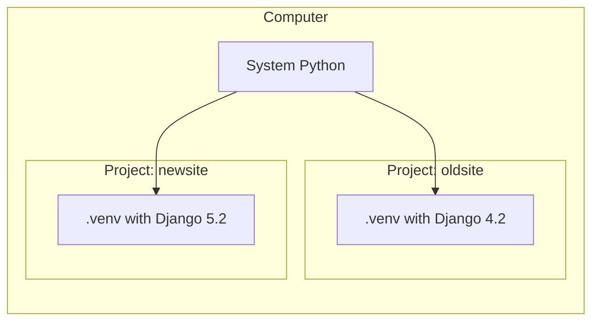
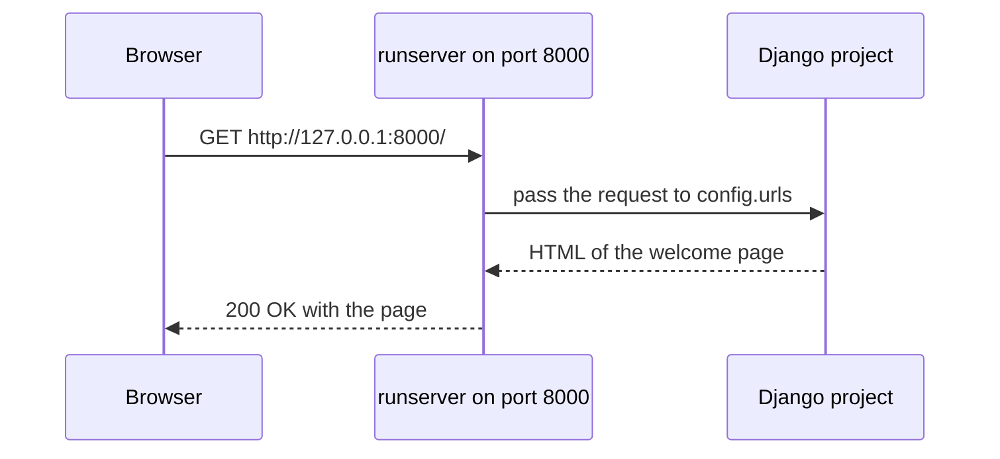

# Python, virtual environments and installing Django

> **Before this lesson:** you should be able to write and run a small Python script (variables, functions, `import`). If that is new, start with the [Python track](#/lesson/python/py-start-first-steps). No web knowledge is assumed.

## In plain words

A **website** is a program that waits for someone's browser to ask for a page and then sends the page back. Writing that program from nothing means solving the same chores every site has: reading the address the visitor typed, talking to a database, checking passwords, building HTML, protecting forms from attackers.

A **web framework** is a ready-made collection of code that already solves those chores, so you only write the parts that make your site different. **Django** (pronounced "JANG-oh") is the most widely used web framework for the Python language.

An everyday picture: building a house from raw timber versus buying a house kit. The kit arrives with walls cut to size, wiring plans and a manual. You still decide the rooms and the paint, but you do not reinvent the staircase. Django is the kit. Its slogan is "batteries included": user accounts, an administration site, database access and security defences come in the box.

Why it matters for a job: Django runs large products (Instagram and Pinterest began on it, and many company back-offices run on it today), "Python/Django developer" is a common job title, and interviewers expect you to set up a project from an empty folder without hesitation. This lesson gets you from an empty folder to a running site.

## What you will install

Three things, in layers:

| Layer | What it is | Why you need it |
|---|---|---|
| **Python** | The programming language and the program (`python`) that runs your code | Django is written in Python |
| **A virtual environment** | A private folder holding the packages for *one* project | Keeps projects from breaking each other |
| **Django** | A Python package you download with `pip` | The framework itself |

A **package** is code someone else wrote and published so that others can install it. **pip** is Python's package installer; it downloads packages from the **Python Package Index (PyPI)**, the public warehouse of Python packages.

### Which versions?

Django publishes a new feature release roughly every eight months. Version numbers look like `5.2`: the first number is the major series and the second is the feature release. Every third release ending in `.2` is a **long-term support (LTS)** release, meaning it receives security fixes for about three years. Django 5.2 is an LTS release (April 2025); Django 6.0 followed in December 2025.

This track is written for **Django 5.x**, and every example also runs on 6.x unless a note says otherwise. Django 5.2 needs Python 3.10 or newer; Django 6.0 needs Python 3.12 or newer. Install the newest Python 3 you can and you are covered.

> [!NOTE]
> The book this track follows was written for Django 2.1 and Python 3.7, and used a tool called Pipenv. The ideas are unchanged, but the day-to-day tooling moved on: the built-in `venv` module (or the newer `uv` tool) is now the usual choice, and several settings changed names. Each lesson points out such differences in a "What changed" note.

## Step 1: the command line

You will type commands into a **terminal** (also called a command line or shell): a text window where you type a program's name and press Enter to run it. On Windows open **PowerShell**; on macOS open **Terminal**; on Linux open your terminal application.

Four commands are enough for now:

```bash
pwd            # print working directory: which folder am I in?
ls             # list the files in this folder
cd projects    # change directory: move into the folder "projects"
mkdir tidewatch   # make a new folder called "tidewatch"
```

The `#` and everything after it is a comment for you; do not type it. The folder you are "in" is called the **working directory**, and commands act on it unless told otherwise.

## Step 2: install Python and check it

Download Python from python.org (on Windows, tick **"Add python.exe to PATH"** in the installer; PATH is the list of folders the terminal searches for programs). Then check:

```bash
python --version
```

Expected output is something like `Python 3.13.1`. On macOS and Linux the command may be `python3` instead of `python`. If the terminal says the command is not found, Python is not on your PATH: reinstall with the box ticked, or use the `py` launcher on Windows (`py --version`).

## Step 3: why a virtual environment?

Suppose you maintain two sites. The older one was built with Django 4.2; the new one uses Django 5.2. Python can only have **one** version of a package installed in a given place. If both projects shared one place, upgrading Django for the new site would silently break the old one.

A **virtual environment** (often shortened to **venv**) solves this. It is a folder that contains its own copy of the `python` command and its own `site-packages` directory, the place where installed packages live. Each project gets its own venv, so each project gets its own Django.

The everyday analogy: a shared kitchen where everyone uses the same spice rack leads to arguments; giving each cook a labelled box of ingredients ends them. A venv is the labelled box.



The model below shows the mechanism with plain dictionaries. Run it, then change the version numbers.

```python-run
# A toy model of "where does `import django` come from?"
system_packages = {"pip": "24.3"}                      # installed for the whole computer

environments = {
    "oldsite/.venv": {"django": "4.2.16", "pip": "24.3"},
    "newsite/.venv": {"django": "5.2.1", "pip": "24.3"},
}

def which_django(active_env):
    """Return the Django version Python would import, or None."""
    packages = environments[active_env] if active_env else system_packages
    return packages.get("django")

print("no venv active :", which_django(None))
print("oldsite active :", which_django("oldsite/.venv"))
print("newsite active :", which_django("newsite/.venv"))

# Upgrading inside one environment does not touch the other:
environments["newsite/.venv"]["django"] = "6.0"
print("after upgrade  :", which_django("oldsite/.venv"), "and", which_django("newsite/.venv"))
```

The first line of output is `None`: with no environment active, Django is not installed at all, which is exactly what you want. "Activating" an environment, which you will do next, is nothing more than telling the terminal which box of packages to use.

## Step 4: create and activate the environment

Make a folder for the project and move into it:

```bash
mkdir tidewatch
cd tidewatch
```

Create the environment. `-m venv` means "run the module named `venv`"; `.venv` is the name of the folder to create (the leading dot hides it in most file listings, and it is the conventional name):

```bash
python -m venv .venv
```

Activate it. This step differs by operating system:

```bash
# Windows PowerShell
.venv\Scripts\Activate.ps1

# macOS and Linux
source .venv/bin/activate
```

Your prompt now starts with `(.venv)`. From this moment `python` and `pip` mean the copies inside `.venv`. To leave the environment type `deactivate`; to come back, run the activate line again. You must activate once per terminal window.

> [!WARNING]
> PowerShell may refuse with "running scripts is disabled on this system". Run `Set-ExecutionPolicy -Scope CurrentUser RemoteSigned` once, answer Y, and try again. This allows scripts you created locally to run.

> [!TIP]
> Not sure whether the environment is active? Ask Python where it lives: `python -c "import sys; print(sys.prefix)"`. If the path ends in `.venv`, you are inside it.

## Step 5: install Django

```bash
python -m pip install "django~=5.2.0"
```

Line by line:

- `python -m pip` runs pip *through the active Python*, which guarantees the package lands in this environment. Typing bare `pip` usually works too, but this form never installs into the wrong place.
- `install` is the pip sub-command.
- `"django~=5.2.0"` is a **version specifier**. `~=` means "compatible release": any `5.2.x` is fine (bug and security fixes), but not `5.3` or `6.0`. Pinning the feature release protects you from surprise upgrades.

pip prints what it downloaded. Django brings two small helper packages with it: `asgiref` and `sqlparse` (plus `tzdata` on Windows). Packages that another package needs are called its **dependencies**.

Check the result:

```bash
python -m django --version
```

Output such as `5.2.1` confirms that Django is installed in this environment.

## Step 6: create a project and run it

Django ships a command-line tool named `django-admin`. Its `startproject` command writes the starting files of a site:

```bash
django-admin startproject config .
```

- `config` is the name of the Python package that will hold the site-wide settings. Many teams call it `config` or `core` so that it is obvious what it contains; you may pick another name, as long as it is a valid Python identifier and not the name of an existing module such as `test` or `django`.
- The final `.` means "create it **here**, in the current folder". Without the dot Django creates an extra wrapper folder, which gives the confusing layout `config/config/`.

Your folder now looks like this:

```
tidewatch/
├── .venv/              the virtual environment (never edit by hand)
├── manage.py           command runner for this project
└── config/
    ├── __init__.py     marks the folder as a Python package (empty)
    ├── settings.py     all configuration
    ├── urls.py         the table of web addresses
    ├── asgi.py         entry point for asynchronous servers
    └── wsgi.py         entry point for classic servers
```

The next lesson pair explains each file. For now, start the development server:

```bash
python manage.py runserver
```

`manage.py` is a thin wrapper around `django-admin` that already knows which settings file belongs to this project. `runserver` starts a small web server on your own machine. The output ends with:

```
Starting development server at http://127.0.0.1:8000/
Quit the server with CTRL-BREAK.
```

`127.0.0.1` is the address that always means "this computer" (also written `localhost`), and `8000` is the **port**, a number that lets several network programs share one machine. Open `http://127.0.0.1:8000/` in a browser and you will see Django's welcome page with a rocket. Press Ctrl+C in the terminal to stop the server.

You will also see a warning about "18 unapplied migration(s)". It is harmless today. A **migration** is a file describing a change to the database structure; Django's built-in features come with some, and the module on models explains them. To silence the warning now, run `python manage.py migrate` once; it creates a file `db.sqlite3`, a complete small database stored in a single file.



## Step 7: record what you installed

Another developer, or the server that will host your site, needs to install the same packages. Write them to a file:

```bash
python -m pip freeze > requirements.txt
```

`pip freeze` prints every installed package with its exact version; `>` redirects that text into a file. The file contains lines such as:

```
asgiref==3.8.1
Django==5.2.1
sqlparse==0.5.3
```

Anyone can then recreate the environment with `python -m pip install -r requirements.txt`. Regenerate the file each time you install or upgrade a package.

### A faster alternative: uv

Many teams now use **uv**, a single fast tool that replaces `venv`, `pip` and `pip freeze`. The equivalent of everything above is:

```bash
uv init tidewatch        # creates the folder and a pyproject.toml file
cd tidewatch
uv add "django~=5.2.0"   # creates .venv, installs Django, records it in pyproject.toml and uv.lock
uv run django-admin startproject config .
uv run python manage.py runserver
```

`uv run` executes a command inside the project's environment without a separate activation step. Both routes produce the same kind of environment; this track shows the built-in `venv` commands because they work everywhere with no extra install, and understanding them makes every other tool easy.

## Pitfalls

- **Forgetting to activate.** `ModuleNotFoundError: No module named 'django'` almost always means the venv is not active in this terminal window. Look for `(.venv)` in the prompt.
- **Installing before activating.** The package goes into the system Python, and the project's environment still lacks it.
- **Omitting the dot in `startproject`.** You get a nested folder and `manage.py` one level deeper than expected. Delete the folder and rerun with the dot.
- **Naming the project `django` or `test`.** Your package would hide the real module of that name and imports fail in confusing ways.
- **Port already in use.** If another program holds port 8000, run `python manage.py runserver 8001`.
- **Using `runserver` on a real server.** It is built for development only: it is slow, handles little traffic and has had no security review. The deployment module shows the production replacements.
- **Committing `.venv` to version control.** The folder is large and specific to your machine. The next lesson shows how to exclude it.

## Cheat sheet

| Task | Command |
|---|---|
| Create an environment | `python -m venv .venv` |
| Activate (Windows / macOS, Linux) | `.venv\Scripts\Activate.ps1` / `source .venv/bin/activate` |
| Leave the environment | `deactivate` |
| Install Django 5.2.x | `python -m pip install "django~=5.2.0"` |
| Show the Django version | `python -m django --version` |
| Start a project in the current folder | `django-admin startproject config .` |
| Run the development server | `python manage.py runserver` |
| Use another port | `python manage.py runserver 8001` |
| Create the built-in database tables | `python manage.py migrate` |
| Save the package list | `python -m pip freeze > requirements.txt` |
| Install from the list | `python -m pip install -r requirements.txt` |

> [!INTERVIEW]
> **"Why do Python projects use virtual environments?"** A strong answer names the problem and the mechanism: different projects need different versions of the same package, but one Python installation can hold only one version; a virtual environment gives each project its own `site-packages` directory and its own `python` executable, so installs are isolated and reproducible from a requirements or lock file. Mention that it also keeps the system Python clean, which matters on Linux where operating-system tools depend on it.

## Summary

- Django is a "batteries included" web framework for Python; this track targets Django 5.x (5.2 is the long-term support release).
- A virtual environment is a per-project folder with its own Python and packages; create it with `python -m venv .venv` and activate it in every new terminal.
- Install with `python -m pip install "django~=5.2.0"`, start a project with `django-admin startproject config .`, and run it with `python manage.py runserver`.
- Record dependencies in `requirements.txt` (or let `uv` manage a lock file) so the environment can be rebuilt anywhere.

## Glossary

- **Web framework**: a library of ready-made code for the common tasks of building a website.
- **Package**: published, installable code; Django is one.
- **pip**: Python's package installer. **PyPI**: the index it downloads from.
- **Virtual environment (venv)**: an isolated folder of Python packages for one project.
- **Activate**: point the current terminal at a virtual environment.
- **Dependency**: a package that another package needs in order to work.
- **LTS (long-term support)**: a release that receives security fixes for an extended period.
- **Development server**: the small server started by `runserver`, for local use only.
- **localhost / 127.0.0.1**: the network name and address of your own computer.
- **Port**: a number identifying one network program on a machine (Django's default is 8000).
- **Migration**: a file describing a change to the database structure.

```quiz
[
  {"q": "What problem does a virtual environment solve?",
   "options": ["It makes Python code run faster", "It lets each project have its own versions of packages", "It hides your source code from other users", "It replaces the need for pip"],
   "answer": 1,
   "explain": "One Python installation can hold only one version of a package. A venv gives each project a private site-packages folder so versions never collide."},
  {"q": "You open a new terminal, run `python manage.py runserver` and get `ModuleNotFoundError: No module named 'django'`. What is the most likely cause?",
   "options": ["Django is broken and must be reinstalled", "The virtual environment is not activated in this terminal", "Port 8000 is in use", "manage.py is missing"],
   "answer": 1,
   "explain": "Activation is per terminal window. Without it, `python` is the system Python, which has no Django installed."},
  {"q": "What does the dot at the end of `django-admin startproject config .` do?",
   "options": ["Ends the command like a sentence", "Creates the project in the current folder instead of a new nested folder", "Selects the newest Django version", "Hides the config folder"],
   "answer": 1,
   "explain": "The second argument is the destination directory. A dot means here; without it Django creates an extra wrapper directory."},
  {"q": "Which version does the specifier `django~=5.2.0` allow?",
   "options": ["Only exactly 5.2.0", "Any 5.2.x release such as 5.2.7, but not 5.3 or 6.0", "Any version from 5.2.0 upwards, including 6.0", "Any 5.x release"],
   "answer": 1,
   "explain": "The compatible-release operator fixes all but the last component, so you get patch releases with bug and security fixes but no feature-release jumps."},
  {"q": "Why should `runserver` never be used to host a public site?",
   "options": ["It only works on Windows", "It is a development tool that is not built or reviewed for performance and security", "It cannot serve HTML", "It requires a paid licence"],
   "answer": 1,
   "explain": "Django's documentation is explicit that the development server is for local use. Production uses servers such as Gunicorn or Uvicorn."},
  {"q": "What is the purpose of `requirements.txt`?",
   "options": ["It stores the site's settings", "It lists installed packages and versions so the environment can be recreated elsewhere", "It contains the database", "It is required by Python to import Django"],
   "answer": 1,
   "explain": "`pip freeze` writes exact versions into it and `pip install -r requirements.txt` rebuilds the same environment on another machine."},
  {"q": "What does LTS mean for Django 5.2?",
   "options": ["It is a beta release", "It receives security fixes for an extended period, about three years", "It only supports small sites", "It cannot be upgraded"],
   "answer": 1,
   "explain": "Releases ending in .2 are long-term support releases. Teams that want fewer upgrades standardise on them."}
]
```

> **Source:** Vincent, *Django for Beginners*, ch. 1 (Initial Set Up), rewritten for current tooling. Docs: https://docs.djangoproject.com/en/5.2/intro/install/ · https://docs.djangoproject.com/en/5.2/faq/install/ · https://docs.python.org/3/library/venv.html · https://docs.astral.sh/uv/
