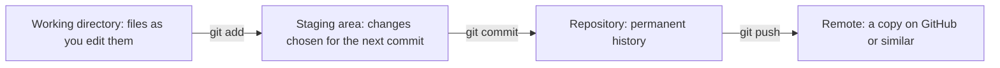

# Git, requirements and a tidy project folder

> **Before this lesson:** you have a folder `tidewatch` with a virtual environment and a fresh Django project from [Python, virtual environments and installing Django](#/lesson/django/setup-python-venv). The full story of Git lives in the [Git track](#/lesson/git/version-control-ideas); this lesson teaches the small part every Django project needs on day one.

## In plain words

**Version control** is a system that remembers every saved state of your project, so you can look at old versions, undo mistakes and work with other people without overwriting each other's files. **Git** is the version-control program nearly every software team uses.

Picture writing a long report. Without version control you end up with `report_final.docx`, `report_final2.docx`, `report_REALLY_final.docx`. With version control there is one `report` and a labelled history: "added introduction", "fixed the budget table", each entry restorable with one command. A saved entry in that history is called a **commit**.

Why it matters for a job: no professional team deploys code that is not in Git. Hosting platforms pull your site straight from a Git repository, code review happens on Git branches, and "walk me through how you would start a project" in an interview is expected to include `git init` and a `.gitignore` file within the first minute.

## The three places your files live

Git thinks of your work as moving through three areas:



- The **working directory** is the project folder on disk.
- The **staging area** (also called the index) is a waiting room: you choose which changes go into the next commit.
- The **repository** is the hidden `.git` folder in which Git stores the history.
- A **remote** is another copy of the repository on a server, used for backup and collaboration.

The two-step "add, then commit" rhythm confuses newcomers. The reason for it: you often change five files but want to record them as two separate, meaningful commits. Staging lets you pick.

## Step 1: install and introduce yourself

Install Git from git-scm.com (macOS: `xcode-select --install` or Homebrew; Linux: your package manager). Check it:

```bash
git --version
```

Tell Git who you are. This is stored once per computer and stamped onto every commit:

```bash
git config --global user.name "Imani Okafor"
git config --global user.email "imani@example.com"
git config --global init.defaultBranch main
```

The third line makes new repositories start on a branch called `main`. A **branch** is a named line of history; `main` is the conventional name of the primary one.

## Step 2: decide what Git must never see

Before the first commit, list the files that do not belong in history. Create a text file called `.gitignore` in the project root (the folder containing `manage.py`):

```
# .gitignore
.venv/
__pycache__/
*.pyc
db.sqlite3
.env
staticfiles/
media/
.idea/
.vscode/
```

Each line is a pattern; matching files are invisible to Git. Line by line:

| Pattern | What it is | Why it is ignored |
|---|---|---|
| `.venv/` | the virtual environment | huge, machine-specific, rebuilt from `requirements.txt` |
| `__pycache__/`, `*.pyc` | compiled Python caches | generated automatically |
| `db.sqlite3` | the local development database | contains your test data, changes on every run |
| `.env` | a file of secrets and local settings (introduced in the deployment lessons) | passwords and keys must never be published |
| `staticfiles/` | collected CSS and JavaScript for production | generated by a command |
| `media/` | files uploaded by users | data, not code |
| `.idea/`, `.vscode/` | editor settings | personal preference |

> [!WARNING]
> A secret that reaches a public repository must be treated as stolen, even if you delete it in the next commit: history keeps the old version, and automated scanners harvest public repositories within minutes. The only fix is to **rotate** it (generate a new one and disable the old). Ignore the files first, commit second.

## Step 3: the first commit

Inside `tidewatch`:

```bash
git init
git status
```

`git init` creates the `.git` folder. `git status` is the command you will run most; it reports which files are untracked (new to Git), modified or staged. Its output now lists `.gitignore`, `manage.py`, `config/` and `requirements.txt` as untracked, and does **not** list `.venv/` or `db.sqlite3`. That is your proof the ignore file works.

```bash
git add .
git status
git commit -m "Start Django project with settings package"
```

- `git add .` stages everything in the current folder (respecting `.gitignore`).
- The second `git status` shows the files in green under "Changes to be committed": read that list every time; it is the last check before history is written.
- `git commit -m "..."` records the snapshot with a message. Write messages in the imperative mood that finish the sentence "This commit will ...": "Add tide table model", not "stuff" or "changes".

Look at the history:

```bash
git log --oneline
```

```
3f9c2ab Start Django project with settings package
```

The seven characters are the start of the commit's **hash**, an identifier computed from the content.

## How a commit works inside

A commit is a snapshot of all tracked files plus a pointer to the commit before it. The identifier is a hash of that content, so changing anything in history changes every later identifier. The toy model below builds such a chain. Run it, then change one file's text and watch the identifiers change.

```python-run
import hashlib, json

def make_commit(files, message, parent):
    """Return (commit_id, commit) where the id is derived from the content."""
    commit = {"files": files, "message": message, "parent": parent}
    text = json.dumps(commit, sort_keys=True)          # stable text form
    commit_id = hashlib.sha1(text.encode()).hexdigest()[:7]
    return commit_id, commit

history = {}

c1, body = make_commit({"manage.py": "v1", "config/settings.py": "DEBUG = True"}, "Start project", None)
history[c1] = body
c2, body = make_commit({"manage.py": "v1", "config/settings.py": "DEBUG = True", "tides/views.py": "def home..."},
                       "Add tides app", c1)
history[c2] = body

def log(commit_id):
    while commit_id:                                    # follow the parent pointers backwards
        commit = history[commit_id]
        print(commit_id, commit["message"], "| files:", len(commit["files"]))
        commit_id = commit["parent"]

log(c2)
```

The output lists the newest commit first and walks backwards through `parent`, which is what `git log` does. Two things to notice: every commit knows the complete set of files, so any version can be restored on its own; and because the parent's identifier is part of the hashed content, history cannot be edited quietly.

## Step 4: the daily loop

From now on every piece of work follows the same loop:

```bash
git status                 # what changed?
git diff                   # show the exact lines that changed
git add config/settings.py # stage one file (or `git add .` for all)
git commit -m "Allow the staging host"
```

`git diff` prints removed lines with `-` and added lines with `+`. Reading your own diff before committing catches leftover debugging lines and accidental edits.

Undoing, the three cases you will meet first:

```bash
git restore config/settings.py           # throw away uncommitted edits to a file
git restore --staged config/settings.py  # unstage, but keep the edits
git commit --amend -m "Better message"   # fix the message of the latest commit (before pushing)
```

## Step 5: publish to a remote

Create an empty repository on GitHub (or GitLab, Bitbucket, Codeberg) **without** a README, licence or ignore file, since you already have content. Then connect and upload:

```bash
git remote add origin git@github.com:imani/tidewatch.git
git push -u origin main
```

- `remote add origin <url>` names the server copy `origin` (a convention).
- `push` uploads commits. `-u origin main` remembers the pairing, so later a bare `git push` is enough.

The `git@github.com:` address uses **SSH**, a protocol that proves who you are with a key pair instead of a password; the hosting site's settings page explains how to add your public key. The alternative is an `https://` address with a personal access token.

Hosting platforms that run Django (covered in the deployment module) deploy by watching this remote: every push to `main` can trigger a new release.

## A tidy project folder

After this lesson the root of the project should contain:

```
tidewatch/
├── .git/               history (managed by Git)
├── .gitignore          what Git must not track
├── .venv/              virtual environment (ignored)
├── README.md           what the project is and how to run it
├── requirements.txt    exact package versions
├── manage.py
├── db.sqlite3          local database (ignored)
└── config/
```

Two files deserve a word.

**README.md** is the first thing a colleague or reviewer reads. A useful one for a Django project is short:

```
# Tidewatch

Shows tide times for small harbours.

## Run it locally
1. python -m venv .venv and activate it
2. python -m pip install -r requirements.txt
3. python manage.py migrate
4. python manage.py runserver
```

**requirements.txt** must be regenerated and committed whenever you install or upgrade a package: `python -m pip freeze > requirements.txt`, then `git add requirements.txt`. A project whose requirements file lags behind its code works on your machine and fails everywhere else.

Larger projects often split requirements into `requirements.txt` (needed in production) and `requirements-dev.txt` (testing and formatting tools, beginning with the line `-r requirements.txt` to include the first file). Projects managed with `uv` or Poetry keep the same information in `pyproject.toml` plus a lock file, and commit both.

> [!TIP]
> Commit small and often. A good rhythm for learning projects is one commit per working step: "Add tides app", "Add home view and URL", "Add test for home page". When something breaks, `git diff` against the last commit shows a handful of lines instead of an afternoon's work.

## Branches in one paragraph

So far all commits sit on `main`. Teams rarely commit there directly. To build a feature you create a branch, commit on it, push it and open a **pull request** (a request to merge your branch, with a page for review comments):

```bash
git switch -c add-harbour-list   # create and move to a new branch
# ... edit, add, commit ...
git push -u origin add-harbour-list
```

After review the branch is merged into `main` and deleted. This matters for Django in one special way: two branches that each change the database structure create migration files that must later be reconciled. The lesson [Transactions, indexes, migrations in teams and raw SQL](#/lesson/django/orm-transactions-migrations) covers that situation.

## What changed since the book

The source book hosts code on Bitbucket and deploys by pushing to Heroku's Git remote. Any Git host works identically for this track. `git init` now honours `init.defaultBranch` (older Git always created `master`), and `git switch`/`git restore` (Git 2.23, 2019) replaced the overloaded `git checkout` for everyday use. Heroku ended its free tier in 2022, so the deployment lessons use the common modern pattern of a platform that builds from your repository.

## Pitfalls

- **Committing first, ignoring later.** Adding a pattern to `.gitignore` does not remove files already tracked. Use `git rm --cached db.sqlite3` to stop tracking a file while keeping it on disk.
- **`git add .` without reading `git status`.** This is how databases, keys and 200 MB of virtual environment enter history.
- **One giant commit per day.** Small commits are easier to review, revert and explain.
- **Forgetting `requirements.txt`.** A missing or stale file is the most common reason a first deployment fails.
- **Pushing secrets.** Rotate them immediately; rewriting history is not enough.
- **Working on `main` in a team.** Create a branch per change, even when working alone, to practise the workflow.

## Cheat sheet

| Task | Command |
|---|---|
| Start a repository | `git init` |
| See what changed | `git status`, `git diff` |
| Stage files | `git add <file>` or `git add .` |
| Record a snapshot | `git commit -m "message"` |
| Show history | `git log --oneline` |
| Discard edits to a file | `git restore <file>` |
| Unstage a file | `git restore --staged <file>` |
| Stop tracking but keep the file | `git rm --cached <file>` |
| Connect a remote | `git remote add origin <url>` |
| Upload | `git push -u origin main` (afterwards `git push`) |
| Download teammates' work | `git pull` |
| New branch | `git switch -c <name>` |

> [!INTERVIEW]
> **"What goes in a Django project's `.gitignore`, and why?"** Name categories, not only file names: *generated* files (`__pycache__`, `staticfiles/`), *environment-specific* files (`.venv/`, editor folders), *data* (`db.sqlite3`, `media/`) and *secrets* (`.env`). Add that migrations are **not** ignored: they are source code describing the database and must be committed, a point interviewers often probe.

## Summary

- Git records snapshots (commits) of your project; `add` chooses what goes into the next one and `commit` writes it.
- Create `.gitignore` before the first commit; exclude the virtual environment, caches, the local database, uploaded media and anything secret.
- The daily loop is `status` → `diff` → `add` → `commit` → `push`.
- Keep `README.md` and `requirements.txt` accurate and committed; they are what makes the project runnable by someone else, including the deployment platform.

## Glossary

- **Version control**: software that records the history of changes to files.
- **Repository**: a project folder together with its Git history (the `.git` directory).
- **Commit**: one saved snapshot of the tracked files, with a message, author and parent.
- **Hash**: the identifier of a commit, computed from its content.
- **Staging area (index)**: the list of changes selected for the next commit.
- **Remote**: a copy of the repository on another machine, usually called `origin`.
- **Push / pull**: upload commits to, or download commits from, a remote.
- **Branch**: a named line of commits; `main` is the usual primary branch.
- **Pull request**: a proposal to merge one branch into another, with review.
- **`.gitignore`**: a file of patterns for paths that Git should not track.
- **Rotate a secret**: replace a leaked key or password with a new one and disable the old.

```quiz
[
  {"q": "What is the purpose of the staging area?",
   "options": ["It is a backup of the working directory", "It lets you choose exactly which changes go into the next commit", "It uploads files to GitHub", "It stores ignored files"],
   "answer": 1,
   "explain": "`git add` copies selected changes into the staging area; `git commit` records only what is staged, so unrelated edits can become separate commits."},
  {"q": "Which of these should be committed to a Django project's repository?",
   "options": [".venv/", "db.sqlite3", "The migrations folder of each app", ".env with the secret key"],
   "answer": 2,
   "explain": "Migrations are source code that describes the database schema. The environment, local database and secrets are excluded."},
  {"q": "You added `db.sqlite3` to .gitignore, but Git still reports changes to it. Why?",
   "options": ["The pattern needs a leading slash", "The file was committed earlier; ignoring does not untrack tracked files", "SQLite files cannot be ignored", "You must restart the terminal"],
   "answer": 1,
   "explain": "Ignore rules only affect untracked files. Run `git rm --cached db.sqlite3` and commit to stop tracking it."},
  {"q": "A secret key was pushed to a public repository an hour ago. What is the correct response?",
   "options": ["Delete the file in a new commit", "Make the repository private", "Rotate the key: generate a new one and disable the old one", "Nothing; nobody reads old commits"],
   "answer": 2,
   "explain": "The key is in history and may already be harvested. Only replacing it makes the leaked value useless."},
  {"q": "What does `git push -u origin main` do that plain `git push origin main` does not?",
   "options": ["It uploads faster", "It records origin/main as the upstream so later `git push` and `git pull` need no arguments", "It creates the remote repository", "It forces the push"],
   "answer": 1,
   "explain": "`-u` (set upstream) links the local branch to the remote branch."},
  {"q": "Why is a stale requirements.txt a problem?",
   "options": ["Git refuses to commit", "Other machines and the deployment platform install the wrong or missing packages", "Django will not start locally", "It slows down pip"],
   "answer": 1,
   "explain": "The file is the only description of the environment that leaves your machine. If it lags, the project works for you and fails elsewhere."},
  {"q": "Which command discards your uncommitted edits to one file?",
   "options": ["git restore <file>", "git rm <file>", "git commit --amend", "git push --force"],
   "answer": 0,
   "explain": "`git restore` rewrites the file from the last commit (or from the staging area). `git rm` would delete the file."}
]
```

> **Source:** Vincent, *Django for Beginners*, ch. 1 (Git section) and the Git sections of ch. 2–3, rewritten with current commands. Docs: https://git-scm.com/docs/gitignore · https://git-scm.com/docs/git-restore · https://docs.github.com/en/get-started
