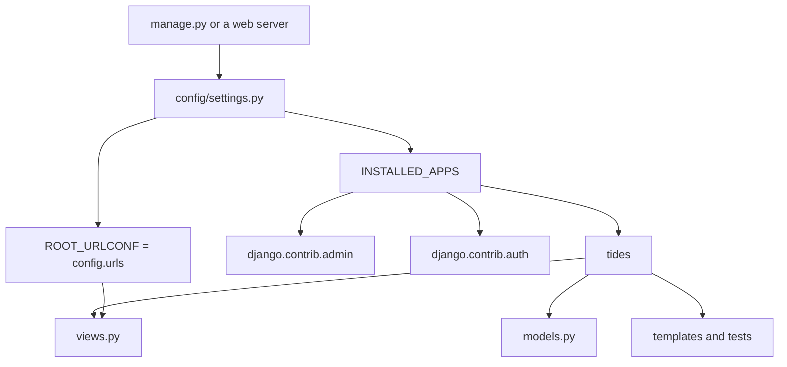

# Projects, apps and the settings file

> **Before this lesson:** you can create a virtual environment, install Django and run `startproject` ([Python, virtual environments and installing Django](#/lesson/django/setup-python-venv)), and your folder is under Git ([Git, requirements and a tidy project folder](#/lesson/django/setup-git-project)). You should know what a Python module and a list are.

## In plain words

Django organises code at two levels, and newcomers mix them up constantly.

A **project** is one whole website: its configuration, its list of web addresses, its database connection. There is one project per site.

An **app** is one self-contained feature of that site, stored as a Python package: a blog, a shopping cart, user accounts. A project is made of many apps.

An everyday picture: a shopping centre and its shops. The centre (project) owns the building, the opening hours, the directory board at the entrance and the electricity contract. Each shop (app) minds its own business inside its unit and could, in principle, be moved to a different centre. The directory board is the URL configuration; the building rules are the settings file.

Why it matters for a job: every Django codebase you will ever open is laid out this way. Reading one quickly means knowing where to look: "which app owns this feature?" and "which setting controls this behaviour?". Interviewers ask "what is the difference between a project and an app?" as a warm-up, and how crisply you answer sets the tone.

## The project you already have

The previous lessons created this:

```
tidewatch/
├── manage.py
└── config/
    ├── __init__.py
    ├── settings.py
    ├── urls.py
    ├── asgi.py
    └── wsgi.py
```

| File | Role |
|---|---|
| `manage.py` | Runs Django commands for *this* project. It sets the environment variable `DJANGO_SETTINGS_MODULE` to `config.settings` and then hands over to Django's command system. |
| `config/__init__.py` | An empty file whose presence tells Python that `config` is a package (an importable folder). |
| `config/settings.py` | Every configuration value of the site. |
| `config/urls.py` | The top-level table mapping web addresses to code, covered in the next lesson. |
| `config/wsgi.py` | The entry point a production web server imports. **WSGI** (Web Server Gateway Interface) is the standard way a Python web program talks to a web server, one request at a time. |
| `config/asgi.py` | The same idea for **ASGI** (Asynchronous Server Gateway Interface), the newer standard that also supports long-lived connections. |

An **environment variable** is a named value kept by the operating system for a running program; `DJANGO_SETTINGS_MODULE` is how Django learns which settings file to load.

## Creating the first app

The site will show tide times, so the first app is called `tides`. Apps are created with a `manage.py` command:

```bash
python manage.py startapp tides
```

A new folder appears next to `config`:

```
tides/
├── __init__.py
├── admin.py        register models with the built-in admin site
├── apps.py         the app's configuration class
├── migrations/     database change files (starts with only __init__.py)
│   └── __init__.py
├── models.py       the data the app stores
├── tests.py        automated tests
└── views.py        code that answers requests
```

There is no `urls.py` and no `templates/` folder yet; you add those yourself when the app needs them. Naming convention: app names are short, lower-case and usually plural nouns describing what the app manages (`tides`, `harbours`, `accounts`).

### Telling the project about the app

Creating the folder is not enough. Django only looks inside apps that are listed in the `INSTALLED_APPS` setting. Open `config/settings.py` and add one line at the end of the list:

```python
# config/settings.py
INSTALLED_APPS = [
    "django.contrib.admin",
    "django.contrib.auth",
    "django.contrib.contenttypes",
    "django.contrib.sessions",
    "django.contrib.messages",
    "django.contrib.staticfiles",
    "tides.apps.TidesConfig",   # our app
]
```

The six `django.contrib.*` entries are apps too. They are the "batteries": the admin site, user authentication, a registry of model types, sessions (remembering a visitor between requests), one-time notification messages, and handling of static files such as CSS.

`"tides.apps.TidesConfig"` is a dotted path to a class in `tides/apps.py`:

```python
# tides/apps.py
from django.apps import AppConfig


class TidesConfig(AppConfig):
    default_auto_field = "django.db.models.BigAutoField"
    name = "tides"
```

Line by line: `AppConfig` is Django's base class for app configuration. `name` is the Python import path of the app. `default_auto_field` chooses the type of the automatic `id` column for the app's database tables (a 64-bit integer). Writing the short form `"tides"` in `INSTALLED_APPS` also works, because Django finds the single `AppConfig` subclass by itself; the long form is explicit and still common.

> [!WARNING]
> The most frequent beginner error in all of Django: writing models, templates or tests in an app and forgetting to add the app to `INSTALLED_APPS`. Nothing crashes. Django behaves as if the app's models and templates did not exist ("no changes detected", "template does not exist"). When a feature is mysteriously invisible, check this list first.

## How Django uses the list

At start-up Django imports every entry of `INSTALLED_APPS` in order and builds an **app registry**: a catalogue of which apps exist and what each provides. Later, when it needs "all models", "all templates folders" or "all management commands", it walks the registry.

Order matters in one specific way: when two apps provide a file with the same relative name, such as a template called `registration/login.html`, the app listed **first** wins. The model below shows that lookup rule.

```python-run
# A toy app registry: which file does Django pick when names collide?
INSTALLED_APPS = ["django.contrib.admin", "django.contrib.auth", "tides"]

# What each app ships in its templates/ folder (shortened).
app_templates = {
    "django.contrib.admin": ["admin/base.html", "registration/logged_out.html"],
    "django.contrib.auth": [],
    "tides": ["tides/home.html", "registration/logged_out.html"],
}

def find_template(name, installed):
    for app in installed:                     # walk the registry in order
        if name in app_templates.get(app, []):
            return app                        # first match wins
    return None                               # Django would raise TemplateDoesNotExist

print(find_template("tides/home.html", INSTALLED_APPS))
print(find_template("registration/logged_out.html", INSTALLED_APPS))

# Put our app first and the answer changes:
print(find_template("registration/logged_out.html", ["tides"] + INSTALLED_APPS[:2]))

# An app that is not installed is never searched:
print(find_template("tides/home.html", ["django.contrib.admin", "django.contrib.auth"]))
```

The second line prints `django.contrib.admin`: the admin's version shadows ours because it comes earlier. Moving `tides` to the front flips the result. This exact situation appears in the lessons on password reset templates. The last line prints `None`, the forgotten-app symptom from the warning above.

## A guided tour of settings.py

`settings.py` is an ordinary Python module. Every upper-case name in it is a **setting**. The generated file is about 120 lines; these are the ones you will meet first.

```python
from pathlib import Path

BASE_DIR = Path(__file__).resolve().parent.parent
```

`__file__` is the path of `settings.py` itself. `.resolve()` makes it absolute, and `.parent.parent` climbs two levels: out of `config/` into the project root. `BASE_DIR` is therefore the folder that contains `manage.py`, and other settings build paths from it, for example `BASE_DIR / "db.sqlite3"` (the `/` operator joins path pieces).

```python
SECRET_KEY = "django-insecure-..."
DEBUG = True
ALLOWED_HOSTS = []
```

- `SECRET_KEY` is a random string used to sign data such as session cookies and password-reset links, so that Django can detect tampering. The generated value starts with `django-insecure-` as a reminder that it must be replaced by a private value before the site goes public.
- `DEBUG = True` turns on detailed error pages that show source code and settings. Wonderful while developing, dangerous in public: it must be `False` in production.
- `ALLOWED_HOSTS` lists the domain names this site may be served under. It is a defence against forged `Host` headers. With `DEBUG = True` and an empty list, Django accepts `localhost` and `127.0.0.1` automatically.

```python
MIDDLEWARE = [
    "django.middleware.security.SecurityMiddleware",
    "django.contrib.sessions.middleware.SessionMiddleware",
    "django.middleware.common.CommonMiddleware",
    "django.middleware.csrf.CsrfViewMiddleware",
    "django.contrib.auth.middleware.AuthenticationMiddleware",
    "django.contrib.messages.middleware.MessageMiddleware",
    "django.middleware.clickjacking.XFrameOptionsMiddleware",
]

ROOT_URLCONF = "config.urls"
```

**Middleware** are layers that every request passes through on its way in and every response passes through on its way out; the next lesson draws the picture. `ROOT_URLCONF` names the module holding the top-level URL table.

```python
TEMPLATES = [
    {
        "BACKEND": "django.template.backends.django.DjangoTemplates",
        "DIRS": [],
        "APP_DIRS": True,
        "OPTIONS": {"context_processors": [...]},
    },
]
```

Configuration for HTML templates. `APP_DIRS: True` is the switch that makes Django search each installed app's `templates/` folder, the behaviour modelled above. `DIRS` lists extra project-level folders.

```python
DATABASES = {
    "default": {
        "ENGINE": "django.db.backends.sqlite3",
        "NAME": BASE_DIR / "db.sqlite3",
    }
}
```

The database connection. **SQLite** is a database stored in a single file, needing no server, which is ideal for learning. Production sites usually switch to PostgreSQL by changing this dictionary.

```python
LANGUAGE_CODE = "en-us"
TIME_ZONE = "UTC"
USE_I18N = True
USE_TZ = True

STATIC_URL = "static/"
DEFAULT_AUTO_FIELD = "django.db.models.BigAutoField"
```

Language and time-zone defaults (`USE_TZ = True` means dates are stored in UTC, Coordinated Universal Time, and converted for display), the URL prefix for static files, and the project-wide default type for automatic primary keys.

> [!NOTE]
> **What changed since the book.** The Django 2.1 settings file built `BASE_DIR` with `os.path.join`; since Django 3.1 it uses `pathlib`. `DEFAULT_AUTO_FIELD` was introduced in 3.2. `USE_TZ` has defaulted to `True` since 5.0, and the old `USE_L10N` setting is gone. If you copy a snippet from an old tutorial that says `os.path.join(BASE_DIR, "templates")`, the modern spelling is `BASE_DIR / "templates"`.

## manage.py: the project's remote control

Every routine task is a sub-command of `manage.py`. Run `python manage.py help` for the full list; these are the ones for today.

```bash
python manage.py check          # look for configuration problems without starting anything
python manage.py runserver      # development server; reloads automatically when you save a file
python manage.py startapp NAME  # create an app skeleton
python manage.py shell          # an interactive Python prompt with Django loaded
python manage.py diffsettings   # show settings that differ from Django's defaults
```

`check` deserves a habit: it validates settings, models and URL patterns in a second and reports problems with identifiers such as `(urls.W005)` that you can search for in the documentation.

The **shell** is where you experiment. Since Django 5.2 it automatically imports the models of all installed apps, so you can start querying immediately:

```
>>> from django.conf import settings
>>> settings.DEBUG
True
>>> settings.BASE_DIR
PosixPath('/home/imani/tidewatch')
```

Always read settings through `django.conf.settings`, as shown, and never with `import config.settings`: the former is the fully prepared settings object, including Django's defaults for everything your file does not mention.

## How the pieces fit



Start-up reads settings; settings name the apps and the URL table; the URL table points at view code inside apps.

## When should something be a new app?

A practical test: can you describe the app's job in one short sentence without the word "and"? "Stores harbours and their tide tables" is one app. "Handles user sign-up" is another. If two groups of models never refer to each other, they probably belong to separate apps. Do not agonise: splitting an app later is routine refactoring, and small projects with two or three apps are perfectly normal.

Throughout this track, each example project uses a settings package named `config` and one or two apps named after what they store.

## Pitfalls

- **App not in `INSTALLED_APPS`.** Models are not migrated, templates are not found, tests may not be discovered.
- **Running `startapp` in the wrong folder.** Run it where `manage.py` lives, or the app lands somewhere Python cannot import it from.
- **App name clashes.** Calling an app `test`, `site`, `email` or `django` shadows a standard module. Pick specific nouns.
- **Editing settings while the server is confused.** The auto-reloader restarts on save, but a syntax error in `settings.py` stops it completely; fix the error and start `runserver` again.
- **Importing settings the wrong way.** Use `from django.conf import settings`.
- **Leaving `DEBUG = True` and the insecure key for deployment.** The deployment module shows how to supply both from the environment.

## Cheat sheet

| Concept | One-line meaning | Where it lives |
|---|---|---|
| Project | one website: configuration + URL table | `config/` and `manage.py` |
| App | one feature as a Python package | a folder such as `tides/` |
| `INSTALLED_APPS` | the apps Django knows about, in priority order | `settings.py` |
| `AppConfig` | per-app configuration class | `apps.py` |
| `BASE_DIR` | absolute path of the project root | `settings.py` |
| `DEBUG` | detailed error pages on or off | `settings.py` |
| `ROOT_URLCONF` | module with the top-level URL patterns | `settings.py` |
| `DATABASES` | database connection details | `settings.py` |
| `manage.py check` | validate the project | terminal |
| `manage.py shell` | interactive Python with Django loaded | terminal |

> [!INTERVIEW]
> **"What is the difference between a Django project and an app?"** A project is the deployment unit: one settings module, one root URL configuration, one WSGI/ASGI entry point. An app is a reusable Python package that groups the models, views, templates, tests and migrations of one feature, and becomes active by being listed in `INSTALLED_APPS`. A project contains many apps, and an app can be installed in many projects, which is how third-party packages such as Django REST framework are distributed. A good follow-up remark: Django's own features (`admin`, `auth`, `sessions`) are apps as well.

> [!TIP]
> Commit after this step: `git add . && git commit -m "Add tides app and register it"`. The generated files are small, and having the untouched skeleton in history makes later diffs easy to read.

## Summary

- A project is the whole site (settings, root URLs, server entry points); an app is one feature packaged as a Python module.
- `python manage.py startapp tides` creates the skeleton; listing it in `INSTALLED_APPS` activates it.
- Django builds an app registry from `INSTALLED_APPS`; earlier apps win when file names collide.
- `settings.py` is plain Python: `BASE_DIR`, `SECRET_KEY`, `DEBUG`, `ALLOWED_HOSTS`, `MIDDLEWARE`, `TEMPLATES` and `DATABASES` are the settings you will touch most.
- `manage.py` runs every project command; `check` and `shell` are the two to make habits of.

## Glossary

- **Project**: the configuration and root files of one Django site.
- **App**: a Python package implementing one feature, activated through `INSTALLED_APPS`.
- **Setting**: an upper-case variable in the settings module that configures Django.
- **App registry**: Django's in-memory catalogue of installed apps and what they provide.
- **AppConfig**: the class that describes one app (its name and defaults).
- **WSGI / ASGI**: the synchronous and asynchronous standards connecting Python web code to a web server.
- **Environment variable**: a named value supplied to a program by the operating system.
- **Middleware**: a layer that processes every request and response.
- **SQLite**: a small database engine that stores everything in one file.
- **Primary key**: the column that uniquely identifies each row of a table (Django's automatic `id`).

```quiz
[
  {"q": "Which statement best describes the relationship between projects and apps?",
   "options": ["A project is a kind of app", "A project contains many apps, and an app can be reused in many projects", "Each app contains exactly one project", "They are two names for the same thing"],
   "answer": 1,
   "explain": "The project is the site-wide container (settings, root URLs); apps are reusable feature packages listed in INSTALLED_APPS."},
  {"q": "You created an app and wrote templates in it, but Django reports that the template does not exist. What should you check first?",
   "options": ["That DEBUG is False", "That the app is listed in INSTALLED_APPS", "That manage.py is executable", "That the database is migrated"],
   "answer": 1,
   "explain": "With APP_DIRS enabled Django only searches the templates folders of installed apps. An unlisted app is invisible."},
  {"q": "Two installed apps both ship `registration/login.html`. Which one is used?",
   "options": ["The one in the app listed first in INSTALLED_APPS", "The one in the app listed last", "The larger file", "Django raises an error"],
   "answer": 0,
   "explain": "The app-directories loader walks INSTALLED_APPS in order and returns the first match."},
  {"q": "What does `BASE_DIR = Path(__file__).resolve().parent.parent` evaluate to?",
   "options": ["The config folder", "The folder containing manage.py", "The user's home directory", "The virtual environment"],
   "answer": 1,
   "explain": "settings.py is in config/, so one parent is config/ and two parents is the project root."},
  {"q": "Why is `DEBUG = True` dangerous on a public site?",
   "options": ["It makes pages load slowly", "Error pages reveal source code, settings and other internals to visitors", "It disables the database", "It prevents users from logging in"],
   "answer": 1,
   "explain": "The debug error page is a development aid that exposes information an attacker can use."},
  {"q": "What is the correct way to read a setting inside your own code?",
   "options": ["import config.settings", "from django.conf import settings", "open('config/settings.py').read()", "os.environ['SETTINGS']"],
   "answer": 1,
   "explain": "`django.conf.settings` is the configured settings object, merged with Django's defaults and independent of the settings module's name."},
  {"q": "Which command validates the project's configuration without starting the server?",
   "options": ["python manage.py check", "python manage.py validate-all", "python manage.py startapp", "python manage.py diff"],
   "answer": 0,
   "explain": "`check` runs the system check framework over settings, models and URL patterns and reports issues with identifiers."}
]
```

> **Source:** Vincent, *Django for Beginners*, ch. 2 (project and app structure). Docs: https://docs.djangoproject.com/en/5.2/intro/tutorial01/ · https://docs.djangoproject.com/en/5.2/ref/applications/ · https://docs.djangoproject.com/en/5.2/ref/settings/ · https://docs.djangoproject.com/en/5.2/ref/django-admin/
