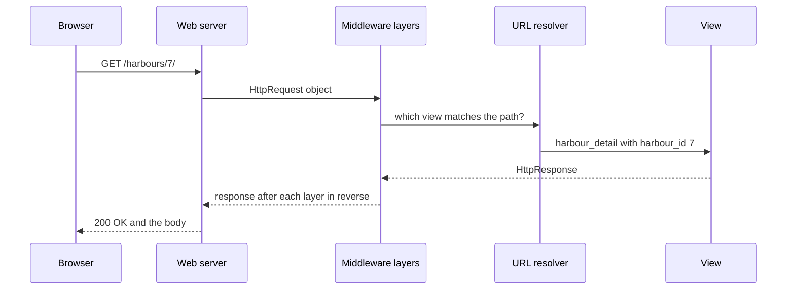

# The request/response cycle, views, URLs and first tests

> **Before this lesson:** you have the `tidewatch` project with a registered `tides` app from [Projects, apps and the settings file](#/lesson/django/project-vs-app). You should be comfortable with Python functions and dictionaries. If the words "HTTP", "GET" or "status code" are unfamiliar, the first half of this lesson defines them; a deeper treatment is in [HTTP: methods, status codes and headers](#/lesson/fastapi/http-basics).

## In plain words

Every page view on the web is a short conversation with two lines. The browser says: "please give me the thing at this address." The server answers: "here it is" (or "there is no such thing", or "you are not allowed"). The first line is the **request**; the second is the **response**. Then the conversation is over. Nothing else ever happens on a classic website: one request in, one response out.

Django's job is everything between those two lines. It reads the request, decides **which piece of your code** should answer (that decision is called **routing**), runs that code, and sends back what the code returns. The piece of code that answers is called a **view**.

An everyday picture: a restaurant. The customer hands an order to the waiter (request). The waiter looks at the menu to see which kitchen station makes that dish (routing by URL), the cook prepares it (view), and the waiter carries the plate back (response). The waiter does not cook, and the cook never meets the customer.

Why it matters for a job: "walk me through what happens when a request hits a Django application" is the single most common Django interview question. It is also the mental map you will use for all debugging: is the bug in routing, in the view, or in what the view returns?

## The vocabulary of a request

**HTTP** (HyperText Transfer Protocol) is the set of rules for that two-line conversation. A request has four parts worth knowing today:

| Part | Example | Meaning |
|---|---|---|
| **Method** | `GET` | What the client wants to do. `GET` reads; `POST` submits data. |
| **Path** | `/harbours/7/` | Which thing it wants. The path is the part of the address after the domain name. |
| **Headers** | `Accept-Language: en` | Extra labelled information about the client and the request. |
| **Body** | form fields | Data being sent (empty for most `GET` requests). |

A response has a **status code** (a three-digit number summarising the outcome), headers and a body. The codes you will see constantly: `200` OK, `302` redirect elsewhere, `404` not found, `403` forbidden, `500` the server's own code crashed.

A **URL** (Uniform Resource Locator) is the full web address, such as `http://127.0.0.1:8000/harbours/7/`.

## The smallest possible view

A view is a Python function that takes a request object and returns a response object. Open `tides/views.py`, replace its content, and read each line:

```python
# tides/views.py
from django.http import HttpResponse


def home(request):
    return HttpResponse("Tidewatch is running. Next high tide: 14:32.")
```

- `from django.http import HttpResponse` imports the class that represents a response.
- `def home(request):` defines the view. Django will call it and pass an `HttpRequest` object as the first argument. The name `request` is a convention you should always follow.
- `return HttpResponse("...")` builds a response whose body is that text. The status code defaults to `200` and the content type to HTML.

Nothing can reach this function yet. Django does not guess addresses from function names; you must connect a URL to it.

## Wiring a URL to the view

URL tables are lists called `urlpatterns`. Good practice is two levels: each app keeps its own table, and the project's table includes them. Create a **new file** `tides/urls.py`:

```python
# tides/urls.py
from django.urls import path

from . import views

urlpatterns = [
    path("", views.home, name="home"),
]
```

- `path(route, view, name)` creates one entry. The route `""` (empty string) matches the empty remainder of the address.
- `from . import views` imports `views.py` from the same package (`.` means "this folder").
- `views.home` is the function itself, **without parentheses**: you hand Django the function to call later, you do not call it now.
- `name="home"` gives the entry a label, used to build links without typing addresses by hand.

Now point the project's table at the app's table:

```python
# config/urls.py
from django.contrib import admin
from django.urls import include, path

urlpatterns = [
    path("admin/", admin.site.urls),
    path("", include("tides.urls")),
]
```

`include("tides.urls")` means: "for addresses matching this prefix, continue matching in the module `tides.urls` with whatever is left over". Start the server (`python manage.py runserver`), open `http://127.0.0.1:8000/`, and the sentence from the view appears. The terminal prints one log line per request:

```
[20/Nov/2026 09:14:02] "GET / HTTP/1.1" 200 44
```

Method, path, protocol, status code, and the size of the body in bytes.

## Capturing parts of the address

Real sites have addresses with variable parts: `/harbours/7/`, `/harbours/12/`. A **path converter** captures a piece of the path and passes it to the view as a keyword argument.

```python
# tides/urls.py
urlpatterns = [
    path("", views.home, name="home"),
    path("harbours/<int:harbour_id>/", views.harbour_detail, name="harbour-detail"),
    path("regions/<slug:region>/", views.region, name="region"),
]
```

```python
# tides/views.py
from django.http import Http404, HttpResponse

HARBOURS = {7: "Port Elin", 12: "Saltwick"}


def harbour_detail(request, harbour_id):
    if harbour_id not in HARBOURS:
        raise Http404("No such harbour")
    return HttpResponse(f"Tide table for {HARBOURS[harbour_id]}")


def region(request, region):
    return HttpResponse(f"Harbours in region: {region}")
```

`<int:harbour_id>` reads: "match digits here, convert them to an `int`, and pass them as the argument named `harbour_id`". Raising `Http404` makes Django answer with status 404. The built-in converters:

| Converter | Matches | Passed to the view as |
|---|---|---|
| `str` (the default when you write `<name>`) | any non-empty text without `/` | `str` |
| `int` | zero or a positive whole number | `int` |
| `slug` | letters, digits, hyphens, underscores, e.g. `north-coast` | `str` |
| `uuid` | a formatted identifier such as `075194d3-6885-417e-a8a8-6c931e272f00` | `uuid.UUID` |
| `path` | any non-empty text, **including** `/` | `str` |

Three rules about matching that prevent hours of confusion:

1. Patterns are tried **from top to bottom** and the first match wins.
2. The route never starts with `/`. Django strips the leading slash before matching.
3. Routes conventionally **end** with `/`. If a visitor omits it, the `APPEND_SLASH` behaviour of `CommonMiddleware` redirects `/harbours/7` to `/harbours/7/`.

## A working model of the resolver

The following pure-Python model does what Django's URL resolver does: turn each route into a pattern, try them in order, convert captured values and call the view. Run it and try other paths, such as `/harbours/abc/`.

```python-run
import re

CONVERTERS = {"int": (r"[0-9]+", int), "str": (r"[^/]+", str), "slug": (r"[-a-zA-Z0-9_]+", str)}

def compile_route(route):
    """Turn 'harbours/<int:harbour_id>/' into a regex and a dict of converters."""
    casts = {}
    def repl(match):
        kind, name = match.group(1) or "str", match.group(2)
        casts[name] = CONVERTERS[kind][1]
        return f"(?P<{name}>{CONVERTERS[kind][0]})"
    return re.compile(re.sub(r"<(?:(\w+):)?(\w+)>", repl, route)), casts

def home(request):
    return 200, "Tidewatch is running"

def harbour_detail(request, harbour_id):
    return 200, f"Tide table for harbour number {harbour_id} ({type(harbour_id).__name__})"

urlpatterns = [("", home, "home"), ("harbours/<int:harbour_id>/", harbour_detail, "harbour-detail")]

def handle(path):
    remainder = path.lstrip("/")                      # Django removes the leading slash
    for route, view, name in urlpatterns:             # top to bottom
        regex, casts = compile_route(route)
        match = regex.fullmatch(remainder)            # the WHOLE remainder must match
        if match:
            kwargs = {k: casts[k](v) for k, v in match.groupdict().items()}
            return view({"path": path}, **kwargs)     # call the view with captured arguments
    return 404, "Not Found"

for p in ["/", "/harbours/7/", "/harbours/7", "/harbours/abc/", "/nowhere/"]:
    print(f"{p:18} -> {handle(p)}")
```

Read the output line by line. `/harbours/7/` reaches the view with the **integer** 7, not the text `"7"`. `/harbours/7` (no trailing slash) and `/harbours/abc/` both produce 404 in this model, the first because the whole remainder must match, the second because `abc` is not digits. Real Django would rescue the first with the append-slash redirect. The problem set for this module asks you to build the full resolver and its inverse, `reverse()`.

## The whole journey



1. The web server (the development server for now) receives the bytes and builds an `HttpRequest`.
2. The request passes through each **middleware** in the order listed in the `MIDDLEWARE` setting. Each may inspect it, attach information (the session, the logged-in user) or answer early.
3. The **URL resolver** reads `ROOT_URLCONF`, walks `urlpatterns` and finds the view plus captured arguments.
4. The **view** runs and returns an `HttpResponse`.
5. The response travels back through the middleware in **reverse** order, then to the browser.

If no pattern matches, Django produces a 404 response. If your view raises an unexpected exception, Django produces a 500 response and, when `DEBUG = True`, a detailed error page with the traceback.

## What is inside `request`

The `HttpRequest` object carries everything about the incoming request. The attributes used most:

```python
def inspect(request):
    lines = [
        f"method: {request.method}",              # "GET" or "POST"
        f"path: {request.path}",                  # "/inspect/"
        f"query: {request.GET.get('unit', 'm')}", # ?unit=ft  -> "ft"; default "m"
        f"agent: {request.headers.get('User-Agent')}",
    ]
    return HttpResponse("\n".join(lines), content_type="text/plain")
```

`request.GET` is a dictionary-like object holding the **query string**, the `?key=value&key2=value2` part of a URL. Use `.get()` with a default, because visitors may omit or edit parameters. `request.POST` holds submitted form fields; the forms module covers it. The `content_type` argument tells the browser to display plain text instead of interpreting HTML.

Other response classes exist for common cases: `JsonResponse({"high": "14:32"})` for data, `HttpResponseRedirect("/")` for a redirect, and the `redirect()` shortcut which accepts a URL name.

## Names instead of hard-coded addresses

The `name` given to each `path()` lets code ask for an address instead of spelling it:

```python
from django.urls import reverse

reverse("home")                                        # "/"
reverse("harbour-detail", kwargs={"harbour_id": 7})    # "/harbours/7/"
```

If the route later changes to `ports/<int:harbour_id>/`, every `reverse()` call and every template link follows automatically. Hard-coded strings would silently rot.

## First tests

A **test** is code that runs your code and checks the result, so that a computer, not your memory, notices when something breaks. Django's test tools include a **test client**: a pretend browser that sends requests straight into the project without a real network.

```python
# tides/tests.py
from django.test import SimpleTestCase
from django.urls import reverse


class HomeTests(SimpleTestCase):
    def test_home_status_and_text(self):
        response = self.client.get("/")
        self.assertEqual(response.status_code, 200)
        self.assertContains(response, "Tidewatch is running")

    def test_home_url_name(self):
        self.assertEqual(reverse("home"), "/")

    def test_harbour_detail(self):
        response = self.client.get(reverse("harbour-detail", kwargs={"harbour_id": 7}))
        self.assertContains(response, "Port Elin")

    def test_unknown_harbour_is_404(self):
        response = self.client.get("/harbours/999/")
        self.assertEqual(response.status_code, 404)
```

- `SimpleTestCase` is the base class for tests that do not touch the database. (Tests that do will use `TestCase`.)
- Every method whose name starts with `test_` is one test. `self.client.get(path)` performs a GET request and returns the response.
- `assertEqual(a, b)` fails the test unless `a == b`. `assertContains(response, text)` checks both that the status is 200 and that the text occurs in the body.

Run them from the project root:

```bash
python manage.py test
```

```
Found 4 test(s).
....
----------------------------------------------------------------------
Ran 4 tests in 0.012s

OK
```

One dot per passing test. A failure prints `F`, the name of the test, and the two values that differed.

> [!TIP]
> Test three things for every page as a minimum: the address answers with the expected status, the URL name reverses to the expected address, and a piece of expected content is present. These three catch the most common regressions: a deleted URL pattern, a renamed route and a broken view.

> [!INTERVIEW]
> **"What happens between a browser sending a request and Django returning a response?"** Give the sequence in order: the WSGI or ASGI server turns the raw request into an `HttpRequest`; the request passes through the `MIDDLEWARE` list top to bottom; the URL resolver matches the path against `urlpatterns` from `ROOT_URLCONF`, first match wins, and extracts arguments with path converters; the view runs, usually talking to models and rendering a template, and returns an `HttpResponse`; the response passes back through the middleware bottom to top; the server sends it. Mention the failure branches: no match gives 404, an unhandled exception gives 500.

> [!WARNING]
> Writing `path("", views.home(), ...)` with parentheses calls the view at import time with no request and crashes with `TypeError: home() missing 1 required positional argument: 'request'`. Pass the function object: `views.home`.

## Pitfalls

- **Leading slash in a route.** `path("/harbours/", ...)` never matches; Django also prints warning `urls.W002`.
- **Forgetting `include`.** An app's `urls.py` does nothing until the project's `urls.py` includes it.
- **Order of patterns.** A general pattern such as `<slug:name>/` placed above `about/` captures "about" first.
- **Missing trailing slash in a test.** `self.client.get("/harbours/7")` returns a 301 redirect, not 200. Write addresses exactly, or better, use `reverse()`.
- **Returning a string from a view.** A view must return an `HttpResponse` (or subclass); returning `"hello"` raises `AttributeError: 'str' object has no attribute 'get'`.
- **Using `request.GET["unit"]`.** A missing key raises an error that becomes a 500 page. Use `.get("unit", default)`.

## Cheat sheet

| Need | Code |
|---|---|
| A view | `def home(request): return HttpResponse("...")` |
| A route | `path("harbours/<int:harbour_id>/", views.harbour_detail, name="harbour-detail")` |
| Include an app's routes | `path("", include("tides.urls"))` |
| Address from a name | `reverse("harbour-detail", kwargs={"harbour_id": 7})` |
| Not found | `raise Http404("message")` |
| Query string value | `request.GET.get("unit", "m")` |
| JSON response | `JsonResponse({"key": "value"})` |
| Redirect | `return redirect("home")` |
| Run tests | `python manage.py test` |
| Request in a test | `self.client.get(reverse("home"))` |

## Summary

- The web is request in, response out. Django routes each request to one view by matching the path against `urlpatterns`, top to bottom.
- A view is a callable that receives an `HttpRequest` and returns an `HttpResponse`.
- Path converters (`int`, `str`, `slug`, `uuid`, `path`) capture and convert parts of the address into view arguments.
- Name your routes and use `reverse()`; never hard-code addresses.
- The test client lets you check status codes, names and content in milliseconds; run `python manage.py test` after every change.

## Glossary

- **HTTP**: the protocol of requests and responses used by the web.
- **Request / response**: the message a client sends and the message the server returns.
- **Method**: the verb of a request (`GET` to read, `POST` to submit).
- **Status code**: the three-digit outcome of a response (200, 302, 404, 500).
- **URL / path**: the full address / the part after the domain.
- **Routing (URL resolution)**: choosing the view for a path.
- **View**: the function (or class) that turns a request into a response.
- **URLconf**: a module containing a `urlpatterns` list.
- **Path converter**: the `<type:name>` syntax that captures and converts a path segment.
- **Query string**: the `?key=value` part of a URL, available as `request.GET`.
- **Middleware**: layers every request and response pass through.
- **Test client**: a simulated browser for automated tests.

```quiz
[
  {"q": "In what order does Django try the entries of urlpatterns?",
   "options": ["Alphabetically by name", "From top to bottom, using the first that matches", "Longest route first", "Randomly, then caches the result"],
   "answer": 1,
   "explain": "The resolver iterates in list order and stops at the first match, so specific routes must come before general ones."},
  {"q": "For the route `harbours/<int:harbour_id>/`, what does the view receive for the address /harbours/42/?",
   "options": ["The string '42' as a positional argument", "The integer 42 as the keyword argument harbour_id", "Nothing; the view must parse request.path", "The list [42]"],
   "answer": 1,
   "explain": "The int converter matches digits and converts them; captured values are passed as keyword arguments by name."},
  {"q": "Why is `path('/about/', views.about)` wrong?",
   "options": ["Routes must not start with a slash because Django strips the leading slash before matching", "about is a reserved word", "path needs three arguments", "The slash must be escaped"],
   "answer": 0,
   "explain": "The remaining path never begins with a slash, so a route that does can never match. Django warns with urls.W002."},
  {"q": "What does `include('tides.urls')` do?",
   "options": ["Copies the file into config", "Delegates matching of the rest of the path to the urlpatterns in tides/urls.py", "Imports all views of the app", "Registers the app in INSTALLED_APPS"],
   "answer": 1,
   "explain": "include chops off the matched prefix and continues resolution in the named URLconf, keeping each app's routes inside the app."},
  {"q": "A view raises an unexpected KeyError. What status code does the visitor get?",
   "options": ["200", "404", "500", "302"],
   "answer": 2,
   "explain": "Unhandled exceptions become 500 Internal Server Error. With DEBUG on, Django shows the traceback page."},
  {"q": "Why prefer `reverse('harbour-detail', kwargs={'harbour_id': 7})` over the literal '/harbours/7/'?",
   "options": ["It is faster", "If the route changes, every use follows automatically and typos fail loudly", "Literals are not allowed in views", "It skips middleware"],
   "answer": 1,
   "explain": "Named URLs keep a single source of truth for addresses; a wrong name raises NoReverseMatch instead of producing a dead link."},
  {"q": "Which base class is appropriate for a test that does not use the database?",
   "options": ["SimpleTestCase", "TransactionTestCase", "LiveServerTestCase", "ModelTestCase"],
   "answer": 0,
   "explain": "SimpleTestCase is the lightest; it forbids database queries, which keeps such tests fast and honest."},
  {"q": "In which direction does a response pass through the MIDDLEWARE list?",
   "options": ["Top to bottom, like the request", "Bottom to top, the reverse of the request", "It skips middleware", "Only the first middleware sees it"],
   "answer": 1,
   "explain": "Middleware wrap the view like layers of an onion: the request goes in through each layer and the response comes out through the same layers in reverse."}
]
```

> **Source:** Vincent, *Django for Beginners*, ch. 2 (Hello World app: views, URLs, tests). Docs: https://docs.djangoproject.com/en/5.2/topics/http/urls/ · https://docs.djangoproject.com/en/5.2/ref/request-response/ · https://docs.djangoproject.com/en/5.2/topics/testing/overview/ · https://docs.djangoproject.com/en/5.2/topics/http/middleware/
